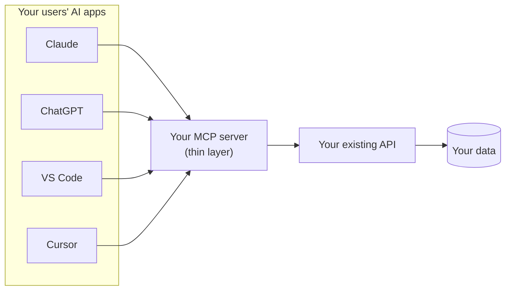
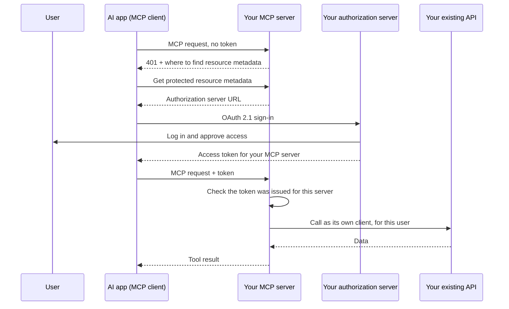

Adding MCP to an existing application means building a small MCP server on top of the API you already have. In return, your product works inside the AI apps your users already use, such as Claude, ChatGPT, VS Code and Cursor, and you build that integration once instead of once per app. The cost is a new kind of client to secure: an AI model that decides which of your actions to call.

This post is for teams deciding whether it's worth it. It covers what you gain, what to expose, how to design the server, and what it costs. If you need the basics first, read [What is MCP?](/blog/what-is-mcp).

## What problem does MCP solve for a product team?

Your users already ask AI assistants for help with their work. Without an integration, the assistant can't see your product, so users copy data out of your app, paste it into a chat, and copy the answer back.

The old fix was a custom integration per AI app: a plugin here, an extension there, each with its own format. MCP replaces that with one standard. You wrap your product once as an **MCP server**, and every app that supports MCP can connect to it.



The [MCP docs](https://modelcontextprotocol.io/docs/getting-started/intro) list Claude, ChatGPT, VS Code and Cursor among the apps that support it. Support for your specific case, such as local or remote servers, or which plans include it, varies by app, so check each one you care about.

## What do you actually get?

**Build once, work in many AI apps.** One server, one protocol, many hosts. When a new AI app adds MCP support, your product works there without new code.

**Users bring their own AI.** The SDK README describes MCP as "separating the concerns of providing context from the actual LLM interaction" ([TypeScript SDK](https://github.com/modelcontextprotocol/typescript-sdk)). In practice, the user's app runs the model, holds the conversation and decides when to call your tools. Your server doesn't need to call a model, so you don't host one or pay for its tokens. Users pick the assistant they like; you provide the actions.

**Your existing API does the real work.** The server translates between MCP and your API. Your business logic, validation and permission checks stay where they are, and the MCP server is one more client of your API.

**People can find it.** Public servers can be listed in the [official MCP Registry](https://modelcontextprotocol.io/registry/about), which marketplaces and other registries read from. [How to publish your MCP server and use it in AI tools](/blog/publish-mcp-server) walks through publishing.

**Your API gets a new kind of user.** Instead of clicking through screens, a user asks "which invoices are overdue and who owns them?" and the model calls your tools to answer. That can reach people who never learned your UI.

## What should you expose: tools, resources or prompts?

An MCP server can offer three kinds of things. The [server concepts page](https://modelcontextprotocol.io/docs/learn/server-concepts) describes each by who controls it:

| Primitive | What it is | Who decides to use it | Example for an invoicing app |
| --- | --- | --- | --- |
| Tools | Actions, including ones that change data | The model | `find_overdue_invoices`, `send_payment_reminder` |
| Resources | Read-only data for context | The app | The account's billing settings, an invoice as a document |
| Prompts | Reusable instruction templates | The user | "Summarize this customer's billing history" |

Start with tools. They're what users notice first, and every MCP app supports them. Add resources and prompts later, once you see how people use the tools.

Don't turn every API endpoint into a tool. Anthropic's guide to [writing tools for agents](https://www.anthropic.com/engineering/writing-tools-for-agents) calls tools that "merely wrap existing software functionality or API endpoints" a common error. It suggests one `schedule_event` tool instead of separate `list_users`, `list_events` and `create_event` tools. Design tools around the tasks users ask for, and let the tool make the several API calls a task needs.

The same guide gives three more habits worth copying:

- **Write descriptions like you would for a new hire.** The model only sees the tool's name, description and input schema. Small changes to descriptions make a big difference.
- **Return only what's useful.** Add filters, pagination and sensible defaults, so one call doesn't return 5,000 rows. AI apps limit how much a tool can return. Claude Code, for example, warns above 10,000 tokens of tool output and limits it to 25,000 tokens by default ([docs](https://code.claude.com/docs/en/mcp)).
- **Prefix tool names** with your product when names could clash, such as `acme_search` instead of `search`.

## What does the architecture look like?

A thin MCP server that calls your existing API. Each tool is a small function: it checks its input, calls your API and turns the answer into short text for the model.

Here is a tool from the first post in this series, [How to build your first MCP server](/blog/build-your-first-mcp-server). It saves todos to a local file:

```ts
server.registerTool(
  "add_todo",
  {
    description: "Add a todo to the project's todo list",
    inputSchema: z.object({
      text: z.string().min(1).describe("What needs to be done"),
    }),
  },
  async ({ text }) => {
    const todos = await loadTodos();
    const todo: Todo = { id: todos.length + 1, text, done: false };
    todos.push(todo);
    await saveTodos(todos);
    return { content: [{ type: "text", text: `Added todo #${todo.id}: ${text}` }] };
  },
);
```

In your application, `loadTodos` and `saveTodos` become calls to your API. The name, the description and the input schema are the parts that need the most design work, because they're all the model sees.

The bigger decision is where the server runs.

| | Local server (stdio) | Remote server (HTTP) |
| --- | --- | --- |
| Where it runs | On each user's machine, started by their AI app | On your infrastructure, at a URL |
| How users add it | A command, such as `npx -y @acme/mcp` | A URL, then sign in |
| How it gets credentials | From environment variables, such as an API key | OAuth 2.1 sign-in |
| Updates | Each user runs the version on their machine | You deploy once, everyone gets it |
| Good for | Developer tools, local files, local databases | SaaS products, customer data, teams |

The [MCP authorization spec](https://modelcontextprotocol.io/specification/2026-07-28/basic/authorization) matches this split. HTTP servers should follow its OAuth flow, and stdio servers should not: they should get credentials from the environment instead.

### How does sign-in work for a remote server?

The spec builds on OAuth 2.1. Your MCP server acts as an OAuth **resource server**: it accepts access tokens and checks them. An **authorization server**, which can be the login system you already have, signs the user in and issues the tokens.



What the spec requires from your server:

- **Publish Protected Resource Metadata** (RFC 9728), so apps can find your authorization server. Point to it in the `WWW-Authenticate` header of a `401` response, or serve it at a well-known URL ([discovery spec](https://modelcontextprotocol.io/specification/2026-07-28/basic/authorization/authorization-server-discovery)).
- **Accept only tokens issued for your MCP server.** The server must check that the token's audience is itself.
- **Never pass the user's token through** to your API. The [security best practices](https://modelcontextprotocol.io/docs/tutorials/security/security_best_practices) call this "token passthrough" and the spec forbids it. The MCP server calls your API as a client in its own right, with credentials meant for your API, acting for the signed-in user.

## What does it cost, and what can go wrong?

MCP adds a client that behaves differently from your web app: an AI model that picks actions based on text. Plan for these costs before you ship.


<Callout type="warning" title="The model is not your user">

A tool call is decided by a model, based on the conversation. That conversation can contain text the user never wrote, such as a web page, an email or a comment in your own product. Hidden instructions in that text, called prompt injection, can steer the model to call your tools in ways the user didn't intend. Design every tool so that a wrong call is limited, visible and reversible.

</Callout>


**Security.** The spec's [tools section](https://modelcontextprotocol.io/specification/2026-07-28/server/tools) says servers must validate all tool inputs, implement access controls, rate limit tool calls and sanitize tool outputs. It also says there should always be a human in the loop who can deny a tool call. In practice:

- Ask for the smallest OAuth scopes you can. Start read-only and ask for more only when a tool needs it. The security best practices call this progressive, least-privilege scopes.
- Keep destructive actions, such as delete, pay or send, as separate tools with clear descriptions, so users see exactly what they approve.
- Treat text from your own users, such as comments or ticket bodies, as untrusted when you return it in a tool result.

**Permissions.** Your API's permission checks must apply to MCP calls exactly as they apply to your UI. An MCP server that uses one powerful service account for everyone is a data leak waiting to happen. Each call should act as the signed-in user.

**Maintenance.** MCP is young and moving. The spec has had five dated versions since 2024-11-05, and each [version date](https://modelcontextprotocol.io/specification/versioning) marks backwards-incompatible changes. The current one, 2026-07-28, was released alongside a new major version of the TypeScript SDK. The older SDK line gets fixes for at least six months after that, per the [SDK README](https://github.com/modelcontextprotocol/typescript-sdk). Budget time to upgrade, and test against the apps your users use.

**Product work.** Tool names, descriptions and outputs are now part of your product. They need reviews, tests and changelogs like any public API. A description change can change how often the model calls a tool.

**Running costs.** A remote server is another service to deploy, monitor and scale. AI apps can make many calls in a row, and the spec asks servers to rate limit tool calls.

## Should your team add MCP?

It's usually worth it when:

- Users already ask AI assistants about data that lives in your product.
- You have a stable API with proper per-user permissions.
- The first tools you'd build are clear, few and mostly read-only.

It can wait when your API is still changing every week, when permissions are coarse, or when every useful action is destructive and hard to undo.

A good first step is a remote server with three to five read-only tools, OAuth sign-in and least-privilege scopes. Watch which tools get called and which questions fail, then add write actions one at a time.

## What should be on your checklist?

- Pick 3–5 tools from real user questions, not from your endpoint list.
- Write each description in one plain sentence; describe every input field.
- Return short, filtered results with pagination and sensible defaults.
- Decide local (stdio) or remote (HTTP). For remote: OAuth 2.1 and Protected Resource Metadata.
- Check token audience; never pass user tokens through to your API.
- Apply your API's per-user permission checks to every call.
- Start with read-only scopes; ask for more only when a tool needs it.
- Rate limit tool calls; validate inputs; sanitize outputs.
- Keep destructive actions separate, clearly named and confirmable.
- Log tool calls with user, tool and result for audits.
- Test with the MCP Inspector and automated tests before each release.
- Plan for spec and SDK upgrades.

## What should I do next?

- **List the ten questions** your users most often ask about data in your product. The ones an API call could answer are your first tools.
- **Read the [security best practices](https://modelcontextprotocol.io/docs/tutorials/security/security_best_practices)** with your security team before you design sign-in.
- **Build a prototype.** The first post in this series, [How to build your first MCP server](/blog/build-your-first-mcp-server), walks you through a working server, step by step.
