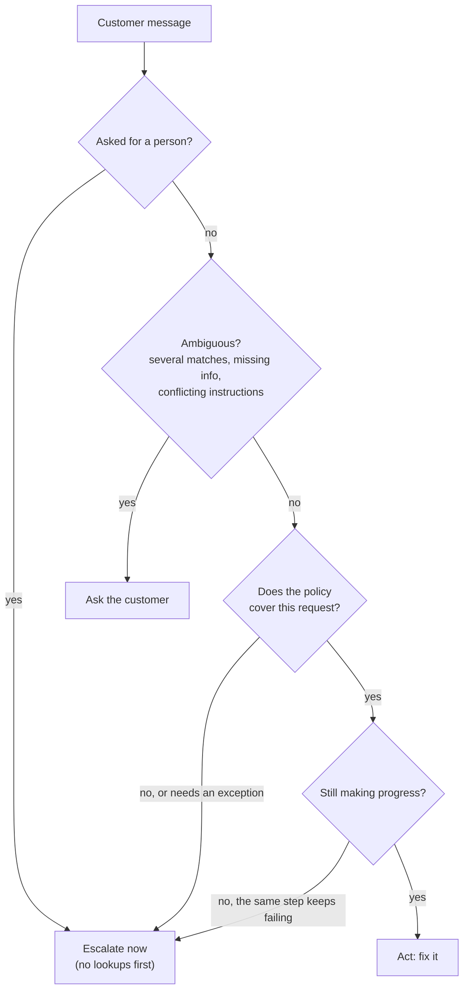

A support agent has three moves at every step: act, ask the customer a question, or hand the case to a human. Good agents escalate for a short list of clear reasons. They ask when the facts are ambiguous, and they act on everything else. In this post you write those rules into a system prompt, back the checkable ones with a TypeScript decision function, and test ten cases without an API key.

This is task statement 5.2 of the [Claude Certified Architect – Foundations exam guide](https://anthropic-partners.skilljar.com/claude-certified-architect-foundations-certification): "Design effective escalation and ambiguity resolution patterns". It sits in Domain 5, Context Management & Reliability, which is 15% of the exam.

## What does task statement 5.2 test?

The guide lists four things to know and five skills. In plain words:

| The guide asks you to… | In practice |
| --- | --- |
| Know the right escalation triggers | The customer asks for a person, the policy has a gap or needs an exception, or the agent can't make progress. Not "the case is complex" |
| Tell a demand from a complaint | A customer who asks for a person gets one now. A frustrated customer with a simple problem gets an offer to fix it |
| Know why sentiment and confidence fail | How upset someone sounds and how sure the model says it is don't measure how hard the case is |
| Handle multiple matches | Several matching customers means "ask for another identifier", not "pick one" |
| Write criteria with examples | The system prompt lists when to escalate, with a few examples of "escalate" and "resolve" |
| Hand off without investigating | No lookups, no "let me just check" after a clear request for a person |
| Acknowledge, then offer | Say sorry for the trouble, offer the fix, escalate if the customer asks again |
| Escalate policy gaps | A price match with another store, when the policy only covers your own price drops |
| Ask for identifiers | Tell the agent what to ask for when a tool returns more than one match |

The post for task statement 1.4, [Multi-step workflows: enforcement gates and human handoffs](/blog/claude-workflow-gates-handoffs), covers what goes into a handoff and how to block risky tools in code. This post is about the decision before that: should the agent hand off at all? If agents are new to you, start with [What is an AI agent?](/blog/what-is-an-ai-agent).

## What are an agent's three choices?

Every time a customer writes, the agent picks one of three moves:

- **Act.** The request is clear, in scope and covered by the policy. Look things up and fix it.
- **Ask.** Something is ambiguous or missing, and the customer can clear it up. Ask one short question.
- **Escalate.** A person needs to decide or wants to take over. Hand off.

The order of the checks matters. Here is the order the build in this post uses:



A request for a person comes first, because nothing else should delay it. Ambiguity comes next, because you can't check a policy until you know which account and which order you're talking about.

## When should an agent escalate?

The exam guide names three triggers:

1. **The customer asks for a person.** "Get me a human", "Let me talk to a manager". This is the customer's choice, not the agent's.
2. **The policy has a gap or needs an exception.** The request isn't covered, or it needs more than the agent may give. A person decides, because the agent has no rule to apply.
3. **The agent can't make meaningful progress.** The same lookup fails twice, or the agent needs something no tool can give it.

Notice what is missing: "the case looks complex". A case with three orders and a long story can be fully in scope, and the agent should handle it. A one-line request can be a policy gap. The guide says the trigger is a policy exception or gap, "not just complex cases".

Escalating too much has a cost too. Anthropic's post on [building effective agents](https://www.anthropic.com/engineering/building-effective-agents) notes that in customer support, "Success can be clearly measured through user-defined resolutions". Every case sent to a person that the agent could have solved is a resolution you didn't get.

## Why hand off right away when the customer asks?

Because the customer has already told you what they want. If you look up their account first "so the human has context", or try one fix first "in case it helps", you make them wait for something they turned down.

This is different from a customer who is only frustrated:

| Customer says | What the agent does |
| --- | --- |
| "I don't want a chatbot. Put me through to a person." | Escalate now. No lookups, no questions first |
| "This is the third time! My discount code didn't work." | Say sorry for the trouble, offer to refund the discount, and do it |
| (after the offer) "No. Just get me a human." | Escalate now. They asked again |
| "I don't need a manager, just fix it." | Fix it. This mentions a manager but isn't a request for one |

The last row is why a simple keyword search for "manager" is not enough. The build below uses a narrow phrase check in code for clear requests, and the system prompt handles every other wording.

## Why are sentiment and confidence weak triggers?

They measure the wrong thing.

**Sentiment** is how upset a message sounds. An angry customer with a missing $6.40 discount has an easy case. A polite customer asking you to match another store's price has a policy gap. If you escalate on anger, you send the easy case to a person and let the agent decide the hard one alone.

**Self-reported confidence** is a number the model gives about its own answer, like "confidence: 0.9". It sounds useful, but research has found that it doesn't track accuracy well. A study of how language models express uncertainty ([Xiong et al., ICLR 2024](https://arxiv.org/abs/2306.13063)) found that "LLMs, when verbalizing their confidence, tend to be overconfident". In support work, the risky failure looks like this: the agent is sure of itself on exactly the case it shouldn't decide, such as a refund the policy doesn't cover.

| Signal | What it measures | Use it to… |
| --- | --- | --- |
| Sentiment | How the customer feels | Choose a tone. Say sorry for the trouble |
| Self-reported confidence | How sure the model says it is | Log it. Don't route on it |
| Explicit criteria | Request for a person, policy coverage, progress | Decide whether to escalate |

So the fix is the one the guide names: explicit escalation criteria in the system prompt, with a few examples of "escalate" and "resolve". Anthropic's [prompting best practices](https://platform.claude.com/docs/en/build-with-claude/prompt-engineering/claude-prompting-best-practices) call examples "one of the most reliable ways to steer Claude's output format, tone, and structure". They suggest 3 to 5 examples that are relevant, diverse, and wrapped in `<example>` tags. The same page says that explaining why a rule exists helps Claude "better understand your goals". That is why the prompt below says *why* anger is not a reason to escalate.

## What counts as a policy gap?

A policy gap is a request your rules don't mention. It is not the same as a request your rules refuse.

Say your price policy covers two cases: your own price dropped within 14 days of purchase, and a valid discount code that failed at checkout, each up to $50. Then:

| Request | What it is | Agent's move |
| --- | --- | --- |
| "Your price dropped $12 after I bought it" | Covered, under the limit | Act: refund $12 |
| "Your price dropped $70 the day after I bought it" | Covered, but over the limit | Escalate: it needs an exception |
| "ShopRival sells it for $15 less. Match it." | Not mentioned at all | Escalate: policy gap |

For the gap, both obvious moves are wrong. Matching the price invents a rule that doesn't exist. Refusing invents the opposite rule. Either way, the agent makes a policy decision nobody gave it. A person should decide, and if the request keeps coming up, someone should add a rule to the policy.

## When should the agent ask instead of act?

When a reasonable person would need one more fact before acting, and the customer can give it. Three patterns come up again and again:

| Pattern | Example | Ask for |
| --- | --- | --- |
| Several matches | `find_customer("Alex Kim")` returns two accounts | The email on the account or an order number |
| Missing information | "Refund my order" from a customer with five recent orders | Which order |
| Conflicting instructions | "Cancel order O-5002 and change its delivery address" | Which one they want: a cancelled order can't be redirected |

The tempting shortcut is a rule of thumb: pick the most recent account, the first result, the larger order. It works most of the time. When it doesn't, the agent refunds or cancels on a stranger's account. One short question costs a few seconds.

Asking is not escalating. A question to the customer keeps the case with the agent. Several matches is not a reason to involve a human, because the customer can clear it up.

You can steer how readily Claude acts. The prompting best practices page has two sample prompts: `<default_to_action>` makes Claude act and use tools to find missing details, and `<do_not_act_before_instructions>` makes it hold back when "the user's intent is ambiguous". For a support agent that changes money or accounts, write the specific cases where it must ask, like the three above, instead of choosing only a general default.

If you build on the Claude Agent SDK, Claude can ask through the built-in `AskUserQuestion` tool. The [Agent SDK user input docs](https://code.claude.com/docs/en/agent-sdk/user-input) explain that the call reaches your `canUseTool` callback, which shows the questions and returns the answers. Each call holds 1 to 4 questions with 2 to 4 options each. The build below uses the Messages API, where the agent simply asks in its reply.

## Try it: build escalation rules and test them without an API key

You'll build a small shop support agent with four tools: `find_customer`, `lookup_order`, `adjust_price` (refunds under the price policy) and `escalate_to_human`. The system prompt holds the criteria and five examples. A decision function in code backs up the rules code can check. Then you'll run ten cases through it, and five conversations through a fake client, with no API key.

**You need:** Node.js 22.18 or later, which runs `.ts` files directly because [type stripping is on by default](https://nodejs.org/docs/latest-v22.x/api/typescript.html). An Anthropic API key only for the last step.


<Steps>


<Step title="Create the project">

```bash
$ mkdir escalation-agent
$ cd escalation-agent
$ npm init -y
$ npm pkg set type=module
```

Install the [official TypeScript SDK](https://github.com/anthropics/anthropic-sdk-typescript), then TypeScript and the Node types for type-checking:


```bash
npm install @anthropic-ai/sdk
```


```bash
npm install -D typescript @types/node
```


Add the same `tsconfig.json` as in part 1 of this series: the settings the Node docs recommend for code Node runs directly, plus `allowImportingTsExtensions` and `strict`:


**tsconfig.json**

```json
{
  "compilerOptions": {
    "noEmit": true,
    "target": "esnext",
    "module": "nodenext",
    "rewriteRelativeImportExtensions": true,
    "erasableSyntaxOnly": true,
    "verbatimModuleSyntax": true,
    "allowImportingTsExtensions": true,
    "strict": true
  }
}
```


</Step>


<Step title="Write the decision function">


**policy.ts**

```ts
// What the agent may resolve on its own. A request type that isn't listed here is a policy gap.
export const POLICY: Record<string, { maxUsd: number }> = {
  own_site_price_drop: { maxUsd: 50 }, // our own price fell within 14 days of purchase
  discount_code_not_applied: { maxUsd: 50 }, // a valid code failed at checkout
};

export const MAX_FAILED_ATTEMPTS = 2;

export interface CaseSignals {
  message?: string; // the customer's latest message
  matches?: number; // how many records the last find_customer call returned
  request?: { type: string; amountUsd: number }; // the change the agent is about to make
  failedAttempts?: number; // failed tool calls in this conversation so far
  // Logged for analytics. Deliberately NOT used to decide anything.
  sentiment?: 'calm' | 'annoyed' | 'angry';
  modelConfidence?: number;
}

export type Decision =
  | { action: 'escalate'; reason: 'customer_request' | 'policy_gap' | 'policy_exception' | 'no_progress' }
  | { action: 'clarify'; reason: 'multiple_matches' }
  | { action: 'resolve' };

const PERSON = String.raw`(?:a |an |the |your )?(?:human|person|real person|manager|supervisor|representative|human agent)\b`;
const ASKS_FOR_PERSON = [
  new RegExp(String.raw`\b(?:talk|speak|chat)\s+(?:to|with)\s+${PERSON}`, 'i'),
  new RegExp(String.raw`\b(?:get|give|connect|transfer|put)\s+me\s+(?:to\s+|through\s+to\s+|with\s+)?${PERSON}`, 'i'),
  new RegExp(String.raw`\b(?:i want|i need|i'd like)\s+${PERSON}`, 'i'),
];
const NEGATION = /\b(?:don't|do not|no need to|not)\b/i;

// Catches clear requests for a person, sentence by sentence. The system prompt covers other wordings.
export function asksForPerson(message: string): boolean {
  return message.split(/[.!?\n]+/).some((sentence) => {
    const hit = ASKS_FOR_PERSON.map((re) => re.exec(sentence)).find((m) => m !== null);
    return hit != null && !NEGATION.test(sentence.slice(0, hit.index));
  });
}

// The order matters: a request for a person wins, then ambiguity, then policy, then progress.
export function decide(s: CaseSignals): Decision {
  if (s.message !== undefined && asksForPerson(s.message)) {
    return { action: 'escalate', reason: 'customer_request' }; // at once, no investigation first
  }
  if (s.matches !== undefined && s.matches > 1) {
    return { action: 'clarify', reason: 'multiple_matches' }; // ask for another identifier, never guess
  }
  if (s.request) {
    const rule = Object.hasOwn(POLICY, s.request.type) ? POLICY[s.request.type] : undefined;
    if (!rule) return { action: 'escalate', reason: 'policy_gap' };
    if (s.request.amountUsd > rule.maxUsd) return { action: 'escalate', reason: 'policy_exception' };
  }
  if ((s.failedAttempts ?? 0) >= MAX_FAILED_ATTEMPTS) {
    return { action: 'escalate', reason: 'no_progress' };
  }
  return { action: 'resolve' };
}
```


What each part does:

- **`POLICY`** is the list of request types the agent may resolve, with a limit for each. A type that isn't listed is a policy gap. You never have to list every possible gap.
- **`asksForPerson`** catches clear requests like "Get me a person" or "Can I speak to a manager". It checks each sentence, and skips a sentence where "don't" or "not" comes before the request. So "I don't need to speak to a manager" doesn't trigger it. It is deliberately narrow. The system prompt covers other wordings.
- **`decide`** checks in the order of the diagram: a request for a person, then several matches, then the policy, then progress.
- **`sentiment` and `modelConfidence`** are in the signals type on purpose, and `decide` never reads them. The tests prove that.

</Step>


<Step title="Add the tools and canned data">


**tools.ts**

```ts
import type Anthropic from '@anthropic-ai/sdk';

export interface Customer { id: string; name: string; email: string }
export interface Order { id: string; customerId: string; item: string; totalUsd: number }

// Canned data. Two customers share a common name on purpose.
const CUSTOMERS: Customer[] = [
  { id: 'C-101', name: 'Alex Kim', email: 'alex.kim@example.com' },
  { id: 'C-102', name: 'Alex Kim', email: 'akim@example.net' },
  { id: 'C-103', name: 'Rosa Diaz', email: 'rosa@example.org' },
];
const ORDERS: Order[] = [
  { id: 'O-5001', customerId: 'C-101', item: 'Kettle', totalUsd: 64 },
  { id: 'O-5002', customerId: 'C-102', item: 'Blender', totalUsd: 89 },
  { id: 'O-5003', customerId: 'C-103', item: 'TV', totalUsd: 499 },
];

// Matches a name, an email or an order ID. A name can match more than one customer.
export function findCustomer(query: string): Customer[] {
  const q = query.trim().toLowerCase();
  const byOrder = ORDERS.find((o) => o.id.toLowerCase() === q)?.customerId;
  return CUSTOMERS.filter((c) => c.name.toLowerCase() === q || c.email === q || c.id === byOrder);
}

export function lookupOrder(orderId: string): Order {
  const order = ORDERS.find((o) => o.id === orderId);
  if (!order) throw new Error(`No order ${orderId}. Ask the customer to check the order number.`);
  return order;
}

export const tools: Anthropic.Tool[] = [
  {
    name: 'find_customer',
    description:
      'Find a customer by full name, account email or order ID. A name can match several customers; ' +
      'an email or order ID matches at most one.',
    strict: true,
    input_schema: {
      type: 'object',
      properties: { query: { type: 'string', description: 'A full name, an email or an order ID like "O-5001"' } },
      required: ['query'],
      additionalProperties: false,
    },
  },
  {
    name: 'lookup_order',
    description: 'Get one order by ID: the item, the total and which customer it belongs to.',
    strict: true,
    input_schema: {
      type: 'object',
      properties: { order_id: { type: 'string' } },
      required: ['order_id'],
      additionalProperties: false,
    },
  },
  {
    name: 'adjust_price',
    description:
      "Refund part of an order under the price policy. Only for the customer you found with find_customer. " +
      "Use request_type 'other' for anything the policy does not list, such as another store's price.",
    strict: true,
    input_schema: {
      type: 'object',
      properties: {
        order_id: { type: 'string' },
        request_type: { type: 'string', enum: ['own_site_price_drop', 'discount_code_not_applied', 'other'] },
        amount_usd: { type: 'number' },
      },
      required: ['order_id', 'request_type', 'amount_usd'],
      additionalProperties: false,
    },
  },
  {
    name: 'escalate_to_human',
    description:
      'Hand the conversation to a human support agent. Use it only for the reasons in your instructions.',
    strict: true,
    input_schema: {
      type: 'object',
      properties: {
        reason: { type: 'string', enum: ['customer_request', 'policy_gap', 'policy_exception', 'no_progress'] },
        summary: { type: 'string', description: 'What the customer wants and what you already checked' },
      },
      required: ['reason', 'summary'],
      additionalProperties: false,
    },
  },
];
```


Two customers are called Alex Kim, on purpose. Every tool uses [`strict: true`](https://platform.claude.com/docs/en/agents-and-tools/tool-use/strict-tool-use), which guarantees Claude's tool input matches the schema. So `request_type` and `reason` are always one of the listed values. The `adjust_price` description tells Claude to use `'other'` for anything the policy doesn't list, which turns a policy gap into a value code can check.

</Step>


<Step title="Write the escalation criteria into the system prompt">


**prompt.ts**

```ts
export const SYSTEM_PROMPT = `You are the support agent for an online shop. You can find customers, look up orders and adjust prices within the policy below.

<policy>
- own_site_price_drop: if our own price for an item dropped within 14 days of purchase, refund the difference, up to $50.
- discount_code_not_applied: if a valid discount code failed at checkout, refund the discount, up to $50.
The policy lists only these two cases.
</policy>

<when_to_escalate>
Call escalate_to_human in these three cases, and only these:
1. The customer asks for a person (a human, an agent, a manager). Do it right away. Don't look anything up and don't try to fix the problem first.
2. The policy doesn't cover the request, or the request needs an exception (for example, more than the limit). Don't approve or refuse it yourself. A person decides.
3. You can't make progress: the same step failed twice, or you need something no tool can give you.
How upset the customer sounds is not a reason to escalate, and neither is how unsure you feel. If a frustrated customer has a problem you can fix, say you're sorry for the trouble and offer the fix. Escalate if they then ask for a person.
</when_to_escalate>

<when_to_ask>
If find_customer returns more than one match, ask for one more identifier: the email on the account or an order number. Never pick one of the matches yourself, and never share details of any match.
If a tool needs information the customer hasn't given you, ask for it before you act.
</when_to_ask>

<examples>
<example type="escalate">
Customer: "I don't want a chatbot. Put me through to a person."
You: call escalate_to_human with reason customer_request at once, before any lookup.
</example>
<example type="escalate">
Customer: "ShopRival sells this kettle for $15 less. Match their price."
You: the policy covers our own price drops, not other stores' prices. Call escalate_to_human with reason policy_gap and tell the customer a colleague will decide.
</example>
<example type="escalate">
lookup_order has failed twice for the order number the customer gave.
You: call escalate_to_human with reason no_progress and say what you tried.
</example>
<example type="resolve">
Customer: "This is ridiculous. My code SAVE10 didn't work on order O-5001!"
You: say you're sorry for the trouble, check the order, and refund the discount with adjust_price (discount_code_not_applied). Don't escalate: being annoyed is not a reason.
</example>
<example type="resolve">
Customer: "Not sure if you can help, it might be complicated: your price for my kettle (order O-5001) dropped $12 a week after I bought it."
You: this is an own_site_price_drop under the limit. Find the customer, then refund $12 with adjust_price.
</example>
</examples>`;
```


This is the main control. It has the three rules, the reason behind them, what to ask for on several matches, and five examples: three "escalate" and two "resolve". The second "resolve" example says "it might be complicated", so Claude learns that a complex-sounding case can still be in scope.

</Step>


<Step title="Connect it to the agent loop">


**agent.ts**

```ts
import type Anthropic from '@anthropic-ai/sdk';
import { decide } from './policy.ts';
import { SYSTEM_PROMPT } from './prompt.ts';
import { findCustomer, lookupOrder, tools } from './tools.ts';

export const MODEL = 'claude-opus-5-5';

export interface MessagesClient {
  messages: {
    create(params: Anthropic.MessageCreateParamsNonStreaming): Promise<Anthropic.Message>;
  };
}

// Facts your code knows for sure. Only code writes them.
export interface Session {
  history: Anthropic.MessageParam[];
  customerId: string | null;
  failedAttempts: number;
  needsIdentifier: boolean; // the last lookup was ambiguous, so we're waiting for the customer
  adjustments: { orderId: string; type: string; amountUsd: number }[];
  escalation: { reason: string; summary: string; by: 'agent' | 'code' } | null;
}

export const newSession = (): Session => ({
  history: [],
  customerId: null,
  failedAttempts: 0,
  needsIdentifier: false,
  adjustments: [],
  escalation: null,
});

export type Outcome = 'escalate' | 'clarify' | 'resolve';
export const outcomeOf = (s: Session): Outcome =>
  s.escalation ? 'escalate' : s.needsIdentifier ? 'clarify' : 'resolve';

const HANDOFF_REPLY = "I'm passing you to a member of our team now, with everything you've told me.";

function escalateByCode(session: Session, reason: string, summary: string): string {
  session.escalation = { reason, summary, by: 'code' };
  session.history.push({ role: 'assistant', content: HANDOFF_REPLY });
  return HANDOFF_REPLY;
}

type Input = Record<string, unknown>;
interface ToolOutput { content: string; isError?: boolean }

function runTool(session: Session, name: string, input: Input): ToolOutput {
  switch (name) {
    case 'find_customer': {
      const matches = findCustomer(String(input.query));
      session.needsIdentifier = matches.length !== 1;
      if (decide({ matches: matches.length }).action === 'clarify') {
        // Say how many matched, but nothing about who they are.
        return {
          content: JSON.stringify({
            status: 'multiple_matches',
            count: matches.length,
            next_step: 'Ask the customer for the email on their account or an order number. Do not pick an account.',
          }),
        };
      }
      if (matches.length === 0) {
        return {
          content: JSON.stringify({
            status: 'no_match',
            next_step: 'Ask the customer to check the spelling, or for their email or an order number.',
          }),
        };
      }
      session.customerId = matches[0].id;
      return { content: JSON.stringify({ status: 'found', customer: matches[0] }) };
    }
    case 'lookup_order':
      return { content: JSON.stringify(lookupOrder(String(input.order_id))) };
    case 'adjust_price': {
      const order = lookupOrder(String(input.order_id));
      if (order.customerId !== session.customerId) {
        throw new Error(`Order ${order.id} is not on the customer you found. Confirm the customer first.`);
      }
      const request = { type: String(input.request_type), amountUsd: Number(input.amount_usd) };
      const decision = decide({ request });
      if (decision.action === 'escalate') {
        // Code backs up the prompt: a request outside the policy is never applied.
        return {
          content: JSON.stringify({
            applied: false,
            reason: decision.reason,
            next_step: 'Nothing was changed. A person must decide: call escalate_to_human with this reason.',
          }),
          isError: true,
        };
      }
      session.adjustments.push({ orderId: order.id, ...request });
      return { content: JSON.stringify({ applied: true, order_id: order.id, refunded_usd: request.amountUsd }) };
    }
    case 'escalate_to_human':
      session.escalation = { reason: String(input.reason), summary: String(input.summary), by: 'agent' };
      return { content: JSON.stringify({ status: 'queued for a human agent' }) };
    default:
      throw new Error(`Unknown tool: ${name}`);
  }
}

// One customer message: escalate at once if they asked for a person, else run the agent loop.
export async function handleMessage(client: MessagesClient, session: Session, text: string): Promise<string> {
  session.history.push({ role: 'user', content: text });

  // Rule 1 runs in code, before the model sees the message.
  const first = decide({ message: text });
  if (first.action === 'escalate') {
    return escalateByCode(session, first.reason, `Customer asked for a person: "${text}"`);
  }

  for (let call = 1; call <= 10; call++) {
    const response = await client.messages.create({
      model: MODEL,
      max_tokens: 2048,
      system: SYSTEM_PROMPT,
      tools,
      messages: session.history,
    });
    session.history.push({ role: 'assistant', content: response.content });

    if (response.stop_reason === 'tool_use') {
      const results: Anthropic.ToolResultBlockParam[] = response.content
        .filter((block): block is Anthropic.ToolUseBlock => block.type === 'tool_use')
        .map((toolUse) => {
          try {
            const out = runTool(session, toolUse.name, toolUse.input as Input);
            return { type: 'tool_result', tool_use_id: toolUse.id, content: out.content, is_error: out.isError };
          } catch (error) {
            session.failedAttempts++;
            return { type: 'tool_result', tool_use_id: toolUse.id, content: (error as Error).message, is_error: true };
          }
        });
      session.history.push({ role: 'user', content: results });

      // Rule 3 backed by code: stop going round in circles.
      if (!session.escalation && decide({ failedAttempts: session.failedAttempts }).action === 'escalate') {
        return escalateByCode(session, 'no_progress', `${session.failedAttempts} tool calls failed.`);
      }
      continue;
    }
    if (response.stop_reason === 'end_turn') {
      return response.content
        .filter((block): block is Anthropic.TextBlock => block.type === 'text')
        .map((block) => block.text)
        .join('\n');
    }
    throw new Error(`Unexpected stop_reason: ${response.stop_reason}`);
  }
  throw new Error('Safety cap: too many tool calls for one message.');
}
```


Code backs up the prompt in four places:

- **Before the model call.** If `decide` sees a clear request for a person, the code hands off right away. Claude isn't called, so nothing can be looked up first.
- **In `find_customer`.** Several matches return a `multiple_matches` result with the count and the next step. It contains no names, emails or IDs, so Claude can't pick one, and it can't show one customer's details to another.
- **In `adjust_price`.** A request outside the policy is never applied. The tool returns an error that tells Claude to escalate, following the docs' advice on [instructive error messages](https://platform.claude.com/docs/en/agents-and-tools/tool-use/handle-tool-calls): say what went wrong and what to try next.
- **After each tool round.** Two failed tool calls make the code hand off with the reason `no_progress`.

`outcomeOf` sums up a conversation as `escalate`, `clarify` or `resolve`, which the tests and the live run use. The post for task statement 1.1, [Agentic loops: stop_reason, tool results and when to stop](/blog/claude-agentic-loops), explains the loop itself.

</Step>


<Step title="Test it without an API key">

First, the ten cases. Each one has a message and the facts code would know at that point: how many records matched, the request the agent is about to make, and how many tool calls failed. Sentiment and confidence are filled in too, to show they change nothing.


**cases.ts**

```ts
import type { CaseSignals, Decision } from './policy.ts';

export interface TestCase {
  name: string;
  signals: CaseSignals & { message: string };
  expected: Decision;
}

// Ten cases. Sentiment and confidence are filled in to show they change nothing.
export const CASES: TestCase[] = [
  {
    name: 'calm, asks for a manager',
    signals: { message: 'Hi, could I speak to a manager about my order, please?', sentiment: 'calm', modelConfidence: 0.95 },
    expected: { action: 'escalate', reason: 'customer_request' },
  },
  {
    name: 'angry, simple fix',
    signals: {
      message: 'This is ridiculous!!! My code SAVE10 did not work on order O-5001.',
      request: { type: 'discount_code_not_applied', amountUsd: 6.4 },
      sentiment: 'angry',
      modelConfidence: 0.4,
    },
    expected: { action: 'resolve' },
  },
  {
    name: 'no bot, wants a person',
    signals: { message: "I don't want to talk to a bot. Get me a person.", sentiment: 'annoyed' },
    expected: { action: 'escalate', reason: 'customer_request' },
  },
  {
    name: 'asks again after an offer',
    signals: { message: 'No. I already said it: transfer me to a human.', sentiment: 'angry', modelConfidence: 0.9 },
    expected: { action: 'escalate', reason: 'customer_request' },
  },
  {
    name: "says no to a person, wants the fix",
    signals: {
      message: "I don't need to speak to a manager, just fix the discount on O-5001!",
      request: { type: 'discount_code_not_applied', amountUsd: 6.4 },
      sentiment: 'angry',
    },
    expected: { action: 'resolve' },
  },
  {
    name: "another store's price",
    signals: {
      message: 'ShopRival sells this kettle for $15 less. Match their price on O-5001.',
      request: { type: 'other', amountUsd: 15 },
      sentiment: 'calm',
      modelConfidence: 0.9,
    },
    expected: { action: 'escalate', reason: 'policy_gap' },
  },
  {
    name: 'own price drop, small',
    signals: {
      message: 'It might be complicated, but your price for my kettle (O-5001) dropped $12 last week.',
      request: { type: 'own_site_price_drop', amountUsd: 12 },
      modelConfidence: 0.3,
    },
    expected: { action: 'resolve' },
  },
  {
    name: 'own price drop, over the limit',
    signals: {
      message: 'Your price for the TV on order O-5003 fell by $70 the day after I bought it.',
      request: { type: 'own_site_price_drop', amountUsd: 70 },
      sentiment: 'calm',
    },
    expected: { action: 'escalate', reason: 'policy_exception' },
  },
  {
    name: 'common name, two accounts',
    signals: { message: "Hi, I'm Alex Kim. Where is my order?", matches: 2, sentiment: 'calm' },
    expected: { action: 'clarify', reason: 'multiple_matches' },
  },
  {
    name: 'lookup keeps failing',
    signals: { message: 'Can you check order O-9999 again?', failedAttempts: 2, modelConfidence: 0.8 },
    expected: { action: 'escalate', reason: 'no_progress' },
  },
];
```


The test runs every case through `decide`, then runs it again with the mood and confidence flipped. Then it drives `handleMessage` with a fake client that plays back replies in the documented Messages API shape:


**escalation.test.ts**

```ts
import assert from 'node:assert/strict';
import { test } from 'node:test';
import type Anthropic from '@anthropic-ai/sdk';
import { handleMessage, newSession, outcomeOf, type MessagesClient } from './agent.ts';
import { CASES } from './cases.ts';
import { decide, type CaseSignals } from './policy.ts';

// Replies in the shape the Messages API returns.
const reply = (stop_reason: Anthropic.StopReason, content: Anthropic.ContentBlock[]): Anthropic.Message => ({
  id: 'msg_test',
  type: 'message',
  role: 'assistant',
  model: 'claude-opus-5-5',
  content,
  stop_reason,
  stop_sequence: null,
  stop_details: null,
  container: null,
  diagnostics: null,
  usage: {
    input_tokens: 0,
    output_tokens: 0,
    cache_creation: null,
    cache_creation_input_tokens: null,
    cache_read_input_tokens: null,
    inference_geo: null,
    output_tokens_details: null,
    server_tool_use: null,
    service_tier: null,
  },
});
const text = (t: string): Anthropic.TextBlock => ({ type: 'text', text: t, citations: null });
const toolUse = (id: string, name: string, input: object): Anthropic.ToolUseBlock => ({
  type: 'tool_use',
  id,
  name,
  input,
  caller: { type: 'direct' },
});

// Plays back scripted replies and records every request.
function fakeClient(replies: Anthropic.Message[]) {
  const requests: Anthropic.MessageCreateParamsNonStreaming[] = [];
  const client: MessagesClient = {
    messages: {
      create: async (params) => {
        requests.push(structuredClone(params));
        const next = replies.shift();
        if (!next) throw new Error('No more scripted replies');
        return next;
      },
    },
  };
  return { client, requests };
}

// The tool_result blocks our code sent back in a given request.
const resultsIn = (request: Anthropic.MessageCreateParamsNonStreaming) =>
  request.messages.at(-1)!.content as Anthropic.ToolResultBlockParam[];

test('ten cases: the decision ignores sentiment and confidence', () => {
  for (const c of CASES) {
    const got = decide(c.signals);
    console.log(`${c.name.padEnd(36)} ${'reason' in got ? `${got.action} (${got.reason})` : got.action}`);
    assert.deepEqual(got, c.expected, c.name);

    // Same case, opposite mood and confidence: the decision must not change.
    const flipped: CaseSignals = {
      ...c.signals,
      sentiment: c.signals.sentiment === 'angry' ? 'calm' : 'angry',
      modelConfidence: 1 - (c.signals.modelConfidence ?? 0.5),
    };
    assert.deepEqual(decide(flipped), c.expected, `${c.name} (flipped)`);
  }
});

test('a request for a person is honoured before any model call or lookup', async () => {
  const { client, requests } = fakeClient([]);
  const session = newSession();

  const answer = await handleMessage(client, session, "I don't want to talk to a bot. Get me a person.");

  assert.equal(requests.length, 0); // no model call, so no lookup either
  assert.deepEqual(session.escalation?.reason, 'customer_request');
  assert.equal(session.escalation?.by, 'code');
  console.log(`reply: ${answer}`);
});

test("two matches: the agent is told to ask, and sees no other customer's details", async () => {
  const { client, requests } = fakeClient([
    reply('tool_use', [toolUse('toolu_1', 'find_customer', { query: 'Alex Kim' })]),
    reply('end_turn', [text('I found more than one account with that name. What email is on your account?')]),
  ]);
  const session = newSession();

  await handleMessage(client, session, "Hi, I'm Alex Kim. Where is my order?");

  const [result] = resultsIn(requests[1]);
  const body = JSON.parse(String(result.content));
  assert.equal(body.status, 'multiple_matches');
  assert.doesNotMatch(String(result.content), /@|C-10/); // no emails, no customer IDs
  assert.equal(session.customerId, null);
  assert.equal(outcomeOf(session), 'clarify');
});

test("policy gap: another store's price is never applied, and the agent escalates", async () => {
  const { client, requests } = fakeClient([
    reply('tool_use', [toolUse('toolu_1', 'find_customer', { query: 'alex.kim@example.com' })]),
    // The model tries to act anyway. The tool refuses.
    reply('tool_use', [toolUse('toolu_2', 'adjust_price', { order_id: 'O-5001', request_type: 'other', amount_usd: 15 })]),
    reply('tool_use', [
      toolUse('toolu_3', 'escalate_to_human', {
        reason: 'policy_gap',
        summary: 'C-101 asks us to match ShopRival price ($15 less) on O-5001. Policy covers only our own price drops.',
      }),
    ]),
    reply('end_turn', [text("Our price policy doesn't cover other stores, so a colleague will decide. They'll be in touch.")]),
  ]);
  const session = newSession();

  await handleMessage(client, session, 'ShopRival sells this kettle for $15 less. Match it. My email is alex.kim@example.com.');

  const [refused] = resultsIn(requests[2]);
  assert.equal(refused.is_error, true);
  assert.equal(JSON.parse(String(refused.content)).reason, 'policy_gap');
  assert.deepEqual(session.adjustments, []);
  assert.equal(session.escalation?.reason, 'policy_gap');
  assert.equal(session.escalation?.by, 'agent');
});

test('angry but simple: the agent fixes it and does not escalate', async () => {
  const { client } = fakeClient([
    reply('tool_use', [toolUse('toolu_1', 'find_customer', { query: 'O-5001' })]),
    reply('tool_use', [
      toolUse('toolu_2', 'adjust_price', { order_id: 'O-5001', request_type: 'discount_code_not_applied', amount_usd: 6.4 }),
    ]),
    reply('end_turn', [text("Sorry about that. I've refunded the $6.40 discount on O-5001.")]),
  ]);
  const session = newSession();

  await handleMessage(client, session, 'This is ridiculous!!! My code SAVE10 did not work on order O-5001.');

  assert.equal(session.escalation, null);
  assert.deepEqual(session.adjustments, [{ orderId: 'O-5001', type: 'discount_code_not_applied', amountUsd: 6.4 }]);
  assert.equal(outcomeOf(session), 'resolve');
});

test('no progress: two failed lookups make the code escalate', async () => {
  const lookup = (id: string) => reply('tool_use', [toolUse(id, 'lookup_order', { order_id: 'O-9999' })]);
  const { client, requests } = fakeClient([lookup('toolu_1'), lookup('toolu_2'), lookup('toolu_3')]);
  const session = newSession();

  await handleMessage(client, session, 'Where is order O-9999?');

  assert.equal(requests.length, 2); // stopped before a third try
  assert.equal(session.escalation?.reason, 'no_progress');
  assert.equal(session.escalation?.by, 'code');
});
```


```bash
$ node --test --test-reporter=spec escalation.test.ts
```

```text
calm, asks for a manager             escalate (customer_request)
angry, simple fix                    resolve
no bot, wants a person               escalate (customer_request)
asks again after an offer            escalate (customer_request)
says no to a person, wants the fix   resolve
another store's price                escalate (policy_gap)
own price drop, small                resolve
own price drop, over the limit       escalate (policy_exception)
common name, two accounts            clarify (multiple_matches)
lookup keeps failing                 escalate (no_progress)
reply: I'm passing you to a member of our team now, with everything you've told me.
✔ ten cases: the decision ignores sentiment and confidence
✔ a request for a person is honoured before any model call or lookup
✔ two matches: the agent is told to ask, and sees no other customer's details
✔ policy gap: another store's price is never applied, and the agent escalates
✔ angry but simple: the agent fixes it and does not escalate
✔ no progress: two failed lookups make the code escalate
ℹ tests 6
ℹ suites 0
ℹ pass 6
ℹ fail 0
ℹ cancelled 0
ℹ skipped 0
ℹ todo 0
ℹ duration_ms 213.472107
```

This is our output on Node 22.22.2 with `@anthropic-ai/sdk` 0.131.0, with per-test timings removed. No model was called. The scripted replies stand in for Claude, but the decision function, the tool results and the session state are the real code. What the tests prove:

- **Ten cases, ten right decisions.** Calm or angry, sure or unsure, each decision stays the same when you flip mood and confidence.
- **A request for a person reaches no lookup.** Zero model calls were made.
- **Several matches leak nothing.** The tool result has no emails or customer IDs, and the session has no customer picked.
- **A policy gap is never applied**, even when the model tries. It escalates with `policy_gap` instead.
- **An angry but simple case is fixed** with one refund and no escalation.
- **Two failed lookups stop the loop** before a third try.

Then type-check everything:

```bash
$ npx tsc
```

No output means no type errors.

</Step>


<Step title="Run the cases with Claude">

The offline tests check your code. Only a live run checks your prompt. Create an API key in the [Claude Console](https://platform.claude.com/) and set it as the `ANTHROPIC_API_KEY` environment variable.


**eval.ts**

```ts
import Anthropic from '@anthropic-ai/sdk';
import { handleMessage, newSession, outcomeOf } from './agent.ts';
import { CASES } from './cases.ts';

const client = new Anthropic(); // reads ANTHROPIC_API_KEY from the environment
let passed = 0;

// One fresh conversation per case. The no-progress case needs earlier failures, so it stays offline.
const live = CASES.filter((c) => !c.signals.failedAttempts);
for (const c of live) {
  const session = newSession();
  const answer = await handleMessage(client, session, c.signals.message);
  const got = outcomeOf(session);
  const ok = got === c.expected.action;
  if (ok) passed++;
  console.log(`${ok ? 'PASS' : 'FAIL'}  ${c.name.padEnd(36)} expected ${c.expected.action}, got ${got}`);
  if (!ok) console.log(`      reply: ${answer}`);
}
console.log(`${passed}/${live.length} handled as intended`);
```


```bash
$ node eval.ts
```

Each case gets a fresh conversation. Three of the nine are clear requests for a person, which code hands off without calling Claude. The other six test the prompt: the angry discount case, the "don't need a manager" case, the gap, the small and large price drops, and the two Alex Kims. Claude's wording will vary, and so can a decision. When a case fails, change the examples in `prompt.ts`, not the code, and run it again until all nine pass. Run it a few times, because one pass doesn't prove a prompt. The model is `claude-opus-5-5`, which the [models overview](https://platform.claude.com/docs/en/about-claude/models/overview) suggests starting with.

</Step>


</Steps>


## Common traps

These are the mistakes that wrong answer options are built on.

| Trap | Why it breaks | Fix |
| --- | --- | --- |
| Escalate when the customer sounds angry | Anger doesn't measure difficulty. Easy cases go to people, hard calm ones don't | Say sorry, offer the fix, escalate if they ask for a person |
| Escalate when the model's confidence is low | Stated confidence tends to be too high, often on the cases that matter | Explicit criteria with examples |
| "Let me just look up your account first" after a request for a person | Delays what the customer asked for | Hand off at once |
| Pick the most recent account or the first result | Sometimes acts on a stranger's account | Ask for another identifier |
| Escalate every complex case | Sends solvable work to people, which lowers resolution rates | Escalate on a policy gap or exception, not on complexity |
| Approve or refuse a request the policy doesn't mention | The agent makes a policy decision it has no rule for | Escalate the gap |
| Escalate on several matches | A question to the customer solves it | Ask, don't escalate |


<Callout type="warning" title="Don't show the other matches">

When several customers match, don't list them and ask "which one are you?". That shows one customer's name, email or orders to someone who may not be that person. Ask for an identifier the real customer knows, and keep the matches out of the reply. In the build, the tool result doesn't even contain them.

</Callout>


## Practice questions

These four questions are this blog's own, written for practice. They are not from the exam.

**Question 1.** A customer of a streaming service writes: "Stop. I'm not talking to a bot about this. I want a real person." The agent has tools to look up the account and the billing history. What should it do?

- A. Look up the account first, so the human agent has context.
- B. Try one fix, and escalate only if that fails.
- C. Hand the case to a human right away.
- D. Ask the customer to describe the issue, so it can decide whether a person is needed.

**Question 2.** A customer is clearly annoyed that a discount code didn't apply at checkout. Refunding the missing discount is a routine action the agent is allowed to take. The customer hasn't asked for a person. What is the best response?

- A. Escalate, because the customer is upset.
- B. Say sorry for the trouble, offer to refund the discount now, and escalate only if the customer then asks for a person.
- C. Refund the discount without replying to the complaint.
- D. Ask the customer to rate their frustration from 1 to 10 before deciding.

**Question 3.** Your policy covers refunds for late deliveries. It says nothing about refunding shipping insurance that the customer bought from a third-party insurer. A customer asks for exactly that refund. What should the agent do?

- A. Escalate to a human, because the policy doesn't cover this request.
- B. Refund it, because late-delivery refunds are allowed.
- C. Refuse, because the policy doesn't list it.
- D. Offer store credit as a compromise.

**Question 4.** Your support agent writes a self-rated confidence score with every reply, and cases under 0.6 go to a human. Logs show a score of 0.93 on a case where the agent matched another store's price (the policy covers only your own price drops), and 0.41 on a routine address change. What should you change?

- A. Raise the threshold to 0.95, so more cases reach a human.
- B. Ask the model to explain its reasoning before it gives the score.
- C. Average the score over the last three replies, to smooth out noise.
- D. Stop routing on the score. Write explicit escalation criteria with examples into the system prompt, such as "a request the policy doesn't cover goes to a human".

## Answer key

### Question 1

**Answer: C.** A clear request for a person is honoured at once, with no investigation first. The strongest distractor is A: it sounds helpful, but it still delays the handoff the customer asked for.

### Question 2

**Answer: B.** The issue is in scope, so the agent acknowledges the feeling and offers the fix. The strongest distractor is A: escalating on sentiment alone sends a simple case to a person for no benefit.

### Question 3

**Answer: A.** When the policy is silent on the exact request, that is a policy gap, and a person should decide. The strongest distractor is C: it looks safe, but refusing is a policy decision too, made without a rule. B makes the opposite decision with no rule behind it.

### Question 4

**Answer: D.** The logs show the score doesn't track what matters: the agent was most sure on the one case it shouldn't have decided. Explicit criteria check the thing that matters, policy coverage. The strongest distractor is A: a higher threshold sends more routine cases to people, and the 0.93 policy gap still gets through.

## What should I do next?

- **Extend the rules.** Add a `missing_info` check to `decide`: if `adjust_price` is about to run without an order ID the customer gave, ask first. Add a case for it to `cases.ts`.
- **Test your prompt like any other code.** [How to test and deploy an AI agent](/blog/test-deploy-ai-agent) shows how to turn cases like these into a test set you run on every prompt change. [What is prompt engineering?](/blog/what-is-prompt-engineering) covers few-shot examples.
- **Move on to task statement 5.3**, "Implement error propagation strategies across multi-agent systems". The next post in this series covers it.
- **Plan and check your prep.** Follow the [six-week study plan](/blog/claude-architect-exam-study-plan), and test yourself with the [mock exam](/blog/claude-certification-mock-exam) when you've worked through Domain 5.
