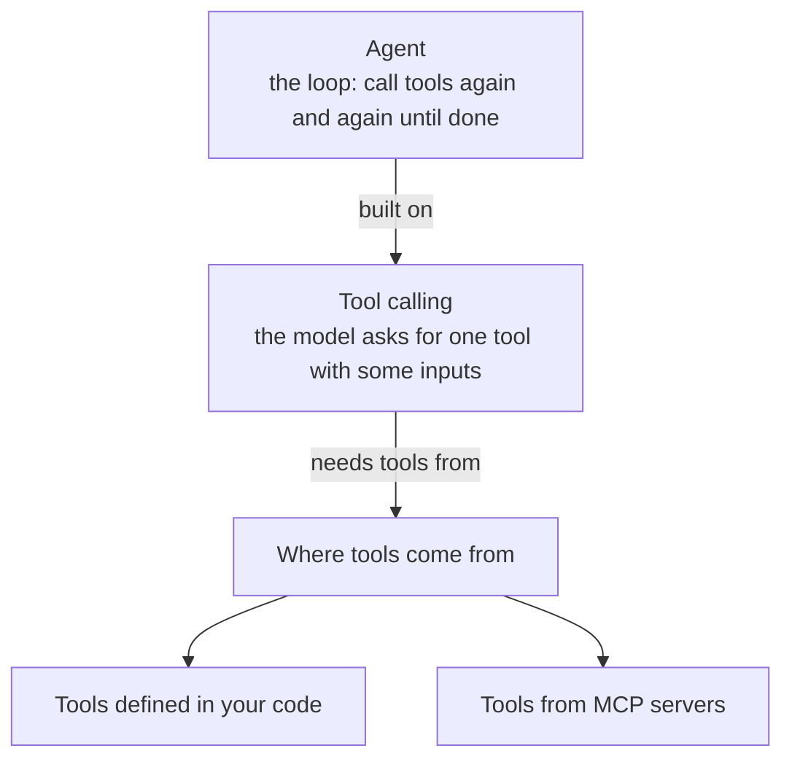
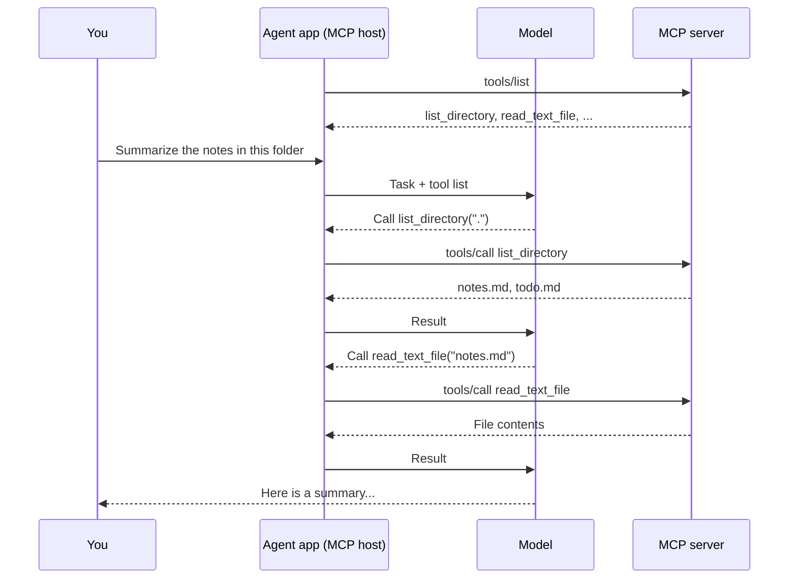
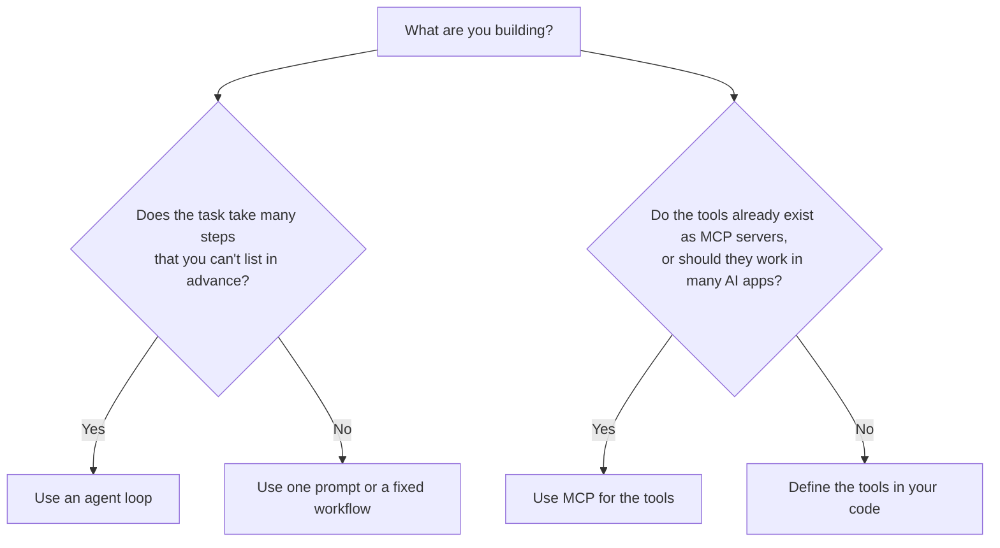

AI agents and MCP are not alternatives, and you don't pick one over the other. MCP (Model Context Protocol) is a standard way to connect tools and data to AI apps. An agent is a way of running a model in a loop that uses tools until a task is done. An agent can get its tools from MCP servers, so the two often work together.

Think of a kitchen. MCP is the standard socket in the wall; tools are the appliances you plug in. The agent is the cook who decides which appliance to use next, looks at the result, and keeps going until the meal is ready. A socket doesn't cook, and a cook without appliances can't do much.

If MCP is new to you, read [What is MCP?](/blog/what-is-mcp) first. If LLMs are new, start with [What is an LLM?](/blog/what-is-an-llm).

## Why do people mix up agents and MCP?

Because they show up together. The MCP docs list "Agents can access your Google Calendar and Notion" as a use of MCP ([source](https://modelcontextprotocol.io/docs/getting-started/intro)). Anthropic's [Building effective agents](https://www.anthropic.com/engineering/building-effective-agents) mentions MCP as one way to plug third-party tools into the model an agent is built on. And a single app, like Claude Code, can be both an agent and an MCP host.

So the words appear in the same sentences. But they answer different questions:

- **MCP** answers "how does an AI app connect to a tool?"
- **An agent** answers "how does a model finish a task that takes many steps?"

## What is the difference between an AI agent and MCP?

| | AI agent | MCP |
| --- | --- | --- |
| What it is | A way of running a model: it uses tools in a loop until the task is done | An open protocol: a standard for how AI apps talk to tool and data servers |
| Who builds it | App developers, with their own loop or an agent SDK | Tool owners build servers; app developers build hosts that connect to them |
| Problem it solves | Tasks where the steps can't be known in advance, like "fix this bug" | Every app having to build its own connector for every tool |
| What it contains | A model, tools, the loop, instructions, memory and limits | Hosts, clients and servers; servers offer tools, resources and prompts |
| Examples | Claude Code, agents built with the Claude Agent SDK, Claude Managed Agents | The GitHub, Notion, Sentry or filesystem MCP servers |

Anthropic defines agents as "systems where LLMs dynamically direct their own processes and tool usage, maintaining control over how they accomplish tasks" ([source](https://www.anthropic.com/engineering/building-effective-agents)). The MCP docs define MCP as "an open-source standard for connecting AI applications to external systems" ([source](https://modelcontextprotocol.io/docs/getting-started/intro)). One is about **behavior**; the other is about **connection**.

## Where does tool calling fit?

There is a third idea underneath both: **tool calling**, also called function calling. It is the model's ability to ask your app to run a tool. The model never runs anything itself. As Anthropic's [tool use docs](https://platform.claude.com/docs/en/agents-and-tools/tool-use/how-tool-use-works) put it: "It emits a structured request, your code (or Anthropic's servers) runs the operation, and the result flows back into the conversation."

The three stack on top of each other:



- **Tool calling** is a model feature. Without it, neither MCP tools nor agents work.
- **MCP** is one source of tools. It packages them so any MCP app can find and call them.
- **An agent** is the loop on top: call a tool, read the result, decide the next step, repeat.

[What is tool calling?](/blog/what-is-tool-calling) covers that middle layer in detail.

## How does an agent use tools from MCP servers?

The AI app sits in the middle. It connects to each MCP server, asks what tools it offers, and passes those tools to the model with the task. When the model asks for a tool, the app sends the call to the right server and returns the result to the model. The MCP docs describe the app combining the tools from all its servers "into a unified tool registry that the language model can access" ([architecture](https://modelcontextprotocol.io/docs/learn/architecture)).



Look at who does what:

- **The model** picks the tools and their inputs. That is tool calling.
- **The agent app** runs the loop, keeps the history and decides when to stop. That is the agent.
- **The MCP server** lists its tools and runs them when asked. That is MCP. It doesn't know it is part of a loop.

In Claude Code, you connect a server with `claude mcp add` and its tools join the built-in ones, such as reading files and running commands. The [Claude Agent SDK](https://code.claude.com/docs/en/agent-sdk/overview) and [Claude Managed Agents](https://platform.claude.com/docs/en/managed-agents/overview) also accept MCP servers as a source of tools. If you call the Claude API directly, the [MCP connector](https://platform.claude.com/docs/en/agents-and-tools/mcp-connector) (in beta) can connect to remote MCP servers for you, without writing your own MCP client.

## Can you have one without the other?

Yes, in both directions.

| | Uses MCP | No MCP |
| --- | --- | --- |
| **Agent** | Claude Code with a GitHub MCP server, fixing an issue across many steps | An agent whose tools are plain functions in your code |
| **Not an agent** | A chat app that makes one MCP tool call to answer "what are my open bugs?" | A single prompt: "summarize this text" |

- **An agent without MCP.** The Claude Agent SDK comes with built-in tools like `Read`, `Edit`, `Bash` and `Grep` ([docs](https://code.claude.com/docs/en/agent-sdk/agent-loop)). You can also define tools directly in your request to the Claude API. No MCP server is involved.
- **MCP without an agent.** An app can ask one question, make one tool call and answer. That is tool use with an MCP tool, but there is no multi-step loop, so it isn't much of an agent.

## What are the common confusions?

**"MCP is an agent framework."** It isn't. The MCP architecture docs say it plainly: "MCP focuses solely on the protocol for context exchange—it does not dictate how AI applications use LLMs or manage the provided context." The loop, the prompts and the stopping rules live in the app.

**"I need MCP to build an agent."** You don't. You need tools. MCP is useful when the tools you want already exist as MCP servers, or when you want the tools you build to work in many apps, like Claude, ChatGPT, VS Code and Cursor.

**"An MCP server is an agent."** Usually not. The docs define a server as "a program that provides context to MCP clients". It offers tools, resources (data to read) and prompts (templates). It waits for requests; the app and its model decide what to call.

**"MCP replaces tool calling."** It doesn't. MCP tools still reach the model as ordinary tools. The model asks for one with tool calling, and the app forwards that request to the server with the MCP method `tools/call`.

**"More MCP servers make a better agent."** Not by itself. Every tool definition takes space in the model's context. The Agent SDK docs warn that without tool search, "each MCP server adds all its tool schemas to every request" ([docs](https://code.claude.com/docs/en/agent-sdk/agent-loop)). Claude Code defers MCP tool definitions by default and loads them when needed, but more tools still mean more choices for the model. Connect the servers the task needs.

## Try it: see what an agent gets from an MCP server

You'll write the MCP half of an agent: start a real MCP server, list its tools, turn them into the format the Claude API expects, and run one tool the way an agent would after the model picks it. It runs on your machine with no API key.

**You need:** [Node.js](https://nodejs.org) (we used Node 22) and a terminal in an empty folder.


<Steps>


<Step title="Install the MCP client and a server">


```bash
npm install @modelcontextprotocol/client @modelcontextprotocol/server-filesystem
```


`@modelcontextprotocol/client` is the official TypeScript MCP client, used in the [MCP client tutorial](https://modelcontextprotocol.io/docs/develop/build-client). The [filesystem server](https://github.com/modelcontextprotocol/servers/tree/main/src/filesystem) is a reference MCP server that works with files in the folders you allow.

</Step>


<Step title="Create the script">


**mcp-tools.mjs**

```js
import { Client } from '@modelcontextprotocol/client';
import { StdioClientTransport } from '@modelcontextprotocol/client/stdio';

// Start the filesystem MCP server as a local program. It may only use this folder.
const transport = new StdioClientTransport({
  command: process.execPath, // the node you are running now
  args: ['node_modules/@modelcontextprotocol/server-filesystem/dist/index.js', '.'],
  stderr: 'ignore', // hide the server's startup log
});
const client = new Client({ name: 'my-agent', version: '1.0.0' });
await client.connect(transport);

// 1. Discovery: ask the server which tools it offers (tools/list).
const { tools } = await client.listTools();
console.log(`${tools.length} tools: ${tools.map((t) => t.name).join(', ')}`);

// 2. Hand them to the model. The Claude API calls the input schema input_schema.
const claudeTools = tools.map((t) => ({
  name: t.name,
  description: t.description,
  input_schema: t.inputSchema,
}));
const listDir = claudeTools.find((t) => t.name === 'list_directory');
console.log();
console.log('Input schema the model gets for list_directory:');
console.log(JSON.stringify(listDir.input_schema));

// 3. Pretend the model asked for list_directory. Run it with tools/call.
const result = await client.callTool({
  name: 'list_directory',
  arguments: { path: '.' },
});
console.log();
console.log('Result to send back to the model:');
console.log(result.content[0].text);

await client.close();
```


The script starts the server from your `node_modules` folder with the same Node.js you run it with, so it needs no global install. In a real agent, step 3 happens inside the loop, every time the model's reply asks for a tool. The [MCP client tutorial](https://modelcontextprotocol.io/docs/develop/build-client) shows the full version with Claude, which needs an API key.

</Step>


<Step title="Run it">

```bash
$ node mcp-tools.mjs
```

You should see something like this (the tool list can change between server versions):

```text
14 tools: read_file, read_text_file, read_media_file, read_multiple_files, write_file, edit_file, create_directory, list_directory, list_directory_with_sizes, directory_tree, move_file, search_files, get_file_info, list_allowed_directories

Input schema the model gets for list_directory:
{"type":"object","properties":{"path":{"type":"string"}},"required":["path"],"$schema":"http://json-schema.org/draft-07/schema#"}

Result to send back to the model:
[FILE] mcp-tools.mjs
[DIR] node_modules
[FILE] package-lock.json
[FILE] package.json
```

The server knows nothing about models or loops. It listed its tools and ran one. Everything that makes this an agent, choosing the next tool and deciding when to stop, would live in your code around it.

</Step>


</Steps>


<Callout type="warning" title="Tools act on real systems">

This server can also write, edit and move files, but only inside the folder you pass it (`.` here). The MCP maintainers describe their reference servers as "educational examples", not production-ready. When an agent runs tools in a loop, a mistake or a hidden instruction in a file can turn into many actions. Give servers the least access they need, and keep approvals on for anything you can't undo.

</Callout>


## How do I decide what I need?

Ask two separate questions.



The answers combine. A coding assistant for your team might be an agent (question 1) that uses your issue tracker's official MCP server (question 2). A support bot that always runs the same three steps might be a workflow with tools defined in code. Anthropic's advice applies to both: find "the simplest solution possible, and only increasing complexity when needed" ([source](https://www.anthropic.com/engineering/building-effective-agents)).

## What should I do next?

- **Connect an MCP server to an agent you already have.** [What is MCP?](/blog/what-is-mcp) walks you through adding one to Claude Code in a few minutes. Then give Claude Code a task that needs several of its tools, and watch the loop.
- **Read the MCP [architecture overview](https://modelcontextprotocol.io/docs/learn/architecture)** to see the messages behind `tools/list` and `tools/call`.
- **Read more in this series:** [What is an AI agent?](/blog/what-is-an-ai-agent) goes deeper on the loop, and [What is tool calling?](/blog/what-is-tool-calling) explains the layer both ideas are built on.
