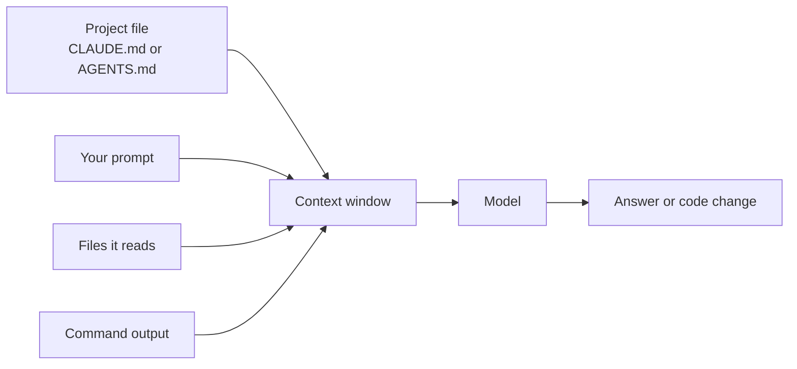
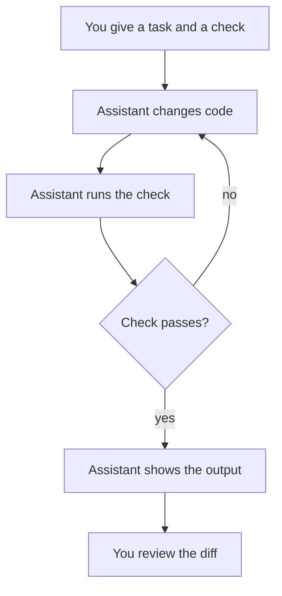

AI coding assistants give their best results when you treat them like a smart new teammate who has never seen your project. Tell them how your project works, give them one clear task at a time, make them prove the work with tests, and read what they write before you merge it. This post turns those four habits into concrete steps, using [Claude Code](https://code.claude.com/docs/en/overview) as the example.

The tips work with any assistant, in a chat window or in your editor. The Claude Code parts show where each habit lives in one real tool.

## What kinds of AI coding assistants are there?

Most tools fall into three groups. They differ in how much they can see and do on their own.

| Kind | Where it runs | What it can do | You provide |
| --- | --- | --- | --- |
| Chat | A chat window in the browser or an app | Answers questions and writes code you copy back | Every piece of code and context, by pasting |
| In-editor | Inside your code editor | Suggests code as you type, answers questions about open files | The file you're in, plus what you select |
| Agentic | Your terminal, editor or the cloud | Reads files, runs commands and edits code on its own, step by step | A goal, the project rules and a way to check the result |

**Agentic** means the assistant can take actions, not just talk. The [Claude Code best practices](https://code.claude.com/docs/en/best-practices) describe it this way: unlike a chatbot that answers and waits, Claude Code can read your files, run commands, make changes, and work through problems while you watch. It runs in your terminal, as an extension in VS Code and JetBrains IDEs, in a desktop app and on the web.

The more an assistant can do, the more your habits matter. A bad chat answer costs you a copy-paste. A bad agentic run can edit ten files.

## Why does context matter so much?

An LLM (large language model) only knows two things: what it learned in training and what is in its **context window**, the text it can see right now. If you're new to these terms, [What is an LLM?](/blog/what-is-an-llm) explains them.

For a coding assistant, the context window holds your messages, every file it reads and every command output. Two facts from the Claude Code docs shape the rest of this post:

- **Each session starts fresh.** The [memory docs](https://code.claude.com/docs/en/memory) say every Claude Code session begins with a new, empty context window. Yesterday's explanation is gone.
- **Context fills up fast, and quality drops as it fills.** The [best practices](https://code.claude.com/docs/en/best-practices) call the context window "the most important resource to manage". When it gets full, the model may start forgetting earlier instructions.



So your job is to put the right things in that window, and keep the wrong things out.

## How do I give the assistant project context?

Write down, once, what you would otherwise explain in every session. Agentic tools read a project file at the start of each session for this.

### CLAUDE.md in Claude Code

`CLAUDE.md` is a Markdown file in your project root. Claude Code [reads it at the start of every session](https://code.claude.com/docs/en/memory). Commit it to git and your whole team shares it.

You don't have to start from a blank page. Run `/init` inside a Claude Code session, and Claude looks at your codebase and writes a starter `CLAUDE.md` with build commands, test instructions and conventions it finds. If the file already exists, `/init` suggests improvements instead of overwriting it.

The docs give clear advice on what to keep in it:

| Put in CLAUDE.md | Leave out |
| --- | --- |
| Commands the AI can't guess, such as how to run one test | Anything it can learn by reading the code |
| Code style rules that differ from the defaults | Standard language conventions |
| How you test, and which test runner you use | Long API documentation (link to it instead) |
| Branch and pull request rules | Information that changes often |
| Surprises and gotchas in your project | Obvious advice like "write clean code" |

Keep it short. The docs suggest under 200 lines per file, because the whole file is loaded into every session and long files are followed less reliably. For each line, ask: would the AI make a mistake without it? If not, delete it.

To check that Claude loaded your file, run `/context` in a session and look for it under **Memory files**.

### AGENTS.md for every tool

[AGENTS.md](https://agents.md) is an open format for the same idea: a "README for agents". It is plain Markdown with no required fields, and many coding agents read it, including OpenAI Codex, Cursor, Gemini CLI and GitHub Copilot's coding agent. The format is now stewarded by the Agentic AI Foundation under the Linux Foundation.

If your project already has an `AGENTS.md`, you don't need to copy it. According to the [Claude Code memory docs](https://code.claude.com/docs/en/memory):

- Claude Code reads `AGENTS.md` when there is no `CLAUDE.md` in your working directory or above it. This needs Claude Code v2.1.277 or later.
- If you also want Claude-only rules, create a `CLAUDE.md` that starts with the line `@AGENTS.md`. That line imports the shared file, and your Claude-specific rules go below it.

### In a chat window

Chat tools don't read your repo, so paste the context yourself: the file you're changing, the error message, and two or three lines about your stack. To let an assistant reach your issue tracker, database or docs without copy-paste, connect them with MCP. [What is MCP?](/blog/what-is-mcp) shows how.

## How do I ask for what I want?

The assistant can guess your intent, but it can't read your mind. A good request has four parts:

1. **One small task.** "Add input checks to the signup form" works better than "improve the signup flow". Small tasks give small diffs, and small diffs are easy to review.
2. **The goal and the limits.** Say what "done" means and what not to touch: "no new dependencies", "keep the public API the same", "don't use mocks".
3. **An example.** Show the input and the output you expect, or point to existing code that does something similar: "follow the pattern in `src/widgets/Clock.tsx`".
4. **The right files.** In Claude Code, type `@` and a path, such as `@src/auth/login.ts`, and Claude reads that file before it answers.

| Vague | Specific |
| --- | --- |
| "Add tests for `cart.js`" | "Add a test for `@src/cart.js` for an empty cart. Don't use mocks." |
| "Fix the login bug" | "Login fails after the session times out. Look at the token refresh in `src/auth/`. Write a failing test first, then fix it." |

For bigger changes, ask for a plan before any code. Claude Code has **plan mode** for this: press `Shift+Tab` until the status bar shows plan mode, and Claude reads and answers questions without changing files. The docs suggest skipping the plan when you could describe the change in one sentence.

When a session goes wrong, don't keep correcting. The best practices say that after two failed corrections you should run `/clear` to start with an empty context and write a better first prompt. Use `/clear` between unrelated tasks too.

## How do I make the assistant check its own work?

Give it a check it can run and read: your test suite, a build, a linter. The [best practices](https://code.claude.com/docs/en/best-practices) put this first. Without a check, the assistant stops when the work "looks done", and you become the one who finds every mistake.



Two habits make this work:

- **Name the check.** End the request with "run `npm test` and fix any failures", or put the test command in `CLAUDE.md` once.
- **Ask for evidence, not a promise.** "Show me the test output" is faster to review than re-running everything yourself, and it catches a claim that isn't true.

Then look at the change. In Claude Code, `/diff` shows the changes in your working tree, including Claude's edits. In any tool, `git diff` does the same.

## How should I review AI-written code?

Review it like code from a new teammate: carefully, and line by line. Tests passing is a good start, not the end. The OWASP [Top 10 for LLM applications](https://genai.owasp.org/llmrisk/llm092025-misinformation/) warns about **overreliance**: trusting AI output without checking it. It also notes that models can suggest insecure code or packages that don't exist.

Before you merge, check:

- **Every line.** If you can't explain a line, ask the assistant why it's there, or remove it.
- **The tests.** Did it add tests for the cases you care about? Did it change or delete a test just to make it pass?
- **Security.** Look for user input going into SQL, shell commands or HTML without checks. In Claude Code, [`/security-review`](https://code.claude.com/docs/en/commands) checks the changes on your branch for problems like injection, auth issues and data exposure. Treat it as a second pair of eyes, not a replacement for yours.
- **New dependencies.** Check that each new package really exists, is maintained and is the one you meant. OWASP lists suggestions of made-up or insecure packages as a known risk.
- **Licences.** If a large block looks copied from another project, find the source and check its licence before you keep it.
- **Secrets.** Make sure no key, token or password ended up in the code, the tests or the logs.

## How do I keep secrets out of prompts?


<Callout type="warning" title="Anything you send is part of the prompt">

Everything you paste, and every file an agent reads, becomes part of what the model sees. With a cloud model, that text leaves your machine. Never paste API keys, passwords, tokens or `.env` files, and check logs and stack traces for tokens before you share them. If a secret does end up in a prompt, rotate it.

</Callout>


Three habits keep secrets safe:

- **Replace real values with placeholders** such as `YOUR_API_KEY` when you share code or config.
- **Load secrets from environment variables** in your code, so they never sit in the files you ask about.
- **Block agent access to secret files.** A rule in `CLAUDE.md` is only a request. To really block reads, Claude Code has [deny rules](https://code.claude.com/docs/en/settings-reference) in `.claude/settings.json`, such as `Read(./.env)`. The docs note that these rules cover Claude's own file tools and file commands it recognises, not every program it could run, so use the [sandbox](https://code.claude.com/docs/en/sandboxing) when you need a hard wall.

It also helps to know what the assistant may do without asking. In Claude Code's Manual mode, it [asks you first](https://code.claude.com/docs/en/security) before it edits files, runs tests or runs commands that can change your system. Read each request before you approve it.

## When should I not use an AI assistant?

An assistant is a tool, not a rule. Write the code yourself, or slow down, when:

- **You're learning the basics.** If the AI writes every loop, you won't learn to write one. Ask it to explain instead.
- **You can't check the answer.** If you can't read the code or test it, you can't tell good output from bad.
- **The change is risky and hard to undo.** Database migrations, payments, auth and production infrastructure need a person who understands every step.
- **Your company doesn't allow it** for this code or data. Follow the policy, even for "just one quick question".

## Try it: set up a CLAUDE.md and use it

You'll write a `CLAUDE.md` for a tiny Node.js library, block access to `.env` files, and ask Claude Code for a change that follows your rules.

**You need:** Node.js 22 and [Claude Code installed and signed in](https://code.claude.com/docs/en/setup). Run `claude --version` to check; it prints a version number.


<Steps>


<Step title="Create a tiny project">

Make a folder called `slugify-lite` with these three files. The library turns titles into URL slugs, such as `hello-world`.


**package.json**

```json
{
  "name": "slugify-lite",
  "version": "1.0.0",
  "type": "module",
  "scripts": {
    "test": "node --test"
  }
}
```


**src/slugify.js**

```js
export function slugify(title) {
  return title
    .toLowerCase()
    .normalize('NFKD')
    .replace(/[\u0300-\u036f]/g, '')
    .replace(/[^a-z0-9]+/g, '-')
    .replace(/^-+|-+$/g, '');
}
```


**test/slugify.test.js**

```js
import { test } from 'node:test';
import assert from 'node:assert/strict';
import { slugify } from '../src/slugify.js';

test('turns a title into a slug', () => {
  assert.equal(slugify('Hello, World!'), 'hello-world');
});

test('removes accents', () => {
  assert.equal(slugify('Café au lait'), 'cafe-au-lait');
});
```


Run the tests to make sure everything works before the AI touches it:

```bash
$ npm test
```

```text
✔ turns a title into a slug (0.994335ms)
✔ removes accents (0.184065ms)
ℹ tests 2
ℹ pass 2
ℹ fail 0
```

The full output has a few more lines, and your times will differ.

</Step>


<Step title="Write the CLAUDE.md">

In a bigger project, start with `/init` and trim what it writes. For this small one, create the file yourself in the project root:


**CLAUDE.md**

```md
# slugify-lite

A tiny Node.js library that turns titles into URL slugs.

## Commands
- Run all tests: `npm test`
- Run one test file: `node --test test/slugify.test.js`

## Code style
- ES modules only (`import`/`export`), never `require`
- No runtime dependencies: use only Node.js built-ins
- 2-space indentation and single quotes

## Layout
- Source code lives in `src/`
- Tests live in `test/` as `<name>.test.js`, using `node:test` and `node:assert/strict`

## Workflow
- Add or update a test for every change
- Run `npm test` before you say a task is done, and show the output
- Ask before adding a dependency
```


Each line is something Claude couldn't guess: the test commands, the no-dependencies rule, where tests go and what to do before saying "done".

</Step>


<Step title="Block secret files">

Create `.claude/settings.json` so Claude's file tools can't read `.env` files, even if you add one later:


**.claude/settings.json**

```json
{
  "permissions": {
    "deny": [
      "Read(./.env)",
      "Read(./.env.*)"
    ]
  }
}
```


</Step>


<Step title="Start Claude Code and check the file loaded">

Open a terminal in the `slugify-lite` folder and start a session:

```bash
$ claude
```

Run `/context` and look for `CLAUDE.md` under **Memory files**.

</Step>


<Step title="Ask for a small, specific task">

Type this prompt:

```text
Add an optional maxLength option to slugify in @src/slugify.js.
When the slug is longer than maxLength, cut it at a word boundary so it never ends with a hyphen.
Add tests for a short title, a cut in the middle of a word, and a title with no limit.
```

Notice what the prompt doesn't say: where the tests go, how to run them, or which module style to use. `CLAUDE.md` already covers that, so Claude should put the tests in `test/slugify.test.js`, use `import`, add no packages and run `npm test` before it finishes.

</Step>


<Step title="Review the change">

When Claude says it's done, check its work instead of trusting the summary:

```bash
$ git diff
$ npm test
```

Read every changed line and check that no test was weakened. If Claude broke a rule from `CLAUDE.md`, tell it. If it happens again, make the rule clearer in the file.

</Step>


</Steps>


That's the whole loop: rules in a file, a small task, a check the AI runs, and a review by you.

## What should I do next?

- **Add a `CLAUDE.md` or `AGENTS.md` to a real project today.** Start with `/init` or the [agents.md examples](https://agents.md), then add a line each time the assistant makes the same mistake twice.
- **Read the [Claude Code best practices](https://code.claude.com/docs/en/best-practices)** for plan mode, subagents and managing long sessions.
- **Connect your tools with MCP** so the assistant can read your issues and docs itself. Start with [What is MCP?](/blog/what-is-mcp).
- **Keep secrets out of your prompts** with the checklist in [Never paste secrets into AI prompts](/blog/secrets-in-ai-prompts).
