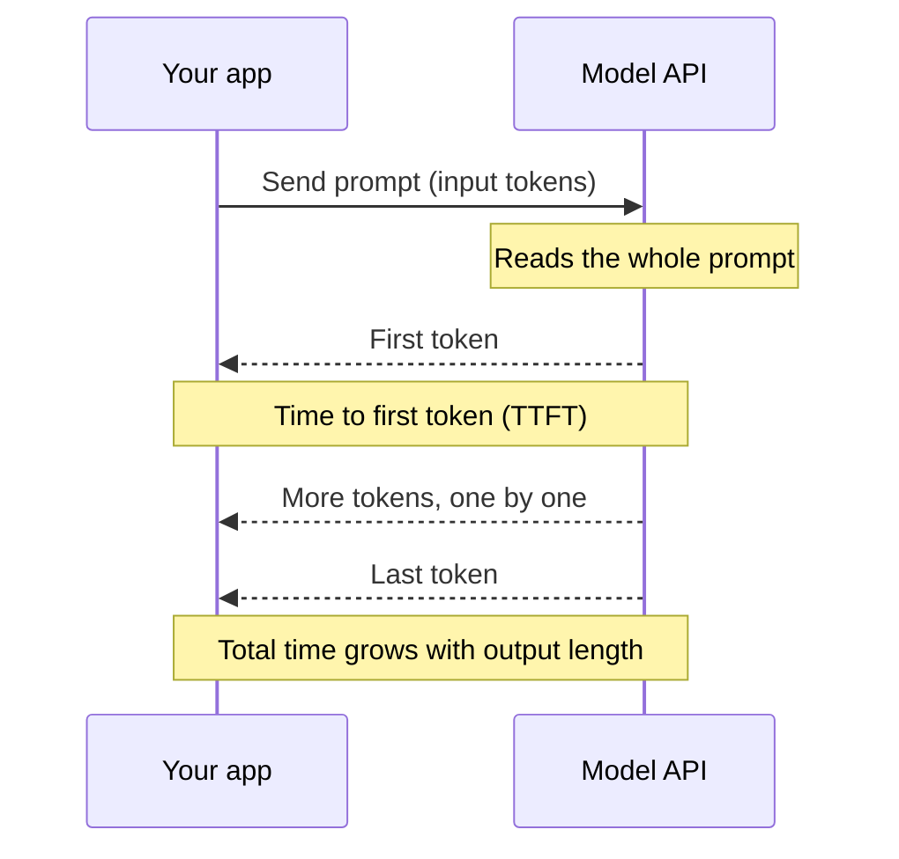

With an LLM API, you pay for every token the model reads and writes, and you wait for every token it writes. So cost and latency (how long a response takes) have the same main driver: how many tokens go in and come out, and how big the model is. Cut the tokens and pick the smallest model that does the job well, and both go down.

This post shows what drives each one, how to estimate the cost of a request before and after you send it, and the levers that help most. You'll finish with a small cost calculator you can run without an API key.

## What am I paying for?

Tokens. A token is a small piece of text, about 3.5 English characters for Claude (see [What is an LLM?](/blog/what-is-an-llm) for how text splits into tokens). The API charges separately for:

- **Input tokens:** everything you send. Your system prompt, the conversation so far, any documents, and tool definitions.
- **Output tokens:** everything the model writes. On models that think before they answer, the thinking counts as output tokens too.

The formula is simple:

```text
cost = input tokens × input price + output tokens × output price
```

Prices are quoted per million tokens (MTok). Here are the current Claude models, from Anthropic's [pricing page](https://platform.claude.com/docs/en/about-claude/pricing) on 26 September 2026:

| Model | API ID | Input / MTok | Output / MTok | Comparative latency |
| --- | --- | --- | --- | --- |
| Claude Haiku 4.5 | `claude-haiku-4-5` | $1 | $5 | Fastest |
| Claude Sonnet 5 | `claude-sonnet-5` | $2 | $10 | Fast |
| Claude Opus 5.5 | `claude-opus-5-5` | $4 | $20 | Moderate |
| Claude Fable 5.1 | `claude-fable-5-1` | $10 | $50 | Slower |


**Claude API price per million tokens (USD)**

| model | input | output |
| --- | --- | --- |
| Haiku 4.5 | 1 | 5 |
| Sonnet 5 | 2 | 10 |
| Opus 5.5 | 4 | 20 |
| Fable 5.1 | 10 | 50 |


Two things stand out. Output costs five times as much as input on every one of these models. And the largest model costs ten times the smallest for the same tokens. Prices change, so treat these numbers as a snapshot and check the [pricing page](https://platform.claude.com/docs/en/about-claude/pricing) before you plan a budget.


<Callout type="note" title="Same text, more tokens on newer models">

Claude 4.7 and later models use a newer tokenizer that produces about 30% more tokens for the same text, according to the pricing page. If you move from an older model, count your prompts again instead of reusing old token counts.

</Callout>


## How do I estimate what a request costs?

Two tools, one before and one after you send:

- **Before:** the [token counting API](https://platform.claude.com/docs/en/build-with-claude/token-counting) takes the same messages you would send and returns the number of input tokens. It is free to use, with its own rate limit. The count is an estimate and can differ by a small amount.
- **After:** every response has a `usage` field with the exact counts: `input_tokens`, `output_tokens`, and, if you use prompt caching, `cache_creation_input_tokens` and `cache_read_input_tokens`.

Here is both in code, using the official SDK and the `cost()` function you'll build below:


**usage.mjs**

```js
import Anthropic from '@anthropic-ai/sdk';
import { cost } from './cost.mjs';

const client = new Anthropic(); // reads ANTHROPIC_API_KEY from the environment
const model = 'claude-sonnet-5';
const question = 'Explain HTTP caching in three sentences.';

// Before you send: count the input tokens (free, but rate limited).
const count = await client.messages.countTokens({
  model,
  messages: [{ role: 'user', content: question }],
});
console.log('input tokens (estimate):', count.input_tokens);

// After you send: `usage` says what you were billed for.
const message = await client.messages.create({
  model,
  max_tokens: 1024,
  messages: [{ role: 'user', content: question }],
});
console.log(message.usage);
console.log('cost in USD:', cost(model, message.usage));
```


You can't count output tokens before you send, because you don't know how long the answer will be. Set `max_tokens` to cap it, and use the `usage` from real responses to learn your typical length.

## What makes a response slow?

Anthropic's [glossary](https://platform.claude.com/docs/en/about-claude/glossary) lists what affects latency: model size, hardware, network conditions, and the complexity of the prompt and of the response. The ones you control are the model and the tokens.

It helps to split one request into two times:



- **Time to first token (TTFT)** is how long until the first piece of the answer arrives. It matters most for chat and other interactive features. A long prompt and a big model both push it up.
- **Total time** is how long until the last token. Each output token is generated one after another, so a long answer takes longer. On models that think first, thinking tokens add to this time too.

Anthropic's [guide to reducing latency](https://platform.claude.com/docs/en/test-and-evaluate/strengthen-guardrails/reduce-latency) sums it up: the fewer tokens the model has to process and generate, the faster the response. It also gives one piece of advice worth keeping: first get a prompt that works well, then optimize for speed. Cutting too early hides what good results look like.

## How do I cut cost and latency?

Here are the levers, roughly in the order to try them. Check every change with your evals, so you know quality held.

| Lever | Cuts cost | Cuts latency | Watch out for |
| --- | --- | --- | --- |
| Smaller model | Yes | Yes | Quality on hard cases |
| Shorter prompt | Yes | Yes (TTFT) | Removing context the model needs |
| Shorter output, `max_tokens` | Yes | Yes | Answers cut off mid-sentence |
| Lower effort | Yes | Yes | Less reasoning on hard tasks |
| Prompt caching | Yes | Yes | Only helps prompts that repeat |
| Batch API | 50% | No (slower) | Results can take up to 24 hours |
| Streaming | No | Feels faster | Total time is the same |
| Cache your own results | Yes | Yes | Stale or personal answers |

### Pick the smallest model that passes your evals

This is usually the biggest lever. Anthropic's [guide to choosing a model](https://platform.claude.com/docs/en/about-claude/models/choosing-a-model) suggests one approach for many apps: start with a fast, low-cost model like Claude Haiku 4.5, test it well, and upgrade only where it falls short. The same guide says a good evaluation set is the most important step. Without one, you can't tell if the cheaper model is good enough. [How to test AI output with evals](/blog/test-ai-output-with-evals) shows how to build one.

You can also combine models. The same guide describes pairing a lower-cost model with a frontier model, so most tokens are billed at the lower rate: for example, a small model does the bulk work and hands only the hard decisions to a bigger one.

### Send fewer tokens, and ask for fewer back

- **Trim the prompt.** Remove repeated instructions, old conversation turns and data the model doesn't need. Be clear but concise.
- **Ask for short answers.** Anthropic's latency guide suggests asking for a number of sentences or paragraphs rather than a word count, since models count tokens, not words.
- **Set `max_tokens`.** It's a hard limit on the answer's length. The response is cut off when it hits the limit, even mid-sentence, so it suits short answers, such as a label or a multiple-choice pick.
- **Lower the effort.** On models that support the [effort parameter](https://platform.claude.com/docs/en/build-with-claude/effort), `low` is the most efficient setting, with significant token savings and some loss of capability. Anthropic suggests it for simpler tasks that need the best speed and lowest cost.

### Use prompt caching for repeated context

If many requests start with the same long text, such as a system prompt, tool definitions or a document, [prompt caching](https://platform.claude.com/docs/en/build-with-claude/prompt-caching) lets the API reuse it. On most models, a cache read costs 10% of the normal input price (5% on Opus 5.5). Writing to the 5-minute cache costs 1.25 times the input price, so it pays off after one cache hit. Anthropic says caching also reduces processing time.

The catch: the prompt must be long enough to cache (for example, 1,024 tokens on Sonnet 5 and 4,096 on Haiku 4.5), and the cached part must be identical at the start of each request: changing anything before the cache point means a new cache entry. Put the stable parts first and the changing question last.

### Use the Batch API when nobody is waiting

The [Message Batches API](https://platform.claude.com/docs/en/build-with-claude/batch-processing) processes requests in the background at 50% of the normal price, for both input and output. Most batches finish within an hour, but results can take up to 24 hours. It's a good fit for evals, nightly reports, and tagging or summarizing a backlog. It stacks with prompt caching, though cache hits in a batch are best-effort.

### Stream the answer for perceived speed

[Streaming](https://platform.claude.com/docs/en/build-with-claude/streaming) sends the answer as it's written instead of all at the end. It doesn't change the cost or the total time. But users see text almost right away instead of staring at a spinner, which Anthropic's latency guide says can significantly improve how responsive your app feels.

### Cache your own results

The cheapest request is the one you don't send. If users often ask the same thing, such as "summarize this release" for the same release, store the answer and reuse it. Key the cache on everything that changes the answer: the model, the prompt and the input. Don't share cached answers that contain one user's personal data with another user, and expire them when the source changes.

## Try it: a tiny cost calculator

You'll build the `cost()` function used above and compare three models and three pricing options. It needs no API key and no packages.

**You need:** [Node.js](https://nodejs.org) 22 or later. We ran it with Node 22.22.


<Steps>


<Step title="Write the cost function">


**cost.mjs**

```js
// USD per million tokens (MTok), copied from Anthropic's pricing page on 2026-09-26.
// Prices change: check https://platform.claude.com/docs/en/about-claude/pricing
export const PRICES = {
  'claude-opus-5-5': { input: 4, output: 20, cacheRead: 0.2 },
  'claude-sonnet-5': { input: 2, output: 10, cacheRead: 0.2 },
  'claude-haiku-4-5': { input: 1, output: 5, cacheRead: 0.1 },
};

// `usage` has the same shape as the `usage` field in a Messages API response.
export function cost(model, usage, { batch = false } = {}) {
  const price = PRICES[model];
  if (!price) throw new Error(`No price for ${model}`);
  const dollars =
    (usage.input_tokens * price.input +
      (usage.cache_creation_input_tokens ?? 0) * price.input * 1.25 + // 5-minute cache write
      (usage.cache_read_input_tokens ?? 0) * price.cacheRead +
      usage.output_tokens * price.output) /
    1_000_000;
  return batch ? dollars * 0.5 : dollars; // the Batch API is 50% off
}
```


The prices are the ones in the table above. `usage` has the same field names as the API's `usage` object, so you can pass a real response straight in. The cache write price assumes the 5-minute cache.

</Step>


<Step title="Write some example requests">


**estimate.mjs**

```js
import { PRICES, cost } from './cost.mjs';

const usd = (n) => `$${n.toFixed(4)}`;
const perMonth = 100_000; // requests

// 1. The same request on each model.
const usage = { input_tokens: 2_000, output_tokens: 500 };
console.log('2,000 tokens in, 500 out');
for (const model of Object.keys(PRICES)) {
  const one = cost(model, usage);
  console.log(`  ${model.padEnd(17)} ${usd(one)} per request, $${(one * perMonth).toFixed(0)} per 100k`);
}

// 2. A 10,000-token system prompt on Sonnet 5: sent every time vs. read from the cache.
const model = 'claude-sonnet-5';
const noCache = cost(model, { input_tokens: 10_200, output_tokens: 300 });
const cached = cost(model, { input_tokens: 200, cache_read_input_tokens: 10_000, output_tokens: 300 });
console.log(`\n${model}, 10,000-token system prompt + 200-token question, 300 out`);
console.log(`  no cache      ${usd(noCache)}`);
console.log(`  cache hit     ${usd(cached)}`);
console.log(`  batch + cache ${usd(cost(model, { input_tokens: 200, cache_read_input_tokens: 10_000, output_tokens: 300 }, { batch: true }))}`);
```


The first part prices one typical request on each model. The second compares a long, repeated system prompt with and without caching and the Batch API.

</Step>


<Step title="Run it">

```bash
$ node estimate.mjs
```

You should see:

```text
2,000 tokens in, 500 out
  claude-opus-5-5   $0.0180 per request, $1800 per 100k
  claude-sonnet-5   $0.0090 per request, $900 per 100k
  claude-haiku-4-5  $0.0045 per request, $450 per 100k

claude-sonnet-5, 10,000-token system prompt + 200-token question, 300 out
  no cache      $0.0234
  cache hit     $0.0054
  batch + cache $0.0027
```

The same request costs four times as much on Opus 5.5 as on Haiku 4.5. And for a long system prompt that repeats, a cache hit cuts the cost of a request by about three quarters, and the Batch API halves what's left. The first request still pays a little extra to write the cache.

</Step>


</Steps>


Change the token counts to match your own app. Take them from `usage` in a few real responses, multiply by your expected monthly traffic, and you have a budget you can defend.

## What should I do next?

- **Log `usage` for every request** in your app, with the model name. You can't cut what you don't measure.
- **Try the next smaller model** on your evals. If it passes, you've cut cost and latency in one change.
- **Read Anthropic's [pricing page](https://platform.claude.com/docs/en/about-claude/pricing)** for the full list, including cache write prices, the 1-hour cache and tool pricing.
