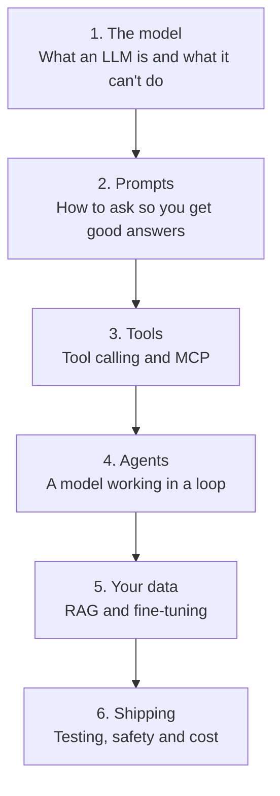
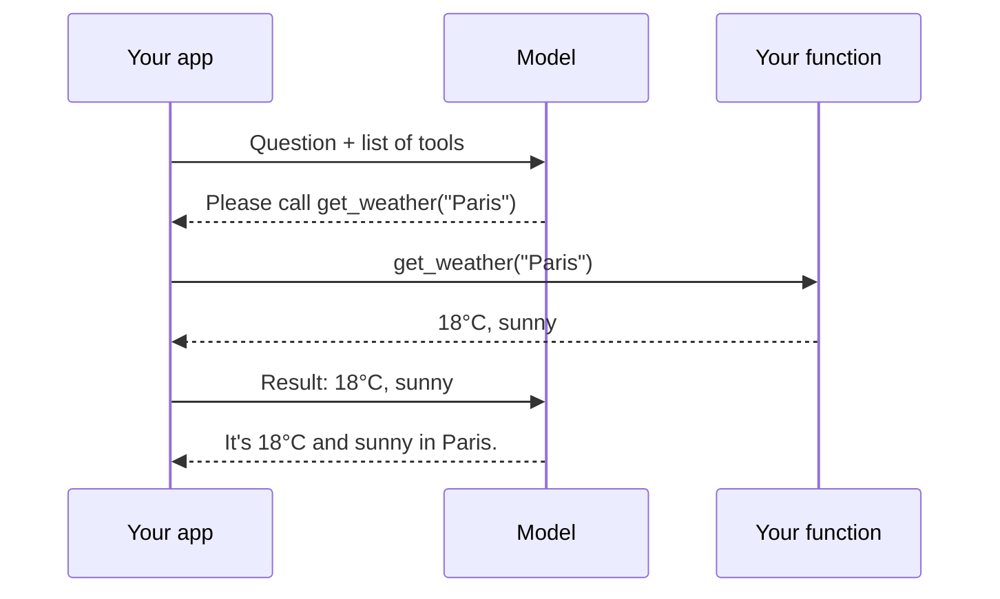
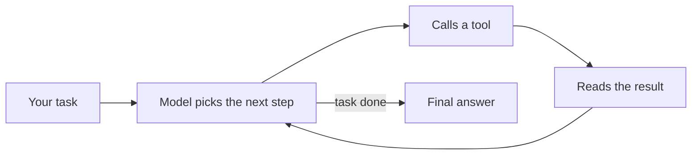

Learn AI in six steps: first what a model is, then how to talk to it, then how to give it tools, then how to let it work on its own, then how to give it your own data, and finally how to ship it safely. Each step uses the ideas from the step before, so this order saves you from confusion later.

You don't need a math degree or your own GPU for any of it. If you can call a web API, you can build with AI.

## Why does the order matter?

AI words are easy to mix up. People say "agent", "MCP", "RAG" and "fine-tuning" as if they were the same kind of thing. They are not. Each one solves a different problem, and each one sits on top of simpler ideas.

For example, MCP is a way to give a model tools. That only makes sense once you know a model can ask your code to run a tool. And that only makes sense once you know what a model does with your text. Learn the base first and the rest falls into place.

## Step 1: What is an LLM, and what can't it do?

An LLM (large language model) is the engine behind Claude, ChatGPT and similar apps. It was trained on a huge amount of text, and it writes an answer by predicting the next piece of text again and again, based on everything that came before. [Anthropic's glossary](https://platform.claude.com/docs/en/about-claude/glossary) describes it this way.

A handful of words will come up in every AI article you read:

| Word | What it means in plain words |
| --- | --- |
| Token | A small piece of text the model reads and writes, such as a word or part of a word. APIs count and bill in tokens. |
| Context window | The model's working memory: how much text it can look at in one go, including your question and its answer. |
| Prompt | Everything you send to the model: your question, instructions and any data. |
| Temperature | A setting for how random the answers are. Lower gives steadier answers; higher gives more varied ones. Some newer models don't let you change it. |
| Hallucination | When the model states something that sounds right but is false. |

The most important thing to learn here is the limits. A model only knows what it learned in training and what you put in the prompt. It can [hallucinate](https://platform.claude.com/docs/en/test-and-evaluate/strengthen-guardrails/reduce-hallucinations), so you check important answers. Every later step is a way to work around one of these limits.

**Read next:** [What is an LLM?](/blog/what-is-an-llm)

## Step 2: How do you talk to a model?

This step has two parts: writing good prompts, and calling a model from your own code.

**Prompts.** A clear prompt gives the model the task, the context it needs and the shape of the answer you want. Many bad answers come from a vague prompt, not a weak model. Improving prompts is called prompt engineering, and it is usually the cheapest way to get better results.

**The API.** Chat apps are for people. Your code talks to a model through an API: you send your messages as JSON over HTTP, and you get the answer back. Once you can make one API call, you can add AI to any app you already build.

**Read next:** [What is prompt engineering?](/blog/what-is-prompt-engineering), then [How to write your first effective prompt](/blog/write-your-first-prompt) and [Your first LLM API call](/blog/first-llm-api-call).

## Step 3: How do you give a model tools?

A model on its own can only write text. Tools let it do things: look up the weather, search your issues, query a database.

This is called **tool calling** (or function calling). You tell the model which tools exist. When a question needs one, the model does not run it itself. It replies with a request, "please call this tool with these inputs". Your code runs the tool and sends the result back, and the model uses it to answer. [Anthropic's tool use docs](https://platform.claude.com/docs/en/agents-and-tools/tool-use/overview) show this round trip.

**MCP** comes next. Every app used to wire up tools its own way. MCP (Model Context Protocol) is a standard way to package tools so that any AI app can use them. Read [What is MCP?](/blog/what-is-mcp) for the full picture and a hands-on step.

**Read next:**

- [What is tool calling?](/blog/what-is-tool-calling) and [What is MCP?](/blog/what-is-mcp)
- The MCP series: [build your first MCP server](/blog/build-your-first-mcp-server), [test and debug it](/blog/test-and-debug-mcp-server), [publish it](/blog/publish-mcp-server), and [what adding MCP to an existing app gets you](/blog/add-mcp-to-existing-app)

## Step 4: What is an agent?

With tools, a model can take one action. An agent takes many. It is a model that works in a loop: it picks a tool, looks at the result, decides the next step, and keeps going until the task is done.

Anthropic describes agents as "LLMs using tools based on environmental feedback in a loop" in its guide [Building effective agents](https://www.anthropic.com/engineering/building-effective-agents).

The same guide gives advice worth taking early: find the simplest solution that works, and add agents only when a simpler setup falls short. An agent is more powerful, but it is also harder to test and costs more to run.

Frameworks such as [LangChain](https://docs.langchain.com/oss/python/langchain/overview) help you build agents from a model, tools and a prompt. Learn the loop first, then pick a framework.

**Read next:**

- [What is an AI agent?](/blog/what-is-an-ai-agent), [AI agents vs MCP](/blog/ai-agents-vs-mcp) and [What is LangChain?](/blog/what-is-langchain)
- Hands-on: [build your first AI agent](/blog/build-your-first-ai-agent), then [test, deploy and use it](/blog/test-deploy-ai-agent)

## Step 5: How do you give a model your own data?

The model doesn't know your docs, your tickets or last week's changes. There are two main ways to fix that, and they solve different problems.

**RAG (retrieval-augmented generation)** finds the most relevant pieces of your data for each question and puts them into the prompt. The model then answers using that data. The idea comes from a [2020 research paper](https://arxiv.org/abs/2005.11401) by Patrick Lewis and others, and it is now a common way to build "chat with your docs" features.

**Fine-tuning** means training an existing model a bit more on your own examples, so it picks up their patterns, such as a style or a specialised task. The [glossary](https://platform.claude.com/docs/en/about-claude/glossary) notes that it needs careful work on the training data.

| You want the model to… | Start with |
| --- | --- |
| Follow instructions or a format better | A better prompt |
| Answer from your docs or fresh data | RAG |
| Behave in a new way that prompts can't teach | Fine-tuning |

Try them in that order. A better prompt is free, RAG changes no model, and fine-tuning costs the most time and money.

Two places you'll meet here: [Hugging Face](https://huggingface.co/docs/hub/index), a hub of millions of open models and datasets, and [Ollama](https://github.com/ollama/ollama), which runs open models on your own computer.

**Read next:**

- [What is RAG?](/blog/what-is-rag), [What are embeddings?](/blog/what-are-embeddings) and [build your first RAG app](/blog/build-your-first-rag-app)
- [What is fine-tuning?](/blog/what-is-fine-tuning) and [RAG vs fine-tuning vs prompt engineering](/blog/rag-vs-fine-tuning-vs-prompting)
- [What is Hugging Face?](/blog/what-is-hugging-face) and [How to run AI models locally](/blog/run-ai-models-locally)

## Step 6: How do you ship AI features safely?

Getting a demo to work is the easy part. Three things matter once real users arrive.

- **Testing (evals).** The same prompt can give different answers, so normal unit tests are not enough. You build evaluations: a set of test inputs and a way to score the answers against your [success criteria](https://platform.claude.com/docs/en/test-and-evaluate/develop-tests).
- **Security.** Tools and agents act on real systems, so a hidden instruction in a web page or document can try to steer them. This is prompt injection.
- **Cost and speed.** You pay per token, in and out, and longer prompts and answers take longer. The size of your prompt and the model you choose drive both.

<Callout type="warning" title="Prompt injection is the top risk">

The OWASP Top 10 for LLM applications ranks [prompt injection](https://genai.owasp.org/llmrisk/llm01-prompt-injection/) first for 2025. Treat any text your model reads from outside, such as web pages, emails or issue comments, as untrusted, and give tools only the access they need.

</Callout>

**Read next:** [How to test AI output with evals](/blog/test-ai-output-with-evals), [Prompt injection and AI security](/blog/prompt-injection-ai-security) and [AI cost and latency](/blog/ai-cost-and-latency).

## Try it: see the limits for yourself

You can feel steps 1 and 2 in five minutes, with the chat app you already use.

<Steps>

<Step title="Ask about something very recent">

Ask about something that happened this morning, with web search turned off if your app has it. The model has to rely on its training, so it may say it doesn't know, or it may guess. That is the "only knows its training and your prompt" limit.

</Step>

<Step title="Ask the same question twice">

Open a new chat and ask the same open question again, for example "Give me a name for a coffee shop". The answers differ, because the model picks from likely next words rather than a fixed answer.

</Step>

<Step title="Give it the missing context">

Paste a short piece of text, such as a paragraph from your project's README, and ask a question about it. The answer gets specific. That is the idea behind RAG: the right data in the prompt beats a bigger model.

</Step>

</Steps>

## What should I do next?

- **Read [What is MCP?](/blog/what-is-mcp)** to see step 3 in action, and connect your first MCP server in a few minutes.
- **Work through the steps in order.** Each step above ends with a "Read next" list: start with the "what is" posts, then try the hands-on ones.
- **Subscribe to the [RSS feed](/rss.xml)** so you don't miss the next one.
