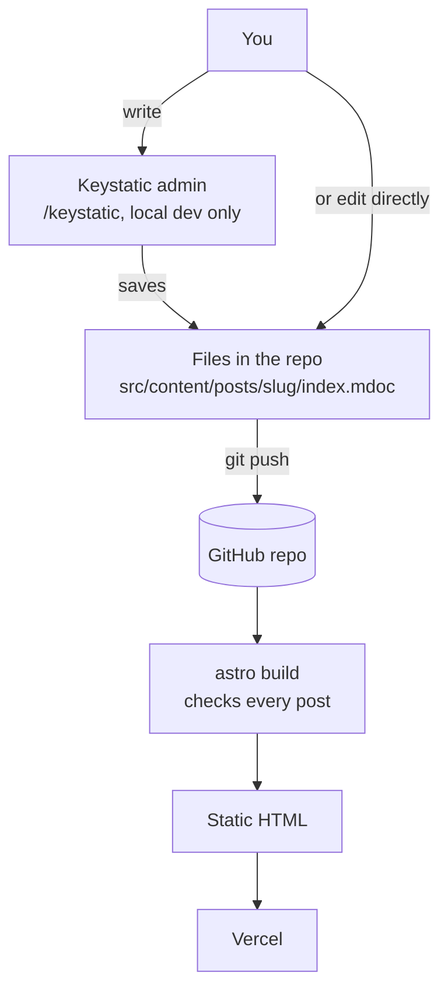
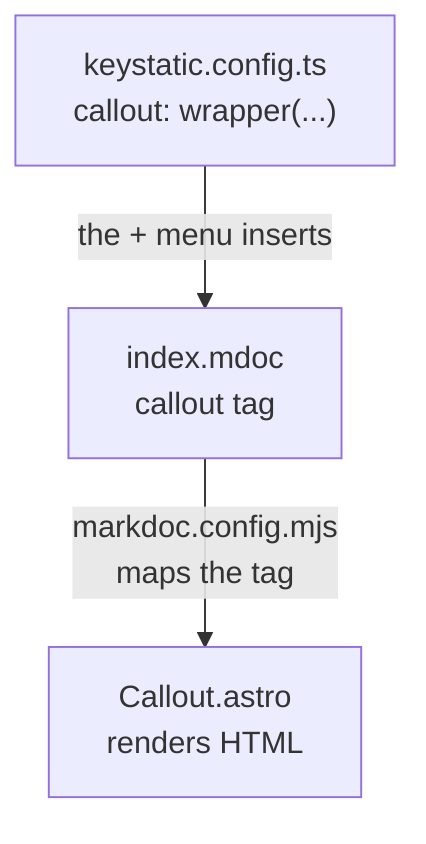
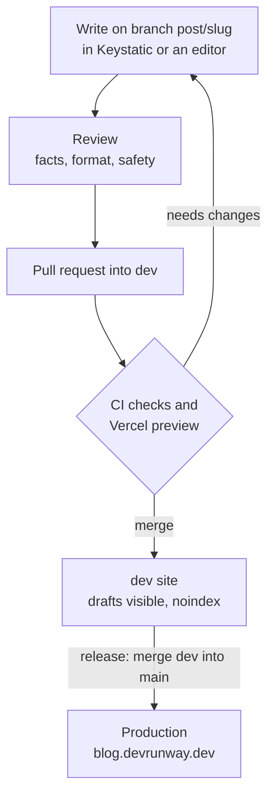

You can run your own blog with a friendly writing screen and still keep every post as a plain file in git. [Astro](https://docs.astro.build/en/install-and-setup/) builds the site into static HTML. [Keystatic](https://keystatic.com/) adds an admin screen at `/keystatic` that saves posts as files in your repo, with no database. This blog, blog.devrunway.dev, is built exactly this way.

Below: what we built and why, then a small version you can build and run on your laptop.

## What is a git-based CMS?

A CMS (content management system) is the screen where you write and edit posts. Most CMSs keep posts in a database. [Keystatic](https://keystatic.com/) edits "Markdown, JSON and YAML content in your codebase" instead: when you click **Save**, it writes a file. So your posts get what your code already has:

- **History.** Every change is a git commit you can read or undo.
- **Review.** A new post can be a pull request, with checks and comments.
- **No lock-in.** Your posts are text files. Any tool can read them.
- **No extra cost.** There is no database to run and no CMS subscription.

The trade-off: in the simplest setup, **local mode**, the admin only works on your own machine. More on that below.

## What stack does this blog use?

| Piece | Job | Why we chose it |
| --- | --- | --- |
| [Astro](https://docs.astro.build/en/install-and-setup/) | Turns content into HTML pages | Static by default, very little JavaScript, fast pages |
| [Keystatic](https://keystatic.com/) | The writing screen at `/keystatic` | Saves posts as files in git, no database |
| [Markdoc](https://markdoc.dev/docs/overview) | The post format (`.mdoc` files) | Markdown plus custom tags for callouts, steps, diagrams |
| Vercel | Builds and hosts the site | A preview site for every branch, production from `main` |

Astro, Keystatic and Markdoc are all open source (MIT license). Here is how they fit together:



The admin never talks to the live site. It writes files, you push them, and the build turns them into pages.

## How is the content organized?

Everything lives under `src/content/`:

| Content | Where | What it holds |
| --- | --- | --- |
| Posts | `src/content/posts/<slug>/index.mdoc` | Title, description, category, tags, author, status, dates, key takeaways, FAQ, SEO overrides, and the body |
| Categories, tags, authors | `src/content/{categories,tags,authors}/*.yaml` | Small YAML files the posts point to |
| Site settings | `src/content/settings.yaml` | Site title, tagline, the main button, newsletter and comments settings |

Each post has its own folder, so its images sit right next to it. A post references an image as `../<slug>/diagram.png`, and Astro optimizes it at build time.

Site settings are a Keystatic **singleton**: one entry, not a list.

### Why describe every field twice?

This is the most important rule in the repo. Each field lives in two places:

1. `keystatic.config.ts` tells the **editor** what fields to show. For example, the description must be 70 to 160 characters.
2. `src/content.config.ts` tells **Astro** what a valid post looks like, using a schema library called Zod. Astro checks every file against it.

Keystatic only checks what you type in the admin. But files can also be edited by hand, by a script or by an AI assistant. The Astro schema catches those too, because it runs on every build. Here is the same rule on both sides:

```ts
// keystatic.config.ts
description: fields.text({
  label: 'Description',
  multiline: true,
  validation: { length: { min: 70, max: 160 } },
}),

// src/content.config.ts
description: z.string().min(70).max(160),
```

If a post breaks a rule, the build fails, so a broken post never reaches production. The cost: you must keep the two files in sync.

## How do custom blocks like callouts work?

A technical blog needs more than plain Markdown: callouts, numbered steps, diagrams, charts. [Markdoc](https://markdoc.dev/docs/overview), a format first built at Stripe for its docs, adds **tags** for that. A warning in a post looks like this:

```md


<Callout type="warning" title="Back up first">

This command deletes the old folder.

</Callout>


```

Each block needs three small pieces that share the same name:



- **The editor piece.** In `keystatic.config.ts`, a [content component](https://keystatic.com/docs/content-components) adds "Callout" to the editor's insert menu, with fields for `type` and `title`. Keystatic has several kinds: `wrapper` (has content inside, like a callout), `block` (no content inside, like a diagram), and `repeating` (a list of children, like steps).
- **The format piece.** When you save, Keystatic writes the callout tag into the file, as in the example above.
- **The render piece.** In `markdoc.config.mjs`, the tag is mapped to an Astro component:

```js
// markdoc.config.mjs
callout: {
  render: component('./src/components/ds/Callout.astro'),
  attributes: {
    type: { type: String, matches: ['note', 'tip', 'warning', 'danger'], default: 'note' },
    title: { type: String },
  },
},
```

This blog adds all its blocks this way: callouts, code with a filename, package-manager tabs, tabs, steps, Mermaid diagrams, charts and video. Charts are drawn as SVG at build time, so readers download no chart library.

## How do drafts and scheduled posts work?

Every post has a `status` (draft or published) and a `pubDate`. One small file, `src/lib/posts.ts`, decides who sees what:

```ts
export const SHOW_DRAFTS =
  import.meta.env.DEV ||
  process.env.SHOW_DRAFTS === 'true' ||
  process.env.VERCEL_ENV === 'preview';

export const isScheduled = (p: Post) => p.data.pubDate.getTime() > NOW.getTime();
export const isLive = (p: Post) => p.data.status === 'published' && !isScheduled(p);
```

In plain words:

- **On your laptop and on preview sites**, you see every post, with a "Draft preview" banner on drafts.
- **In production**, a post shows only when it is published **and** its date has arrived.
- **Scheduled posts** have a future date. A static site only changes when it rebuilds, so a GitHub Actions workflow calls a Vercel [deploy hook](https://vercel.com/docs/deploy-hooks) every day at 06:00 UTC. A deploy hook is a secret URL that starts a new deployment when you send it a request.

Pages use `getVisiblePosts()`. The RSS feed, the sitemap and `llms.txt` use `getLivePosts()`, so a draft can't leak into them.

## Local mode or GitHub mode?

Keystatic can save in two ways:

| | Local mode | GitHub mode |
| --- | --- | --- |
| Where the admin runs | Your local dev server | Your live site too |
| Where saves go | Files on your disk | Commits on a branch in your GitHub repo |
| Setup | None | A GitHub App plus a few environment variables |
| Good for | One writer, working from a laptop | Writing from anywhere, or non-developer writers |

This blog starts in [local mode](https://keystatic.com/docs/local-mode), the default. Local mode saves to the file system of the machine running the admin, so `astro.config.mjs` only loads the admin in `astro dev`, or when you turn it on on purpose:

```js
const isDev = process.argv.includes('dev');
const withAdmin = isDev || process.env.KEYSTATIC_ADMIN === 'true';
```

Keystatic's docs have [a recipe for the same idea](https://keystatic.com/docs/recipes/astro-disable-admin-ui-in-production), using a `SKIP_KEYSTATIC` variable instead.

The config already has a switch for [GitHub mode](https://keystatic.com/docs/github-mode) (repo name shortened here):

```ts
storage:
  import.meta.env?.PUBLIC_KEYSTATIC_STORAGE === 'github'
    ? { kind: 'github', repo: 'your-name/your-blog', branchPrefix: 'post/' }
    : { kind: 'local' },
```

In GitHub mode, Keystatic walks you through creating a GitHub App the first time you open `/keystatic`. It then writes `KEYSTATIC_GITHUB_CLIENT_ID`, `KEYSTATIC_GITHUB_CLIENT_SECRET`, `KEYSTATIC_SECRET` and `PUBLIC_KEYSTATIC_GITHUB_APP_SLUG` to your `.env` file. You copy them to your host, and the host must be able to run Node.js for Keystatic's API routes. `branchPrefix: 'post/'` means the admin only lists and creates branches that start with `post/`, so every post still gets its own pull request.


<Callout type="warning" title="Keep the GitHub App secrets out of git">

`KEYSTATIC_GITHUB_CLIENT_SECRET` and `KEYSTATIC_SECRET` are passwords. Keep them in `.env` (Astro's starter `.gitignore` already ignores it) and in your host's environment variable settings. Never commit them or paste them into a post.

</Callout>


## How does a post get from draft to production?

Every change goes through a pull request. There are two long-lived branches: `dev` feeds a dev site for review, and `main` feeds production.



- **The dev site** shows drafts and tells search engines to stay away: every page gets a `noindex` tag and `robots.txt` disallows everything. Only production can be indexed.
- **CI** (GitHub Actions) runs on every pull request: a content validator (schema, Markdoc tags, links, Mermaid syntax, leaked secrets), `astro check` for types, a production build, a check of the built HTML (one `h1` per page, structured data, no drafts leaked), a link check, and Lighthouse budgets (performance and accessibility at least 95, SEO 100).
- **SEO basics** come from the build: a sitemap, an RSS feed, generated Open Graph images at `/og/<slug>.png` for social cards, and JSON-LD structured data (a small block of data in each page that tells search engines "this is a blog post, by this author, with this FAQ").

### Where does the AI assistant fit?

Optional, but it's how this blog gets written. Post ideas are GitHub Issues from a "Blog idea" form, and the repo has project skills for Claude Code: `/write-post` drafts a post in the right format, `/review-post` checks formatting, facts and safety and writes a report with a verdict, and `/publish-post` opens the pull request into `dev`. A GitHub Actions workflow moves the issue's label along (idea, writing, in review, on dev, live) and closes it on release. The same CI checks apply, so AI-written drafts meet the same bar as hand-written ones.

## Try it: build a minimal blog with Astro and Keystatic

You'll build a tiny blog: a list of posts, a page per post, and the Keystatic admin to write them. It's the same idea as this blog, with only three fields.

**You need:** Node.js v22.12.0 or higher ([Astro's requirement](https://docs.astro.build/en/install-and-setup/)) and a terminal. We tested these steps with Node 22.22.2, Astro 7.3.5, @keystatic/core 0.6.9, @keystatic/astro 6.0.0, @astrojs/react 7.0.0 and @astrojs/markdoc 2.0.9.


<Steps>


<Step title="Create an Astro project">

```bash
$ npm create astro@latest my-blog -- --template minimal --install --no-git --skip-houston --yes
$ cd my-blog
```

- `--template minimal` starts from an almost empty project.
- `--install` installs the dependencies, and `--yes` accepts the defaults, so there are no questions.
- `--no-git` skips `git init`. Leave it out if you want a new repo.
- The defaults also add `AGENTS.md` and `CLAUDE.md` files for AI coding assistants. Add `--no-ai` if you don't want them.

</Step>


<Step title="Add React, Markdoc and Keystatic">

Keystatic's admin is a React app, and Markdoc is the post format. Add both integrations, and answer yes to the prompts:


```bash
npx astro add react markdoc
```


Then install Keystatic:


```bash
npm install @keystatic/core @keystatic/astro
```


</Step>


<Step title="Load Keystatic in the Astro config">

Replace `astro.config.mjs`:


**astro.config.mjs**

```js
import { defineConfig } from 'astro/config';
import react from '@astrojs/react';
import markdoc from '@astrojs/markdoc';
import keystatic from '@keystatic/astro';

// The admin UI writes files on your machine, so only load it in `astro dev`.
const isDev = process.argv.includes('dev');

export default defineConfig({
  integrations: [react(), markdoc(), ...(isDev ? [keystatic()] : [])],
});
```


The admin writes files to your disk, so it only makes sense in `astro dev`. Without the `isDev` check, `npm run build` fails with `NoAdapterInstalled`, because the admin needs a server.

</Step>


<Step title="Describe your posts for the editor">

Create `keystatic.config.ts` in the project root:


**keystatic.config.ts**

```ts
import { config, fields, collection } from '@keystatic/core';

export default config({
  storage: { kind: 'local' },
  collections: {
    posts: collection({
      label: 'Posts',
      slugField: 'title',
      path: 'src/content/posts/*',
      format: { contentField: 'content' },
      schema: {
        title: fields.slug({ name: { label: 'Title' } }),
        pubDate: fields.date({
          label: 'Publish date',
          defaultValue: { kind: 'today' },
          validation: { isRequired: true },
        }),
        draft: fields.checkbox({ label: 'Draft', defaultValue: true }),
        content: fields.markdoc({ label: 'Content' }),
      },
    }),
  },
});
```


- `path: 'src/content/posts/*'` saves each post as `src/content/posts/<slug>.mdoc`.
- `slugField: 'title'` builds the file name from the title.
- `format: { contentField: 'content' }` puts the other fields in the frontmatter and the body below it.

</Step>


<Step title="Describe the same posts for Astro">

Create `src/content.config.ts`. It matches the Keystatic fields one to one:


**src/content.config.ts**

```ts
import { defineCollection } from 'astro:content';
import { glob } from 'astro/loaders';
import { z } from 'astro/zod';

const posts = defineCollection({
  loader: glob({ pattern: '*.mdoc', base: './src/content/posts' }),
  schema: z.object({
    title: z.string(),
    pubDate: z.coerce.date(),
    draft: z.boolean().default(true),
  }),
});

export const collections = { posts };
```


The `glob` loader reads every `.mdoc` file in the folder. The file name, without `.mdoc`, becomes the post's `id`, which you'll use in the URL.

</Step>


<Step title="Add a home page and a post page">

Replace `src/pages/index.astro` with a list of posts:


**src/pages/index.astro**

```astro
---
import { getCollection } from 'astro:content';

// Drafts show while you run `npm run dev`, never in the built site.
const posts = (await getCollection('posts', ({ data }) => import.meta.env.DEV || !data.draft))
  .sort((a, b) => b.data.pubDate.getTime() - a.data.pubDate.getTime());
---

<html lang="en">
  <head>
    <meta charset="utf-8" />
    <meta name="viewport" content="width=device-width" />
    <title>My blog</title>
  </head>
  <body>
    <h1>My blog</h1>
    <ul>
      {posts.map((post) => (
        <li>
          <a href={`/blog/${post.id}`}>{post.data.title}</a>
          {post.data.draft && ' (draft)'}
        </li>
      ))}
    </ul>
  </body>
</html>
```


Then create `src/pages/blog/[slug].astro` for each post:


**src/pages/blog/[slug].astro**

```astro
---
import { getCollection, render } from 'astro:content';

export async function getStaticPaths() {
  const posts = await getCollection('posts', ({ data }) => import.meta.env.DEV || !data.draft);
  return posts.map((post) => ({ params: { slug: post.id }, props: { post } }));
}

const { post } = Astro.props;
const { Content } = await render(post);
---

<html lang="en">
  <head>
    <meta charset="utf-8" />
    <meta name="viewport" content="width=device-width" />
    <title>{post.data.title}</title>
  </head>
  <body>
    <a href="/">All posts</a>
    <article>
      <h1>{post.data.title}</h1>
      <time datetime={post.data.pubDate.toISOString()}>{post.data.pubDate.toDateString()}</time>
      <Content />
    </article>
  </body>
</html>
```


Both pages use the same filter: drafts show while you run `npm run dev`, and only published posts go into the build.

</Step>


<Step title="Write a post in the admin">


```bash
npm run dev
```


Open `http://127.0.0.1:4321/keystatic`, click **Posts**, then **Add**. Type a title such as "Hello from Keystatic", write a sentence in **Content**, and click **Create**. The slug and today's date fill in for you, and **Draft** starts checked.

Keystatic writes `src/content/posts/hello-from-keystatic.mdoc`:

```md
---
title: Hello from Keystatic
pubDate: 2026-09-27
draft: true
---
My first post, written in the admin UI and saved as a file.
```

Open `http://127.0.0.1:4321/` and you'll see "Hello from Keystatic (draft)". Click it to read the post.

</Step>


<Step title="Publish it and build">

Uncheck **Draft** in the admin and save, or change `draft: true` to `draft: false` in the file. Then build:


```bash
npm run build
```


```text
 generating static routes
  ├─ /blog/hello-from-keystatic/index.html (+17ms)
  ├─ /index.html (+3ms)
✓ Completed in 49ms.
[build] 2 page(s) built in 1.84s
[build] Complete!
```

The `dist/` folder now holds plain HTML. There is no `/keystatic` in it.

</Step>


</Steps>


### How do I know the schema works?

Create a post file by hand and leave out `pubDate`, then run `npm run build` again. The build stops:

```text
[InvalidContentEntryDataError] posts → broken data does not match collection schema.

  pubDate**: **pubDate: Expected type `"date"`, received `"object"`
```

Delete the file and the build passes again. That's the safety net: the editor helps you write valid posts, and the build refuses invalid ones.

### What if something goes wrong?

- **`/keystatic` shows a blank page or a React error:** stop and restart `npm run dev` after you change `astro.config.mjs` or `keystatic.config.ts`.
- **A post saved in the admin doesn't appear:** check that `path` in `keystatic.config.ts` and `base` in `src/content.config.ts` point to the same folder, and that the file extension matches the `pattern`.
- **`npm create astro` says the template could not be found:** it downloads templates from GitHub, so check your network or proxy.

## How do I put it online?

A static Astro site needs no extra setup on Vercel. The steps from [Astro's Vercel guide](https://docs.astro.build/en/guides/deploy/vercel/):

1. Push your project to GitHub, GitLab or Bitbucket.
2. In Vercel, import the repository. Vercel detects Astro and picks the right build settings.
3. Deploy. Every push to another branch then gets its own preview URL, and pushes to your production branch (usually `main`) update the live site.

Environment variables go in the project's settings on Vercel. A change only applies to new deployments, so redeploy after you add one. This blog sets `SITE_URL` there, so canonical links always point to production. It also uses the `@astrojs/vercel` adapter, which Vercel's docs say you need for features like Web Analytics.

Remember that in local mode, the live site has no admin. You write on your laptop, push, and Vercel builds.

## What should I do next?

- **Build the minimal blog above**, then add one field you actually want, such as `description`, in both config files. Watch the build fail until both sides agree.
- **Add your first custom block.** Follow [Astro's Markdoc guide](https://docs.astro.build/en/guides/integrations-guide/markdoc/) to map a tag to a component, then add the matching [content component](https://keystatic.com/docs/content-components) so the editor can insert it.
- **Read Keystatic's [Astro installation guide](https://keystatic.com/docs/installation-astro)** and [Astro's content collections guide](https://docs.astro.build/en/guides/content-collections/) for the options this post skipped.
- **When you want to write from anywhere**, follow Keystatic's [GitHub mode](https://keystatic.com/docs/github-mode) guide.
- **Writing with an AI assistant?** [Getting the most out of AI coding assistants](/blog/ai-coding-assistants-tips) shows how to set up the `CLAUDE.md` and `AGENTS.md` files the Astro starter adds.
