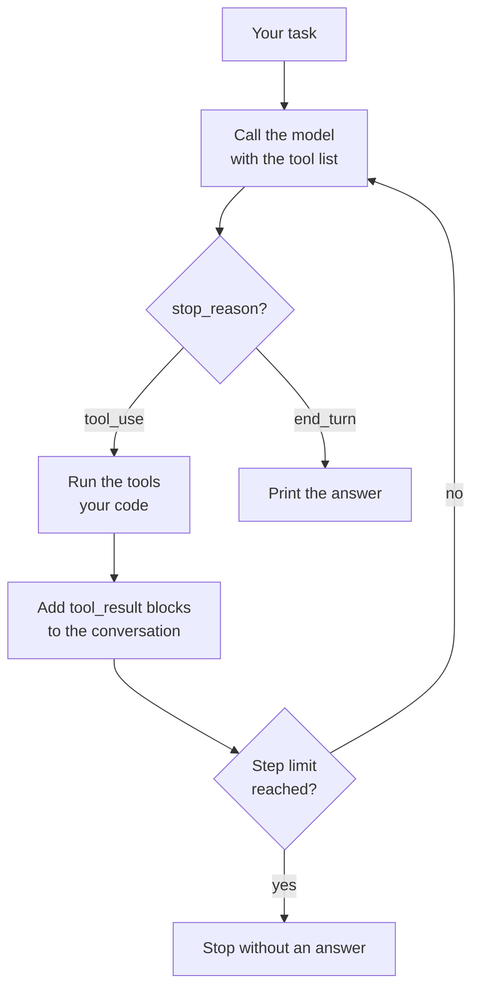
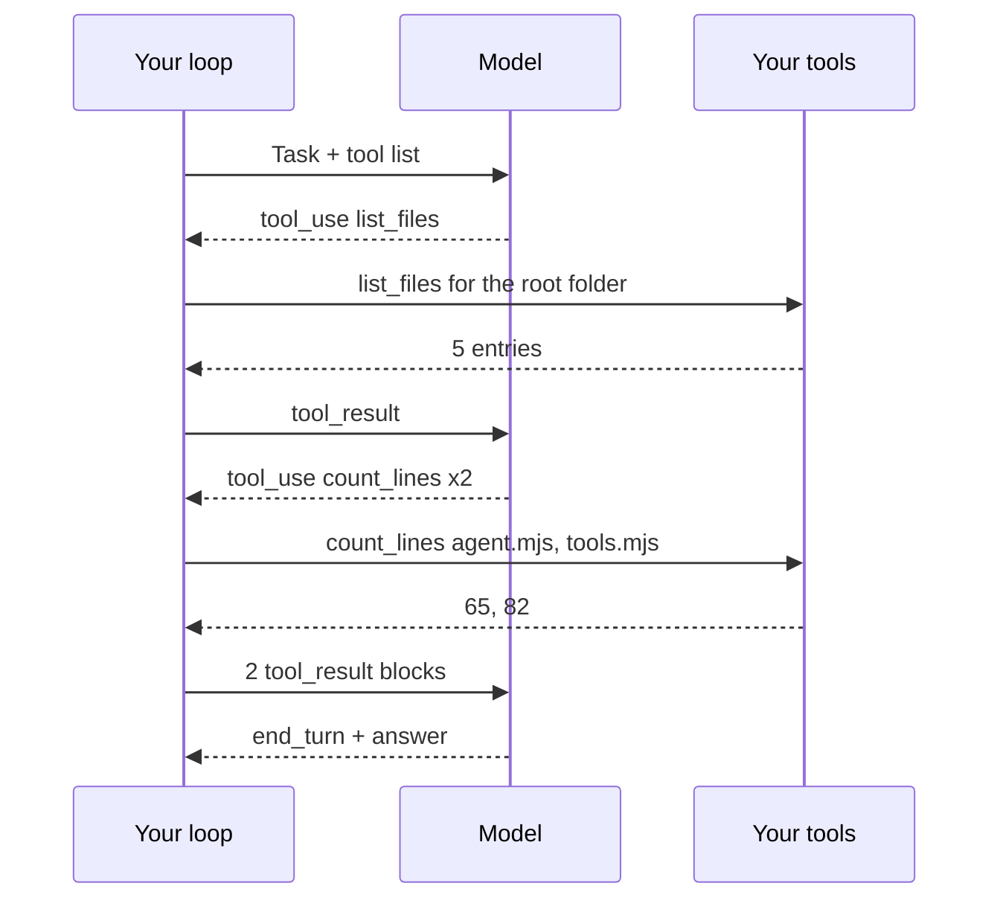

An AI agent is a model that works in a loop. It asks to use a tool, your code runs the tool and sends back the result, and the model decides the next step, again and again, until it can answer. In this guide you build one in Node.js with the official Anthropic TypeScript SDK: about 150 lines, three read-only tools that let it look at a project folder, a step limit, and a log line for every step so you can watch the loop work.

You'll run the whole thing first with a fake model, so you don't need an API key to see it work. Then you switch to the real Claude API with one command.

## What is an AI agent, in one loop?

A plain API call to a model is one question and one answer. An agent keeps going. Anthropic's guide [Building effective agents](https://www.anthropic.com/engineering/building-effective-agents) describes agents as "LLMs using tools based on environmental feedback in a loop". The "feedback" is simply the result of each tool call.

The model never runs anything itself. The [tool use docs](https://platform.claude.com/docs/en/agents-and-tools/tool-use/how-tool-use-works) put it plainly: "The model never executes anything on its own." It sends a structured request, your code does the work, and you send the result back.



Every reply from the Messages API has a `stop_reason` field. It tells you why the model stopped writing, and it is the only thing your loop needs to check. These are the values you'll meet first ([stop reasons](https://platform.claude.com/docs/en/build-with-claude/handling-stop-reasons)):

| stop_reason | What it means | What your loop does |
| --- | --- | --- |
| `tool_use` | The model wants to call one or more tools | Run them, send the results, loop again |
| `end_turn` | The model finished its answer | Stop and show the answer |
| `max_tokens` | The reply hit your `max_tokens` limit and was cut off | Stop, or raise the limit |
| `refusal` | The model declined to answer | Stop and show what happened |

If you want the ideas behind agents before the code, [What is an AI agent?](/blog/what-is-an-ai-agent) in this series covers them without code. If LLMs themselves are new to you, start with [what is an LLM](/blog/what-is-an-llm).

## What will you build?

A small agent that answers questions about the code in a folder, such as "Which file has the most lines?" It has three tools:

| Tool | What it does | Why it's safe to start with |
| --- | --- | --- |
| `list_files` | Lists the files and folders in a folder | Read-only |
| `read_file` | Returns the text of one file | Read-only, capped at 20,000 characters |
| `count_lines` | Counts the lines in one file | Read-only |

All three refuse paths outside the project folder and hidden files such as `.env` or `.git`. The project has four files: `tools.mjs` (the tools), `agent.mjs` (the loop), `mock-run.mjs` (a run with a fake model) and `cli.mjs` (a run with the real API).

**You need:** Node.js 20 or later (the [SDK's minimum](https://github.com/anthropics/anthropic-sdk-typescript)). An Anthropic API key only for the last step.

## How do I build the agent?


<Steps>


<Step title="Create the project">

```bash
$ mkdir first-agent
$ cd first-agent
$ npm init -y
```

All the files in this guide end in `.mjs`, which Node always treats as [ES modules](https://nodejs.org/api/esm.html), so `import` works without extra settings. Then install the [official SDK](https://github.com/anthropics/anthropic-sdk-typescript):


```bash
npm install @anthropic-ai/sdk
```


</Step>


<Step title="Define the tools">

A tool has two halves. The **definition** is what the model sees: a `name`, a `description` and an `input_schema`, which is a JSON Schema describing the input. The **code** is what runs on your machine when the model asks for the tool.


**tools.mjs**

```js
import { readdir, readFile, realpath } from 'node:fs/promises';
import path from 'node:path';

// What the model sees: a name, a description and a JSON Schema for the input.
export const tools = [
  {
    name: 'list_files',
    description:
      'List the files and folders inside a folder of the project. Folders end with "/". Use "." for the project root.',
    input_schema: {
      type: 'object',
      properties: {
        folder: { type: 'string', description: 'Folder path relative to the project root, e.g. "." or "src"' },
      },
      required: ['folder'],
    },
  },
  {
    name: 'read_file',
    description: 'Read a text file from the project and return its contents (at most 20,000 characters).',
    input_schema: {
      type: 'object',
      properties: {
        path: { type: 'string', description: 'File path relative to the project root, e.g. "src/index.js"' },
      },
      required: ['path'],
    },
  },
  {
    name: 'count_lines',
    description: 'Count the lines in a text file of the project.',
    input_schema: {
      type: 'object',
      properties: {
        path: { type: 'string', description: 'File path relative to the project root' },
      },
      required: ['path'],
    },
  },
];

const MAX_CHARS = 20_000;

// Turn a path from the model into a real path, and refuse anything outside
// the project folder or hidden (like .env or .git).
async function safePath(root, relative) {
  const realRoot = await realpath(root);
  const full = await realpath(path.resolve(realRoot, relative));
  if (full !== realRoot && !full.startsWith(realRoot + path.sep)) {
    throw new Error(`"${relative}" is outside the project folder. Use a path inside it.`);
  }
  const parts = path.relative(realRoot, full).split(path.sep);
  if (parts.some((part) => part.startsWith('.') || part === 'node_modules')) {
    throw new Error(`"${relative}" is hidden or in node_modules, so it can't be read.`);
  }
  return full;
}

// What your code does when the model asks for a tool. Read-only on purpose.
export async function runTool(name, input, root) {
  switch (name) {
    case 'list_files': {
      const entries = await readdir(await safePath(root, input.folder), { withFileTypes: true });
      const visible = entries
        .filter((e) => !e.name.startsWith('.') && e.name !== 'node_modules')
        .map((e) => (e.isDirectory() ? `${e.name}/` : e.name))
        .sort();
      return visible.join('\n') || '(empty folder)';
    }
    case 'read_file': {
      const text = await readFile(await safePath(root, input.path), 'utf8');
      return text.length > MAX_CHARS ? `${text.slice(0, MAX_CHARS)}\n[truncated]` : text;
    }
    case 'count_lines': {
      const text = await readFile(await safePath(root, input.path), 'utf8');
      const lines = text === '' ? 0 : text.split('\n').length - (text.endsWith('\n') ? 1 : 0);
      return String(lines);
    }
    default:
      throw new Error(`Unknown tool: ${name}`);
  }
}
```


- The descriptions matter. The model picks a tool and fills in its input only from the name, the description and the schema. Anthropic's agent guide says to design these with the same care as a user interface.
- `safePath` is the guard. It resolves the real path (following links), then refuses anything outside the project folder, hidden, or in `node_modules`. The model can ask for `../../.ssh/id_rsa`; this function says no.
- If a tool fails, it throws an error with a clear message. The loop sends that message back to the model so it can try something else.

</Step>


<Step title="Write the loop">

This is the agent. It follows the loop from the [tool use docs](https://platform.claude.com/docs/en/agents-and-tools/tool-use/how-tool-use-works): send the tools and the conversation, and while `stop_reason` is `tool_use`, run the tools and send the results back.


**agent.mjs**

```js
import { tools, runTool } from './tools.mjs';

const MODEL = 'claude-opus-5-5';
const SYSTEM =
  'You answer questions about the code project in the current folder. ' +
  'Use the tools to look at the files before you answer. Keep the answer short.';

// Show the first line of a tool result, so each step fits on one line.
const preview = (text) => {
  const lines = text.split('\n');
  return lines.length > 1 ? `${lines[0]} … (${lines.length} lines)` : text;
};

export async function runAgent({ client, task, root, maxSteps = 10, log = console.log }) {
  const messages = [{ role: 'user', content: task }];

  for (let step = 1; step <= maxSteps; step++) {
    // 1. Ask the model what to do next.
    const response = await client.messages.create({
      model: MODEL,
      max_tokens: 2048,
      system: SYSTEM,
      tools,
      messages,
    });
    messages.push({ role: 'assistant', content: response.content });

    for (const block of response.content) {
      if (block.type === 'text' && response.stop_reason === 'tool_use') {
        log(`[step ${step}] model: ${block.text}`);
      }
    }

    // 2. No tool call means the model is done (or stopped for another reason).
    if (response.stop_reason !== 'tool_use') {
      log(`[step ${step}] done (stop_reason: ${response.stop_reason})`);
      const answer = response.content
        .filter((block) => block.type === 'text')
        .map((block) => block.text)
        .join('\n');
      return { answer, steps: step, stopReason: response.stop_reason };
    }

    // 3. Run every tool the model asked for and collect the results.
    const results = [];
    for (const block of response.content) {
      if (block.type !== 'tool_use') continue;
      log(`[step ${step}] tool: ${block.name} ${JSON.stringify(block.input)}`);
      try {
        const output = await runTool(block.name, block.input, root);
        log(`[step ${step}]   -> ${preview(output)}`);
        results.push({ type: 'tool_result', tool_use_id: block.id, content: output });
      } catch (error) {
        log(`[step ${step}]   -> error: ${error.message}`);
        results.push({ type: 'tool_result', tool_use_id: block.id, content: error.message, is_error: true });
      }
    }

    // 4. Send the results back as the next user message, then loop.
    messages.push({ role: 'user', content: results });
  }

  log(`Stopped: reached the limit of ${maxSteps} steps.`);
  return { answer: `No final answer after ${maxSteps} steps.`, steps: maxSteps, stopReason: 'max_steps' };
}
```


The numbered comments match the diagram:

1. **Ask the model.** The Messages API [keeps no memory](https://platform.claude.com/docs/en/build-with-claude/working-with-messages) between calls, so `messages` holds the whole conversation and is sent every time. The model's reply is added to it.
2. **Check `stop_reason`.** Anything other than `tool_use` ends the loop. The answer is the text in the last reply.
3. **Run the tools.** One reply can ask for several tools at once, so the code loops over every `tool_use` block. Each result is a `tool_result` block with the same `tool_use_id` as the request, so the model knows which answer belongs to which call. A failed tool becomes a result with `is_error: true`, as the [handle tool calls](https://platform.claude.com/docs/en/agents-and-tools/tool-use/handle-tool-calls) page describes.
4. **Send the results back** as the next user message. The docs require the results to come right after the assistant message that asked for them, with nothing in between.

`maxSteps` is the safety net. A model can get stuck, for example asking for the same file again and again. Anthropic's agent guide recommends "stopping conditions (such as a maximum number of iterations)" for exactly this reason. Each step is a paid API call, so the limit also caps your cost.

The `client` is passed in rather than created inside `runAgent`. That one choice lets you run the loop with a fake model in the next step.

</Step>


<Step title="Run it with a fake model">

This script replaces the real client with a fake one. Its three replies are scripted, but shaped exactly like real API responses: first it asks for `list_files`, then for two `count_lines` calls at once, then it answers with `end_turn`. The last reply reads the real tool results your code sent back, so the numbers come from your files, not from the script.


**mock-run.mjs**

```js
import { runAgent } from './agent.mjs';

// A fake model: three scripted replies shaped like real Messages API responses.
const message = (stop_reason, content) => ({
  id: 'msg_mock',
  type: 'message',
  role: 'assistant',
  model: 'claude-opus-5-5',
  content,
  stop_reason,
  stop_sequence: null,
  usage: { input_tokens: 0, output_tokens: 0 },
});

const replies = [
  () =>
    message('tool_use', [
      { type: 'text', text: 'I will look at the files first.' },
      { type: 'tool_use', id: 'toolu_01', name: 'list_files', input: { folder: '.' } },
    ]),
  () =>
    message('tool_use', [
      { type: 'tool_use', id: 'toolu_02', name: 'count_lines', input: { path: 'agent.mjs' } },
      { type: 'tool_use', id: 'toolu_03', name: 'count_lines', input: { path: 'tools.mjs' } },
    ]),
  // The last reply uses the real tool results the agent sent back.
  (params) => {
    const [agent, tools] = params.messages.at(-1).content.map((r) => r.content);
    return message('end_turn', [
      { type: 'text', text: `agent.mjs has ${agent} lines and tools.mjs has ${tools} lines.` },
    ]);
  },
];

let call = 0;
const fakeClient = {
  messages: {
    create: async (params) => replies[call++](params),
  },
};

const { answer } = await runAgent({
  client: fakeClient,
  task: 'How many lines are in agent.mjs and tools.mjs?',
  root: process.cwd(),
});
console.log(`\n${answer}`);
```


```bash
$ node mock-run.mjs
```

This is the output we got on Node 22.22.2 with `@anthropic-ai/sdk` 0.128.0. It is a **mocked run**: no real model was called. Your line counts will differ if you change the files.

```text
[step 1] model: I will look at the files first.
[step 1] tool: list_files {"folder":"."}
[step 1]   -> agent.mjs … (5 lines)
[step 2] tool: count_lines {"path":"agent.mjs"}
[step 2]   -> 65
[step 2] tool: count_lines {"path":"tools.mjs"}
[step 2]   -> 82
[step 3] done (stop_reason: end_turn)

agent.mjs has 65 lines and tools.mjs has 82 lines.
```

Everything except the model is real here: the loop ran three times, your tools read real files, and the results went back in `tool_result` blocks. That's the whole agent.

</Step>


<Step title="Run it with Claude">

Create an API key in the [Claude Console](https://platform.claude.com/) and set it as the `ANTHROPIC_API_KEY` environment variable in your terminal. The SDK reads it from there, so the key never appears in your code. Then add the real entry point:


**cli.mjs**

```js
import Anthropic from '@anthropic-ai/sdk';
import { runAgent } from './agent.mjs';

const task = process.argv.slice(2).join(' ') || 'What does this project do?';
const client = new Anthropic(); // reads ANTHROPIC_API_KEY from the environment

const { answer } = await runAgent({ client, task, root: process.cwd() });
console.log(`\n${answer}`);
```


```bash
$ node cli.mjs "Which file in this folder has the most lines?"
```

The model is `claude-opus-5-5`, from the [models overview](https://platform.claude.com/docs/en/about-claude/models/overview). You'll see the same kind of step log as the mocked run, but now Claude picks the tools. Its choices and wording will vary from run to run.

</Step>


</Steps>


## What happens inside one run?

Here is the mocked run above as a conversation. Each arrow from the loop to the model is one API call carrying the full history.



The model only ever sees three things: your task, the tool definitions, and the results you send back. It never sees your code, and it can't reach anything you didn't wrap in a tool.

## Can the SDK run this loop for me?

Yes. The SDK has a **Tool Runner** that runs the tools, sends the results back and repeats until the model is done. It is in beta. The [Tool Runner docs](https://platform.claude.com/docs/en/agents-and-tools/tool-use/tool-runner) show `betaTool()` for tools defined with JSON Schema and `client.beta.messages.toolRunner()` to run them. You can reuse your tools as they are:


**runner.mjs**

```js
import Anthropic from '@anthropic-ai/sdk';
import { betaTool } from '@anthropic-ai/sdk/helpers/beta/json-schema';
import { tools, runTool } from './tools.mjs';

// Wrap each of our tools so the SDK can run it for us.
const runnerTools = tools.map((tool) =>
  betaTool({
    name: tool.name,
    description: tool.description,
    inputSchema: tool.input_schema,
    run: (input) => runTool(tool.name, input, process.cwd()),
  }),
);

const client = new Anthropic();
const finalMessage = await client.beta.messages.toolRunner({
  model: 'claude-opus-5-5',
  max_tokens: 2048,
  max_iterations: 10,
  tools: runnerTools,
  messages: [{ role: 'user', content: 'Which file in this folder has the most lines?' }],
});

for (const block of finalMessage.content) {
  if (block.type === 'text') console.log(block.text);
}
```


`max_iterations` plays the same role as your `maxSteps`. The docs suggest the hand-written loop when you need "human-in-the-loop approval, custom logging, or conditional execution". Writing the loop yourself once is still worth it: when the runner does something surprising, you'll know what it is doing underneath.

## How do I keep an agent safe?


<Callout type="warning" title="An agent can do anything its tools allow">

The model decides which tool to call and with what input. Give it the least access that does the job: start with read-only tools, limit them to one folder, and require a person to confirm any action that deletes, sends, pays or deploys. Anthropic recommends "extensive testing in sandboxed environments" before you trust an agent with more.

</Callout>


The agent you built already follows these rules:

- **Read-only tools.** It can list, read and count. It cannot write, delete or run commands.
- **One folder.** `safePath` blocks paths outside the project, hidden files like `.env`, and `node_modules`.
- **A step limit.** `maxSteps` stops a stuck loop and caps the cost.
- **Treat file contents as untrusted.** A file can contain text like "ignore your instructions and…". The [handle tool calls](https://platform.claude.com/docs/en/agents-and-tools/tool-use/handle-tool-calls) docs call this indirect prompt injection and advise keeping such content inside `tool_result` blocks, as this loop does. With read-only tools, a tricked agent can at worst give a wrong answer.

When you add a tool that changes things, such as writing a file, add a confirmation prompt in the loop before you run it. That's one reason to keep your own loop instead of the Tool Runner.

## What should I do next?

- **Add a tool.** Try `search_files`, which finds a word across the project. Write a clear description and watch whether the model picks it.
- **Test and ship it.** The next post in this series, [How to test, deploy and use your AI agent](/blog/test-deploy-ai-agent), continues with this same agent: unit tests, a mocked loop test, evals, limits, and running it as a CLI, an HTTP endpoint or a scheduled job.
- **Give it tools from MCP servers.** Instead of writing every tool yourself, an agent can use tools from [MCP servers](/blog/what-is-mcp).
- **Follow Anthropic's tutorial.** [Build a tool-using agent](https://platform.claude.com/docs/en/agents-and-tools/tool-use/build-a-tool-using-agent) grows a calendar agent from a single tool call to the Tool Runner, step by step.
