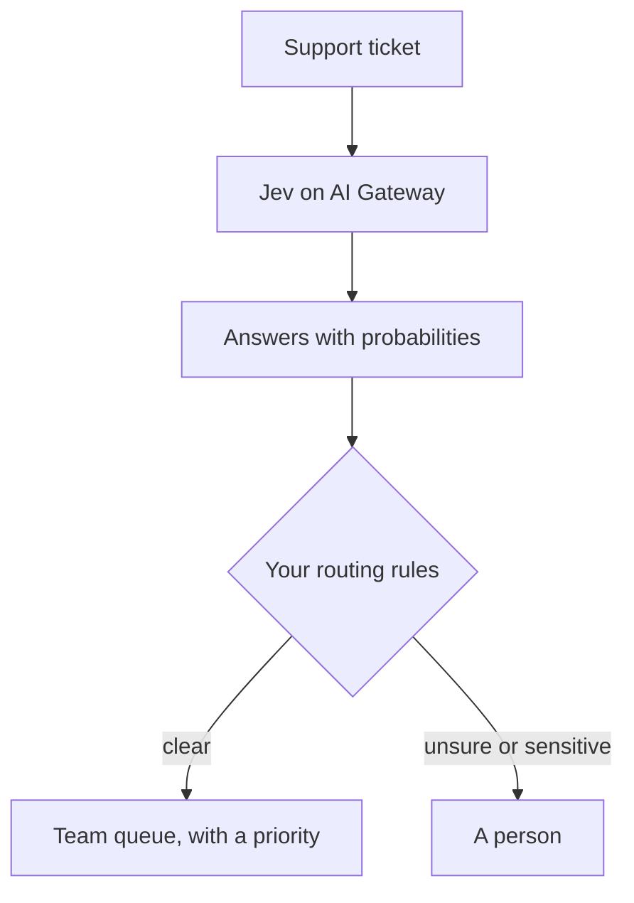

In this guide you build a small Node.js script that sends a support ticket to Jev, TypeSafe AI's decision model, through Vercel AI Gateway. Jev answers three typed questions in one request: which team should handle the ticket, how urgent it is, and whether a person should handle it. Your code then uses the probabilities in those answers to route the ticket to a queue, or to a person when Jev isn't sure.

It takes about 15 minutes. You need Node.js 22 and an AI Gateway API key for the live call. The routing tests at the end run without a key.

## What will you build?

A script called `ticket-router` that asks Jev three questions about one ticket:

| Question | Type | What you get back |
| --- | --- | --- |
| Which team should handle it? | `choice` | One of `billing`, `technical`, `account`, `other`, plus a probability for each |
| How urgent is it? | `score` | A number from 0 (low) to 2 (high), plus a probability for each level |
| Should a person handle it? | `boolean` | The probability that the answer is "yes" |

A **probability** here is a number from 0 to 1. For example, 0.92 for `billing` means Jev puts 92% of its weight on "this is a billing ticket".

Jev doesn't write text. It only returns these typed answers. Your own code, not the model, decides what happens next:



## What do you need?

- **Node.js 22 or newer.** The `ai` package requires it. Check with `node --version`.
- **A Vercel account with AI Gateway access.** The live call needs an [AI Gateway API key](https://vercel.com/docs/ai-gateway/authentication-and-byok) and a team with [AI Gateway Credits](https://vercel.com/docs/ai-gateway/pricing). The next part of this series, [How to test Jev on Vercel AI Gateway](/blog/test-jev-on-vercel-ai-gateway), covers credits and the free tier in detail.
- **About 15 minutes.**

Jev costs [$0.042 per million input tokens](https://vercel.com/ai-gateway/models/jev), and there is [no charge for output tokens](https://vercel.com/kb/guide/typesafe-jev-and-ai-sdk). In Vercel's [HTTP API example](https://vercel.com/docs/ai-gateway/modalities/evaluation#http-api), a one-question request used 275 input tokens and cost $0.00001155.

The AI SDK exposes Jev through `experimental_evaluate`. The `experimental_` prefix matters: the [AI SDK docs](https://ai-sdk.dev/docs/ai-sdk-core/evaluation) say this API "may change in patch releases". Pin the version in `package.json` before you ship anything.

## How do I build the ticket router?


<Steps>


<Step title="Create the project">

```bash
$ mkdir ticket-router
$ cd ticket-router
$ npm init -y
```

The files in this guide end in `.mjs`, so Node treats them as ES modules and you can use `import` without extra settings.

</Step>


<Step title="Install the AI SDK">


```bash
npm install ai
```


You need AI SDK 7.0.105 or later: that's the [version that added](https://vercel.com/kb/guide/typesafe-jev-and-ai-sdk) `experimental_evaluate`. Check what you got:

```bash
$ npm ls ai
```

We tested this guide with `ai@7.0.122`. The `ai` package also installs `@ai-sdk/gateway`, the part that talks to AI Gateway, so you don't install anything else.

</Step>


<Step title="Add your AI Gateway API key">

In the Vercel dashboard, open **AI Gateway**, then **API Keys**, and click **Create key**. Then put the key in an environment variable in your terminal:

```bash
$ export AI_GATEWAY_API_KEY="YOUR_AI_GATEWAY_API_KEY"
```

When you pass a model ID as a plain string, like `'typesafe-ai/jev'`, the AI SDK sends the call through AI Gateway and [reads this variable](https://vercel.com/docs/ai-gateway/authentication-and-byok) for you. You never put the key in your code.


<Callout type="warning" title="Keep the key out of your code and your repo">

Anyone with this key can spend your AI Gateway Credits. Don't paste it into a source file, a prompt or a chat. If you prefer a file, put `AI_GATEWAY_API_KEY=…` in a `.env` file, add `.env` to `.gitignore`, and run the script with `node --env-file=.env index.mjs` ([Node.js docs](https://nodejs.org/docs/latest-v22.x/api/cli.html#--env-filefile)). Read [Never paste secrets into AI prompts](/blog/secrets-in-ai-prompts) for what to do if a key leaks.

</Callout>


</Step>


<Step title="Write the questions and the routing rules">

Create `jev-triage.mjs`. It has two functions: `classifyTicket` asks Jev, and `routeTicket` turns the answers into a decision.


**jev-triage.mjs**

```js
import { experimental_evaluate as evaluate } from 'ai';

/**
 * Ask Jev three questions about one ticket, in one request.
 * `model` is a parameter so the tests can pass a fake model.
 * @param {object} ticket
 * @param {import('ai').Experimental_EvaluationModel} [model]
 */
export async function classifyTicket(ticket, model = 'typesafe-ai/jev') {
  const result = await evaluate({
    model,
    state: ticket,
    questions: {
      category: {
        type: 'choice',
        instructions: 'Which team should handle this support ticket?',
        criteria: {
          billing: 'Charges, invoices, refunds and plan changes',
          technical: 'Bugs, errors, outages and integration problems',
          account: 'Login, passwords, permissions and profile changes',
          other: 'Anything that does not fit the other teams',
        },
      },
      urgency: {
        type: 'score',
        instructions: 'How urgent is this ticket for the customer?',
        criteria: [
          'Low: a question or a small annoyance, no deadline',
          'Medium: something is broken, but there is a workaround',
          'High: the customer is blocked or is losing money or data',
        ],
      },
      needsHuman: {
        type: 'boolean',
        instructions: 'Should a person handle this ticket instead of an automated reply?',
        criteria: {
          true: 'The customer asks for a person, is very upset, mentions legal action or reports a security problem.',
          false: 'A standard answer from the right team is enough.',
        },
      },
    },
  });
  return result.answers;
}

// Your rules, in plain code. Tune the numbers here, not in the questions.
export function routeTicket(answers) {
  const { category, urgency, needsHuman } = answers;

  if (needsHuman.probability >= 0.5) {
    return { action: 'human', reason: 'a person should handle this' };
  }

  const categoryProbability = category.probabilities?.[category.choice] ?? 0;
  if (categoryProbability < 0.7) {
    return { action: 'human', reason: 'not sure which team' };
  }

  return {
    action: 'queue',
    queue: category.choice,
    priority: urgency.score >= 1.5 ? 'high' : 'normal',
  };
}
```


What each part does:

- `model: 'typesafe-ai/jev'` is Jev's [model ID on AI Gateway](https://vercel.com/ai-gateway/models/jev).
- `state` is what Jev looks at: here, the ticket object. It can be a string, an object or an array.
- `questions` is a map of named questions. Each name, like `category`, comes back as a key in `result.answers`.
- `criteria` describes the options. Full descriptions, like "Blocking with no workaround", give Jev more to match than one word like "high". For a `score`, list the levels from lowest to highest.
- `routeTicket` is ordinary code. Jev never sees these rules, so you can change them without touching the questions.

</Step>


<Step title="Write the script that calls Jev">

Create `index.mjs`:


**index.mjs**

```js
import { classifyTicket, routeTicket } from './jev-triage.mjs';

if (!process.env.AI_GATEWAY_API_KEY) {
  console.error('Set AI_GATEWAY_API_KEY first (see step 3).');
  process.exit(1);
}

const ticket = {
  subject: 'Charged twice this month',
  message: 'My card was charged twice for the Pro plan in September. Please refund the extra charge.',
  plan: 'pro',
};

const answers = await classifyTicket(ticket);
console.log('Answers from Jev:');
console.log(JSON.stringify(answers, null, 2));
console.log('Decision:', routeTicket(answers));
```


</Step>


<Step title="Run it">

```bash
$ node index.mjs
```

The script prints the three answers and the decision. Without the key, it stops with `Set AI_GATEWAY_API_KEY first (see step 3).`

</Step>


</Steps>


## What does Jev send back?

We couldn't run the live call while writing this post (it needs a key with credits), so here is the response shape from Vercel's own guide instead. Their ticket uses different question names (`department`, `severity`, `requestsRefund`), but the shape is the same as yours:

```json
{
  "department": {
    "type": "choice",
    "choice": "technical",
    "probabilities": { "billing": 0.08, "technical": 0.91, "account": 0.01, "other": 0 }
  },
  "severity": {
    "type": "score",
    "score": 2.86,
    "probabilities": { "0": 0, "1": 0.02, "2": 0.1, "3": 0.88 }
  },
  "requestsRefund": { "type": "boolean", "probability": 0.97 }
}
```

_Example output from [How to classify, route, and score with Jev and AI SDK](https://vercel.com/kb/guide/typesafe-jev-and-ai-sdk) (Vercel), not a run of this script. Your numbers will differ._

How to read each answer (from the [AI SDK evaluation docs](https://ai-sdk.dev/docs/ai-sdk-core/evaluation) and the Vercel guide):

- **Choice:** `choice` is the selected option. `probabilities` lists every option, and the selected one always has the highest value.
- **Score:** the levels are numbered from zero, and the `probabilities` keys are strings (`"0"`, `"1"`…). `score` is the probability-weighted average of the levels, so `2.86` sits between level 2 and level 3. With your three urgency levels, the score is between 0 and 2.
- **Boolean:** `probability` is the chance that the answer is "yes". `0.98` is a strong yes, `0.02` is a strong no, and `0.5` means Jev can't tell. It is not a confidence value.

Two more details. TypeSafe rounds probabilities to two decimal places, so a choice can add up to `0.99` instead of `1`: don't "fix" that yourself. And TypeSafe returns a separate **confidence** number for choice and score answers, under `typesafe.confidence` in the result's `providerMetadata`. It measures how concentrated the probabilities are, from 0 (spread evenly) to 1 (all on one option).

## How do the probabilities route a ticket?

`routeTicket` checks three rules, in this order:

| Rule | Why |
| --- | --- |
| `needsHuman` probability is 0.5 or higher → a person | Missing an angry customer or a security report costs more than an extra look, so the bar is low |
| The chosen team's probability is below 0.7 → a person | Jev isn't sure which team, so don't guess |
| Otherwise → the chosen team's queue, `high` priority if urgency is 1.5 or higher | A clear case, handled automatically |

These numbers are starting points, not rules from TypeSafe. Vercel's guide suggests the same idea: [stricter thresholds](https://vercel.com/kb/guide/typesafe-jev-and-ai-sdk) where a wrong decision costs more, and a review path for anything below your floor. To pick real numbers, run tickets with known answers through the same questions and see where Jev is wrong. [How to test AI output with evals](/blog/test-ai-output-with-evals) shows how to build that kind of test set.

Keep one line clear: Jev classifies, your code authorizes. If Jev says a customer wants a refund, that's the customer's intent. Whether they get the refund depends on your policy and their account, and Jev sees neither.

## Can I test the routing without a key?

Yes. The AI SDK ships a fake evaluation model, `Experimental_EvaluationMockModelV4` in `ai/test`, that returns whatever answers you give it. Because `classifyTicket` takes the model as a parameter, you can pass the fake one in and test every branch of `routeTicket` with no network call. Node's built-in test runner is enough.

Create `routing.test.mjs`:


**routing.test.mjs**

```js
import { test } from 'node:test';
import assert from 'node:assert/strict';
import { Experimental_EvaluationMockModelV4 as MockEvaluationModel } from 'ai/test';
import { classifyTicket, routeTicket } from './jev-triage.mjs';

// A fake model that returns the answers you give it. No network, no key.
function fakeJev(answers) {
  return new MockEvaluationModel({
    doEvaluate: async () => ({ answers, warnings: [] }),
  });
}

const ticket = { subject: 'Charged twice', message: 'Please refund the extra charge.', plan: 'pro' };

const clearBilling = {
  category: {
    type: 'choice',
    choice: 'billing',
    probabilities: { billing: 0.92, technical: 0.04, account: 0.03, other: 0.01 },
  },
  urgency: { type: 'score', score: 1.2, probabilities: { 0: 0.1, 1: 0.6, 2: 0.3 } },
  needsHuman: { type: 'boolean', probability: 0.1 },
};

test('a clear billing ticket goes to the billing queue', async () => {
  const answers = await classifyTicket(ticket, fakeJev(clearBilling));
  assert.deepEqual(routeTicket(answers), { action: 'queue', queue: 'billing', priority: 'normal' });
});

test('an unclear category goes to a person', async () => {
  const unclear = {
    ...clearBilling,
    category: {
      type: 'choice',
      choice: 'billing',
      probabilities: { billing: 0.5, technical: 0.3, account: 0.1, other: 0.1 },
    },
  };
  const answers = await classifyTicket(ticket, fakeJev(unclear));
  assert.equal(routeTicket(answers).action, 'human');
});

test('"needs a human" wins over the queue', async () => {
  const angry = { ...clearBilling, needsHuman: { type: 'boolean', probability: 0.8 } };
  const answers = await classifyTicket(ticket, fakeJev(angry));
  assert.deepEqual(routeTicket(answers), { action: 'human', reason: 'a person should handle this' });
});
```


Run it:

```bash
$ node --test
```

```text
✔ a clear billing ticket goes to the billing queue (41.170094ms)
✔ an unclear category goes to a person (0.740071ms)
✔ "needs a human" wins over the queue (2.329348ms)
ℹ tests 3
ℹ suites 0
ℹ pass 3
ℹ fail 0
ℹ cancelled 0
ℹ skipped 0
ℹ todo 0
ℹ duration_ms 238.020236
```

That's a real run; in a terminal, Node prints this format by default. The fake answers still go through the AI SDK's checks: if a choice's probabilities don't add up to 1, or a score doesn't match its probabilities, the call fails just as it would with a bad answer from a real model.

These tests prove your rules do what you meant. They don't prove Jev answers your tickets well. Only real tickets with known outcomes can show that.

## What if the call fails?

Match the status code with this table from the [AI Gateway FAQ](https://vercel.com/docs/ai-gateway/faq):

| Response | Cause | Fix |
| --- | --- | --- |
| `401` | The API key is missing, invalid or revoked | Export a current AI Gateway key and try again |
| `402` (type is not `quota_for_entity_exceeded`) | Your team has no credit balance | [Add AI Gateway Credits](https://vercel.com/docs/ai-gateway/pricing) |
| `402` with `quota_for_entity_exceeded` | A team, project, API key or user budget reached its limit | Wait for the budget to refresh, or raise the limit |
| `403` with `customer_verification_required` | The team must add a payment method before using free credits | Add a payment method from the link in the error |
| `403` whose message names the free tier | The model isn't in the free-tier subset and needs purchased credits | Add AI Gateway Credits, or pick a free-tier model |
| `403` whose message names team restrictions | A model or provider allowlist blocks the request | Ask a team owner to update the allowlist |
| `429` | An AI Gateway or provider rate limit was hit | Wait a moment and retry |

With a wrong key, the error includes this line (we ran the script with a made-up key to check):

```text
_GatewayAuthenticationError: AI Gateway authentication failed: Invalid API key or token.
```

Two more things to know:

- **The AI SDK already retries.** Failed calls are retried with backoff, and `maxRetries` [defaults to 2](https://vercel.com/docs/ai-gateway/rate-limits).
- **Evaluation needs the AI SDK, the AI Gateway HTTP API or the TypeSafe-compatible API.** The OpenAI-, Anthropic- and Cohere-compatible endpoints [don't support it](https://vercel.com/docs/ai-gateway/modalities/evaluation), so an OpenAI client pointed at AI Gateway can't call Jev this way.

## What should I do next?

- **Get credits and try the live call.** The next part of this series, [How to test Jev on Vercel AI Gateway](/blog/test-jev-on-vercel-ai-gateway), walks through access, credits and the free tier.
- **Swap in your own tickets.** Change the ticket in `index.mjs`, or read tickets from a file, and compare Jev's answers with what your team would decide.
- **Add a confidence floor.** Vercel's guide also checks TypeSafe's confidence value (`typesafe.confidence` in `providerMetadata`) before assigning a queue. See [step 4 of the guide](https://vercel.com/kb/guide/typesafe-jev-and-ai-sdk).
- **Measure before you trust the numbers.** Build a small labeled test set with [How to test AI output with evals](/blog/test-ai-output-with-evals), then choose your thresholds from the errors you can live with.
