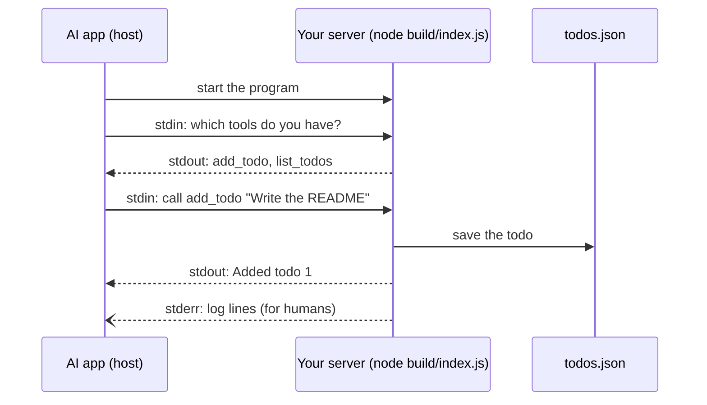

An MCP server is a small program that offers tools to AI apps. In this guide you build one in TypeScript with the official SDK: a "project todos" server with two tools, `add_todo` and `list_todos`. You test it with the MCP Inspector and then connect it to Claude Code, so you can say "add a todo to write the README" and Claude calls your code.

If you haven't met MCP yet, read [What is MCP?](/blog/what-is-mcp) first. This post assumes you know what a host, a server and a tool are.

## What will you build?

A local MCP server that keeps a todo list in a JSON file. It has two tools:

| Tool | What it does | Input |
| --- | --- | --- |
| `add_todo` | Adds a todo to the list | `text`: what needs to be done |
| `list_todos` | Shows every todo | none |

It is a **local** server: the AI app starts it as a program on your machine and talks to it over stdio (standard input and output). You don't need a web server, a port or an account.



The app writes requests to your program's stdin and reads answers from its stdout. Those messages are JSON-RPC, a simple JSON request and response format. The SDK handles all of that for you. You only write the tools.

## What do you need?

- **Node.js 22.19 or newer.** The SDK itself needs Node 20, but the MCP Inspector you'll use for testing needs [22.19.0 or newer](https://modelcontextprotocol.io/docs/tools/inspector). Check with `node --version`.
- **A terminal and an editor.** Basic TypeScript is enough.
- **Claude Code**, only for the last step. [Install it and sign in](https://code.claude.com/docs/en/setup). Everything before that works without it.

We use the SDK's current version 2 packages: `@modelcontextprotocol/server` for servers and `@modelcontextprotocol/client` for clients. Older tutorials use `@modelcontextprotocol/sdk`: that is version 1, which the [SDK README](https://github.com/modelcontextprotocol/typescript-sdk) says keeps getting bug and security fixes for at least six months after v2's release. For new servers, use v2.

## How do I build the server?

The setup follows the official [build a server guide](https://modelcontextprotocol.io/docs/develop/build-server) (TypeScript tab).


<Steps>


<Step title="Create the project">

```bash
$ mkdir project-todos
$ cd project-todos
$ npm init -y
$ mkdir src
```

</Step>


<Step title="Install the SDK and TypeScript">


```bash
npm install @modelcontextprotocol/server zod
```


```bash
npm install -D @types/node typescript
```


- `@modelcontextprotocol/server` is the official SDK for building MCP servers.
- `zod` describes the shape of each tool's input. The SDK turns it into a JSON Schema that the AI app reads, and uses it to check the input before your code runs.
- `typescript` and `@types/node` compile your code to JavaScript.

</Step>


<Step title="Configure the project">

```bash
$ npm pkg set type=module "bin.project-todos=./build/index.js" "scripts.build=tsc && chmod 755 build/index.js" "files[0]=build"
```

This edits `package.json` for you:

- `"type": "module"` lets you use `import`.
- `bin` gives the server a command name. You'll need it when you publish the package later.
- `build` compiles the code and makes the output file executable.
- `files` keeps the published package down to the compiled code.

On Windows, npm runs scripts with `cmd.exe`, which has no `chmod`. Use `"scripts.build=tsc"` there instead.

Then create `tsconfig.json` in the project folder:


**tsconfig.json**

```json
{
  "compilerOptions": {
    "target": "ES2022",
    "module": "Node16",
    "moduleResolution": "Node16",
    "types": ["node"],
    "outDir": "./build",
    "rootDir": "./src",
    "strict": true,
    "esModuleInterop": true,
    "skipLibCheck": true,
    "forceConsistentCasingInFileNames": true
  },
  "include": ["src/**/*"],
  "exclude": ["node_modules"]
}
```


</Step>


<Step title="Write the server">

Create `src/index.ts`:


**src/index.ts**

```ts
#!/usr/bin/env node
import { readFile, writeFile } from "node:fs/promises";
import { homedir } from "node:os";
import { join } from "node:path";
import { McpServer } from "@modelcontextprotocol/server";
import { StdioServerTransport } from "@modelcontextprotocol/server/stdio";
import { z } from "zod";

// Where the todos are saved. Set TODO_FILE to use another file.
const TODO_FILE = process.env.TODO_FILE ?? join(homedir(), ".project-todos.json");

type Todo = { id: number; text: string; done: boolean };

async function loadTodos(): Promise<Todo[]> {
  try {
    return JSON.parse(await readFile(TODO_FILE, "utf8"));
  } catch (error) {
    if ((error as NodeJS.ErrnoException).code === "ENOENT") return []; // no file yet
    throw error;
  }
}

async function saveTodos(todos: Todo[]): Promise<void> {
  await writeFile(TODO_FILE, JSON.stringify(todos, null, 2));
}

const server = new McpServer({ name: "project-todos", version: "1.0.0" });

server.registerTool(
  "add_todo",
  {
    description: "Add a todo to the project's todo list",
    inputSchema: z.object({
      text: z.string().min(1).describe("What needs to be done"),
    }),
  },
  async ({ text }) => {
    const todos = await loadTodos();
    const todo: Todo = { id: todos.length + 1, text, done: false };
    todos.push(todo);
    await saveTodos(todos);
    return { content: [{ type: "text", text: `Added todo #${todo.id}: ${text}` }] };
  },
);

server.registerTool(
  "list_todos",
  {
    description: "List all todos in the project's todo list",
  },
  async () => {
    const todos = await loadTodos();
    const text = todos.length
      ? todos.map((t) => `#${t.id} [${t.done ? "x" : " "}] ${t.text}`).join("\n")
      : "No todos yet.";
    return { content: [{ type: "text", text }] };
  },
);

async function main() {
  const transport = new StdioServerTransport();
  await server.connect(transport);
  // Log to stderr: stdout is reserved for MCP messages.
  console.error(`project-todos MCP server running on stdio (file: ${TODO_FILE})`);
}

main().catch((error) => {
  console.error("Fatal error:", error);
  process.exit(1);
});
```


</Step>


<Step title="Build it">

```bash
$ npm run build
```

This creates `build/index.js`. There's no output when it works.

</Step>


</Steps>


## What does each part of the code do?

- **`new McpServer({ name, version })`** creates the server. The name and version identify your server to the app when it connects.
- **`registerTool(name, config, handler)`** adds a tool. The AI model never sees your code. It only sees the tool's **name**, its **description** and its **input schema**, and uses them to decide when to call the tool and with what. So write descriptions for the model: say what the tool does in one plain sentence.
- **`inputSchema: z.object({ text: z.string().min(1) })`** says `add_todo` needs a non-empty string called `text`. If a caller sends anything else, the SDK rejects the call before your handler runs. `list_todos` takes no input, so it has no schema.
- **The handler** does the work and returns `content`: a list of results, here one piece of text. That text is what the model reads back.
- **`StdioServerTransport`** connects the server to stdin and stdout, and `server.connect()` starts listening.
- **`TODO_FILE`** is an environment variable that lets the user choose where todos are saved. Without it, the server uses `.project-todos.json` in your home folder.

## Why must logs go to stderr, not stdout?

Because stdout is the wire. The [stdio part of the MCP spec](https://modelcontextprotocol.io/specification/2026-07-28/basic/transports/stdio) says the server must not write anything to stdout that is not a valid MCP message. It may write log lines to stderr, and the app can capture or ignore them.

In Node, `console.log()` writes to stdout and `console.error()` writes to stderr. So in a stdio server:

```ts
console.log("Server started");   // wrong: goes to stdout and mixes with MCP messages
console.error("Server started"); // right: goes to stderr, apps keep it as a log
```

A single stray `console.log`, yours or one inside a library, puts a line on stdout that isn't JSON. Depending on the app, that line is skipped, or the app reports a JSON parse error and drops the connection. The server above logs one line at startup, and it uses `console.error`.

You can check that stdout stays clean. Run the server with stdin closed and stderr hidden. A correct stdio server prints nothing and exits:

```bash
$ node build/index.js < /dev/null 2>/dev/null
```

If you see text, something is writing to stdout.

## How do I test it with the MCP Inspector?

The [MCP Inspector](https://modelcontextprotocol.io/docs/tools/inspector) is the official test tool. It connects to your server the same way an AI app does. It has a web UI, a terminal UI and a CLI mode for scripts, and it runs with `npx`, so there's nothing to install.

First, ask the server for its tools with the CLI mode. Everything after `--cli` is the command that starts your server:

```bash
$ npx @modelcontextprotocol/inspector --cli node build/index.js --method tools/list
```

```text
project-todos MCP server running on stdio (file: /home/you/.project-todos.json)
{
  "tools": [
    {
      "name": "add_todo",
      "description": "Add a todo to the project's todo list",
      "inputSchema": {
        "type": "object",
        "properties": {
          "text": {
            "type": "string",
            "minLength": 1,
            "description": "What needs to be done"
          }
        },
        "required": [
          "text"
        ],
        "$schema": "https://json-schema.org/draft/2020-12/schema"
      }
    },
    {
      "name": "list_todos",
      "description": "List all todos in the project's todo list",
      "inputSchema": {
        "type": "object",
        "properties": {}
      }
    }
  ]
}
```

The first line is your stderr log. The rest is exactly what an AI model sees: the Zod schema has become a JSON Schema.

Now call the tools:

```bash
$ npx @modelcontextprotocol/inspector --cli node build/index.js --method tools/call --tool-name add_todo --tool-arg "text=Write the README"
```

```text
project-todos MCP server running on stdio (file: /home/you/.project-todos.json)
{
  "content": [
    {
      "type": "text",
      "text": "Added todo #1: Write the README"
    }
  ]
}
```

```bash
$ npx @modelcontextprotocol/inspector --cli node build/index.js --method tools/call --tool-name list_todos
```

```text
project-todos MCP server running on stdio (file: /home/you/.project-todos.json)
{
  "content": [
    {
      "type": "text",
      "text": "#1 [ ] Write the README"
    }
  ]
}
```

Each CLI run starts the server, sends one request, prints the result and stops. The todo survived between runs because it's saved in the file.

To click around instead, start the web UI:

```bash
$ npx @modelcontextprotocol/inspector node build/index.js
```

It prints a local URL with a one-time token. Open it, switch the server on, and open the **Tools** tab. Pick a tool, fill in its input and select **Execute Tool**.


## How do I connect it to Claude Code?

Use `claude mcp add` with the stdio form. Run this in the `project-todos` folder, in your terminal, not inside a Claude session:

```bash
$ claude mcp add --transport stdio project-todos -- node "$PWD/build/index.js"
```

- `--transport stdio` means Claude Code starts the server as a local program.
- `project-todos` is the name you'll see in Claude Code.
- Everything after `--` is the command that starts the server. The [Claude Code docs](https://code.claude.com/docs/en/mcp) explain that `--` keeps Claude Code from reading the server's own flags as its options.
- `"$PWD/build/index.js"` turns into the absolute path of your build. Use absolute paths: the [Claude Code docs](https://code.claude.com/docs/en/debug-your-config) note that relative paths resolve against the folder you started Claude Code from, which may not be this one.

By default the server is added in local scope: only for you, in this project. Check it:

```bash
$ claude mcp list
```

```text
Checking MCP server health…

project-todos: node /home/you/project-todos/build/index.js - ✔ Connected
```

Then start Claude Code and ask for something that needs your tools:

```bash
$ claude
```

```text
Add a todo to write the README, then show me all my todos.
```

In the default permission mode, Claude Code [asks before the first use of each tool](https://code.claude.com/docs/en/permissions), so it asks before it calls `add_todo`. Approve it, and Claude answers from what your server returned. Type `/mcp` in the session to see the server's status and how many tools it offers.

To save todos somewhere else, pass the variable with `--env`, after the server name and before `--`:

```bash
$ claude mcp add --transport stdio project-todos --env TODO_FILE=/home/you/work/todos.json -- node "$PWD/build/index.js"
```


<Callout type="warning" title="Your tools run with your permissions">

Claude Code starts a stdio server as a normal program on your machine, with your user's access to files and the network. Keep tools narrow: this server only reads and writes one JSON file. Before you add a tool that deletes data, runs commands or calls a paid API, think about what happens if the model calls it with the wrong input, and keep tool-call approvals on.

</Callout>


## What if it doesn't work?

| What you see | Likely cause | Fix |
| --- | --- | --- |
| `claude mcp list` shows `✘ Failed to connect` | Wrong path to `build/index.js`, or you didn't build | Run `npm run build`, then add the server again with an absolute path |
| The Inspector won't start | Node is older than 22.19 | Update Node |
| The model never calls your tool | The description doesn't match what you asked | Make the description say plainly what the tool does |
| `SyntaxError: ... is not valid JSON` in a client log | Something printed to stdout | Replace `console.log` with `console.error` |

The next post in this series, [How to test and debug an MCP server](/blog/test-and-debug-mcp-server), covers testing and debugging in depth, including automated tests.

## What should I do next?

- **Add a third tool**, such as `complete_todo`, that marks a todo as done. Rebuild, and test it with the Inspector before you try it in Claude Code.
- **Wrap something you use every day.** Swap the JSON file for a call to your team's API. The tool shape stays the same.
- **Read the SDK docs** for resources, prompts and remote HTTP servers: [ts.sdk.modelcontextprotocol.io](https://ts.sdk.modelcontextprotocol.io/v2/).
