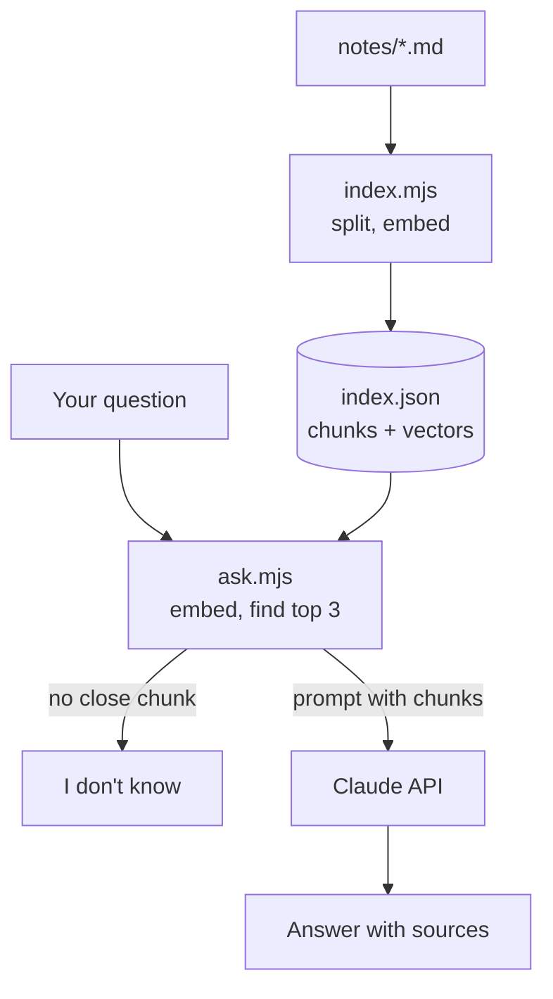

You'll build a small Node.js app that answers questions from a folder of Markdown notes. It splits the notes into chunks, turns each chunk into an embedding on your machine, finds the chunks closest to a question, and asks Claude to answer from them with sources. The whole app is four short files, and everything except the final Claude call runs without an API key.

This is RAG (retrieval-augmented generation) in its simplest useful form. If the idea is new to you, read [What is RAG?](/blog/what-is-rag) first. If embeddings are new, [What are embeddings and vector databases?](/blog/what-are-embeddings) covers them.

## What will the app do?

Two scripts, one for each RAG phase:

- `index.mjs` reads every note, splits it into chunks, embeds each chunk and saves everything to `index.json`. You run it once, and again when your notes change.
- `ask.mjs` takes a question, finds the 3 closest chunks, builds a prompt and sends it to Claude. If no chunk is close enough, it says "I don't know" without calling the model.



A shared file, `rag.mjs`, holds the two helpers both scripts need: `embed` and `search`.

## What do you need?

- [Node.js](https://nodejs.org) 22 and a terminal.
- Internet access for the first run: the embedding model (about 90 MB) downloads from Hugging Face and is cached after that.
- For the last step only: an Anthropic API key from the [Claude Console](https://platform.claude.com). Everything before it runs without one.

## How do I build it?


<Steps>


<Step title="Create the project">

```bash
$ mkdir rag-notes
$ cd rag-notes
$ mkdir notes
```


```bash
npm install @huggingface/transformers @anthropic-ai/sdk
```


[Transformers.js](https://huggingface.co/docs/transformers.js/index) (`@huggingface/transformers`) runs the embedding model locally. `@anthropic-ai/sdk` is Anthropic's official TypeScript SDK for the Claude API, and it works from plain JavaScript files like the ones here.

</Step>


<Step title="Add some notes">

Create three small team notes in the `notes` folder. Use your own notes later; these make the output below match yours.


**notes/deploys.md**

```md
# Deploys

## How to deploy

Merge your pull request into main. CI builds the app and deploys it to staging.
When the staging checks pass, run the "Promote" job in CI to ship to production.

## Deploy freeze

We don't deploy to production on Fridays after 3 pm or during company holidays.
Urgent fixes need approval from the on-call lead.

## Rollbacks

To roll back, run the "Rollback" job in CI and pick the last good release.
A rollback takes about five minutes.
```


**notes/on-call.md**

```md
# On-call

## Rotation

Each engineer is on call for one week, Monday to Monday.
The schedule lives in the team calendar.

## When you get paged

Acknowledge the page within 15 minutes.
Open an incident channel, post what you know, and start with the runbook for that alert.

## Handover

At the end of your week, write a short handover note: open incidents, noisy alerts, and anything half done.
```


**notes/local-setup.md**

```md
# Local setup

## Requirements

You need Node 22 and Docker. Run `npm install` in the repo root.

## Running the app

Start the database with `docker compose up -d`, then run `npm run dev`.
The app runs on http://localhost:3000.

## Tests

Run `npm test` for unit tests. End-to-end tests run in CI only.
```


</Step>


<Step title="Write the embed and search helpers">


**rag.mjs**

```js
import { pipeline } from '@huggingface/transformers';

// A small embedding model that runs on your machine (about 90 MB, downloaded once)
const extractor = await pipeline('feature-extraction', 'onnx-community/all-MiniLM-L6-v2-ONNX');

// Turn a list of texts into vectors: 384 numbers each, scaled to length 1
export async function embed(texts) {
  const output = await extractor(texts, { pooling: 'mean', normalize: true });
  return output.tolist();
}

// The vectors have length 1, so the dot product is the cosine similarity
const dot = (a, b) => a.reduce((sum, value, i) => sum + value * b[i], 0);

// Find the chunks closest to the question, best first
export async function search(index, question, { topK = 3, minScore = 0.25 } = {}) {
  const [questionVector] = await embed([question]);
  return index
    .map((chunk) => ({ ...chunk, score: dot(questionVector, chunk.vector) }))
    .filter((chunk) => chunk.score >= minScore)
    .sort((a, b) => b.score - a.score)
    .slice(0, topK);
}
```


- `embed` turns texts into vectors with a small open model, [all-MiniLM-L6-v2](https://huggingface.co/sentence-transformers/all-MiniLM-L6-v2). The call matches the [Transformers.js feature-extraction example](https://huggingface.co/docs/transformers.js/api/pipelines).
- `search` scores every chunk against the question, drops the weak ones (`minScore`), and keeps the best few (`topK`). Because `normalize: true` makes every vector length 1, the dot product equals cosine similarity.

</Step>


<Step title="Index the notes">


**index.mjs**

```js
import { readdir, readFile, writeFile } from 'node:fs/promises';
import { join } from 'node:path';
import { embed } from './rag.mjs';

const NOTES_DIR = 'notes';

// One chunk per "## " section. Each chunk keeps its page title,
// so "Rollbacks" still says which page it came from.
function splitIntoChunks(file, markdown) {
  const title = markdown.match(/^# (.+)$/m)?.[1] ?? file;
  return markdown
    .split(/^(?=## )/m)
    .filter((section) => section.startsWith('## '))
    .map((section) => {
      const [headingLine, ...body] = section.trim().split('\n');
      const heading = headingLine.slice(3);
      return {
        source: `${file} > ${heading}`,
        text: `${title}: ${heading}\n${body.join('\n').trim()}`,
      };
    });
}

const files = (await readdir(NOTES_DIR)).filter((f) => f.endsWith('.md')).sort();
const chunks = [];
for (const file of files) {
  const markdown = await readFile(join(NOTES_DIR, file), 'utf8');
  chunks.push(...splitIntoChunks(file, markdown));
}

const vectors = await embed(chunks.map((chunk) => chunk.text));
const index = chunks.map((chunk, i) => ({ ...chunk, vector: vectors[i] }));

await writeFile('index.json', JSON.stringify(index));
console.log(`Indexed ${index.length} chunks from ${files.length} files into index.json`);
```


Each `## ` section becomes one chunk. The chunk text starts with the page title, so a section called "Rollbacks" still says it belongs to "Deploys". Run it:

```bash
$ node index.mjs
```

```text
Indexed 9 chunks from 3 files into index.json
```

</Step>


<Step title="Retrieve and build the prompt">


**ask.mjs**

```js
import { readFile } from 'node:fs/promises';
import Anthropic from '@anthropic-ai/sdk';
import { search } from './rag.mjs';

const question = process.argv.slice(2).join(' ');
if (!question) {
  console.error('Usage: node ask.mjs "your question"');
  process.exit(1);
}

// 1. Retrieve: find the chunks closest to the question
const index = JSON.parse(await readFile('index.json', 'utf8'));
const results = await search(index, question, { topK: 3, minScore: 0.25 });

console.log('Retrieved chunks:');
for (const { score, source } of results) {
  console.log(`  ${score.toFixed(2)}  ${source}`);
}

// Nothing relevant? Say so instead of letting the model guess
if (results.length === 0) {
  console.log("\nI don't know. Nothing in the notes matches this question.");
  process.exit(0);
}

// 2. Augment: documents first, then instructions, then the question
const documents = results
  .map(
    (chunk, i) =>
      `<document index="${i + 1}">\n<source>${chunk.source}</source>\n<document_content>\n${chunk.text}\n</document_content>\n</document>`,
  )
  .join('\n');

const prompt = `<documents>
${documents}
</documents>

Answer the question using only the documents above.
Cite the source of each fact in square brackets, like [deploys.md > Rollbacks].
If the documents don't contain the answer, say "I don't know based on the notes."

Question: ${question}`;

if (!process.env.ANTHROPIC_API_KEY) {
  console.log('\nNo ANTHROPIC_API_KEY set. This is the prompt that would be sent:\n');
  console.log(prompt);
  process.exit(0);
}

// 3. Generate: ask Claude
const client = new Anthropic();
const message = await client.messages.create({
  model: 'claude-opus-5-5',
  max_tokens: 1000,
  messages: [{ role: 'user', content: prompt }],
});

for (const block of message.content) {
  if (block.type === 'text') {
    console.log(`\n${block.text}`);
  }
}
```


The prompt follows Anthropic's advice for [long documents](https://platform.claude.com/docs/en/build-with-claude/prompt-engineering/claude-prompting-best-practices): documents first in XML tags with their source, the question last. The instructions come from its guide to [reducing hallucinations](https://platform.claude.com/docs/en/test-and-evaluate/strengthen-guardrails/reduce-hallucinations): use only the documents, cite sources, and allow "I don't know". The API call has the same shape as Anthropic's [quickstart](https://platform.claude.com/docs/en/get-started), with the current `claude-opus-5-5` model.

Run it without an API key first, to see what retrieval found:

```bash
$ node ask.mjs "How do I run the app locally?"
```

```text
Retrieved chunks:
  0.51  local-setup.md > Running the app
  0.36  local-setup.md > Requirements
  0.29  deploys.md > How to deploy

No ANTHROPIC_API_KEY set. This is the prompt that would be sent:

<documents>
<document index="1">
<source>local-setup.md > Running the app</source>
<document_content>
Local setup: Running the app
Start the database with `docker compose up -d`, then run `npm run dev`.
The app runs on http://localhost:3000.
</document_content>
</document>
<document index="2">
<source>local-setup.md > Requirements</source>
<document_content>
Local setup: Requirements
You need Node 22 and Docker. Run `npm install` in the repo root.
</document_content>
</document>
<document index="3">
<source>deploys.md > How to deploy</source>
<document_content>
Deploys: How to deploy
Merge your pull request into main. CI builds the app and deploys it to staging.
When the staging checks pass, run the "Promote" job in CI to ship to production.
</document_content>
</document>
</documents>

Answer the question using only the documents above.
Cite the source of each fact in square brackets, like [deploys.md > Rollbacks].
If the documents don't contain the answer, say "I don't know based on the notes."

Question: How do I run the app locally?
```

The two local-setup chunks are on top. The deploy chunk scraped in at third place; the instructions tell Claude to use only what answers the question.

</Step>


<Step title="Ask Claude">

Set your API key as an environment variable. The SDK reads `ANTHROPIC_API_KEY` automatically:

```bash
$ export ANTHROPIC_API_KEY="your-api-key-here"
$ node ask.mjs "How do I run the app locally?"
```

You get the same retrieved chunks, then Claude's answer with sources in square brackets, such as `[local-setup.md > Running the app]`. The wording changes from run to run, but every fact should point to one of the three chunks.

</Step>


</Steps>


<Callout type="warning" title="Your chunks leave your machine">

Indexing and search run locally, but the chunks in the prompt are sent to the Claude API with every question. Don't index notes that hold secrets, such as passwords, API keys or customer data, and keep your API key out of your notes and your code.

</Callout>


## How do I check that it works?

Ask something the notes don't cover:

```bash
$ node ask.mjs "What is our vacation policy?"
```

```text
Retrieved chunks:

I don't know. Nothing in the notes matches this question.
```

No chunk scored 0.25 or more, so the app answered without calling Claude. That saves a request and stops the model from guessing.

Then test retrieval on purpose. Write down a few questions people really ask, with the chunk that should answer each one, and check that search finds it. This is a small eval (evaluation): a fixed set of test cases that you run after every change. Anthropic's guide to [building evals](https://platform.claude.com/docs/en/test-and-evaluate/develop-tests) suggests test questions that mirror real use, including edge cases, and grading that a script can do. This one checks for an exact match on the chunk's source, and it needs no API key, because it only tests search.


**eval.mjs**

```js
import { readFile } from 'node:fs/promises';
import { search } from './rag.mjs';

// Questions users really ask, and the chunk that should answer each one
const tests = [
  { question: 'How do I roll back a bad release?', expected: 'deploys.md > Rollbacks' },
  { question: 'Can I ship to production on a Friday afternoon?', expected: 'deploys.md > Deploy freeze' },
  { question: 'How fast do I need to respond when paged?', expected: 'on-call.md > When you get paged' },
  { question: 'Which port does the app use on my laptop?', expected: 'local-setup.md > Running the app' },
  { question: 'What do I need to install to work on the app?', expected: 'local-setup.md > Requirements' },
];

const index = JSON.parse(await readFile('index.json', 'utf8'));
let passed = 0;

for (const { question, expected } of tests) {
  const results = await search(index, question, { topK: 3, minScore: 0.25 });
  const found = results.some((chunk) => chunk.source === expected);
  if (found) passed++;
  console.log(`${found ? 'PASS' : 'FAIL'}  ${question}`);
}

console.log(`\n${passed} of ${tests.length} questions retrieved the right chunk.`);
```


```bash
$ node eval.mjs
```

```text
PASS  How do I roll back a bad release?
PASS  Can I ship to production on a Friday afternoon?
PASS  How fast do I need to respond when paged?
PASS  Which port does the app use on my laptop?
FAIL  What do I need to install to work on the app?

4 of 5 questions retrieved the right chunk.
```

The failure is real, and typical. The question says "install", but the Requirements note says "You need Node 22 and Docker". The words differ enough that the chunk scores below the others. You could fix it by rewording the note ("Install Node 22 and Docker"), by using a stronger embedding model, or by adding keyword search. Then run the eval again to confirm the fix and to check that nothing else broke.

## What should I tune first?

**Chunk size.** One section per chunk works for short notes. Long sections need splitting: this embedding model [cuts off input](https://huggingface.co/sentence-transformers/all-MiniLM-L6-v2) after 256 word pieces, so the end of a long chunk is ignored. Anthropic's [Contextual Retrieval](https://www.anthropic.com/engineering/contextual-retrieval) article says "the choice of chunk size, chunk boundary, and chunk overlap can affect retrieval performance". Split at headings or paragraphs, and keep the title with each chunk, as this app does.

**Top-k.** This app sends the top 3 chunks, which fits nine small chunks. With a large document set, send more: in the same article, "passing the top-20 chunks to the model is more effective than just the top-10 or top-5". More chunks cost more tokens, so test with your own questions.

**The "I don't know" threshold.** `minScore: 0.25` fits this model and these notes, and it's a narrow margin: the port question's best chunk scored 0.26, and the vacation question's best was 0.23. A different model gives different scores, so pick the value by looking at the scores for questions you know the answers to.

**A fresh index.** The app only knows what was in the notes when you last ran `node index.mjs`. Re-run it after every change, for example in CI when the notes change. For large sets, re-embed only the files that changed, and remove chunks from deleted files.

**The model.** `claude-opus-5-5` is where Anthropic's [models overview](https://platform.claude.com/docs/en/about-claude/models/overview) suggests starting. For short answers from short chunks, `claude-sonnet-5` is faster and costs half as much ($2 per million input tokens versus $4). Ask both the same questions and compare the answers.

## What if something goes wrong?

- **The install fails while downloading from `api.nuget.org` (Linux).** On Linux x64, the `onnxruntime-node` package that Transformers.js uses downloads optional GPU (CUDA) files during install. If your network blocks that, install with `ONNXRUNTIME_NODE_INSTALL=skip npm install @huggingface/transformers @anthropic-ai/sdk`. The [install script](https://github.com/microsoft/onnxruntime/blob/main/js/node/script/install.js) supports this setting, and the app runs on the CPU without those files.
- **`ENOENT: no such file or directory, open 'index.json'`.** Run `node index.mjs` before `node ask.mjs`.
- **The first run hangs or fails to download the model.** The model comes from huggingface.co. Check that your network allows it; after the first run, it's cached in a `.cache` folder inside the Transformers.js package in `node_modules`.
- **A `401` error from the API.** The [error reference](https://platform.claude.com/docs/en/api/errors) says there's an issue with your API key, for example it's malformed, revoked or expired. Check the key in the Claude Console and set it again in the same terminal.

## What should I do next?

- **Point it at your own notes.** Copy a folder of real Markdown docs into `notes/`, write five questions into `eval.mjs`, and see what fails.
- **Let the API do the citing.** Claude's [citations feature](https://platform.claude.com/docs/en/build-with-claude/citations) takes your chunks as document blocks and returns the exact passages it used, instead of relying on the prompt.
- **Improve search.** Read Anthropic's [Contextual Retrieval](https://www.anthropic.com/engineering/contextual-retrieval) for adding context to chunks, keyword search and reranking. If the data outgrows a JSON file, [What are embeddings and vector databases?](/blog/what-are-embeddings) covers when to move to a vector database.
