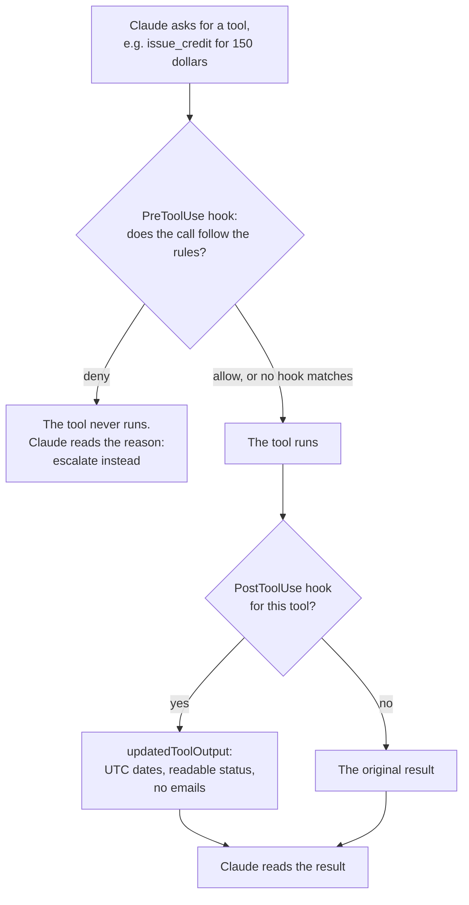

A hook is a function the Claude Agent SDK calls at a fixed point in the agent's work. A `PreToolUse` hook sees every tool call before it runs and can block it or change it. A `PostToolUse` hook sees every tool result before Claude does and can clean it up. In this post you write both in TypeScript: one hook that blocks store credits above a limit and sends Claude to a human instead, and one that turns two tools' messy data into one clean format. Then you test both hooks without an API key.

This is task statement 1.5 of the [Claude Certified Architect – Foundations exam guide](https://anthropic-partners.skilljar.com/claude-certified-architect-foundations-certification): "Apply Agent SDK hooks for tool call interception and data normalization". It sits in Domain 1, Agentic Architecture & Orchestration, which is 27% of the exam.

## What does task statement 1.5 test?

The guide lists three things to know and three skills. In plain words:

| The guide asks you to… | In practice |
| --- | --- |
| Know hooks that change tool results before the model sees them (such as `PostToolUse`) | Clean up, convert or trim what a tool returned, in code, before Claude reads it |
| Know hooks that stop outgoing tool calls to enforce rules | Block a call such as a refund above a limit before it runs |
| Know hooks (deterministic) vs prompt instructions (probabilistic) | A hook holds every time; an instruction holds most of the time |
| Normalize Unix timestamps, ISO 8601 and numeric status codes from different MCP tools | One date format, readable status labels, one money format |
| Block a policy-breaking call and redirect to another workflow | Deny the call and tell Claude to escalate to a human |
| Choose hooks when a business rule needs guaranteed compliance | Sort rules by what a miss costs |

The previous post in this series, [Multi-step workflows: enforcement gates and human handoffs](/blog/claude-workflow-gates-handoffs), built a gate in the dispatch code of a Messages API loop. Parts 1 to 3 covered the agentic loop, coordinators and subagents. This post moves the same idea into the Agent SDK, where the SDK runs the loop and the tools for you, so hooks are where your rules go. If MCP is new to you, read [What is MCP?](/blog/what-is-mcp) first.

## What is a hook?

The [Agent SDK hooks guide](https://code.claude.com/docs/en/agent-sdk/hooks) defines hooks as "callback functions that run your code in response to agent events, like a tool being called, a session starting, or execution stopping." You register them in the `hooks` option of `query()`. When an event fires, the SDK runs the hooks registered for it, and each hook returns an object that says what to do next.

Think of a parcel service. Before a parcel ships, a clerk at the counter checks it against the rules and can refuse it or fix the label. When a parcel arrives, a clerk at the depot repacks it into a standard box before it goes to you. `PreToolUse` is the counter. `PostToolUse` is the depot. Claude only sees what passes both.



Every hook callback gets three arguments: an input object for the event (with `session_id`, `cwd` and `hook_event_name`, plus fields such as `tool_name` and `tool_input` for tool events), the tool use ID, and a context object with an `AbortSignal`. Return `{}` to let things continue unchanged.

## How does a PreToolUse hook block or change a call?

`PreToolUse` runs after Claude has written a tool call and before the tool runs. Your hook reads `tool_name` and `tool_input` and returns a decision inside `hookSpecificOutput`:

| Field | What it does |
| --- | --- |
| `permissionDecision: "deny"` | The tool doesn't run |
| `permissionDecisionReason` | For a deny, the reason is shown to Claude, so it knows what to do instead |
| `updatedInput` | Replaces the tool's input. Include the fields you didn't change too |
| `permissionDecision: "allow"` / `"ask"` / `"defer"` | Skip the permission prompt, ask the user, or pause the run to resume later |

Three details from the docs matter for the exam:

- **Deny wins.** When several hooks or permission rules apply, "`deny` takes priority over `defer`, which takes priority over `ask`, which takes priority over `allow`." One deny blocks the call whatever the other hooks say.
- **Hooks run first.** The [permissions guide](https://code.claude.com/docs/en/agent-sdk/permissions) lists hooks as step 1, before permission rules and modes. A hook can deny a tool even when `allowedTools` approves it, and the docs say: "To gate every tool call regardless of mode and rules, use a `PreToolUse` hook".
- **A timeout blocks.** If a `PreToolUse` callback runs past its timeout, the tool call doesn't run and Claude gets an error result. A slow hook fails closed.

A deny with no reason leaves Claude guessing, and it may retry the same call. The docs' example says the reason "tells the model why, so it avoids retrying". So write the reason as an instruction: what was blocked, that nothing happened, and what to do instead. This is the same advice as for the gate errors in part 4, in a different place.

## How does a PostToolUse hook clean up a result?

`PostToolUse` runs right after a tool succeeds. Its input has `tool_input` (what Claude asked for) and `tool_response` (what the tool returned). It can return:

- **`updatedToolOutput`**, which "replaces the tool's output with the provided value before it is sent to Claude". It works for any tool. The older `updatedMCPToolOutput` does the same for MCP tools only and is deprecated.
- **`additionalContext`**, a string added next to the result, when you want to add a note rather than replace anything.

This is where normalizing belongs. Say one MCP tool returns `"ts": 1790643600` and `"status": 2`, and another returns `"received_at": "2026-09-28T22:30:00-04:00"` and `"status": "RECEIVED"`. Claude has to guess that the first number is seconds, not milliseconds, that `2` means "in transit", and that 22:30 at UTC−4 is 02:30 the next day in UTC. It can work these out, but it has to do it again on every turn, and one wrong guess puts events in the wrong order. A hook knows which tool sent the data, so it doesn't guess: it converts every time to ISO 8601 in UTC, every status to a readable label, and every amount to dollars. The same hook can drop fields Claude doesn't need, such as customer emails and debug strings, which keeps personal data out of the context window and saves tokens.

The replacement must match the tool's output shape. For built-in tools the docs say a value that doesn't match "is ignored and the original output is used". MCP tool output "is passed through without schema validation", so your hook is responsible for sending something sensible. The SDK's `McpOutput` type says an MCP result can be a string, an array of content blocks, or an object, so the hook in the build below handles all three and writes back the same shape it received.


<Callout type="warning" title="PostToolUse can't undo anything">

The docs are direct: "`updatedToolOutput` only changes what Claude sees. The tool has already run". If `issue_credit` already paid out, a PostToolUse hook that hides the result doesn't take the money back. It only hides the payment from Claude. Block side effects in PreToolUse. And when a result doesn't look the way your hook expects, pass it through unchanged: hiding an error can make Claude carry on as if the call worked.

</Callout>


## How do I scope a hook to the right tools?

Each hook sits in a matcher group. The `matcher` is tested against the tool name, and a hook without a matcher runs for every tool call. The [matcher rules](https://code.claude.com/docs/en/hooks) depend on the characters you use:

| Matcher | Read as | Matches |
| --- | --- | --- |
| omitted, `""` or `"*"` | Match all | Every tool call |
| `mcp__ops__issue_credit` | An exact name, because it has only letters, digits, `_` and `-` | Only that tool |
| `mcp__ops__get_shipments, mcp__ops__get_returns` | A list of exact names | Either tool |
| `mcp__ops__.*` | A JavaScript regular expression, because of `.` and `*` | Every tool on the `ops` server |

A list can use commas, as above, or the pipe sign, as in the docs' `Edit|Write`. The build below uses the pipe form.

MCP tools are named `mcp__<server>__<tool>`, where `<server>` is the key you used in `mcpServers`. Two details catch people out. A matcher like `mcp__ops` has only exact-match characters, so it's compared as an exact string and matches no tool; the docs say the `.*` is required. And a matcher only sees the tool name, not the arguments: to act on an amount or a file path, check `tool_input` inside the hook.

## What other hook events are there?

The SDK has many more events. The TypeScript SDK supports all of them; the Python SDK supports a subset. The ones worth knowing for the exam:

| Event | Fires when | Typical use |
| --- | --- | --- |
| `PostToolUseFailure` | A tool call fails | Log or explain tool errors |
| `UserPromptSubmit` | A prompt is submitted | Add context to the prompt |
| `Stop` | The agent finishes | Save state, check the work is done |
| `SubagentStart`, `SubagentStop` | A subagent starts or finishes | Track or collect parallel work |
| `PreCompact` | Before the conversation is compacted | Archive the full transcript first |
| `PermissionRequest` | A tool call needs a permission decision | Custom approval handling |
| `SessionStart`, `SessionEnd` | A session starts or ends (TypeScript only) | Set up and clean up |
| `Notification` | The agent sends a status message | Forward it to Slack or a pager |

Tool hooks also fire for tools a subagent calls. The input then carries `agent_id` and `agent_type`, so one hook covers the coordinator and every subagent.

## Hook, prompt or dispatch gate: which one fits?

All three steer the agent. They differ in where they run and how sure you can be.

| Your situation | Use | Why |
| --- | --- | --- |
| A rule that must always hold, in an Agent SDK agent ("credits over $100 need a human") | `PreToolUse` hook | Deterministic, and the SDK runs the tools, so this is your only place in the call path |
| The same rule in your own Messages API loop | A gate in your dispatch code (part 4) | You own the code between Claude's `tool_use` and the tool |
| Data from several tools that Claude must compare (dates, statuses, units) | `PostToolUse` hook, or fix the tool if you own it | One conversion in code instead of a guess in every turn |
| A person must approve this specific action | `canUseTool` callback (covered in part 4) | It pauses until your app returns allow or deny |
| Tone, wording, which help article to suggest | System prompt | A miss is cheap, and the rule needs judgment |

If you own the MCP server, the cleanest fix for messy data is in the server itself. Hooks shine when you don't own the tools, such as a third-party MCP server, or when one rule must cover many tools.

The prompt still matters with hooks in place. It tells Claude the rule, so the hook rarely has to fire. The hook is there for the times it does.

## How do Claude Code hooks relate to SDK hooks?

The Agent SDK "runs the Claude Code binary", and its hooks are the same system. The difference is where you write them:

| Aspect | Agent SDK | Claude Code |
| --- | --- | --- |
| Where | `hooks` option of `query()` | `hooks` key in a settings file, such as `.claude/settings.json` |
| What runs | A callback function in your app | A handler: a shell command, an HTTP endpoint, an MCP tool, a prompt or an agent |
| Input | A typed object | The same fields as JSON on stdin (for a command) |
| Output | The returned object | The same JSON on stdout, or exit code 2 to block |

The [hooks guide](https://code.claude.com/docs/en/hooks-guide) says hooks give "deterministic control: certain actions always happen rather than relying on the LLM to choose to run them." This Claude Code setting logs every credit call to a file. It needs `jq`:


**.claude/settings.json**

```json
{
  "hooks": {
    "PreToolUse": [
      {
        "matcher": "mcp__ops__issue_credit",
        "hooks": [
          {
            "type": "command",
            "command": "jq -c '{tool: .tool_name, input: .tool_input}' >> ~/.claude/credit-calls.log"
          }
        ]
      }
    ]
  }
}
```


The SDK runs these settings-file hooks too, next to your callbacks, when its `settingSources` option loads that file, which it does with the default options. The build below passes `settingSources: []`, so hooks from your user and project settings stay out.

## Try it: block a large credit and normalize two tools

You'll build an order-support agent with four MCP tools on an in-process server called `ops`: `get_shipments`, `get_returns`, `issue_credit` and `escalate_to_human`. The two read tools use different formats on purpose. Then you'll add a `PreToolUse` hook that blocks credits above $100 per order, a `PostToolUse` hook that normalizes the two read tools, and tests that call the hooks directly with inputs in the documented shape.

**You need:** Node.js 22.18 or later, which runs `.ts` files directly because [type stripping is on by default](https://nodejs.org/docs/latest-v22.x/api/typescript.html). An Anthropic API key only for the last step.


<Steps>


<Step title="Create the project">

```bash
$ mkdir hooks-agent
$ cd hooks-agent
$ npm init -y
$ npm pkg set type=module
```

Install the [Agent SDK](https://code.claude.com/docs/en/agent-sdk/overview) and Zod (for the tools' input schemas), then TypeScript and the Node types:


```bash
npm install @anthropic-ai/claude-agent-sdk zod
```


```bash
npm install -D typescript @types/node
```


Add the same `tsconfig.json` as in the earlier parts:


**tsconfig.json**

```json
{
  "compilerOptions": {
    "noEmit": true,
    "target": "esnext",
    "module": "nodenext",
    "rewriteRelativeImportExtensions": true,
    "erasableSyntaxOnly": true,
    "verbatimModuleSyntax": true,
    "allowImportingTsExtensions": true,
    "strict": true
  }
}
```


</Step>


<Step title="Define the tools">


**ops-tools.ts**

```ts
import { createSdkMcpServer, tool } from '@anthropic-ai/claude-agent-sdk';
import { z } from 'zod';

// Two "teams", two formats. Canned data, so nothing touches a real system.
const SHIPMENTS = {
  'A-1001': [
    // Unix seconds, numeric status codes, money in cents, plus fields Claude doesn't need.
    { id: 'shp_1', ts: 1790265600, status: 3, declared_value_cents: 4990, customer_email: 'ana@example.com', wh_debug: 'node=7;retry=0' },
    { id: 'shp_2', ts: 1790643600, status: 2, declared_value_cents: 4990, customer_email: 'ana@example.com', wh_debug: 'node=3;retry=2' },
  ],
};

const RETURNS = {
  'A-1001': [
    // ISO 8601 with a local offset, text status, money as a string.
    { rma: 'rma_7', received_at: '2026-09-28T22:30:00-04:00', status: 'RECEIVED', refund: '49.90 USD', customer_email: 'ana@example.com', notes_internal: 'box damaged, scanned at dock 4' },
  ],
};

type OrderId = keyof typeof SHIPMENTS;
const json = (data: unknown) => ({ content: [{ type: 'text' as const, text: JSON.stringify(data) }] });

export const getShipments = tool(
  'get_shipments',
  'List shipment events for an order.',
  { order_id: z.string() },
  async ({ order_id }) => json({ order_id, events: SHIPMENTS[order_id as OrderId] ?? [] }),
  { annotations: { readOnlyHint: true } },
);

export const getReturns = tool(
  'get_returns',
  'List return events for an order.',
  { order_id: z.string() },
  async ({ order_id }) => json({ order_id, returns: RETURNS[order_id as OrderId] ?? [] }),
  { annotations: { readOnlyHint: true } },
);

export const issueCredit = tool(
  'issue_credit',
  'Give the customer store credit for an order, in US dollars.',
  { order_id: z.string(), amount_usd: z.number(), reason: z.string() },
  async ({ order_id, amount_usd }) => json({ credit_id: `cr_${order_id}_${Math.round(amount_usd * 100)}`, order_id, amount_usd }),
);

export const escalateToHuman = tool(
  'escalate_to_human',
  'Send a case to the human support team, who can approve large credits.',
  { order_id: z.string(), amount_usd: z.number(), reason: z.string() },
  async ({ order_id }) => json({ ticket_id: `HUM-${order_id}`, status: 'queued for a human agent' }),
);

// In-process MCP server. Its tools appear to Claude as mcp__ops__<tool name>.
export const opsServer = createSdkMcpServer({
  name: 'ops',
  version: '1.0.0',
  tools: [getShipments, getReturns, issueCredit, escalateToHuman],
});
```


`tool()` and `createSdkMcpServer()` come from the [custom tools guide](https://code.claude.com/docs/en/agent-sdk/custom-tools). Each handler returns a `content` array with one text block of JSON. The data copies a real problem: the shipping tool sends Unix seconds, number codes and cents, while the returns tool sends local time with an offset, text codes and a money string. Both send a customer email that Claude doesn't need. `readOnlyHint` marks the two lookups as safe to run in parallel.

</Step>


<Step title="Write the two hooks">


**hooks.ts**

```ts
import type {
  HookCallback,
  HookCallbackMatcher,
  HookEvent,
  PostToolUseHookInput,
  PreToolUseHookInput,
} from '@anthropic-ai/claude-agent-sdk';
import type { McpOutput } from '@anthropic-ai/claude-agent-sdk/sdk-tools';

export const CREDIT_LIMIT_USD = 100; // per order; above this, a human decides

// Every decision a hook makes, so you can see that code (not the prompt) decided.
export const hookLog: string[] = [];
const log = (line: string) => {
  hookLog.push(line);
  console.log(`[hook] ${line}`);
};

// Cents already allowed per session and order, so splitting $150 into 2 x $75 doesn't work.
// A credit counts once the hook allows it, even if the tool then fails: the safe side.
const creditedCents = new Map<string, number>();

const deny = (reason: string) => ({
  hookSpecificOutput: {
    hookEventName: 'PreToolUse' as const,
    permissionDecision: 'deny' as const,
    permissionDecisionReason: reason,
  },
});

// PreToolUse: runs BEFORE issue_credit. It can deny the call or change its input.
export const creditLimitHook: HookCallback = async (input) => {
  if (input.hook_event_name !== 'PreToolUse') return {};
  const { tool_input, session_id } = input as PreToolUseHookInput;
  const args = tool_input as { order_id?: unknown; amount_usd?: unknown };
  const orderId = String(args.order_id);
  const amount = Number(args.amount_usd);

  if (!Number.isFinite(amount) || amount <= 0) {
    log(`deny issue_credit ${orderId}: invalid amount ${String(args.amount_usd)}`);
    return deny('amount_usd must be a positive number of US dollars. No credit was issued.');
  }

  const cents = Math.round(amount * 100); // work in whole cents
  const key = `${session_id}:${orderId}`;
  const totalCents = (creditedCents.get(key) ?? 0) + cents;

  if (totalCents > CREDIT_LIMIT_USD * 100) {
    log(`deny issue_credit ${orderId}: $${(totalCents / 100).toFixed(2)} total > $${CREDIT_LIMIT_USD} limit`);
    return deny(
      `Policy: credits above $${CREDIT_LIMIT_USD} per order need a human. This call would bring order ${orderId} ` +
        `to $${(totalCents / 100).toFixed(2)}, so NO credit was issued. Do not retry or split the amount. ` +
        `Call escalate_to_human with order_id ${orderId}, the full amount and the reason, then tell the customer a person will review it.`,
    );
  }

  creditedCents.set(key, totalCents);
  log(`allow issue_credit ${orderId}: $${(cents / 100).toFixed(2)} (order total $${(totalCents / 100).toFixed(2)})`);
  // No permissionDecision: the rounded input goes through the normal permission rules.
  return {
    hookSpecificOutput: {
      hookEventName: 'PreToolUse',
      updatedInput: { ...(tool_input as Record<string, unknown>), amount_usd: cents / 100 },
    },
  };
};

// ---- PostToolUse: normalize results from get_shipments and get_returns ----

// One shape for every event, whatever tool it came from.
export interface OrderEvent {
  source: 'shipment' | 'return';
  id: string;
  at: string; // ISO 8601 in UTC, so a plain string sort is a time sort
  status: string; // a readable label
  amount_usd: number;
}

const SHIPMENT_STATUS: Record<number, string> = { 1: 'label_created', 2: 'in_transit', 3: 'delivered' };
const RETURN_STATUS: Record<string, string> = { REQUESTED: 'return_requested', RECEIVED: 'return_received', REFUNDED: 'refunded' };

type Raw = Record<string, unknown>;

function shipmentEvent(e: Raw): OrderEvent {
  return {
    source: 'shipment',
    id: String(e.id),
    at: new Date(Number(e.ts) * 1000).toISOString(), // this tool sends Unix SECONDS
    status: SHIPMENT_STATUS[Number(e.status)] ?? `unknown_status_${String(e.status)}`,
    amount_usd: Number(e.declared_value_cents) / 100,
  };
  // customer_email and wh_debug are dropped: Claude doesn't need them.
}

function returnEvent(e: Raw): OrderEvent {
  const [amount, currency] = String(e.refund).split(' ');
  if (currency !== 'USD') throw new Error(`unexpected currency in ${String(e.refund)}`);
  return {
    source: 'return',
    id: String(e.rma),
    at: new Date(String(e.received_at)).toISOString(), // the offset (-04:00) becomes UTC
    status: RETURN_STATUS[String(e.status)] ?? `unknown_status_${String(e.status)}`,
    amount_usd: Number(amount),
  };
  // customer_email and notes_internal are dropped.
}

// An MCP result can arrive as a string, an array of content blocks, or an object.
function readText(output: McpOutput): string | null {
  if (typeof output === 'string') return output;
  const blocks = Array.isArray(output) ? output : Array.isArray(output.content) ? (output.content as Raw[]) : null;
  if (!blocks) return null;
  return blocks
    .filter((b) => b.type === 'text')
    .map((b) => String(b.text))
    .join('');
}

// Put the new text back in the same shape the tool used.
function writeText(output: McpOutput, text: string): McpOutput {
  if (typeof output === 'string') return text;
  if (Array.isArray(output)) return [{ type: 'text', text }];
  return { ...output, content: [{ type: 'text', text }] };
}

export const normalizeEventsHook: HookCallback = async (input) => {
  if (input.hook_event_name !== 'PostToolUse') return {};
  const { tool_name, tool_response } = input as PostToolUseHookInput;
  const output = tool_response as McpOutput;

  try {
    const text = readText(output);
    if (text === null) throw new Error('no text content');
    const data = JSON.parse(text) as { order_id: string; events?: Raw[]; returns?: Raw[] };
    const events = tool_name.endsWith('__get_shipments')
      ? (data.events ?? []).map(shipmentEvent)
      : (data.returns ?? []).map(returnEvent);
    log(`normalized ${events.length} event(s) from ${tool_name}`);
    return {
      hookSpecificOutput: {
        hookEventName: 'PostToolUse',
        updatedToolOutput: writeText(output, JSON.stringify({ order_id: data.order_id, events })),
      },
    };
  } catch (error) {
    // Unexpected shape: pass the original through. Hiding it could mislead Claude.
    log(`left ${tool_name} unchanged: ${(error as Error).message}`);
    return {};
  }
};

// Scope each hook to the tools it is for. MCP tool names are mcp__<server>__<tool>.
export const hooks: Partial<Record<HookEvent, HookCallbackMatcher[]>> = {
  PreToolUse: [{ matcher: 'mcp__ops__issue_credit', hooks: [creditLimitHook] }],
  PostToolUse: [{ matcher: 'mcp__ops__get_shipments|mcp__ops__get_returns', hooks: [normalizeEventsHook] }],
};
```


How it works:

- **`creditLimitHook`** reads `amount_usd` from `tool_input`. A missing, negative or non-numeric amount is denied. Above the limit, it denies with a reason that says nothing was issued, not to retry or split, and to call `escalate_to_human`. It keeps a running total per session and order, so two $75 credits can't get around a $100 limit. Under the limit, it returns `updatedInput` with the amount rounded to whole cents and no `permissionDecision`, so the normal permission rules still apply.
- **`normalizeEventsHook`** reads the text out of the MCP result, converts each event to one `OrderEvent` shape, and keeps only the listed fields. That drops the email and the debug strings. Times become ISO 8601 in UTC, so sorting the strings sorts by time. Unknown status codes stay visible as `unknown_status_…` instead of disappearing.
- **The fallback**: if the result isn't the JSON the hook expects, such as an error message, the hook returns `{}` and Claude sees the original.
- **`hooks`** scopes each callback with a matcher, so the credit check never runs on lookups, and the normalizer never runs on credits.
- **`hookLog`** records each decision, so you can see later that code, not the model, made it.

</Step>


<Step title="Wire the hooks into query()">


**agent.ts**

```ts
import { query } from '@anthropic-ai/claude-agent-sdk';
import { opsServer } from './ops-tools.ts';
import { hooks } from './hooks.ts';

// Guidance only. The credit limit is enforced in hooks.ts, not here.
const SYSTEM_PROMPT = `You are an order support agent.
Use the ops tools to look up shipments and returns. Times in tool results are UTC.
Offer store credit with issue_credit when an order went wrong. Escalate when a tool tells you to.`;

const prompt =
  process.argv[2] ??
  'Order A-1001: list every shipment and return event in time order, then give the customer $150 credit for the trouble.';

for await (const message of query({
  prompt,
  options: {
    model: 'claude-opus-5-5',
    systemPrompt: SYSTEM_PROMPT,
    mcpServers: { ops: opsServer },
    tools: [], // no built-in tools (files, shell): only the ops tools
    allowedTools: ['mcp__ops__*'], // run the ops tools without a permission prompt
    hooks,
    settingSources: [], // don't load hooks or settings from .claude/settings.json
    maxTurns: 20,
  },
})) {
  if (message.type === 'assistant') {
    for (const block of message.message.content) {
      if (block.type === 'tool_use') console.log(`-> ${block.name} ${JSON.stringify(block.input)}`);
    }
  }
  if (message.type === 'result') {
    console.log(message.subtype === 'success' ? `\n${message.result}` : `\nStopped: ${message.subtype}`);
  }
}
```


The options that matter for this task statement:

- **`mcpServers: { ops: opsServer }`** gives the tools the names `mcp__ops__get_shipments` and so on, which is what the matchers use.
- **`tools: []`** removes the built-in tools such as file editing and the shell, so Claude can only use your ops tools.
- **`allowedTools: ['mcp__ops__*']`** runs the ops tools without a permission prompt. The credit hook still runs first and can deny.
- **`hooks`** is the object from `hooks.ts`.
- **`settingSources: []`** skips the user, project and local settings files, so hooks from your own settings don't join in. Managed policy settings still load.

The system prompt doesn't mention the $100 limit at all. In a real agent you would mention it, so Claude rarely hits the hook. Here it's left out, so the first run with Claude shows the hook doing the work alone.

Type-check everything:

```bash
$ npx tsc
```

No output means no type errors.

</Step>


<Step title="Test the hooks without an API key">

A hook is a plain async function, so you can call it with a sample input and check what it returns. The test builds inputs with the SDK's own `PreToolUseHookInput` and `PostToolUseHookInput` types, and runs the real tool handlers to get raw results.


**hooks.test.ts**

```ts
import assert from 'node:assert/strict';
import { test } from 'node:test';
import type { PostToolUseHookInput, PreToolUseHookInput, SyncHookJSONOutput } from '@anthropic-ai/claude-agent-sdk';
import { creditLimitHook, hookLog, normalizeEventsHook, type OrderEvent } from './hooks.ts';
import { getReturns, getShipments } from './ops-tools.ts';

// Hook inputs in the documented shape (common fields + the event's own fields).
const base = { session_id: 'sess_test', transcript_path: '/tmp/transcript.jsonl', cwd: '/tmp' };
const signal = { signal: new AbortController().signal };

const pre = (amount_usd: unknown, order_id = 'A-1001'): PreToolUseHookInput => ({
  ...base,
  hook_event_name: 'PreToolUse',
  tool_name: 'mcp__ops__issue_credit',
  tool_input: { order_id, amount_usd, reason: 'late delivery' },
  tool_use_id: 'toolu_pre',
});

const post = (tool: 'get_shipments' | 'get_returns', tool_response: unknown): PostToolUseHookInput => ({
  ...base,
  hook_event_name: 'PostToolUse',
  tool_name: `mcp__ops__${tool}`,
  tool_input: { order_id: 'A-1001' },
  tool_response,
  tool_use_id: 'toolu_post',
});

const credit = (amount_usd: unknown, order_id: string) => creditLimitHook(pre(amount_usd, order_id), 'toolu_pre', signal);

// What a hook returned for the current operation.
const specific = (out: unknown) => (out as SyncHookJSONOutput).hookSpecificOutput as Record<string, unknown> | undefined;

test('PreToolUse: up to the limit is allowed, one cent over is denied with a redirect', async () => {
  assert.equal(specific(await credit(100, 'B-1'))?.permissionDecision, undefined);

  const out = specific(await credit(100.01, 'B-2'));
  assert.equal(out?.permissionDecision, 'deny');
  assert.match(String(out?.permissionDecisionReason), /NO credit was issued/);
  assert.match(String(out?.permissionDecisionReason), /escalate_to_human/);
  assert.match(hookLog.at(-1)!, /^deny issue_credit B-2/); // the hook, not the model, decided
});

test('PreToolUse: splitting a large credit into small ones is denied too', async () => {
  assert.equal(specific(await credit(75, 'C-1'))?.permissionDecision, undefined);
  assert.equal(specific(await credit(75, 'C-1'))?.permissionDecision, 'deny');
});

test('PreToolUse: bad amounts are denied, odd ones are rounded to cents', async () => {
  assert.equal(specific(await credit(-5, 'D-1'))?.permissionDecision, 'deny');
  assert.equal(specific(await credit('lots', 'D-1'))?.permissionDecision, 'deny');

  const out = specific(await credit(19.999, 'D-2'));
  assert.deepEqual(out?.updatedInput, { order_id: 'D-2', amount_usd: 20, reason: 'late delivery' });
});

test('PostToolUse: both tools come out in one format, without PII or noise', async () => {
  // Run the real tool handlers to get their raw MCP results.
  const shipments = await getShipments.handler({ order_id: 'A-1001' }, {});
  const returns = await getReturns.handler({ order_id: 'A-1001' }, {});

  const events: OrderEvent[] = [];
  for (const [tool, result] of [['get_shipments', shipments], ['get_returns', returns]] as const) {
    const out = specific(await normalizeEventsHook(post(tool, result.content), 'toolu_post', signal));
    const [block] = out?.updatedToolOutput as { type: string; text: string }[];
    events.push(...(JSON.parse(block.text) as { events: OrderEvent[] }).events);
  }

  // UTC ISO strings sort as text. The return (22:30 at -04:00) is really AFTER shp_2 (01:00 UTC).
  const timeline = events.sort((a, b) => a.at.localeCompare(b.at));
  for (const e of timeline) console.log(`${e.at}  ${e.id}  ${e.status.padEnd(15)}  $${e.amount_usd.toFixed(2)}`);
  assert.deepEqual(timeline.map((e) => e.id), ['shp_1', 'shp_2', 'rma_7']);
  assert.deepEqual(timeline.map((e) => e.status), ['delivered', 'in_transit', 'return_received']);
  assert.deepEqual(timeline.map((e) => e.amount_usd), [49.9, 49.9, 49.9]);
  assert.doesNotMatch(JSON.stringify(timeline), /@|wh_debug|notes_internal/);
});

test('PostToolUse: keeps the shape the result arrived in (string, blocks or object)', async () => {
  const raw = JSON.stringify({ order_id: 'A-1001', events: [{ id: 'shp_9', ts: 0, status: 1, declared_value_cents: 100 }] });
  const fromString = specific(await normalizeEventsHook(post('get_shipments', raw), 'toolu_post', signal));
  assert.equal(typeof fromString?.updatedToolOutput, 'string');

  const fromObject = specific(
    await normalizeEventsHook(post('get_shipments', { content: [{ type: 'text', text: raw }] }), 'toolu_post', signal),
  );
  const { content } = fromObject?.updatedToolOutput as { content: { text: string }[] };
  assert.match(content[0].text, /"at":"1970-01-01T00:00:00.000Z"/);
});

test('PostToolUse: an unexpected result is passed through untouched', async () => {
  const error = [{ type: 'text', text: 'Upstream timeout, try again later' }];
  assert.deepEqual(await normalizeEventsHook(post('get_returns', error), 'toolu_post', signal), {});
});
```


```bash
$ node --test --test-reporter=spec hooks.test.ts
```

```text
[hook] allow issue_credit B-1: $100.00 (order total $100.00)
[hook] deny issue_credit B-2: $100.01 total > $100 limit
[hook] allow issue_credit C-1: $75.00 (order total $75.00)
[hook] deny issue_credit C-1: $150.00 total > $100 limit
[hook] deny issue_credit D-1: invalid amount -5
[hook] deny issue_credit D-1: invalid amount lots
[hook] allow issue_credit D-2: $20.00 (order total $20.00)
[hook] normalized 2 event(s) from mcp__ops__get_shipments
[hook] normalized 1 event(s) from mcp__ops__get_returns
2026-09-24T16:00:00.000Z  shp_1  delivered        $49.90
2026-09-29T01:00:00.000Z  shp_2  in_transit       $49.90
2026-09-29T02:30:00.000Z  rma_7  return_received  $49.90
[hook] normalized 1 event(s) from mcp__ops__get_shipments
[hook] normalized 1 event(s) from mcp__ops__get_shipments
[hook] left mcp__ops__get_returns unchanged: Unexpected token 'U', "Upstream t"... is not valid JSON
✔ PreToolUse: up to the limit is allowed, one cent over is denied with a redirect
✔ PreToolUse: splitting a large credit into small ones is denied too
✔ PreToolUse: bad amounts are denied, odd ones are rounded to cents
✔ PostToolUse: both tools come out in one format, without PII or noise
✔ PostToolUse: keeps the shape the result arrived in (string, blocks or object)
✔ PostToolUse: an unexpected result is passed through untouched
ℹ tests 6
ℹ suites 0
ℹ pass 6
ℹ fail 0
ℹ cancelled 0
ℹ skipped 0
ℹ todo 0
```

This is our output on Node 22.22.2 with `@anthropic-ai/claude-agent-sdk` 0.3.287 and `zod` 4.6.5, with timings removed. No model was called and no agent ran. Read it from the top:

- $100.00 is allowed and $100.01 is denied, with a reason that names `escalate_to_human`.
- Two $75 credits on one order: the first is allowed, the second is denied because the total would be $150.
- `-5` and `"lots"` are denied, and `19.999` is rounded to `20`.
- The timeline puts `shp_2` (01:00 UTC) before `rma_7`. The raw return said 22:30 on 28 September, which looks earlier, but at UTC−4 it's 02:30 UTC on the 29th. A string sort of the raw values gets this order wrong.
- No email or debug field survives, and an upstream error passes through untouched.

To prove the tests check the hooks, change `if (totalCents > CREDIT_LIMIT_USD * 100)` to `if (false)` and run them again: two tests fail.

</Step>


<Step title="Run it with Claude">

Create an API key in the [Claude Console](https://platform.claude.com/) and set it as the `ANTHROPIC_API_KEY` environment variable. Then run the agent:

```bash
$ node agent.ts
```

The model is `claude-opus-5-5`, the one the [models overview](https://platform.claude.com/docs/en/about-claude/models/overview) suggests starting with. Claude's wording and the order of its calls will vary. Check three things in the output:

- `[hook] normalized …` lines appear after each lookup, and Claude's timeline lists `shp_2` before `rma_7`.
- `-> mcp__ops__issue_credit` with `150` is followed by `[hook] deny …`, and then a call to `mcp__ops__escalate_to_human`.
- No credit ID appears for the $150.

Then try `node agent.ts "Give order A-1001 a credit of 40 dollars."`: the hook allows it, and the tool returns a credit ID.

</Step>


</Steps>


## Common traps

These are the mistakes that wrong answer options are built on.

| Trap | Why it breaks | Fix |
| --- | --- | --- |
| A system-prompt rule for a limit that must always hold | Prompt compliance is probabilistic | A `PreToolUse` hook that denies the call |
| Using `PostToolUse` to cancel an action | The tool already ran; only Claude's view changes | Block side effects in `PreToolUse` |
| Explaining every tool's date format in the system prompt | Claude must convert correctly on every turn | Normalize once in a `PostToolUse` hook |
| A deny with no reason, or just "denied" | Claude retries or gets stuck | Say what was blocked, that nothing happened, and the next step |
| A hook with no matcher for a rule about one tool | It runs on every call and can block things it shouldn't | Match the exact tool name |
| A matcher like `mcp__ops` | Exact-match characters only, so it matches no tool | `mcp__ops__.*` or the full tool name |
| A per-call limit only | Claude can split one large amount into small ones | Track a running total in the hook |
| Hiding an unexpected tool result | Claude may act as if the call worked | Pass unknown shapes through unchanged |

## Practice questions

These four questions are this blog's own, written for practice. They are not from the exam.

**Question 1.** An agent reads events from three MCP tools. One returns Unix timestamps, one returns ISO 8601 strings, and one returns dates like "03/04/2026". The agent often lists events in the wrong order. What is the best fix?

- A. Explain each tool's date format in the system prompt.
- B. Add a `convert_date` tool the agent can call when it is unsure.
- C. Add a `PostToolUse` hook that converts every result's dates to one format before the model sees them.
- D. Ask the teams that own the tools to agree on one format next quarter.

**Question 2.** A procurement agent built with the Agent SDK can call `create_purchase_order`. Company policy says any order above $10,000 needs a manager's approval. The agent occasionally creates larger orders directly. What should you implement?

- A. A `PostToolUse` hook that checks each `create_purchase_order` result and cancels orders above the limit.
- B. Remove `create_purchase_order` from the agent.
- C. A stronger system-prompt instruction with examples of orders above the limit.
- D. A `PreToolUse` hook that denies `create_purchase_order` above $10,000 and tells the agent to send the order for approval instead.

**Question 3.** A logistics tool returns 20 KB of JSON per call, but the agent only needs five fields. The extra data fills the context window quickly, and you can't change the tool. Where is the best place to trim it?

- A. In a `PreToolUse` hook.
- B. In a `PostToolUse` hook, before the model processes the result.
- C. In the system prompt, telling the model to ignore the other fields.
- D. By moving to a model with a larger context window.

**Question 4.** A compliance team says outgoing emails from the agent must never contain full card numbers, with no exceptions. What approach meets this requirement?

- A. A `PreToolUse` hook on `send_email` that checks the content and blocks the call, or redacts the number with `updatedInput`, before sending.
- B. A system-prompt rule and a few examples of redacted emails.
- C. A review of 5% of sent emails each week.
- D. A `PostToolUse` hook on `send_email` that removes card numbers from the tool's result.

## Answer key

### Question 1

**Answer: C.** A result hook converts the data deterministically, in one place, before the agent reasons about it. The strongest distractor is A: it still relies on the model converting correctly every time, and "03/04/2026" is ambiguous anyway (3 April or 4 March).

### Question 2

**Answer: D.** Denying the call before it runs enforces the rule every time and redirects the agent to the approval flow. The strongest distractor is A: it acts after the order exists, so the side effect has already happened.

### Question 3

**Answer: B.** `PostToolUse` runs after the tool returns and before Claude sees the output, which is exactly where trimming belongs. The strongest distractor is C: the extra fields still enter the context window and use tokens, and the model may not ignore them.

### Question 4

**Answer: A.** "No exceptions" needs a deterministic check in the call path before the email goes out. The strongest distractor is D: by the time `PostToolUse` fires, the email has been sent, and changing the result only changes what Claude sees.

## What should I do next?

- **Extend the build.** Add a `PostToolUseFailure` hook for the ops tools that turns a raw error into a short instruction for Claude, and a test that calls it with a sample failure.
- **Keep secrets and personal data out.** [Never paste secrets into AI prompts](/blog/secrets-in-ai-prompts) explains why data that enters the context is hard to take back, which is what a trimming hook prevents. [How to build your first AI agent in Node.js](/blog/build-your-first-ai-agent) is a gentler start if agents are new to you.
- **Move on to task statement 1.6**, "Design task decomposition strategies for complex workflows". The next post in this series covers it.
- **Plan and check your prep.** Follow the [six-week study plan](/blog/claude-architect-exam-study-plan), and test yourself with the [mock exam](/blog/claude-certification-mock-exam) when you've worked through Domain 1.
