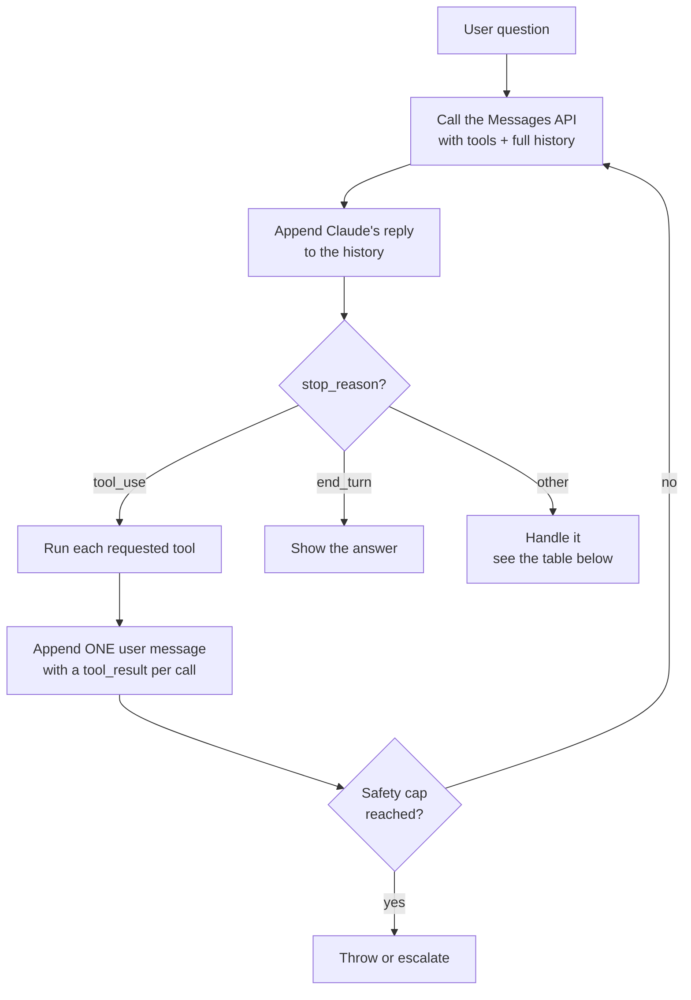

An agentic loop is the small piece of code that turns one Claude API call into an agent. You send a request, read `stop_reason`, run any tools Claude asked for, send the results back, and repeat until Claude says it is done. In this post you build that loop in TypeScript with two small tools, handle every documented stop reason, and test it without an API key.

This is task statement 1.1 of the [Claude Certified Architect – Foundations exam guide](https://anthropic-partners.skilljar.com/claude-certified-architect-foundations-certification): "Design and implement agentic loops for autonomous task execution". It sits in Domain 1, Agentic Architecture & Orchestration, which is 27% of the exam, and the rest of the domain builds on it.

## What does task statement 1.1 test?

The guide lists three things to know and three skills. In plain words:

| The guide asks you to… | In practice |
| --- | --- |
| Know the loop lifecycle | Send a request, check `stop_reason` (`"tool_use"` or `"end_turn"`), run the tools, return the results, go again |
| Know how tool results join the history | Claude only knows what a tool returned if the result is in the conversation you send next |
| Know model-driven vs pre-set decisions | Claude picks the next tool from the context, instead of your code following a fixed tree |
| Continue on `"tool_use"`, stop on `"end_turn"` | The loop's only stop test is `stop_reason` |
| Add results between iterations | Append Claude's turn and a matching `tool_result` before the next call |
| Avoid the anti-patterns | No parsing "I'm done", no small cap as the main stop rule, no "it wrote text, so it's finished" |

If tool calling itself is new to you, read [What is tool calling?](/blog/what-is-tool-calling) first. For the ideas behind agents without code, see [What is an AI agent?](/blog/what-is-an-ai-agent).

## How does an agentic loop work?

Claude never runs your code. The [tool use docs](https://platform.claude.com/docs/en/agents-and-tools/tool-use/how-tool-use-works) say it directly: "The model never executes anything on its own." Claude replies with a request to call a tool. Your code runs the tool and sends the result back. Then Claude decides what to do next.



Two facts make this work:

- **The API has no memory.** The Messages API "is stateless, which means that you always send the full conversational history" ([working with messages](https://platform.claude.com/docs/en/build-with-claude/working-with-messages)). Your `messages` array is the agent's memory.
- **`stop_reason` is the control signal.** It is part of every successful Messages API response, and it tells you why Claude stopped writing. Your loop reads it on every turn and nothing else decides the next step.

## What does each stop_reason mean for your loop?

The exam guide talks about `"tool_use"` and `"end_turn"`. The current [stop reasons page](https://platform.claude.com/docs/en/build-with-claude/handling-stop-reasons) lists seven values. A good loop handles all of them on purpose:

| `stop_reason` | What it means (from the docs) | What the loop in this post does |
| --- | --- | --- |
| `tool_use` | Claude is calling a tool | Run every tool, send the results, loop again |
| `end_turn` | Claude finished its response naturally | Stop and return the text |
| `max_tokens` | The reply reached your `max_tokens` limit | Throw: the reply is cut off, maybe in the middle of a tool call |
| `model_context_window_exceeded` | The reply filled the model's context window | Throw: treat the reply as cut off |
| `stop_sequence` | Claude wrote one of your `stop_sequences` | Stop and return (this post sets none) |
| `refusal` | Claude declined to respond | Stop and return, so the caller can read `stop_details` or retry on another model |
| `pause_turn` | A server-tool loop, such as web search, hit its iteration limit | Send the turn back as-is to let Claude continue |

The docs' advice for a `max_tokens` stop with an unfinished `tool_use` block is to retry with a higher `max_tokens`. Throwing a clear error is the simple, safe version of that: never run a half-written tool call.

## How do tool results get back to Claude?

When Claude wants a tool, the reply has `stop_reason: "tool_use"` and one or more `tool_use` blocks, each with an `id`, a `name` and an `input`. Often there is a `text` block in front, such as "I'll check the weather first." That text is not the answer. The loop must keep going.

Your next request carries two new messages: Claude's whole reply as an `assistant` message, and a `user` message with one `tool_result` per call. Here is the history after one tool call:

```json
[
  { "role": "user", "content": "What is the weather in Paris, in Fahrenheit?" },
  {
    "role": "assistant",
    "content": [
      { "type": "text", "text": "I'll check the weather in Paris first." },
      { "type": "tool_use", "id": "toolu_01", "name": "get_weather", "input": { "city": "Paris" } }
    ]
  },
  {
    "role": "user",
    "content": [
      {
        "type": "tool_result",
        "tool_use_id": "toolu_01",
        "content": "{\"city\":\"Paris\",\"temp_c\":18,\"condition\":\"cloudy\"}"
      }
    ]
  }
]
```

The rules from [handle tool calls](https://platform.claude.com/docs/en/agents-and-tools/tool-use/handle-tool-calls) and [parallel tool use](https://platform.claude.com/docs/en/agents-and-tools/tool-use/parallel-tool-use):

- **Match every ID.** Each `tool_result` has the `tool_use_id` of the call it answers.
- **Results come right after the call.** No other message may sit between the assistant's `tool_use` message and your `tool_result` message.
- **Results first.** Inside that user message, `tool_result` blocks come before any text. Don't add text after them either: the stop reasons page lists that as a cause of empty `end_turn` replies.
- **One message for parallel calls.** Claude may ask for several tools in one reply. Send all the results together in one user message. Separate messages "teach" Claude to stop calling tools in parallel.
- **Errors are results too.** If a tool fails, send its message back with `is_error: true` so Claude can recover or explain.

## Who decides the next step: Claude or your code?

In an agentic loop, Claude decides. It reads the question, the tool descriptions and the results so far, and chooses the next tool, or chooses to answer. A question in Celsius may need only `get_weather`. The same question in Fahrenheit can add `convert_units`. You don't write a branch for either case: Claude picks from the tool descriptions.

A pre-set decision tree does the opposite: your code fixes the order of steps. Anthropic's [Building effective agents](https://www.anthropic.com/engineering/building-effective-agents) puts the trade-off like this: workflows "offer predictability and consistency for well-defined tasks, whereas agents are the better option when flexibility and model-driven decision-making are needed at scale."

The exam likes the middle ground. Let Claude choose the tools, and enforce the few rules that must always hold in code, for example "never refund before the customer is verified". Task statements 1.4 (workflow enforcement) and 1.5 (Agent SDK hooks) cover how. Don't turn the whole task into a fixed script to protect one rule.

## Try it: build the loop and test it without an API key

You'll build a weather agent with two tools that use canned data, so nothing depends on a real weather service: `get_weather(city)` and `convert_units(value, from, to)`. Then you'll run the loop against a fake client that returns replies in the documented shape.

**You need:** Node.js 22.18 or later. That version runs `.ts` files directly, because [type stripping is on by default](https://nodejs.org/docs/latest-v22.x/api/typescript.html). An Anthropic API key only for the last step.


<Steps>


<Step title="Create the project">

```bash
$ mkdir agent-loop
$ cd agent-loop
$ npm init -y
$ npm pkg set type=module
```

Install the [official TypeScript SDK](https://github.com/anthropics/anthropic-sdk-typescript), then TypeScript and the Node types for type-checking:


```bash
npm install @anthropic-ai/sdk
```


```bash
npm install -D typescript @types/node
```


Add a `tsconfig.json`. These are the settings the Node docs recommend for code that Node runs directly, plus `strict`:


**tsconfig.json**

```json
{
  "compilerOptions": {
    "noEmit": true,
    "target": "esnext",
    "module": "nodenext",
    "rewriteRelativeImportExtensions": true,
    "erasableSyntaxOnly": true,
    "verbatimModuleSyntax": true,
    "allowImportingTsExtensions": true,
    "strict": true
  }
}
```


</Step>


<Step title="Define the two tools">

A tool has a definition that Claude sees (name, description, JSON Schema) and code that runs on your machine.


**tools.ts**

```ts
import type Anthropic from '@anthropic-ai/sdk';

// What Claude sees: a name, a description and a JSON Schema for the input.
export const tools: Anthropic.Tool[] = [
  {
    name: 'get_weather',
    description:
      'Get the current weather for a city. Returns the temperature in Celsius and a short condition. ' +
      'Use it whenever the user asks about weather. Supported cities: Paris, Tokyo, Lagos.',
    input_schema: {
      type: 'object',
      properties: {
        city: { type: 'string', description: 'City name, e.g. "Paris"' },
      },
      required: ['city'],
    },
  },
  {
    name: 'convert_units',
    description:
      'Convert a number from one unit to another. Supports celsius <-> fahrenheit and km <-> miles. ' +
      'Use it instead of doing the maths yourself.',
    input_schema: {
      type: 'object',
      properties: {
        value: { type: 'number', description: 'The number to convert' },
        from: { type: 'string', enum: ['celsius', 'fahrenheit', 'km', 'miles'] },
        to: { type: 'string', enum: ['celsius', 'fahrenheit', 'km', 'miles'] },
      },
      required: ['value', 'from', 'to'],
    },
  },
];

// Canned data, so the example needs no weather API.
const WEATHER: Record<string, { tempC: number; condition: string }> = {
  paris: { tempC: 18, condition: 'cloudy' },
  tokyo: { tempC: 24, condition: 'sunny' },
  lagos: { tempC: 29, condition: 'light rain' },
};

const CONVERSIONS: Record<string, (v: number) => number> = {
  'celsius->fahrenheit': (v) => (v * 9) / 5 + 32,
  'fahrenheit->celsius': (v) => ((v - 32) * 5) / 9,
  'km->miles': (v) => v / 1.609344,
  'miles->km': (v) => v * 1.609344,
};

// What your code does when Claude asks for a tool. Throws on bad input.
export function runTool(name: string, input: Record<string, unknown>): string {
  switch (name) {
    case 'get_weather': {
      const city = String(input.city ?? '');
      const weather = WEATHER[city.toLowerCase()];
      if (!weather) throw new Error(`No weather data for "${city}". Try Paris, Tokyo or Lagos.`);
      return JSON.stringify({ city, temp_c: weather.tempC, condition: weather.condition });
    }
    case 'convert_units': {
      const convert = CONVERSIONS[`${input.from}->${input.to}`];
      if (!convert) throw new Error(`Can't convert ${input.from} to ${input.to}.`);
      const result = Math.round(convert(Number(input.value)) * 100) / 100;
      return JSON.stringify({ value: result, unit: input.to });
    }
    default:
      throw new Error(`Unknown tool: ${name}`);
  }
}
```


The descriptions do real work: Claude picks tools only from their names, descriptions and schemas. Telling it to "use it instead of doing the maths yourself" is how it learns to call `convert_units`. Unknown input throws an error with a clear message, which the loop turns into an `is_error` result.

</Step>


<Step title="Write the loop">


**loop.ts**

```ts
import type Anthropic from '@anthropic-ai/sdk';
import { tools, runTool } from './tools.ts';

const MODEL = 'claude-opus-5-5';
const MAX_TURNS = 25; // safety cap, not the normal way to stop

// The loop only needs messages.create, so a fake client can stand in for tests.
export interface MessagesClient {
  messages: {
    create(params: Anthropic.MessageCreateParamsNonStreaming): Promise<Anthropic.Message>;
  };
}

export interface AgentResult {
  text: string;
  stopReason: 'end_turn' | 'stop_sequence' | 'refusal';
  turns: number;
  messages: Anthropic.MessageParam[];
}

export async function runAgent(client: MessagesClient, question: string): Promise<AgentResult> {
  const messages: Anthropic.MessageParam[] = [{ role: 'user', content: question }];

  for (let turn = 1; turn <= MAX_TURNS; turn++) {
    const response = await client.messages.create({
      model: MODEL,
      max_tokens: 4096,
      tools,
      messages,
    });

    // Keep Claude's whole turn (text AND tool_use blocks) in the history.
    messages.push({ role: 'assistant', content: response.content });

    const text = response.content
      .filter((block): block is Anthropic.TextBlock => block.type === 'text')
      .map((block) => block.text)
      .join('\n');

    switch (response.stop_reason) {
      case 'tool_use': {
        // Run every tool Claude asked for, then send ALL results in ONE user message.
        const toolUses = response.content.filter(
          (block): block is Anthropic.ToolUseBlock => block.type === 'tool_use',
        );
        const results: Anthropic.ToolResultBlockParam[] = toolUses.map((toolUse) => {
          try {
            const output = runTool(toolUse.name, toolUse.input as Record<string, unknown>);
            return { type: 'tool_result', tool_use_id: toolUse.id, content: output };
          } catch (error) {
            return {
              type: 'tool_result',
              tool_use_id: toolUse.id,
              content: (error as Error).message,
              is_error: true,
            };
          }
        });
        messages.push({ role: 'user', content: results });
        continue; // ask Claude again, now with the results
      }

      case 'pause_turn':
        // Only happens with server tools (e.g. web search): send the turn back as-is.
        continue;

      case 'end_turn':
      case 'stop_sequence':
      case 'refusal':
        // Claude is done (or declined). The caller decides what to show.
        return { text, stopReason: response.stop_reason, turns: turn, messages };

      case 'max_tokens':
      case 'model_context_window_exceeded':
        // The reply was cut off, maybe in the middle of a tool call. Don't guess.
        throw new Error(`Reply cut off (stop_reason: ${response.stop_reason}). Raise max_tokens or shorten the input.`);

      case null:
        throw new Error('No stop_reason on a non-streaming response.');

      default: {
        // TypeScript errors here if the SDK adds a stop reason you don't handle.
        const unhandled: never = response.stop_reason;
        throw new Error(`Unhandled stop_reason: ${String(unhandled)}`);
      }
    }
  }

  throw new Error(`Safety cap: no end_turn after ${MAX_TURNS} turns. Check the log for a tool loop.`);
}
```


How it maps to the diagram:

- **Claude's whole reply goes into the history**, text and `tool_use` blocks together, before anything else happens.
- **The `switch` is the only stop logic.** It never looks at the words in the reply. `"tool_use"` continues; `"end_turn"` returns.
- **All results go back in one user message**, each with the `tool_use_id` of its call, and a failed tool becomes `is_error: true`.
- **`MAX_TURNS` is a guard, not the exit.** A weather question takes two or three turns, so 25 is never reached in normal use. If it is, the loop throws, so a stuck agent can't quietly return a half answer or run up your bill.
- **The `never` check** makes `tsc` fail if a future SDK version adds a stop reason you don't handle.

The `client` is passed in, typed as anything with a `messages.create` method. A real `Anthropic` client fits, and so does a fake one.

</Step>


<Step title="Test it without an API key">

This test file uses Node's built-in test runner. The fake client plays back scripted replies in the shape the Messages API returns and records every request, so you can check the history the loop builds. The first reply mixes text with a tool call on purpose.


**loop.test.ts**

```ts
import assert from 'node:assert/strict';
import { test } from 'node:test';
import type Anthropic from '@anthropic-ai/sdk';
import { runAgent, type MessagesClient } from './loop.ts';

// Build replies in the shape the Messages API returns.
const reply = (
  stop_reason: Anthropic.StopReason,
  content: Anthropic.ContentBlock[],
): Anthropic.Message => ({
  id: 'msg_test',
  type: 'message',
  role: 'assistant',
  model: 'claude-opus-5-5',
  content,
  stop_reason,
  stop_sequence: null,
  stop_details: null,
  container: null,
  diagnostics: null,
  usage: {
    input_tokens: 0,
    output_tokens: 0,
    cache_creation: null,
    cache_creation_input_tokens: null,
    cache_read_input_tokens: null,
    inference_geo: null,
    output_tokens_details: null,
    server_tool_use: null,
    service_tier: null,
  },
});
const text = (t: string): Anthropic.TextBlock => ({ type: 'text', text: t, citations: null });
const toolUse = (id: string, name: string, input: object): Anthropic.ToolUseBlock => ({
  type: 'tool_use',
  id,
  name,
  input,
  caller: { type: 'direct' },
});

// A fake client that plays back scripted replies and records every request.
function fakeClient(replies: Anthropic.Message[]) {
  const requests: Anthropic.MessageCreateParamsNonStreaming[] = [];
  const client: MessagesClient = {
    messages: {
      create: async (params) => {
        requests.push(structuredClone(params)); // snapshot: the loop keeps mutating messages
        const next = replies.shift();
        if (!next) throw new Error('No more scripted replies');
        return next;
      },
    },
  };
  return { client, requests };
}

test('keeps looping on tool_use, even when the turn also has text', async () => {
  const { client, requests } = fakeClient([
    reply('tool_use', [
      text("I'll check the weather in Paris first."),
      toolUse('toolu_01', 'get_weather', { city: 'Paris' }),
    ]),
    reply('tool_use', [toolUse('toolu_02', 'convert_units', { value: 18, from: 'celsius', to: 'fahrenheit' })]),
    reply('end_turn', [text('It is 18 °C (64.4 °F) and cloudy in Paris.')]),
  ]);

  const result = await runAgent(client, 'What is the weather in Paris, in Fahrenheit?');

  assert.equal(result.stopReason, 'end_turn');
  assert.equal(result.turns, 3);
  assert.equal(result.text, 'It is 18 °C (64.4 °F) and cloudy in Paris.');

  // The 2nd request carries Claude's tool call AND our matching result.
  const [, assistantTurn, toolResults] = requests[1].messages;
  assert.equal(assistantTurn.role, 'assistant');
  assert.deepEqual(toolResults.content, [
    {
      type: 'tool_result',
      tool_use_id: 'toolu_01',
      content: '{"city":"Paris","temp_c":18,"condition":"cloudy"}',
    },
  ]);

  // The 3rd request has the conversion result, matched by ID.
  assert.deepEqual(requests[2].messages.at(-1)?.content, [
    { type: 'tool_result', tool_use_id: 'toolu_02', content: '{"value":64.4,"unit":"fahrenheit"}' },
  ]);

  for (const [i, r] of requests.entries()) {
    console.log(`request ${i + 1}: ${r.messages.map((m) => m.role).join(' -> ')}`);
  }
});

test('sends a tool error back with is_error instead of crashing', async () => {
  const { client, requests } = fakeClient([
    reply('tool_use', [toolUse('toolu_01', 'get_weather', { city: 'Atlantis' })]),
    reply('end_turn', [text('Sorry, I have no weather data for Atlantis.')]),
  ]);

  await runAgent(client, 'Weather in Atlantis?');

  assert.deepEqual(requests[1].messages.at(-1)?.content, [
    {
      type: 'tool_result',
      tool_use_id: 'toolu_01',
      content: 'No weather data for "Atlantis". Try Paris, Tokyo or Lagos.',
      is_error: true,
    },
  ]);
});

test('throws when the reply is cut off by max_tokens', async () => {
  const { client } = fakeClient([reply('max_tokens', [text('The weather in Par')])]);
  await assert.rejects(runAgent(client, 'Weather in Paris?'), /cut off \(stop_reason: max_tokens\)/);
});

test('the safety cap throws instead of looping forever', async () => {
  const stuck = Array.from({ length: 30 }, (_, i) =>
    reply('tool_use', [toolUse(`toolu_${i}`, 'get_weather', { city: 'Paris' })]),
  );
  const { client, requests } = fakeClient(stuck);

  await assert.rejects(runAgent(client, 'Weather in Paris?'), /Safety cap: no end_turn after 25 turns/);
  assert.equal(requests.length, 25);
});
```


```bash
$ node --test --test-reporter=spec loop.test.ts
```

```text
request 1: user
request 2: user -> assistant -> user
request 3: user -> assistant -> user -> assistant -> user
✔ keeps looping on tool_use, even when the turn also has text
✔ sends a tool error back with is_error instead of crashing
✔ throws when the reply is cut off by max_tokens
✔ the safety cap throws instead of looping forever
ℹ tests 4
ℹ suites 0
ℹ pass 4
ℹ fail 0
ℹ cancelled 0
ℹ skipped 0
ℹ todo 0
ℹ duration_ms 135.742128
```

This is our output on Node 22.22.2 with `@anthropic-ai/sdk` 0.130.0, with per-test timings removed. No model was called: the replies are scripted, but the tools, the history and the stop logic are the real code. The request lines show the history growing by an assistant turn and a user turn on every loop. Then type-check everything:

```bash
$ npx tsc
```

No output means no type errors.

</Step>


<Step title="Run it with Claude">

Create an API key in the [Claude Console](https://platform.claude.com/) and set it as the `ANTHROPIC_API_KEY` environment variable. The SDK reads it from there, so the key never appears in your code.


**main.ts**

```ts
import Anthropic from '@anthropic-ai/sdk';
import { runAgent } from './loop.ts';

const client = new Anthropic(); // reads ANTHROPIC_API_KEY from the environment
const question = process.argv[2] ?? 'What is the weather in Paris, in Fahrenheit?';

const result = await runAgent(client, question);
console.log(`[${result.stopReason} after ${result.turns} turns]\n${result.text}`);
```


```bash
$ node main.ts "What is the weather in Tokyo and Lagos, in Fahrenheit?"
```

The model is `claude-opus-5-5`, the one the [models overview](https://platform.claude.com/docs/en/about-claude/models/overview) suggests starting with. Claude's wording and the number of turns will vary. To see how each result shaped the next step, print `result.messages` with `console.dir(result.messages, { depth: null })`.

</Step>


</Steps>


## Can the SDK run this loop for me?

Yes. The TypeScript SDK has a beta [Tool Runner](https://platform.claude.com/docs/en/agents-and-tools/tool-use/tool-runner) that runs tools and sends results back for you. The [Claude Agent SDK](https://code.claude.com/docs/en/agent-sdk/agent-loop) goes further and runs Claude Code's own loop, with built-in tools. Its `maxTurns` option is the same kind of guard as `MAX_TURNS`: when it is hit, the run ends with an `error_max_turns` result, not a success. The exam still expects you to know what happens inside the loop, because that is how you debug an agent that stops early or never stops.

## Common traps

These are the mistakes that wrong answer options are built on.

| Trap | Why it breaks | Fix |
| --- | --- | --- |
| Stop when the reply contains text | Claude often writes a sentence and a tool call together; `stop_reason` is still `"tool_use"` | Decide on `stop_reason` only |
| Parse phrases like "Task complete" or "I'm done" | Wording changes between runs and models; the signal is already in `stop_reason` | Remove the text check |
| A small cap as the real stop rule | Long but valid tasks get cut off mid-way with a half answer | Stop on `"end_turn"`; keep a high cap that throws or escalates |
| Run the tool but don't send the result | Claude never sees the answer, so it asks for the same tool again | Append the assistant turn and a matching `tool_result` every time |
| One user message per tool result | Breaks the expected format and teaches Claude to stop calling tools in parallel | Put all results in one user message |
| A fixed tool sequence for every request | Wastes calls on simple requests and can't adapt to new ones | Let Claude choose; enforce only must-hold rules in code |


<Callout type="warning" title="A loop is a spending loop too">

Every turn is a paid API call, and the whole history is sent again each time, so long runs cost more per turn. Keep the safety cap, log each turn in production, and treat hitting the cap as an incident to look at, not a normal result.

</Callout>


## Practice questions

These four questions are this blog's own, written for practice. They are not from the exam.

**Question 1.** An IT helpdesk agent sometimes replies "Let me look up your ticket history" and then stops without looking anything up. The loop ends as soon as a response contains any text block. What is the best fix?

- A. Tell the model in the system prompt never to write text in the same turn as a tool call.
- B. Continue the loop whenever `stop_reason` is `"tool_use"` and end it only on `"end_turn"`, whatever text the response contains.
- C. Search the text for phrases like "let me" and continue the loop when they appear.
- D. Raise the maximum number of loop iterations.

**Question 2.** A billing agent calls `get_invoice` for the same invoice five times in a row before giving up. Logs show the tool runs and returns correct data each time, but each new request only contains the earlier messages. What should you change?

- A. Add a line to the system prompt: "Never call the same tool twice."
- B. Cache tool results so repeated calls are cheaper.
- C. Stop the loop after three tool calls.
- D. Append the assistant turn with the tool call and a user turn with the matching tool result before sending the next request.

**Question 3.** A travel-expense agent always runs the same four tools in a fixed order: `get_policy`, `get_receipts`, `check_currency`, `submit_report`. Many requests need only one or two of these, and some need a tool twice. The only hard rule is that `submit_report` must never run before `get_policy`. What design fits best?

- A. Keep the fixed order and add more branches to the script for each new request type.
- B. Split the agent into four agents, one per tool.
- C. Let Claude choose tools in the loop from the request and the tool descriptions, and enforce the one hard rule in code.
- D. Remove `get_policy` so the order problem can't happen.

**Question 4.** A research agent's loop stops after 5 iterations. Complex questions often end mid-task with a half-finished answer, while simple ones finish in 2 or 3. What is the best change?

- A. Stop on `"end_turn"`, and keep a much higher cap only as a safety guard that raises an error or escalates when hit.
- B. Raise the cap to 20 so complex tasks usually finish.
- C. Ask Claude to print `TASK_COMPLETE` when finished and stop when that string appears.
- D. Stop when two responses in a row contain text.

## Answer key

### Question 1

**Answer: B.** `stop_reason` is the reliable signal. One turn can hold both text and a tool call, and then `stop_reason` is `"tool_use"`. The strongest distractor is A: it tries to change the model to suit a broken loop, and a prompt instruction still fails some of the time.

### Question 2

**Answer: D.** Claude can only use a result it can see in the history. Without it, calling the tool again is a sensible move. The strongest distractor is B: caching makes the waste cheaper, but Claude still never sees the answer, so it keeps asking.

### Question 3

**Answer: C.** Model-driven tool choice handles varied requests, and the single must-hold rule is best enforced in code, where it can't be skipped. The strongest distractor is A: it keeps growing a decision tree that still can't handle requests nobody planned for.

### Question 4

**Answer: A.** Claude signals completion through `stop_reason`. A cap should catch runaway loops, not decide normal completion. The strongest distractor is B: it still uses the cap as the main stop rule and only moves the cut-off point.

## What should I do next?

- **Extend the agent.** Add a third tool, ask a question that needs all three, and print `result.messages` to see how each result shaped the next call.
- **Compare with a bigger agent.** [How to build your first AI agent in Node.js](/blog/build-your-first-ai-agent) uses the same loop with file tools and a path guard.
- **Move on to task statement 1.2**, "Orchestrate multi-agent systems with coordinator-subagent patterns". The next post in this series covers it.
- **Plan and check your prep.** Follow the [six-week study plan](/blog/claude-architect-exam-study-plan), and test yourself with the [mock exam](/blog/claude-certification-mock-exam) when you've worked through Domain 1.
