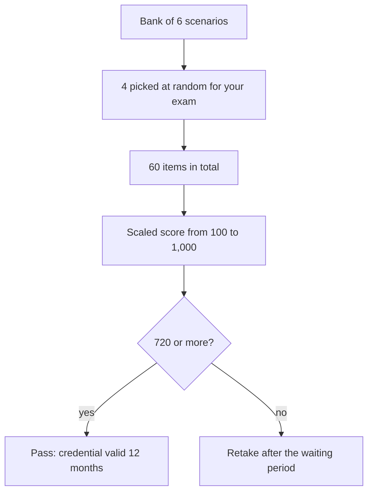
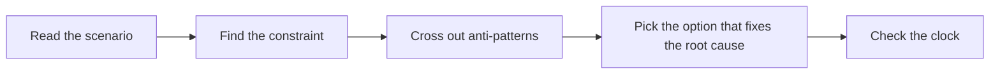

This post is a 20-question mock exam for the Claude Certified Architect – Foundations exam. It covers all five domains, and every answer points back to a task statement in the official exam guide. After the questions you'll find the answer key, a score guide that tells you what to study next, and the facts about exam day: 60 items, 120 minutes, and a pass mark of 720.

Take the questions first and check the key after. That's the only way the score means anything.


<Callout type="note" title="These are our own practice questions">

We wrote every question in this post. None of them come from the real exam, and none copy the sample questions in the exam guide. The exam is covered by a non-disclosure agreement (NDA), a promise not to share its content, so nobody can publish real exam items. Treat this as practice with the same topics and the same style: a scenario, four options, one best answer.

</Callout>


## How is the real exam set up?

Every fact in this section comes from the *Claude Certified Architect – Foundations Exam Guide* (version 1.0, effective July 2026), the PDF linked from the [official certification page](https://anthropic-partners.skilljar.com/claude-certified-architect-foundations-certification). The guide calls itself the authoritative reference for the exam, so read it in full before you book.

| What | Detail |
| --- | --- |
| Exam code | CCAR-F |
| Number of items | 60 |
| Item types | Multiple choice and multiple response. Each item tells you how many answers to select. |
| Structure | 4 scenarios, picked at random from a bank of 6 |
| Time limit | 120 minutes |
| Delivery | Proctored by Pearson VUE, online or at a Pearson test center |
| Passing score | Scaled score of 720, on a scale of 100–1,000 |
| Result | Pass or fail with your scaled score, plus the percentage you got right in each domain |
| Fee | $125 USD. The guide says the price at checkout reflects any discount for your partner tier. |
| Valid for | 12 months from the date you earn it |

A **scaled score** is your raw result converted to a fixed range, so that different versions of the exam are graded fairly. The guide says the pass mark was set by experts who judged what a "minimally qualified candidate" should be able to do. You are measured against that standard, not against other candidates.



The five domains and their weights, also from the guide:

| Domain | Name | Weight | Questions in this mock |
| --- | --- | --- | --- |
| 1 | Agentic Architecture & Orchestration | 27% | 5 |
| 2 | Tool Design & MCP Integration | 18% | 4 |
| 3 | Claude Code Configuration & Workflows | 20% | 4 |
| 4 | Prompt Engineering & Structured Output | 20% | 4 |
| 5 | Context Management & Reliability | 15% | 3 |

This mock follows the same format: four made-up scenarios, each with a short story that frames its questions. The details in each story matter.

## Try it: take the mock under exam conditions


<Steps>


<Step title="Set a 40-minute timer">

20 questions at the exam's pace of 2 minutes each is 40 minutes. Close the exam guide and any docs.

</Step>


<Step title="Answer every question">

Read each scenario once, then answer its questions. Write down your letter for all 20 before you look at anything else. If you're unsure, pick your best guess: an empty answer teaches you nothing.

</Step>


<Step title="Score yourself">

Check your answers against the answer key below. Read the explanation even for questions you got right, to make sure you were right for the right reason.

</Step>


<Step title="Map your misses to domains">

Use the score guide table to find the task statement and domain behind each wrong answer. Then read that task statement in the exam guide, word for word.

</Step>


</Steps>


## Scenario A: a trip-change assistant

You are building an assistant with the Claude Agent SDK that helps travelers change flights, cancel trips and get travel credit. It reaches your systems through MCP tools: `find_booking`, `get_traveler`, `change_flight`, `issue_travel_credit` and `transfer_to_agent`. A partner airline also gives you its own MCP server. The goal is to resolve most requests without a human, while handing off the right cases.

### Question 1

Your loop sends the conversation to Claude, then decides what to do next. Today it stops as soon as a response contains any text, and it also stops after 4 rounds. Logs show the assistant often says "Let me pull up your booking" and then the conversation ends with no answer. What should the loop do?

- **A.** Raise the round limit to 20 so the assistant has more room to finish.
- **B.** Keep stopping on text, and add a system prompt rule that Claude must never write text in the same response as a tool call.
- **C.** Keep looping while `stop_reason` is `"tool_use"`: run the requested tools, add their results to the conversation and call Claude again. Stop when `stop_reason` is `"end_turn"`.
- **D.** Stop when the text contains a closing phrase such as "Is there anything else I can help with?".

### Question 2

`find_booking` returns departure times as Unix timestamps (seconds since 1970). The partner airline's server returns ISO 8601 strings with time zone offsets. One tool returns the booking status as a number: 1 for confirmed, 2 for waitlisted, 3 for cancelled. The assistant sometimes gives travelers the wrong departure time, and once said a cancelled flight was confirmed. What's the most reliable fix?

- **A.** Add a `PostToolUse` hook that converts every tool result to one format (ISO 8601 times in the traveler's time zone, status as a word) before Claude sees it.
- **B.** Add a section to the system prompt that explains all three formats and the status-code table.
- **C.** Add few-shot examples that show how to read each format correctly.
- **D.** Ask the partner airline to change the output format of its server.

### Question 3

`change_flight` returns `{"error": "Operation failed"}` for every problem: an airline timeout, a date in the wrong format, and a fare rule that says the ticket can't be changed. On tickets that can't be changed, the assistant retries the same call five times, then tells the traveler "Something went wrong, please try again later." What should the tool return instead?

- **A.** An HTTP 500 status code, so the assistant knows it's a server problem.
- **B.** The same message, plus a system prompt rule: "Never retry a tool more than twice."
- **C.** An empty result that isn't marked as an error, so the assistant moves on.
- **D.** A result marked `isError: true` with structured details: an error category (such as transient, validation, permission or business rule), an `isRetryable` flag, and a plain-language explanation the assistant can pass on.

### Question 4

A traveler only gives their name, "Sam Lee". `get_traveler` returns three profiles with that name. What should the assistant do?

- **A.** Pick the profile with the most recent booking, since that person is most likely the one asking.
- **B.** Ask the traveler for another identifier, such as the booking reference or the email address on the booking, before going further.
- **C.** Transfer the case to a human, because several matches make it a complex case.
- **D.** Show the traveler all three profiles with their trips and ask which one is theirs.

## Scenario B: Claude Code for a platform team

Your team of 30 engineers works in one TypeScript monorepo (a single repository that holds many packages). You are rolling out Claude Code for daily work, and you also run it in GitHub Actions to review every pull request. You want setups that work the same way for everyone on the team.

### Question 5

The tech lead wrote the team's testing rules ("use the factories in `test/factories`, never call the real database") in `~/.claude/CLAUDE.md` on her laptop. Claude follows them for her. A new engineer's Claude keeps writing tests that call the real database. What's the fix?

- **A.** Ask the new engineer to copy the lead's file into their own `~/.claude/CLAUDE.md`.
- **B.** Move the rules into the project's `CLAUDE.md` (at the repository root or in `.claude/CLAUDE.md`) and commit it.
- **C.** Turn the rules into a custom slash command, `/test-rules`, that everyone runs before writing tests.
- **D.** Tell the new engineer to run `/compact` at the start of each session.

### Question 6

The team has a `/map-deps` skill that walks the whole monorepo and prints every package's dependencies. It's useful, but after one run the main conversation holds thousands of lines of output, and Claude starts to lose track of the task the developer was working on. What change fits best?

- **A.** Add `allowed-tools: Read Grep` to the skill's frontmatter.
- **B.** Move the skill's instructions into the root `CLAUDE.md` so they are always loaded.
- **C.** Add `context: fork` to the skill's frontmatter, so it runs in its own subagent context and only its result comes back.
- **D.** Ask developers to run `/compact` after each use of the skill.

### Question 7

A production error shows `TypeError: Cannot read properties of undefined (reading 'id')` at `src/billing/invoice.ts:88`. The cause is clear: there's no check that `customer` exists before the code reads `customer.id`. How should you work on this in Claude Code?

- **A.** Direct execution: ask Claude to add the missing check at that line, plus a test for the case where `customer` is undefined.
- **B.** Plan mode: have Claude explore the billing module and propose an approach before it edits anything.
- **C.** Use the Explore subagent to map every file in the repository first.
- **D.** Use the interview pattern, so Claude first asks you about caching and failure modes.

### Question 8

The team wants everyone to use the same issue-tracker MCP server in Claude Code. The server needs an API token. One engineer set it up with the token pasted into their personal config. How should you set it up for the whole team?

- **A.** Commit a `.mcp.json` with the token written into the headers, since the repository is private.
- **B.** Ask each engineer to add the server in their own user scope (`~/.claude.json`).
- **C.** Put the token in the root `CLAUDE.md` so Claude can pass it to the server.
- **D.** Commit a project-scoped `.mcp.json` that reads the token from an environment variable, such as `${TRACKER_TOKEN}`, and have each engineer set that variable on their own machine.

### Question 9

You need to find every place in the monorepo that calls `formatCurrency(`, because you're about to change its parameters. Which built-in tool should Claude start with?

- **A.** Glob with `**/*.ts`, then Read every file it returns.
- **B.** Grep for `formatCurrency\(` across the repository, then Read only the files it finds.
- **C.** Glob with `**/*formatCurrency*`.
- **D.** Read the file that defines `formatCurrency` and follow its imports.

### Question 10

The GitHub Actions job runs `claude -p "Review this PR against our review rules"`, and a script turns the output into inline pull request comments. The script often fails, because the review comes back as prose with a slightly different layout every time. What change fixes it?

- **A.** Add "Respond only in JSON" to the end of the prompt.
- **B.** Remove `-p` so you can watch the output and correct the format by hand.
- **C.** Add `--output-format json` and a `--json-schema` that defines each finding (file, line, severity, message), then read the findings from the JSON output.
- **D.** Pipe the output into a second `claude -p` call that converts the prose into JSON.

## Scenario C: invoice and contract extraction

You run a pipeline that pulls data out of supplier invoices and contracts. Claude reads the text of each document and returns the fields through an extraction tool whose JSON schema describes them. The results go straight into the finance system, so wrong values cost real money.

### Question 11

Each contract record has a `renewal_notice_days` field. About a third of contracts don't mention a notice period at all. For those, the extraction often returns 30 or 60, numbers that appear nowhere in the document. Right now the field is required and must be an integer. What's the best change?

- **A.** Make `renewal_notice_days` nullable and not required, and tell the model to return `null` when the contract doesn't state a notice period.
- **B.** Keep the field required, and add "Do not guess" to the prompt.
- **C.** Add a retry that sends the contract again with the message "value not found in document" until a value appears.
- **D.** Give the field a default of 30 in the schema, since that's the most common value.

### Question 12

Your validation step catches two kinds of failure. Type 1: `invoice_date` comes back as `03/04/2026`, but the schema expects `YYYY-MM-DD`. Type 2: `po_number` (the purchase order number) is missing, because the invoice only says "PO: see attached" and the purchase order isn't part of the input. Today, both types are retried three times with the same prompt. What should you change?

- **A.** Retry both types more often, up to ten times.
- **B.** Stop all retries and send every failure to a human.
- **C.** Keep retrying both, and add "be careful" to the prompt.
- **D.** For Type 1, retry with the original document, the failed output and the exact validation error. For Type 2, don't retry: mark the field as missing and flag the invoice, because the value isn't in the input.

### Question 13

Supplier invoices come in many layouts. Some list items in a table, some describe them in sentences ("12 boxes of gloves at $4 each"), and some put the totals in a footer. On the sentence-style invoices, `line_items` comes back empty even though the items are there. You've already rewritten the instructions twice, with no change. What's the most effective next step?

- **A.** Make `line_items` required with at least one entry, so the model can't leave it empty.
- **B.** Add 2 to 4 few-shot examples to the prompt, each with a different layout (including a sentence-style one) and its correct extraction.
- **C.** Move the pipeline to the Message Batches API.
- **D.** Add one more line to the system prompt: "Line items may appear anywhere in the document."

### Question 14

Finance wants to move extraction to the Message Batches API to save money. Documents arrive all day. Your agreement with finance says each document's data must be ready within 36 hours of its arrival. A batch can take up to 24 hours to finish. How often should you submit a batch?

- **A.** Every 16 hours.
- **B.** Don't use batches: a 36-hour target is too tight for a 24-hour processing window.
- **C.** Every 8 hours.
- **D.** Once a day is enough, because most batches finish within an hour.

### Question 15

After a month, extraction accuracy is 96% on a labeled test set (documents where people have checked the right answers). The team proposes to stop human review for every extraction the model marks as high confidence. What should you do first?

- **A.** Break accuracy down by document type and by field, confirm each segment meets the bar, and after launch keep reviewing a stratified random sample of high-confidence extractions.
- **B.** Approve it, because 96% is above the 95% target.
- **C.** Keep 100% human review forever, because any error is unacceptable.
- **D.** Ask the model to rate its own confidence from 1 to 10 and skip review above 8, without checking those scores against labeled data.

## Scenario D: a competitor research system

You're building a research system with the Claude Agent SDK for your product team. A coordinator agent hands work to four subagents: a web researcher, a filings analyst that reads annual reports, a pricing tracker, and a report writer. The output is a short brief where every claim has a source.

### Question 16

Every question goes through all four subagents, even "What's Competitor X's current price for its starter plan?". Simple questions take minutes and cost as much as a full report. What should change?

- **A.** Cache every subagent's output for 24 hours.
- **B.** Run all four subagents in parallel, so the full pipeline finishes sooner.
- **C.** Remove the coordinator and send every question straight to the web researcher.
- **D.** Have the coordinator look at each question and call only the subagents it needs (here, the pricing tracker), keeping the full pipeline for broad questions.

### Question 17

For a full report, the coordinator calls the web researcher and waits, then calls the filings analyst and waits, then calls the pricing tracker. The three tasks don't depend on each other. How do you cut the waiting time?

- **A.** Merge the three subagents into one agent that has all of their tools.
- **B.** Have the coordinator request all three subagents in a single response (three calls to the subagent tool, which the exam guide calls the Task tool), so they run in parallel.
- **C.** Let the subagents call each other directly, so they don't wait for the coordinator.
- **D.** Raise the coordinator's `max_tokens` limit.

### Question 18

The report writer can use all 16 tools in the system, including web search and page fetching. Halfway through writing, it sometimes starts its own web searches and pulls in sources nobody checked. Reports get slower and less consistent. What's the best fix?

- **A.** Give the report writer only the tools its job needs, and send any new research through the coordinator.
- **B.** Add "Don't search the web" to its system prompt, but keep all 16 tools available in case they're needed.
- **C.** Rewrite the web search tool's description so it sounds less useful.
- **D.** Give the report writer even more tools, so it has better options than web search.

### Question 19

The coordinator has finished a long analysis of the market: sources read, facts pulled out. The product lead wants to compare two report layouts, one organized by competitor and one by customer need. You want both to start from the same analysis without redoing it, and neither attempt should affect the other. What do you use?

- **A.** Resume the same session twice in a row: first ask for the competitor layout, then for the customer-need layout.
- **B.** Start two new sessions and run the research again in each.
- **C.** Fork the session (`fork_session`), so each layout is written in its own branch that starts from a copy of the shared analysis.
- **D.** Resume the session and tell Claude to "forget the first version" before it writes the second.

### Question 20

The filings analyst reports Competitor X's market share as 18%, from its own annual report for fiscal 2025. The web researcher finds 23%, from an industry analyst report published in 2026. Both sources are credible. Today the report writer picks the higher number and cites one source. What should the system do?

- **A.** Average the two and report 20.5%.
- **B.** Use only the newest source, because newer data is always more accurate.
- **C.** Have the web researcher keep searching until a third source breaks the tie.
- **D.** Keep both values, each with its source and date, and mark the figure as contested in the report, so readers can see why they may differ.

## Answer key

Each answer shows the task statement from the exam guide that it tests, why it's right, and why the most tempting wrong option loses.

### Answer 1

**Correct: C** (Task 1.1). An agent loop should keep going while `stop_reason` is `"tool_use"` and stop when it is `"end_turn"`. The guide names both of the current stop rules as anti-patterns: treating any text as "done", and using a fixed round limit as the main way to stop.

**Strongest distractor: B.** It tries to fix a control-flow bug with a prompt rule. Claude often writes a short sentence *and* a tool call in the same response, and the [tool use docs](https://platform.claude.com/docs/en/agents-and-tools/tool-use/define-tools) tell you to treat that text like any other assistant text and not rely on its format. The loop must read `stop_reason`, not the text.

### Answer 2

**Correct: A** (Task 1.5). A `PostToolUse` hook runs your code on each tool result before the model processes it, so every timestamp and status reaches Claude in one format. The guide uses almost this exact case (Unix timestamps, ISO 8601, numeric status codes) as its example for normalizing data with hooks.

**Strongest distractor: B.** Explaining the formats in the prompt helps, but it's still a request the model can get wrong. The guide says to choose hooks when you need a guarantee rather than likely compliance.

### Answer 3

**Correct: D** (Task 2.2). MCP tools report failures with the `isError` flag. Adding a category, a retry flag and a readable explanation lets the agent retry a timeout, fix a bad date, and tell the traveler plainly that the fare can't be changed. The guide warns that a uniform "Operation failed" stops the agent from choosing the right recovery.

**Strongest distractor: B.** A retry cap hides the symptom. The agent still can't tell a timeout (worth retrying) from a fare rule (never worth retrying), and the traveler still gets no real answer.

### Answer 4

**Correct: B** (Task 5.2). When a lookup returns several matches, the guide says to ask for more identifiers instead of choosing by a rule of thumb.

**Strongest distractor: A.** "Most recent booking" is exactly the kind of guess the guide warns against. If it's wrong, the assistant changes a stranger's trip. Option D shows other people's personal data, and option C escalates a case the assistant can solve with one question.

### Answer 5

**Correct: B** (Task 3.1). `~/.claude/CLAUDE.md` is user-level: it applies only to that person and is never shared through version control. Team standards belong in the project `CLAUDE.md`, which everyone gets when they pull the repository. The guide uses this exact problem, a new team member missing instructions that live at user level, as its example.

**Strongest distractor: A.** Copying works for one person today, but nothing keeps the copies in sync, and every new hire has to know to do it.

### Answer 6

**Correct: C** (Task 3.2). `context: fork` runs the skill in a separate subagent context. The long output stays there, and only the result comes back to the main conversation. The guide names verbose tasks like codebase analysis as the reason to use it.

**Strongest distractor: D.** `/compact` shrinks the conversation after the damage is done, and a summary may drop details the developer needed. Option A controls tool use, not where the output goes. Option B makes things worse: `CLAUDE.md` loads in every session.

### Answer 7

**Correct: A** (Task 3.4). The change is small, the file and line are known, and the fix is clear. The guide lists "a single-file bug fix with a clear stack trace" as a case for direct execution.

**Strongest distractor: B.** Plan mode is for large changes, several valid approaches or architecture decisions. Here it adds a planning step to a one-line fix.

### Answer 8

**Correct: D** (Task 2.4). A project-scoped `.mcp.json` is committed, so everyone gets the same server. Claude Code expands environment variables in it, so the token itself never goes into git. Each engineer sets the variable on their own machine:


**.mcp.json**

```json
{
  "mcpServers": {
    "tracker": {
      "type": "http",
      "url": "https://tracker.example.com/mcp",
      "headers": {
        "Authorization": "Bearer ${TRACKER_TOKEN}"
      }
    }
  }
}
```


The format follows the [Claude Code MCP docs](https://code.claude.com/docs/en/mcp); the URL is a placeholder for your tracker's server.

**Strongest distractor: B.** It keeps the token out of git, but user scope is personal. Nothing is shared, so each setup drifts. Option A commits a secret, and a private repository is not a safe place for one.

### Answer 9

**Correct: B** (Task 2.5). Grep searches file *contents*, so it finds every call site. Then you Read only the files that matter. The guide recommends starting with Grep and reading files as you go, instead of loading everything up front.

**Strongest distractor: C.** Glob matches file *names and paths*, not what's inside the files. At best it finds a file named `formatCurrency.ts`, not the code that calls it. Option A reads the whole repository, and option D follows imports from the definition, which shows what it uses, not who uses it.

### Answer 10

**Correct: C** (Task 3.6). In CI, `-p` runs Claude Code without waiting for input. `--output-format json` with `--json-schema` returns output that matches your schema, which a script can turn into inline comments. The [CLI reference](https://code.claude.com/docs/en/cli-reference) describes `--json-schema` as returning validated JSON that matches the schema (print mode only).

**Strongest distractor: A.** A prompt request for JSON isn't enforced, so the format can still drift. Option B would hang the CI job, and option D adds a second unvalidated step.

### Answer 11

**Correct: A** (Task 4.3). A required field pushes the model to fill it, even with an invented value. The guide says to make fields optional (nullable) when the source may not contain the information, so the model can return `null` instead of making something up.

**Strongest distractor: B.** "Do not guess" helps a little, but the schema still demands an integer. The fix belongs in the schema. Option C can't work: retries don't help when the information isn't in the document.

### Answer 12

**Correct: D** (Task 4.4). A format error is fixable: send the document, the failed output and the exact validation error, and the model can correct itself. A value that isn't in the input can't be fixed by retrying. The guide makes this exact distinction, including the case of information that exists only in a document you didn't provide.

**Strongest distractor: B.** Sending everything to a human throws away the cheap, automatic fix for format errors and fills your reviewers' queue with problems a retry would have solved.

### Answer 13

**Correct: B** (Task 4.2). When detailed instructions alone give inconsistent results, the guide calls few-shot examples the most effective technique. It names this exact use: examples of correct extraction from documents with varied formats, to fix fields that come back empty. Each example shows the model what "correct" looks like for one layout.

**Strongest distractor: D.** It's a third instruction tweak, after two that failed. Option A is risky: forcing at least one line item invites the model to invent one.

### Answer 14

**Correct: C** (Task 4.5). In the worst case, a document arrives just after a batch was sent. It waits for the next submission (up to the interval) and then up to 24 hours of processing. Every 8 hours: 8 + 24 = 32 hours, inside 36 with 4 hours to spare. Every 16 hours: 16 + 24 = 40 hours, too late.

**Strongest distractor: D.** The [batch processing docs](https://platform.claude.com/docs/en/build-with-claude/batch-processing) do say most batches finish within an hour, but a batch can take up to 24 hours (requests still unfinished then expire), and the guide stresses that batches have no guaranteed latency. Once a day gives a worst case of 24 + 24 = 48 hours. Option B is wrong because the target fits with the right interval.

### Answer 15

**Correct: A** (Task 5.5). A 96% overall score can hide a document type or a field that does much worse. The guide says to check accuracy by document type and by field before cutting review, and to keep measuring errors with stratified random sampling of high-confidence results. Stratified means you sample from each group, so small groups aren't missed.

**Strongest distractor: B.** It trusts the overall number, which is exactly what the guide warns about. Option D relies on confidence scores nobody has checked against labeled data.

### Answer 16

**Correct: D** (Task 1.2). The guide says a coordinator should look at what each question needs and choose which subagents to call, rather than always running the full pipeline.

**Strongest distractor: B.** Parallel runs finish sooner but still do and pay for three subagents' worth of work nobody needed.

### Answer 17

**Correct: B** (Task 1.3). To run subagents in parallel, the coordinator requests them all in one response, not one per turn. The guide names this skill directly. The exam guide calls the subagent tool "Task". The current [Agent SDK docs](https://code.claude.com/docs/en/agent-sdk/subagents) call it "Agent" and note that it was named "Task" before Claude Code v2.1.63. Know both names; the exam guide uses "Task".

**Strongest distractor: C.** Letting subagents talk to each other breaks the hub-and-spoke design, where all messages go through the coordinator. The guide values that for visibility, consistent error handling and control over what information flows where. Option A throws away each subagent's focused tools and separate context.

### Answer 18

**Correct: A** (Task 2.3). The guide warns that too many tools make tool choice less reliable, and that agents misuse tools outside their role. The example it gives is a synthesis agent running web searches. Give each agent only the tools its role needs.

**Strongest distractor: B.** A prompt rule while the tool is still there is a request, not a limit. Option C would hurt the web researcher, which does need that tool.

### Answer 19

**Correct: C** (Task 1.7). Forking creates a new session that starts with a copy of the original's history, then goes its own way. The [sessions docs](https://code.claude.com/docs/en/agent-sdk/sessions) describe fork as the way to "try an alternative approach without losing the original", and the guide names `fork_session` for comparing approaches from a shared analysis.

**Strongest distractor: A.** The second layout would be written by a session that has already seen the first one, so the two are not independent. Option D asks the model to ignore context it can still see.

### Answer 20

**Correct: D** (Task 5.6). The guide says to keep conflicting figures from credible sources, each with its source, and to mark the conflict instead of picking one. It also says to keep publication dates, because a difference in time can look like a contradiction.

**Strongest distractor: B.** "Newest wins" drops a credible figure without telling the reader. The two numbers may measure different years or different things, and only the dates and sources show that.

## Which domains should I revisit?

Circle each question you missed, then read across. Each row names the task statement to re-read in the guide and the prep series on this blog that covers it.

| Question | Task | Domain | Revisit |
| --- | --- | --- | --- |
| 1 | 1.1 Agentic loops | 1 | Claude certification prep: agentic architecture |
| 2 | 1.5 Agent SDK hooks | 1 | Claude certification prep: agentic architecture |
| 16 | 1.2 Coordinator-subagent pattern | 1 | Claude certification prep: agentic architecture |
| 17 | 1.3 Subagent spawning | 1 | Claude certification prep: agentic architecture |
| 19 | 1.7 Sessions and forking | 1 | Claude certification prep: agentic architecture |
| 3 | 2.2 Structured error responses | 2 | Claude certification prep: tool design and MCP |
| 8 | 2.4 MCP servers in Claude Code | 2 | Claude certification prep: tool design and MCP |
| 9 | 2.5 Built-in tools | 2 | Claude certification prep: tool design and MCP |
| 18 | 2.3 Tool distribution | 2 | Claude certification prep: tool design and MCP |
| 5 | 3.1 CLAUDE.md hierarchy | 3 | Claude certification prep: Claude Code configuration |
| 6 | 3.2 Slash commands and skills | 3 | Claude certification prep: Claude Code configuration |
| 7 | 3.4 Plan mode vs direct execution | 3 | Claude certification prep: Claude Code configuration |
| 10 | 3.6 Claude Code in CI/CD | 3 | Claude certification prep: Claude Code configuration |
| 11 | 4.3 Structured output with schemas | 4 | Claude certification prep: prompt engineering and structured output |
| 12 | 4.4 Validation and retry | 4 | Claude certification prep: prompt engineering and structured output |
| 13 | 4.2 Few-shot prompting | 4 | Claude certification prep: prompt engineering and structured output |
| 14 | 4.5 Batch processing | 4 | Claude certification prep: prompt engineering and structured output |
| 4 | 5.2 Escalation and ambiguity | 5 | Claude certification prep: context management and reliability |
| 15 | 5.5 Human review and confidence | 5 | Claude certification prep: context management and reliability |
| 20 | 5.6 Provenance and conflicts | 5 | Claude certification prep: context management and reliability |

How to read your result:

- **Two or more misses in one domain:** go back to that domain's prep series first, and re-read every task statement in that domain, not only the ones you missed.
- **Single misses spread across domains:** re-read those task statements and do the matching preparation exercise in the guide.
- **Everything right:** good, but this mock touches 20 of the guide's 30 task statements. Read the other 10 before exam day.

Don't turn your score into a predicted exam result. The real exam uses scaled scoring across 60 items, and 20 of our questions can't stand in for it.

## How should I answer scenario questions on exam day?

Three habits cover most of it.

**Read the scenario before the options.** The story sets the limits: who the users are, what must be guaranteed, what is shared with a team, what runs without a human. Words like "guaranteed", "the whole team", "first step" or "non-interactive" usually decide between two options that both sound reasonable.

**Cross out anti-patterns first.** The exam guide lists, task by task, patterns it treats as mistakes. If an option describes one, it's almost never the best answer. Here are the ones this mock used:

| If an option says… | The guide prefers… |
| --- | --- |
| Stop the loop when the text looks finished, or after N rounds | Loop on `stop_reason` (Task 1.1) |
| Add a prompt rule, where a business rule must always hold | A hook or programmatic check (Tasks 1.4, 1.5) |
| Return "Operation failed", or an empty result marked as success | Structured errors with a category and a retry flag (Tasks 2.2, 5.3) |
| Pick one of several matches by a guess | Ask for another identifier (Task 5.2) |
| Escalate based on the model's own confidence or on sentiment | Explicit escalation criteria (Task 5.2) |
| Give every agent every tool | Tools scoped to each agent's role (Task 2.3) |
| Put team standards in personal config | Project-level files in version control (Tasks 2.4, 3.1) |
| Use batches for a workflow someone waits on | The synchronous API for blocking work (Task 4.5) |
| Trust one overall accuracy number | Accuracy by document type and field (Task 5.5) |

**Manage your time.** The arithmetic is simple: 120 minutes for 60 items is 2 minutes per item. With 4 scenarios, that's 15 items and 30 minutes per scenario on average. (The guide doesn't say the items are split evenly, so treat this as a pace, not a rule.) Check the clock at 30, 60 and 90 minutes: you want to be around items 15, 30 and 45. On a multiple-response item, the question tells you how many answers to pick, so pick exactly that many.



## What should I do on exam day?

The guide's exam policies are short, and each one can cost you your fee if you miss it:

- **Book with care.** You can cancel or reschedule up to 24 hours before your appointment. Changes inside 24 hours forfeit the fee, and so does not showing up.
- **Bring valid ID.** A government-issued photo ID that hasn't expired, with a name that matches your registration exactly.
- **Clear your space.** No notes, books, phones, smart watches, headphones or second monitors. If you test online, stay in view of the webcam for the whole session.
- **Expect the NDA.** Before the exam starts, you must accept a confidentiality agreement that covers all questions, answer options and scenarios. If you decline, the session ends with no refund.

If you don't pass, you can retake the exam after 14 days (first attempt), 30 days (second) or 90 days (third), up to four attempts in a rolling 12 months, paying the fee each time. If you pass, renewal before the 12 months run out is a free, unproctored assessment on the Anthropic Partner Academy. If the credential lapses, you take the full exam again at the full fee.

## What should I do next?

- **Read the exam guide end to end.** It's the PDF linked from the [official certification page](https://anthropic-partners.skilljar.com/claude-certified-architect-foundations-certification). Its four preparation exercises give you hands-on practice with the same topics.
- **Catch up on the rest of this series.** Start with [What Claude certifications are there, and can you take one?](/blog/what-are-claude-certifications), then [Claude Developer vs Architect exam: which should you take?](/blog/which-claude-certification), then [How to prepare for the Claude Certified Architect exam: a study plan](/blog/claude-architect-exam-study-plan).
- **Work through the prep series for your weakest domain.** There's one post per task statement, in five series: "Claude certification prep: agentic architecture", "Claude certification prep: tool design and MCP", "Claude certification prep: Claude Code configuration", "Claude certification prep: prompt engineering and structured output" and "Claude certification prep: context management and reliability".
- **Fill gaps in the basics now.** If terms like tool calls or MCP servers felt shaky, read [What is tool calling?](/blog/what-is-tool-calling), [What is MCP?](/blog/what-is-mcp) and [Build your first AI agent](/blog/build-your-first-ai-agent) first.
