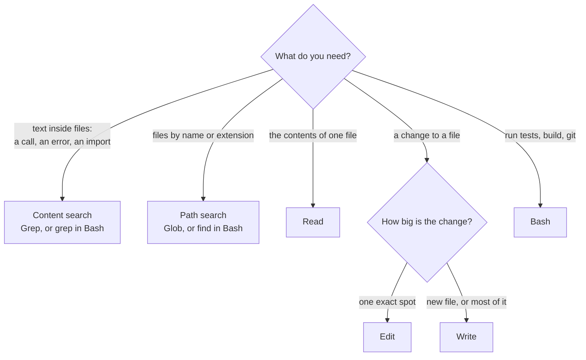
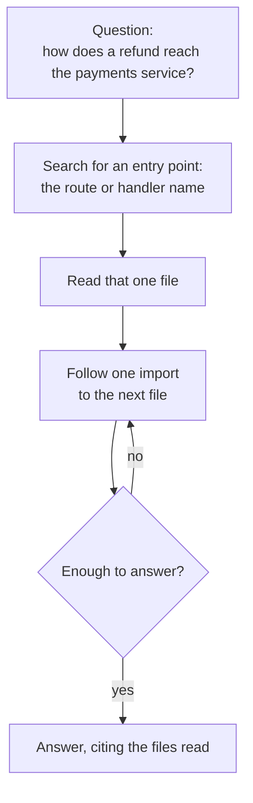

Claude Code's built-in tools each do one job: Grep searches inside files, Glob finds files by their path, Read loads one file, Write replaces a whole file, Edit changes one exact piece of text, and Bash runs shell commands. Picking the right one keeps the context small and the changes safe. In this post you learn how to choose, what to do when an Edit fails because its text appears twice, how to explore a codebase one step at a time, and how to scope each tool with permission rules. Then you test the Edit rule and a permissions file offline.

This is task statement 2.5 of the [Claude Certified Architect – Foundations exam guide](https://anthropic-partners.skilljar.com/claude-certified-architect-foundations-certification): "Select and apply built-in tools (Read, Write, Edit, Bash, Grep, Glob) effectively". It sits in Domain 2, Tool Design & MCP Integration, which is 18% of the exam. It is the last task statement in this domain. The earlier parts of this series covered tool descriptions (2.1), structured errors (2.2), tool distribution (2.3) and MCP servers in Claude Code (2.4); they are drafts for now.

## What does task statement 2.5 test?

The guide lists four things to know and five skills. In plain words:

| The guide asks you to… | In practice |
| --- | --- |
| Know Grep for content search | Find function names, error messages, imports inside files |
| Know Glob for path matching | Find files by name or extension, like `**/*.test.tsx` |
| Know Read/Write vs Edit | Whole-file operations vs one targeted change |
| Know the Read + Write fallback | When Edit's text isn't unique, rewrite the whole file |
| Pick Grep for callers and errors | "Where is `chargeCard` called?" is a content search |
| Pick Glob for naming patterns | "List every test file" is a path search |
| Recover a failed Edit | Read the full file, then Write the updated version |
| Explore step by step | Search for an entry point, Read it, follow its imports |
| Trace through wrapper modules | List every exported name, then search for each one |

A **tool** here is an action Claude Code lets the model take, such as reading a file or running a command. If tool use is new to you, [What is tool calling?](/blog/what-is-tool-calling) explains how a model asks for a tool and gets the result back.

## What does each built-in tool do?

The [tools reference](https://code.claude.com/docs/en/tools-reference) lists every tool. These six are the ones the exam names:

| Tool | What it does | Asks permission? |
| --- | --- | --- |
| `Read` | Returns one file's contents with line numbers. Also images, PDFs and notebooks. Not folders | No, inside your working folders |
| `Write` | Creates a file, or replaces an existing file with the full new content. It doesn't append or merge | Yes |
| `Edit` | Replaces one exact string (`old_string`) with another (`new_string`) | Yes |
| `Bash` | Runs a shell command: tests, builds, git, and on macOS and Linux also searches | Yes, except built-in read-only commands such as `ls`, `cat`, `grep` and `find` |
| `Grep` | Searches file contents with a regular expression. Built on ripgrep, skips gitignored files | No, inside your working folders |
| `Glob` | Finds files whose path matches a pattern, like `src/**/*.ts`. Returns up to 100 paths, sorted by modification time | No, inside your working folders |

"Working folders" means the folder you started Claude Code in, plus any you added with `--add-dir`. Outside them, even reads ask first.

A few other built-in tools matter for the same jobs. `NotebookEdit` changes Jupyter notebook cells. `LSP` asks a language server for definitions and references, once you install a code intelligence plugin. `Agent` hands a search to a subagent such as the built-in Explore agent, which keeps the search results out of your main conversation.

## Which tool should I pick?

Ask what you are looking for. Text inside files means a content search. A file you know by name or extension means a path search. Then decide whether you are changing one spot or the whole file.



| The task | The right tool | The tempting wrong one |
| --- | --- | --- |
| Where does the message "card declined" come from? | Content search for the string | Glob for `*declined*`, which only matches file names |
| List every Playwright spec in `e2e/` | Path search for `e2e/**/*.spec.ts` | Grep for `test(`, which also hits unit tests |
| Every file that imports `retryPolicy` | Content search for the import | Glob for `**/retryPolicy*`, which finds the file that defines it, not its users |
| Rename one constant in one file | Edit | Write, which re-sends the whole file |
| Create a new config file | Write | Bash with a shell redirect, which hides the file's content inside a command |
| Does the change pass the tests? | Bash, running the test command | Reading the test files and guessing |

### Wait: why does Claude run grep instead of Grep?

This is where the current docs and the exam guide differ. The [Glob tool docs](https://code.claude.com/docs/en/tools-reference#glob-tool-behavior) say that on macOS, Linux and WSL, Claude Code leaves `Glob` and `Grep` out of the default tool set. Claude searches with `find` and `grep` through the Bash tool instead, and in Claude's shell those commands run built-in copies of `bfs` and `ugrep`. On Windows, both tools are still part of the default set.

You get the dedicated tools back on macOS and Linux when:

- you name `Glob` or `Grep` in `--tools` or `--allowedTools` when you start a session, or in the matching Agent SDK options (an allow rule in a settings file doesn't do this);
- a deny rule, `--disallowedTools` or `--restricted` removes Bash;
- a subagent lists `Glob` or `Grep` in its `tools` and leaves out Bash.

For the exam, nothing changes in the thinking: a content search and a path search are still different jobs. Whether Claude does them with the `Grep` tool or with `grep` in Bash depends on your platform. What changes in practice is permissions: on macOS and Linux, those searches reach your rules and hooks as `Bash` calls.

## What happens when Edit's text appears twice?

Edit is an exact string replacement, with no regex and no fuzzy matching. The [Edit tool docs](https://code.claude.com/docs/en/tools-reference#edit-tool-behavior) list the checks that must pass:

- **Read before edit.** Claude has read the file in this conversation. Newer models can skip this when reading wouldn't need a permission prompt.
- **Match.** `old_string` appears in the file exactly as written. One space of indentation off is enough to miss.
- **Uniqueness.** `old_string` appears exactly once.

When the text appears more than once, the edit is rejected. Retrying the same call fails the same way, because the file hasn't changed. There are three ways out:

| Option | When it fits | Risk |
| --- | --- | --- |
| A longer `old_string` with the lines around it | One copy has unique neighbours, like the `host:` line above it | None, if the extra lines are copied exactly |
| `replace_all: true` | You really want every copy changed, like a rename | Changes copies you didn't mean to touch |
| Read the whole file, then Write the full new version | The copies have no unique neighbours, or the change spans several spots | Write replaces everything, so the new content must be complete |

The exam guide names the last one as the reliable fallback. The tools reference also notes that Write is for new files and full rewrites; for partial changes, Claude uses Edit. So try a unique `old_string` first, and switch to Read + Write when you can't make one.

## How do I explore a codebase without reading everything?

Read a little, then decide what to read next. Every file Claude reads lands in its context window, the limited space it holds for one conversation. Reading a whole `src/` folder first fills that space with files that don't matter to the question, and leaves less room for the work itself.



Wrapper modules need one extra step. A barrel file such as `index.ts` can re-export a function under a second name. A search for the original name misses every caller that uses the new one. So first list every name the module exports for the function, then search for each name. You can see it in a tiny project where `slugify` is also exported as `toSlug`:

```bash
$ grep -rn "slugify" src
```

```text
src/text/slugify.ts:1:export function slugify(title: string): string {
src/text/index.ts:1:export { slugify, slugify as toSlug } from './slugify.ts';
src/pages/tag.ts:1:import { slugify } from '../text/slugify.ts';
src/pages/tag.ts:3:export const tagUrl = (tag: string) => `/tags/${slugify(tag)}`;
```

Two of the three callers are missing. The export line shows the second name, so search for both, as whole words:

```bash
$ grep -rnwE "slugify|toSlug" src --include='*.ts'
```

```text
src/text/slugify.ts:1:export function slugify(title: string): string {
src/text/index.ts:1:export { slugify, slugify as toSlug } from './slugify.ts';
src/api/anchor.ts:3:export const anchor = (heading: string) => text.toSlug(heading);
src/pages/tag.ts:1:import { slugify } from '../text/slugify.ts';
src/pages/tag.ts:3:export const tagUrl = (tag: string) => `/tags/${slugify(tag)}`;
src/pages/post.ts:1:import { toSlug } from '../text/index.ts';
src/pages/post.ts:3:export const postUrl = (title: string) => `/blog/${toSlug(title)}`;
```

Now all three callers show up, including `anchor.ts`, which imports the whole module as `text` and calls `text.toSlug`. This is our output with GNU grep 3.11; the line order can differ on your machine. With the `LSP` tool set up, "find all references" does the same job using the language's own rules.

## How do permission rules apply to each tool?

Claude Code checks every tool call against the `allow`, `ask` and `deny` lists in your settings. The [permissions docs](https://code.claude.com/docs/en/permissions) give the order: deny first, then ask, then allow. The first match wins, so a broad deny can't be undone by a narrower allow. Rules are enforced by Claude Code, not the model, so a line in CLAUDE.md is a request while a deny rule is a limit.

The rule format is `Tool` or `Tool(specifier)`, and each tool family shares one specifier style:

| Rule | Covers | Specifier |
| --- | --- | --- |
| `Read(…)` | Read, Grep, Glob, LSP | A path pattern in gitignore style |
| `Edit(…)` | Edit, Write, NotebookEdit | A path pattern in gitignore style |
| `Bash(…)` | Bash, Monitor | The command text, with `*` for any text |
| `Write`, `Glob` with a path | Nothing | Accepted, but never checked. Claude Code warns at startup |

Path patterns have four anchors, and the single slash is the one that catches people:

| Pattern | Means |
| --- | --- |
| `//Users/alice/secrets/**` | An absolute path from the filesystem root |
| `~/Documents/*.pdf` | A path from your home folder |
| `/src/**` | Relative to the settings source: the project folder for `.claude/settings.json`, but `~/.claude` for user settings |
| `src/**` or `./src/**` | Relative to the current folder |

A few more details from the same page:

- An `Edit(…)` allow rule also lets Claude read the same path. A `Read(…)` deny rule also blocks Edit and Write on that path.
- Bash rules match each part of a compound command separately, so `Bash(npm test *)` doesn't approve `npm test && rm -rf build`.
- Put the `*` after the subcommand. `Bash(git log *)` allows only `git log`; `Bash(git * main)` also allows `git push origin main`.
- A bare `Bash` in `deny` removes the tool from Claude's view entirely. `Bash(rm *)` leaves the tool and blocks matching commands.


<Callout type="warning" title="Deny rules are not a sandbox">

A `Read` deny rule covers Claude's file tools and the file commands Claude Code recognizes in Bash, such as `cat` and `head`. It doesn't cover a command that reads files without naming them, like `grep -r pattern .` run from the parent folder, or a script that opens files itself. A `Bash(curl *)` deny doesn't stop `/usr/bin/curl` or `sh -c 'curl …'` either. When a secret must stay unreadable, also turn on [sandboxing](https://code.claude.com/docs/en/sandboxing), which blocks the path for every process.

</Callout>


## Try it: an Edit simulator and a checked permissions file

You'll build two small offline tools. The first models Edit's matching rule, so you can watch a non-unique edit fail and try each fix. The second validates a project's `.claude/settings.json` against its JSON schema and catches rules that look right but do nothing. Nothing here starts Claude or calls an API.

**You need:** Node.js 22.18 or later, which runs `.ts` files directly because [type stripping is on by default](https://nodejs.org/docs/latest-v22.x/api/typescript.html).


<Steps>


<Step title="Create the project">

```bash
$ mkdir tool-drill
$ cd tool-drill
$ npm init -y
$ npm pkg set type=module
$ mkdir .claude
```


```bash
npm install -D typescript @types/node ajv
```


**tsconfig.json**

```json
{
  "compilerOptions": {
    "noEmit": true,
    "target": "esnext",
    "module": "nodenext",
    "erasableSyntaxOnly": true,
    "verbatimModuleSyntax": true,
    "allowImportingTsExtensions": true,
    "resolveJsonModule": true,
    "strict": true,
    "types": ["node"]
  }
}
```


</Step>


<Step title="Write a file with the same line three times">


**config.yaml**

```yaml
server:
  port: 8080
  timeout: 30
database:
  host: db.internal
  timeout: 30
cache:
  ttl: 300
  timeout: 30
```


The task: raise the **database** timeout to 60, and leave the other two alone.

</Step>


<Step title="Model Edit's rule">

`simulateEdit` follows the documented checks: no match is an error, more than one match is an error unless `replace_all` is set. `setKeyInSection` is the Read + Write fallback: it works on the whole file, so it knows which section each line belongs to.


**edit-sim.ts**

```ts
// A model of the Edit tool's matching rules, for practice. It is not Claude Code's own code.
// Edit replaces old_string with new_string as an exact string: no regex, no fuzzy matching.

export type EditResult =
  | { ok: true; content: string; replaced: number }
  | { ok: false; reason: 'not-found' | 'not-unique'; matches: number };

export function countMatches(content: string, needle: string): number {
  if (needle === '') return 0;
  let count = 0;
  for (let at = content.indexOf(needle); at !== -1; at = content.indexOf(needle, at + needle.length)) count++;
  return count;
}

export function simulateEdit(content: string, oldString: string, newString: string, replaceAll = false): EditResult {
  const matches = countMatches(content, oldString);
  if (matches === 0) return { ok: false, reason: 'not-found', matches };
  if (matches > 1 && !replaceAll) return { ok: false, reason: 'not-unique', matches };
  const next = replaceAll ? content.split(oldString).join(newString) : content.replace(oldString, () => newString);
  return { ok: true, content: next, replaced: matches };
}

// The fallback: Read the whole file, change it with full knowledge of its structure, Write it all back.
// Here: set one key inside one top-level YAML section, and leave every other section alone.
export function setKeyInSection(content: string, section: string, key: string, value: string): string {
  let inSection = false;
  let changed = 0;
  const lines = content.split('\n').map((line) => {
    if (/^\S/.test(line)) inSection = line === `${section}:`; // a top-level key starts a new section
    if (inSection && line.trimStart().startsWith(`${key}:`)) {
      changed++;
      return `${line.slice(0, line.indexOf(key))}${key}: ${value}`;
    }
    return line;
  });
  if (changed !== 1) throw new Error(`Expected one "${key}" in "${section}", found ${changed}`);
  return lines.join('\n');
}
```


This is a model of the rule for practice, not Claude Code's own code, and its error names are ours.

</Step>


<Step title="Test each way out">


**edit-sim.test.ts**

```ts
import assert from 'node:assert/strict';
import { readFileSync } from 'node:fs';
import { test } from 'node:test';
import { setKeyInSection, simulateEdit } from './edit-sim.ts';

const config = readFileSync('config.yaml', 'utf8');
const timeouts = (text: string) => [...text.matchAll(/timeout: (\d+)/g)].map((m) => Number(m[1]));

test('a short old_string that appears three times is rejected', () => {
  const result = simulateEdit(config, '  timeout: 30', '  timeout: 60');
  assert.deepEqual(result, { ok: false, reason: 'not-unique', matches: 3 });
  console.log(`  Edit "timeout: 30" -> ${result.ok ? 'ok' : `${result.reason} (${result.matches} matches)`}`);
});

test('retrying the same Edit fails the same way', () => {
  const first = simulateEdit(config, '  timeout: 30', '  timeout: 60');
  const second = simulateEdit(config, '  timeout: 30', '  timeout: 60');
  assert.deepEqual(first, second);
});

test('replace_all succeeds, but changes every section', () => {
  const result = simulateEdit(config, '  timeout: 30', '  timeout: 60', true);
  assert.ok(result.ok);
  assert.deepEqual(timeouts(result.content), [60, 60, 60]); // the server and cache changed too
});

test('more surrounding context makes the match unique', () => {
  const result = simulateEdit(config, '  host: db.internal\n  timeout: 30', '  host: db.internal\n  timeout: 60');
  assert.ok(result.ok);
  assert.deepEqual(timeouts(result.content), [30, 60, 30]);
});

test('an old_string with different indentation is not found', () => {
  const result = simulateEdit(config, 'host: db.internal\ntimeout: 30', 'host: db.internal\ntimeout: 60');
  assert.deepEqual(result, { ok: false, reason: 'not-found', matches: 0 });
});

test('Read + Write changes only the database section', () => {
  const updated = setKeyInSection(config, 'database', 'timeout', '60'); // Read: the whole file is in hand
  assert.deepEqual(timeouts(updated), [30, 60, 30]); // Write: the whole file goes back
  assert.equal(updated.split('\n').length, config.split('\n').length);
  console.log(`  Read + Write -> timeouts ${timeouts(updated).join(', ')}`);
});
```


</Step>


<Step title="Write the project's permissions">

A team file for a TypeScript repository: tests and lint run without asking, Claude may change `src/` and `test/`, a push or a change to `package.json` asks first, and secrets and `curl` are off limits.


**.claude/settings.json**

```json
{
  "$schema": "https://json.schemastore.org/claude-code-settings.json",
  "permissions": {
    "allow": [
      "Bash(npm run test *)",
      "Bash(npm run lint)",
      "Edit(/src/**)",
      "Edit(/test/**)"
    ],
    "ask": [
      "Bash(git push *)",
      "Edit(/package.json)"
    ],
    "deny": [
      "Read(**/.env)",
      "Read(**/.env.*)",
      "Read(secrets/**)",
      "Bash(curl *)",
      "Bash(rm -rf *)"
    ]
  }
}
```


- `Edit(/src/**)` starts with one slash, so it means `src/` in this project. It also lets Claude read there.
- `Read(**/.env)` blocks every `.env` at any depth. Because it's a `Read` deny, Edit and Write can't touch those files either.
- `Read(secrets/**)` in a deny list matches a `secrets` folder at any depth.

</Step>


<Step title="Check the file">

Download the settings schema the docs reference in their `$schema` line. It's maintained by the SchemaStore project:

```bash
$ curl -sL -o claude-code-settings.schema.json https://json.schemastore.org/claude-code-settings.json
```

The checker validates against the schema first (JSON shape, known tool names), then applies rules from the permissions docs that a schema can't express.


**check-permissions.ts**

```ts
import { readFileSync } from 'node:fs';
import { fileURLToPath } from 'node:url';
import { Ajv } from 'ajv';

type Lists = { allow?: string[]; ask?: string[]; deny?: string[] };

// Tools whose path rules Claude Code accepts but never consults. Use Edit(...) or Read(...) instead.
const UNCHECKED_PATH_RULES: Record<string, string> = { Write: 'Edit', NotebookEdit: 'Edit', MultiEdit: 'Edit', Glob: 'Read' };
// Each tool's main input. A Tool(param:value) rule on it is ignored.
const PRIMARY_PARAM: Record<string, string> = {
  Bash: 'command', Read: 'file_path', Edit: 'file_path', Write: 'file_path', Grep: 'path', Glob: 'path', WebFetch: 'url',
};
const RULE = /^([^(]+)(?:\((.*)\))?$/s;

// Checks from the permissions docs that a JSON schema can't express.
export function lintRules(permissions: Lists): string[] {
  const problems: string[] = [];
  for (const list of ['allow', 'ask', 'deny'] as const) {
    for (const rule of permissions[list] ?? []) {
      const [, tool = '', spec] = RULE.exec(rule) ?? [];
      const where = `${list}: ${rule}`;
      if (spec !== undefined && tool in UNCHECKED_PATH_RULES) {
        problems.push(`${where} -> never checked for paths. Use ${UNCHECKED_PATH_RULES[tool]}(${spec}) instead`);
      }
      if ((tool === 'Read' || tool === 'Edit') && /^\/(Users|home|etc|var|tmp)\//.test(spec ?? '')) {
        problems.push(`${where} -> one leading / anchors at the settings source, not the filesystem root. Use //${spec!.slice(1)}`);
      }
      const param = PRIMARY_PARAM[tool];
      if (param && spec?.startsWith(`${param}:`)) {
        problems.push(`${where} -> ${param} can't be matched as a parameter; Claude Code ignores this rule`);
      }
      if (list === 'allow' && tool === 'Bash' && spec?.includes('*')) {
        const before = spec.slice(0, spec.indexOf('*')).trim().split(/\s+/).filter(Boolean);
        const trailing = spec.endsWith(' *') && spec.indexOf('*') === spec.length - 1;
        if (before.length < 2 && !trailing) problems.push(`${where} -> the * comes before the subcommand, so it allows far more than it looks`);
      }
    }
  }
  return problems;
}

export function checkSettings(settings: unknown, schema: object): string[] {
  const ajv = new Ajv({ allErrors: true, strict: false, validateFormats: false }); // formats such as uri aren't needed here
  const validate = ajv.compile(schema);
  const schemaErrors = validate(settings)
    ? []
    : (validate.errors ?? []).map((e) => `schema: ${e.instancePath || '/'} ${e.keyword === 'pattern' ? 'is not a known tool rule' : e.message}`);
  const permissions = (settings as { permissions?: Lists }).permissions ?? {};
  return schemaErrors.length > 0 ? schemaErrors : lintRules(permissions);
}

// CLI: node check-permissions.ts [settings file]
if (process.argv[1] === fileURLToPath(import.meta.url)) {
  const file = process.argv[2] ?? '.claude/settings.json';
  const schema = JSON.parse(readFileSync('claude-code-settings.schema.json', 'utf8'));
  const problems = checkSettings(JSON.parse(readFileSync(file, 'utf8')), schema);
  for (const problem of problems) console.error(`✘ ${problem}`);
  if (problems.length > 0) process.exit(1);
  console.log(`✔ ${file}: valid JSON, matches the schema, no rule mistakes found`);
}
```


**check-permissions.test.ts**

```ts
import assert from 'node:assert/strict';
import { readFileSync } from 'node:fs';
import { test } from 'node:test';
import { checkSettings } from './check-permissions.ts';

const schema = JSON.parse(readFileSync('claude-code-settings.schema.json', 'utf8'));

test('the project settings pass', () => {
  const settings = JSON.parse(readFileSync('.claude/settings.json', 'utf8'));
  assert.deepEqual(checkSettings(settings, schema), []);
});

test('the schema rejects a misspelled tool and a string instead of a list', () => {
  const problems = checkSettings({ permissions: { allow: ['Search(src/**)'], deny: 'Bash(rm *)' } }, schema);
  for (const problem of problems) console.log(`  ${problem}`);
  assert.ok(problems.length >= 2);
});

test('the linter catches rules that look right but do nothing useful', () => {
  const problems = checkSettings(
    {
      permissions: {
        allow: ['Bash(git * main)'],
        deny: ['Write(/migrations/**)', 'Read(/Users/alice/.ssh/**)', 'Bash(command:rm *)', 'Glob(secrets/**)'],
      },
    },
    schema,
  );
  for (const problem of problems) console.log(`  ${problem}`);
  assert.equal(problems.length, 5);
});
```


</Step>


<Step title="Run it">

```bash
$ node --test --test-reporter=spec edit-sim.test.ts check-permissions.test.ts
```

```text
  schema: /permissions/allow/0 is not a known tool rule
  schema: /permissions/deny must be array
  allow: Bash(git * main) -> the * comes before the subcommand, so it allows far more than it looks
  deny: Write(/migrations/**) -> never checked for paths. Use Edit(/migrations/**) instead
  deny: Read(/Users/alice/.ssh/**) -> one leading / anchors at the settings source, not the filesystem root. Use //Users/alice/.ssh/**
  deny: Bash(command:rm *) -> command can't be matched as a parameter; Claude Code ignores this rule
  deny: Glob(secrets/**) -> never checked for paths. Use Read(secrets/**) instead
✔ the project settings pass
✔ the schema rejects a misspelled tool and a string instead of a list
✔ the linter catches rules that look right but do nothing useful
  Edit "timeout: 30" -> not-unique (3 matches)
  Read + Write -> timeouts 30, 60, 30
✔ a short old_string that appears three times is rejected
✔ retrying the same Edit fails the same way
✔ replace_all succeeds, but changes every section
✔ more surrounding context makes the match unique
✔ an old_string with different indentation is not found
✔ Read + Write changes only the database section
ℹ tests 9
ℹ suites 0
ℹ pass 9
ℹ fail 0
ℹ cancelled 0
ℹ skipped 0
ℹ todo 0
```

This is our output on Node 22.22.2 with `ajv` 8.20.0, with timings removed. The Edit tests show the three outcomes: the short string fails with three matches, `replace_all` changes all three timeouts, and both the longer string and Read + Write change only the database. The checker passes the team file and flags five quiet mistakes in the bad one.

Run the checker on the real file, and type-check everything:

```bash
$ node check-permissions.ts
$ npx tsc
```

```text
✔ .claude/settings.json: valid JSON, matches the schema, no rule mistakes found
```

No output from `tsc` means no type errors.

</Step>


<Step title="Watch Claude in your own repository">

Open a medium-sized repository in Claude Code and try these prompts. What to expect, not a measured result:

- "Where is the error message `<a real message>` raised?" Claude should search file contents, not list files or read a folder.
- "List all test files for the checkout feature." Claude should search by path, such as `find` or Glob with a pattern.
- In a copy of `config.yaml`, "Change only the database timeout to 60." Claude should anchor the edit on the `host:` line, or read and rewrite the file.
- "Read the whole src folder first, then explain checkout" against "Start from the checkout route and follow imports". Count the files read in each. The second should read far fewer.

On macOS or Linux, the searches show up as Bash calls running `grep` or `find`.

</Step>


</Steps>


## Common traps

These are the mistakes that wrong answer options are built on.

| Trap | Why it fails | Fix |
| --- | --- | --- |
| A path search for text inside files | Glob matches names, not contents | A content search |
| A content search to find files by name | Slow, noisy, and misses files that don't mention the name | A path search |
| Reading every file before answering | Fills the context before the real question is touched | Search, Read one file, follow imports |
| Retrying the same failed Edit | The file didn't change, so the match is still not unique | Longer `old_string`, or Read + Write |
| `replace_all` to fix one copy | Changes every copy | Unique `old_string` |
| Searching only for a function's original name | Misses callers of re-exported or renamed names | List the exports, search for each name |
| `Write(path)` or `Glob(path)` permission rules | Never checked | `Edit(path)` and `Read(path)` |
| `/Users/alice/…` in a path rule | One slash anchors at the project, not the root | `//Users/alice/…` |

## Practice questions

These four questions are this blog's own, written for practice. They are not from the exam.

**Question 1.** A team adds `"Write(./migrations/**)"` to the `deny` list in `.claude/settings.json` so Claude never changes database migrations. A week later, Claude changes a migration with the Edit tool. What should they change?

- A. Add `"NotebookEdit(./migrations/**)"` and `"MultiEdit(./migrations/**)"` as well, so every editing tool is named.
- B. Replace the rule with `"Edit(./migrations/**)"`. Path rules are checked only for Edit and Read, and an Edit rule covers every built-in tool that edits files.
- C. Move the rule into CLAUDE.md as "never edit migrations".
- D. Change the pattern to `"Write(//migrations/**)"`, because deny rules need absolute paths.

**Question 2.** Claude tries to change `timeout: 30` to `timeout: 60` in a YAML file. The Edit is rejected because `timeout: 30` appears in the `server`, `database` and `cache` sections. Only the database value should change, and the lines around the three copies look alike. What is the reliable next step?

- A. Run the same Edit again.
- B. Run the Edit with `replace_all: true`.
- C. Read the whole file, change the line in the database section, and Write the full updated file.
- D. Delete the file and recreate it from memory with Write.

**Question 3.** An agent is asked, "How does a refund request reach the payments service?" in a repository of about 2,000 files. Which approach is best?

- A. Search for the refund route or handler to find the entry point, Read that file, then follow its imports.
- B. Read all 2,000 files first so nothing is missed.
- C. List every file path in the repository and answer from the names.
- D. Ask the user to paste the files they think are relevant.

**Question 4.** `formatPrice` is defined in `money/core.ts`. `money/index.ts` re-exports it as `toDisplayPrice`. You need every place it is used. What should the agent do?

- A. Search file contents for `formatPrice` only.
- B. Search for files with "price" in their name.
- C. Read `money/core.ts` and stop there.
- D. Read `money/index.ts` to list every name the function is exported under, then search file contents for each name.

## Answer key

### Question 1

**Answer: B.** The permissions docs say Claude Code checks file permissions against `Edit(path)` and `Read(path)` rules only; a path rule for `Write` is accepted but never consulted. An `Edit` rule applies to every built-in tool that edits files, including Write. The strongest distractor is A: naming more tools feels thorough, but path rules for `NotebookEdit` and the legacy `MultiEdit` are never checked either, so Edit stays unblocked. C is a request, not a limit.

### Question 2

**Answer: C.** Read gives the full file, so you can change exactly the database line and Write the complete result. The strongest distractor is B: `replace_all` succeeds, but it changes all three timeouts. A fails the same way every time, because the file hasn't changed.

### Question 3

**Answer: A.** A search finds the entry point, and following imports builds the picture one file at a time, so the context holds only what matters. The strongest distractor is B: it reads everything, which wastes context and buries the few files that answer the question. C sees names but not code.

### Question 4

**Answer: D.** A wrapper module can rename an export, so you first find every name the function goes by, then search for each one. The strongest distractor is A: it finds direct callers of `formatPrice` but misses every caller that imports `toDisplayPrice`.

## What should I do next?

- **Run the drill on a real file.** Pick a config file in your repository with repeated lines, and practise anchoring an edit on a unique neighbour. Then add the permissions checker to CI next to your `.claude/settings.json`.
- **Move on to Domain 3.** This post ends the tool design and MCP series. The next series, "Claude certification prep: Claude Code configuration", starts with task statement 3.1, "Configure CLAUDE.md files with appropriate hierarchy, scoping, and modular organization".
- **Use Claude Code well day to day.** [Getting the most out of AI coding assistants](/blog/ai-coding-assistants-tips) covers context, CLAUDE.md and reviews, and [Build your first AI agent](/blog/build-your-first-ai-agent) shows the tool loop from the inside.
- **Plan and check your prep.** Follow the [six-week study plan](/blog/claude-architect-exam-study-plan), and test yourself with the [mock exam](/blog/claude-certification-mock-exam) now that you've worked through Domain 2.
