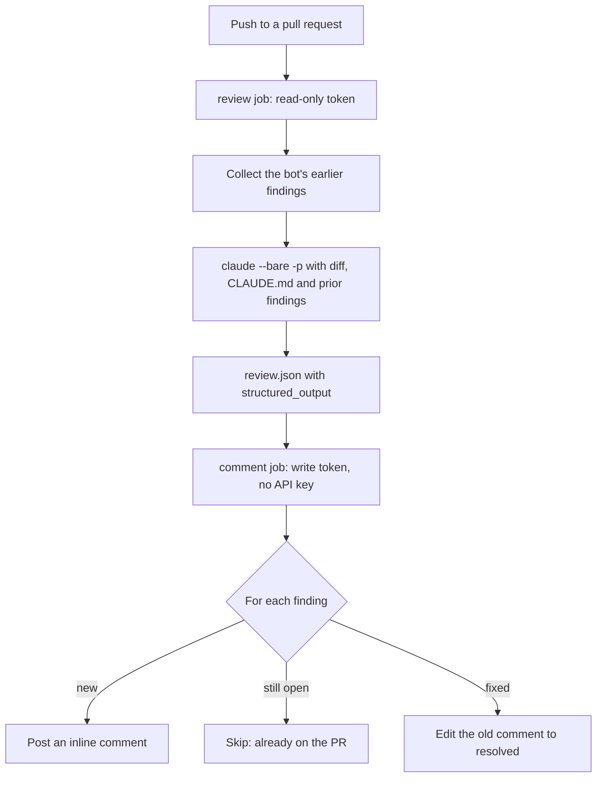
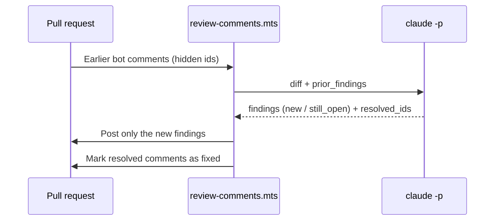

To run Claude Code in a CI/CD pipeline, call it with `-p` so it answers once and exits, ask for `--output-format json` with a `--json-schema` so a script can read the result, and give it project context through CLAUDE.md. Then two habits keep the bot useful: review with a separate instance from the one that wrote the code, and send the earlier findings on every re-run so it doesn't post the same comments again.

This is task statement 3.6 of the [Claude Certified Architect – Foundations exam guide](https://anthropic-partners.skilljar.com/claude-certified-architect-foundations-certification): "Integrate Claude Code into CI/CD pipelines". It sits in Domain 3, Claude Code Configuration & Workflows, which is 20% of the exam, and it is the last task statement in that domain. In this post you build a GitHub Actions workflow that reviews pull requests and posts findings as inline comments without repeating itself. The TypeScript that posts the comments is tested offline against canned Claude Code results. Nothing in this post starts Claude, so the review step itself is untested here; what Claude would return is described as an expectation.

## What does task statement 3.6 test?

The guide lists four things to know and five skills. In plain words:

| The guide asks you to… | In practice |
| --- | --- |
| Know the `-p` (`--print`) flag for non-interactive runs | The job runs one prompt, prints the result and exits |
| Know `--output-format json` and `--json-schema` | The script reads validated JSON, not free text |
| Know CLAUDE.md as the way to give CI runs project context | Review criteria, testing standards and fixtures live in the repository |
| Know why a fresh review instance beats self-review | The reviewer doesn't share the writer's assumptions |
| Run Claude Code in CI with `-p` so it never waits for input | No hanging jobs |
| Turn schema output into inline PR comments | A small script maps each finding to a file and line |
| Send prior findings when a review re-runs | Report only new or still-open issues |
| Give test generation the existing test files | No duplicate test cases |
| Document testing standards and fixtures in CLAUDE.md | Fewer low-value tests |

Writing the review criteria themselves is task statement 4.1, covered in [Explicit criteria in prompts: fewer false positives](/blog/prompt-explicit-criteria), and splitting a large review into several passes is task statement 4.6, [Multi-instance and multi-pass code review with Claude](/blog/claude-multi-pass-review). Both are in the prompt engineering series. This post is about the pipeline around the prompt.

## What does -p change?

Without `-p`, `claude` starts an interactive session and waits for you to type. In CI nobody types, so the job sits there until it times out. With `-p` (or `--print`), Claude Code takes the prompt, does the work, prints the result and exits. The [headless docs](https://code.claude.com/docs/en/headless) call this running Claude Code programmatically.

```bash
$ git diff main | claude -p "List the typos in this diff as file:line and the fix"
```

Three details matter in a pipeline:

- **Exit codes.** Claude Code exits with 0 on success and a non-zero code when the run fails, so a CI step fails the way any other command does.
- **Stdin.** `-p` reads piped input, so you can send a diff or a log straight in. Piped input is capped at 10 MB; for more, write a file and name it in the prompt.
- **Bare mode.** `--bare` skips auto-discovery of hooks, skills, plugins, MCP servers, auto memory and CLAUDE.md. The docs recommend it for scripted calls so every machine gets the same result, and say it will become the default for `-p` in a future release. Bare mode reads no OAuth login, so it needs `ANTHROPIC_API_KEY` in the environment.

## How do you get output a script can trust?

Use `--output-format` and, when a script must read the answer, a schema. The [CLI reference](https://code.claude.com/docs/en/cli-reference) lists three output formats for print mode:

| `--output-format` | What you get | Use it for |
| --- | --- | --- |
| `text` (default) | The answer as plain text | Logs a human reads |
| `json` | One JSON object: `result`, `session_id`, cost, usage and other metadata | Scripts that read the result once at the end |
| `stream-json` | Newline-delimited JSON events as they happen (the docs' examples add `--verbose`) | Progress output, or watching tool calls live |

`json` alone still gives you the answer as text in the `result` field. If you ask for "JSON only" in the prompt and parse that text, the format is a request the model usually follows, not a guarantee. Add `--json-schema` with a [JSON Schema](https://json-schema.org/) and Claude Code returns data that matches it in a separate `structured_output` field. The [structured outputs page](https://code.claude.com/docs/en/agent-sdk/structured-outputs) explains what happens underneath: the output is validated against your schema, and Claude is asked again when it doesn't match.

```bash
$ claude -p "Review this diff" --output-format json \
    --json-schema "$(cat findings.schema.json)" < pr.diff > review.json
```

Two failure cases are worth handling in your script, because both still produce a JSON object:

- If no valid output is produced within the retry limit, the result's `subtype` is `error_max_structured_output_retries` instead of `success`.
- A result can say `success` and still have no `structured_output`. The docs say to treat that as a failure too.

The docs also note that the schemas are validated as JSON Schema draft-07, so don't declare a newer draft. For structured output through the Messages API (tool use and `output_config`), see [Structured output from Claude: tool use and JSON schemas](/blog/claude-structured-output-json-schema) (task statement 4.3) in the prompt engineering series.

## Which permissions should a CI run get?

As few as the job needs, set on the command line. A `-p` run never shows a permission prompt, and the docs list the flags that decide what happens instead:

| Flag | What it does | In the review job |
| --- | --- | --- |
| `--tools "Read,Bash"` | Only these built-in tools exist in the session | No Edit or Write: the reviewer can't change code |
| `--allowedTools "…"` | Calls matching these rules run without asking | Not needed for the review; used for test generation below |
| `--permission-mode dontAsk` | Anything that would prompt is denied; the run never waits | Reads in the repository and read-only commands such as `cat`, `grep` and `git diff` still run |
| `--max-turns 30` | Stops after 30 agentic turns, with an error | A cap on a runaway review |
| `--max-budget-usd 3` | Stops when the estimated spend reaches the cap | A cost ceiling per run; pick your own number |

The [permission modes page](https://code.claude.com/docs/en/permission-modes) gives this exact pattern for CI: `dontAsk` plus an exact allowlist. It reserves `--dangerously-skip-permissions` for runs inside a container or VM.

One surprise: in a folder that was never trusted, which a fresh CI checkout is, a `-p` run ignores the `permissions.allow` rules in the project's `.claude/settings.json`, and prints a warning. Put the rules you need on the command line. Without `--bare`, the same run does load the project's hooks and connects the servers in `.mcp.json` without asking. The [permissions docs](https://code.claude.com/docs/en/permissions#what-runs-before-you-trust-a-folder) list what runs; bare mode switches those off.

## How does a CI run get your project's context?

Through CLAUDE.md, committed in the repository. A CI runner starts empty, so files that live only on your laptop, such as `~/.claude/CLAUDE.md`, aren't there. Anything the review or the test generator should know goes in the project CLAUDE.md. The CLAUDE.md hierarchy itself is part 1 of this series, [CLAUDE.md hierarchy: user, project, directory and @imports](/blog/claude-md-hierarchy).

A normal `claude -p` loads CLAUDE.md the way an interactive session does. `--bare` skips it, so a bare run needs it passed back explicitly:

```bash
$ claude --bare -p "Review this diff" --append-system-prompt-file CLAUDE.md
```

Here is the CLAUDE.md the Try it section uses. It has two sections for CI: review criteria, and testing standards with the fixtures.


**CLAUDE.md**

```md
# Shop API

TypeScript on Node 22. Source in `src/`, tests in `test/` (node:test).
Run the tests with `npm test`.

## Review criteria

Report only:
- Bugs: wrong results, unhandled errors, race conditions, money or tax maths.
- Security: injection, missing auth checks, secrets in code or logs.

Don't report naming, formatting or style. ESLint and Prettier handle those.
Severity: critical = data loss, security hole or wrong charge; major = a
user-visible bug; minor = a bug with an easy workaround.

## Testing

- One test file per module: `src/billing/discount.ts` -> `test/billing/discount.test.ts`.
- Use the shared fixtures in `test/fixtures/`: `customers.ts` (`activeCustomer`,
  `suspendedCustomer`) and `orders.ts` (`paidOrder`, `refundedOrder`). Don't build
  customers or orders by hand.
- A valuable test checks behaviour a user would notice: totals, refunds, error
  responses. Don't test private helpers or that a mock was called.
- Before adding a test, read the existing test file for that module and skip
  cases it already covers.
```


The [GitHub Actions docs](https://code.claude.com/docs/en/github-actions#define-project-standards-in-claude-md) give the same advice for the official action. They also say to keep the file concise, because Claude reads it on every run.

### What changes for test generation?

Two things from the guide: document what a good test looks like and which fixtures exist (the Testing section above), and give Claude the existing tests so it doesn't repeat them. A test generation step needs to write files, so it gets Edit, limited to the test folder:

```bash
$ claude --bare -p "Write unit tests for the functions this diff changes. First read the existing test file for each module and skip cases it already covers. Use the fixtures listed in CLAUDE.md. Run npm test before you finish." \
    --append-system-prompt-file CLAUDE.md \
    --tools "Read,Edit,Write,Bash" \
    --permission-mode dontAsk \
    --allowedTools "Edit(test/**)" "Bash(npm test *)" \
    --max-turns 40 < pr.diff
```

`Edit(test/**)` lets Claude create and change files under `test/` only (Edit rules cover all the built-in file-editing tools, Write included); `Bash(npm test *)` lets it run the tests. Everything else that would prompt is denied. Expect fewer, more useful tests: with the fixtures named, Claude has no reason to build a customer by hand, and with the existing file read first, it can see which cases exist. Check this on your own repository by comparing a run with and without the Testing section; this post doesn't run it.

## Why should a separate instance review the code?

Because the session that wrote the code reviews it with the same reasoning that produced it. If it misread the requirement while writing, it misreads it again while checking. The [best practices page](https://code.claude.com/docs/en/best-practices) says it directly: "A fresh context improves code review since Claude won't be biased toward code it just wrote." It describes a Writer/Reviewer pattern with two sessions, and adds that a reviewer in a fresh context "sees only the diff and the criteria you give it, not the reasoning that produced the change".

In CI that separation comes almost for free: the review job is its own `claude -p` process, started from a clean runner, with only the diff, CLAUDE.md and the prior findings.



Telling the same session to "review your work very critically" doesn't give you this. The instruction changes, but the context that hid the mistake is still there. One caution from the same docs: a reviewer asked to find gaps usually reports some, even when the work is sound. That's why the review criteria in CLAUDE.md say what to report and what to skip.

## How do you stop duplicate comments on re-runs?

Give the reviewer its earlier findings and ask it to sort them. A review bot runs on every push. Without memory, push number three posts the same six comments a third time, including ones the author already fixed. Developers learn to ignore the bot.



The pull request itself stores the history. Each bot comment starts with a hidden marker such as `<!-- claude-review id=cr-5dac7dcd severity=critical -->`, so the next run can list them, send them as `<prior_findings>`, and later edit the right comment. The prompt asks Claude to label each prior finding as `still_open` or put it in `resolved_ids`, and to mark something `new` only when no prior finding covers it. The script adds a safety net: if a "new" finding has the same file, line and message as an existing comment, it isn't posted again. That catches a re-run of the same job; it can't catch Claude rewording an old finding, so the prompt does most of the work.

## How do you keep secrets safe in the pipeline?

Treat the review job as code that reads untrusted input, because the diff is untrusted input. The workflow below follows these rules:

- **The API key lives in GitHub Secrets** and reaches only the step that runs Claude, through that step's `env`. The [GitHub Actions docs](https://code.claude.com/docs/en/github-actions#protect-your-credentials) say never to commit API keys and to reference them as secrets.
- **Claude's shell commands can't read it.** `CLAUDE_CODE_SUBPROCESS_ENV_SCRUB=1` strips Anthropic and cloud credentials from subprocess environments, such as Bash tool commands, while Claude Code itself keeps the key for its API calls. See the [environment variables reference](https://code.claude.com/docs/en/env-vars).
- **No GitHub write token near Claude.** `persist-credentials: false` keeps the checkout from storing a token for git. The job that runs Claude has a read-only token; the job that posts comments has `pull-requests: write` and no API key.
- **No fork pull requests.** GitHub passes no secrets to workflows triggered from forks, so the job is limited to branches in the same repository.
- **Values from the event go through `env`,** not straight into `run:` scripts, which avoids the script injection that [actionlint checks for](https://github.com/rhysd/actionlint/blob/main/docs/checks.md#untrusted-inputs).


<Callout type="warning" title="Don't switch to pull_request_target to get secrets on fork PRs">

`pull_request_target` runs with the base repository's secrets and a token that can write. If that workflow checks out and runs the fork's code, the fork's author controls code running next to your secrets. [GitHub's docs](https://docs.github.com/en/actions/reference/workflows-and-actions/events-that-trigger-workflows#pull_request_target) warn that this can lead to cache poisoning and to leaked secrets or write access. Keep fork reviews manual. For what to do when a key does leak, see [Never paste secrets into AI prompts](/blog/secrets-in-ai-prompts).

</Callout>


## Try it: a pull request review that doesn't repeat itself

You'll add seven files to a repository on GitHub: a schema, a prompt, a script that posts the comments, its offline test, two canned results, and the workflow. Then you run the tests and lint the workflow. None of these steps calls Claude. The canned results are hand-written in the shape the CLI documents for `--output-format json` (the fields of the SDK's result message); the findings in them are made up.

**You need:** a GitHub repository with a CLAUDE.md like the one above, Node.js 22.18 or later (it [runs `.ts` and `.mts` files directly](https://nodejs.org/docs/latest-v22.x/api/typescript.html)), and a Claude API key from the [Claude Console](https://platform.claude.com) for the real runs.


<Steps>


<Step title="Define the findings schema">

Each finding has the four fields the guide names (file, line, severity, message), plus `status` and `prior_id` so a re-run can say which old findings are still open. `resolved_ids` lists the old findings the new commits fixed.


**.github/review/findings.schema.json**

```json
{
  "$schema": "http://json-schema.org/draft-07/schema#",
  "type": "object",
  "additionalProperties": false,
  "required": ["findings", "resolved_ids"],
  "properties": {
    "findings": {
      "type": "array",
      "items": {
        "type": "object",
        "additionalProperties": false,
        "required": ["status", "prior_id", "file", "line", "severity", "message"],
        "properties": {
          "status": { "enum": ["new", "still_open"] },
          "prior_id": {
            "type": ["string", "null"],
            "description": "id from <prior_findings> when status is still_open, otherwise null"
          },
          "file": { "type": "string", "description": "Path from the repository root" },
          "line": { "type": "integer", "minimum": 1, "description": "Line in the new version of the file" },
          "severity": { "enum": ["critical", "major", "minor"] },
          "message": { "type": "string", "description": "What is wrong and why, in one or two sentences" }
        }
      }
    },
    "resolved_ids": {
      "type": "array",
      "items": { "type": "string" },
      "description": "ids from <prior_findings> that the new commits fixed"
    }
  }
}
```


</Step>


<Step title="Write the review prompt">

The prompt says where the diff and the prior findings are, and how to label each one. The review criteria stay in CLAUDE.md.


**.github/review/prompt.md**

```md
Review the pull request diff in <diff>. Use the review criteria from CLAUDE.md.
You may read files in the repository when you need more context.

<prior_findings> lists issues this bot already posted on earlier commits of
this pull request, each with an id. For each one:
- If the problem is still in the code, report it with status "still_open"
  and its id as prior_id.
- If the new commits fixed it, put its id in resolved_ids.

Report an issue with status "new" and prior_id null only when no prior
finding already covers it. Report only issues the criteria ask for. If
there are none, return an empty findings list. Line numbers refer to the
new version of each file.
```


</Step>


<Step title="Add the script that posts or updates comments">

`prior` prints the bot's open findings from the pull request. `post` reads the CLI's JSON result, checks that the run succeeded and that `structured_output` has the right shape, then posts new findings, skips ones already posted, and edits fixed ones to say "resolved". The `.mts` extension makes Node run it as an ES module whatever your `package.json` says. It uses only Node's built-ins and three [pull request review comment endpoints](https://docs.github.com/en/rest/pulls/comments). If GitHub refuses an inline comment (422), for example because the line isn't part of the diff, the finding goes to the job summary instead of the pull request.


**.github/review/review-comments.mts**

```ts
// Turns a `claude -p --output-format json --json-schema …` result into PR comments.
//   node review-comments.mts prior             prints the open findings already on the PR, as JSON
//   node review-comments.mts post review.json  posts new findings, marks fixed ones as resolved
// Needs GH_TOKEN, GITHUB_REPOSITORY, PR_NUMBER and HEAD_SHA in the environment.
import { createHash } from 'node:crypto';
import { appendFileSync, readFileSync } from 'node:fs';
import { fileURLToPath } from 'node:url';

export interface Finding {
  status: 'new' | 'still_open';
  prior_id: string | null;
  file: string;
  line: number;
  severity: 'critical' | 'major' | 'minor';
  message: string;
}

export interface Review {
  findings: Finding[];
  resolved_ids: string[];
}

export interface PriorFinding {
  id: string;
  commentId: number;
  file: string;
  line: number | null;
  severity: string;
  message: string;
}

export interface ReviewComment {
  id: number;
  path: string;
  line: number | null;
  body: string;
}

// The three GitHub calls the script needs. Tests pass a fake instead.
export interface GitHub {
  listReviewComments(): Promise<ReviewComment[]>;
  createReviewComment(comment: { body: string; path: string; line: number }): Promise<void>;
  updateReviewComment(commentId: number, body: string): Promise<void>;
}

export class GitHubError extends Error {
  status: number;
  constructor(status: number, message: string) {
    super(message);
    this.status = status;
  }
}

// Every bot comment starts with a hidden marker, so the next run can find it again.
const MARKER = /^<!-- claude-review id=(\S+) severity=(\S+)( resolved)? -->\n\*\*\S+\*\*: ([\s\S]*)$/;

export function findingId(f: Pick<Finding, 'file' | 'line' | 'message'>): string {
  return 'cr-' + createHash('sha256').update(`${f.file}:${f.line}:${f.message}`).digest('hex').slice(0, 8);
}

export function commentBody(id: string, f: Finding): string {
  return `<!-- claude-review id=${id} severity=${f.severity} -->\n**${f.severity}**: ${f.message}`;
}

// Reads the CLI's JSON result and returns the validated findings, or throws.
export function parseResult(raw: string): Review {
  const result = JSON.parse(raw);
  if (result?.type !== 'result' || result.subtype !== 'success' || result.is_error) {
    const why = [result?.subtype ?? 'not a result message', ...(result?.errors ?? [])].join(': ');
    throw new Error(`Claude Code run did not succeed (${why})`);
  }
  if (!isReview(result.structured_output)) {
    throw new Error('The result has no structured_output in the expected shape. Was --json-schema passed?');
  }
  return result.structured_output;
}

function isReview(value: any): value is Review {
  return (
    Array.isArray(value?.findings) &&
    Array.isArray(value?.resolved_ids) &&
    value.resolved_ids.every((id: unknown) => typeof id === 'string') &&
    value.findings.every(
      (f: any) =>
        (f.status === 'new' || f.status === 'still_open') &&
        (f.prior_id === null || typeof f.prior_id === 'string') &&
        typeof f.file === 'string' &&
        Number.isInteger(f.line) &&
        ['critical', 'major', 'minor'].includes(f.severity) &&
        typeof f.message === 'string',
    )
  );
}

// Open findings this bot already posted on the PR. Resolved ones are left out.
export async function priorFindings(gh: GitHub): Promise<PriorFinding[]> {
  const prior: PriorFinding[] = [];
  for (const c of await gh.listReviewComments()) {
    const m = c.body.match(MARKER);
    if (!m || m[3]) continue;
    prior.push({ id: m[1], commentId: c.id, file: c.path, line: c.line, severity: m[2], message: m[4] });
  }
  return prior;
}

export interface SyncSummary {
  posted: string[];
  alreadyPosted: string[];
  resolved: string[];
  notInline: string[]; // findings GitHub refused as inline comments
}

export async function syncFindings(gh: GitHub, review: Review, headSha: string): Promise<SyncSummary> {
  const prior = await priorFindings(gh);
  const known = new Set(prior.map((p) => p.id));
  const summary: SyncSummary = { posted: [], alreadyPosted: [], resolved: [], notInline: [] };

  for (const f of review.findings) {
    // Still open and already on the PR: say nothing new.
    if (f.status === 'still_open' && f.prior_id && known.has(f.prior_id)) {
      summary.alreadyPosted.push(f.prior_id);
      continue;
    }
    // Safety net: the same finding posted by an earlier run (for example a re-run job).
    const id = findingId(f);
    if (known.has(id)) {
      summary.alreadyPosted.push(id);
      continue;
    }
    try {
      await gh.createReviewComment({ body: commentBody(id, f), path: f.file, line: f.line });
      summary.posted.push(id);
      known.add(id);
    } catch (error) {
      // 422: GitHub refused an inline comment on this line. Report it in the job summary instead.
      if (!(error instanceof GitHubError) || error.status !== 422) throw error;
      summary.notInline.push(`- \`${f.file}:${f.line}\` **${f.severity}**: ${f.message}`);
    }
  }

  for (const id of review.resolved_ids) {
    const p = prior.find((x) => x.id === id);
    if (!p) continue; // unknown or already resolved
    const body = `<!-- claude-review id=${p.id} severity=${p.severity} resolved -->\n**resolved**: fixed in ${headSha.slice(0, 7)}.\n\n~~${p.message}~~`;
    await gh.updateReviewComment(p.commentId, body);
    summary.resolved.push(id);
  }
  return summary;
}

// GitHub REST client built on fetch, for the three calls above.
export function gitHubClient(env: NodeJS.ProcessEnv = process.env): GitHub {
  const need = (name: string) => env[name] ?? fail(`Missing environment variable ${name}`);
  const api = env.GITHUB_API_URL ?? 'https://api.github.com';
  const repo = need('GITHUB_REPOSITORY');
  const pr = need('PR_NUMBER');
  const headSha = need('HEAD_SHA');
  const token = need('GH_TOKEN');

  async function call(method: string, path: string, body?: unknown): Promise<any> {
    const res = await fetch(`${api}${path}`, {
      method,
      headers: {
        Authorization: `Bearer ${token}`,
        Accept: 'application/vnd.github+json',
        'X-GitHub-Api-Version': '2026-03-10',
        'Content-Type': 'application/json',
      },
      body: body === undefined ? undefined : JSON.stringify(body),
    });
    if (!res.ok) throw new GitHubError(res.status, `${method} ${path} failed: ${res.status} ${await res.text()}`);
    return res.json();
  }

  return {
    async listReviewComments() {
      const all: ReviewComment[] = [];
      for (let page = 1; ; page++) {
        const batch: ReviewComment[] = await call('GET', `/repos/${repo}/pulls/${pr}/comments?per_page=100&page=${page}`);
        all.push(...batch);
        if (batch.length < 100) return all;
      }
    },
    async createReviewComment(c) {
      await call('POST', `/repos/${repo}/pulls/${pr}/comments`, { ...c, commit_id: headSha, side: 'RIGHT' });
    },
    async updateReviewComment(commentId, body) {
      await call('PATCH', `/repos/${repo}/pulls/comments/${commentId}`, { body });
    },
  };
}

function fail(message: string): never {
  throw new Error(message);
}

async function main([command, file]: string[]) {
  const gh = gitHubClient();
  if (command === 'prior') {
    const prior = await priorFindings(gh);
    console.log(JSON.stringify(prior.map(({ commentId, ...rest }) => rest), null, 2));
  } else if (command === 'post' && file) {
    const review = parseResult(readFileSync(file, 'utf8'));
    const s = await syncFindings(gh, review, process.env.HEAD_SHA ?? '');
    console.log(
      `posted ${s.posted.length}, already posted ${s.alreadyPosted.length}, ` +
        `resolved ${s.resolved.length}, not inline ${s.notInline.length}`,
    );
    if (s.notInline.length > 0 && process.env.GITHUB_STEP_SUMMARY) {
      appendFileSync(process.env.GITHUB_STEP_SUMMARY, `### Findings outside the diff\n\n${s.notInline.join('\n')}\n`);
    }
  } else {
    fail('Usage: review-comments.mts prior | post <review.json>');
  }
}

if (process.argv[1] === fileURLToPath(import.meta.url)) {
  main(process.argv.slice(2)).catch((error) => {
    console.error(error.message);
    process.exitCode = 1;
  });
}
```


</Step>


<Step title="Add two canned results and an offline test">

Run 1 has three findings; one points at a line outside the diff. Run 2 comes after a fix: one finding is still open, one is fixed, and one is new.


**.github/review/fixtures/run1.json**

```json
{
  "type": "result",
  "subtype": "success",
  "is_error": false,
  "duration_ms": 48210,
  "duration_api_ms": 41877,
  "num_turns": 6,
  "result": "Found 3 issues.",
  "stop_reason": "end_turn",
  "session_id": "00000000-0000-4000-8000-000000000001",
  "total_cost_usd": 0.42,
  "permission_denials": [],
  "structured_output": {
    "findings": [
      {
        "status": "new",
        "prior_id": null,
        "file": "src/billing/discount.ts",
        "line": 42,
        "severity": "critical",
        "message": "applyDiscount() subtracts the percentage as a whole number (price - 15) instead of 15%, so a 15% code takes 15 dollars off every order."
      },
      {
        "status": "new",
        "prior_id": null,
        "file": "src/api/orders.ts",
        "line": 88,
        "severity": "major",
        "message": "The catch block logs the payment error and returns 200, so the client shows the order as paid when the charge failed."
      },
      {
        "status": "new",
        "prior_id": null,
        "file": "src/billing/rates.ts",
        "line": 10,
        "severity": "minor",
        "message": "TAX_RATES is exported as a mutable object; a caller can change the rates for every request."
      }
    ],
    "resolved_ids": []
  }
}
```


**.github/review/fixtures/run2.json**

```json
{
  "type": "result",
  "subtype": "success",
  "is_error": false,
  "duration_ms": 39544,
  "duration_api_ms": 35102,
  "num_turns": 5,
  "result": "1 new issue, 1 still open, 1 fixed.",
  "stop_reason": "end_turn",
  "session_id": "00000000-0000-4000-8000-000000000002",
  "total_cost_usd": 0.37,
  "permission_denials": [],
  "structured_output": {
    "findings": [
      {
        "status": "still_open",
        "prior_id": "cr-5dac7dcd",
        "file": "src/billing/discount.ts",
        "line": 44,
        "severity": "critical",
        "message": "applyDiscount() still subtracts the percentage as a whole number."
      },
      {
        "status": "new",
        "prior_id": null,
        "file": "src/api/orders.ts",
        "line": 97,
        "severity": "major",
        "message": "The new retry loop charges the card again after a timeout without an idempotency key, so a slow response can charge the customer twice."
      }
    ],
    "resolved_ids": ["cr-4d0a5553"]
  }
}
```


The test uses a fake pull request in memory that refuses lines outside the diff with 422, like GitHub, and a fake `fetch` to check the URLs.


**.github/review/review-comments.test.mts**

```ts
// Offline tests: canned Claude Code results and a fake GitHub. No network, no model.
import assert from 'node:assert/strict';
import { readFileSync } from 'node:fs';
import { test } from 'node:test';
import {
  GitHubError,
  gitHubClient,
  parseResult,
  syncFindings,
  type GitHub,
  type ReviewComment,
} from './review-comments.mts';

const fixture = (name: string) => readFileSync(new URL(`./fixtures/${name}`, import.meta.url), 'utf8');

// An in-memory pull request. Lines outside the diff are refused with 422, like GitHub does.
function fakePullRequest(diffLines: Record<string, number[]>) {
  const comments: ReviewComment[] = [];
  const gh: GitHub = {
    async listReviewComments() {
      return structuredClone(comments);
    },
    async createReviewComment({ body, path, line }) {
      if (!diffLines[path]?.includes(line)) throw new GitHubError(422, 'Validation Failed');
      comments.push({ id: comments.length + 1, path, line, body });
    },
    async updateReviewComment(commentId, body) {
      const c = comments.find((x) => x.id === commentId);
      if (!c) throw new GitHubError(404, 'Not Found');
      c.body = body;
    },
  };
  return { gh, comments };
}

const diffLines = {
  'src/billing/discount.ts': [40, 41, 42, 43, 44],
  'src/api/orders.ts': [85, 86, 87, 88, 95, 96, 97],
};

test('first run posts each finding once and reports the one outside the diff', async () => {
  const { gh, comments } = fakePullRequest(diffLines);
  const s = await syncFindings(gh, parseResult(fixture('run1.json')), 'aaaaaaa1111');

  assert.deepEqual(s.posted, ['cr-5dac7dcd', 'cr-4d0a5553']);
  assert.equal(s.notInline.length, 1);
  assert.match(s.notInline[0], /src\/billing\/rates\.ts:10/);
  assert.equal(comments.length, 2);
  console.log(comments[0].body);
});

test('second run posts only the new finding and marks the fixed one resolved', async () => {
  const { gh, comments } = fakePullRequest(diffLines);
  await syncFindings(gh, parseResult(fixture('run1.json')), 'aaaaaaa1111');
  const s = await syncFindings(gh, parseResult(fixture('run2.json')), 'bbbbbbb2222');

  assert.deepEqual(s.alreadyPosted, ['cr-5dac7dcd']);
  assert.equal(s.posted.length, 1);
  assert.deepEqual(s.resolved, ['cr-4d0a5553']);
  assert.equal(comments.length, 3); // 2 from run 1 + 1 new, no repeats
  assert.match(comments[1].body, /resolved -->\n\*\*resolved\*\*: fixed in bbbbbbb/);
  console.log(comments[1].body);
});

test('a re-run of the same job posts nothing new', async () => {
  const { gh, comments } = fakePullRequest(diffLines);
  await syncFindings(gh, parseResult(fixture('run1.json')), 'aaaaaaa1111');
  const s = await syncFindings(gh, parseResult(fixture('run1.json')), 'aaaaaaa1111');

  assert.deepEqual(s.posted, []);
  assert.deepEqual(s.alreadyPosted, ['cr-5dac7dcd', 'cr-4d0a5553']);
  assert.equal(comments.length, 2);
});

test('a failed or unstructured run stops the job instead of posting', () => {
  const failed = { type: 'result', subtype: 'error_max_structured_output_retries', is_error: true, errors: [] };
  assert.throws(() => parseResult(JSON.stringify(failed)), /did not succeed \(error_max_structured_output_retries\)/);

  const noSchema = { type: 'result', subtype: 'success', is_error: false, result: 'Looks good to me!' };
  assert.throws(() => parseResult(JSON.stringify(noSchema)), /no structured_output/);
});

test('the GitHub client calls the documented endpoints and pages through comments', async () => {
  const calls: string[] = [];
  const page1 = Array.from({ length: 100 }, (_, i) => ({ id: i + 1, path: 'a.ts', line: 1, body: 'hi' }));
  globalThis.fetch = async (input, init) => {
    const url = new URL(String(input));
    calls.push(`${init?.method} ${url.pathname}${url.search}`);
    const page = url.searchParams.get('page');
    const body = page === '1' ? page1 : page === '2' ? [] : {};
    return new Response(JSON.stringify(body), { status: 200 });
  };
  const gh = gitHubClient({ GITHUB_REPOSITORY: 'acme/shop', PR_NUMBER: '7', HEAD_SHA: 'abc123', GH_TOKEN: 'test' });

  assert.equal((await gh.listReviewComments()).length, 100);
  await gh.createReviewComment({ body: 'x', path: 'a.ts', line: 3 });
  await gh.updateReviewComment(42, 'y');

  assert.deepEqual(calls, [
    'GET /repos/acme/shop/pulls/7/comments?per_page=100&page=1',
    'GET /repos/acme/shop/pulls/7/comments?per_page=100&page=2',
    'POST /repos/acme/shop/pulls/7/comments',
    'PATCH /repos/acme/shop/pulls/comments/42',
  ]);
});
```


```bash
$ node --test --test-reporter=spec .github/review/review-comments.test.mts
```

```text
<!-- claude-review id=cr-5dac7dcd severity=critical -->
**critical**: applyDiscount() subtracts the percentage as a whole number (price - 15) instead of 15%, so a 15% code takes 15 dollars off every order.
<!-- claude-review id=cr-4d0a5553 severity=major resolved -->
**resolved**: fixed in bbbbbbb.

~~The catch block logs the payment error and returns 200, so the client shows the order as paid when the charge failed.~~
✔ first run posts each finding once and reports the one outside the diff (4.307454ms)
✔ second run posts only the new finding and marks the fixed one resolved (1.152014ms)
✔ a re-run of the same job posts nothing new (4.674414ms)
✔ a failed or unstructured run stops the job instead of posting (0.625532ms)
✔ the GitHub client calls the documented endpoints and pages through comments (44.398369ms)
ℹ tests 5
ℹ suites 0
ℹ pass 5
ℹ fail 0
ℹ cancelled 0
ℹ skipped 0
ℹ todo 0
ℹ duration_ms 237.309849
```

The second test is the one that matters: after run 2, the pull request has three comments, not five. The resolved comment now starts with `**resolved**: fixed in bbbbbbb.` and the old message is struck through. This is our run on Node 22.22.2; timings will differ.

</Step>


<Step title="Add the workflow">

Two jobs. `review` has a read-only token and the API key; `comment` has the write token and no key. The `head.repo.full_name` check skips fork pull requests.


**.github/workflows/claude-review.yml**

```yaml
name: Claude review

on:
  pull_request:
    types: [opened, synchronize, reopened]

# One review per PR at a time; a new push cancels the old run.
concurrency:
  group: claude-review-${{ github.event.pull_request.number }}
  cancel-in-progress: true

permissions: {}

defaults:
  run:
    shell: bash

jobs:
  review:
    # Same-repo PRs only: GitHub gives fork PRs no secrets anyway.
    if: github.event.pull_request.head.repo.full_name == github.repository
    runs-on: ubuntu-latest
    timeout-minutes: 15
    permissions:
      contents: read
      pull-requests: read
    env:
      BASE_SHA: ${{ github.event.pull_request.base.sha }}
      HEAD_SHA: ${{ github.event.pull_request.head.sha }}
      PR_NUMBER: ${{ github.event.pull_request.number }}
    steps:
      - uses: actions/checkout@v7
        with:
          ref: ${{ github.event.pull_request.head.sha }}
          fetch-depth: 0
          persist-credentials: false

      - uses: actions/setup-node@v7
        with:
          node-version: 22

      - name: Install Claude Code
        run: npm install -g @anthropic-ai/claude-code@2.1.287

      - name: Collect findings already on the PR
        env:
          GH_TOKEN: ${{ github.token }}
        run: node .github/review/review-comments.mts prior > "$RUNNER_TEMP/prior-findings.json"

      - name: Review the diff
        env:
          ANTHROPIC_API_KEY: ${{ secrets.ANTHROPIC_API_KEY }}
          CLAUDE_CODE_SUBPROCESS_ENV_SCRUB: "1"
        run: |
          {
            echo "<diff>"
            git diff "$BASE_SHA...$HEAD_SHA"
            echo "</diff>"
            echo "<prior_findings>"
            cat "$RUNNER_TEMP/prior-findings.json"
            echo "</prior_findings>"
          } | claude --bare -p "$(cat .github/review/prompt.md)" \
                --append-system-prompt-file CLAUDE.md \
                --model claude-opus-5-5 \
                --tools "Read,Bash" \
                --permission-mode dontAsk \
                --max-turns 30 \
                --max-budget-usd 3 \
                --output-format json \
                --json-schema "$(cat .github/review/findings.schema.json)" \
                > review.json

      - uses: actions/upload-artifact@v7
        with:
          name: claude-review
          path: review.json
          if-no-files-found: error

  comment:
    needs: review
    runs-on: ubuntu-latest
    timeout-minutes: 5
    permissions:
      contents: read
      pull-requests: write
    steps:
      - uses: actions/checkout@v7
        with:
          ref: ${{ github.event.pull_request.head.sha }}
          persist-credentials: false
          sparse-checkout: .github/review

      - uses: actions/setup-node@v7
        with:
          node-version: 22

      - uses: actions/download-artifact@v8
        with:
          name: claude-review

      - name: Post or update findings
        env:
          GH_TOKEN: ${{ github.token }}
          PR_NUMBER: ${{ github.event.pull_request.number }}
          HEAD_SHA: ${{ github.event.pull_request.head.sha }}
        run: node .github/review/review-comments.mts post review.json
```


Things to notice:

- `shell: bash` makes GitHub run each script with `-eo pipefail`, so a failing `claude` in the middle of the pipe fails the step.
- The version of Claude Code is pinned, so a new release doesn't change your pipeline without a pull request. Bump it on purpose.
- `--model claude-opus-5-5` is the model the [models overview](https://platform.claude.com/docs/en/about-claude/models/overview) suggests starting with.
- If you'd rather use the official [claude-code-action](https://github.com/anthropics/claude-code-action/blob/main/docs/usage.md), pass the same flags in its `claude_args` input. With `--json-schema`, the action exposes the result as a `structured_output` step output.

</Step>


<Step title="Lint the workflow, then add the secret">

[actionlint](https://github.com/rhysd/actionlint) checks workflow syntax, expressions and, when `shellcheck` is installed, the shell in every `run:` block. It prints nothing when the file is clean.

```bash
$ actionlint .github/workflows/claude-review.yml
```

Then add `ANTHROPIC_API_KEY` under **Settings → Secrets and variables → Actions** in your repository, and open a pull request. When the workflow runs, expect inline comments only for issues that match your criteria, and on the next push, only new ones plus "resolved" edits.

</Step>


</Steps>


We also ran the workflow's own `run:` blocks on a laptop, with a stub `claude` that printed the canned results and a fake GitHub API on localhost. Three runs (run 1, run 2, then run 2 again) posted 2, then 1, then 0 comments.

## Common traps

These are the mistakes wrong answer options are built on.

| Trap | Why it breaks | Fix |
| --- | --- | --- |
| Running `claude "…"` without `-p` in CI | It starts an interactive session and waits for input | `claude -p "…"` |
| Asking for "JSON only" and parsing the text | The format is a request, not a guarantee | `--output-format json` with `--json-schema`, read `structured_output` |
| Treating any JSON result as success | A failed run still prints JSON | Check `subtype` is `success` and `structured_output` exists |
| Using `--bare` and expecting CLAUDE.md to load | Bare mode skips CLAUDE.md | `--append-system-prompt-file CLAUDE.md` |
| Relying on `.claude/settings.json` allow rules in CI | A `-p` run in an untrusted folder ignores them | Put the rules in `--allowedTools` |
| A full review on every push with no memory | The same comments pile up | Send prior findings; post only new ones |
| The writing session approves its own code | It shares the reasoning that made the mistake | A separate review instance with only the diff and criteria |
| Generating tests without the existing tests or fixtures | Duplicate and hand-built tests | Testing section in CLAUDE.md, existing test files in context |
| The API key in job-wide `env` next to a write token | Any step, and any command Claude runs, can reach both | Key only on the Claude step, scrub subprocess env, split jobs |

## Practice questions

These four questions are this blog's own, written for practice. They are not from the exam.

**Question 1.** Your CI review job follows the docs and runs `claude --bare -p "Review this diff" < pr.diff`. When developers run the same review locally with `claude`, it follows the team's review criteria in the repository's CLAUDE.md. In CI it flags style issues the criteria say to skip. What should you change?

- A. Copy the criteria into `~/.claude/CLAUDE.md` on the CI runner image.
- B. Keep `--bare` and add `--append-system-prompt-file CLAUDE.md`, or drop `--bare` so the run discovers CLAUDE.md again.
- C. Repeat "follow CLAUDE.md" in the prompt in capital letters.
- D. Add `--permission-mode dontAsk` so the run can read CLAUDE.md without a prompt.

**Question 2.** A review bot runs on every push to a pull request. After the fourth push, the pull request shows the same five comments four times, including two problems the author fixed after the first push. What change fixes this best?

- A. Review only the diff of the newest commit.
- B. Send the bot's earlier findings with each run and ask Claude to report only new issues and issues that are still not fixed, then post only those.
- C. Delete every bot comment before each run and post the full list again.
- D. Run the review only when the pull request is first opened.

**Question 3.** A pipeline asks one Claude Code session to implement a ticket, then asks the same session to review its changes before it opens a pull request. The self-reviews nearly always pass, but human reviewers keep finding logic errors. What should you change?

- A. Add "review your work very critically" to the review prompt.
- B. Run the review in a separate Claude Code instance that gets only the diff and the review criteria.
- C. Run the same self-review twice and merge the results.
- D. Remove the automated review and rely on human review.

**Question 4.** Claude Code writes unit tests in CI. Developers say many new tests repeat cases that already exist, and they build customers by hand although `test/fixtures/` has shared ones. What is the best improvement?

- A. Switch test generation to a larger model.
- B. Document the testing standards and the available fixtures in CLAUDE.md, and have each run read the existing tests for the modules it touches.
- C. Ask for twice as many tests, so more of them are useful.
- D. Delete generated tests that duplicate existing ones after each run.

## Answer key

### Question 1

**Answer: B.** Bare mode skips the automatic discovery of CLAUDE.md, so the criteria never reach the CI run. `--append-system-prompt-file` passes the file explicitly; dropping `--bare` also works, but loses the predictability bare mode gives. The strongest distractor is A: bare mode skips user-level CLAUDE.md too, and a file baked into a runner image drifts from the one the team edits in the repository. D is about tool permissions, not context.

### Question 2

**Answer: B.** With the earlier findings in context, Claude can sort them into still open and fixed, and the script posts only what is new. The strongest distractor is A: it cuts the repeats, but it misses problems that come from how the new commit interacts with earlier changes, and it can't mark fixed issues as resolved.

### Question 3

**Answer: B.** The session that wrote the code reviews it with the same assumptions that produced the errors. A separate instance with a fresh context sees only the diff and the criteria. The strongest distractor is A: it changes the wording, but the reviewer still carries the reasoning that hid the bugs.

### Question 4

**Answer: B.** CLAUDE.md gives every CI run the testing conventions and fixture names, and the existing tests show what is already covered, so new tests fill real gaps. The strongest distractor is D: it removes duplicates after the fact, but you still pay to generate them, and it does nothing about hand-built test data.

## What should I do next?

- **Add the workflow to a real repository.** Start with the review job only and read `review.json` in the job's artifacts for a few pull requests before you let it post comments.
- **Tighten the criteria.** The next domain series, "Claude certification prep: prompt engineering and structured output", starts with task statement 4.1 in [Explicit criteria in prompts: fewer false positives](/blog/prompt-explicit-criteria), which is how you make the bot's findings worth reading.
- **Finish Domain 3.** This is the last part of the Claude Code configuration series. Task 3.6 is in week 4 of the [six-week study plan](/blog/claude-architect-exam-study-plan); when the domain feels solid, test yourself with the [mock exam](/blog/claude-certification-mock-exam).
- **Read around it.** [How to test, deploy and use your AI agent](/blog/test-deploy-ai-agent) covers CI for agents more broadly, and [How to test AI output with evals](/blog/test-ai-output-with-evals) shows how to measure whether a prompt change made the reviews better.
