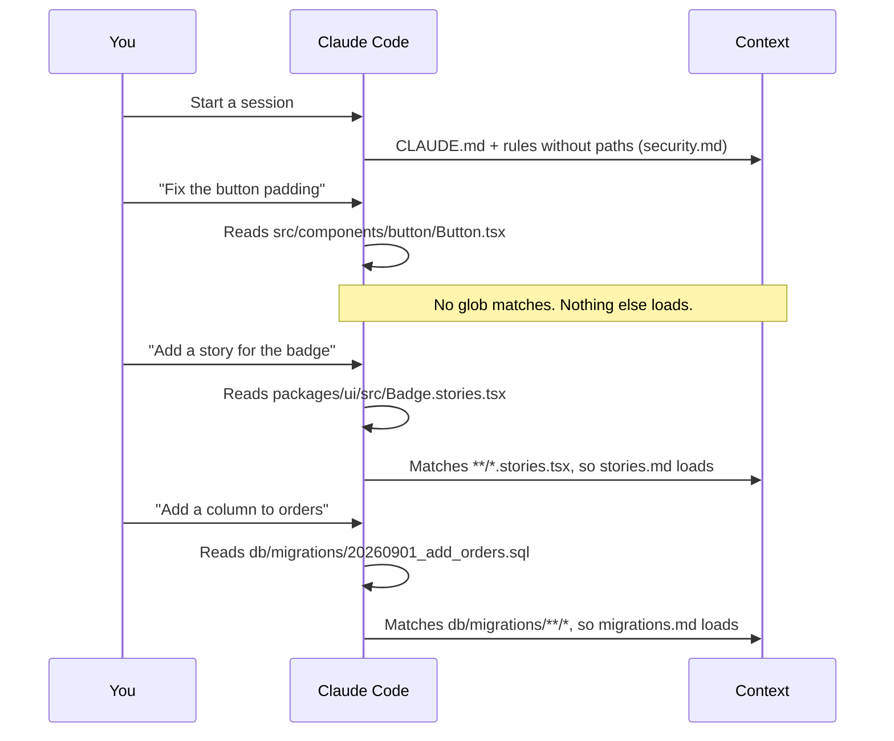

A path-specific rule is a Markdown file in `.claude/rules/` that starts with a `paths:` list of glob patterns. Claude Code keeps it out of context until Claude reads a file that matches one of those patterns, such as a migration or a Storybook story. Your always-loaded context stays small, and each convention still shows up exactly where it applies.

This is task statement 3.3 of the [Claude Certified Architect – Foundations exam guide](https://anthropic-partners.skilljar.com/claude-certified-architect-foundations-certification): "Apply path-specific rules for conditional convention loading". It sits in Domain 3, Claude Code Configuration & Workflows, which is 20% of the exam. In this post you set up a small repository with four rules, then build a script that tells you which rules would load for any file. It uses a real glob library, runs its tests offline, and never starts Claude.

## What does task statement 3.3 test?

The guide lists three things to know and three skills. In plain words:

| The guide asks you to… | In practice |
| --- | --- |
| Know `.claude/rules/` files with `paths` frontmatter | A YAML list of globs at the top of a rule file |
| Know that scoped rules load only for matching files | Less unrelated text in context, fewer tokens spent |
| Know why globs beat a directory CLAUDE.md for spread-out files | Test files live in every folder; a folder file can't follow them |
| Write a rule with `paths` scoping | `paths: ["terraform/**/*"]` style frontmatter |
| Match files by type in any folder | `**/*.test.tsx` for every test file |
| Choose a scoped rule over a subdirectory CLAUDE.md | When the convention follows a file type, not a folder |

The earlier post in this series, on the CLAUDE.md hierarchy (task statement 3.1), showed where `.claude/rules/` sits among the other memory files. This post goes one level deeper: how the globs match, when the rule loads and leaves, and how to test it.

## How do I scope a rule to some files?

Put YAML frontmatter at the top of the rule, between two `---` lines, with a `paths` field. This example is from the [memory docs](https://code.claude.com/docs/en/memory#path-specific-rules):

```md
---
paths:
  - "src/api/**/*.ts"
---

# API Development Rules

- All API endpoints must include input validation
- Use the standard error response format
```

What the docs say about the frontmatter:

- **`paths` is the only field Claude Code reads** from a rule. Other fields are ignored without an error, and the frontmatter is removed before the rule goes into context.
- **It takes a YAML list or a comma-separated string.** Prefer the list: it's easier to read, and a comma inside braces, as in `*.{ts,tsx}`, can't be mistaken for a separator.
- **Broken YAML fails open.** If the frontmatter doesn't parse, Claude Code ignores it and loads the rule as if it had no `paths`. Run `claude --debug` to see the parse error.
- **No `paths` means always.** A rule without it loads at launch "with the same priority as `.claude/CLAUDE.md`".

## When does a path-scoped rule load?

When Claude reads a matching file. The docs put it this way: "Path-scoped rules trigger when Claude reads files matching the pattern, not on every tool use." The exam guide says "when editing matching files". Both point at the same moment, because Claude reads a file before it edits it.



Three details matter for the exam and for real work:

- **Once loaded, a rule stays in the conversation.** It goes into the message history next to the file that triggered it, and it stays there until the conversation is compacted.
- **Compaction drops it.** The [context window guide](https://code.claude.com/docs/en/context-window#what-survives-compaction) explains that path-scoped rules are summarized away with the rest of the history. They come back the next time Claude reads a matching file. If a rule must survive compaction, remove its `paths` or move it to the project-root CLAUDE.md.
- **You can see loads happen.** The same guide says the terminal shows a one-line "Loaded" notice for a rule, without its content. `/context` lists the memory files and rules in the current session.

## How do the glob patterns match?

A glob is a pattern for file paths. `*` matches any characters inside one folder name. `**` matches any number of folders, including none. For rules in the project's `.claude/rules/`, patterns are relative to the project root: the docs' table says `*.md` matches "Markdown files in the project root", not in every folder.

| Pattern | Matches | Misses |
| --- | --- | --- |
| `**/*.stories.tsx` | `Button.stories.tsx` in any folder, root included | `Button.tsx` |
| `db/migrations/**/*` | Every file under `db/migrations/`, at any depth | `db/seeds/users.sql` |
| `src/stories/*.tsx` | `src/stories/Intro.stories.tsx` | `src/features/cart/CartSummary.stories.tsx` (another folder) |
| `*.md` | `README.md` at the root | `docs/guide.md` |
| `**/*.test.{ts,tsx}` | `cart.test.ts` and `App.test.tsx` anywhere | `cart.ts` |

The last row uses brace expansion: `{ts,tsx}` turns one pattern into two. The docs cap how far that goes: all the brace groups in one rule's `paths` share a budget of 1,000 expanded patterns. A pattern with a `[` that isn't a valid bracket expression, such as `photos [2024/**`, matches nothing; escape it as `photos \[2024/**`.

The rule of thumb: **start with `**/` when the convention follows a file type, and with a folder name when it follows a folder.**

## Should I use a path rule or a subdirectory CLAUDE.md?

Both keep instructions out of context until Claude works in the right place. The [large codebases guide](https://code.claude.com/docs/en/large-codebases#choose-between-per-directory-claude-md-and-path-scoped-rules) compares them, and the difference is where the file lives and what it follows:

| | Subdirectory `CLAUDE.md` | Path-scoped rule |
| --- | --- | --- |
| Lives in | The folder itself, next to its code | `.claude/rules/` at the repository root |
| Loads when | Claude reads a file in that folder (or you start Claude there) | Claude reads a file that matches a glob |
| Follows | One folder and everything under it | Any set of paths: a file type, several folders, both |
| Best when | A folder's owners keep their own conventions, versioned with their code | One convention applies to files spread across the repo, or you want all rules in one place |

Test files are the classic case. If `*.test.tsx` files sit next to components in forty folders, a subdirectory CLAUDE.md would need forty copies. One rule with `paths: ["**/*.test.tsx"]` covers all of them, and new folders get it for free.

Skills can be scoped the same way. A [skill's `paths` field](https://code.claude.com/docs/en/skills#frontmatter-reference) uses the same glob format, and Claude loads the skill automatically only when it works with matching files. Use that for a procedure (how to write a migration, step by step). Use a rule for a convention (every migration must be reversible).

## How small should the always-loaded part be?

As small as you can make it while it still holds what every task needs. The memory docs give the target and the reason: keep each CLAUDE.md under 200 lines, because "longer files consume more context and reduce adherence". Their advice for a file that grew too big is the topic of this post: "Move instructions that matter for only part of the codebase into path-scoped rules."

A quick way to sort a long CLAUDE.md:

- **Applies to every task?** Build commands, the package manager, the security baseline. Keep it in CLAUDE.md or in a rule without `paths`.
- **Applies to a kind of file?** Migrations, stories, tests, Terraform. Make it a path-scoped rule.
- **Applies to one folder that a team owns?** Put it in that folder's CLAUDE.md.
- **A multi-step procedure you run sometimes?** Make it a skill.

`@imports` don't belong in this list. The CLAUDE.md hierarchy post showed that imported files load at launch with the file that imports them, so they help you organize but save nothing.

## Try it: a repo with path rules and a "which rules load?" script

You'll build `shop-app`, a small repository with four rules: one always-on and three scoped. Then you'll write a TypeScript script that reads `.claude/rules/`, parses the frontmatter with the [`yaml`](https://github.com/eemeli/yaml) package, and matches paths with [picomatch](https://github.com/micromatch/picomatch), a widely used glob library. Give it a file path and it prints which rules would load. A `--check` mode finds globs that match no file in the repository.

The script models the documented rules. It is not Claude Code's own matcher, so treat its answer as a strong hint and confirm the real behaviour with `/context` (last step).

**You need:** Node.js 22.18 or later, which [runs `.ts` files directly](https://nodejs.org/docs/latest-v22.x/api/typescript.html), and git.


<Steps>


<Step title="Create the repository">

```bash
$ mkdir -p shop-app/.claude/rules shop-app/.claude/hooks shop-app/scripts
$ cd shop-app
$ git init
```

Add a few files in different folders so the globs have something to match:

```bash
$ mkdir -p db/migrations src/components/button src/features/cart src/stories packages/ui/src
$ touch db/migrations/20260901_add_orders.sql src/components/button/Button.tsx
$ touch src/components/button/Button.stories.tsx src/features/cart/CartSummary.stories.tsx
$ touch packages/ui/src/Badge.stories.tsx src/stories/Intro.stories.tsx src/features/cart/cart.test.ts
```


**package.json**

```json
{
  "name": "shop-app",
  "private": true,
  "type": "module",
  "scripts": {
    "test": "node --test scripts/rule-matcher.test.ts"
  }
}
```


**.gitignore**

```text
node_modules/
.claude/rule-loads.log
```


Install the glob library, the YAML parser and the type checker:


```bash
npm install -D picomatch yaml typescript @types/picomatch @types/node
```


</Step>


<Step title="Keep the root CLAUDE.md short">

The root file holds only what every task needs. It says where the other conventions live, in backticks, so it imports nothing:


**CLAUDE.md**

```md
# shop-app

A React storefront with a Postgres database.

- Use npm. Run `npm test` before you say a task is done.
- Conventions for migrations, stories and tests live in `.claude/rules/` and load only for matching files.
```


</Step>


<Step title="Add one rule that always loads">

The security baseline must apply to every file, so it has no frontmatter:


**.claude/rules/security.md**

```md
# Security baseline

- Never log tokens, passwords or API keys, not even in debug code.
- Read secrets from environment variables. Never hard-code them.
```


</Step>


<Step title="Add three path-scoped rules">

Migrations follow a folder. Stories and tests follow a file type, wherever the file sits:


**.claude/rules/migrations.md**

```md
---
paths:
  - "db/migrations/**/*"
---

# Database migrations

- Every migration must be reversible: write the `down` step in the same file.
- Never edit a migration that has been merged. Add a new one instead.
- One schema change per migration.
```


**.claude/rules/stories.md**

```md
---
paths:
  - "**/*.stories.tsx"
---

# Storybook stories

- One story file per component, next to the component.
- Export a `Default` story first, then one story per visual state.
- Use fixed sample data. Never call the real API from a story.
```


**.claude/rules/tests.md**

```md
---
paths:
  - "**/*.test.{ts,tsx}"
---

# Tests

- Use `node:test` and `node:assert/strict`.
- Never call the real payment provider. Use the fake in `src/test/fakes/`.
```


</Step>


<Step title="Write the matcher">

This module reads every `.md` file under `.claude/rules/`, applies the documented rules for frontmatter, and asks picomatch whether a path matches. Paths are relative to the project root, with `/` separators.


**scripts/rule-matcher.ts**

```ts
// Reads .claude/rules/ and decides which rules apply to a file, following the
// documented rules: no `paths` means always loaded; otherwise the rule loads
// when Claude reads a file that matches one of its globs.
import { readdirSync, readFileSync } from 'node:fs';
import { join } from 'node:path';
import picomatch from 'picomatch';
import { parse } from 'yaml';

export interface Rule {
  file: string; // e.g. .claude/rules/stories.md
  globs: string[] | null; // null: no paths, so it loads at launch
  warning?: string;
}

// `paths` may be a comma-separated string. Split on commas outside {braces},
// so "src/*.{ts,tsx}, lib/**" gives two patterns, not three.
export function splitPatterns(value: string): string[] {
  const parts: string[] = [];
  let depth = 0;
  let current = '';
  for (const char of value) {
    if (char === '{') depth++;
    if (char === '}') depth = Math.max(0, depth - 1);
    if (char === ',' && depth === 0) {
      parts.push(current);
      current = '';
    } else {
      current += char;
    }
  }
  parts.push(current);
  return parts.map((p) => p.trim()).filter(Boolean);
}

export function readRule(file: string, text: string): Rule {
  const front = text.match(/^---\r?\n([\s\S]*?)\r?\n---(?:\r?\n|$)/);
  if (!front) return { file, globs: null };
  let data: unknown;
  try {
    data = parse(front[1]);
  } catch {
    // The docs: frontmatter that doesn't parse is ignored, so the rule loads as if it had no paths.
    return { file, globs: null, warning: 'frontmatter is not valid YAML, so this rule loads in every session' };
  }
  const paths = (data as { paths?: unknown } | null)?.paths;
  if (paths === undefined || paths === null) return { file, globs: null };
  const list = Array.isArray(paths) ? paths.map(String) : splitPatterns(String(paths));
  return { file, globs: list.map((p) => p.trim()).filter(Boolean) };
}

// Every .md file under .claude/rules/, in subfolders too.
export function loadRules(root: string): Rule[] {
  const dir = join(root, '.claude', 'rules');
  let names: string[];
  try {
    names = readdirSync(dir, { recursive: true, encoding: 'utf8' });
  } catch {
    return [];
  }
  return names
    .filter((name) => name.endsWith('.md'))
    .sort()
    .map((name) => {
      const file = join('.claude', 'rules', name).split('\\').join('/');
      return readRule(file, readFileSync(join(root, file), 'utf8'));
    });
}

// The first glob that matches a path relative to the project root, or null.
export function firstMatch(globs: string[], relPath: string): string | null {
  return globs.find((glob) => picomatch(glob)(relPath)) ?? null;
}
```


Picomatch skips dotfiles by default unless the pattern names the dot, so `**/*` won't match `.env.example` here. We can't confirm from the docs how Claude Code treats dotfiles, so don't rely on either behaviour for them.

</Step>


<Step title="Write the command-line script">


**scripts/which-rules.ts**

```ts
// Which .claude/rules/ files would Claude Code load when it reads a file?
// Usage: node scripts/which-rules.ts <file> [more files…]
//        node scripts/which-rules.ts --check   (find globs that match no file)
import { execFileSync } from 'node:child_process';
import { relative, resolve } from 'node:path';
import { firstMatch, loadRules } from './rule-matcher.ts';

const root = process.cwd(); // run it from the project root
const rules = loadRules(root);
const args = process.argv.slice(2);
let problems = 0;

for (const rule of rules) {
  if (rule.warning) {
    problems++;
    console.log(`WARNING ${rule.file}: ${rule.warning}`);
  }
}

if (args.length === 0) {
  console.log('Usage: node scripts/which-rules.ts <file>… | --check');
  problems++;
} else if (args[0] === '--check') {
  // Tracked and untracked files git knows about, minus ignored ones.
  const files = execFileSync('git', ['ls-files', '-co', '--exclude-standard'], { encoding: 'utf8' })
    .split('\n')
    .filter(Boolean);
  for (const rule of rules.filter((r) => r.globs)) {
    for (const glob of rule.globs!) {
      const hits = files.filter((f) => firstMatch([glob], f)).length;
      if (hits === 0) problems++;
      console.log(`${rule.file}  "${glob}"  ${hits === 0 ? 'MATCHES NO FILE' : `${hits} file(s)`}`);
    }
  }
} else {
  for (const arg of args) {
    const rel = relative(root, resolve(arg)).split('\\').join('/');
    console.log(`\n${rel}`);
    // Rules without paths first: they are already in context before Claude reads anything.
    for (const rule of [...rules].sort((a, b) => Number(!!a.globs) - Number(!!b.globs))) {
      if (!rule.globs) {
        console.log(`  always   ${rule.file}  (no paths: loaded at launch)`);
        continue;
      }
      const hit = rel.startsWith('../') ? null : firstMatch(rule.globs, rel);
      console.log(hit ? `  loads    ${rule.file}  (matches "${hit}")` : `  skipped  ${rule.file}`);
    }
  }
}

if (problems) console.log(`\n${problems} problem(s) found.`);
process.exitCode = problems ? 1 : 0;
```


`--check` asks git for the files it knows about, so `node_modules/` stays out thanks to `.gitignore`.

</Step>


<Step title="Test it offline">

The tests cover the cases the exam likes: no frontmatter, list and string forms, broken YAML, a type glob across folders, a glob that is too narrow, `*` against `**`, and braces.


**scripts/rule-matcher.test.ts**

```ts
import assert from 'node:assert/strict';
import { test } from 'node:test';
import { firstMatch, readRule, splitPatterns } from './rule-matcher.ts';

test('a rule without frontmatter loads in every session', () => {
  assert.equal(readRule('a.md', '# Security\n').globs, null);
});

test('reads paths as a YAML list or a comma-separated string', () => {
  const list = readRule('a.md', '---\npaths:\n  - "db/migrations/**/*"\n---\n# x');
  assert.deepEqual(list.globs, ['db/migrations/**/*']);
  const line = readRule('b.md', '---\npaths: "src/*.{ts,tsx}, lib/**/*.ts"\n---\n');
  assert.deepEqual(line.globs, ['src/*.{ts,tsx}', 'lib/**/*.ts']);
});

test('broken YAML is ignored, so the rule loads everywhere', () => {
  const rule = readRule('c.md', '---\npaths: [unclosed\n---\n');
  assert.equal(rule.globs, null);
  assert.ok(rule.warning);
});

test('**/*.stories.tsx follows stories into every folder', () => {
  for (const file of ['src/components/button/Button.stories.tsx', 'packages/ui/src/Badge.stories.tsx', 'Root.stories.tsx']) {
    assert.equal(firstMatch(['**/*.stories.tsx'], file), '**/*.stories.tsx', file);
  }
  assert.equal(firstMatch(['**/*.stories.tsx'], 'src/components/button/Button.tsx'), null);
});

test('a folder glob is too narrow for files spread across the repo', () => {
  assert.ok(firstMatch(['src/stories/*.tsx'], 'src/stories/Intro.stories.tsx'));
  assert.equal(firstMatch(['src/stories/*.tsx'], 'src/features/cart/CartSummary.stories.tsx'), null);
});

test('one * stays in one folder; ** crosses folders', () => {
  assert.equal(firstMatch(['*.md'], 'docs/guide.md'), null);
  assert.ok(firstMatch(['*.md'], 'README.md'));
  assert.ok(firstMatch(['db/migrations/**/*'], 'db/migrations/2026/20260901_add_orders.sql'));
});

test('braces match several extensions', () => {
  assert.ok(firstMatch(['**/*.test.{ts,tsx}'], 'src/features/cart/cart.test.ts'));
  assert.ok(firstMatch(['**/*.test.{ts,tsx}'], 'src/App.test.tsx'));
  assert.equal(firstMatch(['**/*.test.{ts,tsx}'], 'src/cart.ts'), null);
});

test('splitPatterns keeps commas inside braces', () => {
  assert.deepEqual(splitPatterns('a/*.{ts,tsx},  b/**'), ['a/*.{ts,tsx}', 'b/**']);
});
```


**tsconfig.json**

```json
{
  "compilerOptions": {
    "target": "es2023",
    "module": "nodenext",
    "strict": true,
    "noEmit": true,
    "allowImportingTsExtensions": true,
    "erasableSyntaxOnly": true,
    "verbatimModuleSyntax": true,
    "types": ["node"]
  },
  "include": ["scripts"]
}
```


```bash
$ node --test scripts/rule-matcher.test.ts
$ npx tsc -p .
```

```text
✔ a rule without frontmatter loads in every session (2.005594ms)
✔ reads paths as a YAML list or a comma-separated string (7.604241ms)
✔ broken YAML is ignored, so the rule loads everywhere (2.172675ms)
✔ **/*.stories.tsx follows stories into every folder (1.158966ms)
✔ a folder glob is too narrow for files spread across the repo (1.968554ms)
✔ one * stays in one folder; ** crosses folders (0.552871ms)
✔ braces match several extensions (0.671998ms)
✔ splitPatterns keeps commas inside braces (0.145985ms)
ℹ tests 8
ℹ suites 0
ℹ pass 8
ℹ fail 0
ℹ cancelled 0
ℹ skipped 0
ℹ todo 0
ℹ duration_ms 226.140851
```

`tsc` prints nothing when the types check.

</Step>


<Step title="Ask which rules load for three files">

A component, a story in another package, and a migration:

```bash
$ node scripts/which-rules.ts src/components/button/Button.tsx packages/ui/src/Badge.stories.tsx db/migrations/20260901_add_orders.sql
```

```text
src/components/button/Button.tsx
  always   .claude/rules/security.md  (no paths: loaded at launch)
  skipped  .claude/rules/migrations.md
  skipped  .claude/rules/stories.md
  skipped  .claude/rules/tests.md

packages/ui/src/Badge.stories.tsx
  always   .claude/rules/security.md  (no paths: loaded at launch)
  skipped  .claude/rules/migrations.md
  loads    .claude/rules/stories.md  (matches "**/*.stories.tsx")
  skipped  .claude/rules/tests.md

db/migrations/20260901_add_orders.sql
  always   .claude/rules/security.md  (no paths: loaded at launch)
  loads    .claude/rules/migrations.md  (matches "db/migrations/**/*")
  skipped  .claude/rules/stories.md
  skipped  .claude/rules/tests.md
```

This is our run on Node 22.22.2 with picomatch 4.0.7 and yaml 2.9.1. Editing the component brings in only the security baseline. The story in `packages/ui/` gets the story conventions even though it is nowhere near `src/`.

</Step>


<Step title="Make a glob too narrow, then fix it">

Change the story rule to `src/stories/*.tsx`, a pattern someone might write after looking at one folder:

```diff
 paths:
-  - "**/*.stories.tsx"
+  - "src/stories/*.tsx"
```

```bash
$ node scripts/which-rules.ts --check
$ node scripts/which-rules.ts src/features/cart/CartSummary.stories.tsx
```

```text
.claude/rules/migrations.md  "db/migrations/**/*"  1 file(s)
.claude/rules/stories.md  "src/stories/*.tsx"  1 file(s)
.claude/rules/tests.md  "**/*.test.{ts,tsx}"  2 file(s)

src/features/cart/CartSummary.stories.tsx
  always   .claude/rules/security.md  (no paths: loaded at launch)
  skipped  .claude/rules/migrations.md
  skipped  .claude/rules/stories.md
  skipped  .claude/rules/tests.md
```

The rule now covers one story file out of four. Nothing errors: Claude simply works on the cart story without the conventions. Put `**/*.stories.tsx` back and `--check` reports 4 files again. The tests rule counts 2 because `scripts/rule-matcher.test.ts` matches too.

A typo is easier to catch. With `db/migration/**/*` (no "s"), `--check` reports `MATCHES NO FILE` and exits with code 1, so it can run in CI.

</Step>


<Step title="Log real loads with a hook">

The script predicts. To record what a real session did, add an `InstructionsLoaded` hook. The [hooks reference](https://code.claude.com/docs/en/hooks#instructionsloaded) says it fires when a CLAUDE.md or rule file loads, and its matcher runs against `load_reason`. `path_glob_match|nested_traversal` keeps only the on-demand loads. The hook can't block or change loading; it's for logging.


**.claude/settings.json**

```json
{
  "hooks": {
    "InstructionsLoaded": [
      {
        "matcher": "path_glob_match|nested_traversal",
        "hooks": [
          {
            "type": "command",
            "command": "node",
            "args": ["${CLAUDE_PROJECT_DIR}/.claude/hooks/log-rule-loads.mjs"]
          }
        ]
      }
    ]
  }
}
```


The `args` array makes this an exec-form hook, which the docs recommend whenever a command uses a path placeholder such as `${CLAUDE_PROJECT_DIR}`.


**.claude/hooks/log-rule-loads.mjs**

```js
// InstructionsLoaded hook: appends one line per on-demand load to
// .claude/rule-loads.log, so you can see which file triggered which rule.
import { appendFileSync, readFileSync } from 'node:fs';
import { join, relative } from 'node:path';

const event = JSON.parse(readFileSync(0, 'utf8')); // the hook input arrives on stdin
const root = process.env.CLAUDE_PROJECT_DIR ?? event.cwd;
const show = (p) => (p ? relative(root, p) : '-');
const line = [
  new Date().toISOString(),
  event.load_reason,
  show(event.file_path),
  `triggered by ${show(event.trigger_file_path)}`,
  event.globs ? `globs ${event.globs.join(' ')}` : '',
].join('  ');
appendFileSync(join(root, '.claude', 'rule-loads.log'), line.trimEnd() + '\n');
```


You can test it without Claude by piping in an event shaped like the documented input:

```bash
$ echo '{"hook_event_name":"InstructionsLoaded","cwd":"'"$PWD"'","file_path":"'"$PWD"'/.claude/rules/stories.md","memory_type":"Project","load_reason":"path_glob_match","globs":["**/*.stories.tsx"],"trigger_file_path":"'"$PWD"'/packages/ui/src/Badge.stories.tsx"}' | CLAUDE_PROJECT_DIR="$PWD" node .claude/hooks/log-rule-loads.mjs
$ cat .claude/rule-loads.log
```

```text
2026-10-02T18:48:09.272Z  path_glob_match  .claude/rules/stories.md  triggered by packages/ui/src/Badge.stories.tsx  globs **/*.stories.tsx
```

</Step>


<Step title="Confirm it in Claude Code">

Start Claude Code in `shop-app/` and run `/context`. Under **Memory files** you should see `CLAUDE.md` and `security.md`, and none of the scoped rules. Then:

1. Ask Claude to change the button padding. Run `/context` again: still no scoped rules.
2. Ask it to add a story for `Badge`. You should see a "Loaded" notice and `stories.md` in `/context`.
3. Ask it to add a column in a new migration. `migrations.md` should appear.

`.claude/rule-loads.log` should list the same loads, each with the file that triggered it. That is our expectation from the docs, not output we recorded: this post's checks never start Claude.

</Step>


</Steps>


## Common traps

These are the mistakes wrong answer options are built on.

| Trap | Why it breaks | Fix |
| --- | --- | --- |
| Every file-type convention in the root CLAUDE.md | All of it loads in every session, used or not | Move each to a path-scoped rule |
| A CLAUDE.md copied into every folder that has tests | Many copies drift apart; new folders get none | One rule with `**/*.test.tsx` |
| A glob tied to one folder (`src/stories/*.tsx`) | Files of the same type elsewhere silently miss the rule | Start with `**/` for file-type rules; check with `--check` |
| A glob that is too broad (`**/*`) | The rule loads for nearly every file, so scoping saves nothing | Drop `paths` and own the cost, or narrow the glob |
| A security baseline scoped to `src/auth/**` | It stops loading everywhere else | Rules that must always apply get no `paths` |
| Broken YAML in the frontmatter | Claude Code ignores the frontmatter and loads the rule in every session | Validate the YAML; check `claude --debug` |
| Expecting a scoped rule after `/compact` | Compaction summarizes it away until the next matching read | Drop `paths` for rules that must persist |
| Thinking scoped rules must be `@imported` | Rules in `.claude/rules/` are found automatically | Remove the import; let the glob decide |


<Callout type="warning" title="Scoping is not enforcement">

A rule is guidance that Claude reads, scoped or not. If a convention must never be broken, such as "never log secrets", keep it unscoped and back it with something that runs every time: a hook, a permission rule or a CI check. See [Keep secrets out of AI prompts](/blog/secrets-in-ai-prompts) for the secrets side.

</Callout>


## Practice questions

These four questions are this blog's own, written for practice. They are not from the exam.

**Question 1.** Your React app keeps `*.test.tsx` files next to the components they test, in about forty feature folders. The team has a page of test conventions. They should apply whenever Claude works on a test, and not otherwise. What should you do?

- A. Add a `CLAUDE.md` with the conventions to each feature folder.
- B. Create `.claude/rules/testing.md` with `paths: ["**/*.test.tsx"]`.
- C. Create `.claude/rules/testing.md` with no frontmatter.
- D. Create `tests/CLAUDE.md` at the repository root.

**Question 2.** You add `.claude/rules/api.md` with `paths: ["src/api/**/*"]`. Your handlers actually live in `services/orders/handlers/` and `services/users/handlers/`. Claude never follows the API conventions when it edits a handler. What is the cause?

- A. Rules in `.claude/rules/` only work after the root CLAUDE.md imports them with `@`.
- B. The glob doesn't match the handlers' paths, so the rule never loads for them.
- C. Path-scoped rules load only at the start of a session, so you must restart Claude Code.
- D. Path-scoped rules load only for files Claude creates, not files it edits.

**Question 3.** While shrinking CLAUDE.md, a teammate moves the security baseline ("never log tokens or passwords") into `.claude/rules/security.md` with `paths: ["src/auth/**/*"]`. A week later, Claude adds a debug log that prints an API key in `src/billing/`. What is the best fix?

- A. Remove the `paths` frontmatter so the rule loads in every session.
- B. Add a second rule with the same text, scoped to `src/billing/**/*`.
- C. Add a `CLAUDE.md` with the baseline in `src/billing/`.
- D. Ask reviewers to look for secrets in every pull request.

**Question 4.** The payments team owns `packages/payments/`. Their conventions apply only to files in that package, and they want to review every change to those conventions in the same pull requests as their code, under their own code owners. Where should the conventions live?

- A. A rule at `.claude/rules/payments.md` with `paths: ["**/*.ts"]`
- B. A rule at `.claude/rules/payments.md` with `paths: ["packages/payments/**/*"]`
- C. `packages/payments/CLAUDE.md`
- D. Each payments developer's `~/.claude/rules/payments.md`

## Answer key

### Question 1

**Answer: B.** One glob that starts with `**/` follows the file type into every folder, and the rule loads only when Claude reads a test. The strongest distractor is A: it scopes the conventions too, but forty copies drift apart and every new folder starts without them. C loads the conventions in every session, and D only covers files under `tests/`, where these tests don't live.

### Question 2

**Answer: B.** A path-scoped rule loads only when Claude reads a file that matches one of its globs, and `src/api/**/*` matches nothing under `services/`. Fix the pattern, for example `services/*/handlers/**/*`. The strongest distractor is A: an `@import` would load the file at launch, but rules in `.claude/rules/` are found without one, so the import isn't what's missing.

### Question 3

**Answer: A.** A rule that must apply everywhere should not be path-scoped. With `src/auth/**/*` it loaded only when Claude read files in `src/auth/`. The strongest distractors are B and C: each fixes billing today and leaves every other folder without the baseline. D catches mistakes later; it doesn't stop them.

### Question 4

**Answer: C.** A subdirectory CLAUDE.md lives next to the code it describes, loads when Claude reads files in that folder, and goes through the same reviews and code owners as the package. The strongest distractor is B: it loads at the same moments, but it lives in the central `.claude/rules/` folder, away from the team's code. A path rule is the better fit when one convention spans many folders. A loads for every TypeScript file in the repo, and D never reaches teammates.

## What should I do next?

- **Run `--check` on your own repository.** Any glob that matches no file is either a typo or a rule nobody needs.
- **Sort your root CLAUDE.md** with the four questions in "How small should the always-loaded part be?" and move each file-type convention into a scoped rule.
- **Move on to task statement 3.4**, "Determine when to use plan mode vs direct execution". The next post in this series covers it.
- **Plan and check your prep.** Domain 3 is part of the [six-week study plan](/blog/claude-architect-exam-study-plan). Test yourself with the [mock exam](/blog/claude-certification-mock-exam) when you've worked through the domain. For why smaller context also means lower cost, see [AI cost and latency](/blog/ai-cost-and-latency).
