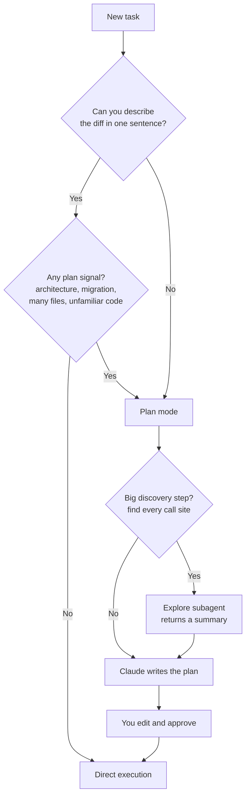
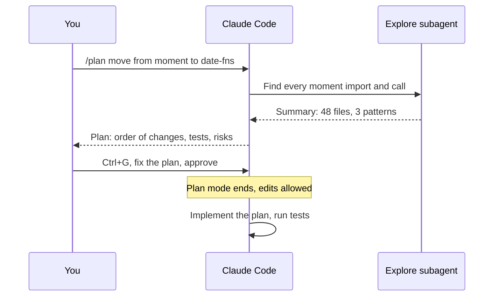

Plan mode is a Claude Code permission mode in which Claude reads files, explores and writes a plan, but can't edit your code until you approve that plan. Direct execution means you let Claude make the change right away. Use plan mode when the task is big, unclear or has more than one good design. For a small fix with a clear scope, skip the plan.

This is task statement 3.4 of the [Claude Certified Architect – Foundations exam guide](https://anthropic-partners.skilljar.com/claude-certified-architect-foundations-certification): "Determine when to use plan mode vs direct execution". It sits in Domain 3, Claude Code Configuration & Workflows, which is 20% of the exam. In this post you build a small TypeScript checklist that sorts task descriptions into "plan" or "direct", and you write and validate the settings that control plan mode. Everything runs offline, and nothing starts Claude.

## What does task statement 3.4 test?

The guide lists four things to know and four skills. In plain words:

| The guide asks you to… | In practice |
| --- | --- |
| Know plan mode is for large changes, several valid approaches, architecture and many files | Look for those signals in the task before you start |
| Know direct execution fits simple, well-scoped changes | One added check in one function: just do it |
| Know plan mode lets you explore and design safely, before any change | No edits until you approve, so a late surprise costs a plan, not a rewrite |
| Know the Explore subagent keeps verbose discovery out of the main context | Long searches return a summary, not every file read |
| Pick plan mode for architectural tasks | Splitting services, a migration touching dozens of files, choosing between integrations |
| Pick direct execution for clear tasks | A single-file bug with a clear stack trace, a date check |
| Use Explore for long discovery phases | So the session doesn't run out of context before the work starts |
| Plan first, then execute | Approve the plan, then implement it |

The task decomposition post in the agentic architecture series (task statement 1.6) already used plan mode to get an adaptive plan for an open-ended task. This post is about the decision itself: which mode for which task, and how to switch between them.

## How do I turn plan mode on and off?

There are four ways in, from the [permission modes docs](https://code.claude.com/docs/en/permission-modes#analyze-before-you-edit-with-plan-mode):

| Way | When to use it |
| --- | --- |
| Press `Shift+Tab` during a session | It cycles the modes; stop when the status bar shows `⏸ plan mode on` |
| Start a prompt with `/plan`, for example `/plan fix the auth bug` | Plan this one task, then carry on |
| `claude --permission-mode plan` | Start a whole session in plan mode |
| `"permissions": { "defaultMode": "plan" }` in a settings file | Start every terminal session in that project (or on your machine) in plan mode |

To leave without approving a plan, press `Shift+Tab` again. A permission mode is the baseline for what Claude may do without asking; the other modes are `default` (shown as Manual), `acceptEdits`, `auto`, `dontAsk` and `bypassPermissions`.

## What does plan mode allow and block?

The docs sum it up: Claude "reads files, runs shell commands to explore, and writes a plan, but does not edit your source."

- **Reads are allowed.** Claude can open and search any file it needs.
- **Shell commands depend on the session.** When auto mode is available and the `useAutoModeDuringPlan` setting is on (the default), a background classifier reviews each command instead of asking you. Otherwise, any command outside the built-in read-only set asks for approval.
- **Edits are blocked until you approve the plan.** Claude presents the plan and asks how to go on. You can approve and continue in auto mode (or "auto-accept edits" when auto mode isn't available), approve and review each edit by hand, or say "No, keep planning" and tell Claude what to change.
- **You can edit the plan yourself.** Press `Ctrl+G` to open it in your text editor before Claude proceeds. Plan files go to `~/.claude/plans` unless you set `plansDirectory`.

Approving a plan ends plan mode. The session switches to the mode you picked, and Claude starts editing. That switch is the "plan, then execute" step the exam asks about.

## When should I plan first?

The [best practices page](https://code.claude.com/docs/en/best-practices) says planning helps most "when you're uncertain about the approach, when the change modifies multiple files, or when you're unfamiliar with the code being modified". The exam guide adds architecture and several valid approaches. Together, that gives five signals:

- **An architectural choice.** Service boundaries, splitting a monolith, a new module structure. The wrong guess shapes every file that follows.
- **A migration across many files.** Replacing a library used in 45 files means finding every call site first. A hidden one found late means rework.
- **Several valid approaches.** Two designs with different infrastructure, such as a managed queue or a self-hosted worker. You want the comparison before any code exists.
- **Unclear requirements.** "Make the dashboard faster" has no diff yet. A plan turns it into one.
- **Unfamiliar code.** If you don't know the module, you can't check Claude's first edit. A plan shows you what it found.

## When should I just make the change?

When the scope is clear and the change is small. The docs' examples are "fixing a typo, adding a log line, or renaming a variable", and their test is short: "If you could describe the diff in one sentence, skip the plan." The guide's examples fit the same test: a single-file bug with a clear stack trace, or one added date check.

On those tasks plan mode doesn't lower any risk. It only adds a round of reading and approving. The docs say it plainly: plan mode "is useful, but also adds overhead."



## How does the Explore subagent save context?

A subagent is a helper Claude starts with its own, separate context window. The [subagents docs](https://code.claude.com/docs/en/sub-agents#built-in-subagents) describe the built-in **Explore** subagent as "a fast, read-only agent optimized for searching and analyzing codebases". Write and Edit are denied to it. Claude delegates to it "when it needs to search or understand a codebase without making changes", and the result is that the exploration "stays out of your main conversation context".

Why that matters: every file Claude reads goes into the context window, the text the model can see at once. A search across 600 files can fill it before the real work starts. With Explore, the subagent reads those files in its own window and sends back only a summary.

Details worth knowing:

- **Claude picks a thoroughness level** when it calls Explore: quick, medium or very thorough.
- **Explore skips your CLAUDE.md files** and the git status snapshot, to keep research fast and cheap. Put what it needs in the request.
- **It's one-shot.** Explore returns no agent ID, so Claude can't resume it. Use the general-purpose subagent or a custom one for work you want to continue.
- **Plan mode has its own helper.** In plan mode, Claude hands codebase research to the built-in **Plan** subagent, also read-only, so the exploration output stays in a separate context.

You can ask for it in plain words, as the docs suggest for any subagent: name it in your prompt.

```text
Use the Explore subagent to find every place we call the old logger:
imports, config files and test helpers. Report file paths grouped by
kind, with a one-line note each. Don't paste file contents.
```

The last line matters. The docs warn that subagents "that each return detailed results can consume significant context", so ask for a short report.

## How do I combine planning and execution?

The best practices page calls it "Explore first, then plan, then code". For a library migration it looks like this:



Planning can use a lot of context. The `showClearContextOnPlanAccept` setting adds a first option to the approval menu that approves the plan, clears the conversation and implements from the plan alone. That's a clean handover from the "think" phase to the "do" phase.

## Try it: a plan-or-direct checklist and plan-mode settings

You'll build `plan-or-direct`, a small project with two scripts. The first turns the signals above into a classifier: give it a task description and it says "plan" or "direct", whether to use Explore, and why. The second validates the settings files that control plan mode against the published JSON schema and the documented rules.

The classifier is a checklist for you, written as code so you can test it. It is not how Claude Code decides anything, and keyword rules miss things. Treat its answer as a second opinion.

**You need:** Node.js 22.18 or later, which [runs `.ts` files directly](https://nodejs.org/docs/latest-v22.x/api/typescript.html), and curl.


<Steps>


<Step title="Create the project">

```bash
$ mkdir -p plan-or-direct/.claude plan-or-direct/scripts plan-or-direct/schemas
$ cd plan-or-direct
$ git init
```


**package.json**

```json
{
  "name": "plan-or-direct",
  "private": true,
  "type": "module",
  "scripts": {
    "test": "node --test scripts/plan-or-direct.test.ts"
  },
  "devDependencies": {
    "@types/node": "^26.6.4",
    "ajv": "^8.20.0",
    "typescript": "^7.0.2"
  }
}
```


**.gitignore**

```text
node_modules/
.claude/settings.local.json
```


Install the schema validator [Ajv](https://github.com/ajv-validator/ajv) and the type checker:


```bash
npm install -D ajv typescript @types/node
```


</Step>


<Step title="Write the classifier">

Each signal is a reason plus a test. Any plan signal wins. Without one, a direct signal means "just do it". With neither, the scope isn't clear, so it plans.


**scripts/plan-or-direct.ts**

```ts
// A decision checklist for Claude Code: plan first, or make the change directly?
// It reads a task description and returns a mode plus the reasons behind it.
// It is a heuristic for you, not how Claude Code decides anything.

export type Mode = 'plan' | 'direct';

export interface Task {
  description: string;
  filesTouched?: number; // your estimate, if you have one
}

export interface Decision {
  mode: Mode;
  explore: boolean; // hand the discovery step to the Explore subagent
  reasons: string[];
}

interface Signal {
  reason: string;
  test: (task: Task) => boolean;
}

const has = (pattern: RegExp) => (task: Task) => pattern.test(task.description);

// Any one of these means: plan first.
const planSignals: Signal[] = [
  {
    reason: 'architectural choice (services, boundaries, structure)',
    test: has(/\b(architecture|restructur\w*|microservices?|monolith|service boundar\w*|split \w+ (out|into))\b/i),
  },
  {
    reason: 'library or framework migration',
    test: has(/\b(migrat\w*|upgrade \w+ to|replace (the )?[\w-]+ (library|client|framework|sdk))\b/i),
  },
  {
    reason: 'several valid approaches to compare',
    test: has(/\b(compare|choose between|which approach|trade-?offs?|options? for)\b/i),
  },
  {
    reason: 'requirements are unclear',
    test: has(/\b(not sure|unclear|figure out|somehow|make (the )?\w+ (faster|better|cleaner))\b/i),
  },
  {
    reason: 'unfamiliar code',
    test: has(/\b(legacy|unfamiliar|never (touched|worked on)|new to)\b/i),
  },
  {
    reason: 'changes many files',
    test: (task) =>
      (task.filesTouched ?? 0) >= 3 ||
      /\b(across|every|all) (the )?(\w+ )?(files?|services?|modules?|packages?|call sites?|endpoints?)\b/i.test(task.description),
  },
];

// These mean the scope is clear enough to just do it.
const directSignals: Signal[] = [
  { reason: 'exact location given (file:line)', test: has(/[\w./-]+\.\w+:\d+/) },
  {
    reason: 'small, well-known kind of change',
    test: has(/\b(typo|rename|log line|add (a|one) (check|guard|conditional|test|log))\b/i),
  },
  {
    reason: 'one file named',
    test: (task) =>
      (task.filesTouched ?? 1) <= 1 &&
      (task.description.match(/[\w/-]+\.(ts|tsx|js|mjs|json|css|md|py)\b/g) ?? []).length === 1,
  },
];

// Discovery that reads many files: keep it out of the main context.
const exploreSignal: Signal = {
  reason: 'large discovery step (find or map many places)',
  test: (task) =>
    (task.filesTouched ?? 0) >= 20 ||
    /\b((find|list|map) (every|all)|call sites|where do we)\b/i.test(task.description),
};

export function decide(task: Task): Decision {
  const plan = planSignals.filter((s) => s.test(task)).map((s) => s.reason);
  const direct = directSignals.filter((s) => s.test(task)).map((s) => s.reason);
  const explore = exploreSignal.test(task);
  const exploreReason = explore ? [`Explore subagent: ${exploreSignal.reason}`] : [];

  if (plan.length > 0) return { mode: 'plan', explore, reasons: [...plan, ...exploreReason] };
  if (direct.length > 0) return { mode: 'direct', explore, reasons: [...direct, ...exploreReason] };
  // No signal either way: if you can't name the diff yet, you need a plan.
  return { mode: 'plan', explore, reasons: ['scope not clear from the description', ...exploreReason] };
}
```


</Step>


<Step title="Add sample tasks and a small CLI">

The sample tasks mirror the guide's examples. `filesTouched` is your own estimate, when you have one.


**tasks.json**

```json
[
  { "description": "Fix TypeError: Cannot read properties of undefined (reading 'zip') at src/format/address.ts:42", "filesTouched": 1 },
  { "description": "Rename usr to user in src/session.ts", "filesTouched": 1 },
  { "description": "Add a check that endDate is after startDate in src/booking/validate.ts" },
  { "description": "Migrate from moment to date-fns", "filesTouched": 48 },
  { "description": "Add notifications: compare a managed queue with a self-hosted worker" },
  { "description": "Split billing out of the monolith into its own service" },
  { "description": "Make the dashboard faster" },
  { "description": "Find every call site of the old logger before we remove it" }
]
```


**scripts/decide.ts**

```ts
// Usage: node scripts/decide.ts                  (classifies tasks.json)
//        node scripts/decide.ts "task description" [filesTouched]
import { readFileSync } from 'node:fs';
import { decide, type Task } from './plan-or-direct.ts';

const [description, files] = process.argv.slice(2);
const tasks: Task[] = description
  ? [{ description, filesTouched: files ? Number(files) : undefined }]
  : JSON.parse(readFileSync('tasks.json', 'utf8'));

for (const task of tasks) {
  const { mode, explore, reasons } = decide(task);
  const label = mode === 'plan' ? 'PLAN  ' : 'DIRECT';
  console.log(`${label} ${explore ? '+ Explore ' : ''}${task.description}`);
  for (const reason of reasons) console.log(`       - ${reason}`);
}
```


</Step>


<Step title="Test it offline">


**scripts/plan-or-direct.test.ts**

```ts
import assert from 'node:assert/strict';
import { readFileSync } from 'node:fs';
import { test } from 'node:test';
import { decide, type Task } from './plan-or-direct.ts';

const tasks: Task[] = JSON.parse(readFileSync('tasks.json', 'utf8'));
const byStart = (start: string) => tasks.find((t) => t.description.startsWith(start))!;

test('a bug with a stack trace and a known line is direct', () => {
  const d = decide(byStart('Fix TypeError'));
  assert.equal(d.mode, 'direct');
  assert.ok(d.reasons.includes('exact location given (file:line)'));
});

test('a rename or one added check in one file is direct', () => {
  assert.equal(decide(byStart('Rename')).mode, 'direct');
  assert.equal(decide(byStart('Add a check')).mode, 'direct');
});

test('a library migration across many files is planned, with Explore for discovery', () => {
  const d = decide(byStart('Migrate'));
  assert.equal(d.mode, 'plan');
  assert.equal(d.explore, true);
  assert.ok(d.reasons.includes('library or framework migration'));
  assert.ok(d.reasons.includes('changes many files'));
});

test('two designs with different infrastructure are planned', () => {
  assert.ok(decide(byStart('Add notifications')).reasons.includes('several valid approaches to compare'));
});

test('splitting a monolith is an architectural choice', () => {
  const d = decide(byStart('Split billing'));
  assert.equal(d.mode, 'plan');
  assert.ok(d.reasons[0].startsWith('architectural'));
});

test('a vague goal is planned, not guessed', () => {
  assert.deepEqual(decide(byStart('Make the dashboard')).reasons, ['requirements are unclear']);
  assert.deepEqual(decide({ description: 'Tidy things up' }).reasons, ['scope not clear from the description']);
});

test('finding every call site goes to the Explore subagent', () => {
  const d = decide(byStart('Find every call site'));
  assert.equal(d.mode, 'plan');
  assert.equal(d.explore, true);
});

test('a plan signal beats a direct signal', () => {
  const d = decide({ description: 'Fix the crash at src/legacy/billing.ts:310 in the legacy billing code' });
  assert.equal(d.mode, 'plan');
  assert.ok(d.reasons.includes('unfamiliar code'));
});

test('a file count estimate alone can tip a task to plan', () => {
  assert.equal(decide({ description: 'Rename usr to user', filesTouched: 1 }).mode, 'direct');
  assert.equal(decide({ description: 'Rename usr to user', filesTouched: 30 }).mode, 'plan');
});
```


**tsconfig.json**

```json
{
  "compilerOptions": {
    "target": "es2023",
    "module": "nodenext",
    "strict": true,
    "noEmit": true,
    "allowImportingTsExtensions": true,
    "erasableSyntaxOnly": true,
    "verbatimModuleSyntax": true,
    "types": ["node"]
  },
  "include": ["scripts"]
}
```


```bash
$ node --test scripts/plan-or-direct.test.ts
$ npx tsc -p .
```

```text
✔ a bug with a stack trace and a known line is direct (4.01021ms)
✔ a rename or one added check in one file is direct (1.539973ms)
✔ a library migration across many files is planned, with Explore for discovery (0.400599ms)
✔ two designs with different infrastructure are planned (0.283277ms)
✔ splitting a monolith is an architectural choice (0.469071ms)
✔ a vague goal is planned, not guessed (1.957674ms)
✔ finding every call site goes to the Explore subagent (0.587377ms)
✔ a plan signal beats a direct signal (0.346407ms)
✔ a file count estimate alone can tip a task to plan (1.088704ms)
ℹ tests 9
ℹ suites 0
ℹ pass 9
ℹ fail 0
ℹ cancelled 0
ℹ skipped 0
ℹ todo 0
ℹ duration_ms 342.050409
```

`tsc` prints nothing when the types check.

</Step>


<Step title="Classify the sample tasks">

```bash
$ node scripts/decide.ts
```

```text
DIRECT Fix TypeError: Cannot read properties of undefined (reading 'zip') at src/format/address.ts:42
       - exact location given (file:line)
       - one file named
DIRECT Rename usr to user in src/session.ts
       - small, well-known kind of change
       - one file named
DIRECT Add a check that endDate is after startDate in src/booking/validate.ts
       - small, well-known kind of change
       - one file named
PLAN   + Explore Migrate from moment to date-fns
       - library or framework migration
       - changes many files
       - Explore subagent: large discovery step (find or map many places)
PLAN   Add notifications: compare a managed queue with a self-hosted worker
       - several valid approaches to compare
PLAN   Split billing out of the monolith into its own service
       - architectural choice (services, boundaries, structure)
PLAN   Make the dashboard faster
       - requirements are unclear
PLAN   + Explore Find every call site of the old logger before we remove it
       - changes many files
       - Explore subagent: large discovery step (find or map many places)
```

This is our run on Node 22.22.2. Three tasks are clear enough to do directly. The migration and the call-site search also get the Explore subagent, because their first step reads many files. You can try your own task too: `node scripts/decide.ts "Upgrade react to 19 across all packages"`.

</Step>


<Step title="Write the plan-mode settings">

Two files, two audiences. The shared `.claude/settings.json` is committed for the whole team. It says where plan files go, inside the repo where you can review them, and adds the "approve and clear context" option:


**.claude/settings.json**

```json
{
  "$schema": "https://json.schemastore.org/claude-code-settings.json",
  "plansDirectory": "./plans",
  "showClearContextOnPlanAccept": true
}
```


The personal `.claude/settings.local.json` starts your own terminal sessions in plan mode while you work on, say, an unfamiliar part of the code. Local settings beat shared project settings, and `.gitignore` keeps this file out of commits:


**.claude/settings.local.json**

```json
{
  "$schema": "https://json.schemastore.org/claude-code-settings.json",
  "permissions": {
    "defaultMode": "plan"
  }
}
```


A few rules from the [settings reference](https://code.claude.com/docs/en/settings-reference#permissions-defaultmode) shape this split:

- `defaultMode` values `auto` and `bypassPermissions` don't take effect from project or local settings. `plan` does.
- `useAutoModeDuringPlan: false` is honoured in user, local and managed settings, but ignored in `.claude/settings.json`. A repository can't turn it off for you.
- `plansDirectory` is a path relative to the project root. If it points outside the project, Claude Code keeps the default.
- Conversations the VS Code extension starts don't read project settings for the starting mode. There, set the starting mode in the extension's own VS Code settings.

</Step>


<Step title="Validate the settings without starting Claude">

Download the published schema once:

```bash
$ curl -sSL -o schemas/claude-code-settings.json https://json.schemastore.org/claude-code-settings.json
```

The checker parses each file as strict JSON (settings files allow no comments and no trailing commas), validates it against the schema, and then checks the rules above. It adds one team rule of our own: no `"plan"` default in the shared file, because that would make everyone plan every task.


**scripts/check-settings.ts**

```ts
// Validates Claude Code settings files without starting Claude:
// strict JSON, the published JSON schema, the documented limits on where
// plan-mode keys take effect, and one team rule (no plan default for everyone).
// Usage: node scripts/check-settings.ts [files…]
import { existsSync, readFileSync } from 'node:fs';
import { isAbsolute, relative, resolve } from 'node:path';
import { Ajv } from 'ajv';

const files = process.argv.slice(2);
if (files.length === 0) files.push('.claude/settings.json', '.claude/settings.local.json');

const schema = JSON.parse(readFileSync('schemas/claude-code-settings.json', 'utf8'));
const validate = new Ajv({ strict: false, allErrors: true, validateFormats: false }).compile(schema);
let problems = 0;
const report = (file: string, message: string) => {
  problems++;
  console.log(`  ${file}: ${message}`);
};

for (const file of files) {
  if (!existsSync(file)) continue; // the local file is optional
  let settings: Record<string, any>;
  try {
    settings = JSON.parse(readFileSync(file, 'utf8')); // no comments, no trailing commas
  } catch (error) {
    report(file, `not valid JSON: ${(error as Error).message}`);
    continue;
  }
  if (!validate(settings)) {
    for (const e of validate.errors ?? []) report(file, `schema: ${e.instancePath || '/'} ${e.message}`);
  }

  const shared = file.endsWith('.claude/settings.json'); // committed for the team
  const projectLevel = shared || file.endsWith('.claude/settings.local.json');
  const mode = settings.permissions?.defaultMode;
  if (projectLevel && (mode === 'auto' || mode === 'bypassPermissions')) {
    report(file, `defaultMode "${mode}" has no effect in project or local settings; use ~/.claude/settings.json`);
  }
  if (shared && mode === 'plan') {
    report(file, 'defaultMode "plan" here makes the whole team plan every task; put it in settings.local.json');
  }
  if (shared && settings.useAutoModeDuringPlan === false) {
    report(file, 'useAutoModeDuringPlan: false is ignored in .claude/settings.json');
  }
  const dir = settings.plansDirectory;
  if (typeof dir === 'string') {
    const inside = relative(process.cwd(), resolve(dir));
    if (isAbsolute(dir) || inside.startsWith('..')) {
      report(file, `plansDirectory "${dir}" is outside the project, so Claude Code keeps the default`);
    }
  }
  console.log(`checked ${file}${mode ? ` (defaultMode: ${mode})` : ''}`);
}

console.log(problems ? `${problems} problem(s) found.` : 'OK');
process.exitCode = problems ? 1 : 0;
```


```bash
$ node scripts/check-settings.ts
```

```text
checked .claude/settings.json
checked .claude/settings.local.json (defaultMode: plan)
OK
```

Now break the shared file the way people do. Add `"permissions": { "defaultMode": "Plan" }` to `.claude/settings.json` and run it again:

```text
  .claude/settings.json: schema: /permissions/defaultMode must be equal to one of the allowed values
checked .claude/settings.json (defaultMode: Plan)
checked .claude/settings.local.json (defaultMode: plan)
1 problem(s) found.
```

The schema spells every mode name in lowercase or camelCase, so `Plan` fails. Fix it to `"plan"`, and the team rule fires instead:

```text
  .claude/settings.json: defaultMode "plan" here makes the whole team plan every task; put it in settings.local.json
checked .claude/settings.json (defaultMode: plan)
checked .claude/settings.local.json (defaultMode: plan)
1 problem(s) found.
```

Remove the `permissions` block from the shared file and you're back to `OK`. The script exits with code 1 on any problem, so it can run in CI. The docs note the schema can lag behind the newest CLI releases, so a schema warning on a just-documented key doesn't always mean the file is wrong.

</Step>


<Step title="Try the three tasks in Claude Code">

This step follows the guide's exercise. Start Claude Code in a real repository (not in this post's checks, which never start Claude) and pick three tasks:

1. **A one-file bug with a stack trace.** Do it directly. Ask whether a plan would have added anything.
2. **A library upgrade across many files.** Start with `/plan`. Read the plan, press `Ctrl+G` to correct it, approve, and let Claude implement it.
3. **A feature with two designs.** In plan mode, ask Claude to compare both designs and their infrastructure before it picks one.

Then repeat one discovery step, "find every place we call the old API", once in the main session and once through the Explore subagent. Run `/context` after each. You should see much less of the window used after the Explore run, because only its summary came back. That is our expectation from the docs, not output we recorded.

</Step>


</Steps>


## Common traps

These are the mistakes wrong answer options are built on.

| Trap | Why it breaks | Fix |
| --- | --- | --- |
| Plan mode for every task "to be safe" | A one-line fix gets a planning round that lowers no risk | Use the one-sentence test; do small fixes directly |
| Direct execution on an architectural change | The structure is decided by whatever Claude edits first; late surprises mean rework | Plan first, compare approaches, then implement |
| Staying in plan mode after the plan is approved | You keep planning work whose design is settled | Approve the plan; the session leaves plan mode to implement |
| Long discovery in the main session | File reads fill the context before the change starts | Hand discovery to the Explore subagent and ask for a short summary |
| Asking Explore to make the edits | Explore is read-only; Write and Edit are denied | Use Explore to find, then implement in the main session |
| `defaultMode: "plan"` in the shared settings | Every teammate plans every task | Put it in your own `.claude/settings.local.json` |


<Callout type="warning" title="Plan mode is only a hard stop when it's enforced">

In interactive terminal sessions started with bypass permissions available (for example with `--allow-dangerously-skip-permissions`), Claude Code doesn't enforce plan mode's blocks. Claude is still told to plan without editing, but an edit it attempts during planning runs without a prompt. If you need edits truly blocked, don't start the session with bypass permissions. Plan mode keeps its blocks in `-p` runs, the Agent SDK and the VS Code chat panel.

</Callout>


## Practice questions

These four questions are this blog's own, written for practice. They are not from the exam.

**Question 1.** A product spec asks you to reject bookings whose check-out date is before the check-in date. The check belongs in `validateBooking()` in `src/booking/validate.ts`, and the spec gives the exact error message. A teammate says the team should use plan mode for every change "to be safe". How should you ask Claude Code to do this one?

- A. Enter plan mode and ask for a design of date handling across the booking module.
- B. Use direct execution: add the check and its error message to `validateBooking()`, plus a test.
- C. Ask the Explore subagent to map every file that uses dates first.
- D. Set `defaultMode` to `"plan"` in the shared `.claude/settings.json`, then ask for the change.

**Question 2.** Your product needs email and push notifications. One option uses a managed queue service; the other runs a self-hosted worker with its own database. The two need very different infrastructure, and the choice affects several services. How should you start?

- A. Use direct execution and tell Claude to "pick whichever is simpler".
- B. Use plan mode to explore the current services and compare both approaches, including their infrastructure needs, before changing any code.
- C. Use direct execution to build both options and delete the worse one later.
- D. Ask Claude to write the notification code first and decide on infrastructure during code review.

**Question 3.** You are replacing a deprecated logging library. The first step is to find every call site, config file and test helper that uses it, across about 600 files. In earlier attempts, the main session ran out of context before the migration even started. What should you change?

- A. Paste the full output of a recursive grep into the prompt.
- B. Run the discovery phase through the Explore subagent, so only a summary of its findings comes back to the main conversation.
- C. Skip discovery and let Claude find call sites as it edits.
- D. Split the repository into smaller repositories before migrating.

**Question 4.** You used plan mode to design the move from one HTTP client library to another across 70 files, and the team approved the plan. What is the best next step?

- A. Stay in plan mode and ask for a new plan for each file.
- B. Approve the plan so the session leaves plan mode, then implement it, running the tests as you go.
- C. Throw the plan away and start again in direct execution with no plan.
- D. Ask the Explore subagent to make the edits.

## Answer key

### Question 1

**Answer: B.** The change is in one known function, the behaviour and message are specified, and you could describe the diff in one sentence. That is what direct execution is for. The strongest distractor is A: it isn't harmful, but a planning round on a clear one-function change adds time and lowers no risk. C spends context on discovery nobody needs, and D makes the whole team plan every task.

### Question 2

**Answer: B.** Two valid approaches with different infrastructure is an architectural decision, and plan mode lets you compare them before any code exists. The strongest distractor is A: it can produce working code quickly, but it hides a decision the team should make up front. C and D build first and decide later, which is the rework plan mode prevents.

### Question 3

**Answer: B.** The Explore subagent reads the 600 files in its own context window and returns a summary, so the main session keeps room to plan and implement. The strongest distractor is A: it gathers the same facts, but it puts all the raw output straight into the context you are trying to protect. C finds call sites too late, and D is a large change that doesn't address the context problem.

### Question 4

**Answer: B.** Plan mode is for investigation and design. Approving the plan switches the session to the permission mode you pick, and Claude implements the agreed plan. The strongest distractor is A: it adds planning overhead to work whose design is already settled. D can't work, because Explore is read-only.

## What should I do next?

- **Run the classifier on your own backlog.** Paste five real tickets into `tasks.json` and see where you disagree with it. Each disagreement is a signal worth adding, or a sign the ticket needs a clearer scope.
- **Try `/plan` on your next multi-file change,** and press `Ctrl+G` to edit the plan before you approve it.
- **Move on to task statement 3.5**, "Apply iterative refinement techniques for progressive improvement". The next post in this series covers examples, tests and the interview pattern.
- **Plan and check your prep.** Domain 3 is part of week 4 in the [six-week study plan](/blog/claude-architect-exam-study-plan). Test yourself with the [mock exam](/blog/claude-certification-mock-exam) when you've worked through the domain. For more day-to-day habits with coding assistants, see [Getting the most out of AI coding assistants](/blog/ai-coding-assistants-tips).
