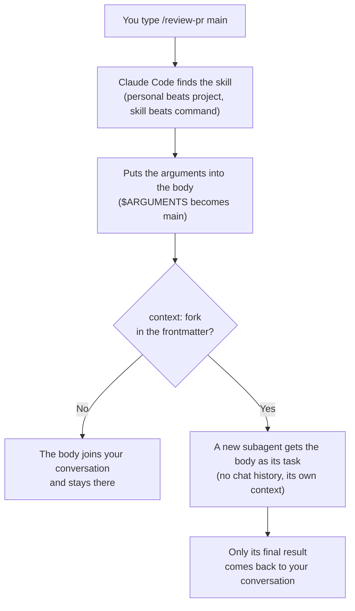

A skill is a folder with a `SKILL.md` file: a short YAML header, then instructions. Save it in `.claude/skills/review-pr/` and everyone who clones the repository can type `/review-pr`. The header decides how it runs: in your conversation or in a separate subagent, with which tools pre-approved, and what hint the `/` menu shows. Custom slash commands were the older way to do this, and they now work the same way as skills.

This is task statement 3.2 of the [Claude Certified Architect – Foundations exam guide](https://anthropic-partners.skilljar.com/claude-certified-architect-foundations-certification): "Create and configure custom slash commands and skills". It sits in Domain 3, Claude Code Configuration & Workflows, which is 20% of the exam. In this post you build a team `/review-pr` skill and check it with two validators that never start a model.

## What does task statement 3.2 test?

The guide lists four things to know and five skills. In plain words:

| The guide asks you to… | In practice |
| --- | --- |
| Know project commands vs user commands | `.claude/commands/` is committed for the team; `~/.claude/commands/` is yours |
| Know SKILL.md frontmatter: `context: fork`, `allowed-tools`, `argument-hint` | The YAML header at the top of `SKILL.md` |
| Know what `context: fork` is for | Long or exploratory output stays out of the main conversation |
| Know personal variants | Copy a team skill to `~/.claude/skills/` under a new name |
| Create a team command | Commit it so every developer gets it after a pull |
| Choose when to fork | Codebase analysis and brainstorming: fork. Short edits: inline |
| Configure `allowed-tools` | Know what the field does today (see below) |
| Use `argument-hint` | Show which argument the skill expects |
| Choose skill vs CLAUDE.md | On-demand workflow vs always-loaded standard |

The previous post in this series, [CLAUDE.md hierarchy: user, project, directory and @imports](/blog/claude-md-hierarchy), covered where `CLAUDE.md` files live and when they load. This one covers the other half of a team setup: workflows you start on purpose.

## Are slash commands and skills the same thing now?

Yes. The [skills docs](https://code.claude.com/docs/en/skills) say "Custom commands have been merged into skills." A file at `.claude/commands/deploy.md` and a skill at `.claude/skills/deploy/SKILL.md` both create `/deploy` and work the same way. Old command files keep working and accept the same frontmatter, except the `name` and `paths` fields.

A skill folder adds two things a command file can't have: supporting files next to `SKILL.md` (a checklist, a script, examples) and the `name` field. If a skill and a command share a name, the skill runs.

The exam guide still uses both words: "custom slash commands" in `.claude/commands/` and "skills" in `.claude/skills/`. Learn both names. For new work, write a skill.

## Where do skills live, and who gets them?

Where you save the folder decides who has the command. These are the locations you'll use most (the docs also list enterprise, plugin and claude.ai sources):

| Scope | Path | Who gets it |
| --- | --- | --- |
| Personal | `~/.claude/skills/<name>/SKILL.md` | Only you, in all your projects on this machine |
| Project | `.claude/skills/<name>/SKILL.md` | Everyone who clones the repository |
| Nested | `packages/api/.claude/skills/<name>/SKILL.md` | Sessions that work in that folder |
| Command (older format) | `.claude/commands/<name>.md` or `~/.claude/commands/<name>.md` | Same split: project for the team, home folder for you |

Three rules from the docs explain most surprises:

- **The same name in two places:** "Enterprise over personal, and personal over project." If you copy the team's `review-pr` into `~/.claude/skills/review-pr/` and change it, your copy silently replaces the team's version for you. Teammates aren't affected, but you stop seeing the team's updates. Give your copy another name, such as `review-pr-brief`, and you keep both.
- **Subfolders in `commands/` become prefixes:** the file `frontend/component.md` inside `.claude/commands/` is `/frontend:component`.
- **Edits apply right away:** Claude Code watches `~/.claude/skills/` and the project's `.claude/skills/`, and picks up a new or changed skill in the current session. If the skills folder didn't exist when the session started, run `/reload-skills`.

## How does Claude Code run a skill?

A skill loads in two parts. By default, the `description` from the frontmatter is always in context, so Claude knows the skill exists and can pick it when your request matches. The body loads only when you type `/name` or Claude decides to use it. After that, the body stays in the conversation for the rest of the session.

`context: fork` changes where the body goes:



## Which frontmatter fields matter for the exam?

All fields are optional, and Claude Code ignores a field name it doesn't recognize without an error, so a typo such as `allowed_tools` silently does nothing. These five carry most of the exam:

| Field | What it does in current Claude Code |
| --- | --- |
| `description` | Tells Claude what the skill does and when to use it. Put the key use case first: the listing cuts `description` plus `when_to_use` at 1,536 characters |
| `argument-hint` | The hint shown in autocomplete, such as `[base-branch]` |
| `context: fork` | Runs the skill in a new subagent. `agent` picks the subagent type; the default is `general-purpose` |
| `allowed-tools` | Tools Claude may use **without asking** during the turn that invokes the skill |
| `disable-model-invocation: true` | Only you can start the skill with `/name`; Claude never starts it on its own. Use it for anything with side effects, like `/deploy` |

### What does context: fork do?

The subagent gets the skill body as its task and starts with an empty conversation. It reads files and runs commands in its own context, and only its result comes back to you. That is why the guide recommends it for "verbose output (e.g., codebase analysis) or exploratory context (e.g., brainstorming alternatives)".

Three details from the docs:

- **The skill must be a task.** The subagent can't see your conversation, so the body has to stand on its own. A fork of "use these API conventions" returns nothing useful.
- **It runs in the background.** You keep working and the result arrives when it finishes. Set `background: false` to wait for it instead.
- **The agent decides the context.** Built-in `Explore` and `Plan` skip your `CLAUDE.md` files to stay small; `general-purpose` and custom subagents load them.

### What does allowed-tools actually do?

This is where the exam guide and today's docs differ. The guide describes `allowed-tools` as a way "to restrict tool access during skill execution". The current docs say the field "does not restrict which tools are available: every tool remains callable". It pre-approves the listed tools, so they run without a permission prompt during the turn that invoked the skill. The grant clears when you send your next message.

When you need a real restriction, use one of these:

| You want to… | Use |
| --- | --- |
| Skip the permission prompt for a few safe commands | `allowed-tools: Bash(git log *) Bash(git diff *)` |
| Remove tools while the skill is active | `disallowed-tools: Bash` |
| Give a forked skill a fixed tool set | `agent:` a subagent whose `tools:` list is the allowlist |
| Block a tool everywhere, for every skill | A deny rule in your permission settings |

For the exam, expect options worded the guide's way. In a real repository, set it up the way the docs describe.

### How do arguments work?

Whatever you type after the command name replaces `$ARGUMENTS` in the body. `/review-pr main` turns `Base branch: $ARGUMENTS` into `Base branch: main`. `$0`, `$1` and so on pick single arguments by position. If the body has no placeholder, Claude Code adds `ARGUMENTS: <what you typed>` at the end.

`argument-hint` only shows the hint in autocomplete. The guide says it prompts developers "for required parameters when they invoke the skill without arguments". The docs describe it as a "hint shown during autocomplete", and nothing stops you from running the skill with no argument. So write the body to handle the empty case: "If no base branch is given, reply with a usage line and stop."

## Should this be a skill, CLAUDE.md or a subagent?

Ask when the instruction is needed and how much output the work makes:

| Use | When | Example |
| --- | --- | --- |
| `CLAUDE.md` | Every task needs it. Loads in every session | "Run `npm test` before you say a task is done" |
| Skill (inline) | A procedure or reference you need sometimes. Loads on demand | `/pre-pr` checklist, API style guide |
| Skill with `context: fork` | A procedure that reads a lot and should return only a summary | `/review-pr`, a dependency audit |
| Subagent | A worker with its own prompt and tool set that Claude can delegate to, or that skills reuse | `pr-reviewer`, which has no Edit or Write tool |

The [features overview](https://code.claude.com/docs/en/features-overview) gives a simple trigger: when you paste the same playbook into chat for the third time, make it a skill. When Claude gets a convention wrong twice, add it to `CLAUDE.md`. Both are instructions, not enforcement. If something must happen every time, use a hook.

## Try it: build a /review-pr skill and check it without a model

You'll add a team command, a project skill that forks into a reviewer that can't edit files, and a personal variant. Then you'll check them with a small script and with `claude plugin validate`. Neither starts a Claude session or calls a model.

**You need:** Node.js 22.18 or later (it [runs `.ts` files directly](https://nodejs.org/docs/latest-v22.x/api/typescript.html)), git, and Claude Code v2.1.233 or later for `claude plugin validate` on a skills folder. We used v2.1.287.


<Steps>


<Step title="Create the repository and the team's CLAUDE.md">

```bash
$ mkdir -p acme-shop/.claude/commands acme-shop/.claude/skills/review-pr acme-shop/.claude/agents acme-shop/scripts
$ cd acme-shop
$ git init
```

Add a `package.json` and a `.gitignore`. `"type": "module"` lets Node run the check script as an ES module:


**package.json**

```json
{
  "name": "acme-shop",
  "private": true,
  "type": "module",
  "scripts": {
    "test": "node --test",
    "check:skills": "node scripts/check-skills.ts"
  }
}
```


**.gitignore**

```text
node_modules/
```


The always-on rules go in `CLAUDE.md`. They apply to every task, so they don't belong in a skill:


**CLAUDE.md**

```md
# acme-shop

- Use npm. Run `npm test` before you say a task is done.
- Every exported function has a JSDoc comment.
- Never log request bodies: they can contain customer data.
```


</Step>


<Step title="Add a team command">

This is the older format the exam guide calls a "custom slash command". It is one Markdown file, and the file name becomes `/pre-pr`:


**.claude/commands/pre-pr.md**

```md
---
description: Run the team's checks before you open a pull request
---

Before I open a pull request, run these in order and stop at the first failure:

1. `npm test`
2. `npm run check:skills`
3. `git status --short`, then list any file that isn't committed.

Report each step as pass or fail, one line each.
```


Because it lives in the repository, a teammate gets it with the next `git pull`. A copy in `~/.claude/commands/` would work only for you.

</Step>


<Step title="Add a reviewer subagent that can't edit files">

The review skill will fork into this subagent. Its `tools` list is an allowlist: it has no `Edit` or `Write`, so it can't change files with Claude's file tools. Unlike `Explore`, a custom subagent loads `CLAUDE.md`, so the review follows the team's rules.


**.claude/agents/pr-reviewer.md**

```md
---
name: pr-reviewer
description: Code reviewer that never changes files. Use for reviewing diffs and branches.
tools: Read, Grep, Glob, Bash
---

You review code changes. You never edit or create files. Report problems with a file and line, and say how sure you are when you're not certain.
```


It keeps `Bash` because the review needs `git diff`. Shell commands still go through your normal permission rules.

</Step>


<Step title="Write the /review-pr skill">


**.claude/skills/review-pr/SKILL.md**

```md
---
description: Reviews the commits on the current branch against a base branch and reports problems by severity. Use when asked to review a branch, a diff or a pull request before it is opened or merged.
argument-hint: "[base-branch]"
context: fork
agent: pr-reviewer
allowed-tools: Bash(git log *) Bash(git diff *)
---

Review the changes on the current branch.

Base branch: $ARGUMENTS

If no base branch is given on the line above, don't guess one. Reply only with "Usage: /review-pr <base-branch>, for example /review-pr main" and stop.

Otherwise:

1. Run `git log --oneline <base>..HEAD` and `git diff <base>...HEAD`, using the base branch above.
2. Check every changed file against the conventions in CLAUDE.md and the checklist in `${CLAUDE_SKILL_DIR}/checklist.md`.
3. Don't change any file. This is a review only.

Reply with a one-line verdict (ready, or needs changes), then findings grouped as Blocking, Should fix and Nit. Give each finding as `file:line` and one sentence. List at most 15 findings.
```


Line by line:

- `description` starts with what the skill does, so Claude can match "review my branch" to it.
- `argument-hint: "[base-branch]"` needs the quotes. Without them, YAML reads `[base-branch]` as a list, not text.
- `context: fork` with `agent: pr-reviewer` runs the review in the read-only subagent, so the diff and the file reads stay out of your conversation.
- `allowed-tools` pre-approves the two git commands the review runs. It doesn't block anything; the subagent's `tools` list does that.
- The body handles a missing argument itself, because `argument-hint` won't.
- `${CLAUDE_SKILL_DIR}` is the skill's own folder, so the checklist is found from any working directory.

The checklist is a supporting file. Claude reads it only when the skill runs:


**.claude/skills/review-pr/checklist.md**

```md
# Review checklist

- New or changed behaviour has a test.
- Errors are handled, not swallowed with an empty `catch`.
- No secrets, tokens or customer data in code, logs or fixtures.
- Public functions and endpoints have a JSDoc comment.
- No leftover `console.log` calls or commented-out code.
```


</Step>


<Step title="Add your personal variant">

Say you want a shorter review for yourself. Don't edit the team's file, and don't reuse the name `review-pr`: a personal skill with the same name replaces the project one for you. Make a new name:

```bash
$ mkdir -p ~/.claude/skills/review-pr-brief
```


**~/.claude/skills/review-pr-brief/SKILL.md**

```md
---
description: My short version of the team's /review-pr. Reports blocking problems only.
argument-hint: "[base-branch]"
allowed-tools: Bash(git log *) Bash(git diff *)
---

Review the changes on the current branch against the base branch `$ARGUMENTS` (use `main` if it's empty).

Run `git diff <base>...HEAD` and report only Blocking problems, at most 5, each as `file:line` and one sentence. Don't change any file.
```


Its output is short, so it runs inline, without `context: fork`. It also has no `agent` field: `pr-reviewer` exists only in this repository, and a personal skill loads in all your projects.

</Step>


<Step title="Add the check script">

The script parses each frontmatter with the [`yaml`](https://github.com/eemeli/yaml) package and checks the layout: every skill folder has a `SKILL.md`, every field name is one the docs list, `argument-hint` is text, and no personal skill hides a project skill with the same name. It also says, for each skill, what `allowed-tools` pre-approves and which subagent a fork uses.


```bash
npm install -D yaml
```


**scripts/check-skills.ts**

```ts
// Checks project skills, personal skills and command files without starting Claude.
// Usage: node scripts/check-skills.ts [repo-root]
import { existsSync, readdirSync, readFileSync } from 'node:fs';
import { homedir } from 'node:os';
import { join, relative, resolve } from 'node:path';
import { parseDocument } from 'yaml';

const root = resolve(process.argv[2] ?? '.');
const personalDir = join(homedir(), '.claude', 'skills');
const projectDir = join(root, '.claude', 'skills');
const commandsDir = join(root, '.claude', 'commands');

// Field names from the frontmatter reference in the Claude Code skills docs.
// Claude Code silently ignores any other name, so a typo never shows an error.
const KNOWN = new Set([
  'name', 'description', 'when_to_use', 'argument-hint', 'arguments',
  'disable-model-invocation', 'user-invocable', 'allowed-tools', 'disallowed-tools',
  'model', 'effort', 'context', 'agent', 'background', 'hooks', 'paths', 'shell',
  'metadata', 'license', 'compatibility',
]);
const USES_ARGS = /\$(ARGUMENTS|\d)/;
let errors = 0;
let warnings = 0;
const error = (msg: string) => { errors++; console.log(`    ERROR: ${msg}`); };
const warn = (msg: string) => { warnings++; console.log(`    WARN: ${msg}`); };

// Split a file into frontmatter (parsed as YAML) and body, and check both.
function check(file: string, kind: 'skill' | 'command'): void {
  const text = readFileSync(file, 'utf8');
  let meta: Record<string, unknown> = {};
  let body = text;
  if (text.startsWith('---\n')) {
    const end = text.indexOf('\n---', 4);
    if (end === -1) return error('frontmatter has no closing ---');
    const doc = parseDocument(text.slice(4, end));
    if (doc.errors.length) return error(`YAML: ${doc.errors[0].message.split('\n')[0]}`);
    meta = (doc.toJS() ?? {}) as Record<string, unknown>;
    body = text.slice(end + 4);
  } else if (text.includes('\n---\n')) {
    warn('--- is not on line 1, so Claude Code treats the frontmatter as plain text');
  }

  for (const key of Object.keys(meta)) {
    if (!KNOWN.has(key)) warn(`unknown field "${key}" (Claude Code ignores it)`);
  }
  if (kind === 'command' && ('name' in meta || 'paths' in meta)) {
    error('command files support every field except name and paths');
  }
  if (!meta.description) warn('no description: Claude falls back to the first line of the body');
  const listing = `${meta.description ?? ''}${meta.when_to_use ?? ''}`;
  if (listing.length > 1536) warn('description + when_to_use is cut at 1,536 characters in the listing');
  if (!body.trim()) error('no instructions after the frontmatter');
  if ('context' in meta && meta.context !== 'fork') error('context accepts only "fork"');
  if ('agent' in meta && meta.context !== 'fork') warn('agent only applies with context: fork');
  if ('argument-hint' in meta && typeof meta['argument-hint'] !== 'string') {
    error('argument-hint is not text: put quotes around a value that starts with [');
  }
  if (USES_ARGS.test(body) && !meta['argument-hint']) {
    warn('body uses $ARGUMENTS or $N but there is no argument-hint for the / menu');
  }
  if (meta['allowed-tools']) {
    console.log(`    pre-approved for the invoking turn (not a restriction): ${meta['allowed-tools']}`);
  }
  if (meta.context === 'fork') {
    console.log(`    runs in a forked subagent: ${meta.agent ?? 'general-purpose'}`);
  }
}

// Every folder in a skills directory needs a SKILL.md, named exactly that.
function skillsIn(dir: string): string[] {
  if (!existsSync(dir)) return [];
  return readdirSync(dir, { withFileTypes: true })
    .filter((entry) => entry.isDirectory() && !entry.name.startsWith('.') && entry.name !== 'synced')
    .map((entry) => entry.name)
    .sort();
}

// Command files: commands/frontend/component.md becomes /frontend:component.
function commandsIn(dir: string): string[] {
  if (!existsSync(dir)) return [];
  return readdirSync(dir, { recursive: true, encoding: 'utf8' })
    .filter((name) => name.endsWith('.md'))
    .sort();
}

const personal = skillsIn(personalDir);
const project = skillsIn(projectDir);
for (const [label, dir, names] of [
  ['Personal skills (only you)', personalDir, personal],
  ['Project skills (everyone who clones the repo)', projectDir, project],
] as const) {
  console.log(`${label}:`);
  if (!names.length) console.log('  (none)');
  for (const name of names) {
    console.log(`  /${name}`);
    const file = join(dir, name, 'SKILL.md');
    if (!existsSync(file)) {
      error(`no SKILL.md in ${name}/ (the file name is case-sensitive)`);
      continue;
    }
    check(file, 'skill');
    if (dir === projectDir && personal.includes(name)) {
      warn(`~/.claude/skills/${name} has the same name and wins for you: give your copy another name`);
    }
  }
}

console.log('Project commands (older format, still supported):');
const commands = commandsIn(commandsDir);
if (!commands.length) console.log('  (none)');
for (const file of commands) {
  const name = file.slice(0, -3).split('/').join(':');
  console.log(`  /${name}  (${relative(root, join(commandsDir, file))})`);
  check(join(commandsDir, file), 'command');
  if (project.includes(name)) warn(`a skill named ${name} exists, and the skill wins`);
}

console.log(`\n${errors} error(s), ${warnings} warning(s).`);
process.exitCode = errors ? 1 : 0;
```


Commit the team files. The personal skill lives in your home folder, so git never sees it:

```bash
$ git add .
$ git commit -m "Add /pre-pr, /review-pr and the pr-reviewer agent"
```

</Step>


<Step title="Run both checks">

```bash
$ node scripts/check-skills.ts
```

```text
Personal skills (only you):
  /review-pr-brief
    pre-approved for the invoking turn (not a restriction): Bash(git log *) Bash(git diff *)
Project skills (everyone who clones the repo):
  /review-pr
    pre-approved for the invoking turn (not a restriction): Bash(git log *) Bash(git diff *)
    runs in a forked subagent: pr-reviewer
Project commands (older format, still supported):
  /pre-pr  (.claude/commands/pre-pr.md)

0 error(s), 0 warning(s).
```

Then run Claude Code's own validator on the `.claude` folder. It checks the `skills`, `agents` and `commands` folders inside it and exits non-zero on errors, so it fits in CI:

```bash
$ claude plugin validate .claude
```

```text
Validating components in: /path/to/acme-shop/.claude

√ Validation passed
```

These are our runs on Node 22.22.2 and Claude Code 2.1.287, with the network turned off to prove that neither check calls a model.

</Step>


<Step title="Break it on purpose">

Make the two mistakes the exam likes. Copy the team skill into your home folder under the same name, and remove the quotes around `[base-branch]` in `.claude/skills/review-pr/SKILL.md`:

```bash
$ cp -r .claude/skills/review-pr ~/.claude/skills/review-pr
$ node scripts/check-skills.ts
```

```text
Personal skills (only you):
  /review-pr
    pre-approved for the invoking turn (not a restriction): Bash(git log *) Bash(git diff *)
    runs in a forked subagent: pr-reviewer
  /review-pr-brief
    pre-approved for the invoking turn (not a restriction): Bash(git log *) Bash(git diff *)
Project skills (everyone who clones the repo):
  /review-pr
    ERROR: argument-hint is not text: put quotes around a value that starts with [
    pre-approved for the invoking turn (not a restriction): Bash(git log *) Bash(git diff *)
    runs in a forked subagent: pr-reviewer
    WARN: ~/.claude/skills/review-pr has the same name and wins for you: give your copy another name
Project commands (older format, still supported):
  /pre-pr  (.claude/commands/pre-pr.md)

1 error(s), 1 warning(s).
```

The exit code is 1. In our run, `claude plugin validate .claude --strict` still passed on both mistakes, because the list is valid YAML and the same name in two places is allowed. It does catch frontmatter that doesn't parse at all, which is the case where "this skill loads with empty metadata (all frontmatter fields silently dropped)". Run both. Then remove `~/.claude/skills/review-pr` and put the quotes back.

</Step>


<Step title="Try it in Claude Code">

The checks prove the files are well formed. To see the behaviour, start `claude` in the repository. Based on the docs, you should see this:

- `/` lists `/pre-pr`, `/review-pr` with the hint `[base-branch]`, and your `/review-pr-brief`.
- `/review-pr` with no argument replies with the usage line instead of guessing a branch.
- `/review-pr main` starts the `pr-reviewer` subagent in the background. Your conversation gets its verdict and findings, not the full diff.
- `/skills` lists the skills and where each one comes from.

</Step>


</Steps>


<Callout type="warning" title="Read allowed-tools before you run a cloned repository">

A project skill can pre-approve tools for itself, and the docs say workspace trust doesn't gate this field: Claude Code applies it "even in a `-p` run in a folder you've never trusted". Before you use Claude Code in a repository you didn't write, read `.claude/skills/*/SKILL.md` for broad grants such as `Bash(*)`. A malicious skill is a form of [prompt injection](/blog/prompt-injection-ai-security).

</Callout>


## Common traps

These are the mistakes wrong answer options are built on.

| Trap | Why it breaks | Fix |
| --- | --- | --- |
| Team command in `~/.claude/commands/` | It's in your home folder, so teammates never get it | Commit it in `.claude/commands/` or `.claude/skills/` |
| Editing the shared skill to suit yourself | Changes the workflow for the whole team | A personal copy in `~/.claude/skills/` with a new name |
| Personal copy with the same name | It replaces the team version for you, and you miss the team's updates | Use a different name, such as `review-pr-brief` |
| "Never run shell commands" in the body | An instruction is followed most of the time, not every time | Remove the tool: `disallowed-tools`, a subagent `tools` list or a deny rule |
| Treating `allowed-tools` as a block list | Today it pre-approves; other tools stay callable | Know both meanings: the guide's and the docs' |
| Forking a skill that is only guidelines | The subagent gets no task and returns nothing useful | Fork only skills with clear steps |
| An always-on standard as a skill | It loads only when someone invokes it | Put it in `CLAUDE.md` |
| Unquoted `[base-branch]` | YAML reads it as a list | Quote it: `"[base-branch]"` |

## Practice questions

These four questions are this blog's own, written for practice. They are not from the exam.

**Question 1.** Your team's `/review-pr` skill lives in `.claude/skills/review-pr/` and is committed. You want the same review with fewer findings and a shorter format, for yourself only. Your teammates like the current version. What should you do?

- A. Edit `.claude/skills/review-pr/SKILL.md` and commit the shorter format.
- B. Copy the folder to `~/.claude/skills/review-pr/` and edit the copy.
- C. Copy the folder to `~/.claude/skills/review-pr-brief/` and edit the copy.
- D. Add "keep reviews short" to the project `CLAUDE.md`.

**Question 2.** A `/release-notes` skill reads the files in `changes/` and writes `RELEASE_NOTES.md`. It needs no shell. Its body says "Never run shell commands", yet in one run it deleted the `dist/` folder with a shell command while "cleaning up". Which change takes shell access away from the skill in current Claude Code?

- A. Repeat the rule in capital letters at the top of the body.
- B. Add `allowed-tools: Read Write` to the frontmatter.
- C. Add `disallowed-tools: Bash` to the frontmatter.
- D. Add `argument-hint: "[version]"` so the developer confirms each run.

**Question 3.** Developers run `/new-endpoint` without arguments, and Claude invents a resource name and builds the wrong endpoint. The skill body says "Create a REST endpoint for $ARGUMENTS". What is the most complete fix?

- A. Add `argument-hint: "[resource-name]"` and a line in the body: if no resource name is given, ask for one and stop.
- B. Add `argument-hint: "[resource-name]"` only, because Claude Code then refuses to run the skill without an argument.
- C. Add `context: fork` so the wrong endpoint is built in a separate context.
- D. Move the skill's instructions into `CLAUDE.md`.

**Question 4.** The root `CLAUDE.md` has grown to 450 lines, and 300 of them are the step-by-step release procedure. Releases happen twice a month. The rest of the file is coding rules that every task needs. How should you change the setup?

- A. Move the release procedure into `.claude/rules/release.md` with no `paths` frontmatter.
- B. Move the release procedure into `.claude/skills/release/SKILL.md` with `disable-model-invocation: true`, and keep the coding rules in `CLAUDE.md`.
- C. Move the coding rules into a skill so `CLAUDE.md` holds only the release procedure.
- D. Split the release procedure into three files and `@import` them from `CLAUDE.md`.

## Answer key

### Question 1

**Answer: C.** A personal skill in `~/.claude/skills/` reaches only you, and a new name keeps both versions available. The strongest distractor is B: it doesn't affect teammates either, but personal skills win over project skills with the same name, so your copy silently replaces the team's `/review-pr` for you and you stop getting the team's updates.

### Question 2

**Answer: C.** `disallowed-tools` removes the listed tools from Claude's pool while the skill is active, so Bash isn't there to call. Reading and writing files still work. The strongest distractor is B. The exam guide describes `allowed-tools` as a restriction, but in current Claude Code it only pre-approves the listed tools for the turn, and Bash stays callable. A is still an instruction, and an instruction already failed once.

### Question 3

**Answer: A.** `argument-hint` shows `[resource-name]` in autocomplete, and the body tells Claude what to do when `$ARGUMENTS` is empty, so it stops guessing. The strongest distractor is B: the guide words `argument-hint` as prompting for required parameters, but the docs describe a hint shown during autocomplete. The skill still runs without an argument unless the body handles that case.

### Question 4

**Answer: B.** A skill's body loads only when it runs, so the procedure stops costing context in every session, and `disable-model-invocation: true` means only a person can start a release. The coding rules stay in `CLAUDE.md` because every task needs them. The strongest distractor is A: rules without `paths` load at launch in every session, just like `CLAUDE.md`, so nothing is saved. D fails the same way, because imports load with the file that imports them.

## What should I do next?

- **Run the script on your own repository.** Fix any error it reports, then run `claude plugin validate .claude` and add both to CI.
- **Read [Getting the most out of AI coding assistants](/blog/ai-coding-assistants-tips)** for what to write in `CLAUDE.md` and in prompts.
- **Move on to task statement 3.3**, "Apply path-specific rules for conditional convention loading". The next post in this series covers it.
- **Plan and check your prep.** Task statement 3.2 is part of week 3 in the [six-week study plan](/blog/claude-architect-exam-study-plan). Test yourself with the [mock exam](/blog/claude-certification-mock-exam) when you've worked through the domain.
