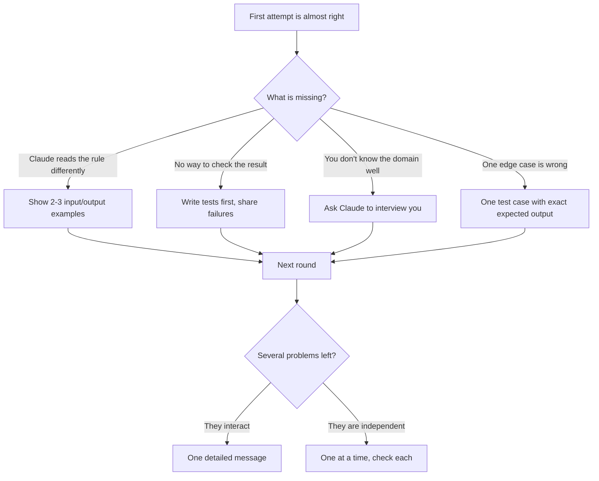
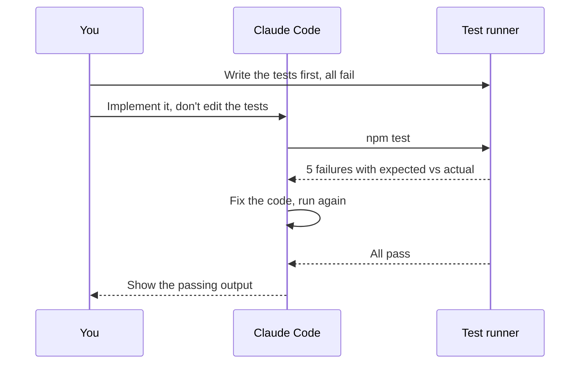

Iterative refinement means getting from Claude Code's first attempt to the result you want in a few clear rounds, instead of one long struggle. The tools are simple: show input/output examples when words fail, write tests first and feed back the failures, let Claude interview you before it builds something unfamiliar, and choose whether to report problems together or one at a time.

This is task statement 3.5 of the [Claude Certified Architect – Foundations exam guide](https://anthropic-partners.skilljar.com/claude-certified-architect-foundations-certification): "Apply iterative refinement techniques for progressive improvement". It sits in Domain 3, Claude Code Configuration & Workflows, which is 20% of the exam. In this post you build a small TypeScript `slugify()` function test-first and walk through four rounds of real failing-test output. Everything runs offline with `node --test`, and nothing starts Claude. The prompts in this post are prompts you can send, not recorded Claude answers.

## What does task statement 3.5 test?

The guide lists four things to know and five skills. In plain words:

| The guide asks you to… | In practice |
| --- | --- |
| Know that concrete input/output examples are the most effective fix when prose is read in different ways | Stop rewriting the description; show two or three before/after pairs |
| Know test-driven iteration | Write the test suite first, then iterate by sharing the failures |
| Know the interview pattern | Claude asks you questions before it implements, so hidden decisions come up early |
| Know when to send all issues together and when to fix them one by one | Interacting problems: one message. Independent problems: one at a time |
| Give 2–3 examples when descriptions give inconsistent results | "Format names" becomes three exact pairs |
| Write tests for behaviour, edge cases and performance before the code | Including empty input, odd characters and a speed check |
| Use the interview pattern in unfamiliar domains | A cache, a rate limiter, a payment flow |
| Fix an edge case with one specific test case | "Handle nulls" becomes one input row and its exact expected output |
| Choose one detailed message or sequential fixes | Based on whether one fix changes the other |

The prompt engineering series covers examples inside API prompts in its own post, [Few-shot prompting: consistent output from Claude](/blog/few-shot-prompting-claude) (task statement 4.2). This post is about the same idea used as feedback in a Claude Code session, together with tests and interviews.

## Why does the first attempt miss?

Because your words leave room for more than one reading. "Normalise product names" can mean fix the case, fix the spacing, expand units, or all three. Claude picks a reading, and it may not be yours.

The [Claude Code best practices](https://code.claude.com/docs/en/best-practices) put it plainly: "Claude can infer intent, but it can't read your mind." They also give the fix the whole task statement builds on. Give Claude "a check it can run: tests, a build, a screenshot to compare". With a check, "Claude does the work, runs the check, reads the result, and iterates until the check passes." Without one, you are the check, and every mistake waits for you to notice it.

Each technique below gives Claude a sharper target:



## When do examples beat more explanation?

When you have already explained the rule and Claude still applies it differently. Two more paragraphs give two more paragraphs to misread. An example has only one reading: this input, this output.

Say you asked Claude Code to "normalise product names" and the results were all over the place. Instead of a longer description, send the pairs:

```text
Update normalizeProductName() in src/catalog/normalize.ts so it matches
these examples exactly:

<examples>
<example>input: "  apple IPHONE 15 pro max 256gb " → output: "Apple iPhone 15 Pro Max 256 GB"</example>
<example>input: "SAMSUNG galaxy s24 ultra (512 GB)" → output: "Samsung Galaxy S24 Ultra 512 GB"</example>
<example>input: "logitech mx master 3s - graphite" → output: "Logitech MX Master 3S Graphite"</example>
</examples>

Add each example as a test case, run the tests and fix any failures.
```

Each pair teaches one thing the description didn't: brand casing, unit spacing, model codes in capitals, and dropped punctuation. The [prompting best practices](https://platform.claude.com/docs/en/build-with-claude/prompt-engineering/claude-prompting-best-practices#use-examples-effectively) call examples "one of the most reliable ways to steer Claude's output format, tone, and structure", and ask for examples that are relevant, diverse and wrapped in `<example>` tags. The exam guide asks for two or three; the docs suggest three to five for best results. Pick the cases Claude gets wrong today, not three easy ones.

The last line of the prompt matters too. It turns the examples into tests, so the next round has a check Claude can run.

## How does test-driven iteration work with Claude Code?

You write the tests first. They are the spec: normal input, edge cases and, if it matters, speed. Then you ask Claude to make them pass, and each round of failures tells it exactly what is still wrong.



Two details make this work:

- **Tests first, from you.** If Claude writes the code and the tests together, the tests describe what the code does, and a wrong behaviour gets a passing test. The best practices page suggests a variant: "have one Claude write tests, then another write code to pass them."
- **Failures are the feedback.** A failing assertion with expected and actual values is precise. "The slug looks wrong" is not. In Claude Code, Claude can run the test command itself, so you often don't need to paste anything. When failures come from somewhere it can't see, such as CI, paste only the failing part.

The Try it section below builds this loop end to end.

## What is the interview pattern?

You ask Claude to question you before it writes code. It's for features where you don't know which decisions matter yet. The [best practices page](https://code.claude.com/docs/en/best-practices#let-claude-interview-you) says Claude "asks about things you might not have considered yet, including technical implementation, UI/UX, edge cases, and tradeoffs", and gives a prompt to start from:

```text
I want to build [brief description]. Interview me in detail using the AskUserQuestion tool.

Ask about technical implementation, UI/UX, edge cases, concerns, and tradeoffs. Don't ask obvious questions, dig into the hard parts I might not have considered.

Keep interviewing until we've covered everything, then write a complete spec to SPEC.md.
```

`AskUserQuestion` is a built-in Claude Code tool that asks you multiple-choice questions; you can also type your own answer. For the guide's caching example, you might fill in the brief like this:

```text
I want to add a read-through cache in front of our product price API.
Interview me in detail using the AskUserQuestion tool before you write
any code. Focus on cache invalidation, what happens when the cache or
the API is down, and data that must never be stale. Then write SPEC.md.
```

You should expect questions such as: How fresh must prices be? Who changes a price, and how does the cache hear about it? Should a request fail or serve old data when the API is down? Those are the decisions that are expensive to change after the code exists. Once the spec is written, the docs suggest a fresh session to implement it, so the new session has "clean context focused entirely on implementation".

## How do I turn "handle nulls properly" into something Claude can fix?

Give one failing case with the exact input and the exact output you expect. "Handle nulls properly" names a topic, not a behaviour. Claude may add null checks in places that were already fine and miss the one that matters.

Say your migration script turns a missing middle name into the text `"null"`. Send the row:

```text
migrateCustomer() in scripts/migrate-customers.ts is wrong for null values.
Add this case to test/migrate-customers.test.ts and make it pass:

input:    { id: 7, first_name: "Ana", middle_name: null, last_name: "Ruiz", phone: null }
expected: { id: 7, fullName: "Ana Ruiz", phone: null }

Today the output has fullName "Ana null Ruiz" and phone "null".
Don't change how rows without nulls are migrated.
```

This is the pattern from the docs' "Describe the symptom" advice: the symptom, the likely location, and what "fixed" looks like. The table below shows the same move for other vague requests.

| Vague | Specific |
| --- | --- |
| "Make it better" | "Cut the response time of `/search` below 200 ms for the query in `bench/search.json`" |
| "Handle nulls properly" | One input row with nulls and the exact expected output |
| "The slug looks wrong" | "`slugify('Rock & Roll')` returns `rock-roll`; expected `rock-and-roll`" |
| "Fix the tests" | "Only `long titles are cut at a word boundary` fails; here is the expected vs actual" |

## Should I report problems together or one at a time?

It depends on whether they interact.

- **They interact** when fixing one changes the other. Report them together in one detailed message, and say how they are linked. Claude can then design one consistent change instead of fixing A, breaking B, fixing B, breaking A.
- **They are independent** when each has its own cause and its own fix. Fix and check them one at a time. Each round is small, easy to review, and a failure points straight at its cause.

A quick test: would the fix for one problem touch the same lines, or change the input to the other? If yes, they interact.

Whatever you choose, don't keep correcting the same thing. The best practices page says: "If you've corrected Claude more than twice on the same issue in one session, the context is cluttered with failed approaches. Run `/clear` and start fresh with a more specific prompt that incorporates what you learned."

## Try it: build slugify() test-first

You'll build `slugify()`, which turns a post title into a URL slug, such as `Hello, World!` into `hello-world`. You write the tests first, then go through the rounds of failures you would feed back to Claude Code. The implementations at each round are ours, written by hand to show what a typical attempt looks like. The failing output is real: every round was run with `node --test`.

**You need:** Node.js 22.18 or later, which [runs `.ts` files directly](https://nodejs.org/docs/latest-v22.x/api/typescript.html).


<Steps>


<Step title="Create the project">

```bash
$ mkdir -p slugify-tdd/src slugify-tdd/test slugify-tdd/scripts slugify-tdd/.claude slugify-tdd/schemas
$ cd slugify-tdd
$ git init
```


**package.json**

```json
{
  "name": "slugify-tdd",
  "private": true,
  "type": "module",
  "scripts": {
    "test": "node --test",
    "test:failures": "node --test --test-reporter=./scripts/failures-reporter.ts"
  },
  "devDependencies": {
    "@types/node": "^26.6.4",
    "ajv": "^8.20.0",
    "typescript": "^7.0.2"
  }
}
```


**tsconfig.json**

```json
{
  "compilerOptions": {
    "target": "es2023",
    "module": "nodenext",
    "strict": true,
    "noEmit": true,
    "allowImportingTsExtensions": true,
    "erasableSyntaxOnly": true,
    "verbatimModuleSyntax": true,
    "types": ["node"]
  },
  "include": ["src", "test", "scripts"]
}
```


**.gitignore**

```text
node_modules/
.claude/settings.local.json
```


```bash
npm install -D ajv typescript @types/node
```


</Step>


<Step title="Write the tests first">

This file is the spec. It covers normal titles, accents, a German `ß`, letters from other scripts, `&`, empty input, long titles and a speed check. No implementation exists yet.


**test/slugify.test.ts**

```ts
// Written before any implementation exists. These tests are the spec.
import assert from 'node:assert/strict';
import { test } from 'node:test';
import { slugify } from '../src/slugify.ts';

test('basic titles become lowercase words joined by dashes', () => {
  assert.equal(slugify('Hello, World!'), 'hello-world');
  assert.equal(slugify('  Ship   it -- today  '), 'ship-it-today');
});

test('accents are removed, not turned into dashes', () => {
  assert.equal(slugify('Crème brûlée à la carte'), 'creme-brulee-a-la-carte');
});

test('German ß becomes ss', () => {
  assert.equal(slugify('Straße und Weg'), 'strasse-und-weg');
});

test('letters from other scripts are kept', () => {
  assert.equal(slugify('東京 2026'), '東京-2026');
});

test('& is spelled out', () => {
  assert.equal(slugify('Rock & Roll'), 'rock-and-roll');
});

test('empty or symbol-only input gives an empty slug', () => {
  assert.equal(slugify(''), '');
  assert.equal(slugify('!!! ???'), '');
});

test('long titles are cut at a word boundary, never mid-word', () => {
  const title = 'How we cut our build time from twelve minutes to ninety seconds';
  assert.equal(slugify(title, 40), 'how-we-cut-our-build-time-from-twelve');
  assert.equal(slugify('Supercalifragilistic', 10), 'supercalif'); // one long word: hard cut
});

test('10,000 long titles take under a second', () => {
  const title = 'Ünïcödé & spaces '.repeat(12); // about 200 characters
  const start = performance.now();
  for (let i = 0; i < 10_000; i++) slugify(title);
  assert.ok(performance.now() - start < 1000);
});
```


Notice the choices the tests make for you: keep `東京` rather than drop it, cut long slugs between words, return an empty string for `!!! ???`. Without the tests, each of those would be a guess.

</Step>


<Step title="Add a reporter that prints only the failures">

The default output includes stack traces and file paths that add noise to a prompt. This small [custom reporter](https://nodejs.org/docs/latest-v22.x/api/test.html#custom-reporters) prints each failing test, the assertion line, and expected vs actual. That's the part worth sharing.


**scripts/failures-reporter.ts**

```ts
// A node:test reporter that prints only what Claude needs to see:
// each failing test, the input line from the test file, and expected vs actual.
// Usage: node --test --test-reporter=./scripts/failures-reporter.ts
import { readFileSync } from 'node:fs';
import { fileURLToPath } from 'node:url';
import { inspect } from 'node:util';

interface FailEvent {
  name: string;
  line?: number;
  file?: string;
  details: { error: { cause?: unknown; message: string } };
}

export default async function* failuresOnly(source: AsyncIterable<{ type: string; data: any }>) {
  let pass = 0;
  let fail = 0;
  for await (const event of source) {
    if (event.data?.details?.type === 'suite') continue;
    if (event.type === 'test:pass') pass++;
    if (event.type !== 'test:fail') continue;
    fail++;
    const { name, details } = event.data as FailEvent;
    const cause = details.error.cause as { expected?: unknown; actual?: unknown; message?: string } | undefined;
    yield `FAIL ${name}\n`;
    const where = failingLine(cause);
    if (where) yield `  at   ${where}\n`;
    if (cause && 'expected' in cause) {
      yield `  expected ${inspect(cause.expected)}\n  actual   ${inspect(cause.actual)}\n`;
    } else {
      yield `  error    ${cause?.message ?? details.error.message}\n`;
    }
  }
  yield `\n${pass} passed, ${fail} failed\n`;
}

// Finds the assertion line inside a test file from the error's stack trace.
function failingLine(cause: unknown): string | undefined {
  const stack = (cause as Error | undefined)?.stack ?? '';
  const match = stack.match(/(file:\/\/\S+\.test\.ts):(\d+):\d+/);
  if (!match) return undefined;
  const lines = readFileSync(fileURLToPath(match[1]), 'utf8').split('\n');
  return lines[Number(match[2]) - 1].trim();
}
```


</Step>


<Step title="Protect the tests, then run them against a stub">

A test-first loop only works if the tests stay fixed. Tell Claude not to edit them, and back that up with a deny rule in your personal settings. `Edit` rules cover all of Claude's built-in file-editing tools, according to the [permissions docs](https://code.claude.com/docs/en/permissions#read-and-edit), and a leading `/` anchors the path at the project.


**.claude/settings.local.json**

```json
{
  "$schema": "https://json.schemastore.org/claude-code-settings.json",
  "permissions": {
    "deny": ["Edit(/test/**)"]
  }
}
```


Check the file against the published settings schema without starting Claude:

```bash
$ curl -sSL -o schemas/claude-code-settings.json https://json.schemastore.org/claude-code-settings.json
```


**scripts/check-settings.ts**

```ts
// Checks a Claude Code settings file against the published JSON schema.
// Usage: node scripts/check-settings.ts .claude/settings.local.json
import { readFileSync } from 'node:fs';
import { Ajv } from 'ajv';

const file = process.argv[2] ?? '.claude/settings.local.json';
const schema = JSON.parse(readFileSync('schemas/claude-code-settings.json', 'utf8'));
const validate = new Ajv({ strict: false, allErrors: true, validateFormats: false }).compile(schema);
const settings = JSON.parse(readFileSync(file, 'utf8')) as { permissions?: { deny?: string[] } };

if (validate(settings)) {
  console.log(`${file}: OK (deny: ${settings.permissions?.deny?.join(', ') ?? 'none'})`);
} else {
  for (const e of validate.errors ?? []) console.log(`${file}: ${e.instancePath || '/'} ${e.message}`);
  process.exitCode = 1;
}
```


```bash
$ node scripts/check-settings.ts .claude/settings.local.json
```

```text
.claude/settings.local.json: OK (deny: Edit(/test/**))
```

Now a stub, so the tests have something to import:


**src/slugify.ts**

```ts
export function slugify(title: string, maxLength = 60): string {
  throw new Error('not implemented');
}
```


```bash
$ npm run -s test:failures
```

All eight tests fail with `not implemented`, ending with:

```text
0 passed, 8 failed
```

</Step>


<Step title="Round 1: ask for an implementation">

The prompt names the spec, forbids editing it, and asks for a general solution. The last part follows the docs' advice to [avoid focusing on passing tests and hardcoding](https://platform.claude.com/docs/en/build-with-claude/prompt-engineering/claude-prompting-best-practices#avoid-focusing-on-passing-tests-and-hardcoding).

```text
The tests in test/slugify.test.ts are the spec. Implement slugify() in
src/slugify.ts so they pass. Don't edit the tests. If a test looks wrong,
tell me instead of changing it. Write a general solution, not one that
only works for the test inputs. Run npm run test:failures after each change.
```

A typical first attempt keeps only `a-z` and `0-9`:


**src/slugify.ts**

```ts
export function slugify(title: string, maxLength = 60): string {
  return title
    .toLowerCase()
    .replace(/[^a-z0-9]+/g, '-')
    .replace(/^-+|-+$/g, '')
    .slice(0, maxLength);
}
```


```bash
$ npm run -s test:failures
```

```text
FAIL accents are removed, not turned into dashes
  at   assert.equal(slugify('Crème brûlée à la carte'), 'creme-brulee-a-la-carte');
  expected 'creme-brulee-a-la-carte'
  actual   'cr-me-br-l-e-la-carte'
FAIL German ß becomes ss
  at   assert.equal(slugify('Straße und Weg'), 'strasse-und-weg');
  expected 'strasse-und-weg'
  actual   'stra-e-und-weg'
FAIL letters from other scripts are kept
  at   assert.equal(slugify('東京 2026'), '東京-2026');
  expected '東京-2026'
  actual   '2026'
FAIL & is spelled out
  at   assert.equal(slugify('Rock & Roll'), 'rock-and-roll');
  expected 'rock-and-roll'
  actual   'rock-roll'
FAIL long titles are cut at a word boundary, never mid-word
  at   assert.equal(slugify(title, 40), 'how-we-cut-our-build-time-from-twelve');
  expected 'how-we-cut-our-build-time-from-twelve'
  actual   'how-we-cut-our-build-time-from-twelve-mi'

3 passed, 5 failed
```

</Step>


<Step title="Round 2: send the interacting failures together">

Look at the five failures before you reply. The first three share one cause: the character filter `[^a-z0-9]`. Any fix for accents changes what happens to `ß` and `東京` too, so they interact. Send them in one message and say so. The `&` and length failures have their own causes, so leave them for later rounds.

```text
Three failures share one cause: the filter [^a-z0-9] treats every
non-ASCII character as a separator.

- "Crème brûlée" must become "creme-brulee": remove accents from Latin letters.
- "Straße" must become "strasse": ß has no accent to remove, so map it to ss.
- "東京 2026" must become "東京-2026": keep letters and digits from any script.

Fix these together in one change. Leave the & and length tests for now.
```

The second version normalises the text and keeps any Unicode letter or digit:


**src/slugify.ts**

```ts
export function slugify(title: string, maxLength = 60): string {
  return title
    .toLowerCase()
    .replaceAll('ß', 'ss')
    .normalize('NFKD') // split "è" into "e" + a combining accent
    .replace(/(\p{Script=Latin})\p{M}+/gu, '$1') // drop accents on Latin letters only
    .normalize('NFC')
    .replace(/[^\p{L}\p{N}]+/gu, '-') // keep letters and digits from any script
    .replace(/^-+|-+$/g, '')
    .slice(0, maxLength);
}
```


```text
FAIL & is spelled out
  at   assert.equal(slugify('Rock & Roll'), 'rock-and-roll');
  expected 'rock-and-roll'
  actual   'rock-roll'
FAIL long titles are cut at a word boundary, never mid-word
  at   assert.equal(slugify(title, 40), 'how-we-cut-our-build-time-from-twelve');
  expected 'how-we-cut-our-build-time-from-twelve'
  actual   'how-we-cut-our-build-time-from-twelve-mi'

6 passed, 2 failed
```

</Step>


<Step title="Rounds 3 and 4: fix the independent failures one at a time">

The two failures left don't touch each other. Spelling out `&` happens before the filter; the length rule happens after it. Send one, check it, then send the other.

```text
Only fix this one: slugify('Rock & Roll') returns 'rock-roll';
expected 'rock-and-roll'. Spell out & as "and".
```

One added line, `.replaceAll('&', ' and ')`, and the run shows only the last failure:

```text
FAIL long titles are cut at a word boundary, never mid-word
  at   assert.equal(slugify(title, 40), 'how-we-cut-our-build-time-from-twelve');
  expected 'how-we-cut-our-build-time-from-twelve'
  actual   'how-we-cut-our-build-time-from-twelve-mi'

7 passed, 1 failed
```

```text
Last one: long slugs must be cut between words, never inside a word.
slugify(title, 40) returns '…-from-twelve-mi'; expected '…-from-twelve'.
If a single word is longer than the limit, cut the word.
```

The final version checks one character past the limit to find the last whole word:


**src/slugify.ts**

```ts
// Turns a post title into a URL slug. The spec is test/slugify.test.ts.
export function slugify(title: string, maxLength = 60): string {
  const slug = title
    .toLowerCase()
    .replaceAll('ß', 'ss')
    .replaceAll('&', ' and ')
    .normalize('NFKD') // split "è" into "e" + a combining accent
    .replace(/(\p{Script=Latin})\p{M}+/gu, '$1') // drop accents on Latin letters only
    .normalize('NFC')
    .replace(/[^\p{L}\p{N}]+/gu, '-') // keep letters and digits from any script
    .replace(/^-+|-+$/g, '');

  if (slug.length <= maxLength) return slug;
  // Look one character past the limit: if it is a dash, the cut falls between words.
  const lastDash = slug.slice(0, maxLength + 1).lastIndexOf('-');
  return lastDash > 0 ? slug.slice(0, lastDash) : slug.slice(0, maxLength);
}
```


```text
8 passed, 0 failed
```

</Step>


<Step title="Run the full suite and the type check">

```bash
$ node --test --test-reporter=spec
$ npx tsc -p .
```

```text
✔ basic titles become lowercase words joined by dashes (2.119065ms)
✔ accents are removed, not turned into dashes (0.839757ms)
✔ German ß becomes ss (0.176493ms)
✔ letters from other scripts are kept (0.3168ms)
✔ & is spelled out (0.219419ms)
✔ empty or symbol-only input gives an empty slug (0.121368ms)
✔ long titles are cut at a word boundary, never mid-word (0.204257ms)
✔ 10,000 long titles take under a second (268.111994ms)
ℹ tests 8
ℹ suites 0
ℹ pass 8
ℹ fail 0
ℹ cancelled 0
ℹ skipped 0
ℹ todo 0
ℹ duration_ms 472.59198
```

`tsc` prints nothing when the types check. This is our run on Node 22.22.2; your timings will differ.

</Step>


</Steps>


Four rounds, and each one was cheap to review: one batched fix for a shared cause, then two small independent fixes. If you had sent all five failures at once, the `&` and length fixes would have been mixed into the character rewrite, which makes a wrong change harder to spot.

## Common traps

These are the mistakes wrong answer options are built on.

| Trap | Why it breaks | Fix |
| --- | --- | --- |
| Writing longer prose when Claude keeps misreading the rule | More text gives more ways to misread it | Show two or three input/output examples |
| Asking for code and tests together | The tests confirm whatever the code does | Write the tests first, or have a separate session write them |
| Letting Claude edit the tests to make them pass | The spec quietly changes | Say "don't edit the tests", and add an `Edit` deny rule |
| "Handle nulls properly" | Names a topic, not a behaviour | One input row and its exact expected output |
| Fixing interacting problems one at a time | Each fix breaks the other, and you go round in circles | One detailed message that explains the link |
| One long list of unrelated issues | Big mixed changes are hard to review, and one bad fix hides in many good ones | Fix and check them one by one |
| Correcting the same issue again and again | Failed attempts fill the context | After two failed corrections, `/clear` and write a better first prompt |


<Callout type="warning" title="A deny rule guards Claude's file tools, not every process">

The permissions docs say Read and Edit deny rules apply to Claude's built-in file tools and to file commands Claude Code recognises in Bash, such as `sed` and `tee`. They don't apply to a Node or Python script that writes files itself. Treat the rule as a guard against accidents, keep the tests in git, and review test-file changes in every diff. For OS-level blocking, the docs point to the sandbox.

</Callout>


## Practice questions

These four questions are this blog's own, written for practice. They are not from the exam.

**Question 1.** A migration script copies customer records to a new schema. Records with a `NULL` phone number arrive in the new table with the text `"null"` in the phone column. You asked Claude Code to "handle nulls properly". It added null checks in three other functions, but the phone column is still wrong. What should your next message be?

- A. "Please be more careful with null values everywhere in the script."
- B. One test row with a `NULL` phone and the exact expected output row, with a request to make that test pass without changing other rows.
- C. A request to rewrite the whole migration script from scratch.
- D. A request for a written plan of null handling across every script in the repository.

**Question 2.** You need a rate limiter for a public API, and nobody on the team has built one before. You want to avoid finding design problems after the code is written. What is the best first step with Claude Code?

- A. Ask Claude to implement a token bucket limiter and then review it.
- B. Ask Claude to interview you about the requirements (limits per key, behaviour across several servers, what happens when the store is down) before it writes any code.
- C. Ask Claude to copy a rate limiter from a popular library into the repository.
- D. Write the limiter yourself and ask Claude only for tests.

**Question 3.** A CSV import has two problems. Dates are parsed in the server's timezone, and the duplicate check compares those parsed dates. Fixing the timezone changes which rows look like duplicates. How should you ask Claude Code to fix them?

- A. Ask it to fix the timezone first, merge, and raise the duplicate check in a later session.
- B. Describe both problems in one detailed message, explain how they affect each other, and include a sample row that shows the combined bug.
- C. Open two sessions and fix each problem separately in parallel.
- D. Ask it to fix whichever problem it thinks is more important.

**Question 4.** You are adding `parseDuration("1h30m")`. It must reject invalid input and run fast on large log files. You want a correct implementation with little back-and-forth. Which workflow fits best?

- A. Ask Claude to write the function and its tests together, then run them.
- B. Write the test suite first (normal cases, invalid input, edge cases, a speed check), then have Claude implement it and iterate on each round of failing tests until they pass.
- C. Ask Claude to implement it, then try a few inputs by hand in a REPL.
- D. Ask Claude for three different implementations and pick the shortest.

## Answer key

### Question 1

**Answer: B.** A specific failing case with the exact input and expected output shows Claude the one behaviour that is wrong, and the test proves when it's fixed. The strongest distractor is D: a plan sounds thorough, but it widens the scope to every script when the problem is one column, and it still doesn't say what the right output is. A is the same vague request again, and C throws away working code.

### Question 2

**Answer: B.** The interview pattern brings up design questions such as shared state across servers and failure modes before any code exists, which matters most in an unfamiliar domain. The strongest distractor is A: it gives working code fast, but decisions you didn't know to make are only found in review, when they cost more to change.

### Question 3

**Answer: B.** The fixes interact: the timezone fix changes the input to the duplicate check. One detailed message lets Claude design one consistent change. The strongest distractor is A: fixing one at a time is right for independent problems, but here the first fix changes the second problem, so you would redo work.

### Question 4

**Answer: B.** Tests written first define the behaviour, edge cases and speed up front, and each round of failures gives Claude precise feedback. The strongest distractor is A: it produces tests quickly, but tests written with the code tend to confirm what the code does rather than what it should do.

## What should I do next?

- **Try the loop on a real function.** Pick one function you plan to change this week. Write three failing tests for it first, then hand them to Claude Code with "don't edit the tests".
- **Use the interview prompt** on your next feature where you're unsure of the design, and keep the `SPEC.md` it produces.
- **Move on to task statement 3.6**, "Integrate Claude Code into CI/CD pipelines". The next post in this series covers non-interactive runs and structured output. Plan mode, the previous part, is covered in [Plan mode vs direct execution in Claude Code](/blog/claude-code-plan-mode).
- **Plan and check your prep.** Task 3.5 is part of week 4 in the [six-week study plan](/blog/claude-architect-exam-study-plan). Test yourself with the [mock exam](/blog/claude-certification-mock-exam) when you've worked through the domain. For more day-to-day habits, see [Getting the most out of AI coding assistants](/blog/ai-coding-assistants-tips) and [How to test AI output with evals](/blog/test-ai-output-with-evals).
