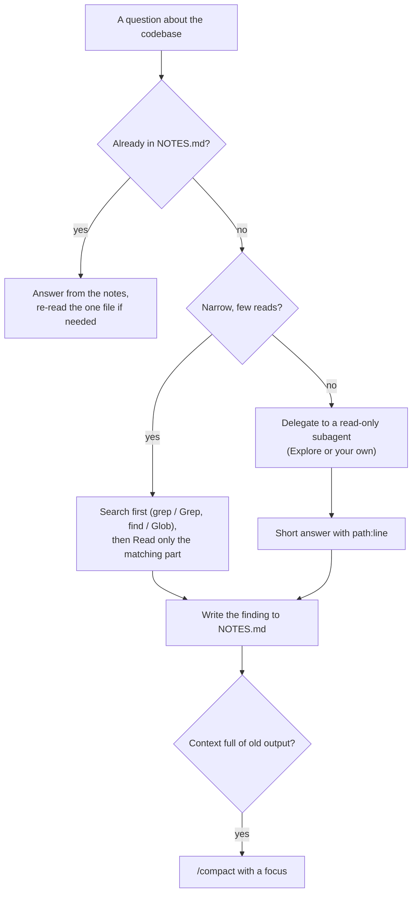

In a large codebase, Claude Code's biggest limit is not the model. It is the context window, which fills with every file it reads and every search it runs. To stay accurate through a long exploration, search before you read, hand noisy questions to subagents, write what you learn to a file, and compact on purpose instead of by accident. In this post you set up all four in a real project layout and test the pieces offline, without starting Claude.

This is task statement 5.4 of the [Claude Certified Architect – Foundations exam guide](https://anthropic-partners.skilljar.com/claude-certified-architect-foundations-certification): "Manage context effectively in large codebase exploration". It sits in Domain 5, Context Management & Reliability, which is 15% of the exam.

## What does task statement 5.4 test?

The guide lists four things to know and five skills. In plain words:

| The guide asks you to… | In practice |
| --- | --- |
| Know how context degrades in long sessions | Answers get inconsistent and drift to "typical patterns" instead of the classes you found |
| Know what scratchpad files are for | Findings live in a file, outside the context window, so they survive compaction |
| Know why subagents isolate exploration | Verbose reads and searches stay in the subagent; the main agent keeps the big picture |
| Know structured state for crash recovery | Each agent saves its state to a known place; the coordinator loads a manifest on resume |
| Spawn subagents for narrow questions | "Find all test files", "trace the refund flow's dependencies" |
| Keep and consult a scratchpad | Write findings as you go, read them before answering later questions |
| Summarize between phases | The next phase's subagents start from a short summary of the last phase |
| Design a manifest for resume | The coordinator injects saved state into agent prompts |
| Use `/compact` during long exploration | Shrink the context when it fills with discovery output |

Three other posts in this prep series go deeper on pieces this post only touches. [Subagents: spawning, context passing and the Agent tool](/blog/claude-subagents-context-passing) (task statement 1.3) covers how a subagent is started and what it receives. [Claude sessions: resume, fork or start fresh](/blog/claude-sessions-resume-fork) (1.7) covers `--resume`, forks and stale tool results. "Path-specific rules in Claude Code" (3.3) and "CLAUDE.md hierarchy" (3.1) cover what loads at startup. Part 1 of this series, [Keep critical facts alive in long Claude conversations](/blog/claude-long-conversation-context), builds the same idea for the Messages API: exact facts in a block your code keeps.

## What goes wrong in a long exploration?

Claude Code's [best practices](https://code.claude.com/docs/en/best-practices) start from one constraint: "Claude's context window fills up fast, and performance degrades as it fills." The context window holds every message, every file Claude reads and every command output. A single "codebase exploration might generate and consume tens of thousands of tokens."

You notice it in three ways:

- **Answers lose their names.** Early on, Claude says "`InvoiceReconciler` in `src/billing/` marks refunded invoices". Two hours later it says "the billing layer probably reconciles invoices in a typical way". The specific finding is buried under newer output.
- **Answers contradict each other.** One question gets "refunds go through `RefundService`", a later one gets "the controller calls the gateway directly".
- **Instructions fade.** The docs say that when context gets full, "Claude may start 'forgetting' earlier instructions or making more mistakes."

Then compaction runs. When context approaches the limit, Claude Code "clears older tool outputs first, then summarizes the conversation if needed", per [how Claude Code works](https://code.claude.com/docs/en/how-claude-code-works#when-context-fills-up). Your requests and key code snippets are kept, but "detailed instructions from early in the conversation may be lost". A summary is a paraphrase. A file path or a line number you needed can disappear.

The docs name the cause too. Their "infinite exploration" anti-pattern: "You ask Claude to 'investigate' something without scoping it. Claude reads hundreds of files, filling the context." The fix they give: "Scope investigations narrowly or use subagents."

## How do I keep exploration out of the main context?

Four habits, from cheapest to most structured:



### Search before you read

A search returns a few lines. A read returns the whole file. Anthropic's [context engineering post](https://www.anthropic.com/engineering/effective-context-engineering-for-ai-agents) describes how Claude Code works this way: "primitives like glob and grep allow it to navigate its environment and retrieve files just-in-time".

One detail of current Claude Code matters here. The [tools reference](https://code.claude.com/docs/en/tools-reference#glob-tool-behavior) says that on macOS, Linux and WSL, the `Glob` and `Grep` tools are left out of the default tool set, "and Claude searches with `find` and `grep` through the Bash tool instead". On Windows they are part of the default set. Either way, the habit is the same: find the file and the line first, then read only what the search points to. The `Read` tool helps with large files: when a whole-file read exceeds its token limit, it returns the first page with a `PARTIAL view` notice, and Claude can read more with `offset` and `limit`.

You can steer this from your prompt. "Fix the bug in `auth.ts`" makes Claude read fewer files than "look into auth". The [context window guide](https://code.claude.com/docs/en/context-window) says: "File reads dominate context usage. Be specific in prompts".

### Delegate noisy questions to a subagent

A subagent is a helper agent that runs in its own context window. The [subagent docs](https://code.claude.com/docs/en/sub-agents) list isolating high-volume operations as one of the most effective uses: "the verbose output stays in the subagent's context while only the relevant summary returns to your main conversation."

Claude Code ships one built for this. **Explore** is "a fast, read-only agent optimized for searching and analyzing codebases". Its Write and Edit tools are denied, it skips your CLAUDE.md files to stay small, and Claude asks it for a thoroughness level: quick, medium or very thorough. Two limits to know: Explore is one-shot and returns no agent ID, so Claude can't resume it, and like every normal subagent it starts without your conversation history. Whatever it needs must be in the task Claude writes for it.

The [context window walkthrough](https://code.claude.com/docs/en/context-window) shows the effect with sample numbers: the subagent read 6,100 tokens of files and the main conversation got back a 420-token result. Anthropic's engineering post gives the general pattern: a subagent "might explore extensively, using tens of thousands of tokens or more, but returns only a condensed, distilled summary of its work (often 1,000-2,000 tokens)."

You can ask for it in plain words: "Use a subagent to find every caller of `PaymentGateway.refund`." You'll write your own read-only subagent in the hands-on part.

### Keep a findings file

A findings file (the exam guide says "scratchpad file") is a plain Markdown file where findings go as soon as you have them: a path, a line, one sentence. The context engineering post calls this "structured note-taking", where "the agent regularly writes notes persisted to memory outside of the context window", and uses this exact example: "your custom agent maintaining a NOTES.md file".

Why it works: compaction summarizes the conversation, not your files. After the summary, Claude can read the file again and get every path and line exactly as written. The trick is making sure it does. You'll do that two ways below: a line in CLAUDE.md, which Claude Code re-injects from disk after compaction, and a hook that prints the notes into the new context.

### Compact on purpose

Three commands manage the context window directly. From the [commands reference](https://code.claude.com/docs/en/commands):

| Command | What it does | Use it when |
| --- | --- | --- |
| `/context` | Shows current context usage as a colored grid, with suggestions | You want to see what is filling the window |
| `/compact [instructions]` | Summarizes the conversation so far; optional focus instructions | Same task, but the window is full of old search output |
| `/clear` | Starts a new conversation with empty context | You switch to unrelated work |

A focus tells the summary what to keep, for example `/compact focus on the refund flow and the open questions`. You can also add a "Compact Instructions" section to CLAUDE.md, so the automatic pass follows it too. Two related commands: `/rewind` can summarize only part of the conversation (**Summarize from here** or **Summarize up to here**), and `/autocompact` sets how full the window gets before automatic compaction runs.

Knowing what survives helps you decide. The [context window guide's table](https://code.claude.com/docs/en/context-window#what-survives-compaction) says the project-root CLAUDE.md and unscoped rules are re-injected from disk, and Claude Code re-reads "up to five" of the files Claude read or edited, "most recently modified first". A file over 5,000 tokens comes back only as a path reference. Context that hooks added earlier is summarized with the rest. `SessionStart` hooks that match `compact` run again, and their output is added to the compacted context.

## How much does reading cost compared with searching?

Here is an estimate from the script you'll build below. We asked "where does the client handle retries?" of the TypeScript SDK's own source, `@anthropic-ai/sdk` 0.131.0, which ships 260 `.ts` files in its `src/` folder:

```text
260 files scanned, 4 match /maxRetries/
Read every file                   ~707,955 tokens
Search, list matching paths       ~21 tokens
Search, show matching lines       ~365 tokens
Search, then Read matching files  ~27,773 tokens
Estimate only: characters / 3.5. Use /context or the token counting API for real numbers.
```

The numbers are rough. Anthropic's [glossary](https://platform.claude.com/docs/en/about-claude/glossary) says a token is "approximately 3.5 English characters", and code can differ. The [token counting docs](https://platform.claude.com/docs/en/build-with-claude/token-counting) add that Claude 4.7 and later models use a tokenizer that produces "approximately 30 percent more tokens" for the same text. The `Read` tool also adds line numbers. The order of magnitude is what matters: reading everything would fill most of a 1M-token window, while the search answers the question for a few hundred tokens.

## Try it: a findings file, a manifest, a subagent and a hook

You'll add an exploration kit to a repository you want to explore. The example is a made-up `shop-api` repository with a refund flow. Everything here runs without Claude: you test the scripts with `node --test` and check the config files with a parser. The last step says what to expect when you do start Claude Code.

**You need:** Node.js 22.18 or later, which runs `.ts` files directly because [type stripping is on by default](https://nodejs.org/docs/latest-v22.x/api/typescript.html).


<Steps>


<Step title="Set up the kit">

Work in the root of the repository you want to explore. If it has no `package.json` yet, create one:

```bash
$ npm init -y
$ npm pkg set type=module
$ mkdir -p scripts .claude/agents .exploration/state
```

Install the YAML parser (to check the subagent file) and the type checker:


```bash
npm install -D yaml typescript @types/node
```


**tsconfig.json**

```json
{
  "compilerOptions": {
    "noEmit": true,
    "target": "esnext",
    "module": "nodenext",
    "rewriteRelativeImportExtensions": true,
    "erasableSyntaxOnly": true,
    "verbatimModuleSyntax": true,
    "allowImportingTsExtensions": true,
    "strict": true,
    "types": ["node"]
  },
  "include": ["scripts/**/*.ts"]
}
```


Keep the findings out of git. They are your working notes, not project docs. (The `Grep` tool also skips gitignored files, so the notes don't show up as matches in its searches.)


**.gitignore**

```text
node_modules/
.exploration/
```


</Step>


<Step title="Write the findings file convention">

The format is the whole point. Every line is one finding with a path, a line number when you have one, and a date. Guesses are marked. Wrong lines are deleted, not left to confuse the next session:


**.exploration/NOTES.md**

```md
# Findings: refund flow in shop-api

Rules: one line per finding. Always a path, a line number when you have one, and a date.
Mark guesses with "(unconfirmed)". Delete lines that turn out wrong. Keep this file under 8,000 characters.

## Map
- src/payments/: payment provider adapters (2026-10-02)
- src/refunds/RefundService.ts: entry point for every refund (2026-10-02)

## Key classes and functions
- RefundService.requestRefund() src/refunds/RefundService.ts:42 checks the return window, then calls PaymentGateway.refund() (2026-10-02)
- InvoiceReconciler src/billing/InvoiceReconciler.ts:15 runs nightly and marks refunded invoices (2026-10-02)

## Data flow
- API POST /refunds -> RefundService.requestRefund -> PaymentGateway.refund -> event "refund.created" -> InvoiceReconciler (2026-10-02)

## Decisions and gotchas
- Amounts are integer cents everywhere except src/legacy/ (floats) (2026-10-02)
```


Keep it short. Under about 5,000 tokens, Claude Code can re-read it whole after compaction. Under 10,000 characters, the hook in a later step can print it whole.

</Step>


<Step title="Track phases in a manifest">

The manifest is the crash-recovery file. It says what the work is, which phases are done, a short summary of each finished phase, where each phase saved its detailed state, and what is still open:


**.exploration/manifest.json**

```json
{
  "task": "Map the refund flow in shop-api and list risky code before the payment-provider migration",
  "updated": "2026-10-02T14:10:00Z",
  "notes": ".exploration/NOTES.md",
  "phases": [
    {
      "id": "1-map",
      "status": "done",
      "summary": "Refunds enter through RefundService.requestRefund and leave through PaymentGateway.refund. InvoiceReconciler updates invoices nightly.",
      "stateFile": ".exploration/state/1-map.json"
    },
    {
      "id": "2-risks",
      "status": "in_progress",
      "stateFile": ".exploration/state/2-risks.json"
    },
    { "id": "3-plan", "status": "todo" }
  ],
  "openQuestions": [
    "Does anything outside src/refunds call PaymentGateway.refund directly?",
    "Which tests cover the float amounts in src/legacy?"
  ]
}
```


A phase's state file holds the detail, so the manifest stays small:


**.exploration/state/1-map.json**

```json
{
  "phase": "1-map",
  "finishedAt": "2026-10-02T13:40:00Z",
  "filesRead": ["src/refunds/RefundService.ts", "src/payments/PaymentGateway.ts", "src/billing/InvoiceReconciler.ts"],
  "findings": [
    { "claim": "Every refund goes through RefundService.requestRefund", "source": "src/refunds/RefundService.ts:42" },
    { "claim": "InvoiceReconciler listens for refund.created", "source": "src/billing/InvoiceReconciler.ts:15" }
  ]
}
```


If the session dies, nothing here is lost. A new session, or a new coordinator process, loads the manifest and continues from `2-risks`.

</Step>


<Step title="Write the brief and next-phase prompt builder">

This script does two jobs. Run on its own, it prints a brief: phases, open questions and the findings. The hook in the next step runs it. It also exports `phasePrompt`, which builds the starting prompt for a subagent in the next phase from the summaries of finished phases.


**scripts/exploration-brief.ts**

```ts
import { existsSync, readFileSync } from 'node:fs';
import { join } from 'node:path';
import { fileURLToPath } from 'node:url';

export interface Phase {
  id: string;
  status: 'done' | 'in_progress' | 'todo';
  summary?: string; // 1-3 sentences, written when the phase ends
  stateFile?: string; // where that phase's agent saved its detailed state
}

export interface Manifest {
  task: string;
  updated: string;
  notes: string; // path of the findings file, relative to the project root
  phases: Phase[];
  openQuestions: string[];
}

// Claude Code caps a hook's plain stdout at 10,000 characters. Over that, Claude gets
// only a file path and a preview, so stay well below it.
export const HOOK_OUTPUT_CAP = 10_000;
const BUDGET = HOOK_OUTPUT_CAP - 500;

export function parseManifest(text: string): Manifest {
  const m = JSON.parse(text) as Partial<Manifest>;
  for (const key of ['task', 'updated', 'notes'] as const) {
    if (typeof m[key] !== 'string' || m[key] === '') throw new Error(`manifest.json: "${key}" must be a non-empty string`);
  }
  if (!Array.isArray(m.phases) || !Array.isArray(m.openQuestions)) {
    throw new Error('manifest.json: "phases" and "openQuestions" must be arrays');
  }
  for (const p of m.phases) {
    if (!['done', 'in_progress', 'todo'].includes(p.status)) throw new Error(`manifest.json: phase "${p.id}" has an unknown status`);
    if (p.status === 'done' && !p.summary) throw new Error(`manifest.json: phase "${p.id}" is done but has no summary`);
  }
  return m as Manifest;
}

// The text the SessionStart hook prints. Claude Code adds it to Claude's context.
export function buildBrief(m: Manifest, notes: string): string {
  const head = [
    '# Exploration brief (from .exploration/manifest.json)',
    `Task: ${m.task}`,
    `Last updated: ${m.updated}`,
    '',
    '## Phases',
    ...m.phases.map((p) => `- ${p.id} [${p.status}]${p.summary ? `: ${p.summary}` : ''}${p.stateFile ? ` (state: ${p.stateFile})` : ''}`),
    '',
    '## Open questions',
    ...(m.openQuestions.length ? m.openQuestions.map((q) => `- ${q}`) : ['- none']),
    '',
    `## Findings (${m.notes})`,
  ].join('\n');
  const tail = '\nTrust these notes over your memory of earlier turns. Re-read a file before you quote its code.';

  let body = notes.trim();
  const room = BUDGET - head.length - tail.length;
  if (body.length > room) {
    const cut = body.slice(0, room - 120);
    body = `${cut}\n[...cut: ${m.notes} is too long for the hook. Read the rest with the Read tool, and trim the file.]`;
  }
  return `${head}\n${body}\n${tail}`;
}

// The starting prompt for a subagent in the next phase: earlier summaries in, not transcripts.
export function phasePrompt(m: Manifest, phaseId: string, question: string): string {
  const done = m.phases.filter((p) => p.status === 'done');
  return [
    `You are helping with phase "${phaseId}" of: ${m.task}`,
    '',
    'Earlier phases already found this. Build on it; do not re-explore it:',
    ...(done.length ? done.map((p) => `- ${p.id}: ${p.summary}`) : ['- (no earlier phases)']),
    '',
    `Your question: ${question}`,
    '',
    'Answer in at most 15 lines: one finding per line with path:line, then a line "Not confirmed:" for anything you could not check.',
  ].join('\n');
}

// Run by the hook. Prints nothing in projects without a manifest.
if (process.argv[1] === fileURLToPath(import.meta.url)) {
  const root = process.env.CLAUDE_PROJECT_DIR ?? process.cwd();
  const manifestPath = join(root, '.exploration', 'manifest.json');
  if (existsSync(manifestPath)) {
    const manifest = parseManifest(readFileSync(manifestPath, 'utf8'));
    const notesPath = join(root, manifest.notes);
    const notes = existsSync(notesPath) ? readFileSync(notesPath, 'utf8') : `(missing: ${manifest.notes})`;
    process.stdout.write(buildBrief(manifest, notes));
  }
}
```


What each part does:

- **`parseManifest`** rejects a broken manifest with a clear message. A phase marked `done` must have a summary, or the next phase starts blind.
- **`buildBrief`** puts the phases and open questions first, then the notes. Claude Code caps a hook's plain output at 10,000 characters, per the [hooks reference](https://code.claude.com/docs/en/hooks). Over that, Claude gets a file path and a preview. So the script cuts long notes itself and says where the rest is.
- **`phasePrompt`** gives the next phase's subagent the earlier summaries, not the earlier transcripts. Unfinished phases add nothing.
- **The CLI part** prints nothing when there is no manifest, so the hook is silent in a normal session.

</Step>


<Step title="Add the hook and the CLAUDE.md rules">

A `SessionStart` hook runs a command when a session starts, and Claude Code adds its plain-text output to Claude's context. The [hooks guide](https://code.claude.com/docs/en/hooks-guide#re-inject-context-after-compaction) uses one with the `compact` matcher to "re-inject critical context after every compaction". This one also fires on `startup` and `resume`, which is the crash-recovery case: a new session starts with the manifest loaded.


**.claude/settings.json**

```json
{
  "hooks": {
    "SessionStart": [
      {
        "matcher": "startup|resume|compact",
        "hooks": [
          {
            "type": "command",
            "command": "node \"${CLAUDE_PROJECT_DIR}/scripts/exploration-brief.ts\""
          }
        ]
      }
    ]
  }
}
```


The matcher `startup|resume|compact` is a list of exact values separated by `|`, as the hooks reference describes. `${CLAUDE_PROJECT_DIR}` is the project root.

Then tell Claude how to use the files. The project-root CLAUDE.md is re-injected from disk after compaction, so these rules survive it:


**CLAUDE.md**

```md
# shop-api

## Exploring this codebase

- Keep findings in `.exploration/NOTES.md`. Add a line after each discovery: path, line, date.
  Update `.exploration/manifest.json` when a phase ends or a question opens or closes.
- Before answering a question about code you looked at earlier, check NOTES.md first.
  If the answer is not there, search again. Never describe "typical" code instead.
- Send searches that need many reads to the `code-scout` subagent, and write what it returns into NOTES.md.

## Compact Instructions

When compacting, keep the current phase, the open questions and every file path named in
the last task. Drop raw search output; the findings are in `.exploration/NOTES.md`.
```


</Step>


<Step title="Define a read-only subagent">

Explore already exists, so why write your own? To fix the answer format. A subagent that returns "at most 15 lines with `path:line`" gives the main session something it can paste into NOTES.md as is.


**.claude/agents/code-scout.md**

```md
---
name: code-scout
description: Read-only codebase search. Use proactively for narrow questions that need many searches or file reads, such as "find every caller of X", "list the test files for Y" or "trace where Z is set". Returns a short list of findings with path:line, not file contents.
tools: Read, Grep, Glob
model: haiku
maxTurns: 25
---

You answer one narrow question about this codebase. You never edit files.

How to work:
1. Search before you read. Use Glob to find candidate files by name and Grep to find lines.
   Read a file only after a search points to it, and read only the part you need.
2. Stop when you can answer. Do not map the rest of the codebase.

How to answer:
- At most 15 lines. One finding per line: `path:line - what is there`.
- No code blocks longer than 3 lines. No file dumps.
- End with `Not confirmed:` and anything you could not check, or `Not confirmed: none`.
```


Each field comes from the [frontmatter reference](https://code.claude.com/docs/en/sub-agents#supported-frontmatter-fields):

- **`name` and `description`** are the only required fields. Claude reads the description to decide when to delegate.
- **`tools: Read, Grep, Glob`** makes it read-only. Leaving out Bash has a second effect: per the tools reference, a subagent that lists `Glob` or `Grep` and leaves out `Bash` gets those tools back, so the prompt's "use Glob, then Grep" matches what it has.
- **`model: haiku`** runs the searches on a cheaper model. Change it to `sonnet` or `inherit` if the answers come back shallow.
- **`maxTurns: 25`** caps a runaway search. At the limit, Claude Code returns the output marked as partial.

The subagent never writes NOTES.md. The main session does. One writer means no two agents edit the file at once.

</Step>


<Step title="Add the cost estimator">

This is the script behind the numbers above. It walks a folder, skips `node_modules`, `.git` and build output, and compares four ways to answer one question. It is an estimate by design: characters divided by 3.5.


**scripts/estimate-read-cost.ts**

```ts
import { readdirSync, readFileSync } from 'node:fs';
import { extname, join, relative } from 'node:path';
import { fileURLToPath } from 'node:url';

// A ROUGH ESTIMATE, not a tokenizer. Anthropic's glossary says a token is about
// 3.5 English characters; code and newer models' tokenizer can produce more tokens.
export const CHARS_PER_TOKEN = 3.5;
const SKIP_DIRS = new Set(['.git', 'node_modules', 'dist', 'build', 'coverage', '.exploration']);

export const estimateTokens = (text: string): number => Math.ceil(text.length / CHARS_PER_TOKEN);

export function listFiles(root: string, exts: string[]): string[] {
  const found: string[] = [];
  const walk = (dir: string) => {
    for (const entry of readdirSync(dir, { withFileTypes: true })) {
      const path = join(dir, entry.name);
      if (entry.isDirectory()) {
        if (!SKIP_DIRS.has(entry.name)) walk(path);
      } else if (exts.includes(extname(entry.name))) {
        found.push(path);
      }
    }
  };
  walk(root);
  return found.sort();
}

export interface Estimate {
  files: number;
  matchingFiles: number;
  readEverything: number; // Read every candidate file
  grepFileList: number; // search, get back only the paths that match
  grepLines: number; // search, get back path:line:text for each match
  readMatchingFiles: number; // search first, then Read only the files that matched
}

export function estimate(root: string, pattern: RegExp, exts: string[]): Estimate {
  const files = listFiles(root, exts);
  const paths: string[] = [];
  const lines: string[] = [];
  let readEverything = 0;
  let readMatchingFiles = 0;

  for (const file of files) {
    const text = readFileSync(file, 'utf8');
    const tokens = estimateTokens(text);
    readEverything += tokens;
    const rel = relative(root, file);
    const hits = text.split('\n').flatMap((line, i) => (pattern.test(line) ? [`${rel}:${i + 1}:${line.trim()}`] : []));
    if (hits.length > 0) {
      paths.push(rel);
      lines.push(...hits);
      readMatchingFiles += tokens;
    }
  }
  return {
    files: files.length,
    matchingFiles: paths.length,
    readEverything,
    grepFileList: estimateTokens(paths.join('\n')),
    grepLines: estimateTokens(lines.join('\n')),
    readMatchingFiles,
  };
}

// CLI: node scripts/estimate-read-cost.ts <dir> <regex> [.ts,.js]
if (process.argv[1] === fileURLToPath(import.meta.url)) {
  const [root, source, extList = '.ts,.tsx,.js,.mjs'] = process.argv.slice(2);
  if (!root || !source) {
    console.error('Usage: node scripts/estimate-read-cost.ts <dir> <regex> [.ts,.js]');
    process.exit(1);
  }
  const result = estimate(root, new RegExp(source), extList.split(','));
  const row = (label: string, tokens: number) => `${label.padEnd(34)}~${tokens.toLocaleString('en-US')} tokens`;
  console.log(`${result.files} files scanned, ${result.matchingFiles} match /${source}/`);
  console.log(row('Read every file', result.readEverything));
  console.log(row('Search, list matching paths', result.grepFileList));
  console.log(row('Search, show matching lines', result.grepLines));
  console.log(row('Search, then Read matching files', result.readMatchingFiles));
  console.log(`Estimate only: characters / ${CHARS_PER_TOKEN}. Use /context or the token counting API for real numbers.`);
}
```


Run it on your own repository with a pattern you'd search for:

```bash
$ node scripts/estimate-read-cost.ts src "PaymentGateway" .ts,.tsx
```

</Step>


<Step title="Test it without Claude">

The tests check the brief, the size cap, the manifest check, the next-phase prompt, the hook script itself, the subagent's tools, the hook config and the estimator:


**scripts/exploration.test.ts**

```ts
import assert from 'node:assert/strict';
import { execFileSync } from 'node:child_process';
import { mkdtempSync, readFileSync, writeFileSync } from 'node:fs';
import { tmpdir } from 'node:os';
import { join } from 'node:path';
import { test } from 'node:test';
import { parse } from 'yaml';
import { estimate } from './estimate-read-cost.ts';
import { buildBrief, HOOK_OUTPUT_CAP, parseManifest, phasePrompt } from './exploration-brief.ts';

const manifest = parseManifest(readFileSync('.exploration/manifest.json', 'utf8'));
const notes = readFileSync('.exploration/NOTES.md', 'utf8');

test('the brief carries phases, open questions and the findings', () => {
  const brief = buildBrief(manifest, notes);
  assert.match(brief, /1-map \[done\]: Refunds enter through RefundService/);
  assert.match(brief, /Does anything outside src\/refunds call PaymentGateway\.refund/);
  assert.match(brief, /InvoiceReconciler src\/billing\/InvoiceReconciler\.ts:15/);
  assert.ok(brief.length < HOOK_OUTPUT_CAP);
});

test('a notes file that is too long is cut below the hook cap, with a pointer', () => {
  const huge = notes + '\n' + '- filler finding src/x.ts:1 (2026-10-02)\n'.repeat(1000);
  const brief = buildBrief(manifest, huge);
  console.log(`brief: ${buildBrief(manifest, notes).length} chars; with oversized notes: ${brief.length} chars`);
  assert.ok(brief.length < HOOK_OUTPUT_CAP);
  assert.match(brief, /too long for the hook/);
});

test('the manifest check rejects a finished phase without a summary', () => {
  const bad = structuredClone(manifest);
  delete bad.phases[0].summary;
  assert.throws(() => parseManifest(JSON.stringify(bad)), /done but has no summary/);
});

test('a next-phase prompt starts from earlier summaries, not transcripts', () => {
  const prompt = phasePrompt(manifest, '2-risks', 'List every caller of PaymentGateway.refund outside src/refunds.');
  console.log(prompt);
  assert.match(prompt, /1-map: Refunds enter through RefundService\.requestRefund/);
  assert.doesNotMatch(prompt, /3-plan/); // unfinished phases add nothing
});

test('the hook script prints the brief, and nothing without a manifest', () => {
  const run = (dir: string) =>
    execFileSync(process.execPath, ['scripts/exploration-brief.ts'], { env: { ...process.env, CLAUDE_PROJECT_DIR: dir } }).toString();
  assert.match(run(process.cwd()), /^# Exploration brief/);
  assert.equal(run(mkdtempSync(join(tmpdir(), 'no-manifest-'))), '');
});

test('the subagent definition is read-only and keeps Grep and Glob', () => {
  const file = readFileSync('.claude/agents/code-scout.md', 'utf8');
  const [, frontmatter] = file.split(/^---$/m);
  const agent = parse(frontmatter);
  assert.equal(agent.name, 'code-scout');
  assert.ok(agent.description.length > 40);
  const tools = String(agent.tools).split(',').map((t) => t.trim());
  assert.deepEqual(tools, ['Read', 'Grep', 'Glob']); // no Bash, Edit or Write
});

test('the hook config parses and fires on startup, resume and compact', () => {
  const settings = JSON.parse(readFileSync('.claude/settings.json', 'utf8'));
  const [entry] = settings.hooks.SessionStart;
  assert.deepEqual(entry.matcher.split('|'), ['startup', 'resume', 'compact']);
});

test('searching first costs far less than reading every file (estimate)', () => {
  const dir = mkdtempSync(join(tmpdir(), 'estimate-'));
  writeFileSync(join(dir, 'a.ts'), 'export const maxRetries = 2;\n' + '// filler\n'.repeat(500));
  writeFileSync(join(dir, 'b.ts'), '// nothing to see\n'.repeat(500));
  const e = estimate(dir, /maxRetries/, ['.ts']);
  assert.equal(e.files, 2);
  assert.equal(e.matchingFiles, 1);
  assert.ok(e.grepLines < e.readMatchingFiles && e.readMatchingFiles < e.readEverything);
});
```


```bash
$ node --test --test-reporter=spec scripts/exploration.test.ts
```

```text
brief: 1650 chars; with oversized notes: 9493 chars
You are helping with phase "2-risks" of: Map the refund flow in shop-api and list risky code before the payment-provider migration

Earlier phases already found this. Build on it; do not re-explore it:
- 1-map: Refunds enter through RefundService.requestRefund and leave through PaymentGateway.refund. InvoiceReconciler updates invoices nightly.

Your question: List every caller of PaymentGateway.refund outside src/refunds.

Answer in at most 15 lines: one finding per line with path:line, then a line "Not confirmed:" for anything you could not check.
✔ the brief carries phases, open questions and the findings
✔ a notes file that is too long is cut below the hook cap, with a pointer
✔ the manifest check rejects a finished phase without a summary
✔ a next-phase prompt starts from earlier summaries, not transcripts
✔ the hook script prints the brief, and nothing without a manifest
✔ the subagent definition is read-only and keeps Grep and Glob
✔ the hook config parses and fires on startup, resume and compact
✔ searching first costs far less than reading every file (estimate)
ℹ tests 8
ℹ suites 0
ℹ pass 8
ℹ fail 0
ℹ cancelled 0
ℹ skipped 0
ℹ todo 0
```

This is our output on Node 22.22.2 with `yaml` 2.9.1, with per-test timings removed. Then type-check:

```bash
$ npx tsc
```

No output means no type errors. To see exactly what the hook will add to Claude's context, run the script the way the hook does:

```bash
$ CLAUDE_PROJECT_DIR=$PWD node scripts/exploration-brief.ts
```

It prints the brief, starting with `# Exploration brief (from .exploration/manifest.json)`.

</Step>


<Step title="Use it in Claude Code">

Start Claude Code in the repository. What you should see, based on the docs (Claude's wording will vary):

1. **At startup**, the hook runs and Claude has the brief. Ask "What do we know so far?" and the answer should name `RefundService.requestRefund` and the two open questions.
2. **Ask a noisy question:** "Use the code-scout subagent to find every caller of `PaymentGateway.refund` outside `src/refunds`." Only the short list comes back. Ask Claude to add the result to NOTES.md and close the open question in the manifest.
3. **Run `/context`.** Look at how much of the window is messages and tool output.
4. **Run `/compact focus on phase 2-risks and the open questions`.** The hook runs again on `compact`. Then ask a detail question, such as "Which line of `RefundService.ts` checks the return window?" The answer should come from NOTES.md (line 42), not from "a typical service".
5. **Simulate a crash:** quit, start a fresh `claude`, and ask it to continue phase 2. The `startup` hook loads the manifest, so it starts from the summary of phase 1, not from zero.

If you build the coordinator in code with the Agent SDK instead, the pattern is the same: your code writes each phase's state file and updates the manifest, and passes `phasePrompt(...)` as the task for the next phase's subagents.

</Step>


</Steps>


<Callout type="warning" title="The hook runs code at every session start">

A `SessionStart` hook runs with your user's permissions, in every session in this project. Keep the command to a script you have read, in your own repository. The notes file is plain text that Claude will trust, so don't paste secrets or customer data into it.

</Callout>


## Common traps

These are the mistakes that wrong answer options are built on.

| Trap | Why it breaks | Fix |
| --- | --- | --- |
| All exploration in the main conversation | Raw file dumps crowd out the findings | Search first; send noisy questions to a subagent |
| Trusting Claude's memory of early findings | Old details fade and compaction paraphrases them | Write findings to a file and check it before answering |
| "Read the whole module so you understand it" | Fills the window before the real question | Scope the question; read what the search points to |
| New phase, fresh subagents, no summary | They re-discover what the last phase found | Put a short summary of earlier phases in their prompt |
| Passing full transcripts to the next phase | Refills the new context with the same noise | Pass summaries; keep detail in state files |
| Resuming a crashed multi-agent run with no saved state | The coordinator can't know which agents finished | Each agent saves state; the coordinator loads a manifest |
| `/clear` in the middle of a task | Drops the task along with the noise | `/compact` with a focus; `/clear` between unrelated tasks |
| Expecting a huge findings file to come back | Files over 5,000 tokens return as a path only | Keep it short, or re-inject it with a hook |

## Practice questions

These four questions are this blog's own, written for practice. They are not from the exam.

**Question 1.** You spend an afternoon exploring a large monorepo with Claude Code. Early on, Claude traced orders to `OrderLedger` in `packages/orders/src/ledger.ts`. Late in the session it answers a question with "orders are probably stored through a typical repository layer". What is the best way to prevent this?

- A. Switch to a model with a larger context window so nothing is forgotten.
- B. Have Claude write each finding with its path to a findings file as it goes, and tell it in CLAUDE.md to check that file before answering questions about code it explored.
- C. Ask Claude to read every file in `packages/orders` again before each answer.
- D. Add "be precise and name real classes" to the end of each question.

**Question 2.** Halfway through tracing the checkout flow, `/context` shows the window is mostly old search output. Your findings are already in `NOTES.md`, and you still have to trace how discounts are applied in the same flow. What should you do?

- A. Run `/clear`, then ask about discounts without mentioning the earlier work.
- B. Run `/compact` with a focus, such as "keep the checkout trace and the open questions; findings are in NOTES.md", then continue.
- C. Keep going and let automatic compaction decide what to keep when the limit is reached.
- D. Paste the contents of `NOTES.md` into the chat again so the findings are more recent.

**Question 3.** A migration review runs in two phases. In phase 1, subagents build an inventory of every service that writes to the `orders` database. In phase 2, new subagents look for risky queries in those services. The phase 2 subagents spend most of their turns rebuilding the inventory. What is the best fix?

- A. Give each phase 2 subagent the complete transcripts of the phase 1 subagents.
- B. Merge both phases into one subagent with a much higher turn limit.
- C. Summarize the phase 1 inventory (service, path, tables written) and put that summary in the starting prompt of each phase 2 subagent.
- D. Tell the phase 2 subagents to skip the inventory and assume the usual services.

**Question 4.** A nightly job runs a coordinator that sends one subagent to each of 12 services. The machine restarts after 7 subagents finish. On the next run the coordinator starts all 12 again, and some of the 7 give different answers the second time. What design fixes this?

- A. Ask the coordinator in its prompt to remember which services it has finished.
- B. Have each subagent's result saved to a state file in a known folder, keep a manifest of which services are done, and have the coordinator load the manifest on start, skip finished services and pass their summaries into the remaining prompts.
- C. Run all 12 subagents in parallel so the job finishes before a restart is likely.
- D. Log each subagent's progress to the console so an operator can see where it stopped.

## Answer key

### Question 1

**Answer: B.** A findings file keeps the exact class and path outside the context window, and the CLAUDE.md rule makes Claude look there first. CLAUDE.md is re-injected after compaction, so the rule survives. The strongest distractor is A: a bigger window gives more room, but quality still drops as it fills, and compaction still paraphrases.

### Question 2

**Answer: B.** You are on the same task, so you want a summary, not an empty context, and a focus tells the summary what to keep. The findings are safe on disk either way. The strongest distractor is C: it works eventually, but the automatic pass guesses what matters, and you keep paying for the old output on every message until then.

### Question 3

**Answer: C.** A short summary carries what phase 1 learned without the noise of how it learned it. The strongest distractor is A: the transcripts contain the inventory too, but they refill each new subagent's context with the same reads and searches you were trying to avoid.

### Question 4

**Answer: B.** State files plus a manifest give the coordinator a reliable record that survives the restart, so it continues instead of starting over. The strongest distractor is D: console logs show a person where it stopped, but they are not structured state the coordinator can load and act on.

## What should I do next?

- **Run the estimator on your own repository** with a question you asked Claude recently. Compare "read everything" with "search, then read".
- **Read the habits that come before this.** [AI coding assistant tips](/blog/ai-coding-assistants-tips) covers giving an assistant project context, and [AI cost and latency](/blog/ai-cost-and-latency) shows why every token you keep out of the window saves money.
- **Move on to task statement 5.5**, "Design human review workflows and confidence calibration". The next post in this series covers it.
- **Plan and check your prep.** Follow the [six-week study plan](/blog/claude-architect-exam-study-plan), and test yourself with the [mock exam](/blog/claude-certification-mock-exam) when you've worked through Domain 5.
