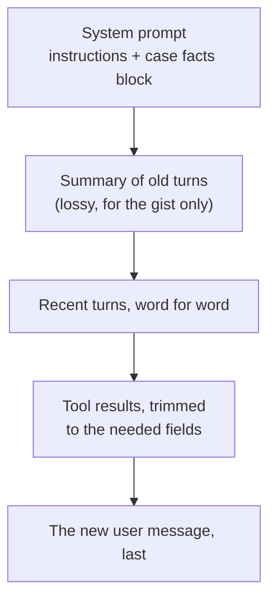
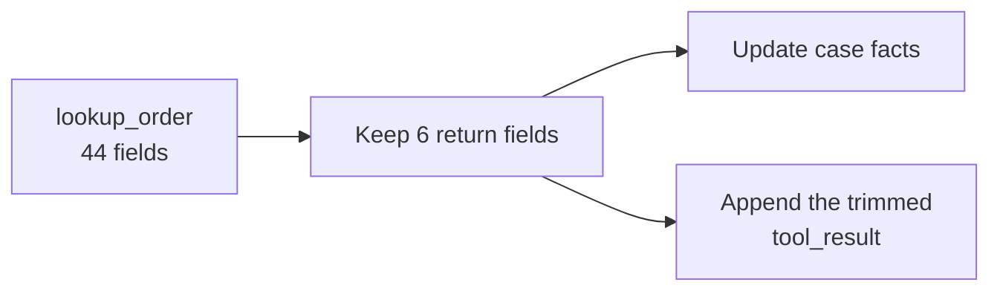

In a long conversation, the facts that matter most are often the first to blur: the order ID, the refund amount you promised, the date a return window closes. The fix is to stop trusting the chat history for them. Keep those facts in a small structured block that your code updates and sends with every request, trim tool results before they pile up, and put the important parts where the model reads most reliably. In this post you build that context manager in TypeScript and test it without an API key.

This is task statement 5.1 of the [Claude Certified Architect – Foundations exam guide](https://anthropic-partners.skilljar.com/claude-certified-architect-foundations-certification): "Manage conversation context to preserve critical information across long interactions". It opens Domain 5, Context Management & Reliability, which is 15% of the exam.

## What does task statement 5.1 test?

The guide lists four things to know and six skills. In plain words:

| The guide asks you to… | In practice |
| --- | --- |
| Know the risks of progressive summarization | Summaries turn exact numbers, dates and promises into vague phrases |
| Know the "lost in the middle" effect | Models read the start and end of a long input best and can miss things in the middle |
| Know how tool results pile up | A lookup with 40+ fields stays in the history and is resent on every call |
| Send the full history each time | The API keeps no memory between requests |
| Keep a case facts block | Amounts, dates, order IDs and statuses live in a block sent with every prompt, outside the summary |
| Keep one record per issue | When one chat covers two orders, each order gets its own structured record |
| Trim tool output | Keep only the fields the task needs before the result enters the history |
| Lead with key findings | Long, combined inputs start with a summary of findings and use clear section headers |
| Ask subagents for structured output | Findings come back with dates, sources and relevance scores, not long prose and reasoning |

If tool calls are new to you, read [What is tool calling?](/blog/what-is-tool-calling) first. If you want the basics of tokens and context windows, [What is an LLM?](/blog/what-is-an-llm) explains them.

## Why do long conversations lose facts?

Three things happen at once as a chat grows.

**The API remembers nothing.** The [Messages API docs](https://platform.claude.com/docs/en/build-with-claude/working-with-messages) say it "is stateless, which means that you always send the full conversational history to the API". Each request is the model's whole world. If a fact is not in the request, Claude can't use it.

**The request keeps growing.** Every user message, every reply and every tool result is added to the history and sent again on the next call. The [context windows page](https://platform.claude.com/docs/en/build-with-claude/context-windows) lists what counts: the system prompt, every message "including tool results", and your tool definitions.

**More context is not automatically better.** The same page warns: "As token count grows, accuracy and recall degrade, a phenomenon known as *context rot*." Current models such as Claude Opus 5.5 have a 1M-token window, so you rarely hit the hard limit. You hit the quality limit first.

So you need a plan for what goes into each request. Here is the layout this post builds:



The case facts sit at the top, where the model reads reliably. The new question sits at the end. The lossy summary is only there for the general story.

## Why is summarizing the history risky?

When a conversation gets long, a common move is "progressive summarization": replace the oldest turns with a short summary, and repeat as the chat grows. It saves tokens, but each round loses detail. Look at what a summary of a returns chat can do:

| What was said in turn 3 | What the summary says by turn 25 |
| --- | --- |
| "I can offer a partial refund of $42.50 on order A-1001." | "A refund was discussed." |
| "Your return window closes on 2026-10-02." | "The customer has some time left to return it." |
| "I'd like the refund to go back to my card, not store credit." | "The customer wants a refund." |

Each line is a fair summary. Each one also loses the exact value a later decision depends on. If the customer asks "How much did you agree?" at turn 25, Claude can only guess, or say it doesn't know.

Anthropic's engineering post on [context engineering](https://www.anthropic.com/engineering/effective-context-engineering-for-ai-agents) names the same risk: "overly aggressive compaction can result in the loss of subtle but critical context whose importance only becomes apparent later." A better summary prompt helps, but a summary is still a paraphrase. Don't make it the only home for a number.

## What is a case facts block?

A case facts block is a small, structured record of the facts this conversation depends on. Your code keeps it, updates it from tool results, and puts it in every request, outside the summarized history. Here is what the block looks like after a customer has asked about two orders:

```json
{
  "customerId": "C-77",
  "issues": {
    "A-1001": {
      "orderId": "A-1001",
      "status": "delivered",
      "orderTotal": "129.99 USD",
      "purchaseDate": "2026-09-02",
      "returnWindowEnds": "2026-10-02",
      "agreedRefund": "42.50 USD"
    },
    "B-2002": {
      "orderId": "B-2002",
      "status": "in_transit",
      "orderTotal": "58.00 USD",
      "purchaseDate": "2026-09-25",
      "returnWindowEnds": "2026-10-25"
    }
  }
}
```

Four rules make it work:

- **Code writes it, not the summary.** Values come from tool results and from tool calls such as `offer_refund`, copied exactly. Claude never has to remember them.
- **It is sent every time.** It goes into the system prompt on each request, so it survives any amount of summarizing.
- **One record per issue.** When a customer raises two problems in one chat, each order gets its own entry. The returns status of A-1001 can't leak into B-2002.
- **It stays small.** Only facts a later decision depends on. If it grows into a copy of the history, you've lost the point.

Anthropic's [prompting best practices](https://platform.claude.com/docs/en/build-with-claude/prompt-engineering/claude-prompting-best-practices) give the same advice for agents that track state: "When tracking structured information (like test results or task status), use JSON or other structured formats".

## How do I stop tool results from flooding the context?

Trim them before they enter the history. A real order lookup often returns dozens of fields: warehouse IDs, tracking numbers, payment provider details, sync timestamps. A returns agent needs about six. If you append the full result, those extra fields are resent on every later call. They cost money each time, and they give Claude more places to mix up which order had which status.

The fix is a filter between the tool and the history:



A prompt instruction like "ignore irrelevant fields" doesn't work as a fix. The fields are still in the context, still cost tokens and are still there to confuse. Trim in code.

If you can't change the tool, or you use the Claude Agent SDK, a `PostToolUse` hook can do the same trimming. The post for task statement 1.5, [Agent SDK hooks: intercept tool calls and normalize data](/blog/claude-agent-sdk-hooks), shows how.

## Where should key facts go in a long input?

Position matters. The paper [Lost in the Middle](https://arxiv.org/abs/2307.03172) (Liu et al., TACL) found that "performance is often highest when relevant information occurs at the beginning or end of the input context, and significantly degrades when models must access relevant information in the middle of long contexts."

This hits multi-agent systems hardest. A coordinator that pastes eight subagent reports into one input will tend to lose findings from the reports in the middle. Two habits help:

- **Lead with key findings.** Start the input with a short list of the most important findings from all reports, then include each report under a clear header.
- **Ask the question last.** Anthropic's [long context tips](https://platform.claude.com/docs/en/build-with-claude/prompt-engineering/claude-prompting-best-practices#long-context-prompting) say to put long documents near the top, above your query, and note that "Queries at the end can improve response quality by up to 30 percent in tests".

Here is a small function that builds such an input from structured subagent reports:


**aggregate.ts**

```ts
export interface Finding {
  claim: string;
  source: string;
  date: string;
  relevance: number; // 0-1, set by the subagent that found it
}

export interface Report {
  agent: string;
  method: string;
  findings: Finding[];
}

// Key findings first, one headed section per report, the question last.
export function buildSynthesisInput(reports: Report[], question: string, topN = 5): string {
  const cite = (f: Finding) => `${f.claim} (${f.source}, ${f.date})`;
  const top = reports
    .flatMap((r) => r.findings)
    .sort((a, b) => b.relevance - a.relevance)
    .slice(0, topN);

  const lines = ['# Key findings', ...top.map((f) => `- ${cite(f)}`), ''];
  for (const r of reports) {
    lines.push(`## Report: ${r.agent}`, `Method: ${r.method}`);
    lines.push(...r.findings.map((f) => `- ${cite(f)} [relevance ${f.relevance}]`), '');
  }
  lines.push(`# Question\n${question}`);
  return lines.join('\n');
}
```


With two small reports, one on pricing and one on user reviews, and `topN = 1`, the function returns:

```text
# Key findings
- Plan B costs $12 per seat (vendor-b.example/pricing, 2026-09-14)

## Report: web-search
Method: Searched vendor docs
- Plan B costs $12 per seat (vendor-b.example/pricing, 2026-09-14) [relevance 0.9]

## Report: reviews
Method: Read 40 user reviews
- Users report slow exports on Plan B (reviews.csv rows 3-9, 2026-08-30) [relevance 0.6]

# Question
Which plan should we buy?
```

This only works if subagents return structured findings. A subagent that returns 3,000 words of prose and reasoning leaves the next agent to dig the facts out, and it eats a small context budget. Ask subagents for records with the claim, the source, the date and a relevance score instead. The engineering post above describes subagents that explore with tens of thousands of tokens but return "a condensed, distilled summary of its work (often 1,000-2,000 tokens)". Task statement 1.3, "Configure subagent invocation, context passing, and spawning", covers how to pass those records between agents.

## Try it: build a context manager and test it without an API key

You'll build a small returns assistant with two tools: `lookup_order` (a fake order system that returns 44 fields) and `offer_refund` (records an amount Claude promised). A `ContextManager` keeps the case facts, the summary and the recent turns. Then you'll simulate a 30-turn chat, summarize the first 20 turns with a deliberately vague summarizer, and check whether the refund amount from turn 3 still reaches the model.

**You need:** Node.js 22.18 or later, which runs `.ts` files directly because [type stripping is on by default](https://nodejs.org/docs/latest-v22.x/api/typescript.html). An Anthropic API key only for the last step.


<Steps>


<Step title="Create the project">

```bash
$ mkdir context-manager
$ cd context-manager
$ npm init -y
$ npm pkg set type=module
```

Install the [official TypeScript SDK](https://github.com/anthropics/anthropic-sdk-typescript), then TypeScript and the Node types for type-checking:


```bash
npm install @anthropic-ai/sdk
```


```bash
npm install -D typescript @types/node
```


Add a `tsconfig.json` with the settings the Node docs recommend for code that Node runs directly, plus `allowImportingTsExtensions` (so imports can end in `.ts`) and `strict`:


**tsconfig.json**

```json
{
  "compilerOptions": {
    "noEmit": true,
    "target": "esnext",
    "module": "nodenext",
    "rewriteRelativeImportExtensions": true,
    "erasableSyntaxOnly": true,
    "verbatimModuleSyntax": true,
    "allowImportingTsExtensions": true,
    "strict": true
  }
}
```


</Step>


<Step title="Add the order tools and the trim filter">


**orders.ts**

```ts
import type Anthropic from '@anthropic-ai/sdk';

// A fake order system. A real lookup often returns dozens of fields like these.
export function lookupOrder(orderId: string): Record<string, unknown> {
  const orders: Record<string, { status: string; total: string; purchased: string; windowEnds: string }> = {
    'A-1001': { status: 'delivered', total: '129.99', purchased: '2026-09-02', windowEnds: '2026-10-02' },
    'B-2002': { status: 'in_transit', total: '58.00', purchased: '2026-09-25', windowEnds: '2026-10-25' },
  };
  const order = orders[orderId];
  if (!order) throw new Error(`No order with ID ${orderId}`);
  return {
    order_id: orderId, status: order.status, total_amount: order.total, currency: 'USD',
    purchase_date: order.purchased, return_window_ends: order.windowEnds,
    customer_id: 'C-77', loyalty_tier: 'silver', loyalty_points_earned: 130, marketing_opt_in: false,
    channel: 'web', storefront: 'us-main', locale: 'en-US', session_id: 'sess_8f2a', device: 'mobile',
    subtotal: order.total, tax_amount: '0.00', shipping_amount: '0.00', discount_code: null, discount_amount: '0.00',
    payment_method: 'card', payment_status: 'captured', payment_provider: 'example-pay', fraud_score: 3, risk_review: false,
    warehouse_id: 'WH-04', pick_list_id: 'PL-5521', packed_by: 'station-12', package_weight_g: 840,
    package_dimensions_cm: '30x20x10', carrier: 'example-post', service_level: 'standard', tracking_number: 'EX123456789',
    shipped_at: '2026-09-03T10:12:00Z', delivered_at: '2026-09-06T15:40:00Z', delivery_attempts: 1,
    gift_wrap: false, gift_message: null, invoice_id: 'INV-30091', erp_sync_status: 'synced', erp_batch: 'B-0906',
    created_at: '2026-09-02T08:01:00Z', updated_at: '2026-09-06T15:40:00Z', schema_version: 7,
  };
}

// The only fields a returns agent needs.
export const RETURN_FIELDS = [
  'order_id', 'status', 'total_amount', 'currency', 'purchase_date', 'return_window_ends',
] as const;

export type ReturnView = Partial<Record<(typeof RETURN_FIELDS)[number], unknown>>;

// Trim BEFORE the result enters the conversation, so the noise never accumulates.
export function trimOrder(order: Record<string, unknown>): ReturnView {
  return Object.fromEntries(RETURN_FIELDS.filter((key) => key in order).map((key) => [key, order[key]]));
}

export const tools: Anthropic.Tool[] = [
  {
    name: 'lookup_order',
    description:
      'Look up one order by its ID. Returns status, total, currency, purchase date and the last day of the return window.',
    input_schema: {
      type: 'object',
      properties: { order_id: { type: 'string', description: 'Order ID, e.g. "A-1001"' } },
      required: ['order_id'],
    },
  },
  {
    name: 'offer_refund',
    description:
      'Record a refund you have offered the customer for one order. Call it every time you promise an amount. ' +
      'The amount must not exceed the order total.',
    input_schema: {
      type: 'object',
      properties: {
        order_id: { type: 'string' },
        amount: { type: 'string', description: 'Amount as a decimal string, e.g. "42.50"' },
      },
      required: ['order_id', 'amount'],
    },
  },
];
```


`lookupOrder` returns 44 fields, like many real order APIs. `trimOrder` keeps the six a return needs. Money stays a string ("129.99") so nothing gets rounded on the way.

</Step>


<Step title="Write the context manager">


**context.ts**

```ts
import type Anthropic from '@anthropic-ai/sdk';

// Facts for ONE issue (here: one order). Values are copied exactly, never paraphrased.
export interface IssueFacts {
  orderId: string;
  status?: string;
  orderTotal?: string;
  purchaseDate?: string;
  returnWindowEnds?: string;
  agreedRefund?: string;
}

export interface CaseFacts {
  customerId: string;
  issues: Record<string, IssueFacts>; // one entry per order, so two problems never blur together
}

// Turns old messages into a short summary. In production this calls Claude.
export type Summarizer = (previousSummary: string, older: Anthropic.MessageParam[]) => Promise<string>;

export class ContextManager {
  readonly facts: CaseFacts;
  private readonly instructions: string;
  private readonly includeFacts: boolean;
  private history: Anthropic.MessageParam[] = [];
  private summary = '';

  constructor(customerId: string, instructions: string, { includeFacts = true } = {}) {
    this.facts = { customerId, issues: {} };
    this.instructions = instructions;
    this.includeFacts = includeFacts;
  }

  updateIssue(orderId: string, patch: Partial<IssueFacts>): void {
    const current = this.facts.issues[orderId] ?? { orderId };
    this.facts.issues[orderId] = { ...current, ...patch, orderId };
  }

  push(message: Anthropic.MessageParam): void {
    this.history.push(message);
  }

  // The API is stateless: this builds EVERYTHING the model will see on this call.
  buildRequest(model: string, tools: Anthropic.Tool[]): Anthropic.MessageCreateParamsNonStreaming {
    const system = this.includeFacts
      ? `${this.instructions}\n\n<case_facts>\n${JSON.stringify(this.facts, null, 2)}\n</case_facts>\n` +
        'The case facts are exact and current. Trust them over the conversation summary.'
      : this.instructions;

    const messages = [...this.history];
    if (this.summary && messages.length > 0) {
      // Put the summary in front of the first kept user turn (the history always starts with one).
      const [first, ...rest] = messages;
      const firstBlocks: Anthropic.ContentBlockParam[] =
        typeof first.content === 'string' ? [{ type: 'text', text: first.content }] : first.content;
      messages.splice(0, messages.length, {
        role: 'user',
        content: [
          { type: 'text', text: `<conversation_summary>\n${this.summary}\n</conversation_summary>` },
          ...firstBlocks,
        ],
      }, ...rest);
    }
    return { model, max_tokens: 2048, system, tools, messages };
  }

  // Replace everything except the last `keepTurns` user turns with a summary.
  async compact(summarize: Summarizer, keepTurns: number): Promise<void> {
    // A "turn" starts at a user message with plain text. Tool results are user messages too,
    // but cutting before one would separate it from its tool_use, which breaks the API format.
    const turnStarts = this.history.flatMap((m, i) => (m.role === 'user' && typeof m.content === 'string' ? [i] : []));
    if (turnStarts.length <= keepTurns) return;

    const cut = turnStarts[turnStarts.length - keepTurns];
    this.summary = await summarize(this.summary, this.history.slice(0, cut));
    this.history = this.history.slice(cut);
  }
}
```


What each part does:

- **`facts`** holds one record per order. `updateIssue` merges new values into the right record.
- **`buildRequest`** builds the full request on every call, because the API is stateless. The facts go in the system prompt, at the top. The summary goes in front of the oldest kept turn. The newest message stays last.
- **`compact`** replaces old turns with a summary but keeps the last `keepTurns` user turns word for word. It only cuts where a user typed a message. A `tool_result` must follow its `tool_use` directly, so cutting between them would break the next request.
- **The `includeFacts` option** exists only so the test can compare a run with the block and one without.

</Step>


<Step title="Connect it to the agent loop">


**agent.ts**

```ts
import type Anthropic from '@anthropic-ai/sdk';
import type { ContextManager, Summarizer } from './context.ts';
import { lookupOrder, tools, trimOrder } from './orders.ts';

export const MODEL = 'claude-opus-5-5';

export interface MessagesClient {
  messages: {
    create(params: Anthropic.MessageCreateParamsNonStreaming): Promise<Anthropic.Message>;
  };
}

export interface TurnOptions {
  trimToolResults?: boolean;
  log?: (line: string) => void;
}

// Run one tool. Every result passes through here, so this is where facts get recorded.
function runTool(ctx: ContextManager, toolUse: Anthropic.ToolUseBlock, trim: boolean): string {
  const input = toolUse.input as Record<string, string>;
  switch (toolUse.name) {
    case 'lookup_order': {
      const order = lookupOrder(input.order_id);
      ctx.updateIssue(input.order_id, {
        status: String(order.status),
        orderTotal: `${order.total_amount} ${order.currency}`,
        purchaseDate: String(order.purchase_date),
        returnWindowEnds: String(order.return_window_ends),
      });
      return JSON.stringify(trim ? trimOrder(order) : order);
    }
    case 'offer_refund': {
      const order = lookupOrder(input.order_id);
      if (Number(input.amount) > Number(order.total_amount)) {
        throw new Error(`Refund ${input.amount} is more than the order total ${order.total_amount}.`);
      }
      ctx.updateIssue(input.order_id, { agreedRefund: `${input.amount} ${order.currency}` });
      return JSON.stringify({ recorded: true, order_id: input.order_id, amount: input.amount });
    }
    default:
      throw new Error(`Unknown tool: ${toolUse.name}`);
  }
}

// One user turn: call Claude, run tools until it answers, keep the history in the manager.
export async function runTurn(
  client: MessagesClient,
  ctx: ContextManager,
  userText: string,
  { trimToolResults = true, log = () => {} }: TurnOptions = {},
): Promise<string> {
  ctx.push({ role: 'user', content: userText });

  for (let call = 1; call <= 10; call++) {
    const request = ctx.buildRequest(MODEL, tools);
    const response = await client.messages.create(request);
    log(`input_tokens=${response.usage.input_tokens} request_chars=${JSON.stringify(request).length}`);
    ctx.push({ role: 'assistant', content: response.content });

    if (response.stop_reason === 'tool_use') {
      const results: Anthropic.ToolResultBlockParam[] = response.content
        .filter((block): block is Anthropic.ToolUseBlock => block.type === 'tool_use')
        .map((toolUse) => {
          try {
            return { type: 'tool_result', tool_use_id: toolUse.id, content: runTool(ctx, toolUse, trimToolResults) };
          } catch (error) {
            return { type: 'tool_result', tool_use_id: toolUse.id, content: (error as Error).message, is_error: true };
          }
        });
      ctx.push({ role: 'user', content: results });
      continue;
    }
    if (response.stop_reason === 'end_turn') {
      return response.content
        .filter((block): block is Anthropic.TextBlock => block.type === 'text')
        .map((block) => block.text)
        .join('\n');
    }
    throw new Error(`Unexpected stop_reason: ${response.stop_reason}`);
  }
  throw new Error('Safety cap: too many tool calls in one turn.');
}

// A summarizer that asks Claude. Even with this prompt, treat the summary as lossy.
export function claudeSummarizer(client: MessagesClient): Summarizer {
  return async (previousSummary, older) => {
    const response = await client.messages.create({
      model: MODEL,
      max_tokens: 1024,
      system:
        'Summarize this support conversation in under 150 words. Keep every order ID, amount, date, ' +
        'status and promise exactly as written.',
      messages: [
        {
          role: 'user',
          content: `Earlier summary:\n${previousSummary || '(none)'}\n\nNew messages:\n${JSON.stringify(older)}`,
        },
      ],
    });
    return response.content
      .filter((block): block is Anthropic.TextBlock => block.type === 'text')
      .map((block) => block.text)
      .join('\n');
  };
}
```


`runTool` is the one place every tool result passes through. It records the facts from the full result, then returns the trimmed version for the history. `runTurn` is a short agent loop: it continues on `"tool_use"`, returns on `"end_turn"` and logs `usage.input_tokens` for every call, which is how the API reports what each request consumed. The post for task statement 1.1, [Agentic loops: stop_reason, tool results and when to stop](/blog/claude-agentic-loops), covers every stop reason in detail.

`claudeSummarizer` asks Claude for the summary. Its prompt asks to keep every amount and date, but the design doesn't rely on that.

</Step>


<Step title="Test it without an API key">

The test uses a fake client that plays back scripted replies in the shape the Messages API returns. It also uses a vague summarizer on purpose, the kind of summary that keeps the story and drops the numbers.


**context.test.ts**

```ts
import assert from 'node:assert/strict';
import { test } from 'node:test';
import type Anthropic from '@anthropic-ai/sdk';
import { runTurn, type MessagesClient } from './agent.ts';
import { ContextManager, type Summarizer } from './context.ts';
import { lookupOrder, trimOrder } from './orders.ts';

// Replies in the shape the Messages API returns.
const reply = (stop_reason: Anthropic.StopReason, content: Anthropic.ContentBlock[]): Anthropic.Message => ({
  id: 'msg_test',
  type: 'message',
  role: 'assistant',
  model: 'claude-opus-5-5',
  content,
  stop_reason,
  stop_sequence: null,
  stop_details: null,
  container: null,
  diagnostics: null,
  usage: {
    input_tokens: 0,
    output_tokens: 0,
    cache_creation: null,
    cache_creation_input_tokens: null,
    cache_read_input_tokens: null,
    inference_geo: null,
    output_tokens_details: null,
    server_tool_use: null,
    service_tier: null,
  },
});
const text = (t: string): Anthropic.TextBlock => ({ type: 'text', text: t, citations: null });
const toolUse = (id: string, name: string, input: object): Anthropic.ToolUseBlock => ({
  type: 'tool_use',
  id,
  name,
  input,
  caller: { type: 'direct' },
});

// A fake client that plays back scripted replies and records every request.
function fakeClient(replies: Anthropic.Message[]) {
  const requests: Anthropic.MessageCreateParamsNonStreaming[] = [];
  const client: MessagesClient = {
    messages: {
      create: async (params) => {
        requests.push(structuredClone(params));
        const next = replies.shift();
        if (!next) throw new Error('No more scripted replies');
        return next;
      },
    },
  };
  return { client, requests };
}

// A lossy summarizer, like a real one on a bad day: the gist survives, the numbers don't.
const vagueSummary: Summarizer = async () =>
  'Customer C-77 wants to return an order. A refund was discussed. They also asked about a second order.';

// 30 user turns. Turn 3 looks up A-1001 and offers 42.50. Turn 12 looks up B-2002. The rest is chat.
async function thirtyTurnChat(ctx: ContextManager) {
  const replies: Anthropic.Message[] = [];
  for (let turn = 1; turn <= 30; turn++) {
    if (turn === 3) {
      replies.push(
        reply('tool_use', [toolUse('toolu_a', 'lookup_order', { order_id: 'A-1001' })]),
        reply('tool_use', [toolUse('toolu_b', 'offer_refund', { order_id: 'A-1001', amount: '42.50' })]),
        reply('end_turn', [text('I have offered you a partial refund of $42.50 for order A-1001.')]),
      );
    } else if (turn === 12) {
      replies.push(
        reply('tool_use', [toolUse('toolu_c', 'lookup_order', { order_id: 'B-2002' })]),
        reply('end_turn', [text('Order B-2002 is on its way.')]),
      );
    } else {
      replies.push(reply('end_turn', [text(`Reply ${turn}.`)]));
    }
  }
  const { client } = fakeClient(replies);
  for (let turn = 1; turn <= 30; turn++) await runTurn(client, ctx, `Message ${turn} from the customer.`);
}

// What a model could answer, given ONLY the request it receives.
function answerFrom(request: Anthropic.MessageCreateParamsNonStreaming): string {
  const seen = String(request.system) + JSON.stringify(request.messages);
  const match = seen.match(/"agreedRefund": "([\d.]+ USD)"/);
  return match ? `You were offered ${match[1]}.` : 'A refund was discussed, but I cannot see the amount.';
}

const INSTRUCTIONS = 'You are a returns assistant for an online shop.';

test('trims a 44-field order lookup to the 6 fields a return needs', () => {
  const full = lookupOrder('A-1001');
  const trimmed = trimOrder(full);
  console.log(`fields: ${Object.keys(full).length} -> ${Object.keys(trimmed).length}`);
  console.log(`chars:  ${JSON.stringify(full).length} -> ${JSON.stringify(trimmed).length}`);
  assert.deepEqual(trimmed, {
    order_id: 'A-1001',
    status: 'delivered',
    total_amount: '129.99',
    currency: 'USD',
    purchase_date: '2026-09-02',
    return_window_ends: '2026-10-02',
  });
});

test('the case facts keep the refund amount after the history is summarized', async () => {
  for (const includeFacts of [true, false]) {
    const ctx = new ContextManager('C-77', INSTRUCTIONS, { includeFacts });
    await thirtyTurnChat(ctx);
    await ctx.compact(vagueSummary, 10); // turns 1-20 become the summary

    ctx.push({ role: 'user', content: 'How much refund did you agree for my first order?' });
    const request = ctx.buildRequest('claude-opus-5-5', []);

    // Turn 3 is gone from the messages either way: the summary dropped the number.
    assert.doesNotMatch(JSON.stringify(request.messages), /42\.50/);
    console.log(`facts block ${includeFacts ? 'on ' : 'off'}: ${answerFrom(request)}`);
    if (includeFacts) assert.match(String(request.system), /"agreedRefund": "42.50 USD"/);
    else assert.doesNotMatch(JSON.stringify(request), /42\.50/);
  }
});

test('each order keeps its own facts', async () => {
  const ctx = new ContextManager('C-77', INSTRUCTIONS);
  await thirtyTurnChat(ctx);
  assert.deepEqual(ctx.facts.issues, {
    'A-1001': {
      orderId: 'A-1001',
      status: 'delivered',
      orderTotal: '129.99 USD',
      purchaseDate: '2026-09-02',
      returnWindowEnds: '2026-10-02',
      agreedRefund: '42.50 USD',
    },
    'B-2002': {
      orderId: 'B-2002',
      status: 'in_transit',
      orderTotal: '58.00 USD',
      purchaseDate: '2026-09-25',
      returnWindowEnds: '2026-10-25',
    },
  });
});

test('compaction never separates a tool_result from its tool_use', async () => {
  const ctx = new ContextManager('C-77', INSTRUCTIONS);
  await thirtyTurnChat(ctx);
  await ctx.compact(vagueSummary, 19); // the cut lands right before turn 12's tool calls

  const { messages } = ctx.buildRequest('claude-opus-5-5', []);
  const [first] = messages;
  assert.equal(first.role, 'user');
  assert.match(JSON.stringify(first.content), /conversation_summary.*Message 12 from the customer/);

  // Every tool_result still has its tool_use in the message right before it.
  messages.forEach((m, i) => {
    if (typeof m.content === 'string') return;
    for (const block of m.content) {
      if (block.type !== 'tool_result') continue;
      const previous = messages[i - 1].content;
      assert.ok(Array.isArray(previous) && previous.some((b) => b.type === 'tool_use' && b.id === block.tool_use_id));
    }
  });
});

test('trimming tool results keeps every later request smaller', async () => {
  const lastSizes: number[] = [];
  for (const trimToolResults of [false, true]) {
    const replies: Anthropic.Message[] = [];
    for (let i = 0; i < 6; i++) {
      const id = i % 2 === 0 ? 'A-1001' : 'B-2002';
      replies.push(
        reply('tool_use', [toolUse(`toolu_${i}`, 'lookup_order', { order_id: id })]),
        reply('end_turn', [text(`Checked ${id}.`)]),
      );
    }
    const { client, requests } = fakeClient(replies);
    const ctx = new ContextManager('C-77', INSTRUCTIONS);
    for (let i = 0; i < 6; i++) await runTurn(client, ctx, `Check order ${i}.`, { trimToolResults });

    const last = JSON.stringify(requests.at(-1)).length;
    console.log(`trim ${trimToolResults ? 'on ' : 'off'}: last request ${last} chars`);
    lastSizes.push(last);
  }
  assert.ok(lastSizes[1] < lastSizes[0] / 2);
});
```


```bash
$ node --test --test-reporter=spec context.test.ts
```

```text
fields: 44 -> 6
chars:  1088 -> 146
facts block on : You were offered 42.50 USD.
facts block off: A refund was discussed, but I cannot see the amount.
trim off: last request 10994 chars
trim on : last request 4553 chars
✔ trims a 44-field order lookup to the 6 fields a return needs
✔ the case facts keep the refund amount after the history is summarized
✔ each order keeps its own facts
✔ compaction never separates a tool_result from its tool_use
✔ trimming tool results keeps every later request smaller
ℹ tests 5
ℹ suites 0
ℹ pass 5
ℹ fail 0
ℹ cancelled 0
ℹ skipped 0
ℹ todo 0
ℹ duration_ms 201.547236
```

This is our output on Node 22.22.2 with `@anthropic-ai/sdk` 0.131.0, with per-test timings removed. No model was called. `answerFrom` is a stand-in for Claude: it can only answer from what is in the request, just like the real model. What the test proves:

- **Trimming:** the lookup shrinks from 44 fields (1,088 characters) to 6 (146 characters). After six lookups the last request is less than half the size.
- **Facts survive summarizing:** after turns 1 to 20 are summarized, "42.50" appears nowhere in the messages. With the facts block, it is still in the system prompt. Without it, it is gone from the request entirely, so no model could answer correctly.
- **Separate issues:** A-1001 and B-2002 keep their own status, total and dates.
- **Safe cuts:** compaction never separates a `tool_result` from its `tool_use`.

Then type-check everything:

```bash
$ npx tsc
```

No output means no type errors.

</Step>


<Step title="Run it with Claude">

Create an API key in the [Claude Console](https://platform.claude.com/) and set it as the `ANTHROPIC_API_KEY` environment variable.


**main.ts**

```ts
import Anthropic from '@anthropic-ai/sdk';
import { createInterface } from 'node:readline/promises';
import { claudeSummarizer, runTurn } from './agent.ts';
import { ContextManager } from './context.ts';

const client = new Anthropic(); // reads ANTHROPIC_API_KEY from the environment
const summarize = claudeSummarizer(client);
const ctx = new ContextManager(
  'C-77',
  'You are a returns assistant for an online shop. Look up orders with lookup_order. ' +
    'Whenever you promise a refund, record it with offer_refund.',
);
const rl = createInterface({ input: process.stdin, output: process.stdout });

for (let turn = 1; ; turn++) {
  const userText = await rl.question('you> ');
  if (userText === 'exit') break;
  const answer = await runTurn(client, ctx, userText, { log: (line) => console.log(`  [${line}]`) });
  console.log(`claude> ${answer}`);
  if (turn % 20 === 0) await ctx.compact(summarize, 10); // summarize all but the last 10 turns
}
rl.close();
```


```bash
$ node main.ts
```

Ask about order A-1001, accept a refund offer, chat for a while, then ask "How much refund did you agree?". The `[input_tokens=…]` lines show how each request grows. To compare, set `trimToolResults: false` in `runTurn`, or create the manager with `{ includeFacts: false }`, and run the same chat again. Claude's wording will vary. Lower the compaction interval from 20 turns if you want to reach a summary sooner. The model is `claude-opus-5-5`, which the [models overview](https://platform.claude.com/docs/en/about-claude/models/overview) suggests starting with. If you want a count before you send a request, the free [token counting API](https://platform.claude.com/docs/en/build-with-claude/token-counting) (`client.messages.countTokens`) returns an estimate.

</Step>


</Steps>


## Does the API have built-in tools for this?

Yes, and they are worth knowing, but they don't replace the facts block:

| Feature | What it does | Status |
| --- | --- | --- |
| [Compaction](https://platform.claude.com/docs/en/build-with-claude/compaction) | Claude writes a summary of older turns on the server and it replaces them | Beta |
| [Context editing](https://platform.claude.com/docs/en/build-with-claude/context-editing) | The `clear_tool_uses_20250919` strategy clears the oldest tool results once context passes a threshold you set | Beta |

Compaction is still a summary, so exact values can still blur. The compaction docs even list writing your own summarization prompt "when the default summary drops something a later turn needs". Tool result clearing removes old results, but it doesn't keep the facts they contained. Use these features to manage size. Use the case facts block to keep what must stay exact. The exam tests the patterns, so know both.

## Common traps

These are the mistakes that wrong answer options are built on.

| Trap | Why it breaks | Fix |
| --- | --- | --- |
| "Just summarize the history when it gets long" | Summaries drop the exact values later decisions depend on | Summarize if you must, and keep facts in a separate block |
| "A bigger context window fixes it" | Accuracy still drops as context grows, middle content still gets missed, and every token is paid for on every call | Curate what goes in; trim and structure |
| "The API remembers the conversation" | It's stateless; anything you don't send is gone | Build the full request each time |
| "Tell the model to ignore extra fields" | The fields are still in context, costing tokens and causing mix-ups | Trim in code before the result enters the history |
| Pass a subagent's full reasoning downstream | Fills a small context budget with process, not facts | Ask for structured findings with sources, dates and relevance |
| One shared summary for several issues | Facts from one order attach to another | One structured record per issue |


<Callout type="warning" title="Only code should write the facts block">

Fill the case facts from tool results and tool calls, never by asking Claude to extract them from the summary. If a value comes from a lossy summary, the block just repeats the mistake with more confidence. And keep it small: put in what decisions depend on, not personal data you don't need.

</Callout>


## Practice questions

These four questions are this blog's own, written for practice. They are not from the exam.

**Question 1.** A billing agent's conversations often run past 50 turns. To stay within budget, older turns are replaced with a model-written summary. Customers complain that late in the chat the agent quotes the wrong credit amount it agreed to earlier. What is the best fix?

- A. Summarize more often, so each summary covers fewer turns.
- B. Keep agreed amounts, dates and account IDs in a structured case facts block that is included in every request, separate from the summary.
- C. Ask the model to write longer, more detailed summaries.
- D. Switch to a model with a larger context window and stop summarizing.

**Question 2.** In one chat, a customer reports a damaged blender (order 5531) and a missing charger (order 5540). Twenty turns later, after the early turns have been summarized into one paragraph, the agent sends the blender replacement against order 5540. What is the best fix?

- A. Tell the agent in the system prompt to double-check order numbers before any action.
- B. Ask the customer to repeat the order number before every action.
- C. Make the summary longer so both orders are described in detail.
- D. Keep a separate structured record for each issue, keyed by order ID with its item, status and agreed action, and include it in every request.

**Question 3.** A coordinator merges reports from eight subagents into one long input for a final synthesis step. Findings from the reports in the middle of the input are often left out of the final answer. Which change helps most?

- A. Randomize the order of the reports on each run.
- B. Drop the reports that end up in the middle.
- C. Start the input with a short summary of key findings from all reports, then include each report under a clear section header.
- D. Ask the synthesis agent to read the input twice.

**Question 4.** Your team moves a support agent to a model with a 1M-token context window. A teammate proposes removing the tool-result filter and the case facts block and sending every full order lookup and the whole raw history. What is the best response?

- A. Keep both. A bigger window adds room, but accuracy still drops as context grows, details in the middle still get missed, and unneeded tokens are paid for on every call.
- B. Agree. With 1M tokens, nothing gets lost.
- C. Agree, but put the full order lookups at the end of each request.
- D. Keep the filter, and drop the case facts block because the raw history now contains every fact.

## Answer key

### Question 1

**Answer: B.** Exact facts must live outside the lossy summary so they reach every request unchanged. The strongest distractor is C: a longer summary is still a paraphrase, and the number can still blur.

### Question 2

**Answer: D.** One structured record per issue keeps each order's facts apart, no matter how the history is summarized. The strongest distractor is A: a prompt instruction can't help when the summary no longer says which item belongs to which order.

### Question 3

**Answer: C.** Leading with key findings and using clear headers counters the position effect that makes middle content get missed. The strongest distractor is A: a random order only changes which reports get lost.

### Question 4

**Answer: A.** Window size doesn't fix context rot, the middle effect or cost. The strongest distractor is D: the facts are in the raw history, but buried among thousands of tokens, which is where they get missed.

## What should I do next?

- **Extend the manager.** Add a `customerExpectations` field (for example "refund to card, not store credit") and a tool that records it, then check it survives compaction.
- **Look at the cost side.** [AI cost and latency](/blog/ai-cost-and-latency) shows how input tokens drive your bill, which is the other reason to trim.
- **Move on to task statement 5.2**, "Design effective escalation and ambiguity resolution patterns". The next post in this series covers it.
- **Plan and check your prep.** Follow the [six-week study plan](/blog/claude-architect-exam-study-plan), and test yourself with the [mock exam](/blog/claude-certification-mock-exam) when you've worked through Domain 5.
