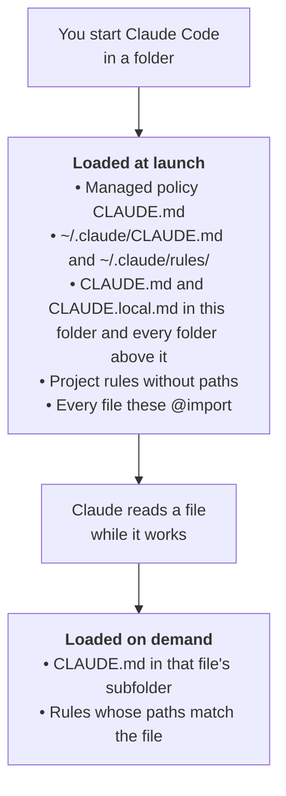

A `CLAUDE.md` file is a set of written instructions that Claude Code reads at the start of a session. You can have several of them: one in your home folder that is yours alone, one committed with the project for the whole team, and more in subfolders for one package. Claude Code joins them together. Most "Claude ignores our rules" problems come from a file in the wrong place, not from bad wording.

This is task statement 3.1 of the [Claude Certified Architect – Foundations exam guide](https://anthropic-partners.skilljar.com/claude-certified-architect-foundations-certification): "Configure CLAUDE.md files with appropriate hierarchy, scoping, and modular organization". It opens Domain 3, Claude Code Configuration & Workflows, which is 20% of the exam. In this post you set up a small monorepo with every kind of memory file, then check it with a script that needs no API key and never runs Claude.

## What does task statement 3.1 test?

The guide lists four things to know and four skills. In plain words:

| The guide asks you to… | In practice |
| --- | --- |
| Know the hierarchy: user, project and directory level | Know where each file lives and who gets it |
| Know that user-level files are not shared | `~/.claude/CLAUDE.md` is in your home folder, not in git |
| Know the `@import` syntax | `@path/to/file.md` pulls another file into a CLAUDE.md |
| Know `.claude/rules/` | Topic files instead of one huge CLAUDE.md |
| Diagnose hierarchy problems | "The new teammate doesn't get this rule" usually means it lives at user level |
| Import only what each package needs | A package's CLAUDE.md imports the standards its maintainers choose |
| Split a large CLAUDE.md | `testing.md`, `api-conventions.md`, `deployment.md` in `.claude/rules/` |
| Use `/memory` to check loaded files | Compare what each session loaded before you change anything |

If CLAUDE.md is new to you, read [Getting the most out of AI coding assistants](/blog/ai-coding-assistants-tips) first. It explains what to write in the file. This post is about where to put it.

## Where can a CLAUDE.md file live?

The [memory docs](https://code.claude.com/docs/en/memory) list four places. The exam guide names three levels (user, project, directory). The docs add a managed policy file and a personal per-project file, `CLAUDE.local.md`.

| Scope | Location | Who gets it | Put here |
| --- | --- | --- | --- |
| Managed policy | `/etc/claude-code/CLAUDE.md` on Linux and WSL (other paths on macOS and Windows) | Everyone on the machine; set by IT | Company-wide rules that nobody may switch off |
| User | `~/.claude/CLAUDE.md` | Only you, in every project | Your personal style, such as "show the diff first" |
| Project | `./CLAUDE.md` or `./.claude/CLAUDE.md` | The whole team, through git | Build and test commands, team conventions |
| Local | `./CLAUDE.local.md` (add it to `.gitignore`) | Only you, in this project | Your sandbox URL, your test data |
| Directory | `CLAUDE.md` in a subfolder, such as `packages/api/` | The whole team, through git | Rules for one package or area |

There is a user-level rules folder too: files in `~/.claude/rules/` apply to every project on your machine, and only for you.

The key column is "Who gets it". A file in your home folder works for you every day, so it is easy to forget that a teammate who clones the repository never gets it.

## When does each file load?

Claude Code doesn't load everything at once. The docs describe two moments:



- **At launch:** the files in the folder where you start Claude Code and in every folder above it, plus user files, rules without `paths`, and all their imports.
- **On demand:** a `CLAUDE.md` in a subfolder below where you started loads when Claude reads a file in that subfolder. Rules with `paths` frontmatter load when Claude reads a matching file.

Where you start matters. The [large codebases guide](https://code.claude.com/docs/en/large-codebases) gives the monorepo case: start at the repository root and only the root file loads at launch. Start in `packages/api/` and you get `packages/api/CLAUDE.md` and the root file, with nothing from `packages/web/`.

Two more rules from the docs explain most surprises:

- **Files add up; they don't replace each other.** All the files are joined into one context. The order runs from the top folder down to where you started, and `CLAUDE.local.md` comes after `CLAUDE.md` in each folder. A file that comes later doesn't win: "if two instructions contradict each other, Claude may pick one arbitrarily". Remove conflicts instead of trying to override them.
- **CLAUDE.md is guidance, not enforcement.** Claude reads it and tries to follow it. To block an action every time, use a hook or a permission rule instead.

## How do @imports work?

Write `@` and a path anywhere in a CLAUDE.md, and Claude Code puts that file's content into context next to it:

```md
- Root scripts: @package.json
- Error responses follow @../../docs/standards/api-errors.md
```

The rules from the docs:

- **Relative paths resolve from the file that contains the import**, not from where you started Claude. This catches people out in subfolders: in `packages/api/CLAUDE.md`, `@docs/standards/api-errors.md` points to `packages/api/docs/standards/api-errors.md`. You need `@../../docs/standards/api-errors.md`.
- **Imports can import other files**, up to four hops deep.
- **Imports inside backticks or code blocks are ignored.** Write `` `@README` `` to mention a file without importing it.
- **A path with spaces needs a backslash before each space**, as in `@Design\ Docs/api.md`.
- **Imports outside the project ask first.** The first time a project file imports something outside your working folder, such as `@~/.claude/my-notes.md`, Claude Code shows an approval dialog.
- **Imports don't save context.** Imported files load at launch, so a 1,000-line file split into ten imports still costs 1,000 lines. Imports keep files easy to maintain. To load less, use a subfolder CLAUDE.md or a path-scoped rule.

## What goes in .claude/rules/?

`.claude/rules/` is a folder of Markdown files, one topic per file, such as `testing.md` or `deployment.md`. Claude Code finds every `.md` file in it, in subfolders too, without any import. A rule with no frontmatter loads at launch "with the same priority as `.claude/CLAUDE.md`".

A rule can also start with `paths:` frontmatter, such as `"packages/api/**/*.ts"`. It then loads only when Claude reads a matching file. That is task statement 3.3, and a later post in this series covers it.

Here is how the options compare when one CLAUDE.md gets too big:

| Tool | Loads | Best for |
| --- | --- | --- |
| One root CLAUDE.md | Always | Short, repo-wide facts: commands, layout, "always do X" |
| `@import` | Always, with the file that imports it | Reusing a file that already exists, such as `package.json` or a standards doc |
| `.claude/rules/topic.md` | Always (no `paths`) or for matching files | Splitting a long file into owned topics |
| Subfolder `CLAUDE.md` | When Claude works in that folder | Rules one package's maintainers own |
| A skill | When invoked or relevant | Multi-step procedures, not always-on rules |

The docs suggest keeping each CLAUDE.md under 200 lines, because "longer files consume more context and reduce adherence".

## Try it: build the layout and check it with a script

You'll set up a small pnpm monorepo called `acme-shop` with every kind of memory file. Then you'll run a short Node script that lists which files Claude Code should load, who gets each one, and whether every `@import` points to a real file. The script reads files and asks git; it never starts Claude and needs no API key.

**You need:** Node.js 22.18 or later, which [runs `.ts` files directly](https://nodejs.org/docs/latest-v22.x/api/typescript.html), and git.


<Steps>


<Step title="Create the repository">

```bash
$ mkdir -p acme-shop/.claude/rules acme-shop/docs/standards acme-shop/packages/api acme-shop/packages/web acme-shop/scripts
$ cd acme-shop
$ git init
```

Add a `package.json` and a `.gitignore`. The `.gitignore` keeps your personal `CLAUDE.local.md` out of git, as the docs advise.


**package.json**

```json
{
  "name": "acme-shop",
  "private": true,
  "type": "module",
  "scripts": {
    "test": "pnpm -r test",
    "lint": "pnpm -r lint"
  }
}
```


**.gitignore**

```text
node_modules/
CLAUDE.local.md
```


</Step>


<Step title="Find the rule that only you have">

Say Alex wrote "use pnpm, never npm" in `~/.claude/CLAUDE.md`. On Alex's laptop Claude uses pnpm. Sam clones the repository, and Claude may run `npm install` for Sam, because Sam's machine has no copy of that file.

The fix is to move every team rule into the project file. Keep only personal style in `~/.claude/CLAUDE.md`:


**~/.claude/CLAUDE.md**

```md
# Alex's preferences (every project)

- Keep explanations short. Show the diff first.
```


**CLAUDE.md**

```md
# acme-shop

A pnpm monorepo: `packages/api` is the HTTP API, `packages/web` is the website.

## Commands

- Use pnpm, never npm or yarn. Add a dependency with `pnpm --filter <package> add <name>`.
- Run all tests with `pnpm test` before you say a task is done.
- Root scripts: @package.json

Testing and deployment rules live in `.claude/rules/`.
```


The last line mentions `.claude/rules/` in backticks, so it imports nothing. Rules load on their own.

Your own sandbox URL goes in `CLAUDE.local.md`. It is gitignored, so it stays on your machine:


**CLAUDE.local.md**

```md
# My local setup (not committed)

- My API sandbox runs at http://localhost:4000. Use it for manual checks.
```


</Step>


<Step title="Split topics into .claude/rules/">

Testing and deployment get a file each, so each topic has a clear owner and smaller diffs:


**.claude/rules/testing.md**

```md
# Testing

- Tests sit next to the code as `*.test.ts` and run with `node --test`.
- Never call the real payment provider in tests. Use the fake in `packages/api/src/fakes/`.
```


**.claude/rules/deployment.md**

```md
# Deployment

- Never deploy from a laptop. Merging to `main` deploys through CI.
- Database migrations go in their own pull request.
```


</Step>


<Step title="Give each package its own CLAUDE.md">

The API team wants the shared error format. The web team doesn't need it. So only the API's file imports it. Note the `../../`: the path starts from `packages/api/`.


**docs/standards/api-errors.md**

```md
# API error format

Every error response is JSON: `{ "error": { "code": "NOT_FOUND", "message": "…" } }`.
Use upper snake case for `code`. Never put stack traces in `message`.
```


**packages/api/CLAUDE.md**

```md
# packages/api

- One route file per resource in `src/routes/`.
- Error responses follow @../../docs/standards/api-errors.md
```


**packages/web/CLAUDE.md**

```md
# packages/web

- One component per file in `src/components/`.
- Components never call `fetch` directly. Use `src/lib/api-client.ts`.
```


Commit everything except `CLAUDE.local.md`, which git now ignores:

```bash
$ git add .
$ git commit -m "Add Claude Code memory files"
```

</Step>


<Step title="Add the check script">

The script follows the loading rules from the memory docs for a session started at the repository root. It asks git who gets each file, follows imports from the folder of the file that contains them, and flags missing imports, chains deeper than four hops, files over 200 lines and memory files that are neither committed nor ignored.


**scripts/check-claude-md.ts**

````ts
// Lists the CLAUDE.md files and rules Claude Code would find when you start it
// at the repository root, checks every @import, and says who gets each file.
// Usage: node scripts/check-claude-md.ts [repo-root]
import { execFileSync } from 'node:child_process';
import { existsSync, readdirSync, readFileSync } from 'node:fs';
import { homedir } from 'node:os';
import { basename, dirname, join, relative, resolve, sep } from 'node:path';

const root = resolve(process.argv[2] ?? '.');
const home = homedir();
const MAX_HOPS = 4; // the docs allow imports of imports, up to four hops
const MAX_LINES = 200; // the docs' target size per CLAUDE.md file
let problems = 0;

const show = (file: string) =>
  file.startsWith(root + sep) ? relative(root, file) : file.replace(home, '~');

// Who gets this file? Asks git, so the answer matches what a teammate clones.
function audience(file: string): string {
  if (!file.startsWith(root + sep)) return 'you only (user level)';
  const rel = relative(root, file);
  const git = (...args: string[]) => {
    try {
      execFileSync('git', ['-C', root, ...args], { stdio: 'ignore' });
      return true;
    } catch {
      return false;
    }
  };
  if (git('check-ignore', '-q', rel)) return 'you only (gitignored)';
  if (git('ls-files', '--error-unmatch', rel)) return 'whole team (committed)';
  problems++;
  return 'NOT COMMITTED: commit it or add it to .gitignore';
}

// Find @path imports. Like Claude Code, skip fenced code blocks and `code spans`.
function findImports(text: string): string[] {
  const prose = text
    .replace(/^(```|~~~)[\s\S]*?^\1/gm, '')
    .replace(/`[^`\n]*`/g, '');
  const imports: string[] = [];
  for (const match of prose.matchAll(/(?:^|\s)@((?:\\ |[^\s])+)/g)) {
    imports.push(match[1].replace(/\\ /g, ' ').replace(/[.,;:)]+$/, ''));
  }
  return imports;
}

// Print one memory file, then its imports. Relative imports resolve from the
// folder of the file that contains them, not from where you started Claude.
function report(file: string, indent = '  ', hops = 0, seen = new Set<string>()): void {
  const text = readFileSync(file, 'utf8');
  const lines = text.trimEnd().split('\n').length;
  const count = `${lines} line${lines === 1 ? '' : 's'}`;
  const size = lines > MAX_LINES ? `${count}: over ${MAX_LINES}, consider splitting` : count;
  if (lines > MAX_LINES) problems++;
  console.log(`${indent}${show(file)}  [${audience(file)}, ${size}]`);
  seen.add(file);
  for (const target of findImports(text)) {
    const path = target.startsWith('~/')
      ? join(home, target.slice(2))
      : resolve(dirname(file), target);
    const label = `${indent}  imports @${target}`;
    if (!existsSync(path)) {
      problems++;
      console.log(`${label}  MISSING: no file at ${show(path)}`);
    } else if (hops + 1 > MAX_HOPS) {
      problems++;
      console.log(`${label}  TOO DEEP: more than ${MAX_HOPS} hops`);
    } else if (seen.has(path)) {
      console.log(`${label}  (already loaded)`);
    } else {
      const outside = !path.startsWith(root + sep) && file.startsWith(root + sep);
      console.log(outside ? `${label}  outside the repo: Claude Code asks you to approve it once` : label);
      report(path, indent + '    ', hops + 1, seen);
    }
  }
}

// A rule's `paths:` frontmatter, as a YAML list or one comma-separated line.
// This small reader handles those two shapes only; it is not a full YAML parser.
function readPaths(text: string): string | null {
  const front = text.match(/^---\n([\s\S]*?)\n---/)?.[1].split('\n') ?? [];
  const at = front.findIndex((line) => line.startsWith('paths:'));
  if (at === -1) return null;
  const inline = front[at].slice('paths:'.length).trim();
  const list = inline ? inline.split(',') : [];
  for (const line of inline ? [] : front.slice(at + 1)) {
    if (!/^\s+-/.test(line)) break;
    list.push(line);
  }
  return list.map((p) => p.replace(/^\s*-\s*/, '').replace(/^["']|["']$/g, '').trim()).join(', ');
}

// Rules: every .md file under .claude/rules/, in subfolders too.
function rules(dir: string): { file: string; paths: string | null }[] {
  if (!existsSync(dir)) return [];
  return readdirSync(dir, { recursive: true, encoding: 'utf8' })
    .filter((name) => name.endsWith('.md'))
    .sort()
    .map((name) => {
      const file = join(dir, name);
      return { file, paths: readPaths(readFileSync(file, 'utf8')) };
    });
}

// Subdirectory CLAUDE.md files: loaded on demand, not at launch.
function nested(dir: string): string[] {
  const found: string[] = [];
  for (const entry of readdirSync(dir, { withFileTypes: true })) {
    if (!entry.isDirectory() || entry.name === 'node_modules' || entry.name.startsWith('.')) continue;
    const sub = join(dir, entry.name);
    for (const name of ['CLAUDE.md', 'CLAUDE.local.md']) {
      if (existsSync(join(sub, name))) found.push(join(sub, name));
    }
    found.push(...nested(sub));
  }
  return found;
}

const atLaunch = [
  join(home, '.claude', 'CLAUDE.md'),
  join(root, 'CLAUDE.md'),
  join(root, '.claude', 'CLAUDE.md'),
  join(root, 'CLAUDE.local.md'),
].filter(existsSync);
const allRules = [...rules(join(home, '.claude', 'rules')), ...rules(join(root, '.claude', 'rules'))];

console.log(`If you start Claude Code in ${basename(root)}/ (the repository root):\n\nLoaded at launch:`);
for (const file of atLaunch) report(file);
for (const rule of allRules.filter((r) => !r.paths)) report(rule.file);

console.log('\nLoaded on demand:');
for (const rule of allRules.filter((r) => r.paths)) {
  console.log(`  when Claude reads a file matching ${rule.paths}:`);
  report(rule.file, '    ');
}
for (const file of nested(root)) {
  console.log(`  when Claude reads a file in ${show(dirname(file))}/:`);
  report(file, '    ');
}

console.log(problems ? `\n${problems} problem(s) found.` : '\nNo problems found.');
process.exitCode = problems ? 1 : 0;
````


It is a model of the documented rules, not Claude Code itself. It leaves out the managed policy file, folders above the repository, and `AGENTS.md`, and it reads only simple `paths:` frontmatter.

</Step>


<Step title="Run it">

```bash
$ node scripts/check-claude-md.ts
```

Here is the output on Alex's machine:

```text
If you start Claude Code in acme-shop/ (the repository root):

Loaded at launch:
  ~/.claude/CLAUDE.md  [you only (user level), 3 lines]
  CLAUDE.md  [whole team (committed), 11 lines]
    imports @package.json
      package.json  [whole team (committed), 9 lines]
  CLAUDE.local.md  [you only (gitignored), 3 lines]
  .claude/rules/deployment.md  [whole team (committed), 4 lines]
  .claude/rules/testing.md  [whole team (committed), 4 lines]

Loaded on demand:
  when Claude reads a file in packages/api/:
    packages/api/CLAUDE.md  [whole team (committed), 4 lines]
      imports @../../docs/standards/api-errors.md
        docs/standards/api-errors.md  [whole team (committed), 4 lines]
  when Claude reads a file in packages/web/:
    packages/web/CLAUDE.md  [whole team (committed), 4 lines]

No problems found.
```

This is our run on Node 22.22.2. Read it as the expected loading plan, not as output from Claude Code. Each line answers one exam question: the `~/.claude/` file and `CLAUDE.local.md` are "you only", the team rules are committed, and the error standard sits under `packages/api/` only. On Sam's machine, the `~/.claude/CLAUDE.md` line is simply missing.

</Step>


<Step title="Break an import on purpose">

In `packages/api/CLAUDE.md`, change the import to the path you'd write from the repository root, `@docs/standards/api-errors.md`, and run the script again:

```text
Loaded on demand:
  when Claude reads a file in packages/api/:
    packages/api/CLAUDE.md  [whole team (committed), 4 lines]
      imports @docs/standards/api-errors.md  MISSING: no file at packages/api/docs/standards/api-errors.md
  when Claude reads a file in packages/web/:
    packages/web/CLAUDE.md  [whole team (committed), 4 lines]

1 problem(s) found.
```

The exit code is 1, so you can run the script in CI and catch the mistake in review. Change the path back to `@../../docs/standards/api-errors.md`.

</Step>


<Step title="Confirm it in Claude Code">

The script shows what should load. To see what did load in a real session, run `/context` and read the list under **Memory files**. Start once at the repository root and once in `packages/api/`:

- From the root, you should see the root files at launch, and `packages/api/CLAUDE.md` only after Claude reads a file in `packages/api/`.
- From `packages/api/`, you should see `packages/api/CLAUDE.md` and the root `CLAUDE.md` at launch, and nothing from `packages/web/`.

Use `/memory` to open and edit any of these files from inside the session.

</Step>


</Steps>


## How do I debug "Claude ignores our rules"?

Find out what each session loaded before you rewrite anything. The docs' troubleshooting steps, in order:

1. **Check the file loaded.** Run `/context` and look under **Memory files**. If a file isn't listed, Claude can't see it.
2. **Check the location.** Is the rule in a file that loads for this person and this folder? A rule in someone's `~/.claude/CLAUDE.md` or in a sibling package's CLAUDE.md is the usual cause.
3. **Make it specific.** "Use 2-space indentation" works better than "format code nicely".
4. **Look for conflicts.** Two files that disagree can leave Claude following either one.
5. **Enforce what must always happen.** If a rule must run every time, such as "lint before every commit", make it a hook.

The exam guide words this skill as "using the /memory command to verify which memory files are loaded". In current Claude Code, the [commands reference](https://code.claude.com/docs/en/commands) describes `/memory` as the place to edit CLAUDE.md files and manage auto memory, and the memory docs point to `/context` for the files the current session loaded. Know both names for the exam.


<Callout type="warning" title="CLAUDE.md is in git, so treat it as public">

Everything in a project CLAUDE.md, its rules and its imports is committed and goes into Claude's context. Never put API keys, passwords or internal hostnames you wouldn't share there. Put personal values in `CLAUDE.local.md` and read secrets from environment variables. See [Keep secrets out of AI prompts](/blog/secrets-in-ai-prompts).

</Callout>


## Common traps

These are the mistakes wrong answer options are built on.

| Trap | Why it breaks | Fix |
| --- | --- | --- |
| Team rules in `~/.claude/CLAUDE.md` | Only you have the file; new teammates never get it | Move them to the project CLAUDE.md or `.claude/rules/` and commit |
| Personal values in the root CLAUDE.md | Your sandbox URL becomes everyone's instruction | Use `CLAUDE.local.md`, gitignored |
| One 1,000-line CLAUDE.md | Costs context in every session, follows less well, and causes merge conflicts | Split into `.claude/rules/` topics and subfolder files |
| Thinking `@import` saves context | Imports load at launch with their parent file | Use subfolder CLAUDE.md files or path-scoped rules |
| Root-relative imports in a subfolder | Relative paths start from the importing file, so the import misses | Write `@../../docs/…` or check with a script |
| Importing every standard into every package | Adds rules that don't apply and can conflict | Import only what each package's maintainers choose |
| "Override" a rule in a later file | Files are joined, not replaced; Claude may follow either | Remove the conflicting line |
| Repeating the rule in every prompt | Hides a missing file for one task | Check `/context`, then fix the file's location |

## Practice questions

These four questions are this blog's own, written for practice. They are not from the exam.

**Question 1.** You test against your own staging database at `http://localhost:5433`, and you want Claude to use it whenever you work in this repository. Your teammates use different URLs, and you don't want the value to reach other projects. Where should the instruction go?

- A. The project's root `CLAUDE.md`
- B. `~/.claude/CLAUDE.md`
- C. `CLAUDE.local.md` at the project root, listed in `.gitignore`
- D. A new file, `.claude/rules/staging.md`

**Question 2.** A monorepo has `packages/billing` and `packages/marketing-site`. The billing maintainers want Claude to follow `docs/standards/money-handling.md` (integer cents, no floats) whenever it works in billing. The marketing team doesn't want that guidance in their sessions. What should you do?

- A. Paste the whole money-handling document into the root `CLAUDE.md`.
- B. Add `@docs/standards/money-handling.md` to `packages/billing/CLAUDE.md`.
- C. Add `@../../docs/standards/money-handling.md` to `packages/billing/CLAUDE.md`.
- D. Import the document in the root `CLAUDE.md` and add "ignore the money-handling rules" to `packages/marketing-site/CLAUDE.md`.

**Question 3.** The root `CLAUDE.md` of a payments platform has grown to 1,200 lines about testing, API design, deployment, logging and security. Pull requests that touch it often conflict, and nobody knows which team owns which section. Every topic must still apply in every session. What is the most maintainable change?

- A. Split it into topic files such as `.claude/rules/testing.md`, `.claude/rules/api-conventions.md` and `.claude/rules/deployment.md`.
- B. Move the content into `~/.claude/CLAUDE.md` on each developer's machine so the repository file stays small.
- C. Delete the older half of the file.
- D. Turn each section into a skill that developers invoke when they remember.

**Question 4.** Two developers on the same branch get different results: Claude follows the logging rules for one of them but not the other. Before you change any file, what should you do first?

- A. Add the logging rules to the start of every task prompt.
- B. Compare the memory files each session loaded, for example with `/context` (the guide says `/memory`), and look for the missing or extra file.
- C. Reinstall Claude Code on the second machine.
- D. Copy the logging rules into every subfolder CLAUDE.md.

## Answer key

### Question 1

**Answer: C.** `CLAUDE.local.md` is for "personal project-specific preferences": it loads only in this project and, once gitignored, only for you. The strongest distractor is B: it is personal too, but it applies to every project on your machine, so the URL leaks into work where it is wrong.

### Question 2

**Answer: C.** A package CLAUDE.md that imports the standard brings it in only where the billing maintainers want it, and git shares it with the team. Relative imports start from the folder of the importing file, so from `packages/billing/` the path needs `../../`. The strongest distractor is B: it is the right idea, but the path points to `packages/billing/docs/standards/money-handling.md`, which doesn't exist.

### Question 3

**Answer: A.** Rules without `paths` load in every session, like CLAUDE.md, and each topic becomes a small file that one team can own and review. The strongest distractor is D: it also shrinks the file, but skills load only when invoked or relevant, so standards that must always apply would often be missing.

### Question 4

**Answer: B.** Check what each session loaded before you change anything. The usual cause is a file one person has and the other doesn't, often at user level or in a package the other person never opened. The strongest distractor is A: it hides the symptom for one task and leaves the gap in the configuration.

## What should I do next?

- **Run the script on your own repository.** Fix any `MISSING` import or `NOT COMMITTED` file it finds, then compare its plan with `/context`.
- **Move on to task statement 3.2**, "Create and configure custom slash commands and skills". The next post in this series covers it.
- **Plan and check your prep.** Task statement 3.1 is part of week 3 in the [six-week study plan](/blog/claude-architect-exam-study-plan). Test yourself with the [mock exam](/blog/claude-certification-mock-exam) when you've worked through the domain.
