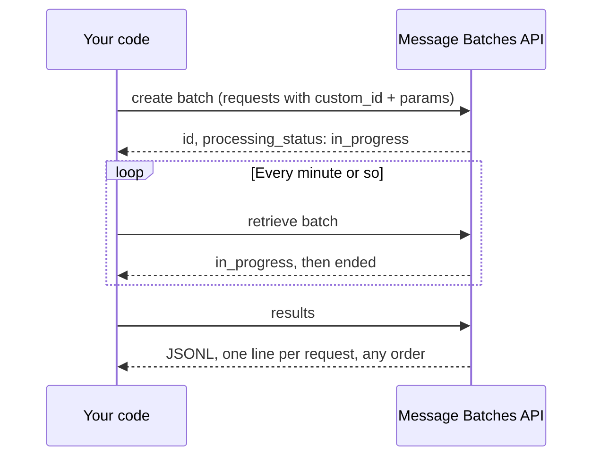

The Message Batches API runs many Claude requests in the background at half the normal price. The catch is time: a batch can take up to 24 hours, with no promise of when it finishes. So use it for work nobody is waiting on, like nightly reports or bulk extraction, and keep the normal API for anything a person or a pipeline is blocked on. In this post you build a batch of support tickets with a `custom_id` on each request, read a results file, and plan a second batch that resends only the failures. You test all of it offline, without an API key.

This is task statement 4.5 of the [Claude Certified Architect – Foundations exam guide](https://anthropic-partners.skilljar.com/claude-certified-architect-foundations-certification): "Design efficient batch processing strategies". It is part of Domain 4, Prompt Engineering & Structured Output, which is 20% of the exam.

## What does task statement 4.5 test?

The guide lists four things to know and four skills. In plain words:

| The guide asks you to… | In practice |
| --- | --- |
| Know the Message Batches API: 50% cheaper, up to 24 hours, no latency guarantee | Lower price, but you can't promise when results arrive |
| Know which work fits | Overnight reports, weekly audits, nightly test generation: yes. A pre-merge check: no |
| Know that a batch request can't do multi-turn tool calling | A request can't stop, run your tool, and carry on with the result |
| Know `custom_id` | Your own label on each request, used to match the result to it |
| Choose the normal API or batches by how long people can wait | Blocking step: normal API. Scheduled analysis: batch |
| Work out how often to submit to meet a deadline | Wait for the next submission + up to 24 hours + your other steps |
| Resubmit only the failures, found by `custom_id`, with a fix | Split a document that was too long, then resend just that one |
| Refine the prompt on a sample first | Fewer failures in the big batch, so fewer resubmissions |

The previous post in this series, [Validation and retry loops for Claude extraction](/blog/claude-validation-retry-loops) (task statement 4.4), retried one document at a time with the normal API. This post moves the same kind of work into batches. If the normal API is new to you, start with [your first LLM API call](/blog/first-llm-api-call).

## How does the Message Batches API work?

A **batch** is a list of normal Messages API requests that you send in one call. Each request has two parts: a `custom_id` and the usual `params` (model, `max_tokens`, messages and so on). The [batch processing docs](https://platform.claude.com/docs/en/build-with-claude/batch-processing) describe three steps:

1. You create the batch. Its `processing_status` starts as `in_progress`.
2. Anthropic processes the requests in the background, "each request handled independently".
3. You poll the batch until `processing_status` is `ended`, then download the results.



The results come as **JSONL**: a text file with one JSON object per line. Each line has the `custom_id` and a `result` with one of four types:

| `result.type` | What happened | Billed? | What to do |
| --- | --- | --- | --- |
| `succeeded` | The request ran. The line holds the full message. | Yes | Read it, then check `stop_reason` and your own validation |
| `errored` | The request failed, for example an invalid request or a server error | No | `invalid_request_error`: fix the request first. Other errors: resend it as is |
| `canceled` | You canceled the batch before this request ran | No | Resend it if you still need it |
| `expired` | The 24 hours ran out before this request ran | No | Resend it |

The "what to do" column for `errored` comes straight from the docs' own example code: for an `invalid_request_error`, the "request body must be fixed before re-sending", while other errors "can be retried directly". A failed request doesn't affect the others in the same batch.

## What are the numbers?

These come from the batch processing docs, read on 2 October 2026:

| Limit | Value |
| --- | --- |
| Price | 50% of the standard API price, for input and output tokens |
| Processing time | Most batches in less than 1 hour; up to 24 hours. Requests not done by then expire. |
| Batch size | 100,000 requests or 256 MB, whichever comes first |
| `custom_id` | 1 to 64 characters: letters, digits, `-` and `_`, unique in the batch |
| Results kept | 29 days after the batch was created (not after it ended) |
| Changing a batch | Not possible. Cancel it and submit a new one. |
| Not allowed in a batch | `stream: true`, `speed` (fast mode), `max_tokens: 0` |

On Claude Opus 5.5, the [models overview](https://platform.claude.com/docs/en/about-claude/models/overview) lists $4 per million input tokens and $20 per million output tokens. The batch price is $2 and $10. So 10,000 tickets at 2,000 input tokens and 300 output tokens each cost about $140 with the normal API and about $70 as a batch. The published post [AI cost and latency](/blog/ai-cost-and-latency) shows how to estimate costs like this, and how batches compare with other ways to save.

Batches also have their own [rate limits](https://platform.claude.com/docs/en/api/rate-limits#message-batches-api), including a cap on how many batch requests can wait in the queue at once. Batch usage doesn't count against your normal Messages API rate limits.

## When does a batch fit, and when doesn't it?

Ask one question: **is anyone waiting for this answer?** If a person or a pipeline step can't move on until Claude replies, a batch is the wrong tool. "Most batches finish within an hour" is not a promise. Some days a batch will take much longer, and the docs warn that under heavy demand more requests can expire.

| Workload | Who waits? | Use |
| --- | --- | --- |
| Overnight report on yesterday's support tickets | Nobody until morning | Batch |
| Weekly audit of all repositories for licence problems | Nobody this week | Batch |
| Nightly generation of test cases for changed code | Nobody until the next day | Batch |
| Extracting fields from 50,000 old contracts | Nobody: it's a backlog | Batch |
| Running your eval set after a prompt change | Usually nobody: a few hours is fine | Batch |
| A check that must pass before a pull request can merge | The developer and the merge | Normal API |
| A chat reply, or a support agent's draft answer | A person, right now | Normal API |
| An agent that calls your tools step by step | The next step | Normal API |

Mixed systems are common. The same team can run a pre-merge review on the normal API and a nightly deep audit of the whole codebase as a batch.

### How often should I submit to meet a deadline?

If documents arrive all day and you promise results within a set time, work out the worst case. A document that arrives just after a submission waits a full interval for the next one, then up to 24 hours in the batch, then whatever your own steps take:

```text
worst case = submission interval + 24 hours + your other steps  ≤  deadline
```

The guide's example: with a 30-hour deadline and nothing else to add, submit at least every 4 hours (4 + 24 = 28). With a 36-hour deadline and 4 hours of checks after the batch, every 8 hours works (8 + 24 + 4 = 36). If you also promise that failed documents get a second batch within the same deadline, add another 24 hours for that round. The [mock exam](/blog/claude-certification-mock-exam) has a question on exactly this calculation.

## Why can't a batch request run my tools?

Batches accept almost any Messages API request, including tool definitions, conversation history and server tools. The limit is about what happens *during* one request.

With your own tools (client tools), the [tool use docs](https://platform.claude.com/docs/en/agents-and-tools/tool-use/how-tool-use-works) describe a loop: Claude replies with `stop_reason: "tool_use"`, your code runs the tool, and you send the result back in a *new request*. A batch request can't pause in the middle for your code. It ends with the `tool_use` reply, and the next step needs a new request, often in a new batch, with up to 24 hours of waiting again. An agent that needs five lookups could take days.

Server tools are different. Web search, web fetch and code execution run on Anthropic's side, and the docs say the batch worker "runs the same server-side agentic loop as the synchronous Messages API". If such a loop pauses, the result comes back with `stop_reason: "pause_turn"` and you continue it in a follow-up request. The exam guide's rule, "cannot execute tools mid-request and return results", is about your own tools.

So if your job needs your data, change its shape:

1. Fetch the data your tools would return *before* you build the batch.
2. Put it in each request's prompt.
3. Batch the analysis. Keep real tool loops on the normal API.

## Can I combine batches with prompt caching?

Yes. The docs say the two discounts "can stack". Prompt caching means the API stores a long, repeated start of a prompt (such as a big system prompt) and charges much less to read it again. In a batch, though, requests run in any order and at the same time, so cache hits are "best-effort". The docs mention hit rates "ranging from 30% to 98%, depending on their traffic patterns".

To raise your chances, the docs advise:

- Put identical `cache_control` blocks in every request in the batch.
- Share as much of the start of each prompt as you can: same system prompt, same examples, in the same order.
- Consider the 1-hour cache (`ttl: "1h"`), because batch requests often take between 5 minutes and an hour. The [prompt caching FAQ](https://platform.claude.com/docs/en/build-with-claude/prompt-caching) suggests a trick: send a batch with one request that has the shared start and a 1-hour cache block, and submit the rest once it completes.

Two limits. A prompt shorter than the model's minimum isn't cached at all, without an error: on Opus 5.5 the minimum is 512 tokens. And the cache "pre-warming" trick with `max_tokens: 0` is not allowed inside a batch.

## Try it: build a batch and handle its failures

You'll build the batch-side code for a nightly job that extracts fields from support tickets, then test it against a hand-written results file:

- **Build:** one request per ticket, with the ticket ID as `custom_id` and the same cached system prompt on each.
- **Sort:** read the results file, match each line by `custom_id`, and put each ticket in done, retry or fix.
- **Resubmit:** plan the next batch from the failures only, splitting the ticket that was too long.

The results file is an **example we wrote by hand** in the documented shape. It is not recorded API output, and its error messages are made up. It proves your code's logic, not Claude's accuracy.

**You need:** Node.js 22.18 or later, which runs `.ts` files directly because [type stripping is on by default](https://nodejs.org/docs/latest-v22.x/api/typescript.html). An Anthropic API key only for the last step.


<Steps>


<Step title="Create the project">

```bash
$ mkdir ticket-batch
$ cd ticket-batch
$ npm init -y
$ npm pkg set type=module
$ mkdir canned
```

Install the [official TypeScript SDK](https://github.com/anthropics/anthropic-sdk-typescript), then TypeScript and the Node types for type-checking:


```bash
npm install @anthropic-ai/sdk
```


```bash
npm install -D typescript @types/node
```


Use the same `tsconfig.json` as the earlier posts in this series:


**tsconfig.json**

```json
{
  "compilerOptions": {
    "noEmit": true,
    "target": "esnext",
    "module": "nodenext",
    "rewriteRelativeImportExtensions": true,
    "erasableSyntaxOnly": true,
    "verbatimModuleSyntax": true,
    "allowImportingTsExtensions": true,
    "strict": true
  },
  "include": ["*.ts"]
}
```


</Step>


<Step title="Build the batch with custom_ids">


**build.ts**

```ts
import type Anthropic from '@anthropic-ai/sdk';

export const MODEL = 'claude-opus-5-5';

export interface Ticket {
  id: string; // your own stable ID, such as the ticket number
  text: string;
}

// The fields we want from every ticket.
export interface TicketFields {
  category: 'billing' | 'bug' | 'account' | 'other';
  product: string | null;
  summary: string;
  needs_follow_up: boolean;
}

const schema = {
  type: 'object',
  properties: {
    category: { type: 'string', enum: ['billing', 'bug', 'account', 'other'] },
    product: { type: ['string', 'null'] },
    summary: { type: 'string' },
    needs_follow_up: { type: 'boolean' },
  },
  required: ['category', 'product', 'summary', 'needs_follow_up'],
  additionalProperties: false,
};

const SYSTEM = `You read customer support tickets and fill in a fixed set of fields.
- category: billing, bug, account or other.
- product: the product name as written in the ticket, or null if none is named.
- summary: one sentence, under 25 words.
- needs_follow_up: true if the customer asks a question or reports a problem that is not solved.`;

// The docs: 1 to 64 characters, only letters, digits, hyphens and underscores.
const CUSTOM_ID = /^[a-zA-Z0-9_-]{1,64}$/;

// One request in the batch. The same params also work with messages.create().
export function requestFor(customId: string, text: string): Anthropic.Messages.BatchCreateParams.Request {
  if (!CUSTOM_ID.test(customId)) throw new Error(`Invalid custom_id: ${customId}`);
  return {
    custom_id: customId,
    params: {
      model: MODEL,
      max_tokens: 16000,
      // Every request repeats the same system block with the same cache_control,
      // so the docs' best-effort batch cache hits are possible.
      system: [{ type: 'text', text: SYSTEM, cache_control: { type: 'ephemeral', ttl: '1h' } }],
      messages: [{ role: 'user', content: `<ticket>\n${text}\n</ticket>` }],
      output_config: { format: { type: 'json_schema', schema } },
    },
  };
}

export function buildBatch(tickets: Ticket[]): Anthropic.Messages.BatchCreateParams.Request[] {
  const seen = new Set<string>();
  return tickets.map((ticket) => {
    if (seen.has(ticket.id)) throw new Error(`Duplicate custom_id: ${ticket.id}`);
    seen.add(ticket.id);
    return requestFor(ticket.id, ticket.text);
  });
}
```


What matters here:

- **`custom_id` is your ticket ID.** It is stable, it means something in your own database, and it fits the documented pattern. The code checks the pattern and refuses duplicates before anything is sent.
- **`params` is a normal Messages API request.** The same object works with `client.messages.create()`, which you'll use to test the prompt on a sample.
- **The system prompt has `cache_control`** with the 1-hour TTL, identical in every request. This demo prompt is far below the 512-token minimum, so nothing is actually cached. With a real prompt full of rules and examples, it would be.
- **`output_config.format`** asks for JSON that matches the schema, as in the third post of this series.

Six hand-written tickets. T-1005 has a pasted log, so it is much longer than the rest:


**tickets.ts**

```ts
import type { Ticket } from './build.ts';

// Six hand-written tickets. T-1005 has a huge pasted log, so it is far longer than the others.
export const TICKETS: Ticket[] = [
  { id: 'T-1001', text: 'I was charged twice for my Pro plan this month. Please refund one payment.' },
  { id: 'T-1002', text: 'The CSV export in Reports has been empty since Monday. Is this a known bug?' },
  { id: 'T-1003', text: 'Thanks, the password reset worked. You can close this.' },
  { id: 'T-1004', text: 'How do I add a second admin to our workspace?' },
  { id: 'T-1005', text: 'Sync keeps failing. Full log below.\n' + 'ERROR sync worker timeout\n'.repeat(40) },
  { id: 'T-1006', text: 'Please list every invoice we have received since 2019, with amounts.' },
];
```


</Step>


<Step title="Sort the results by custom_id">


**results.ts**

```ts
import type Anthropic from '@anthropic-ai/sdk';
import type { TicketFields } from './build.ts';

type Line = Anthropic.Messages.MessageBatchIndividualResponse;

export interface Failure {
  customId: string;
  // retry: send the same request again. fix: change the request first.
  action: 'retry' | 'fix';
  reason: string;
}

export interface Sorted {
  done: Map<string, TicketFields>;
  failures: Failure[];
}

// The results file is JSONL: one JSON object per line.
export function parseJsonl(text: string): Line[] {
  return text
    .split('\n')
    .filter((line) => line.trim() !== '')
    .map((line) => JSON.parse(line) as Line);
}

export function readFields(message: Anthropic.Message): TicketFields | string {
  // Cut off or refused: the JSON may not match the schema.
  if (message.stop_reason !== 'end_turn') return `stop_reason is ${message.stop_reason}`;
  // Opus 5.5 replies can start with a thinking block, so find the text block by type.
  const text = message.content.find((block) => block.type === 'text');
  if (!text) return 'no text block';
  try {
    return JSON.parse(text.text) as TicketFields;
  } catch {
    return 'not valid JSON';
  }
}

// Match every result to its request by custom_id, never by position.
export function sortResults(lines: Iterable<Line>, sentIds: string[]): Sorted {
  const done = new Map<string, TicketFields>();
  const failures: Failure[] = [];
  const pending = new Set(sentIds);

  for (const { custom_id, result } of lines) {
    if (!pending.delete(custom_id)) throw new Error(`Unknown or repeated custom_id: ${custom_id}`);

    switch (result.type) {
      case 'succeeded': {
        const fields = readFields(result.message);
        if (typeof fields === 'string') failures.push({ customId: custom_id, action: 'fix', reason: fields });
        else done.set(custom_id, fields);
        break;
      }
      case 'errored': {
        const { type, message } = result.error.error;
        // The docs: an invalid request must be fixed before you send it again.
        // Other errors (such as api_error or overloaded_error) can be retried as they are.
        const action = type === 'invalid_request_error' ? 'fix' : 'retry';
        failures.push({ customId: custom_id, action, reason: `${type}: ${message}` });
        break;
      }
      case 'expired':
        failures.push({ customId: custom_id, action: 'retry', reason: 'expired before it ran' });
        break;
      case 'canceled':
        failures.push({ customId: custom_id, action: 'retry', reason: 'batch was canceled' });
        break;
    }
  }

  // Every request should have a result line. Treat a missing one as a failure.
  for (const id of pending) failures.push({ customId: id, action: 'retry', reason: 'no result line' });
  return { done, failures };
}
```


`sortResults` does three things:

- **It matches by `custom_id`.** A `Set` of the IDs you sent catches a line you didn't expect and a request that never got a line.
- **It turns every result into an action.** `retry` means "send the same request again": a server error, an expired request, a canceled one, or a missing line. `fix` means "change the request first": an invalid request, or a reply that was cut off or isn't valid JSON.
- **It checks `succeeded` results too.** `succeeded` means the request ran, not that the answer is usable. A reply that hit `max_tokens` is billed but may not match the schema.

</Step>


<Step title="Plan the resubmission">


**resubmit.ts**

```ts
import type Anthropic from '@anthropic-ai/sdk';
import { requestFor, type Ticket } from './build.ts';
import type { Failure } from './results.ts';

// About 400k characters is far below a 1M-token context window. Tune it for your data.
export const MAX_CHARS = 400_000;

export function chunk(text: string, size: number): string[] {
  const parts: string[] = [];
  for (let i = 0; i < text.length; i += size) parts.push(text.slice(i, i + size));
  return parts;
}

export interface Plan {
  requests: Anthropic.Messages.BatchCreateParams.Request[];
  toPerson: Failure[]; // a fix we can't make in code
}

// Build the next batch from the failures only.
export function planResubmission(failures: Failure[], tickets: Map<string, Ticket>, maxChars = MAX_CHARS): Plan {
  const requests: Plan['requests'] = [];
  const toPerson: Failure[] = [];

  for (const failure of failures) {
    const ticket = tickets.get(failure.customId);
    if (!ticket) {
      toPerson.push(failure);
    } else if (failure.action === 'retry') {
      requests.push(requestFor(ticket.id, ticket.text)); // same request, unchanged
    } else if (ticket.text.length > maxChars) {
      // Too big for one request: split it. "--part-N" lets you join the parts later.
      chunk(ticket.text, maxChars).forEach((part, i) => {
        requests.push(requestFor(`${ticket.id}--part-${i + 1}`, part));
      });
    } else {
      toPerson.push(failure); // sending it again unchanged would fail the same way
    }
  }
  return { requests, toPerson };
}
```


The next batch holds only failures:

- **Retry:** the same request, unchanged.
- **Fix, too long:** the ticket is split into parts, each with its own `custom_id` such as `T-1005--part-1`, so you can join the answers later.
- **Fix, anything else:** goes to a person. Sending it unchanged would fail the same way. For a reply cut off at `max_tokens`, for example, someone has to decide whether to raise the limit or ask for less.

`MAX_CHARS` is a rough size check, not a token count. 400,000 characters is well below the 1M-token context window that the models overview lists for Opus 5.5. Pick a limit that suits your documents and model.

</Step>


<Step title="Test it against a canned results file">

Save this results file. The lines are out of order on purpose, and they cover each case: two successes (one starting with an empty thinking block, as Opus 5.5 replies can), an invalid request, a server error, an expired request and a reply cut off at `max_tokens`:


**canned/results.jsonl**

```json
{"custom_id":"T-1003","result":{"type":"succeeded","message":{"id":"msg_canned_3","type":"message","role":"assistant","model":"claude-opus-5-5","content":[{"type":"thinking","thinking":"","signature":"canned"},{"type":"text","text":"{\"category\":\"account\",\"product\":null,\"summary\":\"The password reset worked and the customer asks to close the ticket.\",\"needs_follow_up\":false}"}],"stop_reason":"end_turn","stop_sequence":null,"usage":{"input_tokens":180,"output_tokens":40}}}}
{"custom_id":"T-1001","result":{"type":"succeeded","message":{"id":"msg_canned_1","type":"message","role":"assistant","model":"claude-opus-5-5","content":[{"type":"text","text":"{\"category\":\"billing\",\"product\":\"Pro plan\",\"summary\":\"The customer was charged twice this month and wants one payment refunded.\",\"needs_follow_up\":true}"}],"stop_reason":"end_turn","stop_sequence":null,"usage":{"input_tokens":185,"output_tokens":42}}}}
{"custom_id":"T-1005","result":{"type":"errored","error":{"type":"error","error":{"type":"invalid_request_error","message":"The input is too long for this model."},"request_id":null}}}
{"custom_id":"T-1002","result":{"type":"errored","error":{"type":"error","error":{"type":"api_error","message":"Internal server error"},"request_id":null}}}
{"custom_id":"T-1004","result":{"type":"expired"}}
{"custom_id":"T-1006","result":{"type":"succeeded","message":{"id":"msg_canned_6","type":"message","role":"assistant","model":"claude-opus-5-5","content":[{"type":"text","text":"{\"category\":\"billing\",\"product\":null,\"summary\":\"The customer asks for a list of"}],"stop_reason":"max_tokens","stop_sequence":null,"usage":{"input_tokens":182,"output_tokens":16000}}}}
```


Then the tests:


**batch.test.ts**

```ts
import assert from 'node:assert/strict';
import { readFileSync } from 'node:fs';
import { test } from 'node:test';
import { buildBatch } from './build.ts';
import { planResubmission } from './resubmit.ts';
import { parseJsonl, sortResults } from './results.ts';
import { TICKETS } from './tickets.ts';

const sentIds = TICKETS.map((t) => t.id);
const lines = parseJsonl(readFileSync(new URL('./canned/results.jsonl', import.meta.url), 'utf8'));

test('every request gets a valid, unique custom_id', () => {
  const requests = buildBatch(TICKETS);
  assert.deepEqual(requests.map((r) => r.custom_id), sentIds);
  assert.throws(() => buildBatch([TICKETS[0], TICKETS[0]]), /Duplicate custom_id/);
  assert.throws(() => buildBatch([{ id: 'ticket 7', text: 'x' }]), /Invalid custom_id/);
});

test('results are matched by custom_id, not by position', () => {
  assert.notDeepEqual(lines.map((l) => l.custom_id), sentIds); // the file is out of order
  const { done } = sortResults(lines, sentIds);
  assert.equal(done.get('T-1001')?.category, 'billing');
  assert.equal(done.get('T-1003')?.category, 'account'); // the thinking block is skipped
});

test('each failure says whether to retry or fix', () => {
  const { done, failures } = sortResults(lines, sentIds);
  assert.equal(done.size, 2);
  assert.deepEqual(
    failures.map((f) => `${f.customId}:${f.action}`),
    ['T-1005:fix', 'T-1002:retry', 'T-1004:retry', 'T-1006:fix'],
  );
});

test('a request with no result line is a failure too', () => {
  const { failures } = sortResults(lines, [...sentIds, 'T-1007']);
  assert.deepEqual(failures.at(-1), { customId: 'T-1007', action: 'retry', reason: 'no result line' });
});

test('only the failures are resubmitted, and the long ticket is split', () => {
  const { failures } = sortResults(lines, sentIds);
  const tickets = new Map(TICKETS.map((t) => [t.id, t]));
  const plan = planResubmission(failures, tickets, 600); // a tiny limit, so the test ticket counts as long

  assert.deepEqual(plan.requests.map((r) => r.custom_id), [
    'T-1005--part-1',
    'T-1005--part-2',
    'T-1002',
    'T-1004',
  ]);
  assert.deepEqual(plan.toPerson.map((f) => f.customId), ['T-1006']);

  // The two parts hold the whole ticket, nothing lost.
  const parts = plan.requests.slice(0, 2).map((r) => String(r.params.messages[0].content));
  const text = parts.map((p) => p.replace(/^<ticket>\n|\n<\/ticket>$/g, '')).join('');
  assert.equal(text, tickets.get('T-1005')?.text);
});
```


```bash
$ node --test batch.test.ts
```

```text
✔ every request gets a valid, unique custom_id (3.950872ms)
✔ results are matched by custom_id, not by position (0.537002ms)
✔ each failure says whether to retry or fix (0.379815ms)
✔ a request with no result line is a failure too (0.284979ms)
✔ only the failures are resubmitted, and the long ticket is split (0.915531ms)
ℹ tests 5
ℹ suites 0
ℹ pass 5
ℹ fail 0
ℹ cancelled 0
ℹ skipped 0
ℹ todo 0
ℹ duration_ms 247.124118
```

All five pass. The second test proves that the file really is out of order and that matching by `custom_id` still finds each ticket. The last one proves that only the four failures go into the next batch, and that the two parts of T-1005 hold the whole ticket. Your timings will differ.

To see the whole picture, add a small report:


**report.ts**

```ts
import { readFileSync } from 'node:fs';
import { planResubmission } from './resubmit.ts';
import { parseJsonl, sortResults } from './results.ts';
import { TICKETS } from './tickets.ts';

const lines = parseJsonl(readFileSync('canned/results.jsonl', 'utf8'));
const { done, failures } = sortResults(lines, TICKETS.map((t) => t.id));

console.log(`Done: ${done.size} of ${TICKETS.length}`);
for (const [id, fields] of done) console.log(`  ${id}  ${fields.category.padEnd(8)} ${fields.summary}`);

console.log(`\nFailed: ${failures.length}`);
for (const f of failures) console.log(`  ${f.customId}  ${f.action.padEnd(5)} ${f.reason}`);

const plan = planResubmission(failures, new Map(TICKETS.map((t) => [t.id, t])), 600);
console.log(`\nNext batch: ${plan.requests.map((r) => r.custom_id).join(', ')}`);
console.log(`To a person: ${plan.toPerson.map((f) => f.customId).join(', ')}`);
```


```bash
$ node report.ts
```

```text
Done: 2 of 6
  T-1003  account  The password reset worked and the customer asks to close the ticket.
  T-1001  billing  The customer was charged twice this month and wants one payment refunded.

Failed: 4
  T-1005  fix   invalid_request_error: The input is too long for this model.
  T-1002  retry api_error: Internal server error
  T-1004  retry expired before it ran
  T-1006  fix   stop_reason is max_tokens

Next batch: T-1005--part-1, T-1005--part-2, T-1002, T-1004
To a person: T-1006
```

This is our output on Node 22.22.2 with `@anthropic-ai/sdk` 0.131.0. No model was called. Two tickets are done, three go into a second batch of four requests, and one goes to a person.

</Step>


<Step title="Run it with Claude">

Create an API key in the [Claude Console](https://platform.claude.com/) and set it as the `ANTHROPIC_API_KEY` environment variable.

First, try the prompt on a few tickets with the normal API. This is the guide's "prompt refinement on a sample set": fix the prompt while each test costs one call, not a whole batch.


**sample.ts**

```ts
import Anthropic from '@anthropic-ai/sdk';
import { buildBatch } from './build.ts';
import { readFields } from './results.ts';
import { TICKETS } from './tickets.ts';

const client = new Anthropic();

// Try the prompt on a small sample with the normal API before you batch everything.
// The batch request's params are exactly what messages.create() takes.
for (const request of buildBatch(TICKETS.slice(0, 3))) {
  const message = await client.messages.create(request.params);
  console.log(request.custom_id, readFields(message));
}
```


```bash
$ node sample.ts
```

When the sample looks right, submit the batch. This script creates it, polls once a minute (as in the docs' example), streams the results, and writes `done.json` and `next-batch.json`:


**run-batch.ts**

```ts
import Anthropic from '@anthropic-ai/sdk';
import { writeFileSync } from 'node:fs';
import { buildBatch } from './build.ts';
import { planResubmission } from './resubmit.ts';
import { sortResults } from './results.ts';
import { TICKETS } from './tickets.ts';

const client = new Anthropic(); // reads ANTHROPIC_API_KEY from the environment

// 1. Submit every ticket as one batch.
const requests = buildBatch(TICKETS);
let batch = await client.messages.batches.create({ requests });
console.log(`Created ${batch.id} with ${requests.length} requests`);

// 2. Poll until processing has ended. This can take up to 24 hours.
while (batch.processing_status !== 'ended') {
  await new Promise((resolve) => setTimeout(resolve, 60_000));
  batch = await client.messages.batches.retrieve(batch.id);
  console.log(`${batch.processing_status}: ${JSON.stringify(batch.request_counts)}`);
}

// 3. Stream the results and match them by custom_id.
const lines = [];
for await (const line of await client.messages.batches.results(batch.id)) lines.push(line);
const { done, failures } = sortResults(lines, requests.map((r) => r.custom_id));
console.log(`Done: ${done.size}, failed: ${failures.length}`);

// 4. Save the extractions and the next batch: only the failures.
writeFileSync('done.json', JSON.stringify(Object.fromEntries(done), null, 2));
const plan = planResubmission(failures, new Map(TICKETS.map((t) => [t.id, t])));
writeFileSync('next-batch.json', JSON.stringify(plan.requests, null, 2));
console.log(`Next batch: ${plan.requests.length} requests. To a person: ${plan.toPerson.length}`);
```


```bash
$ node run-batch.ts
```

Expect it to run for minutes or hours, not seconds. Real results will differ from the canned file: with six short tickets, you will probably see six successes and an empty next batch. Type-check everything:

```bash
$ npx tsc
```

`tsc` prints nothing when there are no type errors. The model is `claude-opus-5-5`, which the models overview suggests starting with.

</Step>


</Steps>


<Callout type="warning" title="Plan for expired requests">

If many requests expire, don't just resubmit them all at once. The docs say processing can slow down under high demand and your own request volume, and that you may then see more expired requests. Split very large jobs into several batches, and leave room in your deadline for a second round.

</Callout>


## Common traps

These are the mistakes that wrong answer options are built on.

| Trap | Why it fails | Fix |
| --- | --- | --- |
| Batching a step someone is blocked on, because "most batches finish in an hour" | There is no latency guarantee; a batch can take 24 hours | Normal API for blocking work |
| Matching results to requests by line number | The results are not in submission order | Match by `custom_id` |
| `custom_id` values like `0`, `1`, `2`, or random UUIDs you don't store | You can't trace a result back to your data | Use your own stable ID, such as the ticket number |
| Treating `succeeded` as "done" | The reply can still be cut off or fail validation | Check `stop_reason` and validate every result |
| Resubmitting the whole batch when a few requests failed | You pay again for work that already succeeded | Resend only the failures |
| Resubmitting an invalid or too-long request unchanged | It fails again for the same reason | Fix it first: split it, or send it to a person |
| A batch job that needs Claude to call your tools step by step | Each tool round trip needs a new request | Fetch the data first, then batch the analysis |
| Picking a submission schedule that only fits the average case | Late documents miss the deadline | Interval + 24 hours + other steps ≤ deadline |

## Practice questions

These four questions are this blog's own, written for practice. They are not from the exam.

**Question 1.** Insurance claims arrive throughout the day. Your agreement says each claim's extraction must be ready within 60 hours of arrival, and that includes one resubmission round for any claim that fails the first time. Each batch can take up to 24 hours; your other steps take almost no time. What is the least frequent submission schedule that always meets the agreement?

- A. Every 36 hours
- B. Every 24 hours
- C. Every 12 hours
- D. Every 4 hours

**Question 2.** A nightly batch of 8,000 call transcripts ends with 45 `errored` results, all `invalid_request_error`. Every one of the 45 is a transcript far longer than the others, from all-day calls. What should you do?

- A. Resubmit all 8,000 transcripts tomorrow night.
- B. Resubmit the 45 failed requests unchanged in a new batch.
- C. Move the whole nightly job to the normal API so failures show up straight away.
- D. Find the 45 by `custom_id`, split each long transcript into parts with their own `custom_id`, and resubmit only those parts.

**Question 3.** You want to move a company research job to the Message Batches API to cut costs. For each company, Claude calls your `lookup_filings` tool, which queries your own database, reads the result, and decides whether to look up more filings. What is the problem with the plan?

- A. Batch requests can't include a system prompt.
- B. A batch request can't pause to run your tool and continue with its result, so each lookup would need a new request.
- C. A batch can contain only one kind of request.
- D. There is no problem: the batch worker runs `lookup_filings` for you, as it does for web search.

**Question 4.** Your team is about to run 25,000 scanned delivery notes through a new extraction prompt as batches for the first time. What step most reduces the total cost and time of the job?

- A. Run the prompt on a small, varied sample with the normal API, fix what goes wrong, then submit the full batch.
- B. Submit all 25,000 now and fix the problems in the resubmission.
- C. Split the job into 25 batches of 1,000 with the same untested prompt and submit them together.
- D. Send all 25,000 through the normal API instead, to see each failure straight away.

## Answer key

### Question 1

**Answer: C.** The worst case is a claim that arrives just after a submission: it waits one interval, then up to 24 hours in the first batch, then up to 24 hours in the resubmission batch. Every 12 hours gives 12 + 24 + 24 = 60 hours, exactly inside the agreement. The strongest distractor is A: 36 + 24 = 60 also looks right, but it forgets the resubmission round and reaches 84 hours in the worst case. B gives 72 hours. D works, but it isn't the least frequent schedule.

### Question 2

**Answer: D.** Only the 45 failed, and they failed for a known reason: they are too long. Finding them by `custom_id`, fixing the cause and resending only them keeps cost and time low, because errored requests aren't billed and the other 7,955 are already done. The strongest distractor is B: it targets the right requests, but an `invalid_request_error` must be fixed before resending, so they would fail again. A pays twice for the successes. C gives up the 50% discount for a problem chunking already solves.

### Question 3

**Answer: B.** `lookup_filings` is a client tool: Claude asks for it with `stop_reason: "tool_use"`, and your code must run it and send the result in a new request. A batch request can't stop and wait for your code in the middle, so each lookup becomes another request, often another batch with up to 24 hours of waiting. Fetch the filings first and batch the analysis, or keep this job on the normal API. The strongest distractor is D: the batch worker does run *server* tools like web search, but it can't run code that lives in your systems.

### Question 4

**Answer: A.** Fixing the prompt on a sample costs a few calls, and it raises the share of the 25,000 that succeed on the first pass, which cuts the cost and time of resubmissions. The strongest distractor is C: it only changes how the work is packaged, so the untested prompt fails just as often. B pays for thousands of failures first. D pays full price for every request.

## What should I do next?

- **Run it on your own data.** Take a hundred real documents, refine the prompt on ten with `sample.ts`, then batch the rest and time how long it takes against a deadline you set yourself.
- **Read the earlier posts in this series.** [Explicit criteria in prompts: fewer false positives](/blog/prompt-explicit-criteria) (task statement 4.1), [Few-shot prompting: consistent output from Claude](/blog/few-shot-prompting-claude) (4.2), [Structured output from Claude: tool use and JSON schemas](/blog/claude-structured-output-json-schema) (4.3) and [Validation and retry loops for Claude extraction](/blog/claude-validation-retry-loops) (4.4) build the extraction prompts that batches run at scale.
- **Move on to task statement 4.6**, "Design multi-instance and multi-pass review architectures". The next post in this series covers why a second, independent Claude instance catches more than asking the same one to check its own work.
- **Check the cost.** [AI cost and latency](/blog/ai-cost-and-latency) puts batches next to model choice, prompt caching and shorter prompts, with a small calculator.
- **Plan and check your prep.** Follow the [six-week study plan](/blog/claude-architect-exam-study-plan), and test yourself with the [mock exam](/blog/claude-certification-mock-exam) once you've worked through Domain 4.
