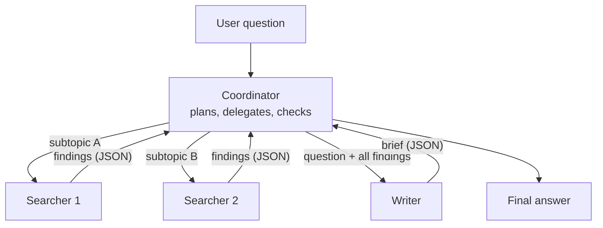
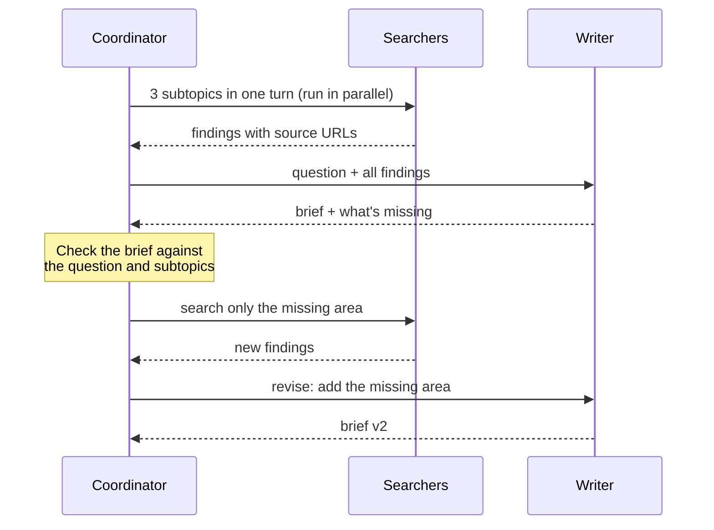

A coordinator-subagent system is one agent that manages a small team of other agents. The coordinator reads the request, decides which subagents it needs, writes each one a focused task, collects their structured results and checks the combined answer for gaps. In this post you build one in TypeScript twice: with plain Messages API calls, tested against a fake client so you need no API key, and with the Claude Agent SDK's built-in subagents.

This is task statement 1.2 of the [Claude Certified Architect – Foundations exam guide](https://anthropic-partners.skilljar.com/claude-certified-architect-foundations-certification): "Orchestrate multi-agent systems with coordinator-subagent patterns". It sits in Domain 1, Agentic Architecture & Orchestration, which is 27% of the exam. The guide's multi-agent research scenario is built on it.

## What does task statement 1.2 test?

The guide lists four things to know and four skills. In plain words:

| The guide asks you to… | In practice |
| --- | --- |
| Know hub-and-spoke | The coordinator handles all communication between subagents, all error handling and all routing of information |
| Know that subagents have isolated context | A subagent doesn't get the coordinator's conversation unless the coordinator puts it in the subagent's prompt |
| Know the coordinator's jobs | Split the task, delegate, combine the results, and pick which subagents a query needs |
| Know the risk of a narrow split | Every subagent can succeed and the answer still misses areas that nobody was asked to cover |
| Pick subagents per query | A simple question skips most of the team instead of running the full pipeline |
| Split scope without overlap | Give each subagent a distinct subtopic or source type |
| Run a refinement loop | Check the result for gaps, send targeted follow-up work, combine again |
| Route everything through the coordinator | One place to trace the flow, handle errors and control what each agent sees |

This post builds on the loop from part 1 of this series, [Agentic loops: stop_reason, tool results and when to stop](/blog/claude-agentic-loops). Each agent here, coordinator and subagents alike, is that loop: call Claude, run the tools it asks for, send the results back, stop on `"end_turn"`. If agents are new to you, start with [What is an AI agent?](/blog/what-is-an-ai-agent).

## What is the coordinator-subagent pattern?

Think of a newsroom. An editor splits a story into parts, sends each reporter one part, reads what comes back and asks for one more interview where the story is thin. Reporters don't phone each other; they report to the editor. The editor is the **coordinator** and the reporters are **subagents**. Anthropic's [multi-agent research system](https://www.anthropic.com/engineering/multi-agent-research-system) calls this the orchestrator-worker pattern: "a lead agent coordinates the process while delegating to specialized subagents that operate in parallel."



Each subagent is a separate agent with three things of its own:

- **Its own system prompt.** The searcher is told to stay inside one subtopic and cite every source. The writer is told to use only the findings it gets.
- **Its own small tool set.** The searcher can search. The writer has no tools at all. Neither can call the other.
- **Its own history.** It starts empty for every task, so a searcher's pages of results never fill the coordinator's context window (how much text a model can read at once).

Every arrow goes through the coordinator. That is **hub-and-spoke**, and it gives you three things the exam cares about: **observability** (one place logs every delegation, so you can see which agent got which task), **consistent error handling** (a failed subagent comes back to one place that decides to retry, skip or report the gap) and **controlled information flow** (the coordinator decides what each subagent sees).

## Why can't a subagent see the conversation?

Because it is a new conversation. The Messages API is [stateless](https://platform.claude.com/docs/en/build-with-claude/working-with-messages): an agent knows only what is in the request you send. When your code starts a subagent with a fresh `messages` array, the subagent knows nothing about the user, earlier turns or other subagents.

The Agent SDK works the same way. Its [subagents guide](https://code.claude.com/docs/en/agent-sdk/subagents) says: "The only content you pass from parent to subagent is the Agent tool's prompt string." Unless you run a fork (a copy of the current conversation, covered later in this series), a subagent gets this:

| A subagent receives | A subagent doesn't receive |
| --- | --- |
| Its own system prompt and the task prompt the coordinator writes | The coordinator's conversation history or tool results |
| The tools you give it | The coordinator's system prompt |
| Project `CLAUDE.md`, if the session loads it (Agent SDK only) | Anything another subagent found |

This is on purpose: each subagent works with a short, focused context. The price is that the coordinator must write complete tasks. If the user said "only sources from the last 12 months" three turns ago, that sentence has to be in the searcher's prompt. Anthropic's team found each subagent needs "an objective, an output format, guidance on the tools and sources to use, and clear task boundaries."

It works the other way too. Only the subagent's final answer comes back, so ask for a structured result, such as JSON with a claim and a source URL per finding.

## How does the coordinator decide which subagents to run?

It looks at the query first. Anthropic's research system scales effort to the question: "Simple fact-finding requires just 1 agent with 3-10 tool calls, direct comparisons might need 2-4 subagents with 10-15 calls each, and complex research might use more than 10 subagents with clearly divided responsibilities."

In the hands-on part, "Define a context window" is a definition the model knows well, so the coordinator answers directly. "How do teams use AI in customer support?" is broad, so it lists subtopics, sends one searcher per subtopic, then asks the writer for a brief.

When it splits a broad question, two rules matter:

- **No overlap.** Give each searcher a distinct slice, by subtopic ("ticket routing", "drafting replies") or by source type ("vendor docs", "surveys"). Anthropic saw what happens otherwise: with vague tasks, "one subagent explored the 2021 automotive chip crisis while 2 others duplicated work investigating current 2025 supply chains". Telling subagents to "avoid what the others find" can't work, because they can't see each other.
- **No gaps.** The subtopics together must cover the whole question. If the coordinator splits "AI in customer support" into only routing and drafting, both searchers succeed and the report still has nothing on self-service chat. No subagent failed. The split did.

## How does the refinement loop work?

The coordinator doesn't trust the first draft. It compares the brief with the question and its own list of subtopics. If an area is thin, it sends a targeted search for that area only and asks the writer to revise.



The follow-up search is narrow, so it doesn't repeat work. And the loop has limits: the prompt allows at most two passes, and part 1's safety cap on turns stays in the code.

## Try it: build a coordinator with the Messages API

You'll build a research coordinator with two subagents: a `searcher` that finds sources on one subtopic, and a `writer` that turns findings into a short brief. The "search" runs over four made-up sources, so nothing depends on a real search service. Then you'll test the whole system against a fake client.

**You need:** Node.js 22.18 or later, which [runs `.ts` files directly](https://nodejs.org/docs/latest-v22.x/api/typescript.html). An Anthropic API key only for the last step.


<Steps>


<Step title="Create the project">

```bash
$ mkdir coordinator
$ cd coordinator
$ npm init -y
$ npm pkg set type=module
```

Install the [official TypeScript SDK](https://github.com/anthropics/anthropic-sdk-typescript), then TypeScript and the Node types for type-checking:


```bash
npm install @anthropic-ai/sdk
```


```bash
npm install -D typescript @types/node
```


Add the same `tsconfig.json` as in part 1:


**tsconfig.json**

```json
{
  "compilerOptions": {
    "noEmit": true,
    "target": "esnext",
    "module": "nodenext",
    "rewriteRelativeImportExtensions": true,
    "erasableSyntaxOnly": true,
    "verbatimModuleSyntax": true,
    "allowImportingTsExtensions": true,
    "strict": true
  }
}
```


</Step>


<Step title="Add a tiny search library">

The searcher's tool needs something to search. This file is plain data plus a keyword match, shared by both versions in this post.


**library.ts**

```ts
// A tiny canned "search index", so the example runs offline.
// The sources are made up for the demo; the URLs use example.com on purpose.
export interface Source {
  title: string;
  url: string;
  topics: string[];
  excerpt: string;
}

const LIBRARY: Source[] = [
  {
    title: 'Routing tickets with a classifier',
    url: 'https://example.com/ticket-triage',
    topics: ['triage', 'routing', 'tickets'],
    excerpt: 'New tickets are tagged by topic and urgency before a person reads them.',
  },
  {
    title: 'Drafting replies for support agents',
    url: 'https://example.com/agent-assist',
    topics: ['drafting', 'replies', 'agent assist'],
    excerpt: 'The model drafts a reply; a support agent edits it and sends it.',
  },
  {
    title: 'Help-centre chat with a human handoff',
    url: 'https://example.com/self-service',
    topics: ['self-service', 'chatbot', 'handoff'],
    excerpt: 'A chat assistant answers common questions and hands the chat to a person when unsure.',
  },
  {
    title: 'Measuring AI in support',
    url: 'https://example.com/support-metrics',
    topics: ['metrics', 'measuring', 'satisfaction'],
    excerpt: 'Teams track time to resolution, customer satisfaction and how often a person steps in.',
  },
];

// Returns every source whose title or topics share a word with the query.
export function searchLibrary(query: string): Source[] {
  const words = query.toLowerCase().split(/\W+/).filter((word) => word.length > 3);
  return LIBRARY.filter((source) =>
    words.some((word) => [source.title.toLowerCase(), ...source.topics].some((text) => text.includes(word))),
  );
}
```


</Step>


<Step title="Define the two subagents">

Each subagent is a spec (model, system prompt, tools, result schema) and one shared function that runs it: part 1's loop with a fresh history.


**subagents.ts**

```ts
import type Anthropic from '@anthropic-ai/sdk';
import { searchLibrary } from './library.ts';

// Same small interface as in part 1: anything with messages.create, so a fake client fits.
export interface MessagesClient {
  messages: {
    create(params: Anthropic.MessageCreateParamsNonStreaming): Promise<Anthropic.Message>;
  };
}

// Everything that makes one subagent different from another.
export interface SubagentSpec {
  name: string;
  model: string;
  system: string;
  tools: Anthropic.Tool[];
  runTool: (name: string, input: Record<string, unknown>) => string;
  outputSchema: Record<string, unknown>; // the JSON shape of its final answer
}

export interface Finding {
  claim: string;
  source_url: string;
}
export interface SearchResult {
  subtopic: string;
  findings: Finding[];
  gaps: string[];
}
export interface WriterResult {
  brief: string;
  sources: string[];
  missing: string[];
}

const stringArray = { type: 'array', items: { type: 'string' } };

export const searcher: SubagentSpec = {
  name: 'searcher',
  model: 'claude-haiku-4-5',
  system:
    'You are a research searcher. You get ONE subtopic. Use search_sources to find sources on it. ' +
    'Report only what the sources say, with the source URL for every claim. Stay inside your subtopic. ' +
    'List anything you could not find in gaps.',
  tools: [
    {
      name: 'search_sources',
      description: 'Search the research library. Returns matching sources with a title, URL and excerpt.',
      input_schema: {
        type: 'object',
        properties: { query: { type: 'string', description: 'A few keywords' } },
        required: ['query'],
      },
    },
  ],
  runTool: (name, input) => {
    if (name !== 'search_sources') throw new Error(`Unknown tool: ${name}`);
    return JSON.stringify(searchLibrary(String(input.query ?? '')));
  },
  outputSchema: {
    type: 'object',
    properties: {
      subtopic: { type: 'string' },
      findings: {
        type: 'array',
        items: {
          type: 'object',
          properties: { claim: { type: 'string' }, source_url: { type: 'string' } },
          required: ['claim', 'source_url'],
          additionalProperties: false,
        },
      },
      gaps: stringArray,
    },
    required: ['subtopic', 'findings', 'gaps'],
    additionalProperties: false,
  },
};

export const writer: SubagentSpec = {
  name: 'writer',
  model: 'claude-sonnet-5-5',
  system:
    'You write a short research brief for developers from the findings you are given. ' +
    'Use only those findings and cite the source URL for each point. ' +
    'In missing, list every part of the question the findings do not cover.',
  tools: [], // the writer needs no tools: everything it needs is in its prompt
  runTool: (name) => {
    throw new Error(`Unknown tool: ${name}`);
  },
  outputSchema: {
    type: 'object',
    properties: { brief: { type: 'string' }, sources: stringArray, missing: stringArray },
    required: ['brief', 'sources', 'missing'],
    additionalProperties: false,
  },
};

const MAX_TURNS = 10; // safety cap, as in part 1

// Part 1's loop, with its own system prompt, its own tools and a JSON final answer.
export async function runSubagent(client: MessagesClient, spec: SubagentSpec, task: string): Promise<unknown> {
  // A fresh history: the subagent sees the task and nothing else.
  const messages: Anthropic.MessageParam[] = [{ role: 'user', content: task }];

  for (let turn = 1; turn <= MAX_TURNS; turn++) {
    const response = await client.messages.create({
      model: spec.model,
      max_tokens: 4096,
      system: spec.system,
      ...(spec.tools.length > 0 && { tools: spec.tools }),
      output_config: { format: { type: 'json_schema', schema: spec.outputSchema } },
      messages,
    });
    messages.push({ role: 'assistant', content: response.content });

    if (response.stop_reason === 'tool_use') {
      const results = response.content
        .filter((block): block is Anthropic.ToolUseBlock => block.type === 'tool_use')
        .map((toolUse): Anthropic.ToolResultBlockParam => {
          try {
            const output = spec.runTool(toolUse.name, toolUse.input as Record<string, unknown>);
            return { type: 'tool_result', tool_use_id: toolUse.id, content: output };
          } catch (error) {
            return { type: 'tool_result', tool_use_id: toolUse.id, content: (error as Error).message, is_error: true };
          }
        });
      messages.push({ role: 'user', content: results });
      continue;
    }

    if (response.stop_reason === 'end_turn') {
      // With output_config.format, the final text is JSON in the shape of outputSchema.
      const text = response.content
        .filter((block): block is Anthropic.TextBlock => block.type === 'text')
        .map((block) => block.text)
        .join('');
      return JSON.parse(text);
    }

    // max_tokens, refusal and the rest: fail loudly and let the coordinator decide.
    throw new Error(`${spec.name} stopped with stop_reason: ${response.stop_reason}`);
  }

  throw new Error(`${spec.name}: no result after ${MAX_TURNS} turns`);
}
```


What makes these real subagents:

- **Isolated context.** `runSubagent` starts a new `messages` array holding only the task.
- **Own prompt, own tools.** The searcher gets `search_sources`. The writer gets none, so the request leaves `tools` out.
- **Own model.** Focused jobs can run on cheaper, faster models. Per million input / output tokens, the [models overview](https://platform.claude.com/docs/en/about-claude/models/overview) lists Claude Haiku 4.5 at $1 / $5 and Claude Sonnet 5.5 at $2 / $10, against $4 / $20 for the coordinator's Claude Opus 5.5.
- **Structured result.** `output_config.format` asks for JSON that matches a schema. The [structured outputs docs](https://platform.claude.com/docs/en/build-with-claude/structured-outputs) say it works together with tools, and require `additionalProperties: false` on every object.
- **Loud failures.** Any other stop reason throws, and the coordinator decides what to do. Part 1 covers each stop reason.

</Step>


<Step title="Write the coordinator">

The coordinator is also a loop, but its tools are the subagents. Each tool call becomes a subagent run.


**coordinator.ts**

```ts
import type Anthropic from '@anthropic-ai/sdk';
import {
  runSubagent,
  searcher,
  writer,
  type Finding,
  type MessagesClient,
  type SearchResult,
  type WriterResult,
} from './subagents.ts';

export const COORDINATOR_PROMPT = `You coordinate a research team. You never search or write briefs yourself: you delegate.
1. First decide if the question needs research. For a definition or a simple fact you are sure of, answer directly and call no tools.
2. For a broad question, list 2-4 subtopics that together cover the whole question and do not overlap. Then call delegate_search once per subtopic, all in the same turn.
3. Call delegate_write to get a brief.
4. Check the brief against the question and your subtopics. If an area is missing, call delegate_search for that area only, then delegate_write with instructions to add it. Do this at most twice.
5. Reply with the final brief.`;

const tools: Anthropic.Tool[] = [
  {
    name: 'delegate_search',
    description:
      'Send ONE subtopic to the searcher subagent. It sees only what you write here, not this conversation. ' +
      'Give each call a different subtopic. Call it several times in one turn to search in parallel.',
    input_schema: {
      type: 'object',
      properties: {
        subtopic: { type: 'string', description: 'The one area to search, e.g. "ticket routing"' },
        focus: { type: 'string', description: 'What the user wants to learn about this area' },
      },
      required: ['subtopic', 'focus'],
    },
  },
  {
    name: 'delegate_write',
    description:
      'Ask the writer subagent to write or revise the brief. Your code passes it every finding so far ' +
      'and the previous brief. Say what to write or change in instructions.',
    input_schema: {
      type: 'object',
      properties: {
        question: { type: 'string', description: "The user's question, in full" },
        instructions: { type: 'string', description: 'What to write, or what to change' },
      },
      required: ['question', 'instructions'],
    },
  },
];

// One line per delegation: who ran, with what input, and whether it worked.
export interface TraceEntry {
  agent: string;
  input: Record<string, string>;
  ok: boolean;
}

export interface CoordinatorResult {
  text: string;
  trace: TraceEntry[];
}

const MAX_TURNS = 15;

export async function runCoordinator(client: MessagesClient, question: string): Promise<CoordinatorResult> {
  const messages: Anthropic.MessageParam[] = [{ role: 'user', content: question }];
  const findings: Finding[] = []; // collected by the coordinator, not shared between subagents
  let lastBrief = '';
  const trace: TraceEntry[] = [];

  // Every subagent call goes through here: build its prompt, run it, record it, catch its errors.
  async function delegate(toolUse: Anthropic.ToolUseBlock): Promise<Anthropic.ToolResultBlockParam> {
    const input = toolUse.input as Record<string, string>;
    const agent = toolUse.name === 'delegate_search' ? 'searcher' : 'writer';
    try {
      let result: SearchResult | WriterResult;
      if (toolUse.name === 'delegate_search') {
        const task = `Subtopic: ${input.subtopic}\nFocus: ${input.focus}`;
        result = (await runSubagent(client, searcher, task)) as SearchResult;
        findings.push(...result.findings);
      } else if (toolUse.name === 'delegate_write') {
        const task = [
          `Question: ${input.question}`,
          `Instructions: ${input.instructions}`,
          `Findings (JSON):\n${JSON.stringify(findings, null, 2)}`,
          lastBrief && `Previous brief:\n${lastBrief}`,
        ]
          .filter(Boolean)
          .join('\n\n');
        result = (await runSubagent(client, writer, task)) as WriterResult;
        lastBrief = result.brief;
      } else {
        throw new Error(`Unknown tool: ${toolUse.name}`);
      }
      trace.push({ agent, input, ok: true });
      return { type: 'tool_result', tool_use_id: toolUse.id, content: JSON.stringify(result) };
    } catch (error) {
      trace.push({ agent, input, ok: false });
      // A structured error, so the coordinator can retry, skip or report the gap.
      const detail = { agent, input, error: (error as Error).message };
      return { type: 'tool_result', tool_use_id: toolUse.id, content: JSON.stringify(detail), is_error: true };
    }
  }

  for (let turn = 1; turn <= MAX_TURNS; turn++) {
    const response = await client.messages.create({
      model: 'claude-opus-5-5',
      max_tokens: 4096,
      system: COORDINATOR_PROMPT,
      tools,
      messages,
    });
    messages.push({ role: 'assistant', content: response.content });

    if (response.stop_reason === 'tool_use') {
      const toolUses = response.content.filter(
        (block): block is Anthropic.ToolUseBlock => block.type === 'tool_use',
      );
      // Several delegate_search calls in one turn run at the same time.
      const results = await Promise.all(toolUses.map(delegate));
      messages.push({ role: 'user', content: results });
      continue;
    }

    if (response.stop_reason === 'end_turn') {
      const text = response.content
        .filter((block): block is Anthropic.TextBlock => block.type === 'text')
        .map((block) => block.text)
        .join('\n');
      return { text, trace };
    }

    throw new Error(`Coordinator stopped with stop_reason: ${response.stop_reason}`);
  }

  throw new Error(`Safety cap: no end_turn after ${MAX_TURNS} turns`);
}
```


How it maps to the skills in task statement 1.2:

- **Picks subagents per query.** The prompt tells Claude to answer simple questions directly, so a definition costs one call instead of a full pipeline.
- **Splits without overlap.** The prompt asks for 2–4 subtopics that cover the question without overlap.
- **Passes only what's needed.** Your code builds each subagent's prompt. A searcher gets one subtopic and a focus. The writer gets the question, all findings as JSON and its previous brief.
- **Runs in parallel.** When Claude asks for three searches in one reply, `Promise.all` runs them at the same time. The [parallel tool use docs](https://platform.claude.com/docs/en/agents-and-tools/tool-use/parallel-tool-use) leave the order up to you, and independent read-only calls are the safe case.
- **Hub-and-spoke.** `delegate` is the only path to a subagent. It records every call in `trace` and turns a failure into a structured error (agent, input, reason) with `is_error: true`, so Claude can retry, skip or report the gap.

</Step>


<Step title="Test it without an API key">

One fake client serves all three agents and tells them apart by system prompt. The fake searcher calls the real `search_sources` tool, so the search code runs for real. The coordinator's replies are scripted to follow its prompt.


**coordinator.test.ts**

```ts
import assert from 'node:assert/strict';
import { test } from 'node:test';
import type Anthropic from '@anthropic-ai/sdk';
import { COORDINATOR_PROMPT, runCoordinator } from './coordinator.ts';
import { searcher, writer, type MessagesClient } from './subagents.ts';

// Build replies in the shape the Messages API returns (as in part 1).
const reply = (stop_reason: Anthropic.StopReason, content: Anthropic.ContentBlock[]): Anthropic.Message => ({
  id: 'msg_test',
  type: 'message',
  role: 'assistant',
  model: 'claude-opus-5-5',
  content,
  stop_reason,
  stop_sequence: null,
  stop_details: null,
  container: null,
  diagnostics: null,
  usage: {
    input_tokens: 0,
    output_tokens: 0,
    cache_creation: null,
    cache_creation_input_tokens: null,
    cache_read_input_tokens: null,
    inference_geo: null,
    output_tokens_details: null,
    server_tool_use: null,
    service_tier: null,
  },
});
const text = (t: string): Anthropic.TextBlock => ({ type: 'text', text: t, citations: null });
const toolUse = (id: string, name: string, input: object): Anthropic.ToolUseBlock => ({
  type: 'tool_use',
  id,
  name,
  input,
  caller: { type: 'direct' },
});

type Agent = 'coordinator' | 'searcher' | 'writer';
type Responder = (params: Anthropic.MessageCreateParamsNonStreaming) => Anthropic.Message;

// One fake client for all three agents. It tells them apart by system prompt,
// records every request per agent, and asks that agent's responder for a reply.
function fakeClient(responders: Partial<Record<Agent, Responder>>) {
  const requests: Record<Agent, Anthropic.MessageCreateParamsNonStreaming[]> = {
    coordinator: [],
    searcher: [],
    writer: [],
  };
  const agentFor = (system: unknown): Agent =>
    system === COORDINATOR_PROMPT ? 'coordinator' : system === searcher.system ? 'searcher' : 'writer';
  const client: MessagesClient = {
    messages: {
      create: async (params) => {
        const agent = agentFor(params.system);
        requests[agent].push(structuredClone(params));
        const respond = responders[agent];
        if (!respond) throw new Error(`No responder for ${agent}`);
        return respond(params);
      },
    },
  };
  return { client, requests };
}

// Plays back a fixed list of replies, in order.
const script = (replies: Anthropic.Message[]): Responder => () => {
  const next = replies.shift();
  if (!next) throw new Error('No more scripted replies');
  return next;
};

// A fake searcher: first asks for the real search_sources tool, then reports what it returned.
const fakeSearcher: Responder = (params) => {
  const task = String(params.messages[0].content);
  const subtopic = /Subtopic: (.+)/.exec(task)?.[1] ?? '';
  const last = params.messages.at(-1)!;
  if (typeof last.content === 'string') {
    return reply('tool_use', [toolUse('toolu_s1', 'search_sources', { query: subtopic })]);
  }
  const [result] = last.content as Anthropic.ToolResultBlockParam[];
  const sources = JSON.parse(String(result.content)) as { url: string; excerpt: string }[];
  const findings = sources.map((s) => ({ claim: s.excerpt, source_url: s.url }));
  return reply('end_turn', [text(JSON.stringify({ subtopic, findings, gaps: [] }))]);
};

test('a simple question skips the subagents', async () => {
  const { client, requests } = fakeClient({
    coordinator: script([
      reply('end_turn', [text('A context window is the amount of text a model can read at once.')]),
    ]),
  });

  const result = await runCoordinator(client, 'Define a context window.');

  assert.deepEqual(result.trace, []);
  assert.equal(requests.searcher.length + requests.writer.length, 0);
});

test('a broad question: parallel search, brief, one refinement pass', async () => {
  const question = 'How do teams use AI in customer support?';
  const search = (id: string, subtopic: string) =>
    toolUse(id, 'delegate_search', { subtopic, focus: 'How teams use it and what it changes' });
  const write = (id: string, instructions: string) => toolUse(id, 'delegate_write', { question, instructions });

  const { client, requests } = fakeClient({
    coordinator: script([
      reply('tool_use', [
        text('Subtopics: ticket triage and routing; drafting replies; self-service chat.'),
        search('toolu_c1', 'ticket triage and routing'),
        search('toolu_c2', 'drafting replies'),
        search('toolu_c3', 'self-service chat'),
      ]),
      reply('tool_use', [write('toolu_c4', 'Write a brief of about 150 words.')]),
      reply('tool_use', [
        text('The brief never says how teams measure results. Searching that area only.'),
        search('toolu_c5', 'measuring results and satisfaction'),
      ]),
      reply('tool_use', [write('toolu_c6', 'Add a short section on how teams measure results.')]),
      reply('end_turn', [text('Final brief: triage, drafting, self-service, and how teams measure it.')]),
    ]),
    searcher: fakeSearcher,
    writer: script([
      reply('end_turn', [text(JSON.stringify({ brief: 'Draft 1', sources: [], missing: [] }))]),
      reply('end_turn', [text(JSON.stringify({ brief: 'Draft 2', sources: [], missing: [] }))]),
    ]),
  });

  const result = await runCoordinator(client, question);

  // Observability: every delegation is in one trace, in order.
  for (const entry of result.trace) console.log(`${entry.agent.padEnd(8)} ${JSON.stringify(entry.input)}`);
  assert.deepEqual(
    result.trace.map((entry) => entry.agent),
    ['searcher', 'searcher', 'searcher', 'writer', 'searcher', 'writer'],
  );

  // Parallel: all three first-turn searches started before any of them finished.
  assert.ok(requests.searcher.slice(0, 3).every((r) => typeof r.messages.at(-1)?.content === 'string'));

  // Isolation: each searcher saw only its subtopic, its own prompt and its own tool.
  for (const r of requests.searcher) {
    assert.match(String(r.messages[0].content), /^Subtopic: /);
    assert.doesNotMatch(String(r.messages[0].content), /customer support/);
    assert.deepEqual(r.tools?.map((t) => ('name' in t ? t.name : '')), ['search_sources']);
  }

  // The first brief had nothing on measuring results: no searcher was ever asked.
  assert.doesNotMatch(String(requests.writer[0].messages[0].content), /support-metrics/);

  // The writer has no tools. On the revision it gets the new finding and its previous brief.
  const revision = String(requests.writer[1].messages[0].content);
  assert.equal(requests.writer[1].tools, undefined);
  assert.match(revision, /https:\/\/example\.com\/support-metrics/);
  assert.match(revision, /Previous brief:\nDraft 1/);
  assert.equal(requests.writer[1].system, writer.system);
});

test('a failed subagent comes back as a structured error, not a crash', async () => {
  const { client, requests } = fakeClient({
    coordinator: script([
      reply('tool_use', [toolUse('toolu_c1', 'delegate_search', { subtopic: 'ticket triage', focus: 'basics' })]),
      reply('end_turn', [text('I could not research ticket triage; the search failed.')]),
    ]),
    searcher: script([reply('max_tokens', [text('{"subtopic": "tick')])]),
  });

  const result = await runCoordinator(client, 'How do teams use AI for ticket triage?');

  assert.deepEqual(result.trace, [
    { agent: 'searcher', input: { subtopic: 'ticket triage', focus: 'basics' }, ok: false },
  ]);
  const [errorResult] = requests.coordinator[1].messages.at(-1)!.content as Anthropic.ToolResultBlockParam[];
  assert.equal(errorResult.is_error, true);
  assert.deepEqual(JSON.parse(String(errorResult.content)), {
    agent: 'searcher',
    input: { subtopic: 'ticket triage', focus: 'basics' },
    error: 'searcher stopped with stop_reason: max_tokens',
  });
});
```


```bash
$ node --test --test-reporter=spec coordinator.test.ts
```

```text
searcher {"subtopic":"ticket triage and routing","focus":"How teams use it and what it changes"}
searcher {"subtopic":"drafting replies","focus":"How teams use it and what it changes"}
searcher {"subtopic":"self-service chat","focus":"How teams use it and what it changes"}
writer   {"question":"How do teams use AI in customer support?","instructions":"Write a brief of about 150 words."}
searcher {"subtopic":"measuring results and satisfaction","focus":"How teams use it and what it changes"}
writer   {"question":"How do teams use AI in customer support?","instructions":"Add a short section on how teams measure results."}
✔ a simple question skips the subagents
✔ a broad question: parallel search, brief, one refinement pass
✔ a failed subagent comes back as a structured error, not a crash
ℹ tests 3
ℹ suites 0
ℹ pass 3
ℹ fail 0
ℹ cancelled 0
ℹ skipped 0
ℹ todo 0
ℹ duration_ms 166.365359
```

This is our output on Node 22.22.2 with `@anthropic-ai/sdk` 0.130.0, with per-test timings removed. The trace shows the pattern: three searches from one turn, a brief, one targeted search for the missing area, a revised brief. The first brief had nothing on measuring results because no searcher was ever asked. That is a coordinator gap, not a searcher bug. Then type-check:

```bash
$ npx tsc
```

No output means no type errors.

</Step>


<Step title="Run it with Claude">

Create an API key in the [Claude Console](https://platform.claude.com/) and set it as the `ANTHROPIC_API_KEY` environment variable. The SDK reads it from there.


**main.ts**

```ts
import Anthropic from '@anthropic-ai/sdk';
import { runCoordinator } from './coordinator.ts';

const client = new Anthropic(); // reads ANTHROPIC_API_KEY from the environment
const question = process.argv[2] ?? 'How do teams use AI in customer support?';

const result = await runCoordinator(client, question);
for (const entry of result.trace) {
  console.log(`[${entry.ok ? 'ok' : 'failed'}] ${entry.agent}: ${JSON.stringify(entry.input)}`);
}
console.log(`\n${result.text}`);
```


```bash
$ node main.ts "Define a context window."
$ node main.ts "How do teams use AI in customer support?"
```

With a real model, the plan is Claude's choice, so the trace will vary. Check two things: the first question should show no subagent calls, and for the second, read the subtopics the coordinator listed before it delegated and ask yourself what they miss.

</Step>


</Steps>


## How do I build the same thing with the Agent SDK?

The [Claude Agent SDK](https://code.claude.com/docs/en/agent-sdk/overview) is a library that runs the Claude Code binary, so it runs the loops for you. Subagents are built in: you describe each one in the `agents` option, and the coordinator starts them with the **Agent** tool.

The exam guide calls this the "Task" tool and says the coordinator's `allowedTools` must include "Task". In Claude Code 2.1.63 [the Task tool was renamed to Agent](https://code.claude.com/docs/en/sub-agents), and "Task" still works as an alias. The current docs use `Agent`, and their examples list it in `allowedTools` so the coordinator can start subagents without a permission prompt.

Install the Agent SDK and Zod (for the tool's input schema) in the same project:


```bash
npm install @anthropic-ai/claude-agent-sdk zod
```


**sdk-coordinator.ts**

```ts
import { createSdkMcpServer, query, tool } from '@anthropic-ai/claude-agent-sdk';
import { z } from 'zod';
import { searchLibrary } from './library.ts';

// The same canned search, served as an in-process MCP tool: mcp__research__search_sources.
const research = createSdkMcpServer({
  name: 'research',
  version: '1.0.0',
  tools: [
    tool(
      'search_sources',
      'Search the research library. Returns matching sources with a title, URL and excerpt.',
      { query: z.string().describe('A few keywords') },
      async ({ query }) => ({ content: [{ type: 'text', text: JSON.stringify(searchLibrary(query)) }] }),
      { annotations: { readOnlyHint: true } },
    ),
  ],
});

const question = process.argv[2] ?? 'How do teams use AI in customer support?';

for await (const message of query({
  prompt: question,
  options: {
    model: 'claude-opus-5-5',
    systemPrompt:
      'You coordinate a research team and delegate with the Agent tool. ' +
      'For a definition or a simple fact you are sure of, answer directly without subagents. ' +
      'For a broad question, list 2-4 subtopics that cover it without overlap, then start one searcher per subtopic in the same turn. ' +
      'Pass the writer the question and every finding. Check the brief for missing areas, search only those, ask the writer to revise, then reply with the brief.',
    tools: ['Agent'], // the coordinator's only built-in tool: it delegates, it doesn't read files or run commands
    mcpServers: { research },
    allowedTools: ['Agent', 'mcp__research__search_sources'], // run these without asking
    settingSources: [], // don't load CLAUDE.md or settings from disk
    maxTurns: 30,
    agents: {
      searcher: {
        description: 'Finds sources on ONE subtopic. Give it the subtopic and what to look for.',
        prompt:
          'You get one subtopic. Use search_sources to find sources on it. Report only what the sources say. ' +
          'End with JSON: {"subtopic": string, "findings": [{"claim": string, "source_url": string}], "gaps": string[]}.',
        tools: ['mcp__research__search_sources'],
        model: 'haiku',
      },
      writer: {
        description: 'Writes or revises a short brief from findings. Pass it the question and all findings.',
        prompt:
          'Write a short brief for developers using only the findings in your prompt. Cite the source URL for each point. ' +
          'End with JSON: {"brief": string, "sources": string[], "missing": string[]}.',
        tools: [], // no tools: everything it needs is in the prompt the coordinator writes
        model: 'sonnet',
      },
    },
  },
})) {
  // Log each delegation the coordinator makes. Skip messages from inside a subagent.
  if (message.type === 'assistant' && message.parent_tool_use_id === null) {
    for (const block of message.message.content) {
      if (block.type === 'tool_use' && (block.name === 'Agent' || block.name === 'Task')) {
        const input = block.input as { subagent_type?: string; description?: string };
        console.log(`-> ${input.subagent_type ?? 'general-purpose'}: ${input.description ?? ''}`);
      }
    }
  }
  if (message.type === 'result') {
    console.log(message.subtype === 'success' ? `\n${message.result}` : `\nStopped: ${message.subtype}`);
  }
}
```


```bash
$ node sdk-coordinator.ts "How do teams use AI in customer support?"
```

What each part does, from the [subagents guide](https://code.claude.com/docs/en/agent-sdk/subagents) and the [TypeScript reference](https://code.claude.com/docs/en/agent-sdk/typescript):

- **`agents`** defines each subagent as an `AgentDefinition`. Claude reads the `description` to decide when to use it, and `prompt` becomes its system prompt.
- **`tools` on a subagent** is an allowlist. The searcher gets only the search tool. The writer's empty list gives it no tools. Neither list has `Agent`, so neither can start subagents of its own, which keeps the hub-and-spoke shape.
- **`tools: ['Agent']`** leaves the coordinator one built-in tool. It can still see the session-wide `research` MCP tool, so its prompt tells it to delegate.
- **`allowedTools`** lists tools that run without asking for permission. It doesn't limit which tools exist. **`model`** takes an alias such as `'haiku'` or a full model ID.
- **`parent_tool_use_id`** is set on messages from inside a subagent. The loop skips those and prints only the coordinator's delegations.

Two differences from your own loop matter. The subagent's final message comes back to the coordinator as text, so the JSON shape is a request in the prompt, not a schema the API enforces. And the SDK decides a lot for you: for example, it can run subagents in the background, and the subagents guide lists extra limits (`maxBudgetUsd`, spawn depth, concurrency) to keep a tree of agents in check.

## Which one should I choose?

| | Messages API loops | Agent SDK subagents |
| --- | --- | --- |
| Who runs the loops | Your code | The SDK (Claude Code's loop) |
| How the coordinator delegates | Your own tools, such as `delegate_search` | The built-in Agent tool ("Task" in the exam guide) |
| What a subagent sees | Exactly the prompt your code builds | The prompt Claude writes in the Agent call, plus its definition |
| Structured subagent results | Enforced with `output_config.format` | Requested in the subagent's prompt; it returns text |
| Tools | Anything you write | Built-in tools, MCP servers and your own MCP tools |
| Testing without a model | Easy: pass a fake client | Harder: the SDK runs the Claude Code binary |
| Choose it when | You need tight control, custom routing or strict schemas | You want file, shell and web tools, sessions and hooks without writing loops |

The pattern is the same in both. The exam also names the SDK's parts (the Task tool, `allowedTools`, `AgentDefinition`), so know both.

## Common traps

These are the mistakes that wrong answer options are built on.

| Trap | Why it breaks | Fix |
| --- | --- | --- |
| Subagents call each other directly | Failures get lost inside the chain and nobody can trace which agent caused a bad result | Route every message and error through the coordinator |
| Assuming a subagent knows what the user said | It starts with an empty history and sees only its own prompt | Put every fact and constraint it needs into the task prompt |
| Running the full pipeline for every query | Simple questions pay the time and cost of deep research | Let the coordinator pick subagents per query |
| Telling subagents to "avoid what the others find" | They can't see each other's work | Give each one a distinct subtopic or source type up front |
| Blaming the searcher or writer for a missing area | If nobody was asked to cover it, no agent could find it | Check the coordinator's split, then run a targeted follow-up |


<Callout type="warning" title="Multi-agent runs cost more">

In Anthropic's own data, "multi-agent systems use about 15× more tokens than chats." Every subagent is a full agent loop with its own paid calls. Answer simple questions directly, put cheaper models on focused subagents, cap the refinement loop, and log every delegation so you can see where the tokens go.

</Callout>


## Practice questions

These four questions are this blog's own, written for practice. They are not from the exam.

**Question 1.** In a market-research system, the search subagent sends its results straight to the report subagent, and the report subagent asks the analysis subagent for extra data directly. When a report comes out wrong, the team can't tell which agent caused it, and one agent's errors were silently dropped. What is the best change?

- A. Add more logging inside each subagent and keep the direct links.
- B. Merge the three subagents into one large agent.
- C. Route all communication between subagents through the coordinator, which passes results on and handles errors.
- D. Let the report subagent retry failed calls to other subagents automatically.

**Question 2.** Early in a chat, a user tells a research coordinator: "Only use sources from the last 12 months." Three turns later, the coordinator asks its search subagent to "find sources on chatbot handoff to human agents". Half of the results are several years old. What is the best fix?

- A. Have the coordinator include the date rule, and any other user requirements, in the task it writes for each search subagent.
- B. Tell the search subagent in its system prompt to read the coordinator's conversation history first.
- C. Remove old sources in the final report step.
- D. Run the search subagent on a larger model.

**Question 3.** Two search subagents both get the task "find sources on electric vehicle battery recycling". About 70% of their results overlap, which wastes tokens and time. What is the best fix?

- A. Tell both subagents to avoid sources the other agent finds.
- B. Keep only one search subagent.
- C. Remove duplicates in the synthesis step.
- D. Give each subagent a distinct slice of the scope, such as a different subtopic or a different source type.

**Question 4.** A coordinator produces a report on remote-work productivity. The synthesis is well written but has no data on hybrid schedules, which the user asked about. What should the coordinator do?

- A. Ask the synthesis subagent to fill the gap from its own general knowledge.
- B. Check the synthesis for gaps, send a targeted search about hybrid schedules, then run synthesis again with the new findings.
- C. Deliver the report and tell the user to ask again about hybrid schedules.
- D. Restart the whole pipeline with a longer prompt.

## Answer key

### Question 1

**Answer: C.** Hub-and-spoke gives one place to trace the flow of information and handle errors the same way every time. The strongest distractor is A: more logs help inside each agent, but errors are still handled in several places and nobody has one view of the whole flow.

### Question 2

**Answer: A.** Subagents have isolated context. The coordinator must pass every constraint the subagent needs in its task prompt. The strongest distractor is B: a subagent has no access to the coordinator's history, so no system prompt can make it read that history.

### Question 3

**Answer: D.** Splitting the scope when you delegate prevents the duplicate work before it happens. The strongest distractor is A: subagents have isolated context and can't see what the other one finds, so the instruction can't be followed.

### Question 4

**Answer: B.** A refinement loop closes the gap with sourced findings and only repeats the part that was missing. The strongest distractor is A: it fills the gap with claims that have no source behind them, which is what a research system must avoid.

## What should I do next?

- **Extend the build.** Add a third subagent, such as an `analyst` that compares findings, and give it its own tool. Then fail one searcher in the test and check that the final answer names the gap.
- **Watch the cost.** [AI cost and latency](/blog/ai-cost-and-latency) shows how tokens add up, which matters more when one question runs several agents.
- **Move on to task statement 1.3**, "Configure subagent invocation, context passing, and spawning". The next post in this series covers the Agent tool, `AgentDefinition` and passing context between agents in depth.
- **Plan and check your prep.** Follow the [six-week study plan](/blog/claude-architect-exam-study-plan), and test yourself with the [mock exam](/blog/claude-certification-mock-exam) when you've worked through Domain 1.
