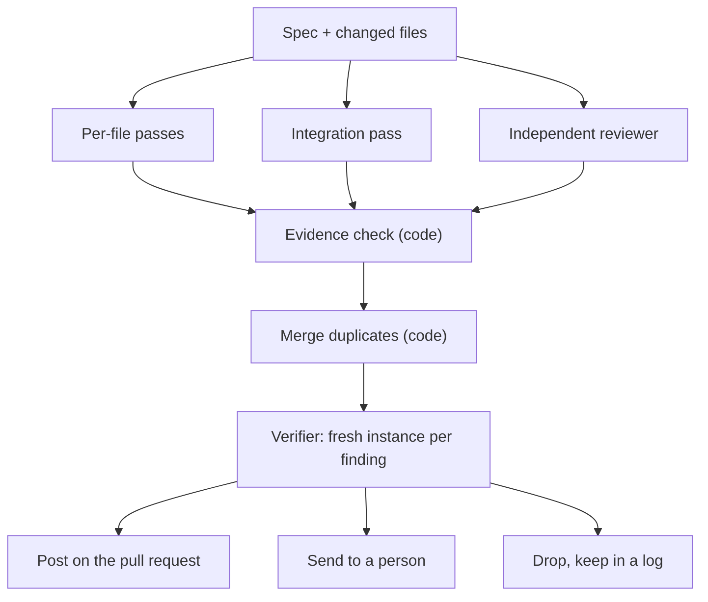

A review is only as good as the reviewer's distance from the work. When Claude checks code it wrote in the same conversation, it still has every reason it had for writing it that way, so it tends to agree with itself. To catch more real problems, review with a **separate Claude instance** that sees only the spec and the code, split big reviews into **focused passes**, then **merge** the findings and **verify** each one before anyone sees it. In this post you build that pipeline in TypeScript and test it offline, without an API key.

This is task statement 4.6 of the [Claude Certified Architect – Foundations exam guide](https://anthropic-partners.skilljar.com/claude-certified-architect-foundations-certification): "Design multi-instance and multi-pass review architectures". It is part of Domain 4, Prompt Engineering & Structured Output, which is 20% of the exam.

## What does task statement 4.6 test?

The guide lists three things to know and three skills. In plain words:

| The guide asks you to… | In practice |
| --- | --- |
| Know the limits of self-review | A session that wrote the code still has its own reasoning, so it rarely questions its own choices |
| Know that independent instances catch more | A fresh instance beats "check your work carefully" and beats more thinking in the same session |
| Know multi-pass review | Per-file passes for local bugs, plus an integration pass for problems between files |
| Use a second instance without the generator's context | Send the spec and the code, nothing from the generator's conversation |
| Split large reviews | One pass per file, then one pass that looks only at cross-file data flow |
| Run verification passes with confidence | Each finding gets a confidence value, and that value decides where the finding goes |

The agentic architecture series already built the per-file and cross-file review chain in [Task decomposition: prompt chaining vs dynamic plans](/blog/claude-task-decomposition) (task statement 1.6). This post doesn't rebuild it. It adds what happens around it: who reviews, how the results are combined, and how false positives are filtered out.

## Why is self-review in the same session weaker?

A model's answer depends on everything in its context. After Claude writes a function, the context holds the request, the plan, the code and the reasoning behind each choice. When you then say "review this for problems", Claude reads the code *through* that reasoning. If it decided early that "the window boundary is fine", that decision is still there, and it shapes what the review looks at.

A fresh instance starts without any of that. It has to work out what the code does from the code itself, and check it against the spec. Claude Code's [best practices](https://code.claude.com/docs/en/best-practices) say it directly: "A fresh context improves code review since Claude won't be biased toward code it just wrote." The same page describes a reviewer that "sees only the diff and the criteria you give it, not the reasoning that produced the change, so it evaluates the result on its own terms."

This doesn't make self-checks useless. The [prompting best practices](https://platform.claude.com/docs/en/build-with-claude/prompt-engineering/claude-prompting-best-practices) recommend asking Claude to verify its answer against test criteria before it finishes, and say this catches errors reliably, especially for coding and math. That is a good first filter. It is just not an *independent* review, and the exam is about knowing the difference.

| Reviewer | Has the generator's reasoning? | Independent? |
| --- | --- | --- |
| Same conversation: "now review your code" | Yes, all of it | No |
| Same conversation with more thinking or higher effort | Yes, and it thinks longer from the same starting point | No |
| A forked session or forked subagent | Yes: a fork starts with a copy of the conversation | No |
| A new API call with only the spec and the code | No | Yes |
| A normal Claude Code subagent | No: it "starts with a fresh, isolated context window" | Yes |

The last row comes from the [subagents docs](https://code.claude.com/docs/en/sub-agents), which also name the exception: a fork "inherits the parent conversation instead of starting fresh". The exam guide talks about "extended thinking". On Claude Opus 5.5, thinking is always on and adaptive, and you set how much it thinks with the effort level. Either way the point is the same: more thinking in the same context doesn't remove the bias of that context.

### What should the independent reviewer get?

Only what a new teammate would need: the requirements, the changed code, and your review criteria. Leave out the generator's explanation, its summary of "what I handled", and its test results. A line like "I made sure the boundary case works" is the generator's reasoning in disguise. It tells the reviewer what not to look at.

## How does multi-pass review work?

One pass over a large change has a known failure: **attention dilution**. The first files get a careful review, later files get one-line comments, and two parts of the same review can even contradict each other. A bigger context window doesn't fix this. The whole diff already fits; the problem is how much attention each file gets.

So you split the work:

- **Per-file passes** look at one file each. They find local bugs: wrong conditions, unhandled cases, leaks.
- **An integration pass** sees every changed file and looks *only* at problems between them: a value passed in the wrong unit, a call that doesn't match the new signature.
- **An independent reviewer** can run over the whole change too, as a fresh second opinion.

Each of these is a separate instance with its own clean context. Then three steps in plain code and one more model call turn their output into something people can act on:



Claude Code's managed [Code Review](https://code.claude.com/docs/en/code-review) service (a research preview for Team and Enterprise plans) works in a similar way: "multiple agents analyze the diff and surrounding code in parallel", then "a verification step checks candidates against actual code behavior to filter out false positives", and the results "are deduplicated, ranked by severity". The open-source [code-review plugin](https://github.com/anthropics/claude-code/tree/main/plugins/code-review) does the same at a smaller scale: four agents review independently, each issue gets a confidence score from 0 to 100, and issues below 80 are filtered out.

## How do I combine and de-duplicate findings?

Several passes means the same bug shows up more than once, with different words and sometimes a line number that is off by one. Posting all of them buries the author in noise. Merge them in plain code, not with another model call, so the result is the same every run:

1. **Normalize.** Lower-case the category and severity. The [structured outputs docs](https://platform.claude.com/docs/en/build-with-claude/structured-outputs) note that the capitalization of `enum` values isn't guaranteed, so `"LOGIC"` and `"logic"` must count as the same.
2. **Match.** Two findings are the same if they are in the same file, have the same category, and their lines are at most two apart.
3. **Combine.** Keep the wording and line of the most confident report, keep the *worst* severity any pass gave, and record every pass that reported it.

Recording the sources matters. "Two independent passes found this" is useful to the person reading the comment. But agreement is a signal, not proof. A cross-file bug may be visible to the integration pass only, and it is still real. Don't drop findings just because only one pass reported them.

## How do confidence and verification passes cut false positives?

Every reviewer produces some false positives. The best practices page warns that "a reviewer prompted to find gaps will usually report some, even when the work is sound". Two filters keep them away from people.

**Filter 1: the evidence check, in plain code.** Ask every pass to copy the exact code each finding is about into an `evidence` field. Then check that this text really appears in the file, near the reported line. A finding about `await this.store.incr(key)` in a file that has no `store` is about code that doesn't exist. It costs nothing to catch, and it never reaches the verifier.

**Filter 2: the verification pass, a fresh instance per finding.** Give it the spec, the code and the finding, and ask it to try to prove the finding *wrong* first. It answers `confirmed`, `refuted` or `unsure`, with its own confidence and a reason that points at lines. Don't give it the reviewers' confidence or how many passes agreed: it should judge the claim, not the crowd.

Then route each finding:

| Verdict | Confidence | Where it goes |
| --- | --- | --- |
| `confirmed` | 80 or more | Posted on the pull request |
| `confirmed` | below 80 | A person decides |
| `unsure` | any | A person decides |
| `refuted` | any | Dropped, but kept in a log with the reason |
| no verdict | — | A person decides; never posted blind |

The confidence number is what the exam guide calls "calibrated review routing". Keep one thing in mind: until you have compared it with outcomes, it is the model's own guess. Log which findings people accept and dismiss, and check that "90" really is right more often than "60". Structured outputs also don't support `minimum` or `maximum` on numbers, so clamp the value to 0–100 in your code.

## Try it: build a review pipeline that merges and verifies

You'll build the pipeline for a small three-file change and test it against canned reviewer output:

- **`findings.ts`**: the evidence check, the merge and the routing, in plain code.
- **`review.ts`**: the live orchestration. Every pass and every verification is a fresh instance.
- **Tests**: run all of it against hand-written reviewer outputs and a fake client.

The reviewer outputs are **examples we wrote by hand** in the shape the prompts ask for. They are not recorded Claude output. They prove your pipeline's logic, not Claude's review quality.

**You need:** Node.js 22.18 or later, which runs `.ts` files directly because [type stripping is on by default](https://nodejs.org/docs/latest-v22.x/api/typescript.html). An Anthropic API key only for the last step.


<Steps>


<Step title="Create the project">

```bash
$ mkdir review-pipeline
$ cd review-pipeline
$ npm init -y
$ npm pkg set type=module
$ mkdir canned sample
```

Install the [official TypeScript SDK](https://github.com/anthropics/anthropic-sdk-typescript), then TypeScript and the Node types for type-checking:


```bash
npm install @anthropic-ai/sdk
```


```bash
npm install -D typescript @types/node
```


Use the same `tsconfig.json` as the earlier posts in this series:


**tsconfig.json**

```json
{
  "compilerOptions": {
    "noEmit": true,
    "target": "esnext",
    "module": "nodenext",
    "rewriteRelativeImportExtensions": true,
    "erasableSyntaxOnly": true,
    "verbatimModuleSyntax": true,
    "allowImportingTsExtensions": true,
    "strict": true
  },
  "include": ["*.ts"]
}
```


</Step>


<Step title="Add the change under review">

The change adds a rate limiter: at most `limit` requests per API key in each time window. The spec has one easy-to-miss edge case, the exact end of a window:


**sample/SPEC.md**

```md
# Rate limiter spec
- Each API key may make at most `limit` requests per window.
- A window is `windowMs` milliseconds long and starts at the key's first request.
- A request at exactly windowStart + windowMs starts a new window.
- Over the limit, the API answers 429.
```


**sample/config.ts**

```ts
// Rate limits for the public API.
export const RATE_LIMIT = {
  limit: 100,
  windowSeconds: 60,
};
```


**sample/rate-limiter.ts**

```ts
export interface Entry {
  count: number;
  windowStart: number;
}

export class RateLimiter {
  private entries = new Map<string, Entry>();
  private limit: number;
  private windowMs: number;

  constructor(limit: number, windowMs: number) {
    this.limit = limit;
    this.windowMs = windowMs;
  }

  allow(key: string, now = Date.now()): boolean {
    const entry = this.entries.get(key);
    if (!entry || now - entry.windowStart > this.windowMs) {
      this.entries.set(key, { count: 1, windowStart: now });
      return true;
    }
    entry.count += 1;
    return entry.count <= this.limit;
  }
}
```


**sample/middleware.ts**

```ts
import { RATE_LIMIT } from './config.ts';
import { RateLimiter } from './rate-limiter.ts';

const limiter = new RateLimiter(RATE_LIMIT.limit, RATE_LIMIT.windowSeconds);

export function rateLimit(apiKey: string): { status: number } {
  if (!limiter.allow(apiKey)) return { status: 429 };
  return { status: 200 };
}
```


Two real bugs are planted. In `rate-limiter.ts` line 18, the `>` keeps a request at exactly `windowStart + windowMs` in the old window, which breaks the spec's third rule. And `middleware.ts` passes `windowSeconds` (60) where `RateLimiter` expects milliseconds, so the window is 60 ms. A per-file pass on `middleware.ts` can't see that: it needs the other two files.

</Step>


<Step title="Write the merge, evidence check and routing">


**findings.ts**

```ts
// One finding, as every review pass reports it.
export interface Finding {
  file: string;
  line: number;
  category: 'logic' | 'contract' | 'resource' | 'concurrency' | 'style';
  severity: 'high' | 'medium' | 'low';
  issue: string;
  evidence: string; // the exact code the finding is about, copied from the file
  confidence: number; // 0-100, the reviewer's own estimate
}

// What one pass returns: its name plus its findings.
export interface ReviewReport {
  pass: string; // e.g. "file:rate-limiter.ts", "integration", "independent"
  findings: Finding[];
}

// A finding after de-duplication. It remembers every pass that reported it.
export interface MergedFinding extends Finding {
  id: string; // "file:line:category", stable enough to match a verdict to it
  sources: string[];
}

// What the verification pass says about one merged finding.
export interface Verdict {
  verdict: 'confirmed' | 'refuted' | 'unsure';
  confidence: number; // 0-100
  reason: string;
}

export interface Routed {
  post: MergedFinding[]; // confirmed with high confidence: comment on the pull request
  human: MergedFinding[]; // a person decides
  dropped: { finding: MergedFinding; reason: string }[]; // kept in a log, never shown as comments
}

const SEVERITY_RANK = { high: 3, medium: 2, low: 1 } as const;

// Confidence is free-form model output: clamp it and never trust its range.
export const clamp = (n: number) => Math.max(0, Math.min(100, Math.round(Number.isFinite(n) ? n : 0)));

// Step 1, plain code: is the quoted evidence really in the file, near the reported line?
// This catches findings about code that doesn't exist, before anyone pays to verify them.
export function checkEvidence(
  reports: ReviewReport[],
  files: Record<string, string>,
  window = 3,
): { kept: ReviewReport[]; rejected: { pass: string; finding: Finding; reason: string }[] } {
  const rejected: { pass: string; finding: Finding; reason: string }[] = [];
  const kept = reports.map(({ pass, findings }) => ({
    pass,
    findings: findings.filter((finding) => {
      const source = files[finding.file];
      if (source === undefined) {
        rejected.push({ pass, finding, reason: `unknown file ${finding.file}` });
        return false;
      }
      const lines = source.split('\n');
      const from = Math.max(0, finding.line - 1 - window);
      const near = lines.slice(from, finding.line + window).join('\n');
      if (finding.evidence.trim() === '' || !near.includes(finding.evidence.trim())) {
        rejected.push({ pass, finding, reason: `evidence not found near line ${finding.line}` });
        return false;
      }
      return true;
    }),
  }));
  return { kept, rejected };
}

// Step 2, plain code: merge findings that describe the same problem.
// Same file + same category + lines at most `tolerance` apart = one finding.
export function mergeFindings(reports: ReviewReport[], tolerance = 2): MergedFinding[] {
  const merged: MergedFinding[] = [];
  const all = reports.flatMap(({ pass, findings }) => findings.map((finding) => ({ pass, finding })));
  // Highest confidence first, so its wording and line number win.
  all.sort((a, b) => clamp(b.finding.confidence) - clamp(a.finding.confidence));

  for (const { pass, finding } of all) {
    const category = finding.category.toLowerCase() as Finding['category'];
    const severity = finding.severity.toLowerCase() as Finding['severity'];
    const same = merged.find(
      (m) => m.file === finding.file && m.category === category && Math.abs(m.line - finding.line) <= tolerance,
    );
    if (same) {
      if (!same.sources.includes(pass)) same.sources.push(pass);
      // Keep the worst severity any pass gave it.
      if (SEVERITY_RANK[severity] > SEVERITY_RANK[same.severity]) same.severity = severity;
    } else {
      merged.push({
        ...finding,
        category,
        severity,
        confidence: clamp(finding.confidence),
        id: `${finding.file}:${finding.line}:${category}`,
        sources: [pass],
      });
    }
  }
  return merged.sort((a, b) => a.file.localeCompare(b.file) || a.line - b.line);
}

// Step 3, plain code: route each finding by the verifier's verdict and confidence.
export function route(findings: MergedFinding[], verdicts: Map<string, Verdict>, postAt = 80): Routed {
  const routed: Routed = { post: [], human: [], dropped: [] };
  for (const finding of findings) {
    const v = verdicts.get(finding.id);
    if (!v) {
      routed.human.push(finding); // no verdict: never post it blind
    } else if (v.verdict === 'refuted') {
      routed.dropped.push({ finding, reason: v.reason });
    } else if (v.verdict === 'confirmed' && clamp(v.confidence) >= postAt) {
      routed.post.push(finding);
    } else {
      routed.human.push(finding); // unsure, or confirmed with low confidence
    }
  }
  return routed;
}
```


What matters here:

- **`checkEvidence`** looks for the quoted code within three lines of the reported line. A reviewer that is off by one still passes. A reviewer that invents code doesn't.
- **`mergeFindings`** sorts by confidence first, so the most confident report's wording and line win. It lower-cases `category` and `severity` before it compares them, and keeps the worst severity.
- **`route`** never posts a finding without a `confirmed` verdict at 80 or more. A refuted finding isn't deleted: it goes to `dropped` with the verifier's reason, so you can audit it later.

</Step>


<Step title="Write the live orchestration">

This file makes the real calls. Every call goes through `ask`, which sends a system prompt and **one** user message. No pass ever gets a conversation history, so no pass can inherit anyone's reasoning:


**review.ts**

```ts
import type Anthropic from '@anthropic-ai/sdk';
import {
  checkEvidence,
  mergeFindings,
  route,
  type Finding,
  type MergedFinding,
  type ReviewReport,
  type Verdict,
} from './findings.ts';

export const MODEL = 'claude-opus-5-5';

// Anything with messages.create: the real SDK client, or a fake one in tests.
export interface MessagesClient {
  messages: {
    create(params: Anthropic.MessageCreateParamsNonStreaming): Promise<Anthropic.Message>;
  };
}

// Everything a reviewer may see: the requirements and the changed files. No chat history.
export interface ChangeSet {
  spec: string;
  files: Record<string, string>; // file name -> source
}

const FINDINGS_SCHEMA = {
  type: 'object',
  properties: {
    findings: {
      type: 'array',
      items: {
        type: 'object',
        properties: {
          file: { type: 'string' },
          line: { type: 'integer' },
          category: { type: 'string', enum: ['logic', 'contract', 'resource', 'concurrency', 'style'] },
          severity: { type: 'string', enum: ['high', 'medium', 'low'] },
          issue: { type: 'string' },
          evidence: { type: 'string', description: 'The exact code this finding is about, copied from the file' },
          confidence: { type: 'integer', description: '0-100: how sure you are that this is a real problem' },
        },
        required: ['file', 'line', 'category', 'severity', 'issue', 'evidence', 'confidence'],
        additionalProperties: false,
      },
    },
  },
  required: ['findings'],
  additionalProperties: false,
};

const VERDICT_SCHEMA = {
  type: 'object',
  properties: {
    verdict: { type: 'string', enum: ['confirmed', 'refuted', 'unsure'] },
    confidence: { type: 'integer', description: '0-100: how sure you are of your verdict' },
    reason: { type: 'string', description: 'Point to the lines that prove or disprove the finding' },
  },
  required: ['verdict', 'confidence', 'reason'],
  additionalProperties: false,
};

const RULES = `Report only problems that break the spec or would fail in production.
Copy the exact code you mean into "evidence". Give each finding a confidence from 0 to 100.
Return an empty list if you find nothing.`;

export const PROMPTS = {
  file: `You review ONE file of a change against its spec. Look for local bugs in this file only.\n${RULES}`,
  integration: `You run the integration pass of a review. You see every changed file.
Look ONLY for problems between files: values passed in the wrong unit or shape, calls that
don't match the signature they call, assumptions one file makes about another.\n${RULES}`,
  independent: `You are an independent reviewer. You did not write this code. Check it against
the spec, line by line, and question every decision.\n${RULES}`,
  verify: `You verify ONE finding from an automated code review. Try to prove it wrong first.
Answer "confirmed" only if the code shows the problem, "refuted" if the code shows it can't
happen, and "unsure" if the files you have are not enough to decide.`,
};

const numbered = (source: string) =>
  source
    .split('\n')
    .map((line, i) => `${String(i + 1).padStart(3)}  ${line}`)
    .join('\n');

const fileBlock = (name: string, source: string) => `<file name="${name}">\n${numbered(source)}\n</file>`;

// One fresh instance: a system prompt and ONE user message. Nothing from the generator's session.
async function ask<T>(client: MessagesClient, system: string, user: string, schema: Record<string, unknown>): Promise<T> {
  const response = await client.messages.create({
    model: MODEL,
    max_tokens: 16000,
    system,
    messages: [{ role: 'user', content: user }],
    output_config: { format: { type: 'json_schema', schema } },
  });
  // Cut off or refused: the JSON may not match the schema, so stop here.
  if (response.stop_reason !== 'end_turn') throw new Error(`Review call stopped with ${response.stop_reason}`);
  const text = response.content.find((block): block is Anthropic.TextBlock => block.type === 'text');
  if (!text) throw new Error('No text block in the response');
  return JSON.parse(text.text) as T;
}

async function pass(client: MessagesClient, name: string, system: string, change: ChangeSet, only?: string): Promise<ReviewReport> {
  const files = Object.entries(change.files).filter(([file]) => only === undefined || file === only);
  const user = `<spec>\n${change.spec}\n</spec>\n${files.map(([file, source]) => fileBlock(file, source)).join('\n')}`;
  const { findings } = await ask<{ findings: Finding[] }>(client, system, user, FINDINGS_SCHEMA);
  return { pass: name, findings };
}

// The verification pass: a fresh instance per finding. It sees the claim and the code,
// but not who reported it, how many passes agreed, or how sure they were.
export async function verify(client: MessagesClient, finding: MergedFinding, change: ChangeSet): Promise<Verdict> {
  const { id, sources, confidence, ...claim } = finding;
  const user =
    `<spec>\n${change.spec}\n</spec>\n<finding>\n${JSON.stringify(claim, null, 2)}\n</finding>\n` +
    Object.entries(change.files)
      .map(([file, source]) => fileBlock(file, source))
      .join('\n');
  return ask<Verdict>(client, PROMPTS.verify, user, VERDICT_SCHEMA);
}

export async function runReview(client: MessagesClient, change: ChangeSet) {
  // 1. Review passes, in parallel: one per file, one integration pass, one independent reviewer.
  const reports = await Promise.all([
    ...Object.keys(change.files).map((file) => pass(client, `file:${file}`, PROMPTS.file, change, file)),
    pass(client, 'integration', PROMPTS.integration, change),
    pass(client, 'independent', PROMPTS.independent, change),
  ]);

  // 2. Plain code: drop findings whose evidence isn't in the file, then merge duplicates.
  const { kept, rejected } = checkEvidence(reports, change.files);
  const merged = mergeFindings(kept);

  // 3. Verify each merged finding in a fresh instance, then route it.
  const verdicts = new Map<string, Verdict>();
  await Promise.all(merged.map(async (finding) => verdicts.set(finding.id, await verify(client, finding, change))));
  return { reports, rejected, merged, verdicts, ...route(merged, verdicts) };
}
```


**load.ts**

```ts
import { readdirSync, readFileSync } from 'node:fs';
import { join } from 'node:path';
import type { ChangeSet } from './review.ts';

// Read the spec and the changed files from a folder.
export function loadChange(dir: string): ChangeSet {
  const files: Record<string, string> = {};
  for (const name of readdirSync(dir).filter((n) => n.endsWith('.ts')).sort()) {
    files[name] = readFileSync(join(dir, name), 'utf8');
  }
  return { spec: readFileSync(join(dir, 'SPEC.md'), 'utf8'), files };
}
```


Three details:

- **Line numbers.** `fileBlock` numbers every line, so all passes report the same line numbers for the same code.
- **Per-file passes really see one file.** `pass(..., only)` filters `change.files` before building the prompt.
- **The verifier sees the claim, not the crowd.** `verify` removes `sources` and `confidence` before it sends the finding.

</Step>


<Step title="Add the canned reviewer outputs">

Five hand-written reports, one per pass. The per-file pass on `config.ts` finds nothing:


**canned/file-config.json**

```json
{ "pass": "file:config.ts", "findings": [] }
```


The per-file pass on `rate-limiter.ts` finds the boundary bug and the growing map, plus a race condition that can't happen in this synchronous code:


**canned/file-rate-limiter.json**

```json
{
  "pass": "file:rate-limiter.ts",
  "findings": [
    {
      "file": "rate-limiter.ts",
      "line": 18,
      "category": "logic",
      "severity": "high",
      "issue": "A request at exactly windowStart + windowMs stays in the old window, but the spec says it starts a new one. Use >= instead of >.",
      "evidence": "now - entry.windowStart > this.windowMs",
      "confidence": 90
    },
    {
      "file": "rate-limiter.ts",
      "line": 7,
      "category": "resource",
      "severity": "medium",
      "issue": "Entries are never removed, so the map keeps one entry for every API key ever seen.",
      "evidence": "private entries = new Map<string, Entry>();",
      "confidence": 70
    },
    {
      "file": "rate-limiter.ts",
      "line": 22,
      "category": "concurrency",
      "severity": "medium",
      "issue": "Two requests can read the same count at the same time and both pass the limit.",
      "evidence": "entry.count += 1;",
      "confidence": 40
    }
  ]
}
```


The per-file pass on `middleware.ts` finds only a style issue. It can't see the unit mismatch:


**canned/file-middleware.json**

```json
{
  "pass": "file:middleware.ts",
  "findings": [
    {
      "file": "middleware.ts",
      "line": 4,
      "category": "style",
      "severity": "low",
      "issue": "The limiter is created at module level, so tests can't reset it between cases.",
      "evidence": "const limiter = new RateLimiter(",
      "confidence": 55
    }
  ]
}
```


The integration pass finds the unit mismatch:


**canned/integration.json**

```json
{
  "pass": "integration",
  "findings": [
    {
      "file": "middleware.ts",
      "line": 4,
      "category": "contract",
      "severity": "high",
      "issue": "config.ts gives the window in seconds (60), but RateLimiter expects milliseconds. The window is 60 ms, not 60 s, so the limit almost never applies.",
      "evidence": "new RateLimiter(RATE_LIMIT.limit, RATE_LIMIT.windowSeconds)",
      "confidence": 90
    }
  ]
}
```


The independent reviewer repeats three findings in its own words (one with a line that is off by one, one with `"LOGIC"` in capitals) and reports one about code that isn't there:


**canned/independent.json**

```json
{
  "pass": "independent",
  "findings": [
    {
      "file": "rate-limiter.ts",
      "line": 19,
      "category": "LOGIC",
      "severity": "medium",
      "issue": "The boundary check uses >, so the request that arrives exactly when the window ends is counted in the old window.",
      "evidence": "now - entry.windowStart > this.windowMs",
      "confidence": 85
    },
    {
      "file": "rate-limiter.ts",
      "line": 8,
      "category": "resource",
      "severity": "medium",
      "issue": "Old keys are never deleted; memory grows without limit.",
      "evidence": "private entries = new Map<string, Entry>();",
      "confidence": 60
    },
    {
      "file": "rate-limiter.ts",
      "line": 22,
      "category": "logic",
      "severity": "high",
      "issue": "The result of the store increment is never checked.",
      "evidence": "await this.store.incr(key)",
      "confidence": 75
    },
    {
      "file": "middleware.ts",
      "line": 4,
      "category": "contract",
      "severity": "high",
      "issue": "windowSeconds is passed where windowMs is expected.",
      "evidence": "RATE_LIMIT.windowSeconds",
      "confidence": 80
    }
  ]
}
```


And the verifier's answers, keyed by the merged finding's ID:


**canned/verdicts.json**

```json
{
  "middleware.ts:4:contract": { "verdict": "confirmed", "confidence": 92, "reason": "rate-limiter.ts line 13 stores windowMs as given; config.ts line 4 is 60, so the window is 60 ms." },
  "middleware.ts:4:style": { "verdict": "unsure", "confidence": 50, "reason": "True, but whether tests need to reset it depends on the test setup, which is not in the change." },
  "rate-limiter.ts:7:resource": { "verdict": "confirmed", "confidence": 65, "reason": "Nothing deletes entries. Whether it matters depends on how many distinct keys production sees." },
  "rate-limiter.ts:18:logic": { "verdict": "confirmed", "confidence": 95, "reason": "With now - windowStart equal to windowMs, the > check is false, so the old window is kept. The spec says a new one starts." },
  "rate-limiter.ts:22:concurrency": { "verdict": "refuted", "confidence": 90, "reason": "allow() is synchronous and has no await, so Node runs each call to the end before the next one starts." }
}
```


</Step>


<Step title="Test it without a key">

A fake client stands in for the SDK. It returns a reply in the Messages API shape and records every request:


**fake-client.ts**

```ts
import type Anthropic from '@anthropic-ai/sdk';
import type { MessagesClient } from './review.ts';

// A reply in the shape the Messages API returns, with one text block of JSON.
export const json = (value: object): Anthropic.Message => ({
  id: 'msg_test',
  type: 'message',
  role: 'assistant',
  model: 'claude-opus-5-5',
  content: [{ type: 'text', text: JSON.stringify(value), citations: null }],
  stop_reason: 'end_turn',
  stop_sequence: null,
  stop_details: null,
  container: null,
  diagnostics: null,
  usage: {
    input_tokens: 0,
    output_tokens: 0,
    cache_creation: null,
    cache_creation_input_tokens: null,
    cache_read_input_tokens: null,
    inference_geo: null,
    output_tokens_details: null,
    server_tool_use: null,
    service_tier: null,
  },
});

// A fake client. `answer` picks the reply for each request; every request is recorded.
export function fakeClient(answer: (params: Anthropic.MessageCreateParamsNonStreaming) => Anthropic.Message) {
  const requests: Anthropic.MessageCreateParamsNonStreaming[] = [];
  const client: MessagesClient = {
    messages: {
      create: async (params) => {
        requests.push(structuredClone(params));
        return answer(params);
      },
    },
  };
  return { client, requests };
}

export const userText = (params: Anthropic.MessageCreateParamsNonStreaming) => String(params.messages[0].content);
```


**review.test.ts**

```ts
import assert from 'node:assert/strict';
import { readFileSync } from 'node:fs';
import { test } from 'node:test';
import type Anthropic from '@anthropic-ai/sdk';
import { checkEvidence, mergeFindings, route, type ReviewReport, type Verdict } from './findings.ts';
import { fakeClient, json, userText } from './fake-client.ts';
import { loadChange } from './load.ts';
import { PROMPTS, runReview } from './review.ts';

const read = (name: string) => JSON.parse(readFileSync(new URL(`./canned/${name}`, import.meta.url), 'utf8'));
const change = loadChange('sample');
const reports: ReviewReport[] = ['file-config', 'file-middleware', 'file-rate-limiter', 'integration', 'independent'].map(
  (name) => read(`${name}.json`),
);
const verdicts = new Map<string, Verdict>(Object.entries(read('verdicts.json')));

test('a finding about code that is not in the file is rejected before verification', () => {
  const { kept, rejected } = checkEvidence(reports, change.files);
  assert.deepEqual(
    rejected.map((r) => `${r.pass} ${r.finding.file}:${r.finding.line} ${r.reason}`),
    ['independent rate-limiter.ts:22 evidence not found near line 22'],
  );
  assert.equal(kept.flatMap((r) => r.findings).length, 8);
});

test('duplicates from different passes become one finding', () => {
  const merged = mergeFindings(checkEvidence(reports, change.files).kept);
  assert.deepEqual(
    merged.map((m) => `${m.id} [${m.sources.join(', ')}]`),
    [
      'middleware.ts:4:contract [integration, independent]',
      'middleware.ts:4:style [file:middleware.ts]',
      'rate-limiter.ts:7:resource [file:rate-limiter.ts, independent]',
      'rate-limiter.ts:18:logic [file:rate-limiter.ts, independent]',
      'rate-limiter.ts:22:concurrency [file:rate-limiter.ts]',
    ],
  );
  // "LOGIC" in medium and "logic" in high merged: lower-cased, and the worst severity wins.
  const boundary = merged.find((m) => m.id === 'rate-limiter.ts:18:logic')!;
  assert.equal(boundary.severity, 'high');
  assert.equal(boundary.confidence, 90); // the wording and line of the most confident pass
});

test('findings are routed by the verdict, not by the reviewer confidence alone', () => {
  const merged = mergeFindings(checkEvidence(reports, change.files).kept);
  const { post, human, dropped } = route(merged, verdicts);
  assert.deepEqual(post.map((f) => f.id), ['middleware.ts:4:contract', 'rate-limiter.ts:18:logic']);
  assert.deepEqual(human.map((f) => f.id), ['middleware.ts:4:style', 'rate-limiter.ts:7:resource']);
  assert.deepEqual(dropped.map((d) => d.finding.id), ['rate-limiter.ts:22:concurrency']);
  // A finding with no verdict goes to a person, never straight to the pull request.
  assert.deepEqual(route(merged, new Map()).human.length, merged.length);
});

// Canned answers for the whole pipeline, picked by what each request asks.
function answer(params: Anthropic.MessageCreateParamsNonStreaming) {
  const user = userText(params);
  if (params.system === PROMPTS.verify) {
    const claim = JSON.parse(user.split('<finding>\n')[1].split('\n</finding>')[0]);
    return json(verdicts.get(`${claim.file}:${claim.line}:${claim.category}`)!);
  }
  if (params.system === PROMPTS.integration) return json(read('integration.json'));
  if (params.system === PROMPTS.independent) return json(read('independent.json'));
  const file = user.match(/<file name="([\w-]+)\.ts">/)![1];
  return json(read(`file-${file}.json`));
}

test('every pass is a fresh instance that sees only what it needs', async () => {
  const { client, requests } = fakeClient(answer);
  const result = await runReview(client, change);

  // 3 per-file passes + integration + independent + 5 verifications.
  assert.equal(requests.length, 10);
  // No pass gets a conversation history: one user message, nothing else.
  for (const r of requests) {
    assert.equal(r.messages.length, 1);
    assert.equal(r.messages[0].role, 'user');
  }
  // A per-file pass sees one file only.
  const configPass = requests.find((r) => r.system === PROMPTS.file && userText(r).includes('name="config.ts"'))!;
  assert.equal(userText(configPass).match(/<file /g)?.length, 1);
  // The verifier sees the claim, but not who reported it or how sure they were.
  const verifyRequests = requests.filter((r) => r.system === PROMPTS.verify);
  assert.equal(verifyRequests.length, 5);
  for (const r of verifyRequests) assert.doesNotMatch(userText(r), /"sources"|"confidence"/);

  assert.deepEqual(result.post.map((f) => f.id), ['middleware.ts:4:contract', 'rate-limiter.ts:18:logic']);
});
```


```bash
$ node --test --test-reporter=spec review.test.ts
```

```text
✔ a finding about code that is not in the file is rejected before verification (2.364768ms)
✔ duplicates from different passes become one finding (8.471844ms)
✔ findings are routed by the verdict, not by the reviewer confidence alone (0.767218ms)
✔ every pass is a fresh instance that sees only what it needs (5.976049ms)
ℹ tests 4
ℹ suites 0
ℹ pass 4
ℹ fail 0
ℹ cancelled 0
ℹ skipped 0
ℹ todo 0
ℹ duration_ms 232.654246
```

All four pass. The first three prove the plain-code steps on the canned reports. The last one runs the whole `runReview` against the fake client and proves the part that is your design: ten calls, each with exactly one user message, a per-file pass that sees one file, and a verifier that never sees `sources` or `confidence`. Your timings will differ.

To see the whole picture, add a small report:


**report.ts**

```ts
import { readFileSync } from 'node:fs';
import { checkEvidence, mergeFindings, route, type ReviewReport, type Verdict } from './findings.ts';
import { loadChange } from './load.ts';

const read = (name: string) => JSON.parse(readFileSync(`canned/${name}`, 'utf8'));
const change = loadChange('sample');
const reports: ReviewReport[] = ['file-config', 'file-middleware', 'file-rate-limiter', 'integration', 'independent'].map(
  (name) => read(`${name}.json`),
);
const verdicts = new Map<string, Verdict>(Object.entries(read('verdicts.json')));

const { kept, rejected } = checkEvidence(reports, change.files);
const merged = mergeFindings(kept);
const { post, human, dropped } = route(merged, verdicts);

const total = reports.reduce((n, r) => n + r.findings.length, 0);
console.log(`Raw findings: ${total} from ${reports.length} passes`);
for (const r of rejected) console.log(`  rejected  ${r.finding.file}:${r.finding.line} (${r.pass}): ${r.reason}`);
console.log(`After merge: ${merged.length}`);
for (const f of post) console.log(`  post      ${f.id}  ${f.severity}  seen by ${f.sources.length}`);
for (const f of human) console.log(`  human     ${f.id}  ${verdicts.get(f.id)?.verdict} ${verdicts.get(f.id)?.confidence}`);
for (const d of dropped) console.log(`  dropped   ${d.finding.id}  ${d.reason}`);
```


```bash
$ node report.ts
```

```text
Raw findings: 9 from 5 passes
  rejected  rate-limiter.ts:22 (independent): evidence not found near line 22
After merge: 5
  post      middleware.ts:4:contract  high  seen by 2
  post      rate-limiter.ts:18:logic  high  seen by 2
  human     middleware.ts:4:style  unsure 50
  human     rate-limiter.ts:7:resource  confirmed 65
  dropped   rate-limiter.ts:22:concurrency  allow() is synchronous and has no await, so Node runs each call to the end before the next one starts.
```

This is our output on Node 22.22.2 with `@anthropic-ai/sdk` 0.131.0. No model was called. Nine raw findings from five passes became two pull request comments, two questions for a person, and two items in a log (the invented one and the refuted one).

</Step>


<Step title="Run it with Claude">

Create an API key in the [Claude Console](https://platform.claude.com/) and set it as the `ANTHROPIC_API_KEY` environment variable.


**main.ts**

```ts
import Anthropic from '@anthropic-ai/sdk';
import { loadChange } from './load.ts';
import { runReview } from './review.ts';

const client = new Anthropic(); // reads ANTHROPIC_API_KEY from the environment
const { rejected, post, human, dropped } = await runReview(client, loadChange(process.argv[2] ?? 'sample'));

for (const r of rejected) console.log(`rejected ${r.finding.file}:${r.finding.line} (${r.pass}): ${r.reason}`);
for (const f of post) console.log(`POST  ${f.file}:${f.line} [${f.severity}] ${f.issue}`);
for (const f of human) console.log(`HUMAN ${f.file}:${f.line} [${f.severity}] ${f.issue}`);
for (const d of dropped) console.log(`DROP  ${d.finding.file}:${d.finding.line} ${d.reason}`);
```


```bash
$ node main.ts sample
```

This makes ten or more calls (five passes, then one verification per merged finding), so it costs about ten times one review. Type-check everything:

```bash
$ npx tsc
```

`tsc` prints nothing when there are no type errors. The model is `claude-opus-5-5`, which the [models overview](https://platform.claude.com/docs/en/about-claude/models/overview) suggests starting with.

Real output will differ from the canned files, and from run to run. What to look for: does the boundary bug come from the per-file pass, the independent reviewer, or both? Does the unit mismatch come from the integration pass? To try the self-review comparison from the exam's exercise, ask Claude to write the limiter from `SPEC.md` in one conversation, then ask that same conversation to review it, and compare its findings with `main.ts` on the same code. We haven't run that comparison here, so treat any difference you see as your own result.

</Step>


</Steps>


<Callout type="warning" title="Don't let confidence decide on its own yet">

The 80 threshold in `route` is a starting point, not a measured value. Until you have checked the verifier's confidence against what people accept and dismiss, keep a person on everything that isn't clearly confirmed, and review a sample of the auto-posted findings too.

</Callout>


### How do I do the same in Claude Code?

You don't need a script for the basic pattern. The best practices page describes a Writer/Reviewer setup with two sessions: session A implements, session B reviews the file, and session A fixes what B found. It also suggests "an adversarial review step": a subagent reviews the diff in a fresh context before you call the work done. The bundled `/code-review` command reviews your current diff in a background subagent with its own context window. Its effort level trades coverage for confidence: at `low` and `medium` it reports only the findings it is most confident in.

## Common traps

These are the mistakes that wrong answer options are built on.

| Trap | Why it fails | Fix |
| --- | --- | --- |
| "Review your answer carefully" in the same conversation | The session still has the reasoning that wrote the code | A fresh instance with only the spec and the code |
| More thinking or higher effort for the same session's review | It thinks longer from the same starting point | Change who reviews, not how long |
| Reviewing in a forked session | A fork copies the whole conversation | A new call or a normal subagent |
| Passing the generator's summary to the reviewer | "I handled the boundary" tells the reviewer where not to look | Spec, code and criteria only |
| One pass over a 30-file change, or a bigger context window | Attention is diluted; later files get shallow review | Per-file passes plus an integration pass |
| Only per-file passes | Bugs between files are invisible to each pass | Add an integration pass |
| Posting every pass's findings as they are | The same bug appears three times | Merge in code; list the sources |
| Keeping only findings that several passes agree on | Real bugs that only one pass can see are lost | Use agreement as a signal, not a filter |
| Treating self-reported confidence as the verdict | It is uncalibrated until checked against outcomes | Route by verdict and confidence; measure it |

## Practice questions

These four questions are this blog's own, written for practice. They are not from the exam.

**Question 1.** An agent writes database migration scripts. At the end of the same conversation it is told: "Review the migration for problems before you finish." The reviews almost always approve, but production incidents show missed problems, such as a dropped column that a nightly report still reads. What change is most likely to catch these?

- A. Make the review instruction stricter: "Be very critical. Assume the migration has at least one bug."
- B. Raise the effort level for the review step, so the same session thinks longer.
- C. Send the migration, the requirements and the list of objects that use the schema to a separate Claude instance that has none of the generator's conversation, and let it review.
- D. Fork the generator's session and run the review in the fork, so the review doesn't clutter the main conversation.

**Question 2.** A single review pass over a 30-file pull request gives detailed comments on the first eight files and one-line comments on the rest. It misses an obvious off-by-one error in file 24. The whole diff uses less than a fifth of the model's context window. What is the best fix?

- A. Review each file in its own focused pass, then run a separate integration pass for problems between files.
- B. Raise `max_tokens` so the review has room for longer comments on later files.
- C. Move to a model with a larger context window.
- D. Sort the files so that the most important ones come first in the prompt.

**Question 3.** Your pipeline runs per-file passes, an integration pass and an independent reviewer. Developers complain that the same bug often appears as three separate comments with different wording, sometimes one line apart. What should you change?

- A. Keep only the independent reviewer's findings, because it sees the whole change.
- B. Add "Don't report anything another reviewer might report" to each pass's prompt.
- C. Post only findings that at least two passes reported.
- D. Merge findings in code by file, category and nearby line, keep the worst severity, list every pass that reported it, and post one comment.

**Question 4.** A review bot posts about 25 findings per pull request, and developers dismiss about 60% of them. Two senior engineers can check only a few findings each day. The team wants fewer wrong comments without losing real bugs. Which design fits best?

- A. Ask each reviewer for a confidence from 0 to 100 and silently delete everything below 80.
- B. Add a verification pass: a fresh instance per finding tries to refute it against the code and returns a verdict and a confidence. Post confirmed, high-confidence findings, send the rest to the senior engineers, log refuted ones, and compare the confidence with what people accept.
- C. At the end of each reviewer's conversation, ask it to double-check every finding it reported and remove the weak ones.
- D. Post a random sample of ten findings per pull request.

## Answer key

### Question 1

**Answer: C.** The reviews approve because the reviewer is the session that wrote the migration and still has its reasons for each step. A separate instance sees only the migration, the requirements and what depends on the schema, so it has to check the dropped column against its users. The strongest distractor is D: a fork looks like a separate reviewer, but it starts with a copy of the whole conversation, so it has the same blind spots. A only changes the wording. B gives the same context more time.

### Question 2

**Answer: A.** Deep comments early and shallow ones later is attention dilution. Focused per-file passes give every file the same attention, and the integration pass covers what per-file passes can't see. The strongest distractor is C: the diff already fits easily, so a larger window doesn't change how attention is spread. B gives more room to write, not more attention to read. D only chooses which files get the shallow review.

### Question 3

**Answer: D.** Duplicates are a merge problem, and plain code solves it the same way every run. Listing the sources keeps the useful fact that several passes agreed. The strongest distractor is C: it removes duplicates, but it also removes real bugs that only one pass can see, such as a cross-file bug only the integration pass finds. A throws away the focused passes. B asks each pass to guess what other passes see, which it can't know.

### Question 4

**Answer: B.** A fresh verifier tries to refute each finding against the code, which removes many false positives. Its verdict and confidence route what is left: clear cases are posted, unclear ones go to the senior engineers. Comparing confidence with outcomes is how you learn whether the numbers mean anything. The strongest distractor is A: the reviewers' own confidence hasn't been checked against anything, and deleting findings silently loses real bugs with no record. C is self-review in the same session. D ignores which findings matter.

## What should I do next?

- **Run it on your own change.** Put a real spec and three or four changed files in a folder, run `node main.ts <folder>`, and compare the result with what the generating session said when you asked it to review its own work.
- **Measure your reviewer.** Use the method in [test AI output with evals](/blog/test-ai-output-with-evals): plant known bugs, run the pipeline, and count how many it finds and how many findings are wrong.
- **Read the related posts.** This is the last part of this series. The earlier parts are [Explicit criteria in prompts: fewer false positives](/blog/prompt-explicit-criteria) (4.1), [Few-shot prompting: consistent output from Claude](/blog/few-shot-prompting-claude) (4.2), [Structured output from Claude: tool use and JSON schemas](/blog/claude-structured-output-json-schema) (4.3), [Validation and retry loops for Claude extraction](/blog/claude-validation-retry-loops) (4.4) and [Claude Message Batches API: when and how to batch](/blog/claude-message-batches-api) (4.5). For the per-file and cross-file chain itself, read [Task decomposition: prompt chaining vs dynamic plans](/blog/claude-task-decomposition) (1.6).
- **Move on to Domain 5.** The next series is "Claude certification prep: context management and reliability". It starts with task statement 5.1, "Manage conversation context to preserve critical information across long interactions", and its task statement 5.5, "Design human review workflows and confidence calibration", covers how to check confidence scores against labeled data before you trust them.
- **Plan and check your prep.** Follow the [six-week study plan](/blog/claude-architect-exam-study-plan), and test yourself with the [mock exam](/blog/claude-certification-mock-exam) now that you've finished Domain 4.
