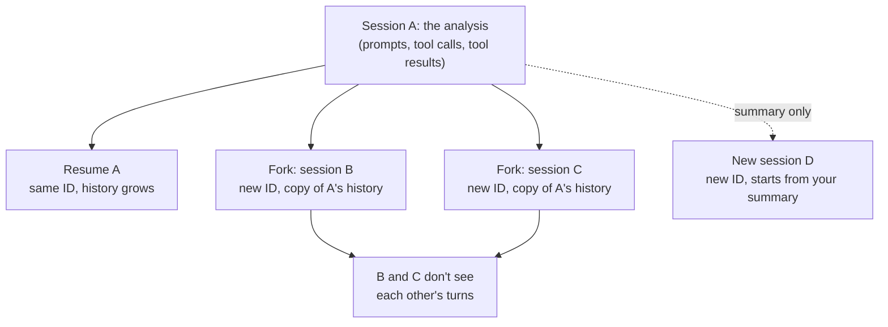
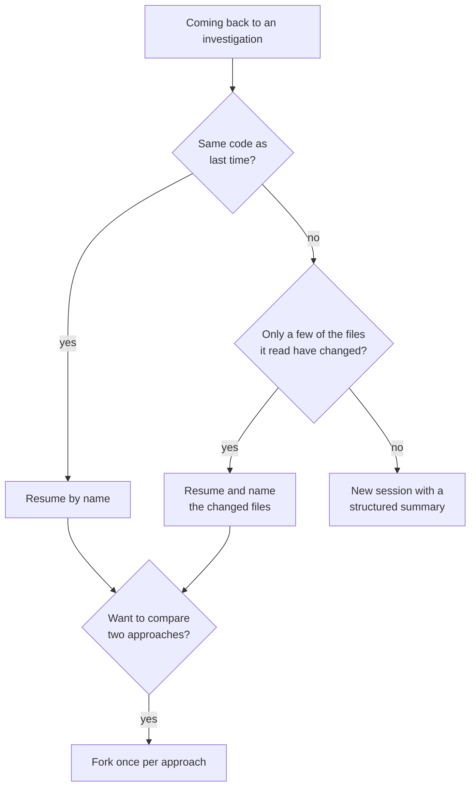

A session is the saved conversation of an agent: your prompts, every tool call, every tool result and every answer. You can come back to it in three ways. **Resume** a named session when most of what it learned is still true. **Fork** it when you want to try two approaches from the same starting point. **Start fresh** with a short summary when the code has changed so much that the old tool results would mislead the agent. This post shows all three in Claude Code and in the Agent SDK, and you build a small session tracker in TypeScript that tells you which one to pick. You can test it without an API key.

This is task statement 1.7 of the [Claude Certified Architect – Foundations exam guide](https://anthropic-partners.skilljar.com/claude-certified-architect-foundations-certification): "Manage session state, resumption, and forking". It sits in Domain 1, Agentic Architecture & Orchestration, which is 27% of the exam.

## What does task statement 1.7 test?

The guide lists four things to know and four skills. In plain words:

| The guide asks you to… | In practice |
| --- | --- |
| Know named session resumption with `--resume <session-name>` | Give a session a name, and go back to that exact session later, not just the newest one |
| Know `fork_session` for branches from a shared analysis | Copy one session into two, and try a different approach in each |
| Know why you tell a resumed agent about changed files | Its earlier reads show the old code until it reads the files again |
| Know why a fresh session with a summary can beat a resume | A clean summary doesn't carry stale tool results |
| Continue named investigations across days | `claude -n <name>` today, `claude --resume <name>` on Thursday |
| Fork to compare approaches | Two testing strategies or two refactors, each in its own branch |
| Choose between resume and fresh | Resume when the old context is mostly valid. Start fresh with a summary when it is mostly stale |
| Name the changed files when you resume | The agent re-reads those files instead of exploring the whole repo again |

The guide says `fork_session`, which is the option's name in the Python SDK. In the TypeScript SDK it is `forkSession`, and in Claude Code it is the `--fork-session` flag or the `/branch` command. They all do the same thing.

Earlier parts of this series kept context small inside one run. Part 3, [Subagents: spawning, context passing and the Agent tool](/blog/claude-subagents-context-passing), gave each subagent a fresh context. This part is about time: what happens to an agent's context between runs, hours or days apart.

## What is a session, exactly?

The [Agent SDK sessions guide](https://code.claude.com/docs/en/agent-sdk/sessions) defines it as "the conversation history the SDK accumulates while your agent works. It contains your prompt, every tool call the agent made, every tool result, and every response." The SDK and Claude Code write it to disk as you work, as a JSONL file under `~/.claude/projects/` (one JSON object per line).

Two details matter for the exam:

- **A session saves the conversation, not your files.** The same guide says: "Sessions persist the **conversation**, not the filesystem." If the code changes, the session doesn't know.
- **Tool results are snapshots.** When the agent read `config/loader.ts` on Monday, the file's Monday contents went into the history. That text stays there. It is like a photo of a whiteboard: useful until someone wipes the board.



## Resume, continue or fork: what is the difference?

All three bring back an earlier conversation. They differ in which conversation they find and whether they change it.

| You want to… | Claude Code | Agent SDK (TypeScript) |
| --- | --- | --- |
| Name a session so you can find it later | `claude -n config-map`, or `/rename config-map` inside a session | Keep the `session_id` yourself, or call `renameSession()` |
| Reopen the **most recent** session here | `claude --continue` (`-c`) | `continue: true` |
| Reopen a **specific** session | `claude --resume config-map` (name or ID), or `/resume` | `resume: sessionId` |
| Try another approach and keep the original | `claude --resume config-map --fork-session`, or `/branch` inside a session | `resume: sessionId, forkSession: true` |
| Start over with an empty context | `/clear`, or a new `claude` | A new `query()` without `resume` |

A few rules from the [Claude Code sessions page](https://code.claude.com/docs/en/sessions) and the [CLI reference](https://code.claude.com/docs/en/cli-reference) that are easy to miss:

- **Continue is not "my investigation".** `claude --continue` "reopens the most recent conversation in the current directory". If you worked on something else since, you get that instead. Resume by name to get the one you mean.
- **Name sessions on purpose.** If you don't name a session, Claude Code generates a title from your first prompt, and that title also works with `--resume`. A name you choose is easier to remember. The [best practices](https://code.claude.com/docs/en/best-practices) suggest treating named sessions "like branches: each workstream gets its own persistent context."
- **SDK and `-p` sessions are hidden from the picker.** Sessions created with `claude -p` or the Agent SDK don't appear in the session picker or in `claude --continue`. You resume them by passing the session ID to `claude --resume <session-id>`.
- **A fork gets its own ID.** In the SDK, "the fork gets its own session ID; the original's ID and history stay unchanged." In Claude Code, sessions made with `/branch` or `--fork-session` "get their own session IDs and appear as separate rows" in the picker.
- **Don't open one session in two terminals.** "If you resume the same session in two terminals without forking, messages from both interleave into one transcript." Fork instead.

## Why do old tool results go stale?

Say you resume Monday's session on Wednesday. A teammate changed `config/loader.ts` on Tuesday. The history still holds Monday's text of that file, so the agent reasons from it. It may suggest an edit to a function that no longer exists, or explain a load order that was replaced.

The agent doesn't catch this on its own. The [common workflows](https://code.claude.com/docs/en/common-workflows) page explains: "Claude reads files fresh on each tool call, so it sees edits you make in another application the next time it reads that file." The key words are *the next time it reads it*. Until then, the old read is all it has, and it has no reason to read again.

The fix is cheap. When you resume, tell the agent which files changed:

```text
config/loader.ts and config/env.ts changed since you last looked.
Re-read those two files before you continue. The other files are unchanged.
```

This keeps everything that is still valid and costs two file reads. The alternatives are worse. Keep going and correct the agent each time, and you pay in mistakes. Ask it to re-read everything, and you pay for a full new exploration.

## When is a fresh session with a summary better?

When most of the old context is wrong. After a big refactor, or weeks later, most of the file reads and test results in the history no longer match the code. Listing every changed file then means the agent re-reads nearly everything, while dozens of old tool results still sit in its context, pointing the wrong way.

A fresh session starts clean. You give it a short **structured summary** of what still holds, and it reads the current code itself:

- **Goal:** what the investigation is for.
- **Confirmed findings:** conclusions that don't depend on code that changed.
- **Open questions:** what is still unknown.
- **Files involved:** where to start reading.

The official docs point the same way. The best practices say: "A clean session with a better prompt almost always outperforms a long session with accumulated corrections." For agents that run on many machines, the SDK sessions guide suggests that you capture "the results you need (analysis output, decisions, file diffs) as application state and pass them into a fresh session's prompt", and calls that "often more robust than shipping transcript files around."




<Callout type="note" title="Resume from summary is not the same thing">

On a Pro or Max plan, Claude Code may offer "Resume from summary" when you return to a long session (inactive for more than about an hour and over 100,000 tokens, per the [sessions page](https://code.claude.com/docs/en/sessions)). That runs `/compact`: Claude summarizes the old history. It saves tokens, but the summary is written from the same old tool results, so it can carry stale facts forward. When the code has changed a lot, write the summary yourself from what you know is still true.

</Callout>


## Try it in Claude Code

This follows the exercise in the exam guide. Use any small repo with a few config files, or the four-file sample repo from the SDK build below. Claude Code needs to be [installed and logged in](https://code.claude.com/docs/en/quickstart). The outcomes below are what you should expect to see, not output we recorded: what Claude says will vary.


<Steps>


<Step title="Start a named investigation">

```bash
$ claude -n config-map
```

Ask: "Map how configuration is loaded in this repo. Which files are involved, and which source wins when two set the same value?" Let it read the files, then exit with `/exit`.

</Step>


<Step title="Change two files, then resume by name">

Edit `config/loader.ts` and `config/env.ts` yourself (for example, change the order of the sources). Then start a short side session, ask it any small question and exit. Now `--continue` would open the side session, not `config-map`. Resume by name instead:

```bash
$ claude -n side-task
$ claude --resume config-map
```

In the resumed `config-map` session, send: "config/loader.ts and config/env.ts changed; re-read them before continuing. Is your load order still right?" You should see Claude read those two files again, and not the rest.

</Step>


<Step title="Fork twice from the same analysis">

```bash
$ claude --resume config-map --fork-session
```

Inside the fork, run `/rename refactor-single-object` and ask for a refactor that merges all sources into one config object. Ask for a proposal only, not edits (see the warning below). Exit, then fork again from the original:

```bash
$ claude --resume config-map --fork-session
```

Run `/rename refactor-schema` and ask for a refactor based on a validated schema. Then ask: "What did the other branch propose?" Expect Claude to say it doesn't know. Both forks copied `config-map`'s history, and neither sees the other's turns. `config-map` itself is unchanged. Inside a session, `/branch` does the same as `--fork-session` and switches you into the copy.

</Step>


<Step title="Start fresh with a summary and compare">

Write five lines: the goal, two confirmed findings, one open question, and the files. Start a brand-new session and paste them in as the first message:

```bash
$ claude -n config-map-v2
```

Ask the same question as in step 2 and compare. With only two files changed, the resume and the fresh start should both work, and the resume should need fewer reads. Now imagine a refactor that touched every file: the resume would carry many wrong reads, and the fresh session none.

</Step>


</Steps>


<Callout type="warning" title="Forks share your files">

A fork copies the conversation, not the folder. The SDK sessions guide warns: "If a forked agent edits files, those changes are real and visible to any session working in the same directory." If two forks will both edit code, run each in its own [git worktree](https://code.claude.com/docs/en/worktrees), or ask for proposals only. To undo file edits within one session, use [checkpointing](https://code.claude.com/docs/en/checkpointing).

</Callout>


## Try it with the Agent SDK

Now the same ideas in code. You'll build:

- `session-options.ts`: typed `query()` options for start, resume and fork, plus the two prompts: the change notice and the fresh-start summary.
- `session-ledger.ts`: a small session tracker. It keeps a name for each SDK session ID and a fingerprint (a SHA-256 hash) of every file the session read, filled in by a `PostToolUse` hook (part 5 of this series covered hooks). On resume, it compares those fingerprints with the files on disk and picks one of three actions: resume, resume with a change notice, or start fresh.
- `sessions.test.ts`: tests that run the tracker against real files, with no model call.
- `main.ts`: the real thing with Claude. It needs an API key.

The tracker is our own design, not part of the SDK. The SDK stores the conversation. Your app still has to decide when that conversation is out of date. The "more than half the reads are stale" rule is a starting point to tune, not a rule from the docs.

**You need:** Node.js 22.18 or later, which runs `.ts` files directly because [type stripping is on by default](https://nodejs.org/docs/latest-v22.x/api/typescript.html). An Anthropic API key only for the last step.


<Steps>


<Step title="Create the project">

```bash
$ mkdir sessions
$ cd sessions
$ npm init -y
$ npm pkg set type=module
$ mkdir -p repo/config repo/src
```

Install the [Claude Agent SDK](https://github.com/anthropics/claude-agent-sdk-typescript), then TypeScript and the Node types for type-checking:


```bash
npm install @anthropic-ai/claude-agent-sdk
```


```bash
npm install -D typescript @types/node
```


Add the same `tsconfig.json` as in the earlier parts:


**tsconfig.json**

```json
{
  "compilerOptions": {
    "noEmit": true,
    "target": "esnext",
    "module": "nodenext",
    "rewriteRelativeImportExtensions": true,
    "erasableSyntaxOnly": true,
    "verbatimModuleSyntax": true,
    "allowImportingTsExtensions": true,
    "strict": true
  }
}
```


</Step>


<Step title="Add a tiny repo to investigate">

Four files: defaults, environment variables, a loader that merges them, and a server that uses the result.


**loader.ts**


**repo/config/loader.ts**

```ts
import { defaults } from './defaults.ts';
import { fromEnv } from './env.ts';

// Later sources win: defaults, then environment variables.
export function loadConfig(env = process.env) {
  return { ...defaults, ...fromEnv(env) };
}
```


**env.ts**


**repo/config/env.ts**

```ts
// Reads APP_* variables, e.g. APP_PORT=8080 -> { port: '8080' }
export function fromEnv(env: Record<string, string | undefined>) {
  const out: Record<string, string> = {};
  for (const [key, value] of Object.entries(env)) {
    if (key.startsWith('APP_') && value !== undefined) out[key.slice(4).toLowerCase()] = value;
  }
  return out;
}
```


**defaults.ts**


**repo/config/defaults.ts**

```ts
export const defaults = { port: 3000, logLevel: 'info', dbUrl: 'postgres://localhost/app' };
```


**server.ts**


**repo/src/server.ts**

```ts
import { loadConfig } from '../config/loader.ts';

const config = loadConfig();
console.log(`Listening on port ${config.port} (log level ${config.logLevel})`);
```


</Step>


<Step title="Write the typed session options">


**session-options.ts**

```ts
import type { HookCallback, Options } from '@anthropic-ai/claude-agent-sdk';
import { relative } from 'node:path';
import type { Decision } from './session-ledger.ts';

// Settings shared by every run. Read-only tools: this is an investigation.
export function baseOptions(cwd: string, trackReads: HookCallback): Options {
  return {
    model: 'claude-opus-5-5',
    cwd,
    allowedTools: ['Read', 'Glob', 'Grep'],
    hooks: { PostToolUse: [{ matcher: 'Read', hooks: [trackReads] }] },
    maxTurns: 30,
  };
}

// A new session. The SDK creates the ID; read it from the init message.
export const startOptions = (base: Options): Options => ({ ...base });

// The same session, with its full history.
export const resumeOptions = (base: Options, sessionId: string): Options => ({ ...base, resume: sessionId });

// A new session that starts with a COPY of sessionId's history. The original is untouched.
export const forkOptions = (base: Options, sessionId: string): Options => ({
  ...base,
  resume: sessionId,
  forkSession: true,
});

// Tell a resumed session exactly what changed, so it re-reads those files and nothing else.
export function changeNotice(decision: Decision, cwd: string): string {
  const list = (paths: string[]) => paths.map((p) => `- ${relative(cwd, p)}`).join('\n');
  const parts = ['Since you last looked at this code, some files you read have changed.'];
  if (decision.changed.length) parts.push(`Changed (your earlier reads are out of date):\n${list(decision.changed)}`);
  if (decision.missing.length) parts.push(`Deleted:\n${list(decision.missing)}`);
  parts.push('Re-read the changed files before you rely on them. The other files you read are unchanged.');
  return parts.join('\n\n');
}

// The opening prompt of a fresh session: what still holds, not the old tool results.
export interface Summary {
  goal: string;
  confirmed: string[];
  openQuestions: string[];
  files: string[];
}

export function freshPrompt(summary: Summary, task: string): string {
  const bullets = (items: string[]) => items.map((i) => `- ${i}`).join('\n');
  return [
    'You are continuing an earlier investigation in a new session. The code may have changed since then,',
    'so treat this summary as a starting point and re-read any file before you rely on it.',
    '',
    `Goal: ${summary.goal}`,
    `Confirmed findings:\n${bullets(summary.confirmed)}`,
    `Open questions:\n${bullets(summary.openQuestions)}`,
    `Files involved:\n${bullets(summary.files)}`,
    '',
    `Task: ${task}`,
  ].join('\n');
}
```


- **`resumeOptions`** sets `resume` to a session ID. The agent continues with the full history.
- **`forkOptions`** adds `forkSession: true`. The [TypeScript reference](https://code.claude.com/docs/en/agent-sdk/typescript) describes it as: "When resuming with `resume`, fork to a new session ID instead of continuing the original session."
- **`changeNotice`** lists only the changed and deleted files, by path, and says the rest are unchanged. That is what lets the agent re-read two files instead of twenty.
- **`freshPrompt`** turns a summary into the first message of a new session. It asks the agent to re-read files before trusting the summary.

</Step>


<Step title="Write the session tracker">


**session-ledger.ts**

```ts
import { createHash } from 'node:crypto';
import { existsSync, readFileSync, writeFileSync } from 'node:fs';
import type { HookCallback, PostToolUseHookInput } from '@anthropic-ai/claude-agent-sdk';

// What your app remembers about each SDK session. The SDK keeps the conversation;
// this file keeps the name, the parent (for forks) and a fingerprint of every file read.
export interface SessionEntry {
  id: string; // the SDK session ID
  name: string;
  parentId?: string; // set on forks
  updatedAt: number;
  reads: Record<string, string>; // absolute path -> sha256 of the content when it was read
}

export type Action = 'resume' | 'resume-with-notice' | 'fresh-with-summary';

export interface Decision {
  action: Action;
  changed: string[]; // read earlier, different now
  missing: string[]; // read earlier, deleted now
  unchanged: string[];
}

export const sha256 = (text: string) => createHash('sha256').update(text).digest('hex');

// Returns the file's current hash, or null if it no longer exists.
const hashOnDisk = (path: string) => (existsSync(path) ? sha256(readFileSync(path, 'utf8')) : null);

export class SessionLedger {
  private sessions = new Map<string, SessionEntry>();
  private now: () => number;

  constructor(now: () => number = Date.now) {
    this.now = now;
  }

  static load(file: string, now?: () => number): SessionLedger {
    const ledger = new SessionLedger(now);
    if (existsSync(file)) {
      for (const s of JSON.parse(readFileSync(file, 'utf8')) as SessionEntry[]) ledger.sessions.set(s.id, s);
    }
    return ledger;
  }

  save(file: string) {
    writeFileSync(file, JSON.stringify([...this.sessions.values()], null, 2));
  }

  // Name a session once the SDK has told you its ID. Reads the hook already recorded are kept.
  register(id: string, name: string, parentId?: string): SessionEntry {
    const parent = parentId ? this.sessions.get(parentId) : undefined;
    const own = this.sessions.get(id)?.reads;
    // A fork starts with a copy of everything its parent had read: it inherits that history.
    const entry: SessionEntry = { id, name, parentId, updatedAt: this.now(), reads: { ...parent?.reads, ...own } };
    this.sessions.set(id, entry);
    return entry;
  }

  recordRead(id: string, path: string, contentHash: string) {
    const entry = this.sessions.get(id) ?? this.register(id, id);
    entry.reads[path] = contentHash;
    entry.updatedAt = this.now();
  }

  touch(id: string) {
    const entry = this.sessions.get(id);
    if (entry) entry.updatedAt = this.now();
  }

  // Like `claude --resume <name>`: the session with that name, newest first.
  byName(name: string): SessionEntry | undefined {
    return [...this.sessions.values()].filter((s) => s.name === name).sort((a, b) => b.updatedAt - a.updatedAt)[0];
  }

  // Like `claude --continue`: whatever was used last, whatever its name.
  mostRecent(): SessionEntry | undefined {
    return [...this.sessions.values()].sort((a, b) => b.updatedAt - a.updatedAt)[0];
  }

  // Compare what the session read with what is on disk now.
  decide(id: string, maxStaleShare = 0.5): Decision {
    const entry = this.sessions.get(id);
    if (!entry) throw new Error(`Unknown session ${id}`);
    const changed: string[] = [];
    const missing: string[] = [];
    const unchanged: string[] = [];
    for (const [path, hashThen] of Object.entries(entry.reads)) {
      const hashNow = hashOnDisk(path);
      if (hashNow === null) missing.push(path);
      else if (hashNow !== hashThen) changed.push(path);
      else unchanged.push(path);
    }
    const total = changed.length + missing.length + unchanged.length;
    const stale = changed.length + missing.length;
    const action: Action =
      stale === 0 ? 'resume' : stale / total <= maxStaleShare ? 'resume-with-notice' : 'fresh-with-summary';
    return { action, changed, missing, unchanged };
  }
}

// A PostToolUse hook that fingerprints every file the Read tool returns.
export function trackReads(ledger: SessionLedger): HookCallback {
  return async (input) => {
    if (input.hook_event_name !== 'PostToolUse') return {};
    const { session_id, tool_input } = input as PostToolUseHookInput;
    const path = (tool_input as { file_path?: unknown }).file_path;
    if (typeof path === 'string' && existsSync(path)) {
      ledger.recordRead(session_id, path, sha256(readFileSync(path, 'utf8')));
    }
    return {};
  };
}
```


- **`register`** names a session. For a fork, it copies the parent's reads, because the fork inherited that history. Reads in the fork after that belong to the fork only.
- **`byName`** works like `claude --resume <name>`. **`mostRecent`** works like `--continue`, and the tests show how it can pick the wrong session.
- **`decide`** hashes each file the session read and compares it with the hash from the time of the read. No stale reads: resume. Up to half stale: resume with a notice. More than half: start fresh.
- **`trackReads`** is a `PostToolUse` hook for the `Read` tool. It gets `session_id` and `tool_input.file_path` from the hook input, so every read is recorded under the right session.

</Step>


<Step title="Test it without an API key">

The tests copy the sample repo to a temporary folder, call the hook the way the SDK would after a `Read`, then edit and delete files to make reads go stale.


**sessions.test.ts**

```ts
import assert from 'node:assert/strict';
import { cpSync, mkdtempSync, rmSync, writeFileSync } from 'node:fs';
import { tmpdir } from 'node:os';
import { join } from 'node:path';
import { test } from 'node:test';
import type { PostToolUseHookInput } from '@anthropic-ai/claude-agent-sdk';
import { SessionLedger, trackReads } from './session-ledger.ts';
import { baseOptions, changeNotice, forkOptions, freshPrompt, resumeOptions } from './session-options.ts';

// A private copy of the sample repo, so the tests can edit files freely.
const dir = mkdtempSync(join(tmpdir(), 'sessions-'));
cpSync('repo', dir, { recursive: true });
const file = (p: string) => join(dir, p);
const FILES = ['config/loader.ts', 'config/env.ts', 'config/defaults.ts', 'src/server.ts'].map(file);

// A clock you control, so "most recent" is predictable.
let clock = 0;
const ledger = new SessionLedger(() => ++clock);
const hook = trackReads(ledger);
const signal = { signal: new AbortController().signal };

// What the SDK sends a PostToolUse hook after the Read tool runs.
const readBy = (session_id: string, file_path: string) =>
  hook(
    {
      session_id, transcript_path: '/tmp/t.jsonl', cwd: dir, hook_event_name: 'PostToolUse',
      tool_name: 'Read', tool_input: { file_path }, tool_response: {}, tool_use_id: 'toolu_1',
    } satisfies PostToolUseHookInput,
    'toolu_1',
    signal,
  );

test('the Read hook fingerprints files; forks copy the history, then diverge', async () => {
  for (const f of FILES) await readBy('s-main', f);
  ledger.register('s-main', 'config-map');

  ledger.register('s-fork-a', 'refactor-a', 's-main');
  ledger.register('s-fork-b', 'refactor-b', 's-main');
  writeFileSync(file('config/schema.ts'), 'export const schema = {};\n');
  await readBy('s-fork-a', file('config/schema.ts')); // only branch A looks at this

  const reads = (name: string) => Object.keys(ledger.byName(name)!.reads).length;
  assert.equal(reads('config-map'), 4); // the original is untouched
  assert.equal(reads('refactor-a'), 5); // 4 inherited + 1 of its own
  assert.equal(reads('refactor-b'), 4); // B never sees what A read
});

test('resume by name finds an older session; "most recent" does not', () => {
  ledger.register('s-other', 'flaky-test'); // used last
  assert.equal(ledger.mostRecent()?.name, 'flaky-test');
  assert.equal(ledger.byName('config-map')?.id, 's-main');
});

test('two of four files changed: resume, and name exactly those two', () => {
  writeFileSync(file('config/loader.ts'), "export { loadConfig } from './load-order.ts';\n");
  writeFileSync(file('config/env.ts'), 'export const fromEnv = () => ({});\n');

  const decision = ledger.decide('s-main');
  assert.equal(decision.action, 'resume-with-notice');
  assert.equal(decision.unchanged.length, 2);

  const notice = changeNotice(decision, dir);
  console.log(`${notice}\n`);
  assert.match(notice, /- config\/loader\.ts\n- config\/env\.ts/);
  assert.doesNotMatch(notice, /defaults|server/);
});

test('most files changed or deleted: start fresh with a summary', () => {
  writeFileSync(file('config/defaults.ts'), 'export const defaults = { port: 8080 };\n');
  rmSync(file('src/server.ts'));

  const decision = ledger.decide('s-main');
  assert.equal(decision.action, 'fresh-with-summary');
  assert.equal(decision.missing.length, 1);

  const prompt = freshPrompt(
    {
      goal: 'Map how configuration is loaded.',
      confirmed: ['Environment variables override defaults.', 'Only APP_* variables are read.'],
      openQuestions: ['Where does the new load order come from?'],
      files: ['config/loader.ts', 'config/env.ts', 'config/defaults.ts'],
    },
    'Re-read the config folder and explain the current load order.',
  );
  console.log(prompt);
  assert.match(prompt, /^You are continuing an earlier investigation/);
});

test('resume keeps the session; fork asks for a new ID; the base is not changed', () => {
  const base = baseOptions(dir, hook);
  assert.deepEqual(resumeOptions(base, 's-main'), { ...base, resume: 's-main' });
  assert.deepEqual(forkOptions(base, 's-main'), { ...base, resume: 's-main', forkSession: true });
  assert.equal(base.resume, undefined);
  assert.equal(base.model, 'claude-opus-5-5');
  assert.equal(JSON.stringify(Object.keys(base).sort()), '["allowedTools","cwd","hooks","maxTurns","model"]');
});

test.after(() => rmSync(dir, { recursive: true, force: true }));
```


```bash
$ node --test sessions.test.ts
```

```text
Since you last looked at this code, some files you read have changed.

Changed (your earlier reads are out of date):
- config/loader.ts
- config/env.ts

Re-read the changed files before you rely on them. The other files you read are unchanged.

You are continuing an earlier investigation in a new session. The code may have changed since then,
so treat this summary as a starting point and re-read any file before you rely on it.

Goal: Map how configuration is loaded.
Confirmed findings:
- Environment variables override defaults.
- Only APP_* variables are read.
Open questions:
- Where does the new load order come from?
Files involved:
- config/loader.ts
- config/env.ts
- config/defaults.ts

Task: Re-read the config folder and explain the current load order.
✔ the Read hook fingerprints files; forks copy the history, then diverge
✔ resume by name finds an older session; "most recent" does not
✔ two of four files changed: resume, and name exactly those two
✔ most files changed or deleted: start fresh with a summary
✔ resume keeps the session; fork asks for a new ID; the base is not changed
ℹ tests 5
ℹ suites 0
ℹ pass 5
ℹ fail 0
ℹ cancelled 0
ℹ skipped 0
ℹ todo 0
```

This is our output on Node 22.22.2 with `@anthropic-ai/claude-agent-sdk` 0.3.287, with per-test timings removed. No model was called: the tests only import types from the SDK. Then type-check everything, including `main.ts` from the next step:

```bash
$ npx tsc
```

No output means no type errors.

</Step>


<Step title="Run it with Claude">

Create an API key in the [Claude Console](https://platform.claude.com/) and set it as the `ANTHROPIC_API_KEY` environment variable. `main.ts` reads the session ID from the `init` message and the result, as the [sessions guide](https://code.claude.com/docs/en/agent-sdk/sessions) shows, and saves your names and fingerprints in `sessions.json`.


**main.ts**

```ts
import { query, type Options } from '@anthropic-ai/claude-agent-sdk';
import { readFileSync } from 'node:fs';
import { resolve } from 'node:path';
import { SessionLedger, trackReads } from './session-ledger.ts';
import {
  baseOptions,
  changeNotice,
  forkOptions,
  freshPrompt,
  resumeOptions,
  startOptions,
  type Summary,
} from './session-options.ts';

const LEDGER_FILE = 'sessions.json';
const cwd = resolve('repo');
const ledger = SessionLedger.load(LEDGER_FILE);
const base = baseOptions(cwd, trackReads(ledger));

// Run one query, print the answer, and return the session ID the SDK used.
async function run(prompt: string, options: Options): Promise<string> {
  let sessionId = '';
  for await (const message of query({ prompt, options })) {
    if (message.type === 'system' && message.subtype === 'init') sessionId = message.session_id;
    if (message.type === 'result') {
      sessionId = message.session_id;
      console.log(message.subtype === 'success' ? message.result : `Stopped: ${message.subtype}`);
    }
  }
  return sessionId;
}

function mustFind(name: string) {
  const entry = ledger.byName(name);
  if (!entry) throw new Error(`No session named "${name}". Start one first.`);
  return entry;
}

const [command, name, ...rest] = process.argv.slice(2);

if (command === 'start') {
  // node main.ts start <name> "<prompt>"
  const id = await run(rest.join(' '), startOptions(base));
  ledger.register(id, name);
} else if (command === 'resume') {
  // node main.ts resume <name> "<prompt>"
  const entry = mustFind(name);
  const decision = ledger.decide(entry.id);
  if (decision.action === 'fresh-with-summary') {
    console.error(`Most of what "${name}" read has changed. Start fresh: node main.ts fresh <name> summary.json "<prompt>"`);
    process.exit(1);
  }
  const prompt = decision.action === 'resume' ? rest.join(' ') : `${changeNotice(decision, cwd)}\n\n${rest.join(' ')}`;
  ledger.touch(await run(prompt, resumeOptions(base, entry.id)));
} else if (command === 'fork') {
  // node main.ts fork <name> <new-name> "<prompt>"
  const [newName, ...words] = rest;
  const entry = mustFind(name);
  const forkId = await run(words.join(' '), forkOptions(base, entry.id));
  ledger.register(forkId, newName, entry.id);
} else if (command === 'fresh') {
  // node main.ts fresh <new-name> summary.json "<prompt>"
  const [summaryFile, ...words] = rest;
  const summary = JSON.parse(readFileSync(summaryFile, 'utf8')) as Summary;
  const id = await run(freshPrompt(summary, words.join(' ')), startOptions(base));
  ledger.register(id, name);
} else {
  console.error('Usage: node main.ts start|resume|fork|fresh <name> ...');
  process.exit(1);
}

ledger.save(LEDGER_FILE);
```


For the fresh start, save a summary like this:


**summary.json**

```json
{
  "goal": "Map how configuration is loaded, then propose a simpler loader.",
  "confirmed": [
    "Environment variables override the defaults.",
    "Only variables that start with APP_ are read."
  ],
  "openQuestions": ["Does anything outside config/ read process.env directly?"],
  "files": ["config/loader.ts", "config/env.ts", "config/defaults.ts", "src/server.ts"]
}
```


Then run the exercise from the Claude Code section, this time in code:

```bash
$ node main.ts start config-map "Map how configuration is loaded. Which source wins when two set the same value?"
$ node main.ts resume config-map "Is your load order still right?"
$ node main.ts fork config-map refactor-single-object "Propose, don't apply, a refactor that merges all sources into one object."
$ node main.ts fork config-map refactor-schema "Propose, don't apply, a refactor based on a validated schema."
$ node main.ts fresh config-map-v2 summary.json "Explain the current load order."
```

The model is `claude-opus-5-5`, the one the [models overview](https://platform.claude.com/docs/en/about-claude/models/overview) suggests starting with. Edit `repo/config/loader.ts` between the first two commands: the resume should start with the change notice. Change most of the files the session read, and `resume` refuses and tells you to start fresh. The two forks get different IDs in `sessions.json`, and both list `config-map`'s ID as their parent.

</Step>


</Steps>


## Common traps

These are the mistakes that wrong answer options are built on.

| Trap | Why it breaks | Fix |
| --- | --- | --- |
| Resuming after code changes without saying what changed | The history still holds the old file contents, and the agent reasons from them | Name the changed files so it re-reads just those |
| Using "continue" to get back to a specific investigation | Continue opens the most recent session, which may be a different task | Name sessions and resume by name or ID |
| Trying two approaches one after the other in one session | The second attempt sees the first, so it isn't independent | Fork once per approach from the shared analysis |
| Thinking a fork isolates files | Forks copy the conversation only; edits land in the same folder | One git worktree per fork, or proposals only |
| Opening the same session in two terminals | Both write into one transcript, and the turns interleave | Fork instead |
| Starting from zero every time | You pay to re-explore context that was still valid | Resume when most of it still holds |
| Resuming a session that is mostly stale | Dozens of wrong reads outweigh a short note about what changed | Start fresh with a structured summary |
| Asking the agent to "re-read everything" | Costs as much as a fresh start, and the stale results are still in context | Name only the changed files, or start fresh |

## Practice questions

These four questions are this blog's own, written for practice. They are not from the exam.

**Question 1.** You resume yesterday's session about a payments module. Overnight a teammate changed three files that the session had already read, and the agent now suggests edits to functions that no longer exist. What should you do?

- A. Tell the resumed session which three files changed, so it re-reads just those before continuing.
- B. Start a new session and have it explore the whole module again.
- C. Keep going and correct the agent each time it refers to old code.
- D. Ask the agent to re-read every file it has opened in the session.

**Question 2.** You are working on two investigations this week: a memory leak and a flaky test. On Thursday you want to continue the flaky-test investigation, but the memory-leak session was the last one you used. What is the best approach?

- A. Run `claude --continue`.
- B. Resume the flaky-test session by its name with `claude --resume <session-name>`.
- C. Paste Monday's notes into a new session.
- D. Add a note about the flaky test to CLAUDE.md.

**Question 3.** After a shared analysis of a service, you fork the session twice: one fork rewrites the data layer, the other adds caching. Both forks are allowed to edit files and run in the same checkout. When you review the caching fork, its tests fail because of data-layer changes it never made. What is the cause, and the fix?

- A. Forking is broken; resume the original session in two terminals instead.
- B. The forks shared their conversation history; fork from an earlier point in the session.
- C. A fork copies the conversation, not the files, so both forks edited the same checkout. Give each fork its own git worktree, or ask for proposals only.
- D. The forks should have used `continue` instead of `resume`.

**Question 4.** You return to a three-week-old session. Since then the codebase has had large refactors, and most file reads and test results in the session are out of date. A few high-level conclusions are still true. What is the most reliable way to continue?

- A. Resume the session and ask the agent to be careful.
- B. Resume the session and list every file that changed.
- C. Fork the old session and continue in the fork.
- D. Start a new session with a structured summary of the conclusions that still hold, then let it read the current code.

## Answer key

### Question 1

**Answer: A.** Naming the changed files gives a targeted re-read and keeps the rest of the context, which is still correct. The strongest distractor is B: it works, but it throws away valid context and pays for a full new exploration. D costs almost as much as B and leaves the stale reads in context.

### Question 2

**Answer: B.** Resuming by name opens the exact conversation you mean. The strongest distractor is A: `--continue` opens the most recent session in the folder, which is the memory-leak one.

### Question 3

**Answer: C.** The SDK docs say forking "branches the conversation history, not the filesystem", so edits from one fork are visible to every session in the same directory. Separate worktrees keep the branches apart on disk. The strongest distractor is B: the forks did start from the same history, but that is the point of forking. The history didn't cause the failure; the shared files did. A makes it worse, because two terminals on one session mix both conversations into one transcript.

### Question 4

**Answer: D.** When most of the old tool results are stale, a fresh session with a clean summary avoids reasoning from outdated data. The strongest distractor is B: listing changed files works when a few changed, but here nearly everything did, so the old context would mislead more than it helps. C keeps the same stale history in a new ID.

## What should I do next?

- **Extend the build.** Make `decide` also look at age, for example "start fresh after 14 days even if few files changed", and add a test for it. Or store the sessions with the SDK's [`sessionStore` option](https://code.claude.com/docs/en/agent-sdk/session-storage), so an agent on another machine can resume them.
- **Keep sessions cheap.** Resuming a long session sends its whole history again. [AI cost and latency: what drives them and how to cut them](/blog/ai-cost-and-latency) explains why, and [Getting the most out of AI coding assistants](/blog/ai-coding-assistants-tips) has more on working with coding agents across days. [How to build your first AI agent in Node.js](/blog/build-your-first-ai-agent) is a good refresher on the agent loop underneath all of this.
- **Review Domain 1.** This is the last task statement in this series. Follow the [six-week study plan](/blog/claude-architect-exam-study-plan), then test yourself with the [mock exam](/blog/claude-certification-mock-exam).
- **Move on to Domain 2.** The next series is "Claude certification prep: tool design and MCP". It starts with task statement 2.1, "Design effective tool interfaces with clear descriptions and boundaries", in the post [Tool descriptions: how Claude picks the right tool](/blog/claude-tool-descriptions).
