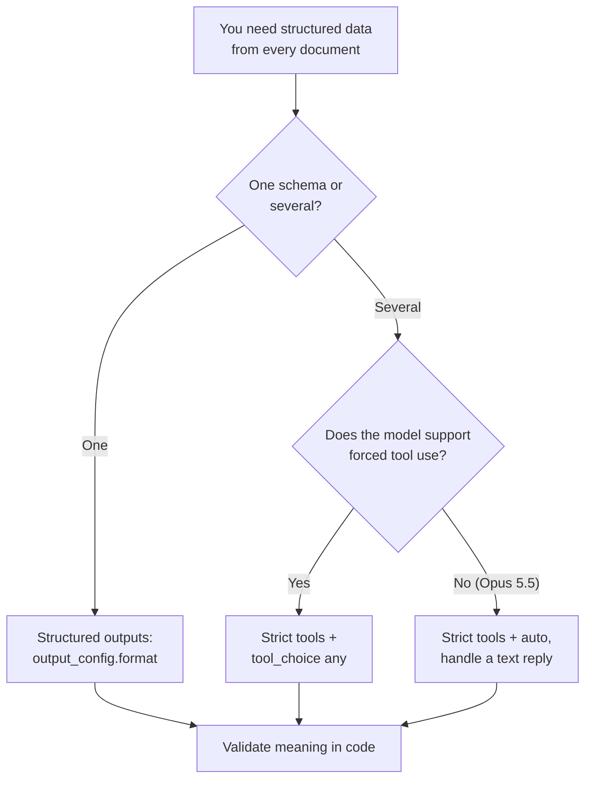

To get reliable JSON from Claude, let the API enforce a JSON schema instead of asking for "JSON only" in the prompt. Structured outputs and strict tool use both make Claude's output match your schema, so you never parse broken JSON again. A schema fixes the *shape* of the data, not its *meaning*, so you still design the fields carefully and check the values in code. In this post you build an invoice extractor in TypeScript with Zod and the official SDK, and test it offline on canned responses, including one that is valid JSON but wrong.

This is task statement 4.3 of the [Claude Certified Architect – Foundations exam guide](https://anthropic-partners.skilljar.com/claude-certified-architect-foundations-certification): "Enforce structured output using tool use and JSON schemas". It is part of Domain 4, Prompt Engineering & Structured Output, which is 20% of the exam.

## What does task statement 4.3 test?

The guide lists four things to know and six skills. In plain words:

| The guide asks you to… | In practice |
| --- | --- |
| Know that tool use with a JSON schema is the most reliable way to get schema-compliant output | Let the API enforce the schema; don't parse free text |
| Know the three `tool_choice` modes: `auto`, `any` and a forced named tool | Know what each guarantees, and which models accept them today |
| Know that strict schemas stop syntax errors but not semantic errors | Valid JSON can still hold wrong numbers or values in the wrong field |
| Know the schema design choices: required vs optional, enum with "other" + detail | Let Claude say "not there" or "doesn't fit" instead of guessing |
| Define an extraction tool and read the data from the `tool_use` block | The tool's `input_schema` is your data shape |
| Use `any` when several extraction schemas exist and the document type is unknown | Claude must call a tool but picks the right one |
| Force a named tool so one extraction runs first | Every response contains that tool call |
| Make fields nullable when the source may not have the value | Claude returns `null` instead of inventing one |
| Add "unclear" and "other" + detail values to enums | Odd cases are visible instead of forced into a wrong bucket |
| Put format rules (dates, amounts) in the prompt next to the schema | The schema says "string"; the prompt says "YYYY-MM-DD" |

Two words you'll see a lot. A **JSON schema** is a description of the JSON you expect: which keys, which types, which values are allowed. **Extraction** means pulling structured fields (names, dates, amounts) out of a document. If tool use is new to you, read [What is tool calling?](/blog/what-is-tool-calling) first.

## What are your options for structured output?

There are four ways to get JSON out of Claude. Only the last two are enforced by the API:

| Approach | How you ask | Where the data is | What the API guarantees |
| --- | --- | --- | --- |
| Prompt only | "Reply with JSON only" | A text block | Nothing. Prose around the JSON, missing keys and wrong types all happen |
| Tool use | A tool whose `input_schema` is your data shape | The `input` of a `tool_use` block | The model follows the schema well, but it isn't enforced |
| Strict tool use | The same tool with `strict: true` | The `input` of a `tool_use` block | `input` follows the `input_schema`, and the tool `name` is always valid |
| Structured outputs | `output_config.format` with `type: "json_schema"` | A text block with JSON | The JSON matches your schema |

How does the API enforce a schema? The [strict tool use docs](https://platform.claude.com/docs/en/agents-and-tools/tool-use/strict-tool-use) call it "grammar-constrained sampling": the API turns your schema into a grammar, and while Claude writes, it can only pick tokens that keep the output valid. Both features use the same pipeline and the same [JSON Schema subset](https://platform.claude.com/docs/en/build-with-claude/structured-outputs#json-schema-limitations).

The [structured outputs docs](https://platform.claude.com/docs/en/build-with-claude/structured-outputs) sum up the two enforced options: JSON outputs "control Claude's response format (what Claude says)", and strict tool use "validates tool parameters (how Claude calls your functions)". For extraction, both work. Structured outputs fit when you always want one shape. Tools fit when there are several shapes and Claude should pick one.

The exam guide was written around tool use, so it calls tool use with a JSON schema "the most reliable approach". Today you have both enforced options, and the next question shows why the choice matters on current models.

## What changed for tool_choice on Claude Opus 5.5?

`tool_choice` tells Claude whether it must call a tool. The [define tools docs](https://platform.claude.com/docs/en/agents-and-tools/tool-use/define-tools#forcing-tool-use) list four options:

- **`auto`**: Claude decides whether to call a tool. This is the default when you pass tools. Claude may answer in text instead.
- **`any`**: Claude must call one of your tools, but chooses which.
- **`tool`**: Claude must call the tool you name, for example `{"type": "tool", "name": "extract_metadata"}`.
- **`none`**: Claude can't call tools.

The exam guide teaches `any` and the forced `tool` as the way to guarantee structured output. That still works on models that support it, such as Claude Opus 5. But the same docs page says that on **Claude Opus 5.5, Claude Sonnet 5.5, Claude Fable 5.1 and Claude Mythos 5.1**, `any` and `tool` "return a 400 error". The [API errors page](https://platform.claude.com/docs/en/api/errors#forced-tool-use-not-supported) shows the message:

```text
tool_choice: type "tool" and "any" are not supported for this model.
```

Forced tool use also fails on any model when you turn on manual extended thinking (`thinking: {type: "enabled"}`). What the docs recommend instead on these models: "`auto` with strict tool use to guarantee schema-valid tool inputs, or structured outputs when you need a response in a fixed JSON shape." So learn the exam's mapping, and know today's version of it:

| You need | Exam guide's answer | On Claude Opus 5.5 |
| --- | --- | --- |
| Always the same structured data | Force the named tool | Structured outputs (`output_config.format`) |
| One of several schemas, type unknown | `tool_choice: "any"` | Strict tools with `auto`, plus code that handles a text reply |
| A tool call only when it helps | `auto` | `auto` (unchanged) |



On a model that supports it, such as Claude Opus 5, the forced version from the guide looks like this. Sent to Claude Opus 5.5, the same request returns the 400 error above:

```json
{
  "model": "claude-opus-5",
  "max_tokens": 1024,
  "tools": [{ "name": "extract_metadata", "strict": true, "input_schema": { "...": "..." } }],
  "tool_choice": { "type": "tool", "name": "extract_metadata" },
  "messages": [{ "role": "user", "content": "..." }]
}
```

## What does a schema guarantee, and what doesn't it?

The structured outputs docs promise: "Always valid: No more `JSON.parse()` errors", "Type safe: Guaranteed field types and required fields", and "Reliable: No retries needed for schema violations". That removes a whole class of bugs. It leaves these:

- **Refusals and cut-offs.** With `stop_reason: "refusal"` or `"max_tokens"`, the docs warn the output "may not match your schema". Check `stop_reason` before you parse.
- **Enum capitals.** The docs say structured outputs "don't guarantee the capitalization of string `enum` and `const` values", typically for the first letter of a word after a space. Compare enum values without caring about case, and avoid values that differ only in capitals.
- **Unsupported rules.** `minimum`, `maximum`, `minLength`, `maxLength` and recursive schemas aren't supported, and an unsupported feature gives "a 400 error with details". Check those rules in your code instead.
- **Meaning.** A schema can't say "the line items add up to the total" or "this number is the PO number, not the invoice number". Valid JSON can still be wrong data.


<Callout type="warning" title="Valid JSON is not correct data">

A schema check passing tells you the shape is right. It tells you nothing about whether the total matches the line items, the date is the issue date, or the PO number came from the document at all. Keep a check in code for every rule your business depends on, and send failures to a person or a retry.

</Callout>


The exam guide names the same split: tool use "eliminates syntax errors" but doesn't prevent "semantic errors (e.g., line items that don't sum to total, values in wrong fields)". The next task statement, 4.4, is about what you do with those errors.

## How do you design fields so Claude doesn't invent values?

The schema shapes what Claude *can* say. If the only allowed answer is a value, Claude gives a value, even when the document has none.

**Nullable fields for values that may be missing.** If `purchase_order_number` is a required string, and an invoice has no PO number, there is no honest answer that fits. Allow `null`:

```json
"purchase_order_number": { "type": ["string", "null"] }
```

The guide calls this making fields "optional (nullable)". You have two ways to do it. You can leave the key out of `required`, or keep it required and allow `null`. For extraction, required-and-nullable is usually better: every key is always there, and `null` clearly means "not in the document". It also saves budget. The docs limit a request to 24 optional parameters and 16 parameters with union types (like `["string", "null"]`) across all strict schemas, and they suggest making parameters required where you can.

**Enums with an escape hatch.** An enum is a fixed list of allowed values. A list without a way out forces every odd case into the nearest bucket. Add two values:

- **`other`**, together with a free-text `category_detail` field, for real cases your list doesn't cover. You can read the details later and add new categories.
- **`unclear`**, for documents that don't say enough to decide. That is different from "other": the input is vague, not new.

**Format rules in the prompt.** A schema can say "string". It can't say "YYYY-MM-DD", "1.250,00 EUR is 1250" or "use null when 03/04 could be March or April". Put those rules in the system prompt, next to the schema, and repeat the key ones in field descriptions.

## Try it: an invoice extractor, checked offline

You'll build two extraction paths for supplier invoices: structured outputs for a known invoice, and strict tools for a mix of invoices and receipts. One Zod schema gives you both the JSON schema for the API and a validator for the reply. Then you run both paths against canned responses with a fake client, so no API key is needed.

The canned responses are **examples we wrote by hand** in the shape the API returns. They are not recorded model output. They show what the validator does with each kind of failure.

**You need:** Node.js 22.18 or later, which runs `.ts` files directly because [type stripping is on by default](https://nodejs.org/docs/latest-v22.x/api/typescript.html). An Anthropic API key only for the last step.


<Steps>


<Step title="Create the project">

```bash
$ mkdir invoice-extract
$ cd invoice-extract
$ npm init -y
$ npm pkg set type=module
$ mkdir canned docs
```

Install the [official TypeScript SDK](https://github.com/anthropics/anthropic-sdk-typescript) and [Zod](https://zod.dev/), then TypeScript and the Node types for type-checking:


```bash
npm install @anthropic-ai/sdk zod
```


```bash
npm install -D typescript @types/node
```


Use the same `tsconfig.json` as the earlier posts in this series:


**tsconfig.json**

```json
{
  "compilerOptions": {
    "noEmit": true,
    "target": "esnext",
    "module": "nodenext",
    "rewriteRelativeImportExtensions": true,
    "erasableSyntaxOnly": true,
    "verbatimModuleSyntax": true,
    "allowImportingTsExtensions": true,
    "strict": true
  },
  "include": ["*.ts"]
}
```


</Step>


<Step title="Define the schemas with Zod">


**schema.ts**

```ts
import { z } from 'zod';

// The shape we want from every invoice. Keys are always present;
// "not on the invoice" is an explicit null, never a guess.
export const InvoiceSchema = z.object({
  vendor_name: z.string().describe('The company that issued the invoice, as printed.'),
  invoice_number: z
    .string()
    .nullable()
    .describe('The invoice number as printed. null if the invoice shows none.'),
  purchase_order_number: z
    .string()
    .nullable()
    .describe('The buyer\'s PO number, only if printed on the invoice. null if absent. Never make one up.'),
  invoice_date: z.string().nullable().describe('Issue date as YYYY-MM-DD. null if absent.'),
  currency: z
    .enum(['USD', 'EUR', 'GBP', 'other', 'unclear'])
    .describe('"other" for a currency not in the list, "unclear" if the invoice does not show which one.'),
  category: z.enum([
    'software',
    'hardware',
    'professional_services',
    'office_supplies',
    'other',
    'unclear',
  ]),
  category_detail: z
    .string()
    .nullable()
    .describe('When category is "other": a few words naming the category. Otherwise null.'),
  line_items: z.array(
    z.object({
      description: z.string(),
      amount: z.number(),
    }),
  ),
  total: z.number().describe('The amount due, as printed on the invoice.'),
});

export const ReceiptSchema = z.object({
  merchant_name: z.string(),
  purchase_date: z.string().nullable().describe('YYYY-MM-DD. null if absent.'),
  currency: z.enum(['USD', 'EUR', 'GBP', 'other', 'unclear']),
  payment_method: z.enum(['card', 'cash', 'other', 'unclear']),
  total: z.number(),
});

export type Invoice = z.infer<typeof InvoiceSchema>;
export type Receipt = z.infer<typeof ReceiptSchema>;
```


Every key is required, and the values that may be missing are `.nullable()`. `currency` and `category` are enums with `other` and `unclear`. `category_detail` holds the free text when the category is `other`. There is no `.positive()` on `total`: the API doesn't support numeric limits, so that rule moves to code in step 4.

</Step>


<Step title="Write the format rules">


**prompt.ts**

```ts
// Format rules the schema can't express go in the prompt.
export const SYSTEM = `You extract data from invoices and receipts for an accounts payable team.

Rules:
- Copy values only from the document. If a value is not printed, use null.
  Never invent invoice numbers or purchase order numbers.
- Dates: write them as YYYY-MM-DD. If the day and month order is ambiguous
  (for example 03/04/2026 with no country hint), use null.
- Amounts: plain numbers with a dot for decimals, no currency symbols and no
  thousands separators ("1.250,00 EUR" becomes 1250).
- total is the amount due as printed. Do not recalculate it.
- currency: use "unclear" when the document does not show the currency.
- category: use "other" with a short category_detail for spend that fits no
  category, and "unclear" when the document does not say what was bought.`;
```


These are the rules the schema can't hold: date format, number format, and when to use `null`, `unclear` and `other`.

</Step>


<Step title="Check the meaning in code">


**checks.ts**

```ts
import type { Invoice, Receipt } from './schema.ts';

const ISO_DATE = /^\d{4}-\d{2}-\d{2}$/;
const OUR_PO = /^PO-\d{4}$/; // the buyer's own PO format, from your purchasing system
const cents = (n: number) => Math.round(n * 100);

function dateProblem(field: string, value: string | null): string[] {
  if (value === null) return [];
  if (!ISO_DATE.test(value) || Number.isNaN(Date.parse(value))) {
    return [`${field} "${value}" is not a valid YYYY-MM-DD date`];
  }
  return [];
}

// Rules about meaning. A schema can't express these, so code checks them.
export function invoiceProblems(inv: Invoice): string[] {
  const problems = dateProblem('invoice_date', inv.invoice_date);
  if (inv.total <= 0) problems.push(`total ${inv.total} is not positive`);

  if (inv.line_items.length > 0) {
    const sum = inv.line_items.reduce((acc, item) => acc + cents(item.amount), 0);
    if (sum !== cents(inv.total)) {
      problems.push(`line items add up to ${(sum / 100).toFixed(2)}, but total is ${inv.total.toFixed(2)}`);
    }
  }
  if (inv.category === 'other' && !inv.category_detail) {
    problems.push('category is "other" but category_detail is empty');
  }
  if (inv.category !== 'other' && inv.category_detail !== null) {
    problems.push(`category_detail is set, but category is "${inv.category}"`);
  }
  if (inv.invoice_number !== null && OUR_PO.test(inv.invoice_number)) {
    problems.push(`invoice_number "${inv.invoice_number}" looks like a PO number (wrong field?)`);
  }
  return problems;
}

export function receiptProblems(rec: Receipt): string[] {
  const problems = dateProblem('purchase_date', rec.purchase_date);
  if (rec.total <= 0) problems.push(`total ${rec.total} is not positive`);
  return problems;
}
```


Each rule here would pass any schema: the sum of the line items, `other` with a detail, a PO-shaped value in the invoice number field, a positive total and a real date. `OUR_PO` stands for your own purchasing system's PO format.

</Step>


<Step title="Read and validate a response">


**read.ts**

```ts
import type Anthropic from '@anthropic-ai/sdk';
import { z } from 'zod';
import { invoiceProblems, receiptProblems } from './checks.ts';
import { InvoiceSchema, ReceiptSchema, type Invoice, type Receipt } from './schema.ts';

// Zod writes the JSON schema for the API; we drop the "$schema" header line.
function toApiSchema(schema: z.ZodType) {
  const { $schema, ...jsonSchema } = z.toJSONSchema(schema);
  return jsonSchema;
}
export const invoiceJsonSchema = toApiSchema(InvoiceSchema);
export const receiptJsonSchema = toApiSchema(ReceiptSchema);

export type Extracted = { kind: 'invoice'; data: Invoice } | { kind: 'receipt'; data: Receipt };

export type Verdict =
  | { status: 'rejected'; reason: string } // no usable data: retry, or send to a person
  | { status: 'needs_review'; extracted: Extracted; problems: string[] } // valid shape, doubtful meaning
  | { status: 'accepted'; extracted: Extracted };

function firstIssue(error: z.ZodError): string {
  const [issue, ...rest] = error.issues;
  const more = rest.length > 0 ? ` (+${rest.length} more)` : '';
  return `${issue.path.join('.')}: ${issue.message}${more}`;
}

function judge(extracted: Extracted): Verdict {
  const problems =
    extracted.kind === 'invoice' ? invoiceProblems(extracted.data) : receiptProblems(extracted.data);
  return problems.length > 0
    ? { status: 'needs_review', extracted, problems }
    : { status: 'accepted', extracted };
}

// Structured outputs: the JSON is in a text block.
export function readStructured(message: Anthropic.Message): Verdict {
  // On refusal or max_tokens, the docs warn the output may not match the schema.
  if (message.stop_reason !== 'end_turn') {
    return { status: 'rejected', reason: `stop_reason is ${message.stop_reason}` };
  }
  // Find the block by type: a thinking block can come first.
  const text = message.content.find((block) => block.type === 'text');
  if (!text) return { status: 'rejected', reason: 'no text block' };

  let json: unknown;
  try {
    json = JSON.parse(text.text);
  } catch {
    return { status: 'rejected', reason: 'not valid JSON' };
  }
  const result = InvoiceSchema.safeParse(json);
  if (!result.success) return { status: 'rejected', reason: firstIssue(result.error) };
  return judge({ kind: 'invoice', data: result.data });
}

// Tool use: the data is the input of a tool_use block.
export function readToolCall(message: Anthropic.Message): Verdict {
  const call = message.content.find((block) => block.type === 'tool_use');
  if (!call) return { status: 'rejected', reason: 'no tool call: Claude answered in text' };

  // strict: true guarantees the shape. Validating again is cheap and gives typed data.
  if (call.name === 'extract_invoice') {
    const result = InvoiceSchema.safeParse(call.input);
    if (!result.success) return { status: 'rejected', reason: firstIssue(result.error) };
    return judge({ kind: 'invoice', data: result.data });
  }
  if (call.name === 'extract_receipt') {
    const result = ReceiptSchema.safeParse(call.input);
    if (!result.success) return { status: 'rejected', reason: firstIssue(result.error) };
    return judge({ kind: 'receipt', data: result.data });
  }
  return { status: 'rejected', reason: `unknown tool ${call.name}` };
}
```


Three outcomes:

- **rejected:** no usable data. A cut-off reply, invalid JSON, a schema violation or no tool call.
- **needs_review:** the shape is valid, but a meaning check failed.
- **accepted:** shape and meaning checks pass.

`z.toJSONSchema()` turns the Zod schema into JSON Schema. The [Zod docs](https://zod.dev/json-schema) say a nullable string becomes `{ type: ["string", "null"] }`, and plain objects get `additionalProperties: false`, which the API requires. Validating the reply with the same Zod schema also gives you typed data.

</Step>


<Step title="Build both requests">


**extract.ts**

```ts
import type Anthropic from '@anthropic-ai/sdk';
import { SYSTEM } from './prompt.ts';
import { invoiceJsonSchema, readStructured, readToolCall, receiptJsonSchema, type Verdict } from './read.ts';

// Anything with a messages.create() method: the real client, or a fake in tests.
export interface MessagesClient {
  messages: {
    create(params: Anthropic.MessageCreateParamsNonStreaming): Promise<Anthropic.Message>;
  };
}

export const MODEL = 'claude-opus-5-5';

// One known document type: structured outputs return the JSON directly.
export async function extractInvoice(client: MessagesClient, document: string): Promise<Verdict> {
  const message = await client.messages.create({
    model: MODEL,
    max_tokens: 16000,
    system: SYSTEM,
    messages: [{ role: 'user', content: `<document>\n${document}\n</document>` }],
    output_config: { format: { type: 'json_schema', schema: invoiceJsonSchema } },
  });
  return readStructured(message);
}

export const TOOLS: Anthropic.Tool[] = [
  {
    name: 'extract_invoice',
    description:
      'Record the fields of a supplier invoice: a bill that asks for payment, usually with an ' +
      'invoice number and payment terms. Use it only for invoices.',
    strict: true,
    input_schema: invoiceJsonSchema as Anthropic.Tool.InputSchema,
  },
  {
    name: 'extract_receipt',
    description:
      'Record the fields of a receipt: proof of a payment already made, such as a till ' +
      'or card receipt. Use it only for receipts.',
    strict: true,
    input_schema: receiptJsonSchema as Anthropic.Tool.InputSchema,
  },
];

// Unknown document type: Claude picks the tool. tool_choice stays at the
// default, auto, because Opus 5.5 returns a 400 error for "any" and "tool".
export async function extractDocument(client: MessagesClient, document: string): Promise<Verdict> {
  const message = await client.messages.create({
    model: MODEL,
    max_tokens: 16000,
    system: `${SYSTEM}\n\nCall exactly one extraction tool for the document.`,
    tools: TOOLS,
    messages: [{ role: 'user', content: `<document>\n${document}\n</document>` }],
  });
  return readToolCall(message);
}
```


The two functions match the two rows of the Opus 5.5 table:

- **`extractInvoice`** sends the schema in `output_config.format`. The JSON comes back in a text block.
- **`extractDocument`** sends two strict tools and leaves `tool_choice` out, so it's `auto`. Claude picks a tool, and the data is in the `tool_use` block's `input`. Because `auto` allows a text reply, `readToolCall` treats "no tool call" as a rejection instead of crashing.

Claude stops with `stop_reason: "tool_use"` after the call. For extraction you only want the input, so you don't need to run the tool or send a `tool_result` back.

</Step>


<Step title="Add the canned responses">

Eight structured-output replies and three tool-use replies. Each one has the `stop_reason` and `content` blocks of a reply; `report.ts` wraps them in the rest of the documented message shape. Two of the structured replies show what a "JSON only" prompt without structured outputs can return:


**canned/structured.json**

````json
[
  {
    "label": "complete invoice",
    "stop_reason": "end_turn",
    "content": [
      {"type":"thinking","thinking":"","signature":"canned"},
      {"type":"text","text":"{\"vendor_name\":\"Northwind Software Ltd\",\"invoice_number\":\"INV-2207\",\"purchase_order_number\":\"PO-4471\",\"invoice_date\":\"2026-09-14\",\"currency\":\"EUR\",\"category\":\"software\",\"category_detail\":null,\"line_items\":[{\"description\":\"Team licence, 12 seats\",\"amount\":960},{\"description\":\"Support plan\",\"amount\":290}],\"total\":1250}"}
    ]
  },
  {
    "label": "no PO number printed",
    "stop_reason": "end_turn",
    "content": [
      {"type":"thinking","thinking":"","signature":"canned"},
      {"type":"text","text":"{\"vendor_name\":\"Hartley Office Supply\",\"invoice_number\":\"88213\",\"purchase_order_number\":null,\"invoice_date\":\"2026-09-18\",\"currency\":\"USD\",\"category\":\"office_supplies\",\"category_detail\":null,\"line_items\":[{\"description\":\"Copy paper, 10 boxes\",\"amount\":189.9},{\"description\":\"Toner, 2 cartridges\",\"amount\":129}],\"total\":318.9}"}
    ]
  },
  {
    "label": "category \"other\"",
    "stop_reason": "end_turn",
    "content": [
      {"type":"thinking","thinking":"","signature":"canned"},
      {"type":"text","text":"{\"vendor_name\":\"Brightline Events\",\"invoice_number\":\"BE-0912\",\"purchase_order_number\":null,\"invoice_date\":\"2026-09-02\",\"currency\":\"GBP\",\"category\":\"other\",\"category_detail\":\"conference booth rental\",\"line_items\":[{\"description\":\"Booth 14, two days\",\"amount\":4200}],\"total\":4200}"}
    ]
  },
  {
    "label": "items do not add up",
    "stop_reason": "end_turn",
    "content": [
      {"type":"thinking","thinking":"","signature":"canned"},
      {"type":"text","text":"{\"vendor_name\":\"Calder IT Services\",\"invoice_number\":\"C-3381\",\"purchase_order_number\":\"PO-4502\",\"invoice_date\":\"2026-09-21\",\"currency\":\"EUR\",\"category\":\"professional_services\",\"category_detail\":null,\"line_items\":[{\"description\":\"Network audit\",\"amount\":400},{\"description\":\"Report\",\"amount\":250}],\"total\":1250}"}
    ]
  },
  {
    "label": "value in the wrong field",
    "stop_reason": "end_turn",
    "content": [
      {"type":"thinking","thinking":"","signature":"canned"},
      {"type":"text","text":"{\"vendor_name\":\"Okoro Hardware\",\"invoice_number\":\"PO-5120\",\"purchase_order_number\":null,\"invoice_date\":\"2026-09-25\",\"currency\":\"USD\",\"category\":\"hardware\",\"category_detail\":null,\"line_items\":[{\"description\":\"Docking station\",\"amount\":240}],\"total\":240}"}
    ]
  },
  {
    "label": "\"JSON only\" prompt, prose around it",
    "stop_reason": "end_turn",
    "content": [
      {"type":"text","text":"Here is the extracted data:\n```json\n{\"vendor_name\": \"Hartley Office Supply\", \"total\": 318.9}\n```"}
    ]
  },
  {
    "label": "\"JSON only\" prompt, wrong types",
    "stop_reason": "end_turn",
    "content": [
      {"type":"text","text":"{\"vendor_name\":\"Hartley Office Supply\",\"invoice_number\":\"88213\",\"purchase_order_number\":\"N/A\",\"invoice_date\":\"09/18/2026\",\"currency\":\"$\",\"category\":\"office_supplies\",\"category_detail\":null,\"line_items\":[],\"total\":\"318.90\"}"}
    ]
  },
  {
    "label": "cut off by max_tokens",
    "stop_reason": "max_tokens",
    "content": [
      {"type":"thinking","thinking":"","signature":"canned"},
      {"type":"text","text":"{\"vendor_name\":\"Northwind Software Ltd\",\"invoice_number\":\"INV-22"}
    ]
  }
]
````


**canned/tools.json**

```json
[
  {
    "label": "invoice",
    "stop_reason": "tool_use",
    "content": [
      {"type":"thinking","thinking":"","signature":"canned"},
      {"type":"tool_use","id":"toolu_canned_1","name":"extract_invoice","input":{"vendor_name":"Northwind Software Ltd","invoice_number":"INV-2207","purchase_order_number":"PO-4471","invoice_date":"2026-09-14","currency":"EUR","category":"software","category_detail":null,"line_items":[{"description":"Team licence, 12 seats","amount":960},{"description":"Support plan","amount":290}],"total":1250},"caller":{"type":"direct"}}
    ]
  },
  {
    "label": "receipt",
    "stop_reason": "tool_use",
    "content": [
      {"type":"thinking","thinking":"","signature":"canned"},
      {"type":"text","text":"This is a card receipt."},
      {"type":"tool_use","id":"toolu_canned_2","name":"extract_receipt","input":{"merchant_name":"Gare du Nord Café","purchase_date":"2026-09-19","currency":"EUR","payment_method":"card","total":14.6},"caller":{"type":"direct"}}
    ]
  },
  {
    "label": "delivery note",
    "stop_reason": "end_turn",
    "content": [
      {"type":"thinking","thinking":"","signature":"canned"},
      {"type":"text","text":"This is a delivery note, not an invoice or a receipt, so neither extraction tool fits."}
    ]
  }
]
```


The thinking blocks are empty on purpose. On Opus 5.5, a response can start with a `thinking` block whose text is empty by default, which is why the [Opus 5.5 prompting guide](https://platform.claude.com/docs/en/build-with-claude/prompt-engineering/prompting-claude-opus-5-5) says to read the response by block type.

</Step>


<Step title="Run both paths against a fake client">


**report.ts**

```ts
import type Anthropic from '@anthropic-ai/sdk';
import { readFileSync } from 'node:fs';
import { extractDocument, extractInvoice, MODEL, type MessagesClient } from './extract.ts';
import { zodOutputFormat } from '@anthropic-ai/sdk/helpers/zod';
import { invoiceJsonSchema, type Verdict } from './read.ts';
import { InvoiceSchema } from './schema.ts';

interface Canned {
  label: string;
  stop_reason: Anthropic.StopReason;
  content: Anthropic.ContentBlock[];
}
const load = (file: string): Canned[] => JSON.parse(readFileSync(`canned/${file}`, 'utf8'));

// Wrap a canned reply in the rest of the documented message shape.
const asMessage = (c: Canned) =>
  ({
    id: 'msg_canned',
    type: 'message',
    role: 'assistant',
    model: MODEL,
    content: c.content,
    stop_reason: c.stop_reason,
    stop_sequence: null,
    usage: { input_tokens: 0, output_tokens: 0 },
  }) as Anthropic.Message;

// A fake client: returns the next canned message and records each request.
function fakeClient(canned: Canned[]) {
  const requests: Anthropic.MessageCreateParamsNonStreaming[] = [];
  const client: MessagesClient = {
    messages: {
      create: async (params) => {
        requests.push(params);
        return asMessage(canned[requests.length - 1]);
      },
    },
  };
  return { client, requests };
}

function show(label: string, v: Verdict) {
  const kind = v.status === 'rejected' ? '' : ` (${v.extracted.kind})`;
  console.log(`  ${label.padEnd(38)} ${v.status}${kind}`);
  if (v.status === 'rejected') console.log(`    - ${v.reason}`);
  if (v.status === 'needs_review') for (const p of v.problems) console.log(`    - ${p}`);
}

// The same enum field, as we send it and as the SDK's Zod helper would send it.
const ours = invoiceJsonSchema.properties as Record<string, object>;
const helper = zodOutputFormat(InvoiceSchema).schema.properties as Record<string, object>;
console.log(`currency, our schema:      ${JSON.stringify(ours.currency)}`);
console.log(`currency, zodOutputFormat: ${JSON.stringify(helper.currency)}`);

console.log('\nStructured outputs (output_config.format)');
const structured = load('structured.json');
const s = fakeClient(structured);
for (const c of structured) show(c.label, await extractInvoice(s.client, 'document text'));
console.log(`  requests with output_config.format: ${s.requests.filter((r) => r.output_config?.format).length}/${structured.length}`);

console.log('\nStrict tool use, tool_choice left at auto');
const tools = load('tools.json');
const t = fakeClient(tools);
for (const c of tools) show(c.label, await extractDocument(t.client, 'document text'));
console.log(`  requests with tool_choice set: ${t.requests.filter((r) => r.tool_choice).length}/${tools.length}`);
console.log(`  strict tools: ${t.requests[0].tools?.filter((tool) => 'strict' in tool && tool.strict).length}`);
```


```bash
$ node report.ts
```

```text
currency, our schema:      {"type":"string","enum":["USD","EUR","GBP","other","unclear"],"description":"\"other\" for a currency not in the list, \"unclear\" if the invoice does not show which one."}
currency, zodOutputFormat: {"type":"string","description":"\"other\" for a currency not in the list, \"unclear\" if the invoice does not show which one.\n\n{enum: [\"USD\",\"EUR\",\"GBP\",\"other\",\"unclear\"]}"}

Structured outputs (output_config.format)
  complete invoice                       accepted (invoice)
  no PO number printed                   accepted (invoice)
  category "other"                       accepted (invoice)
  items do not add up                    needs_review (invoice)
    - line items add up to 650.00, but total is 1250.00
  value in the wrong field               needs_review (invoice)
    - invoice_number "PO-5120" looks like a PO number (wrong field?)
  "JSON only" prompt, prose around it    rejected
    - not valid JSON
  "JSON only" prompt, wrong types        rejected
    - currency: Invalid option: expected one of "USD"|"EUR"|"GBP"|"other"|"unclear" (+1 more)
  cut off by max_tokens                  rejected
    - stop_reason is max_tokens
  requests with output_config.format: 8/8

Strict tool use, tool_choice left at auto
  invoice                                accepted (invoice)
  receipt                                accepted (receipt)
  delivery note                          rejected
    - no tool call: Claude answered in text
  requests with tool_choice set: 0/3
  strict tools: 2
```

This is our output on Node 22.22.2 with `@anthropic-ai/sdk` 0.131.0 and `zod` 4.6.5. No model was called. Read it like this:

- **The missing PO number stays `null`**, and the record is accepted. Null is a valid answer, not an error.
- **"items do not add up" passed the schema.** Every key is there and every type is right, but 400 + 250 isn't 1,250. Only the code check catches it.
- **"value in the wrong field"** is the guide's other semantic error. `PO-5120` sits in `invoice_number`. The schema can't know which string goes where; a check that knows your PO format can.
- **The two "JSON only" replies** fail at the first gate: prose around the JSON, then `"$"` as a currency and `"318.90"` as a string. Structured outputs stop both kinds before they reach you.
- **The cut-off reply** is rejected on `stop_reason` before parsing, as the docs advise.
- **The delivery note** got a text answer, which `auto` allows, and which is right here: neither tool fits. Your code must handle that case, because on Opus 5.5 you can't force a tool call.
- **No request set `tool_choice`**, so none of them would hit the 400 error.

The first two lines show a trap we found while testing. The SDK has a `zodOutputFormat()` helper for Zod schemas. In version 0.131.0, it rewrites the schema before sending it, and it moved our `enum` into the field description. The API then only sees `"type": "string"`, so it doesn't enforce the list. The helper's `parse()` still checks the enum after the reply, but a value outside the list makes it throw instead of being prevented. Building the schema with `z.toJSONSchema()` keeps the enum in the grammar. Check what your SDK version sends.

Type-check everything, including the live script in the next step:

```bash
$ npx tsc
```

`tsc` prints nothing when there are no type errors.

</Step>


<Step title="Run it with Claude">

Create an API key in the [Claude Console](https://platform.claude.com/) and set it as the `ANTHROPIC_API_KEY` environment variable. Save a test invoice:


**docs/hartley.txt**

```text
HARTLEY OFFICE SUPPLY, Columbus, Ohio, USA
Invoice 88213          Date: Sept 18, 2026
Bill to: Devrunway Ltd

Copy paper, 10 boxes ........ $189.90
Toner, 2 cartridges ......... $129.00

Amount due: $318.90 (USD)
Payment within 30 days.
```


**run.ts**

```ts
import Anthropic from '@anthropic-ai/sdk';
import { readFileSync } from 'node:fs';
import { extractDocument, extractInvoice } from './extract.ts';

// Usage: node run.ts invoice <file>   (known invoice: structured outputs)
//        node run.ts any <file>       (invoice or receipt: strict tools)
const [mode, file] = process.argv.slice(2);
if (!file || (mode !== 'invoice' && mode !== 'any')) {
  throw new Error('Usage: node run.ts invoice|any <file>');
}

const client = new Anthropic(); // reads ANTHROPIC_API_KEY from the environment
const document = readFileSync(file, 'utf8');
const verdict =
  mode === 'invoice' ? await extractInvoice(client, document) : await extractDocument(client, document);
console.log(JSON.stringify(verdict, null, 2));
```


```bash
$ node run.ts invoice docs/hartley.txt
$ node run.ts any docs/hartley.txt
```

This invoice has no PO number, so expect `"purchase_order_number": null`. To follow the exercise from the exam guide, add five invoices (two without a PO number), a few receipts, and one invoice whose line items don't add up. Check that missing values come back `null`, each document gets the right tool, and the bad total lands in `needs_review`.

The model is `claude-opus-5-5`, which the [models overview](https://platform.claude.com/docs/en/about-claude/models/overview) suggests starting with. Real replies will differ from the canned ones.

</Step>


</Steps>


## Common traps

These are the mistakes that wrong answer options are built on.

| Trap | Why it fails | Fix |
| --- | --- | --- |
| "Reply with JSON only" and `JSON.parse` | Nothing enforces it: prose, code fences and wrong types slip through | Structured outputs or strict tool use |
| `tool_choice: "auto"` when every document needs data | Claude may answer in text instead of calling the tool | Structured outputs, or `any`/a named tool on models that support them; always handle a text reply |
| Forcing a tool on Claude Opus 5.5 | `any` and `tool` return a 400 error on this model | Structured outputs, or strict tools with `auto` |
| "The schema passed, so the data is right" | A schema checks shape, not meaning | Code checks for sums, field placement and business rules |
| Every field required and non-null | Claude has to fill a value the document doesn't have | Nullable fields; `null` means "not there" |
| A closed enum with no way out | Odd cases are forced into the nearest category | Add `other` + detail and `unclear` |
| `minimum` or `maxLength` in a strict schema | Not supported; an unsupported feature returns a 400 | Check those limits in code |
| Format rules only in your head | The schema says "string"; dates and amounts come back in mixed formats | Write the rules in the prompt |

## Practice questions

These four questions are this blog's own, written for practice. They are not from the exam.

**Question 1.** A contract-extraction service runs on Claude Opus 5.5. It defines one tool, `extract_contract`, and leaves `tool_choice` at `auto`. About 3% of responses contain a friendly text summary and no tool call, which breaks the parser downstream. What is the most direct fix?

- A. Set `tool_choice` to `{"type": "tool", "name": "extract_contract"}`.
- B. Send the contract schema in `output_config.format` (structured outputs) and read the JSON from the text block.
- C. Add "Always call the tool" to the system prompt.
- D. Parse the text summaries with regular expressions as a fallback.

**Question 2.** A mailroom pipeline on Claude Opus 5, which supports forced tool use, receives scanned invoices, purchase orders and delivery notes. Each type has its own extraction tool. The type isn't known in advance, and every document must produce structured data. Which `tool_choice` fits best?

- A. `auto`
- B. Force the invoice tool, and retry with the other tools when the output looks wrong.
- C. `any`
- D. No tools; ask for JSON in the prompt.

**Question 3.** An invoice pipeline uses strict tool use, and every response passes schema validation. Finance finds that on about 2% of invoices the line items don't add up to the total, usually when one line was on a second scanned page. What is the best change?

- A. Add a code check that compares the sum of the line items with the total and sends mismatches to review.
- B. Switch from strict tool use to structured outputs, which guarantee correct values.
- C. Add `minimum` and `maximum` limits to the `amount` field.
- D. Make `line_items` a required field.

**Question 4.** A support-ticket classifier uses an enum of six categories. Tickets about new product lines fit none of them, and the model puts them in the nearest category, which skews the weekly reports. Some tickets are too short to classify at all. What is the best schema design?

- A. Add every category you might need in the future to the enum now.
- B. Replace the enum with a free-text category field.
- C. Remove the category field and classify tickets by hand.
- D. Add an "other" value with a free-text `category_detail` field, and an "unclear" value for tickets that are too vague.

## Answer key

### Question 1

**Answer: B.** Structured outputs make the response itself match the schema, so every reply is parseable JSON. On Claude Opus 5.5 that is the documented replacement for a forced tool. The strongest distractor is A: forcing the named tool is the exam guide's answer on models that support it, but on Claude Opus 5.5 it returns a 400 error. C makes a tool call more likely, but a prompt guarantees nothing.

### Question 2

**Answer: C.** `any` makes Claude call one of the tools while letting it choose the right schema for an unknown document type, and this model supports it. The strongest distractor is B: it does guarantee a tool call, but it forces the wrong schema on most documents and wastes calls on retries.

### Question 3

**Answer: A.** The data is valid JSON with the right types; the error is in the meaning. Only a check that knows the rule (items add up to the total) can catch it, and a person or a retry can then fix it. The strongest distractor is B: structured outputs and strict tool use both guarantee shape, not correct values. C fails twice: numeric limits aren't supported in strict schemas, and they couldn't check a sum anyway.

### Question 4

**Answer: D.** "other" + detail keeps the categories structured while making new cases visible for review, and "unclear" stops vague tickets from being forced into a wrong bucket. The strongest distractor is B: free text accepts anything, but you lose the fixed categories that reporting depends on.

## What should I do next?

- **Use your own documents.** Run `run.ts` on ten real invoices with your key, and add one code check for each rule finance cares about.
- **Read the earlier posts in this series.** [Explicit criteria in prompts: fewer false positives](/blog/prompt-explicit-criteria) (task statement 4.1) and [Few-shot prompting: consistent output from Claude](/blog/few-shot-prompting-claude) (task statement 4.2) cover the prompt side of extraction.
- **Move on to task statement 4.4**, "Implement validation, retry, and feedback loops for extraction quality". The next post in this series covers what to do with the `needs_review` results: retry with the error, and when a retry can't help.
- **Refresh the basics.** [Your first LLM API call](/blog/first-llm-api-call) covers the Messages API, and [How to test AI output with evals](/blog/test-ai-output-with-evals) covers test sets for extraction.
- **Plan and check your prep.** Follow the [six-week study plan](/blog/claude-architect-exam-study-plan), and test yourself with the [mock exam](/blog/claude-certification-mock-exam) once you've worked through Domain 4.
