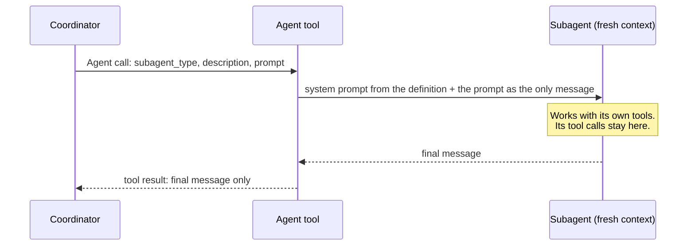

A subagent is a separate Claude agent that your main agent starts to do one focused job. The main agent starts it with the **Agent** tool and writes it a prompt. That prompt is the only thing the subagent learns from its parent. In this post you define the same two subagents twice, as Claude Code subagent files and as Agent SDK config, and then prove with a test that needs no API key that a subagent sees only the prompt you give it.

This is task statement 1.3 of the [Claude Certified Architect – Foundations exam guide](https://anthropic-partners.skilljar.com/claude-certified-architect-foundations-certification): "Configure subagent invocation, context passing, and spawning". It sits in Domain 1, Agentic Architecture & Orchestration, which is 27% of the exam.

## What does task statement 1.3 test?

The guide lists four things to know and four skills. In plain words:

| The guide asks you to… | In practice |
| --- | --- |
| Know the Task tool | The coordinator starts subagents with one tool, now called Agent. Without it, the coordinator can't delegate |
| Know that context isn't inherited | A subagent doesn't get the parent's conversation or memory. What it needs goes in its prompt |
| Know `AgentDefinition` | Each subagent type has a description (when to use it), a system prompt and a tool list |
| Know fork-based sessions | A fork copies the conversation so you can try different approaches from the same starting point |
| Pass complete findings | The next subagent gets earlier results in full, in its prompt |
| Keep content apart from metadata | Each finding keeps its source URL, document name and page, so citations survive |
| Spawn in parallel | Several Agent calls in one coordinator response, not one per turn |
| Write goal-based prompts | Say what a good result looks like, not every step, so a subagent can adapt |

Part 1 of this series, [Agentic loops: stop_reason, tool results and when to stop](/blog/claude-agentic-loops), built the loop every agent runs. Part 2, [Multi-agent systems: the coordinator-subagent pattern](/blog/claude-multi-agent-coordinator), built a coordinator with subagents and covered when to delegate and how to split a task. This post zooms in on the mechanics: how a subagent is defined and started, what goes in and what comes out. If agents are new to you, start with [What is an AI agent?](/blog/what-is-an-ai-agent).

## Is it the Task tool or the Agent tool?

It's the same tool. In Claude Code 2.1.63 [the Task tool was renamed to Agent](https://code.claude.com/docs/en/sub-agents), and "Task" still works as an alias. The [Agent SDK TypeScript reference](https://code.claude.com/docs/en/agent-sdk/typescript) says the same, and adds one quirk: the `system:init` message still lists the tool as `Task`. So if your code watches for subagent calls, match both names.

The exam guide uses the old name and says the coordinator's `allowedTools` must include "Task". Today's docs split that into two separate settings, and it helps to know which one does what:

| Setting | What it does | What it means for subagents |
| --- | --- | --- |
| `tools` | Which tools exist in the session | Leave `Agent` out, and the coordinator can't start subagents at all |
| `allowedTools` | Which tools run without asking for permission | The docs' examples list `Agent` here. It [doesn't limit](https://code.claude.com/docs/en/agent-sdk/typescript) which tools exist |
| `disallowedTools` | Which tools are removed or blocked | `Agent` here also stops all delegation |

The [tools reference](https://code.claude.com/docs/en/tools-reference) marks Agent as needing no permission, and says "Launching the subagent doesn't itself prompt for permission." Each tool the subagent then calls is checked as usual. For the exam, remember the rule behind the guide's wording: a coordinator that isn't given the subagent tool does all the work itself.

## How is a subagent defined and started?

There are two halves: a **definition** that says what kind of subagent exists, and an **Agent call** that starts one for a specific task.

You can write the definition in several places. The [Agent SDK subagents guide](https://code.claude.com/docs/en/agent-sdk/subagents) lists three: the `agents` option in code, Markdown files in `.claude/agents/`, and the built-in `general-purpose` subagent that needs no definition. Claude Code also takes a JSON object with the `--agents` flag for one session. Every form has the same core fields:

| Field | Required | What it does |
| --- | --- | --- |
| `description` | Yes | Tells the coordinator when to use this subagent. Claude reads it to choose |
| `prompt` (or the file body) | Yes | Becomes the subagent's system prompt |
| `tools` | No | An allowlist. Leave it out and the subagent gets every tool available to subagents |
| `disallowedTools` | No | A denylist, removed from the inherited or listed tools |
| `model` | No | An alias such as `haiku` or `sonnet`, a full model ID, or `inherit` |
| `maxTurns` | No | Caps the subagent's turns. At the limit, its output comes back marked as partial |

In a file, `name` is required too. The SDK uses the key of the `agents` object as the name. There are more fields, such as `skills`, `mcpServers` and `background`; the [subagent docs](https://code.claude.com/docs/en/sub-agents) list them all.

To start a subagent, the coordinator calls the Agent tool. Its input, from the SDK's `AgentInput` type, has two required fields and a few optional ones:

```json
{
  "subagent_type": "finder",
  "description": "Ebook refund rule",
  "prompt": "What is the refund rule for an ebook?"
}
```

`subagent_type` picks the definition. Without it, Claude gets `general-purpose`. `description` is a short (3–5 word) label for logs. `prompt` is the task. Optional fields include `model`, `run_in_background` and `isolation`.



## What does a subagent see, and what doesn't it see?

A subagent that isn't a fork starts with a fresh context window. Claude Code's docs list [what loads at startup](https://code.claude.com/docs/en/sub-agents):

- **Its system prompt:** the definition's prompt plus environment details such as the working directory. Not Claude Code's own system prompt.
- **The task message:** the prompt from the Agent call.
- **CLAUDE.md files**, unless the definition sets `omitClaudeMd: true`. In the SDK, the `settingSources` option decides whether they load at all.
- **A git status snapshot**, when the project is a Git repository.
- **Preloaded skills**, if the definition lists them in `skills`.

What never reaches it: the parent's conversation, the parent's tool results, the files the parent already read, the skills the parent already used, and the parent's system prompt. The SDK guide puts it in one line: "The only content you pass from parent to subagent is the Agent tool's prompt string."

Isolation also works across calls. Each Agent call creates a new instance, so a subagent doesn't remember its last task. To continue earlier work, you [resume](https://code.claude.com/docs/en/agent-sdk/subagents) that subagent by its ID; a new Agent call starts from zero.

The exception is a **fork**: a subagent that inherits the whole conversation so far. It's useful when a fresh subagent would need too much background, or when you want to try two approaches from the same analysis. Forks are covered with sessions in task statement 1.7, later in this series.

## How do I pass exactly the context a subagent needs?

Write the prompt as if for a smart colleague who has just walked into the room and heard nothing. Everything it needs goes in:

- **The goal**, and what a good result looks like.
- **Facts the user gave earlier**, such as "the customer bought the ebook 20 days ago" or "only sources from the last 12 months".
- **Earlier findings, in full**, not a pointer to them.
- **The output format** you want back.

Compare two prompts to a summarizer:

```text
Use the findings from before to answer the customer.
```

The subagent has no "before". It will say it has nothing, or worse, write a generic answer from its own knowledge. The fix is to paste the findings in:

```text
Customer question: Can I get a refund on an ebook, and how long does shipping to Canada take?

The customer bought the ebook 20 days ago.

Findings (JSON):
[
  {
    "claim": "Ebooks and other downloads can be refunded within 14 days, but only if you have not downloaded them yet.",
    "excerpt": "Ebooks and other downloads can be refunded within 14 days, but only if you have not downloaded them yet.",
    "source": "docs/refunds.md",
    "page_or_section": "Digital goods"
  }
]
```

Notice the shape. Each finding is a record where the content (`claim`, `excerpt`) sits next to its metadata (`source`, `page_or_section`). If earlier agents flatten findings into one paragraph, the link between a claim and its source is lost, and the next agent can't cite what it can't trace. With records, it can end every sentence with the right source.

Two more habits help:

- **Give goals, not scripts.** A coordinator prompt that says "find what the docs say, cite every sentence, say so if the docs don't cover something" lets a subagent adapt when a file is named differently. A numbered list of exact steps breaks the first time the data looks different.
- **Ask for structured output back.** In the SDK, the subagent's final message comes back as text, so ask for JSON in its prompt. Part 2 showed how to enforce a schema when you run the loops yourself.

## How do I run subagents in parallel?

Have the coordinator emit several Agent calls in **one** response. The guide names this skill directly: parallel subagents come from "multiple Task tool calls in a single coordinator response rather than across separate turns". If the coordinator starts one subagent per turn instead, each one waits for the previous result, and every step adds a full round trip.

This is ordinary [parallel tool use](https://platform.claude.com/docs/en/agents-and-tools/tool-use/parallel-tool-use): Claude may put several `tool_use` blocks in one response, and independent, read-only calls are the safe ones to run at the same time. Your coordinator prompt can ask for it plainly: "independent lookups go to separate subagents, all started in the same response."

The SDK adds its own rules on top. [Subagents run in the background by default](https://code.claude.com/docs/en/agent-sdk/subagents), and Claude sets `run_in_background: false` when it needs the result before continuing. A session runs at most 20 subagents at once by default, and subagents can nest up to three layers below the main agent. Both limits can be changed with environment variables.

## How do I restrict a subagent's tools?

With the `tools` list. The [subagents guide](https://code.claude.com/docs/en/agent-sdk/subagents) is clear about what that means: "A tool you leave out isn't in the subagent's session at all: Claude works without it, with no permission prompt or error."

| Definition | What the subagent gets |
| --- | --- |
| No `tools` field | Every tool available to subagents |
| `tools: Read, Grep, Glob` | Only those three: it can search but not edit or run commands |
| `tools: []` | No tools at all. Everything must be in its prompt |
| `disallowedTools: Write, Edit` | Everything available except those two |
| `Agent` in `tools` | It can start subagents of its own, up to the depth limit |

A subagent only gets tools that exist in the session. If the coordinator's own `tools` list leaves out `Read`, a finder that lists `Read` won't have it either. Background subagents also get a smaller set of built-in tools. `Read`, `Grep`, `Glob`, `Bash`, `Edit` and `Write` are all still in it.

Tight tool lists do two jobs. They make each subagent safer, since a reviewer without `Edit` can't change your files. And they keep each subagent in its lane: a summarizer with no search tool can't wander off and redo the research.

## What comes back to the parent?

Only the subagent's final message. The [tools reference](https://code.claude.com/docs/en/tools-reference) says the parent "doesn't see the subagent's intermediate tool calls or outputs, only that final result." That is the point of a subagent: it can read twenty files and return one short summary, and your main context stays small.

The details, from the SDK's `AgentOutput` type and the subagent docs:

- **Finished in the foreground:** the result has `status: "completed"`, the final text, token and tool counts, and an `agentId` you can use to resume the subagent later.
- **Started in the background:** the call returns `status: "async_launched"` right away, and the real result reaches Claude later as a completion notification.
- **Stopped at `maxTurns`:** the output comes back marked as partial, so Claude knows the work isn't finished.
- **Ended by an API error:** Claude Code reports the failure instead of passing the error text off as findings.

The parent may also summarize a subagent's answer in its own words. If you need the subagent's text word for word in the final reply, say so in the coordinator's prompt.

## Try it: define subagents two ways and test context isolation

You'll define a `finder` subagent (read-only file search) and a `summarizer` (no tools) for a tiny support-docs folder. First as Claude Code files, then as Agent SDK config. Then you'll run a test with a fake model that shows exactly what a subagent receives.

**You need:** Node.js 22.18 or later, which [runs `.ts` files directly](https://nodejs.org/docs/latest-v22.x/api/typescript.html), and [Claude Code](https://code.claude.com/docs/en/sub-agents) 2.1.233 or later for the validate step. An API key only for the last step.


<Steps>


<Step title="Create the project">

```bash
$ mkdir subagents-demo
$ cd subagents-demo
$ npm init -y
$ npm pkg set type=module
```

Install the [Agent SDK](https://code.claude.com/docs/en/agent-sdk/overview) and the [Anthropic TypeScript SDK](https://github.com/anthropics/anthropic-sdk-typescript) (used for its Messages API types in the test), then TypeScript and the Node types:


```bash
npm install @anthropic-ai/claude-agent-sdk @anthropic-ai/sdk
```


```bash
npm install -D typescript @types/node
```


Add the same `tsconfig.json` as in parts 1 and 2:


**tsconfig.json**

```json
{
  "compilerOptions": {
    "noEmit": true,
    "target": "esnext",
    "module": "nodenext",
    "rewriteRelativeImportExtensions": true,
    "erasableSyntaxOnly": true,
    "verbatimModuleSyntax": true,
    "allowImportingTsExtensions": true,
    "strict": true
  }
}
```


</Step>


<Step title="Add two small docs">

The finder needs something to search. Create a `docs` folder with two files:


**docs/refunds.md**

```text
# Refunds

## Physical items

You can return a physical item within 30 days of delivery for a full refund.

## Digital goods

Ebooks and other downloads can be refunded within 14 days, but only if you have not downloaded them yet.
```


**docs/shipping.md**

```text
# Shipping

## Canada

Standard shipping to Canada takes 5 to 8 business days.

## United States

Standard shipping within the United States takes 3 to 5 business days.
```


</Step>


<Step title="Write the subagents as Claude Code files">

A subagent file is Markdown with YAML frontmatter. The frontmatter configures it; the body becomes its system prompt. Put project subagents in `.claude/agents/` and commit them, so your whole team gets them.


**.claude/agents/finder.md**

```text
---
name: finder
description: Looks up ONE fact in the docs/ folder. Give it one question. Returns JSON findings with the source file and section.
tools: Read, Grep, Glob
model: haiku
---

You look up facts in the docs/ folder. Your task message holds one question.
Search with Grep and Glob, and Read the matching file before you answer.

Reply with JSON only: an array of findings, each with these fields:
- "claim": the fact in one plain sentence
- "excerpt": the sentence from the doc, copied word for word
- "source": the file path, such as "docs/refunds.md"
- "page_or_section": the heading the excerpt sits under

If the docs don't answer the question, reply with [].
```


**.claude/agents/summarizer.md**

```text
---
name: summarizer
description: Writes a short, cited answer from findings. It has no tools, so its prompt must hold the question and every finding as JSON.
tools: []
model: sonnet
---

You write a short answer for a customer, using only the findings in your task message.
End every sentence with its source in brackets, such as [docs/refunds.md, Digital goods].
Never add facts that are not in the findings.

If your task message has no findings, reply exactly: NO FINDINGS IN PROMPT
```


What each field does, checked against the [frontmatter reference](https://code.claude.com/docs/en/sub-agents):

- **`name` and `description`** are the only required fields. The description is short and says when to use the subagent, because the coordinator reads it to choose.
- **`tools: Read, Grep, Glob`** makes the finder read-only. It can't edit files or run commands.
- **`tools: []`** gives the summarizer no tools. The docs say an empty list launches the subagent without tools, so its prompt must carry everything.
- **`model`** puts the simple lookup on Haiku and the writing on Sonnet.

Check the files:

```bash
$ claude plugin validate .claude/agents
```

```text
Validating components in: /path/to/subagents-demo/.claude/agents

√ Validation passed
```

The command reads only the directory you name and reports problems such as a missing description. Claude Code picks up new agent files within a few seconds. If `.claude/agents/` didn't exist when your session started, restart it.

</Step>


<Step title="Write the same subagents as Agent SDK config">

In the SDK, the `agents` option takes an object of `AgentDefinition`s. The key is the name.


**agents.ts**

```ts
import type { AgentDefinition } from '@anthropic-ai/claude-agent-sdk';

// One finding per fact. The claim and excerpt are content; source and section are metadata.
export interface Finding {
  claim: string;
  excerpt: string;
  source: string;
  page_or_section: string;
}

// The same two subagents as the .claude/agents/*.md files, as Agent SDK config.
export const agents: Record<string, AgentDefinition> = {
  finder: {
    description:
      'Looks up ONE fact in the docs/ folder. Give it one question. Returns JSON findings with the source file and section.',
    prompt:
      'You look up facts in the docs/ folder. Your task message holds one question. ' +
      'Search with Grep and Glob, and Read the matching file before you answer. ' +
      'Reply with JSON only: an array of findings, each with "claim" (the fact in one plain sentence), ' +
      '"excerpt" (the sentence from the doc, word for word), "source" (the file path) and ' +
      '"page_or_section" (the heading the excerpt sits under). If the docs don\'t answer the question, reply with [].',
    tools: ['Read', 'Grep', 'Glob'], // read-only: it can search, but not edit files or run commands
    model: 'haiku',
  },
  summarizer: {
    description:
      'Writes a short, cited answer from findings. It has no tools, so its prompt must hold the question and every finding as JSON.',
    prompt:
      'You write a short answer for a customer, using only the findings in your task message. ' +
      'End every sentence with its source in brackets, such as [docs/refunds.md, Digital goods]. ' +
      'Never add facts that are not in the findings. ' +
      'If your task message has no findings, reply exactly: NO FINDINGS IN PROMPT',
    tools: [], // no tools at all: everything it needs must be in the prompt
    model: 'sonnet',
  },
};
```


The `Finding` type is the record from earlier: content and metadata side by side.

</Step>


<Step title="Write the coordinator">

The coordinator's prompt states a goal and a quality bar, and the few delegation rules that matter. It doesn't script each step.


**sdk-coordinator.ts**

```ts
import { query } from '@anthropic-ai/claude-agent-sdk';
import { agents } from './agents.ts';

// Goal and quality bar, not a step-by-step script.
const COORDINATOR_PROMPT = `You answer customer questions from the docs/ folder. You delegate; you don't search yourself.
Goal: a short answer in which every sentence names its source file and section.
Quality bar: nothing that isn't in the docs. If the docs don't cover part of the question, say so.
How to delegate:
- Independent lookups go to separate finder subagents, all started in the same response.
- A subagent can't see this conversation. Put everything it needs in its prompt.
- The summarizer gets the customer's question and every finding as JSON, copied in full.`;

const question = process.argv[2] ?? 'Can I get a refund on an ebook, and how long does shipping to Canada take?';

// Count Agent calls per coordinator response, to check that lookups start in parallel.
const agentCallsPerResponse = new Map<string, number>();

for await (const message of query({
  prompt: question,
  options: {
    model: 'claude-opus-5-5',
    systemPrompt: COORDINATOR_PROMPT,
    agents,
    tools: ['Agent', 'Read', 'Grep', 'Glob'], // without Agent, the coordinator can't delegate at all
    allowedTools: ['Agent', 'Read', 'Grep', 'Glob'], // run these without a permission prompt
    settingSources: [], // use only the agents above, not files from .claude/ or CLAUDE.md
    maxTurns: 20,
  },
})) {
  // Messages from inside a subagent carry its parent_tool_use_id; skip them.
  if (message.type === 'assistant' && message.parent_tool_use_id === null) {
    for (const block of message.message.content) {
      // Current versions name the tool "Agent"; older ones used "Task".
      if (block.type === 'tool_use' && (block.name === 'Agent' || block.name === 'Task')) {
        const input = block.input as { subagent_type?: string; description?: string; prompt?: string };
        const id = message.message.id;
        agentCallsPerResponse.set(id, (agentCallsPerResponse.get(id) ?? 0) + 1);
        console.log(`-> ${input.subagent_type ?? 'general-purpose'} (${input.description ?? ''})`);
        console.log(`   prompt: ${input.prompt ?? ''}`);
      }
    }
  }
  if (message.type === 'result') {
    console.log(`\nAgent calls per coordinator response: ${[...agentCallsPerResponse.values()].join(', ')}`);
    console.log(message.subtype === 'success' ? `\n${message.result}` : `\nStopped: ${message.subtype}`);
  }
}
```


The settings that matter for task statement 1.3:

- **`tools`** lists `Agent`, so the coordinator can delegate, plus the three file tools the finder needs. A subagent can only get tools the session has.
- **`allowedTools`** auto-approves those tools, as the docs' examples do.
- **`settingSources: []`** keeps the run to the `agents` object in code. To use the `.claude/agents/` files from step 3 instead, pass `settingSources: ['project']` and drop `agents`. When both define the same name, the one in code wins.
- **The loop** groups Agent calls by response ID, so the last line shows whether independent lookups started in the same response.

Type-check both files:

```bash
$ npx tsc
```

No output means no type errors.

</Step>


<Step title="Model the Agent tool so you can test it">

You can't run the SDK without a model. To see what a subagent receives, this file models the documented behaviour of the Agent tool on top of the Messages API: a fresh conversation, the definition's prompt as the system prompt, the Agent call's prompt as the only message, only the listed tools, and only the final text back. It reuses the SDK's own `AgentDefinition` and `AgentInput` types, so it takes the same config. It's a model for testing, not the SDK's code.


**spawn.ts**

```ts
import type Anthropic from '@anthropic-ai/sdk';
import type { AgentDefinition } from '@anthropic-ai/claude-agent-sdk';
import type { AgentInput } from '@anthropic-ai/claude-agent-sdk/sdk-tools';

// Anything with messages.create: the real client, or a fake one in tests.
export interface MessagesClient {
  messages: {
    create(params: Anthropic.MessageCreateParamsNonStreaming): Promise<Anthropic.Message>;
  };
}

// A tool the subagent may be allowed to use: its definition plus the code that runs it.
export interface LocalTool {
  definition: Anthropic.Tool;
  run(input: Record<string, unknown>): string;
}

const MODEL_IDS: Record<string, string> = {
  haiku: 'claude-haiku-4-5',
  sonnet: 'claude-sonnet-5-5',
  opus: 'claude-opus-5-5',
};
const MAX_TURNS = 10;

// A small model of the Agent tool, built on the Messages API so you can test it without a key.
// It follows the documented behaviour; it is not the SDK's own code.
export async function spawnSubagent(
  client: MessagesClient,
  agents: Record<string, AgentDefinition>,
  tools: Record<string, LocalTool>,
  call: AgentInput,
): Promise<string> {
  const definition = agents[call.subagent_type ?? ''];
  if (!definition) throw new Error(`Unknown subagent_type: ${call.subagent_type}`);

  // Tool restriction: the definition's list, or every tool when the list is left out.
  const allowed = (definition.tools ?? Object.keys(tools)).filter((name) => name in tools);

  // A brand-new conversation: the Agent call's prompt is the only message.
  const messages: Anthropic.MessageParam[] = [{ role: 'user', content: call.prompt }];

  for (let turn = 1; turn <= MAX_TURNS; turn++) {
    const response = await client.messages.create({
      model: MODEL_IDS[definition.model ?? 'sonnet'] ?? definition.model ?? 'claude-sonnet-5-5',
      max_tokens: 4096,
      system: definition.prompt, // the definition's prompt is the system prompt
      ...(allowed.length > 0 && { tools: allowed.map((name) => tools[name].definition) }),
      messages,
    });
    messages.push({ role: 'assistant', content: response.content });

    if (response.stop_reason === 'tool_use') {
      const results = response.content
        .filter((block): block is Anthropic.ToolUseBlock => block.type === 'tool_use')
        .map((toolUse): Anthropic.ToolResultBlockParam => {
          const tool = allowed.includes(toolUse.name) ? tools[toolUse.name] : undefined;
          if (!tool) {
            return { type: 'tool_result', tool_use_id: toolUse.id, content: `No such tool: ${toolUse.name}`, is_error: true };
          }
          return { type: 'tool_result', tool_use_id: toolUse.id, content: tool.run(toolUse.input as Record<string, unknown>) };
        });
      messages.push({ role: 'user', content: results });
      continue;
    }

    if (response.stop_reason === 'end_turn') {
      // Only the final text goes back to the parent. Tool calls and results stay here.
      return response.content
        .filter((block): block is Anthropic.TextBlock => block.type === 'text')
        .map((block) => block.text)
        .join('');
    }

    throw new Error(`${call.subagent_type} stopped with stop_reason: ${response.stop_reason}`);
  }
  throw new Error(`${call.subagent_type}: no result after ${MAX_TURNS} turns`);
}

// Runs every Agent call in one coordinator response at the same time, and returns one
// tool_result per call, in order, for the coordinator's next turn.
export async function runAgentCalls(
  client: MessagesClient,
  agents: Record<string, AgentDefinition>,
  tools: Record<string, LocalTool>,
  response: Anthropic.Message,
): Promise<Anthropic.ToolResultBlockParam[]> {
  const calls = response.content.filter(
    (block): block is Anthropic.ToolUseBlock => block.type === 'tool_use' && block.name === 'Agent',
  );
  return Promise.all(
    calls.map(async (call): Promise<Anthropic.ToolResultBlockParam> => {
      try {
        const text = await spawnSubagent(client, agents, tools, call.input as AgentInput);
        return { type: 'tool_result', tool_use_id: call.id, content: text };
      } catch (error) {
        return { type: 'tool_result', tool_use_id: call.id, content: (error as Error).message, is_error: true };
      }
    }),
  );
}
```


`spawnSubagent` never receives the coordinator's history, so it can't leak it. `runAgentCalls` takes one coordinator response and runs all its Agent calls with `Promise.all`, which is what "several Agent calls in one response" buys you.

</Step>


<Step title="Test context isolation without an API key">

The test uses a fake client that answers like the Messages API. Its read-only tools really search your `docs` folder. The fake summarizer can only use findings that are written in its own prompt, as a real subagent can only use what's in its context.


**spawn.test.ts**

```ts
import assert from 'node:assert/strict';
import { readdirSync, readFileSync } from 'node:fs';
import { test } from 'node:test';
import type Anthropic from '@anthropic-ai/sdk';
import { agents, type Finding } from './agents.ts';
import { runAgentCalls, spawnSubagent, type LocalTool, type MessagesClient } from './spawn.ts';

// Read-only tools over docs/, named like Claude Code's built-in tools.
const sectionOf = (lines: string[], index: number) =>
  lines.slice(0, index + 1).findLast((line) => line.startsWith('## '))?.slice(3) ?? '';
const noInput = { type: 'object' as const, properties: {} };
const tools: Record<string, LocalTool> = {
  Glob: {
    definition: { name: 'Glob', description: 'List the files in docs/.', input_schema: noInput },
    run: () => readdirSync('docs').map((file) => `docs/${file}`).join('\n'),
  },
  Grep: {
    definition: {
      name: 'Grep',
      description: 'Search docs/ for a word. Returns each matching line with its file and section.',
      input_schema: { type: 'object', properties: { pattern: { type: 'string' } }, required: ['pattern'] },
    },
    run: ({ pattern }) => {
      const hits = readdirSync('docs').flatMap((file) => {
        const lines = readFileSync(`docs/${file}`, 'utf8').split('\n');
        return lines.flatMap((line, i) =>
          !line.startsWith('#') && new RegExp(String(pattern), 'i').test(line)
            ? [{ source: `docs/${file}`, section: sectionOf(lines, i), line }]
            : [],
        );
      });
      return JSON.stringify(hits);
    },
  },
  Read: {
    definition: {
      name: 'Read',
      description: 'Read one file.',
      input_schema: { type: 'object', properties: { file_path: { type: 'string' } }, required: ['file_path'] },
    },
    run: ({ file_path }) => readFileSync(String(file_path), 'utf8'),
  },
  Write: {
    definition: { name: 'Write', description: 'Write a file.', input_schema: noInput },
    run: () => {
      throw new Error('No subagent in this demo may write files');
    },
  },
};

// Replies in the shape the Messages API returns.
const reply = (stop_reason: Anthropic.StopReason, content: Anthropic.ContentBlock[]): Anthropic.Message => ({
  id: 'msg_test',
  type: 'message',
  role: 'assistant',
  model: 'claude-opus-5-5',
  content,
  stop_reason,
  stop_sequence: null,
  stop_details: null,
  container: null,
  diagnostics: null,
  usage: {
    input_tokens: 0,
    output_tokens: 0,
    cache_creation: null,
    cache_creation_input_tokens: null,
    cache_read_input_tokens: null,
    inference_geo: null,
    output_tokens_details: null,
    server_tool_use: null,
    service_tier: null,
  },
});
const text = (t: string): Anthropic.TextBlock => ({ type: 'text', text: t, citations: null });
const toolUse = (id: string, name: string, input: object): Anthropic.ToolUseBlock => ({
  type: 'tool_use',
  id,
  name,
  input,
  caller: { type: 'direct' },
});

// A fake finder: greps for the last word of its task, then reports every hit as a finding.
function fakeFinder(params: Anthropic.MessageCreateParamsNonStreaming): Anthropic.Message {
  const last = params.messages.at(-1)!;
  if (typeof last.content === 'string') {
    const word = last.content.replace(/[^\w\s]/g, '').split(/\s+/).at(-1);
    return reply('tool_use', [toolUse(`toolu_${word}`, 'Grep', { pattern: word })]);
  }
  const [result] = last.content as Anthropic.ToolResultBlockParam[];
  const hits = JSON.parse(String(result.content)) as { source: string; section: string; line: string }[];
  const findings: Finding[] = hits.map((hit) => ({
    claim: hit.line,
    excerpt: hit.line,
    source: hit.source,
    page_or_section: hit.section,
  }));
  return reply('end_turn', [text(JSON.stringify(findings))]);
}

// A fake summarizer: it can only use findings that are written in its own prompt.
function fakeSummarizer(params: Anthropic.MessageCreateParamsNonStreaming): Anthropic.Message {
  const task = String(params.messages[0].content);
  const json = task.slice(task.indexOf('['), task.lastIndexOf(']') + 1);
  const findings = json ? (JSON.parse(json) as Finding[]) : [];
  if (findings.length === 0) return reply('end_turn', [text('NO FINDINGS IN PROMPT')]);
  const sentences = findings.map((f) => `${f.claim} [${f.source}, ${f.page_or_section}]`);
  return reply('end_turn', [text(sentences.join(' '))]);
}

// One fake client for both subagents. It tells them apart by system prompt and records every request.
function fakeClient() {
  const requests: Anthropic.MessageCreateParamsNonStreaming[] = [];
  const client: MessagesClient = {
    messages: {
      create: async (params) => {
        requests.push(structuredClone(params));
        await new Promise((resolve) => setTimeout(resolve, 10)); // pretend the API takes a moment
        if (params.system === agents.finder.prompt) return fakeFinder(params);
        if (params.system === agents.summarizer.prompt) return fakeSummarizer(params);
        throw new Error('Unknown agent');
      },
    },
  };
  const to = (agent: string) => requests.filter((r) => r.system === agents[agent].prompt);
  return { client, to };
}

// The coordinator's response: two independent lookups, as two Agent calls in ONE response.
const coordinatorResponse = reply('tool_use', [
  text('Two independent lookups. Starting both finders now.'),
  toolUse('toolu_a1', 'Agent', { subagent_type: 'finder', description: 'Ebook refund rule', prompt: 'What is the refund rule for an ebook?' }),
  toolUse('toolu_a2', 'Agent', { subagent_type: 'finder', description: 'Shipping time to Canada', prompt: 'How long does shipping take to Canada?' }),
]);

test('a subagent sees its own system prompt and the Agent prompt, nothing else', async () => {
  // Earlier, the customer told the coordinator: "I bought the ebook 20 days ago. I live in Toronto."
  const { client, to } = fakeClient();

  await spawnSubagent(client, agents, tools, {
    subagent_type: 'finder',
    description: 'Ebook refund rule',
    prompt: 'What is the refund rule for an ebook?',
  });

  const [first] = to('finder');
  assert.equal(first.system, agents.finder.prompt);
  assert.deepEqual(first.messages, [{ role: 'user', content: 'What is the refund rule for an ebook?' }]);
  // Nothing from the coordinator's conversation reaches the subagent unless the prompt carries it.
  assert.doesNotMatch(JSON.stringify(to('finder')), /20 days|Toronto/);
});

test('each subagent gets only the tools in its definition', async () => {
  const { client, to } = fakeClient();
  await runAgentCalls(client, agents, tools, coordinatorResponse);
  await spawnSubagent(client, agents, tools, { subagent_type: 'summarizer', description: 'Answer', prompt: 'No findings.' });

  assert.deepEqual(to('finder')[0].tools?.map((t) => ('name' in t ? t.name : '')), ['Read', 'Grep', 'Glob']);
  assert.equal(to('summarizer')[0].tools, undefined); // tools: [] means no tools at all
});

test('two Agent calls in one response run in parallel; only final text comes back', async () => {
  const { client, to } = fakeClient();
  const results = await runAgentCalls(client, agents, tools, coordinatorResponse);

  // Both finders sent their first request before either got its tool result.
  assert.deepEqual(to('finder').slice(0, 2).map((r) => r.messages.length), [1, 1]);

  assert.deepEqual(results.map((r) => r.tool_use_id), ['toolu_a1', 'toolu_a2']);
  for (const result of results) {
    // The parent gets the final JSON, not the Grep calls or their raw output.
    const findings = JSON.parse(String(result.content)) as Finding[];
    assert.ok(findings.length > 0);
    console.log(`${result.tool_use_id}: ${JSON.stringify(findings)}`);
  }
});

test('"use the findings from before" fails; pasting the findings as JSON works', async () => {
  const { client } = fakeClient();
  const results = await runAgentCalls(client, agents, tools, coordinatorResponse);
  const findings = results.flatMap((r) => JSON.parse(String(r.content)) as Finding[]);

  const vague = await spawnSubagent(client, agents, tools, {
    subagent_type: 'summarizer',
    description: 'Answer the customer',
    prompt: 'Use the findings from before to answer the customer.',
  });
  console.log(`vague prompt    -> ${vague}`);
  assert.equal(vague, 'NO FINDINGS IN PROMPT');

  const complete = await spawnSubagent(client, agents, tools, {
    subagent_type: 'summarizer',
    description: 'Answer the customer',
    prompt: [
      'Customer question: Can I get a refund on an ebook, and how long does shipping to Canada take?',
      'The customer bought the ebook 20 days ago.',
      `Findings (JSON):\n${JSON.stringify(findings, null, 2)}`,
    ].join('\n\n'),
  });
  console.log(`complete prompt -> ${complete}`);
  // Every sentence still names its source file and section.
  for (const sentence of complete.split(/(?<=\])\s+/)) assert.match(sentence, /\[docs\/\w+\.md, [\w ]+\]$/);
});
```


```bash
$ node --test --test-reporter=spec spawn.test.ts
```

```text
✔ a subagent sees its own system prompt and the Agent prompt, nothing else
✔ each subagent gets only the tools in its definition
toolu_a1: [{"claim":"Ebooks and other downloads can be refunded within 14 days, but only if you have not downloaded them yet.","excerpt":"Ebooks and other downloads can be refunded within 14 days, but only if you have not downloaded them yet.","source":"docs/refunds.md","page_or_section":"Digital goods"}]
toolu_a2: [{"claim":"Standard shipping to Canada takes 5 to 8 business days.","excerpt":"Standard shipping to Canada takes 5 to 8 business days.","source":"docs/shipping.md","page_or_section":"Canada"}]
✔ two Agent calls in one response run in parallel; only final text comes back
vague prompt    -> NO FINDINGS IN PROMPT
complete prompt -> Ebooks and other downloads can be refunded within 14 days, but only if you have not downloaded them yet. [docs/refunds.md, Digital goods] Standard shipping to Canada takes 5 to 8 business days. [docs/shipping.md, Canada]
✔ "use the findings from before" fails; pasting the findings as JSON works
ℹ tests 4
ℹ suites 0
ℹ pass 4
ℹ fail 0
ℹ cancelled 0
ℹ skipped 0
ℹ todo 0
```

This is our output on Node 22.22.2 with `@anthropic-ai/claude-agent-sdk` 0.3.286 and `@anthropic-ai/sdk` 0.131.0, with timings removed. Read it from the top:

- The finder's request held its system prompt and one message: the Agent call's prompt. The customer's "20 days ago" and "Toronto" never reached it.
- The finder got `Read`, `Grep` and `Glob`, never `Write`. The summarizer got no tools.
- Both finders sent their first request before either finished, and the parent got back only their final JSON, not the Grep calls.
- "Use the findings from before" gave the summarizer nothing to work with. The same subagent with the findings pasted in as JSON wrote an answer where every sentence names its file and section.

Run `npx tsc` again to type-check the test too.

</Step>


<Step title="Run it with Claude">

Create an API key in the [Claude Console](https://platform.claude.com/) and set it as the `ANTHROPIC_API_KEY` environment variable. Then run the SDK coordinator:

```bash
$ node sdk-coordinator.ts
```

With a real model, the plan is Claude's choice, so check the output: the log should show two finder calls from one response, then one summarizer call whose prompt holds both findings. Then remove `'Agent'` from `tools` and run it again. With no Agent tool, the coordinator can't delegate. It either searches the docs itself or says it can't.

To try the file-based subagents instead, start `claude` in the project folder and ask:

```text
Use the finder subagent to look up the ebook refund rule and the shipping time to Canada, one finder per question, then have the summarizer write the answer.
```

</Step>


</Steps>


## Common traps

These are the mistakes that wrong answer options are built on.

| Trap | Why it breaks | Fix |
| --- | --- | --- |
| "Use the findings from before" in a subagent prompt | The subagent has no "before". It starts fresh | Paste the findings, in full, into its prompt |
| Leaving Agent (the guide's "Task") out of the coordinator's tools | It can't spawn subagents, so it does all the work itself | Give the coordinator the Agent tool |
| Flattening findings into one paragraph | The link between each claim and its source is lost | Pass records with the claim, excerpt, source and page or section |
| Starting independent subagents one per turn | Each one waits for the last, adding a full round trip each time | Emit all the Agent calls in one response |
| Scripting subagents step by step | The script breaks when the data looks different | State the goal and the quality bar, and let the subagent pick its steps |
| Giving every subagent every tool | A summarizer that can search may redo the research, and a reviewer that can edit may change files | List only the tools each role needs |


<Callout type="warning" title="Every subagent is paid work">

Each subagent makes its own API calls, and one prompt can grow into a tree of agents. Keep tool lists tight, put simple jobs on cheaper models, and use the SDK's limits: `maxBudgetUsd` for spend, and the depth and concurrency environment variables described in the [subagents guide](https://code.claude.com/docs/en/agent-sdk/subagents).

</Callout>


## Practice questions

These four questions are this blog's own, written for practice. They are not from the exam.

**Question 1.** A coordinator has definitions for a `researcher` and an `editor` subagent, but it never delegates. It researches and edits everything itself. Its tool configuration lists only `WebSearch` and `Read`. What is the most likely cause?

- A. The subagent descriptions are too short.
- B. The subagents need their own copy of the coordinator's system prompt.
- C. The coordinator isn't given the subagent tool (Agent, which the exam guide calls "Task"), so it can't spawn subagents.
- D. The coordinator needs a larger context window.

**Question 2.** A coordinator tells its synthesis subagent: "Combine the results the search and analysis agents found into a summary." The summary comes back generic and ignores the actual findings. What is the best fix?

- A. Put the full search results and analysis output directly in the synthesis subagent's prompt.
- B. Give the synthesis subagent the coordinator's session ID so it can read the history.
- C. Give the synthesis subagent search tools so it can redo the research.
- D. Tell the synthesis subagent to be more specific.

**Question 3.** A coordinator gives its research subagent an eight-step script: search a phrase, open the first three results, copy two quotes from each, and so on. When the useful sources turn out to be PDFs deeper in the results, the subagent follows the script and returns thin, off-topic quotes. What is the best change?

- A. Add more steps to the script to cover PDFs and deeper results.
- B. State the research goal and what a good result looks like, such as three independent sources with every claim tied to its source, and let the subagent choose its steps.
- C. Run the subagent on a larger model.
- D. Raise the subagent's maximum number of turns.

**Question 4.** A report combines findings from 30 documents, but many statements lose their citation during synthesis. Findings are passed between agents as one long paragraph per document. What is the best fix?

- A. Tell the synthesis subagent in its system prompt to "always cite sources."
- B. Shorten each paragraph so it fits more easily in context.
- C. Add a final step that searches the web for sources for uncited statements.
- D. Pass findings as structured records that keep each claim separate from its metadata, such as source URL, document name and page.

## Answer key

### Question 1

**Answer: C.** A coordinator starts subagents through the Agent tool, so without it there is no way to delegate. The strongest distractor is A: a vague description can make Claude pick the wrong subagent or skip one, but it wouldn't stop every delegation.

### Question 2

**Answer: A.** A subagent doesn't inherit its parent's context, so the findings have to be in its prompt. The strongest distractor is C: it works around the missing context by paying for all the research twice, and the second run may find different things.

### Question 3

**Answer: B.** A goal and a quality bar let the subagent adapt when the data isn't what you expected. The strongest distractor is A: every new step patches one case and makes the script longer, and it still breaks on the next surprise.

### Question 4

**Answer: D.** Structured records keep each claim tied to where it came from, so attribution survives each handoff. The strongest distractor is A: asking for citations doesn't help when the synthesis agent can no longer see which source a claim came from.

## What should I do next?

- **Extend the build.** Add an `analyst` subagent with its own tool list, and write a test that checks it never receives a tool it didn't declare.
- **Move on to task statement 1.4**, "Implement multi-step workflows with enforcement and handoff patterns". The next post in this series covers when a prompt is enough and when your code must enforce the order of steps.
- **Plan and check your prep.** Follow the [six-week study plan](/blog/claude-architect-exam-study-plan), and test yourself with the [mock exam](/blog/claude-certification-mock-exam) when you've worked through Domain 1.
