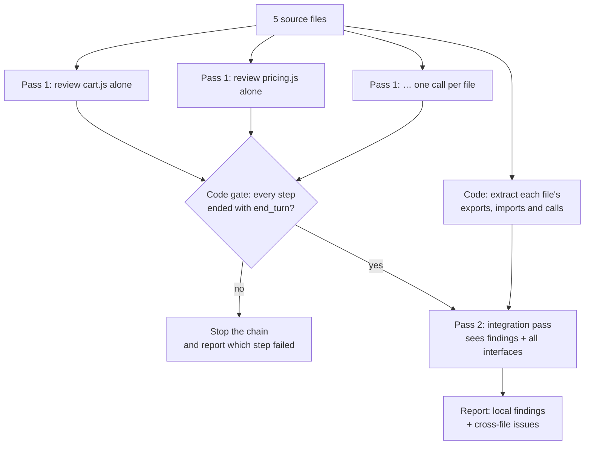
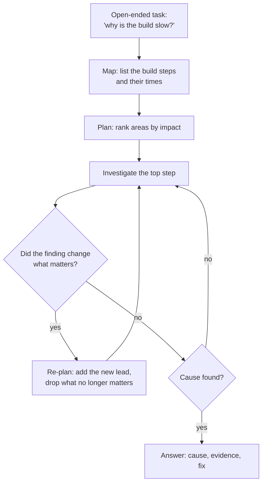

Task decomposition means breaking a big job into smaller steps. There are two ways to do it. If the steps are the same every time, write them down in code as a **prompt chain**: a fixed sequence of focused model calls. If the next step depends on what you just found, let Claude make a **dynamic plan** and change it as it learns. In this post you build both in TypeScript, a two-step code review chain and an adaptive build investigation, and test them without an API key.

This is task statement 1.6 of the [Claude Certified Architect – Foundations exam guide](https://anthropic-partners.skilljar.com/claude-certified-architect-foundations-certification): "Design task decomposition strategies for complex workflows". It sits in Domain 1, Agentic Architecture & Orchestration, which is 27% of the exam.

## What does task statement 1.6 test?

The guide lists three things to know and three skills. In plain words:

| The guide asks you to… | In practice |
| --- | --- |
| Know when to use a fixed pipeline (prompt chaining) or dynamic decomposition | Same steps every time: chain. Steps depend on what you find: dynamic plan |
| Know chaining patterns for reviews | Review each file on its own, then run a cross-file integration pass |
| Know the value of adaptive investigation plans | The plan creates new subtasks from what each step discovers |
| Pick the right pattern for a workflow | A multi-aspect review that never changes shape is a chain; "find out why X" is a dynamic plan |
| Split large code reviews | Per-file local passes plus a separate integration pass, "to avoid attention dilution" |
| Decompose open-ended tasks | Map the structure, find the high-impact areas, make a prioritized plan, adapt it as you learn |

Part 1 of this series, [Agentic loops: stop_reason, tool results and when to stop](/blog/claude-agentic-loops), explained who decides the next step: Claude in an agent loop, or your code in a fixed workflow. This post is about the same choice one level up: how to split a whole job into steps. The adaptive half reuses the loop from part 1. Parts 2 and 3 split work across subagents. Here the split happens inside one program, so you can see both patterns side by side.

## What is the difference between a prompt chain and a dynamic plan?

A **prompt chain** is a fixed sequence of model calls. Each call gets one focused prompt, and the output of one step becomes input for the next. Your code owns the steps. Anthropic's [Building effective agents](https://www.anthropic.com/engineering/building-effective-agents) describes it as a pattern that "decomposes a task into a sequence of steps, where each LLM call processes the output of the previous one". You can add programmatic checks, which it calls gates, between steps. It recommends chaining "for situations where the task can be easily and cleanly decomposed into fixed subtasks".

A **dynamic plan** (the guide says "dynamic adaptive decomposition") is made by the model while it works. It looks around, writes a plan, does a step, and changes the plan when a finding points somewhere new. The same article describes a related pattern, orchestrator-workers, for tasks where "you can't predict the subtasks needed".

Think of a car service. The yearly inspection is a checklist: brakes, lights, tyres, every car, every time. That's a chain. A strange noise is different. The mechanic listens, forms a guess, checks the most likely part, and changes the plan when the first guess is wrong. That's a dynamic plan.

| | Prompt chain | Dynamic plan |
| --- | --- | --- |
| Who decides the steps | Your code, before the run | The model, during the run |
| Shape of each run | The same every time | Depends on what it finds |
| Best for | Predictable, repeatable work: the same checks on every file, contract or ticket | Open-ended work: "why is the build slow?", "add tests to this legacy code" |
| Strengths | Consistent, easy to test, easy to log and debug, cost is predictable | Follows leads, skips what doesn't matter, finds what you didn't think to check |
| Weaknesses | Can't follow a lead that isn't in the script | Less predictable; harder to test; needs a turn limit |
| Typical code | A few functions called in order | An agent loop with a planning tool |

The platform docs still recommend explicit chaining for some jobs, even though current models plan well on their own. [Prompting best practices](https://platform.claude.com/docs/en/build-with-claude/prompt-engineering/claude-prompting-best-practices) says chaining "is still useful when you need to inspect intermediate outputs or enforce a specific pipeline structure", and that with each step as a separate API call "you can log, evaluate, or branch at any point".

## Why split a review into passes at all?

Because attention is limited. When one prompt holds twenty files and five concerns, the model can't look at everything with the same care. Some files get a close reading, others a quick one, and you can't tell which from the output. The exam guide calls this "attention dilution". Claude Code's [best practices](https://code.claude.com/docs/en/best-practices) make the same point about long sessions: "LLM performance degrades as context fills."

So a review chain has two kinds of pass:

1. **Per-file local passes.** One call per file, with only that file. The prompt asks for bugs you can see inside the file: wrong logic, crashes, missed edge cases. Each file gets full attention.
2. **A cross-file integration pass.** One call that sees how the files connect: what each file exports, what it imports, and where it calls other files. It looks only for problems between files.



The integration pass exists because of a blind spot that is there by design. Say `pricing.js` changes `applyDiscount` to take `{ rate }` instead of `{ percent }`, and `cart.js` still passes `{ percent }`. Reviewed alone, `pricing.js` looks fine: the new code is correct. Reviewed alone, `cart.js` looks fine too: it calls a function the way it always did. The bug lives in the gap between them. Running each per-file pass twice, or giving it a bigger context window, doesn't help. Only a step that sees both sides can find it.

The exam guide comes back to this in task statement 4.6, multi-pass review architectures. That part of the exam is covered later in the prep series.

## How does an adaptive plan work?

An adaptive plan has a clear order, even though its steps are not fixed. The exam guide uses the example "add comprehensive tests to a legacy codebase":

1. **Map the structure first.** List the modules, how big they are, what depends on what, and what is already tested. Don't start writing tests on the first file you open.
2. **Find the high-impact areas.** Rank by what matters: code that handles money, code many modules depend on, code that changes often and has no tests.
3. **Write a prioritized plan.** A short, ordered list, so the work and the reasons are visible.
4. **Adapt as you learn.** When you find that three modules all depend on an untested date helper, the date helper moves to the top, even though it wasn't in the first plan.



The step that makes this a dynamic plan is the re-plan. A plan that was written once and never changed is a chain written by the model, with all the weaknesses of a chain and none of the consistency.

## How do I choose between them?

Ask one question: **can I write the steps down before I see the input?**

- **Yes, and they are the same every time** → a chain. The same three checks on every contract, the same review on every pull request, the same extraction on every invoice. A chain gives consistent results you can test and compare from one run to the next.
- **No, the next step depends on what I find** → a dynamic plan. Incidents, slow builds, flaky tests, "what would break if we removed this?", adding tests to unfamiliar code.

Two smaller questions help with edge cases:

- **Does consistency matter more than coverage?** Compliance and review checks usually need the same steps for every item, so that results can be compared. That points to a chain, even if a planner could be a bit smarter on some inputs.
- **Is the task tiny?** Then you may need neither. Claude Code's best practices put it simply: "If you could describe the diff in one sentence, skip the plan."

Most real systems mix the two. A dynamic investigation can call a fixed chain as one of its tools ("run the standard security review on this file"). A chain can have one step where Claude plans freely inside a fixed box. Building effective agents also advises to "find the simplest solution possible, and only increasing complexity when needed", so start with a chain and move to a planner only when the fixed steps keep missing things.

## Try it: build a review chain and an adaptive plan

You'll build two small programs that share one test helper:

- `review-chain.ts`: a fixed two-step chain that reviews a five-file sample repo. Step 1 reviews each file on its own and returns JSON findings. Step 2 is the cross-file integration pass. One bug is planted that only shows across files.
- `investigate.ts`: an agent that finds why a CI build is slow. It must map the build, write a plan with an `update_plan` tool, and re-plan as it learns.

Both take a client with a `messages.create` method, so the tests can pass in a fake one that plays back answers in the documented Messages API shape.

**You need:** Node.js 22.18 or later, which runs `.ts` files directly because [type stripping is on by default](https://nodejs.org/docs/latest-v22.x/api/typescript.html). An Anthropic API key only for the last step.


<Steps>


<Step title="Create the project">

```bash
$ mkdir decompose
$ cd decompose
$ npm init -y
$ npm pkg set type=module
$ mkdir sample
```

Install the [official TypeScript SDK](https://github.com/anthropics/anthropic-sdk-typescript), then TypeScript and the Node types for type-checking:


```bash
npm install @anthropic-ai/sdk
```


```bash
npm install -D typescript @types/node
```


Add the same `tsconfig.json` as in part 1:


**tsconfig.json**

```json
{
  "compilerOptions": {
    "noEmit": true,
    "target": "esnext",
    "module": "nodenext",
    "rewriteRelativeImportExtensions": true,
    "erasableSyntaxOnly": true,
    "verbatimModuleSyntax": true,
    "allowImportingTsExtensions": true,
    "strict": true
  }
}
```


</Step>


<Step title="Add a small repo with two planted bugs">

Save these five files in `sample/`. They make up a tiny shop checkout.


**pricing.js**


**sample/pricing.js**

```js
// The discount is now a rate between 0 and 1 (it used to be a percent).
export function applyDiscount(priceCents, { rate }) {
  return Math.round(priceCents * (1 - rate));
}

export function addTax(priceCents, taxRate) {
  return Math.round(priceCents * (1 + taxRate));
}
```


**cart.js**


**sample/cart.js**

```js
import { applyDiscount, addTax } from './pricing.js';

export function cartTotal(items, coupon) {
  const subtotal = items.reduce((sum, item) => sum + item.priceCents * item.qty, 0);
  const discounted = coupon ? applyDiscount(subtotal, { percent: coupon.percent }) : subtotal;
  return addTax(discounted, 0.08);
}
```


**coupons.js**


**sample/coupons.js**

```js
const COUPONS = {
  WELCOME10: { percent: 10, expires: '2027-01-01' },
  SUMMER25: { percent: 25, expires: '2026-09-01' },
};

export function findCoupon(code) {
  const coupon = COUPONS[code.trim().toUpperCase()];
  if (!coupon || new Date() > coupon.expires) return null;
  return coupon;
}
```


**format.js**


**sample/format.js**

```js
export function formatCents(cents) {
  return `$${(cents / 100).toFixed(2)}`;
}
```


**checkout.js**


**sample/checkout.js**

```js
import { cartTotal } from './cart.js';
import { findCoupon } from './coupons.js';
import { formatCents } from './format.js';

export function checkoutSummary(items, couponCode) {
  const coupon = couponCode ? findCoupon(couponCode) : null;
  return `Total: ${formatCents(cartTotal(items, coupon))}`;
}
```


There are two bugs:

- **A local bug** in `coupons.js`, line 8: `new Date() > coupon.expires` compares a date with a string. The string turns into `NaN`, the comparison is always `false`, and expired coupons are never rejected. You can see it by reading this one file.
- **A cross-file bug**: `pricing.js` now reads `{ rate }`, but `cart.js` line 5 still passes `{ percent }`. Each file looks correct on its own.

Prove the cross-file bug is real:

```bash
$ node --input-type=module -e "import { checkoutSummary } from './sample/checkout.js'; console.log(checkoutSummary([{ priceCents: 1000, qty: 2 }])); console.log(checkoutSummary([{ priceCents: 1000, qty: 2 }], 'welcome10'));"
```

```text
Total: $21.60
Total: $NaN
```

Without a coupon the total is right. With a coupon, `rate` is `undefined`, so the discount is `NaN`.

</Step>


<Step title="Build the fixed review chain">


**review-chain.ts**

```ts
import type Anthropic from '@anthropic-ai/sdk';
import { readdir, readFile } from 'node:fs/promises';
import { join } from 'node:path';

export const MODEL = 'claude-opus-5-5';

// Anything with messages.create: the real SDK client, or a fake one in tests.
export interface MessagesClient {
  messages: {
    create(params: Anthropic.MessageCreateParamsNonStreaming): Promise<Anthropic.Message>;
  };
}

export interface Finding {
  line: number;
  severity: 'high' | 'medium' | 'low';
  issue: string;
}
export interface FileReview {
  file: string;
  findings: Finding[];
}
export interface CrossFileIssue {
  files: string[];
  severity: 'high' | 'medium' | 'low';
  issue: string;
}
export interface FileInterface {
  file: string;
  exports: string[]; // e.g. "applyDiscount(priceCents, { rate })"
  imports: { names: string[]; from: string }[];
  calls: { name: string; line: number; code: string }[]; // where this file calls imported functions
}

const severity = { type: 'string', enum: ['high', 'medium', 'low'] };

// Step 1 output: findings for ONE file.
const FILE_SCHEMA = {
  type: 'object',
  properties: {
    findings: {
      type: 'array',
      items: {
        type: 'object',
        properties: { line: { type: 'integer' }, severity, issue: { type: 'string' } },
        required: ['line', 'severity', 'issue'],
        additionalProperties: false,
      },
    },
  },
  required: ['findings'],
  additionalProperties: false,
};

// Step 2 output: problems that involve more than one file.
const CROSS_FILE_SCHEMA = {
  type: 'object',
  properties: {
    issues: {
      type: 'array',
      items: {
        type: 'object',
        properties: { files: { type: 'array', items: { type: 'string' } }, severity, issue: { type: 'string' } },
        required: ['files', 'severity', 'issue'],
        additionalProperties: false,
      },
    },
  },
  required: ['issues'],
  additionalProperties: false,
};

const FILE_PROMPT = `You review ONE JavaScript file for bugs you can see inside this file:
wrong logic, crashes, unhandled edge cases. You cannot see other files, so don't guess about them.
Use the line numbers shown. Return an empty list if you find nothing.`;

const CROSS_FILE_PROMPT = `You run the cross-file integration pass of a code review.
You get the per-file findings and, for each file, its interface: exported function signatures,
imports, and the lines where it calls imported functions.
Look ONLY for problems between files: a call whose arguments don't match the signature it calls,
data passed in a shape the other file doesn't expect, imports of names that aren't exported.
Don't repeat the per-file findings.`;

// One step of the chain: one call, JSON out. The check between steps is plain code.
async function runStep<T>(client: MessagesClient, step: string, system: string, user: string, schema: Record<string, unknown>): Promise<T> {
  const response = await client.messages.create({
    model: MODEL,
    max_tokens: 4096,
    system,
    messages: [{ role: 'user', content: user }],
    output_config: { format: { type: 'json_schema', schema } },
  });
  // Gate: on max_tokens or refusal the JSON may be cut off or missing, so stop the chain here.
  if (response.stop_reason !== 'end_turn') {
    throw new Error(`${step}: stopped with ${response.stop_reason}, so its output can't be trusted`);
  }
  const text = response.content.find((block): block is Anthropic.TextBlock => block.type === 'text');
  if (!text) throw new Error(`${step}: no text block in the response`);
  return JSON.parse(text.text) as T;
}

const numbered = (source: string) =>
  source
    .split('\n')
    .map((line, i) => `${String(i + 1).padStart(3)}  ${line}`)
    .join('\n');

// Step 1: one call per file. Each call sees only its own file.
export async function reviewFile(client: MessagesClient, file: string, source: string): Promise<FileReview> {
  const user = `File: ${file}\n<file>\n${numbered(source)}\n</file>`;
  const { findings } = await runStep<{ findings: Finding[] }>(client, `review ${file}`, FILE_PROMPT, user, FILE_SCHEMA);
  return { file, findings };
}

// Plain code, no model: pull out what other files depend on.
export function extractInterface(file: string, source: string): FileInterface {
  const exports = [...source.matchAll(/^export (?:async )?function (\w+)\s*\(([^)]*)\)/gm)].map(
    (m) => `${m[1]}(${m[2].trim()})`,
  );
  const imports = [...source.matchAll(/^import \{([^}]+)\} from ['"]([^'"]+)['"]/gm)].map((m) => ({
    names: m[1].split(',').map((name) => name.trim()),
    from: m[2],
  }));
  const calls: FileInterface['calls'] = [];
  source.split('\n').forEach((code, i) => {
    if (code.startsWith('import ')) return;
    for (const name of imports.flatMap((imp) => imp.names)) {
      if (code.includes(`${name}(`)) calls.push({ name, line: i + 1, code: code.trim() });
    }
  });
  return { file, exports, imports, calls };
}

// Step 2: one call that sees every file's interface, plus what step 1 found.
export async function integrationPass(
  client: MessagesClient,
  reviews: FileReview[],
  interfaces: FileInterface[],
): Promise<CrossFileIssue[]> {
  const user =
    `<per_file_findings>\n${JSON.stringify(reviews, null, 2)}\n</per_file_findings>\n` +
    `<interfaces>\n${JSON.stringify(interfaces, null, 2)}\n</interfaces>`;
  const { issues } = await runStep<{ issues: CrossFileIssue[] }>(
    client,
    'integration pass',
    CROSS_FILE_PROMPT,
    user,
    CROSS_FILE_SCHEMA,
  );
  return issues;
}

// The whole chain. The steps are fixed: N file reviews, then one integration pass.
export async function runReviewChain(client: MessagesClient, dir: string) {
  const files = (await readdir(dir)).filter((name) => name.endsWith('.js')).sort();
  const sources = await Promise.all(files.map((file) => readFile(join(dir, file), 'utf8')));

  // Step 1 runs per file. The calls don't depend on each other, so they run in parallel.
  const reviews = await Promise.all(files.map((file, i) => reviewFile(client, file, sources[i])));
  const interfaces = files.map((file, i) => extractInterface(file, sources[i]));
  const crossFile = await integrationPass(client, reviews, interfaces);

  return { reviews, interfaces, crossFile };
}
```


How it works:

- **Two fixed steps.** `runReviewChain` always makes one `reviewFile` call per file, then one `integrationPass` call. Five files means six calls, every run.
- **JSON out of every step.** Each call sets `output_config.format` to a JSON schema. [Structured outputs](https://platform.claude.com/docs/en/build-with-claude/structured-outputs) constrain Claude's reply to the schema, so the next step can parse it safely.
- **A gate between steps.** The structured outputs docs warn that on `max_tokens` "the output may be incomplete and not match your schema", and a refusal may not match either. `runStep` stops the chain when `stop_reason` isn't `end_turn`, instead of passing broken JSON on.
- **Each step sees only what it needs.** A per-file call gets one file with line numbers. The integration call gets the per-file findings and each file's interface, not every full source file.
- **The interface is built by code.** `extractInterface` uses plain regular expressions to list exports, imports and the lines that call imported functions. Simple, testable steps don't need a model. These regexes only handle the simple `export function` and `import { … }` forms in the sample; a real project would use a parser.
- **Independent calls run in parallel.** The per-file reviews don't depend on each other, so `Promise.all` runs them together. The integration pass waits for all of them.

</Step>


<Step title="Build the adaptive investigation">


**investigate.ts**

```ts
import type Anthropic from '@anthropic-ai/sdk';
import { MODEL, type MessagesClient } from './review-chain.ts';

// Canned CI data, so the example needs no real build system.
const BUILD_STEPS = [
  { step: 'install', seconds: 38 },
  { step: 'typecheck', seconds: 41 },
  { step: 'test', seconds: 412 },
  { step: 'bundle', seconds: 29 },
];
const LOGS: Record<string, string> = {
  test: [
    ' ✓ src/cart.test.ts (12 tests) 3.1s',
    ' ✓ dist/cart.test.js (12 tests) 3.0s',
    ' ✓ src/checkout.test.ts (31 tests) 9.8s',
    ' ✓ dist/checkout.test.js (31 tests) 9.6s',
    ' ... 240 more files',
    ' Test Files  248 passed (248)',
  ].join('\n'),
  typecheck: 'tsc --noEmit: 0 errors in 41s (incremental: false)',
};
const FILES: Record<string, string> = {
  'vitest.config.ts':
    "import { defineConfig } from 'vitest/config';\n" +
    "export default defineConfig({ test: { include: ['**/*.test.{ts,js}'] } });",
  'tsconfig.json': '{ "compilerOptions": { "outDir": "dist", "incremental": false } }',
};

const planStep = {
  type: 'object',
  properties: {
    id: { type: 'string', description: 'Short stable ID, e.g. "s1". Keep IDs when you rewrite the plan.' },
    task: { type: 'string' },
    status: { type: 'string', enum: ['pending', 'in_progress', 'done', 'dropped'] },
    reason: { type: 'string', description: 'Why this step is here, or why its status changed' },
  },
  required: ['id', 'task', 'status', 'reason'],
  additionalProperties: false,
};

export const tools: Anthropic.Tool[] = [
  {
    name: 'list_build_steps',
    description: 'Map the build: every CI step with its duration in seconds from the last run. Call this first.',
    input_schema: { type: 'object', properties: {}, required: [], additionalProperties: false },
  },
  {
    name: 'update_plan',
    description:
      'Write your investigation plan, highest-impact steps first. Call it after mapping the build, and again ' +
      'whenever a finding changes what matters. Send the full plan each time.',
    strict: true,
    input_schema: {
      type: 'object',
      properties: {
        steps: { type: 'array', items: planStep },
        change_note: { type: 'string', description: 'What changed since the last plan, and which finding caused it' },
      },
      required: ['steps', 'change_note'],
      additionalProperties: false,
    },
  },
  {
    name: 'get_step_log',
    description: 'Read the CI log of one build step.',
    strict: true,
    input_schema: {
      type: 'object',
      properties: { step: { type: 'string', enum: BUILD_STEPS.map((s) => s.step) } },
      required: ['step'],
      additionalProperties: false,
    },
  },
  {
    name: 'read_file',
    description: 'Read a config file from the repository root, e.g. "vitest.config.ts".',
    strict: true,
    input_schema: {
      type: 'object',
      properties: { path: { type: 'string' } },
      required: ['path'],
      additionalProperties: false,
    },
  },
];

export type PlanStep = { id: string; task: string; status: 'pending' | 'in_progress' | 'done' | 'dropped'; reason: string };
export interface PlanVersion {
  version: number;
  steps: PlanStep[];
  change_note: string;
  added: string[]; // step IDs that weren't in the previous plan
  dropped: string[]; // step IDs newly marked "dropped"
}

export interface InvestigationState {
  mapped: boolean;
  plans: PlanVersion[];
  toolLog: string[];
}

export const SYSTEM_PROMPT = `You investigate why a CI build is slow.
1. Map the build with list_build_steps.
2. Write a plan with update_plan: rank the steps by how much time they could save.
3. Investigate one step at a time. After each finding, call update_plan again: add steps the
   finding calls for, drop steps that no longer matter, and say why in change_note.
4. When you know the main cause, answer with the cause, the evidence and the fix.`;

type Input = Record<string, unknown>;
type Result = { content: string; is_error?: true };

function run(name: string, input: Input, state: InvestigationState): Result {
  switch (name) {
    case 'list_build_steps':
      state.mapped = true;
      return { content: JSON.stringify(BUILD_STEPS) };
    case 'update_plan': {
      if (!state.mapped) return { content: 'Map the build with list_build_steps before you plan.', is_error: true };
      const steps = input.steps as PlanStep[];
      const previous = state.plans.at(-1);
      const oldIds = new Set(previous?.steps.map((s) => s.id) ?? []);
      const wasDropped = new Set(previous?.steps.filter((s) => s.status === 'dropped').map((s) => s.id) ?? []);
      const version: PlanVersion = {
        version: state.plans.length + 1,
        steps,
        change_note: String(input.change_note),
        added: previous ? steps.filter((s) => !oldIds.has(s.id)).map((s) => s.id) : [],
        dropped: steps.filter((s) => s.status === 'dropped' && !wasDropped.has(s.id)).map((s) => s.id),
      };
      state.plans.push(version);
      return { content: JSON.stringify({ saved: `plan v${version.version}`, added: version.added, dropped: version.dropped }) };
    }
    case 'get_step_log':
    case 'read_file': {
      // The order rule lives in code: map, then plan, then dig.
      if (state.plans.length === 0) {
        return { content: 'No plan yet. Call update_plan with your ranked steps first, then investigate.', is_error: true };
      }
      const text = name === 'get_step_log' ? LOGS[String(input.step)] : FILES[String(input.path)];
      return text === undefined ? { content: `Nothing found for ${JSON.stringify(input)}`, is_error: true } : { content: text };
    }
    default:
      return { content: `Unknown tool: ${name}`, is_error: true };
  }
}

const MAX_TURNS = 25;

export async function runInvestigation(client: MessagesClient, task: string) {
  const state: InvestigationState = { mapped: false, plans: [], toolLog: [] };
  const messages: Anthropic.MessageParam[] = [{ role: 'user', content: task }];

  for (let turn = 1; turn <= MAX_TURNS; turn++) {
    const response = await client.messages.create({
      model: MODEL,
      max_tokens: 4096,
      system: SYSTEM_PROMPT,
      tools,
      messages,
    });
    messages.push({ role: 'assistant', content: response.content });

    if (response.stop_reason === 'tool_use') {
      const results: Anthropic.ToolResultBlockParam[] = [];
      for (const block of response.content) {
        if (block.type !== 'tool_use') continue;
        const result = run(block.name, block.input as Input, state);
        state.toolLog.push(`${block.name}${result.is_error ? ' (blocked)' : ''}`);
        results.push({ type: 'tool_result', tool_use_id: block.id, ...result });
      }
      messages.push({ role: 'user', content: results });
      continue;
    }
    if (response.stop_reason === 'end_turn') {
      const report = response.content
        .filter((block): block is Anthropic.TextBlock => block.type === 'text')
        .map((block) => block.text)
        .join('\n');
      return { report, ...state };
    }
    throw new Error(`Investigation stopped with stop_reason: ${response.stop_reason}`);
  }
  throw new Error(`Safety cap: no end_turn after ${MAX_TURNS} turns`);
}

// Readable plan history, for logs and tests.
export function formatPlans(plans: PlanVersion[]): string {
  return plans
    .map((plan) =>
      [
        `Plan v${plan.version}: ${plan.change_note}`,
        ...plan.steps.map((s) => `  [${s.status}] ${s.id} ${s.task}${plan.added.includes(s.id) ? '  (new)' : ''}`),
      ].join('\n'),
    )
    .join('\n');
}
```


How it works:

- **The plan is a tool.** `update_plan` takes the full plan each time, with an ID, a status and a reason for every step. Your code keeps every version and works out which steps were added or dropped. That makes the planning visible, and testable.
- **The order rule is in code.** The system prompt asks for map, plan, then investigate. The dispatch code also enforces it: `update_plan` is refused until the build is mapped, and the digging tools are refused until a plan exists. That is the gate pattern from part 4, applied to planning.
- **Everything else is up to Claude.** Which log to read, which file to open, what to add to the plan and when to stop are all decided during the run. That is the "dynamic" part.
- **A safety cap.** The loop is the one from part 1, with `MAX_TURNS` as a guard, never the normal way to finish.

</Step>


<Step title="Add a fake client for the tests">


**fake-client.ts**

```ts
import type Anthropic from '@anthropic-ai/sdk';
import type { MessagesClient } from './review-chain.ts';

// Replies in the shape the Messages API returns (as in part 1).
export const reply = (stop_reason: Anthropic.StopReason, content: Anthropic.ContentBlock[]): Anthropic.Message => ({
  id: 'msg_test',
  type: 'message',
  role: 'assistant',
  model: 'claude-opus-5-5',
  content,
  stop_reason,
  stop_sequence: null,
  stop_details: null,
  container: null,
  diagnostics: null,
  usage: {
    input_tokens: 0,
    output_tokens: 0,
    cache_creation: null,
    cache_creation_input_tokens: null,
    cache_read_input_tokens: null,
    inference_geo: null,
    output_tokens_details: null,
    server_tool_use: null,
    service_tier: null,
  },
});
export const text = (t: string): Anthropic.TextBlock => ({ type: 'text', text: t, citations: null });
export const json = (value: object) => reply('end_turn', [text(JSON.stringify(value))]);
export const toolUse = (id: string, name: string, input: object): Anthropic.ToolUseBlock => ({
  type: 'tool_use',
  id,
  name,
  input,
  caller: { type: 'direct' },
});

// A fake client. `answer` picks the reply for each request; every request is recorded.
export function fakeClient(answer: (params: Anthropic.MessageCreateParamsNonStreaming) => Anthropic.Message) {
  const requests: Anthropic.MessageCreateParamsNonStreaming[] = [];
  const client: MessagesClient = {
    messages: {
      create: async (params) => {
        requests.push(structuredClone(params));
        return answer(params);
      },
    },
  };
  return { client, requests };
}

// The text of the first user message in a request.
export const userText = (params: Anthropic.MessageCreateParamsNonStreaming) => String(params.messages[0].content);
```


`reply` builds a message in the shape the Messages API returns, as in part 1. `fakeClient` takes a function that picks the reply for each request, and records every request, so the tests can check what each step was shown.

</Step>


<Step title="Test the chain without an API key">


**review-chain.test.ts**

```ts
import assert from 'node:assert/strict';
import { test } from 'node:test';
import type Anthropic from '@anthropic-ai/sdk';
import { extractInterface, runReviewChain } from './review-chain.ts';
import { fakeClient, json, reply, text, userText } from './fake-client.ts';

const isIntegration = (p: Anthropic.MessageCreateParamsNonStreaming) => String(p.system).includes('integration pass');

// Canned answers in the shape step 1 and step 2 ask for.
function answer(params: Anthropic.MessageCreateParamsNonStreaming) {
  if (isIntegration(params)) {
    return json({
      issues: [
        {
          files: ['cart.js', 'pricing.js'],
          severity: 'high',
          issue: 'cart.js line 5 passes { percent } but applyDiscount now reads { rate }, so rate is undefined and the total is NaN.',
        },
      ],
    });
  }
  if (userText(params).startsWith('File: coupons.js')) {
    return json({
      findings: [
        {
          line: 8,
          severity: 'high',
          issue: 'new Date() > coupon.expires compares a Date with a string. The string becomes NaN, so expired coupons are never rejected.',
        },
      ],
    });
  }
  return json({ findings: [] });
}

test('the interface shows both sides of the broken call', () => {
  const cart = extractInterface('cart.js', "import { applyDiscount } from './pricing.js';\n\nconst t = applyDiscount(1, { percent: 5 });");
  assert.deepEqual(cart.calls, [{ name: 'applyDiscount', line: 3, code: 'const t = applyDiscount(1, { percent: 5 });' }]);
  const pricing = extractInterface('pricing.js', 'export function applyDiscount(priceCents, { rate }) {\n}');
  assert.deepEqual(pricing.exports, ['applyDiscount(priceCents, { rate })']);
});

test('step 1 sees one file at a time; step 2 sees every interface', async () => {
  const { client, requests } = fakeClient(answer);
  const result = await runReviewChain(client, 'sample');

  // Fixed shape: 5 file reviews + 1 integration pass, every run.
  const perFile = requests.filter((r) => !isIntegration(r));
  const [integration] = requests.filter(isIntegration);
  assert.equal(perFile.length, 5);
  assert.ok(integration);

  // The cart.js review sees the call but never the new signature, so it can't spot the mismatch.
  const cartRequest = perFile.find((r) => userText(r).startsWith('File: cart.js'))!;
  assert.match(userText(cartRequest), /applyDiscount\(subtotal, \{ percent: coupon\.percent \}\)/);
  assert.doesNotMatch(userText(cartRequest), /rate/);

  // The integration pass gets both sides.
  assert.match(userText(integration), /applyDiscount\(priceCents, \{ rate \}\)/);
  assert.match(userText(integration), /applyDiscount\(subtotal, \{ percent: coupon\.percent \}\)/);

  // Each pass reports what it can see.
  for (const review of result.reviews) {
    console.log(`${review.file}: ${review.findings.map((f) => `line ${f.line} ${f.issue}`).join('; ') || 'no findings'}`);
  }
  for (const issue of result.crossFile) console.log(`cross-file [${issue.files.join(', ')}]: ${issue.issue}`);
  assert.equal(result.reviews.flatMap((r) => r.findings).length, 1);
  assert.deepEqual(result.crossFile[0].files, ['cart.js', 'pricing.js']);
});

test('a cut-off step stops the chain before the next step', async () => {
  const { client, requests } = fakeClient((params) =>
    userText(params).startsWith('File: coupons.js') ? reply('max_tokens', [text('{"findings": [{"line": 8,')]) : answer(params),
  );
  await assert.rejects(runReviewChain(client, 'sample'), /review coupons\.js: stopped with max_tokens/);
  assert.equal(requests.filter(isIntegration).length, 0);
});
```


The fake answers are canned, so this test can't prove that Claude finds the bug. It proves the part that is your design: what each step can see. The `cart.js` review sees the old-style call but never the word `rate`. The integration pass sees both the new signature and the old call. The last test shows the gate: when one per-file step stops on `max_tokens`, the chain fails with that step's name and the integration pass never runs.

</Step>


<Step title="Test the adaptive plan without an API key">


**investigate.test.ts**

```ts
import assert from 'node:assert/strict';
import { test } from 'node:test';
import type Anthropic from '@anthropic-ai/sdk';
import { formatPlans, runInvestigation } from './investigate.ts';
import { fakeClient, reply, text, toolUse } from './fake-client.ts';

// Plays back scripted turns in order.
const script = (turns: Anthropic.Message[]) => () => {
  const next = turns.shift();
  if (!next) throw new Error('No more scripted replies');
  return next;
};
// The tool_result blocks our code sent back in a request.
const resultsIn = (request: Anthropic.MessageCreateParamsNonStreaming) =>
  request.messages.at(-1)!.content as Anthropic.ToolResultBlockParam[];

const TASK = 'Our CI build takes almost 9 minutes. Find out why and what to fix.';

test('the plan changes when a finding points somewhere new', async () => {
  const { client, requests } = fakeClient(
    script([
      // Map first.
      reply('tool_use', [toolUse('t1', 'list_build_steps', {})]),
      // Plan v1, ranked by time: test is 412 of 520 seconds.
      reply('tool_use', [
        toolUse('t2', 'update_plan', {
          change_note: 'First plan, ranked by step time',
          steps: [
            { id: 's1', task: 'Find why the test step takes 412 s', status: 'in_progress', reason: '79% of build time' },
            { id: 's2', task: 'Check if typecheck can be incremental', status: 'pending', reason: '41 s' },
            { id: 's3', task: 'Check the install cache', status: 'pending', reason: '38 s' },
            { id: 's4', task: 'Profile the bundle step', status: 'pending', reason: '29 s' },
          ],
        }),
      ]),
      reply('tool_use', [toolUse('t3', 'get_step_log', { step: 'test' })]),
      // Finding: every test file runs twice (src and dist). Re-plan.
      reply('tool_use', [
        toolUse('t4', 'update_plan', {
          change_note: 'The test log shows every test runs twice, from src/ and from dist/',
          steps: [
            { id: 's1', task: 'Find why the test step takes 412 s', status: 'in_progress', reason: 'Lead found' },
            { id: 's5', task: 'Find why dist/ test files are collected', status: 'in_progress', reason: 'Log: src/cart.test.ts and dist/cart.test.js both run' },
            { id: 's2', task: 'Check if typecheck can be incremental', status: 'pending', reason: '41 s' },
            { id: 's3', task: 'Check the install cache', status: 'pending', reason: '38 s' },
            { id: 's4', task: 'Profile the bundle step', status: 'dropped', reason: '29 s; small next to the duplicated tests' },
          ],
        }),
      ]),
      reply('tool_use', [toolUse('t5', 'read_file', { path: 'vitest.config.ts' })]),
      reply('tool_use', [
        toolUse('t6', 'update_plan', {
          change_note: 'Cause confirmed in vitest.config.ts',
          steps: [
            { id: 's1', task: 'Find why the test step takes 412 s', status: 'done', reason: 'Tests run twice' },
            { id: 's5', task: 'Find why dist/ test files are collected', status: 'done', reason: "include '**/*.test.{ts,js}' has no exclude for dist/" },
            { id: 's2', task: 'Check if typecheck can be incremental', status: 'pending', reason: 'Next-biggest win' },
            { id: 's3', task: 'Check the install cache', status: 'pending', reason: '38 s' },
            { id: 's4', task: 'Profile the bundle step', status: 'dropped', reason: '29 s; small next to the duplicated tests' },
          ],
        }),
      ]),
      reply('end_turn', [
        text(
          'Cause: Vitest collects compiled tests in dist/ as well as src/, so all tests run twice. ' +
            "Fix: limit include to 'src/**/*.test.ts'. That should cut the test step roughly in half.",
        ),
      ]),
    ]),
  );

  const result = await runInvestigation(client, TASK);
  console.log(formatPlans(result.plans));

  assert.equal(result.plans.length, 3);
  assert.deepEqual(result.plans[1].added, ['s5']); // created because of a finding
  assert.deepEqual(result.plans[1].dropped, ['s4']); // dropped because of a finding
  assert.deepEqual(result.toolLog, [
    'list_build_steps',
    'update_plan',
    'get_step_log',
    'update_plan',
    'read_file',
    'update_plan',
  ]);
  assert.match(result.report, /dist\//);
  assert.equal(requests.length, 7);
});

test('digging before planning is blocked', async () => {
  const { client, requests } = fakeClient(
    script([
      reply('tool_use', [toolUse('t1', 'read_file', { path: 'vitest.config.ts' })]),
      reply('tool_use', [toolUse('t2', 'update_plan', { change_note: 'First plan', steps: [] })]),
      reply('end_turn', [text('Stopping here.')]),
    ]),
  );

  const result = await runInvestigation(client, TASK);

  const [blockedRead] = resultsIn(requests[1]);
  assert.equal(blockedRead.is_error, true);
  assert.match(String(blockedRead.content), /No plan yet/);
  const [blockedPlan] = resultsIn(requests[2]);
  assert.match(String(blockedPlan.content), /Map the build/);
  assert.deepEqual(result.toolLog, ['read_file (blocked)', 'update_plan (blocked)']);
});
```


The scripted "model" maps the build, plans by step time (the test step is 412 of 520 seconds), reads the test log, and finds that every test runs twice, once from `src/` and once from `dist/`. That finding changes the plan: step `s5` is added and the bundle step is dropped. The second test shows the order rule: digging before planning, and planning before mapping, both get an error back.

Run both test files:

```bash
$ node --test --test-reporter=spec review-chain.test.ts investigate.test.ts
```

```text
Plan v1: First plan, ranked by step time
  [in_progress] s1 Find why the test step takes 412 s
  [pending] s2 Check if typecheck can be incremental
  [pending] s3 Check the install cache
  [pending] s4 Profile the bundle step
Plan v2: The test log shows every test runs twice, from src/ and from dist/
  [in_progress] s1 Find why the test step takes 412 s
  [in_progress] s5 Find why dist/ test files are collected  (new)
  [pending] s2 Check if typecheck can be incremental
  [pending] s3 Check the install cache
  [dropped] s4 Profile the bundle step
Plan v3: Cause confirmed in vitest.config.ts
  [done] s1 Find why the test step takes 412 s
  [done] s5 Find why dist/ test files are collected
  [pending] s2 Check if typecheck can be incremental
  [pending] s3 Check the install cache
  [dropped] s4 Profile the bundle step
✔ the plan changes when a finding points somewhere new
✔ digging before planning is blocked
✔ the interface shows both sides of the broken call
cart.js: no findings
checkout.js: no findings
coupons.js: line 8 new Date() > coupon.expires compares a Date with a string. The string becomes NaN, so expired coupons are never rejected.
format.js: no findings
pricing.js: no findings
cross-file [cart.js, pricing.js]: cart.js line 5 passes { percent } but applyDiscount now reads { rate }, so rate is undefined and the total is NaN.
✔ step 1 sees one file at a time; step 2 sees every interface
✔ a cut-off step stops the chain before the next step
ℹ tests 5
ℹ suites 0
ℹ pass 5
ℹ fail 0
ℹ cancelled 0
ℹ skipped 0
ℹ todo 0
ℹ duration_ms 205.455359
```

This is our output on Node 22.22.2 with `@anthropic-ai/sdk` 0.131.0, with per-test timings removed. No model was called. Then type-check everything:

```bash
$ npx tsc
```

No output means no type errors.

</Step>


<Step title="Run both with Claude">

Create an API key in the [Claude Console](https://platform.claude.com/) and set it as the `ANTHROPIC_API_KEY` environment variable. The SDK reads it from there.


**review-main.ts**


**review-main.ts**

```ts
import Anthropic from '@anthropic-ai/sdk';
import { runReviewChain } from './review-chain.ts';

const client = new Anthropic(); // reads ANTHROPIC_API_KEY from the environment
const { reviews, crossFile } = await runReviewChain(client, process.argv[2] ?? 'sample');

for (const review of reviews) {
  for (const f of review.findings) console.log(`${review.file}:${f.line} [${f.severity}] ${f.issue}`);
}
for (const issue of crossFile) console.log(`cross-file ${issue.files.join(' + ')} [${issue.severity}] ${issue.issue}`);
```


**investigate-main.ts**


**investigate-main.ts**

```ts
import Anthropic from '@anthropic-ai/sdk';
import { formatPlans, runInvestigation } from './investigate.ts';

const client = new Anthropic(); // reads ANTHROPIC_API_KEY from the environment
const result = await runInvestigation(client, 'Our CI build takes almost 9 minutes. Find out why and what to fix.');

console.log(formatPlans(result.plans));
console.log('\nTools:', result.toolLog.join(' -> '));
console.log(`\n${result.report}`);
```


```bash
$ node review-main.ts
$ node investigate-main.ts
```

Both use `claude-opus-5-5`, the model the [models overview](https://platform.claude.com/docs/en/about-claude/models/overview) suggests starting with. Wording will vary from run to run. For the review, check which pass reports the `{ percent }` / `{ rate }` mismatch: if the chain works as designed, it's the cross-file line. For the investigation, compare the plan versions: which steps were in plan v1, and which were added because of something Claude read. Run the investigation twice and the plans may differ. Run the review twice and it always makes the same six calls.

</Step>


</Steps>


## How do I do the same in Claude Code?

You don't have to write the loop to get an adaptive plan. Claude Code's [plan mode](https://code.claude.com/docs/en/common-workflows) is built for the "map, then plan" part: Claude "reads files and proposes a plan but makes no edits until you approve". Start it with `claude --permission-mode plan`, or press `Shift+Tab` until the status bar shows plan mode. Then give it the open-ended task and ask for a plan that changes:

```text
Find out why `npm run build` is slow. First list the build steps and how long
each one takes. Then write a short plan, ranked by how much time each area
could save. After each finding, update the plan and say what changed and why.
```

You can expect Claude to read the build scripts and configs, propose a ranked plan, and wait for you. Once you approve and it starts running commands, ask it to show the plan again after each finding, so you can see what it added or dropped.

The [best practices](https://code.claude.com/docs/en/best-practices) page calls this "explore first, then plan, then code", and says plan mode "adds overhead". It's most useful "when you're uncertain about the approach". For a fixed review over many files, a script is the better fit: the same page shows a loop that runs `claude -p` once per file, which is a prompt chain driven from the shell.


<Callout type="note" title="Todo lists depend on the model">

Some Claude models keep a written todo list in Claude Code; others don't by default. The [todo tracking docs](https://code.claude.com/docs/en/agent-sdk/todo-tracking) say that "newer models track multi-step work without a written todo list" and list the models that get the task tools by default. If your application needs to see the plan, as in the test above, give the agent its own plan tool, or opt in to the task tools as that page describes.

</Callout>


## Common traps

These are the mistakes that wrong answer options are built on.

| Trap | Why it breaks | Fix |
| --- | --- | --- |
| One huge prompt for many files or many concerns | Attention is spread thin, so depth is uneven and you can't tell which parts got a shallow look | One pass per file (or per concern), then an integration pass |
| Only per-file passes for a change that spans files | No step ever sees both sides of a call, so interface bugs slip through | Add a separate cross-file integration pass |
| A bigger context window or a stronger model instead of splitting | Same single pass, same thin attention | Split the work into focused passes |
| A fixed script for an open-ended investigation | It can't follow a lead that isn't in the script | Map first, plan, and re-plan as findings come in |
| A dynamic planner for simple, repeatable checks | Runs differ, results are harder to compare and test, and planning costs extra calls | A fixed chain |
| Sticking to the first plan after a finding points elsewhere | Most of the effort goes where the evidence isn't | Re-plan: move the lead to the top, drop what no longer matters |
| No checks between chain steps | A cut-off or refused step passes broken output to the next one | A code gate after every step |

## Practice questions

These four questions are this blog's own, written for practice. They are not from the exam.

**Question 1.** Every contract uploaded to a legal tool must be checked for the same three things: payment terms, liability limits and termination clauses. Results must be consistent from one contract to the next. Which decomposition fits best?

- A. A fixed chain of prompts, one per check, with a final step that combines the three results.
- B. A planner agent that decides which checks each contract needs.
- C. One prompt that asks for all three checks at once, plus anything else it notices.
- D. A separate subagent for each page of the contract.

**Question 2.** Production latency spikes a few times a day and nobody knows why. You ask an agent to find the cause. Which approach fits best?

- A. A fixed five-step chain written in advance: check CPU, memory, database, network, then write a report.
- B. One prompt containing all logs from the last week.
- C. Split the codebase into files and review each file for performance issues.
- D. An adaptive plan: map the services and signals first, pick the most likely areas, and create new subtasks based on what each step finds.

**Question 3.** A review pipeline already analyzes each file separately. It catches local bugs well, but it missed that a changed function signature in one file broke three callers in other files. What should you add?

- A. A line in the per-file prompt: "Also consider how other files might call the functions in this file."
- B. Run each per-file pass twice and merge the findings.
- C. A separate integration pass that looks at cross-file interfaces and data flow, using the per-file results.
- D. A rule that pull requests may only change one file.

**Question 4.** An agent is checking data quality across 40 database tables, one by one. After the third table it finds that every bad row so far came from the same nightly import job. What should the agent do next?

- A. Continue checking the remaining 37 tables in order, as planned.
- B. Update the plan to investigate the import job and the tables it writes to first.
- C. Stop and report the three tables checked so far.
- D. Start over with a larger sample from every table.

## Answer key

### Question 1

**Answer: A.** The steps are known and the same for every contract, so a fixed chain gives consistent, testable results, and each check gets a focused prompt. The strongest distractor is B: a planner adds cost and variation where none is needed, and two contracts could end up checked differently.

### Question 2

**Answer: D.** Nobody knows the cause, so the steps can't be written in advance. An adaptive plan starts by mapping, then follows the evidence. The strongest distractor is A: it looks thorough, but it can't follow a lead outside its five fixed steps, such as a cron job or a slow third-party API.

### Question 3

**Answer: C.** Per-file passes can't see cross-file effects by design. A dedicated integration pass that sees exports, imports and call sites is what catches a broken call. The strongest distractor is A: the prompt asks the right question, but the per-file pass still has only one file, so it can't see the callers it is asked about.

### Question 4

**Answer: B.** An adaptive plan changes its priorities when a finding points to a likely root cause. The strongest distractor is A: it finishes the original plan, but spends most of its effort away from where the evidence points.

## What should I do next?

- **Extend the build.** Plant a third bug in `checkout.js` that only shows when you read it together with `format.js`, and check that the integration pass gets both sides. Then add a third tool to the investigation, such as `get_cache_stats`, and write a script where a cache finding adds a new step to the plan.
- **Sharpen your prompts and tests.** [What is prompt engineering?](/blog/what-is-prompt-engineering) covers how to write the focused prompts each chain step needs, and [How to test AI output with evals](/blog/test-ai-output-with-evals) shows how to measure whether a chain or a planner gives better results on your own data. [Getting the most out of AI coding assistants](/blog/ai-coding-assistants-tips) has more on working with coding agents.
- **Move on to task statement 1.7**, "Manage session state, resumption, and forking". The next post in this series covers it.
- **Plan and check your prep.** Follow the [six-week study plan](/blog/claude-architect-exam-study-plan), and test yourself with the [mock exam](/blog/claude-certification-mock-exam) when you've worked through Domain 1.
