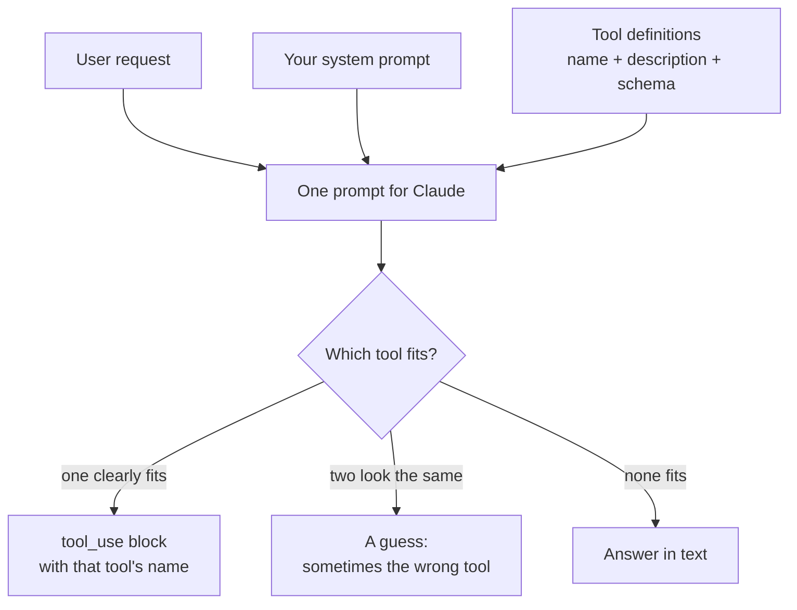
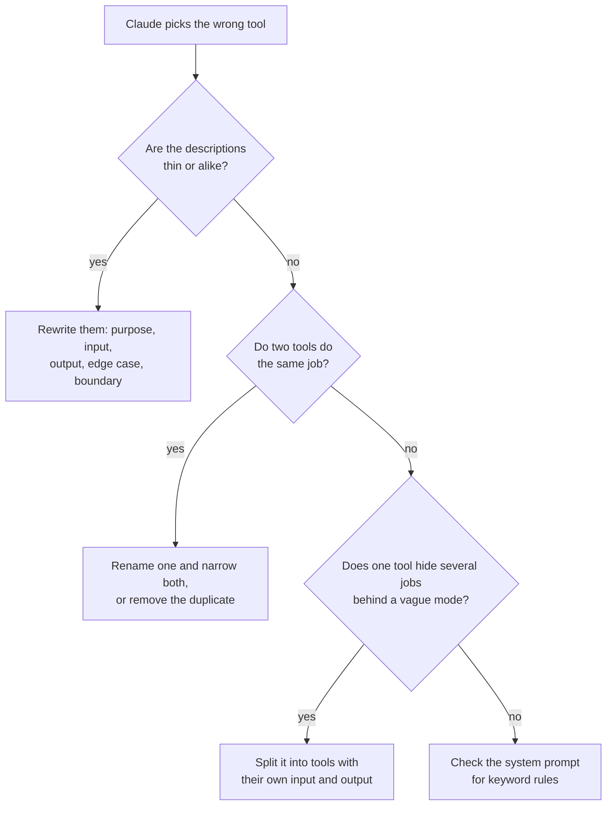

Claude decides which tool to call by reading each tool's name, description and input schema. It never sees the code behind the tool. If two tools have thin or similar descriptions, Claude has to guess, and some requests go to the wrong tool. In this post you rewrite two vague tool sets, one for the Messages API and one in an MCP server, and check them with tests that run without a model.

This is task statement 2.1 of the [Claude Certified Architect – Foundations exam guide](https://anthropic-partners.skilljar.com/claude-certified-architect-foundations-certification): "Design effective tool interfaces with clear descriptions and boundaries". It opens Domain 2, Tool Design & MCP Integration, which is 18% of the exam. The rest of the domain (errors, tool distribution, MCP setup) assumes Claude already picks the right tool.

## What does task statement 2.1 test?

The guide lists four things to know and four skills. In plain words:

| The guide asks you to… | In practice |
| --- | --- |
| Know that descriptions drive tool selection | A one-line description gives Claude too little to separate similar tools |
| Know what a description should hold | Input format, example queries, edge cases, and when to use this tool and not another |
| Know how overlap causes misrouting | `analyze_content` and `analyze_document` with near-identical descriptions get mixed up |
| Know the system prompt's effect | A keyword-based instruction can tie a word to a tool you did not intend |
| Write descriptions that tell tools apart | Purpose, inputs, outputs, and "use X instead when…" |
| Rename tools to remove overlap | For example, `analyze_content` becomes `extract_web_results` |
| Split generic tools | One `analyze_document` becomes `extract_data_points`, `summarize_content` and `verify_claim_against_source` |
| Review system prompts | Find keyword rules that override good descriptions |

If tool calling is new to you, read [What is tool calling?](/blog/what-is-tool-calling) first.

## How does Claude choose a tool?

A tool is a function in your code that Claude can ask you to run. Claude never sees that code. It sees a definition: a `name`, a `description` and an `input_schema`, which is a [JSON Schema](https://json-schema.org/) that describes the arguments. The [define tools page](https://platform.claude.com/docs/en/agents-and-tools/tool-use/define-tools) explains that the API "constructs a special system prompt from the tool definitions, tool configuration, and any user-specified system prompt". So your tool list and your own instructions end up in one prompt, and Claude reads them together.



MCP works the same way. An MCP server lists its tools with `tools/list`, and each tool has a `name`, a `description` and an `inputSchema` ([MCP tools spec](https://modelcontextprotocol.io/specification/latest/server/tools)). The host app passes those to the model. A vague description in an MCP server hurts routing exactly as much as one in your own API code.

The docs are blunt about what matters most: detailed descriptions are "by far the most important factor in tool performance". Names help, but a name like `search_docs` can't say what counts as a doc, what input works, or when to use another tool.

## What makes a good tool description?

The tool use docs ask for "at least 3–4 sentences" per description, covering what the tool does, when to use it and when not to, what each parameter means, and its limits. Anthropic's [Writing tools for agents](https://www.anthropic.com/engineering/writing-tools-for-agents) adds a useful test: describe the tool the way you would to a new hire on your team.

A checklist you can apply to any tool:

| Part | Question it answers | Example |
| --- | --- | --- |
| Purpose | What does it do, on what data? | "Search past and open support tickets: real customer cases…" |
| Input format | What should go in each argument? | "A ticket ID (like "T-10422"), a customer name, or keywords" |
| Example queries | What does a typical request look like? | "Acme login failures last week" |
| Output | What comes back? | "Up to 10 tickets with ID, status, customer and a short summary" |
| Edge case | What is easy to get wrong? | "If the user gives a ticket ID, put only the ID in the query" |
| Boundary | When should Claude use another tool? | "Do not use it for general how-to questions: use search_help_articles…" |

The boundary is the part most people skip, and it is the one that separates similar tools. The schema helps too. Give every parameter a `description`, and use an `enum` when only a few values are valid. Name parameters so they can't be misread: the engineering post suggests `user_id` over `user`.

Here is the change for a pair of search tools, from the hands-on below. The diff shows only the help-article tool; the tickets tool changes the same way.

```diff-ts
 {
-  name: 'search_docs',
-  description: 'Searches documents.',
+  name: 'search_help_articles',
+  description:
+    'Search the public help center: how-to guides, setup steps, feature explanations and documented error codes. ' +
+    'Input is a short natural-language question or an error code, for example "how do I rotate an API key" or "what does error E401 mean". ' +
+    'Returns up to 5 articles with title, URL and a one-paragraph excerpt. ' +
+    'Use it when the user wants to know how the product works or how to fix a problem themselves, even when the message mentions an error. ' +
+    'Do not use it to look up a specific customer case: use search_support_tickets for anything with a ticket ID, a customer name or "my ticket".',
   input_schema: {
     type: 'object',
-    properties: { query: { type: 'string' } },
+    properties: {
+      query: {
+        type: 'string',
+        description: 'The question or error code in plain words, e.g. "reset two-factor authentication" or "E401".',
+      },
+    },
     required: ['query'],
   },
 },
```

The name changed too. `search_docs` and `search_tickets` both sound like "search some text". `search_help_articles` and `search_support_tickets` say what is inside.

## When should you rename, split or merge tools?

Three fixes come up again and again. Pick by the problem you see in the logs.



**Rename to remove overlap.** The guide's example is `analyze_content` and `analyze_document`, both described as analyzing content. If one really works on web search results, rename it `extract_web_results` and say so in the description. Now the name and the description both carry the difference.

**Split a catch-all tool.** A generic `analyze_document` that summarizes, pulls out numbers or checks a claim, based on a free-text mode, hides the real choice inside an argument. Splitting it into `extract_data_points`, `summarize_content` and `verify_claim_against_source` moves that choice into the tool list, where each option has its own description, inputs and outputs.

**Merge when tools are steps of one job.** This sounds like the opposite advice, so read it carefully. The tool use docs say to "consolidate related operations into fewer tools", for example one tool with an `action` parameter instead of `create_pr`, `review_pr` and `merge_pr`. The engineering post suggests one `schedule_event` tool instead of `list_users`, `list_events` and `create_event`. Both cut the number of near-identical choices.

The two ideas fit together. Merge when the operations act on the same thing and a clear enum names each action. Split when one tool does different jobs with different inputs and outputs, chosen through a vague string. The exam's wrong answers often merge everything into one "do anything" tool. That hides the choice instead of making it clear.

When tools come from several services, prefix the names with the service, such as `github_list_prs` or `slack_send_message`. The tool use docs recommend this so selection stays unambiguous as the list grows.

## How can the system prompt undo a good description?

Your system prompt and your tool descriptions arrive in the same prompt. If the system prompt says "Whenever the user mentions an error, search the support tickets first", the word "error" now points at the tickets tool. A user who asks "What does error E401 mean?" wants a help article, and the description says so. The system prompt's rule may still win.

To review a system prompt for this:

- Search it for tool names and for words like "whenever", "always" and "if the user says".
- For each rule, ask whether it is about a **word** or about the **user's goal**. Rules about words create accidental links.
- Move tool guidance into the tool's own description, where it sits next to the boundary. Keep the system prompt for the role, the tone and rules that apply to every tool.

## Try it: rewrite two tool sets and check them without a model

You'll rewrite a pair of Messages API tools and a pair of MCP tools, then run a small lint that catches thin, unbounded and duplicate descriptions. Everything in the tests runs locally, with no API key. The last step is a routing eval that needs a key.

**You need:** Node.js 22.18 or later, which runs `.ts` files directly because [type stripping is on by default](https://nodejs.org/docs/latest-v22.x/api/typescript.html). An Anthropic API key only for the last step.


<Steps>


<Step title="Create the project">

```bash
$ mkdir tool-descriptions
$ cd tool-descriptions
$ npm init -y
$ npm pkg set type=module
```

Install the [Anthropic TypeScript SDK](https://github.com/anthropics/anthropic-sdk-typescript), the [MCP TypeScript SDK](https://github.com/modelcontextprotocol/typescript-sdk) server and client packages, and Zod for the MCP input schemas:


```bash
npm install @anthropic-ai/sdk @modelcontextprotocol/server @modelcontextprotocol/client zod
```


```bash
npm install -D typescript @types/node
```


Add a `tsconfig.json`. The MCP server package README asks for `"types": ["node"]` on TypeScript 6 and later:


**tsconfig.json**

```json
{
  "compilerOptions": {
    "noEmit": true,
    "target": "esnext",
    "module": "nodenext",
    "rewriteRelativeImportExtensions": true,
    "erasableSyntaxOnly": true,
    "verbatimModuleSyntax": true,
    "allowImportingTsExtensions": true,
    "strict": true,
    "types": ["node"]
  }
}
```


</Step>


<Step title="Write the Messages API tools, before and after">

The `before` pair is what you often find in a first prototype: a one-line description and an undocumented `query`. The `after` pair follows the checklist and renames both tools.


**tools.ts**

```ts
import type Anthropic from '@anthropic-ai/sdk';

// Before: thin, similar descriptions. Claude has almost nothing to tell them apart.
export const before: Anthropic.Tool[] = [
  {
    name: 'search_docs',
    description: 'Searches documents.',
    input_schema: {
      type: 'object',
      properties: { query: { type: 'string' } },
      required: ['query'],
    },
  },
  {
    name: 'search_tickets',
    description: 'Searches records.',
    input_schema: {
      type: 'object',
      properties: { query: { type: 'string' } },
      required: ['query'],
    },
  },
];

// After: purpose, input format, example queries, an edge case and the boundary.
export const after: Anthropic.Tool[] = [
  {
    name: 'search_help_articles',
    description:
      'Search the public help center: how-to guides, setup steps, feature explanations and documented error codes. ' +
      'Input is a short natural-language question or an error code, for example "how do I rotate an API key" or "what does error E401 mean". ' +
      'Returns up to 5 articles with title, URL and a one-paragraph excerpt. ' +
      'Use it when the user wants to know how the product works or how to fix a problem themselves, even when the message mentions an error. ' +
      'Do not use it to look up a specific customer case: use search_support_tickets for anything with a ticket ID, a customer name or "my ticket".',
    input_schema: {
      type: 'object',
      properties: {
        query: {
          type: 'string',
          description: 'The question or error code in plain words, e.g. "reset two-factor authentication" or "E401".',
        },
      },
      required: ['query'],
    },
  },
  {
    name: 'search_support_tickets',
    description:
      'Search past and open support tickets: real customer cases with their status, owner and history. ' +
      'Input is a ticket ID (like "T-10422"), a customer or company name, or keywords from a case, for example "Acme login failures last week". ' +
      'Returns up to 10 tickets with ID, status (open, pending or closed), customer and a short summary. ' +
      'If the user gives a ticket ID, put only the ID in the query. ' +
      'Do not use it for general how-to questions: use search_help_articles when the user wants instructions or an explanation, not a specific case.',
    input_schema: {
      type: 'object',
      properties: {
        query: {
          type: 'string',
          description: 'A ticket ID such as "T-10422", a customer name, or keywords from the case.',
        },
        status: {
          type: 'string',
          enum: ['open', 'pending', 'closed', 'any'],
          description: 'Only return tickets with this status. Use "any" when the user does not say.',
        },
      },
      required: ['query', 'status'],
    },
  },
];
```


The tickets tool also gains a `status` enum that lists the valid values, so "show me open cases" has an obvious place to go. A plain schema guides Claude but doesn't guarantee the input; if you need that guarantee, turn on [strict tool use](https://platform.claude.com/docs/en/agents-and-tools/tool-use/strict-tool-use).

</Step>


<Step title="Write a lint for tool definitions">

This check reads tool definitions and reports problems. It never calls a model. The input shape works for both the Messages API (`input_schema`) and MCP (`inputSchema`), so one lint covers both.


**lint-tools.ts**

```ts
// A tool definition in the shape both the Messages API and MCP's tools/list share.
export interface ToolSpec {
  name: string;
  description?: string;
  schema: { properties?: Record<string, { description?: string }> };
}

const NAME = /^[a-zA-Z0-9_-]{1,128}$/; // the Messages API's rule for tool names
const MIN_SENTENCES = 3; // the tool use docs suggest at least 3-4 per description
const MAX_OVERLAP = 0.6; // share of words two descriptions may have in common

const words = (text: string) => new Set(text.toLowerCase().match(/[a-z0-9_]+/g) ?? []);
const sentences = (text: string) => text.split(/[.!?](?:\s|$)/).filter((s) => s.trim()).length;

// Jaccard similarity: words in both / words in either. 1 means the same words.
function overlap(a: string, b: string): number {
  const wa = words(a);
  const wb = words(b);
  const shared = [...wa].filter((w) => wb.has(w)).length;
  return shared / new Set([...wa, ...wb]).size;
}

// Returns one line per problem. An empty array means the tool set passes.
export function lintTools(tools: ToolSpec[]): string[] {
  const problems: string[] = [];

  for (const tool of tools) {
    const description = tool.description ?? '';
    if (!NAME.test(tool.name)) problems.push(`${tool.name}: name must match ${NAME}`);
    if (sentences(description) < MIN_SENTENCES) {
      problems.push(`${tool.name}: description has ${sentences(description)} sentence(s), want ${MIN_SENTENCES}+`);
    }
    for (const [param, schema] of Object.entries(tool.schema.properties ?? {})) {
      if (!schema.description) problems.push(`${tool.name}: parameter "${param}" has no description`);
    }
    // Boundary check: with several tools, each description should say when to use another one instead.
    const others = tools.filter((t) => t.name !== tool.name).map((t) => t.name);
    if (others.length > 0 && !others.some((name) => description.includes(name))) {
      problems.push(`${tool.name}: description never names another tool, so it has no boundary`);
    }
  }

  for (const [i, a] of tools.entries()) {
    for (const b of tools.slice(i + 1)) {
      const score = overlap(a.description ?? '', b.description ?? '');
      if (score > MAX_OVERLAP) {
        problems.push(`${a.name} / ${b.name}: descriptions are ${Math.round(score * 100)}% the same words`);
      }
    }
  }

  return problems;
}
```


What each rule catches:

- **Name pattern.** The Messages API requires tool names to match `^[a-zA-Z0-9_-]{1,128}$`.
- **Three or more sentences.** A floor taken from the docs' "at least 3–4 sentences". It flags one-liners; it can't judge quality.
- **Parameter descriptions.** An undocumented argument leaves Claude to guess the format.
- **A named boundary.** In a set of tools, each description should name at least one other tool, as in "use search_support_tickets for…".
- **Word overlap.** Two descriptions that share more than 60% of their words are near-duplicates. The 60% is our own threshold; tune it on your tools.

</Step>


<Step title="Rename and split the MCP tools">

The `before` server has the guide's problem: two tools from two teams with the same description. The new server renames the web tool to `extract_web_results` and splits the document tool into `summarize_document` and `verify_claim_against_source`, each with its own schema. The handlers use canned data, so the example needs no storage.


**mcp-server.ts**

```ts
import { McpServer } from '@modelcontextprotocol/server';
import { z } from 'zod';

// Canned documents, so the example needs no storage.
const DOCS: Record<string, string> = {
  'q3-report': 'Revenue grew 12% in Q3. Churn fell to 2.1%. The team shipped single sign-on in August.',
};

const text = (value: unknown) => ({ content: [{ type: 'text' as const, text: JSON.stringify(value) }] });

function readDoc(documentId: string): string {
  const doc = DOCS[documentId];
  if (!doc) throw new Error(`No document "${documentId}". Known IDs: ${Object.keys(DOCS).join(', ')}.`);
  return doc;
}

// Before: two tools from two teams, same description, same input.
export function createBeforeServer(): McpServer {
  const server = new McpServer({ name: 'research-before', version: '1.0.0' });
  for (const name of ['analyze_content', 'analyze_document']) {
    server.registerTool(
      name,
      {
        description: 'Analyzes the given content and returns insights.',
        inputSchema: z.object({ content: z.string() }),
      },
      async ({ content }) => text({ insights: content.slice(0, 80) }),
    );
  }
  return server;
}

// After: one renamed tool for web results, and the document tool split by job.
export function createServer(): McpServer {
  const server = new McpServer({ name: 'research', version: '1.0.0' });

  server.registerTool(
    'extract_web_results',
    {
      title: 'Extract facts from web search results',
      description:
        'Pull the facts that answer a question out of web search results you already have. ' +
        'Input is the question plus the results as a list of { url, title, snippet } objects, exactly as the search tool returned them. ' +
        'Returns each matching snippet with its URL, so every fact keeps its source. ' +
        'It does not search the web and does not read uploaded files: for a document ID, use summarize_document or verify_claim_against_source.',
      inputSchema: z.object({
        question: z.string().describe('What the user wants to know, e.g. "When did Acme launch single sign-on?"'),
        results: z
          .array(z.object({ url: z.string(), title: z.string(), snippet: z.string() }))
          .min(1)
          .describe('Web search results to read, as returned by the search tool'),
      }),
      annotations: { readOnlyHint: true },
    },
    async ({ question, results }) => {
      const keywords = question.toLowerCase().match(/[a-z0-9]{4,}/g) ?? [];
      const facts = results
        .filter((r) => keywords.some((k) => r.snippet.toLowerCase().includes(k)))
        .map((r) => ({ fact: r.snippet, source: r.url }));
      return text({ facts });
    },
  );

  server.registerTool(
    'summarize_document',
    {
      title: 'Summarize an uploaded document',
      description:
        'Write a short summary of one uploaded document, such as a PDF report or a contract. ' +
        'Input is the document ID from the upload (like "q3-report") and an optional word limit. ' +
        'Returns the summary as plain text. ' +
        'Use it when the user asks what a document says overall. To check one specific statement against a document, use verify_claim_against_source; for web pages, use extract_web_results.',
      inputSchema: z.object({
        document_id: z.string().describe('ID of an uploaded document, e.g. "q3-report"'),
        max_words: z.number().int().min(10).max(300).optional().describe('Longest summary to return; default 100'),
      }),
      annotations: { readOnlyHint: true },
    },
    async ({ document_id, max_words }) => {
      // A real server would call a summarizer here; the canned version trims the text.
      const summary = readDoc(document_id).split(' ').slice(0, max_words ?? 100).join(' ');
      return text({ document_id, summary });
    },
  );

  server.registerTool(
    'verify_claim_against_source',
    {
      title: 'Check one claim against a document',
      description:
        'Check whether one specific claim appears in an uploaded document. ' +
        'Input is a single short claim, such as "churn fell to 2.1%", and the document ID. ' +
        'Returns "supported" with the matching sentence, or "not_found". ' +
        'Send one claim per call; for an overall summary use summarize_document instead.',
      inputSchema: z.object({
        claim: z.string().describe('One factual statement to check, e.g. "Revenue grew 12% in Q3"'),
        document_id: z.string().describe('ID of an uploaded document, e.g. "q3-report"'),
      }),
      annotations: { readOnlyHint: true },
    },
    async ({ claim, document_id }) => {
      const sentence = readDoc(document_id)
        .split(/(?<=\.)\s+/)
        .find((s) => s.toLowerCase().includes(claim.toLowerCase().replace(/\.$/, '')));
      return text(sentence ? { verdict: 'supported', sentence } : { verdict: 'not_found' });
    },
  );

  return server;
}
```


`title` is the display name a host app shows to people. `readOnlyHint` tells the host the tool changes nothing. The spec says clients must treat annotations as untrusted unless the server is trusted, so they are hints, not guarantees.

To run this server for real, connect it to `StdioServerTransport` as in [Build your first MCP server](/blog/build-your-first-mcp-server).

</Step>


<Step title="Test it without an API key">

The test lints both Messages API sets. For MCP, it connects a real MCP client to each server through the SDK's `InMemoryTransport` and lints what `tools/list` returns, which is what a host app would pass to Claude. It also calls one new tool, to prove the split didn't break behaviour. The last test runs the routing scorer from the next step against a fake client.


**tools.test.ts**

```ts
import assert from 'node:assert/strict';
import { test } from 'node:test';
import type Anthropic from '@anthropic-ai/sdk';
import { Client } from '@modelcontextprotocol/client';
import { InMemoryTransport, type McpServer } from '@modelcontextprotocol/server';
import { lintTools, type ToolSpec } from './lint-tools.ts';
import { before, after } from './tools.ts';
import { createBeforeServer, createServer } from './mcp-server.ts';
import { CASES, scoreRouting, type MessagesClient } from './routing.ts';

const fromApi = (tools: Anthropic.Tool[]): ToolSpec[] =>
  tools.map((t) => ({ name: t.name, description: t.description, schema: t.input_schema as ToolSpec['schema'] }));

// Connect a real MCP client to the server in memory and read tools/list, as a host would.
async function listMcpTools(server: McpServer) {
  const [clientSide, serverSide] = InMemoryTransport.createLinkedPair();
  await server.connect(serverSide);
  const client = new Client({ name: 'lint', version: '1.0.0' });
  await client.connect(clientSide);
  const { tools } = await client.listTools();
  return { client, tools };
}

test('Messages API: the thin definitions fail the lint', () => {
  const problems = lintTools(fromApi(before));
  for (const p of problems) console.log(`  ${p}`);
  assert.equal(problems.length, 6);
});

test('Messages API: the rewritten definitions pass', () => {
  assert.deepEqual(lintTools(fromApi(after)), []);
});

test('MCP: the two analyze_* tools fail as near-duplicates', async () => {
  const { client, tools } = await listMcpTools(createBeforeServer());
  const problems = lintTools(tools.map((t) => ({ name: t.name, description: t.description, schema: t.inputSchema as ToolSpec['schema'] })));
  for (const p of problems) console.log(`  ${p}`);
  assert.ok(problems.includes('analyze_content / analyze_document: descriptions are 100% the same words'));
  await client.close();
});

test('MCP: the renamed and split tools pass, and still work', async () => {
  const { client, tools } = await listMcpTools(createServer());
  assert.deepEqual(
    tools.map((t) => t.name),
    ['extract_web_results', 'summarize_document', 'verify_claim_against_source'],
  );
  assert.deepEqual(
    lintTools(tools.map((t) => ({ name: t.name, description: t.description, schema: t.inputSchema as ToolSpec['schema'] }))),
    [],
  );

  const result = await client.callTool({
    name: 'verify_claim_against_source',
    arguments: { claim: 'churn fell to 2.1%', document_id: 'q3-report' },
  });
  assert.deepEqual(result.content, [{ type: 'text', text: '{"verdict":"supported","sentence":"Churn fell to 2.1%."}' }]);
  await client.close();
});

test('routing scorer: counts hits and records misses, with a fake client', async () => {
  // Script one reply per case: answer correctly except for the first two prompts.
  const names = CASES.map((c, i) => (i < 2 ? 'search_support_tickets' : c.expected === 'docs' ? 'search_help_articles' : 'search_support_tickets'));
  const requests: Anthropic.MessageCreateParamsNonStreaming[] = [];
  const client: MessagesClient = {
    messages: {
      create: async (params) => {
        requests.push(params);
        const name = names[requests.length - 1];
        return {
          id: 'msg_test',
          type: 'message',
          role: 'assistant',
          model: params.model,
          content: [{ type: 'tool_use', id: `toolu_${requests.length}`, name, input: { query: 'x' }, caller: { type: 'direct' } }],
          stop_reason: 'tool_use',
          stop_sequence: null,
          stop_details: null,
          container: null,
          diagnostics: null,
          usage: {
            input_tokens: 0,
            output_tokens: 0,
            cache_creation: null,
            cache_creation_input_tokens: null,
            cache_read_input_tokens: null,
            inference_geo: null,
            output_tokens_details: null,
            server_tool_use: null,
            service_tier: null,
          },
        };
      },
    },
  };

  const report = await scoreRouting(
    client,
    after,
    { docs: 'search_help_articles', tickets: 'search_support_tickets' },
    'Whenever the user mentions an error, search the support tickets first.',
  );

  assert.equal(report.hits, 13);
  assert.equal(report.total, 15);
  assert.deepEqual(report.misses[1], {
    prompt: 'What does error E401 mean when I log in?',
    expected: 'search_help_articles',
    got: 'search_support_tickets',
  });
  assert.equal(requests[0].system, 'Whenever the user mentions an error, search the support tickets first.');
  assert.equal(requests[0].tool_choice, undefined); // auto, the default
  console.log(`  ${report.hits}/${report.total} hits, ${report.misses.length} misses`);
});
```


```bash
$ node --test --test-reporter=spec tools.test.ts
```

```text
  search_docs: description has 1 sentence(s), want 3+
  search_docs: parameter "query" has no description
  search_docs: description never names another tool, so it has no boundary
  search_tickets: description has 1 sentence(s), want 3+
  search_tickets: parameter "query" has no description
  search_tickets: description never names another tool, so it has no boundary
  analyze_content: description has 1 sentence(s), want 3+
  analyze_content: parameter "content" has no description
  analyze_content: description never names another tool, so it has no boundary
  analyze_document: description has 1 sentence(s), want 3+
  analyze_document: parameter "content" has no description
  analyze_document: description never names another tool, so it has no boundary
  analyze_content / analyze_document: descriptions are 100% the same words
  13/15 hits, 2 misses
✔ Messages API: the thin definitions fail the lint
✔ Messages API: the rewritten definitions pass
✔ MCP: the two analyze_* tools fail as near-duplicates
✔ MCP: the renamed and split tools pass, and still work
✔ routing scorer: counts hits and records misses, with a fake client
ℹ tests 5
ℹ suites 0
ℹ pass 5
ℹ fail 0
ℹ cancelled 0
ℹ skipped 0
ℹ todo 0
ℹ duration_ms 476.913161
```

This is our output on Node 22.22.2 with `@anthropic-ai/sdk` 0.131.0 and `@modelcontextprotocol/server` 2.3.0, with timings removed. The lint finds six problems in each `before` set, plus the 100% overlap between the two `analyze_*` tools. Both `after` sets pass. Then type-check everything:

```bash
$ npx tsc
```

No output means no type errors.

</Step>


<Step title="Measure routing with Claude">

The lint checks the shape of a description. Only the model can tell you whether it routes well. This scorer sends 15 labelled requests once each and records the first tool Claude asks for. Several requests mention an error on purpose.


**routing.ts**

```ts
import type Anthropic from '@anthropic-ai/sdk';

export const MODEL = 'claude-opus-5-5';

// 15 requests where you know the right tool. "docs" and "tickets" map to a tool per tool set.
export type Target = 'docs' | 'tickets';
export const CASES: { prompt: string; expected: Target }[] = [
  { prompt: 'How do I rotate my API key?', expected: 'docs' },
  { prompt: 'What does error E401 mean when I log in?', expected: 'docs' },
  { prompt: 'Is there a guide for setting up single sign-on?', expected: 'docs' },
  { prompt: 'I get a 429 error on uploads. How do I fix it?', expected: 'docs' },
  { prompt: 'Which file types can I import?', expected: 'docs' },
  { prompt: 'Explain how webhooks retry failed deliveries.', expected: 'docs' },
  { prompt: 'How do I export my data to CSV?', expected: 'docs' },
  { prompt: 'What error codes can the billing API return?', expected: 'docs' },
  { prompt: 'What is the status of ticket T-10422?', expected: 'tickets' },
  { prompt: 'Show me open cases from Acme Corp.', expected: 'tickets' },
  { prompt: 'Did anyone already report the login error customers saw on Monday?', expected: 'tickets' },
  { prompt: 'Who is handling my ticket about the missing invoice?', expected: 'tickets' },
  { prompt: 'List closed tickets that mention SSO timeouts.', expected: 'tickets' },
  { prompt: 'Has Globex contacted support this month?', expected: 'tickets' },
  { prompt: 'Find the case where a customer lost webhook events.', expected: 'tickets' },
];

// The loop only needs messages.create, so a fake client can stand in for tests.
export interface MessagesClient {
  messages: {
    create(params: Anthropic.MessageCreateParamsNonStreaming): Promise<Anthropic.Message>;
  };
}

export interface RoutingReport {
  hits: number;
  total: number;
  misses: { prompt: string; expected: string; got: string }[];
}

// Send each prompt once and record the first tool Claude asks for ("none" if it answers directly).
export async function scoreRouting(
  client: MessagesClient,
  tools: Anthropic.Tool[],
  targets: Record<Target, string>,
  system?: string,
): Promise<RoutingReport> {
  const report: RoutingReport = { hits: 0, total: CASES.length, misses: [] };

  for (const { prompt, expected } of CASES) {
    const response = await client.messages.create({
      model: MODEL,
      max_tokens: 1024,
      tools,
      ...(system ? { system } : {}),
      messages: [{ role: 'user', content: prompt }],
    });
    const call = response.content.find((b): b is Anthropic.ToolUseBlock => b.type === 'tool_use');
    const got = call?.name ?? 'none';
    if (got === targets[expected]) report.hits++;
    else report.misses.push({ prompt, expected: targets[expected], got });
  }

  return report;
}
```


The scorer leaves `tool_choice` at its default, `auto`, so Claude chooses freely, which is the behaviour you want to measure. (Forcing a tool would defeat the test, and the define tools page says Claude Opus 5.5 returns a 400 error for `any` and `tool` anyway.)

Set your key as the `ANTHROPIC_API_KEY` environment variable, then run three configurations: the thin tools, the rewritten tools, and the rewritten tools with a keyword rule in the system prompt.


**run-eval.ts**

```ts
import Anthropic from '@anthropic-ai/sdk';
import { before, after } from './tools.ts';
import { scoreRouting } from './routing.ts';

const client = new Anthropic(); // reads ANTHROPIC_API_KEY from the environment

const KEYWORD_RULE = 'Whenever the user mentions an error, search the support tickets first.';

const runs = [
  { label: 'before', tools: before, targets: { docs: 'search_docs', tickets: 'search_tickets' } },
  { label: 'after', tools: after, targets: { docs: 'search_help_articles', tickets: 'search_support_tickets' } },
  {
    label: 'after + keyword rule',
    tools: after,
    targets: { docs: 'search_help_articles', tickets: 'search_support_tickets' },
    system: KEYWORD_RULE,
  },
];

for (const run of runs) {
  const report = await scoreRouting(client, run.tools, run.targets, run.system);
  console.log(`${run.label}: ${report.hits}/${report.total}`);
  for (const miss of report.misses) console.log(`  miss: "${miss.prompt}" -> ${miss.got} (want ${miss.expected})`);
}
```


```bash
$ node run-eval.ts
```

This makes 45 API calls. What to expect, not a measured result: the `after` tools should score at least as well as `before`, and the keyword rule may pull some "error" questions, such as the E401 one, to `search_support_tickets`. Your numbers will vary between runs, so run each configuration a few times before you compare. For more on building evals, see [How to test AI output with evals](/blog/test-ai-output-with-evals).

</Step>


</Steps>


## Common traps

These are the mistakes that wrong answer options are built on.

| Trap | Why it fails | Fix |
| --- | --- | --- |
| Add few-shot examples, a keyword router or a classifier first | Treats the symptom; the thin descriptions are still there | Rewrite the descriptions first: it is the cheapest fix |
| Merge every similar tool into one "do anything" tool | Hides the choice inside an argument | Split by job, with its own inputs and outputs |
| Trust the name alone | A name can't state input format, output or boundaries | Write the description and parameter docs |
| Leave keyword rules in the system prompt | They tie words to tools and can beat a clear description | Phrase rules by user goal, or move them into the tool description |
| Add a post-processing step that re-calls the "right" tool | Pays twice and hides the cause | Fix the definitions so the first choice is right |


<Callout type="warning" title="A lint is not a routing test">

A description can have five sentences, a boundary and low overlap and still mislead Claude, for example if it describes the wrong data. Use the lint to catch thin and duplicate definitions early, and keep a small routing eval with real requests for the real answer.

</Callout>


## Practice questions

These four questions are this blog's own, written for practice. They are not from the exam.

**Question 1.** A documentation assistant has two tools: `find_article` ("Finds help content") and `find_snippet` ("Finds content"). Users who ask for a code sample often get a full help article instead. Both tools work correctly when called. What should you change first?

- A. Add a post-processing step that detects code requests and calls `find_snippet` again.
- B. Rewrite both descriptions to state what each returns, the input each expects, sample queries, and when to use one instead of the other.
- C. Remove `find_snippet` and let `find_article` return code blocks too.
- D. Add five few-shot examples of code requests to the system prompt.

**Question 2.** An internal agent has one tool, `process_file`, that can summarize a file, pull out numbers, or check a claim against it, based on a free-text `mode` string. Logs show Claude often picks the wrong mode. What is the best redesign?

- A. List all allowed `mode` values in the system prompt.
- B. Keep `process_file` and add a second tool that validates the chosen mode.
- C. Split it into tools such as `summarize_file`, `extract_figures` and `check_claim_in_file`, each with its own input and output.
- D. Make `mode` optional and let the server guess from the file type.

**Question 3.** A research agent's system prompt says: "Whenever the user mentions a source, check it." Afterwards Claude calls `verify_claim_against_source` for requests like "summarize this source", even though that tool's description clearly says it is for checking a single claim. What is the most likely cause?

- A. The tool description is too long, so Claude stops reading it.
- B. The keyword rule in the system prompt links the word "source" to verification and overrides the description.
- C. The tool's input schema is missing a required field.
- D. Claude can't choose reliably between more than two tools.

**Question 4.** Two teams each wrote an MCP tool: `analyze_content` and `analyze_document`, both described as "Analyzes the given content and returns insights." One works on web search results, the other on uploaded PDFs. What is the best fix?

- A. Rename one to `extract_web_results`, describe it as working only on web search results, and describe the other as working only on uploaded documents.
- B. Keep the names and add "Tool 1" and "Tool 2" to the descriptions.
- C. Put both behind one `analyze` tool that checks the input type.
- D. Tell users to say "web" or "PDF" in every request.

## Answer key

### Question 1

**Answer: B.** The tools only overlap in their descriptions, so clear, different descriptions fix the cause. The strongest distractor is D: examples in the system prompt may help a little, but they work around thin descriptions instead of fixing them, and they cost tokens on every request. C removes a real capability.

### Question 2

**Answer: C.** Tools with one job each and their own input and output make the choice visible in the tool list, where Claude decides. The strongest distractor is A: listing modes keeps the hidden, error-prone choice inside one tool. A clear `action` enum on related operations can be fine; a free-text mode that switches between different jobs is the problem here.

### Question 3

**Answer: B.** A keyword rule in the system prompt can create a link between a word and a tool that the author never meant. The strongest distractor is A: the description is already clear, so shortening it does nothing about the conflicting rule.

### Question 4

**Answer: A.** Renaming and rewriting the descriptions removes the overlap, so each tool has one clear purpose. The strongest distractor is C: merging hides the choice inside the tool, and the two jobs take different inputs anyway.

## What should I do next?

- **Lint your own tools.** Run `lintTools` on the tool list of an agent or MCP server you already have, and fix what it finds before you touch prompts.
- **Test the server end to end.** [How to test and debug an MCP server](/blog/test-and-debug-mcp-server) shows the MCP Inspector and stdio tests.
- **Move on to task statement 2.2**, "Implement structured error responses for MCP tools". The next post in this series covers it.
- **Plan and check your prep.** Follow the [six-week study plan](/blog/claude-architect-exam-study-plan), and test yourself with the [mock exam](/blog/claude-certification-mock-exam) when you've worked through Domain 2.
