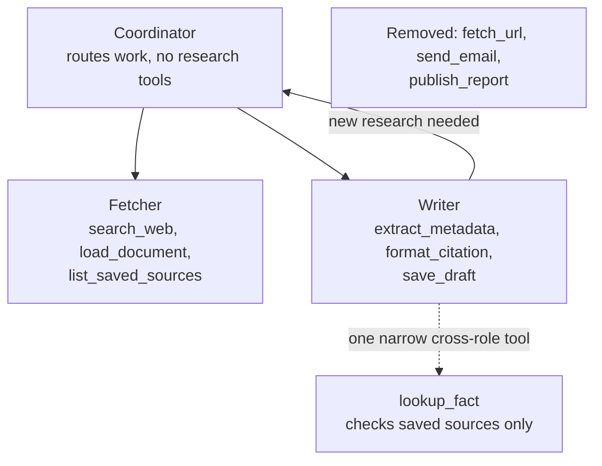
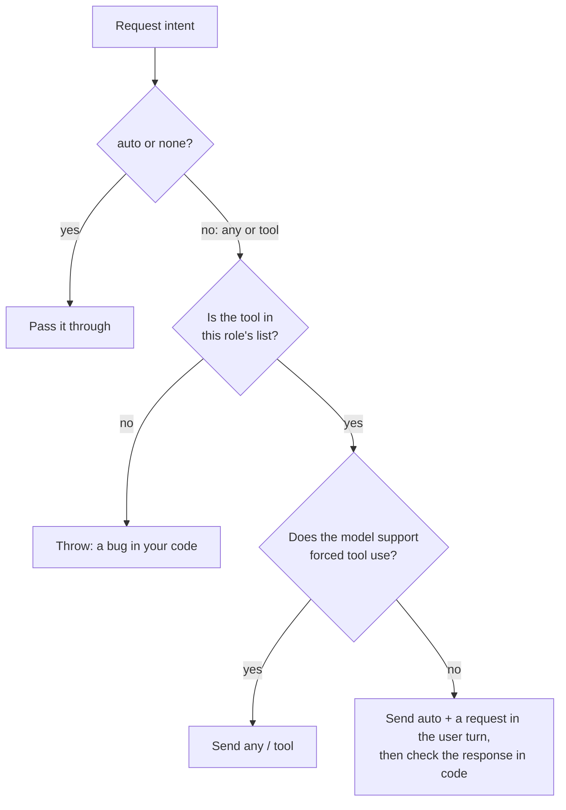

Each agent in a multi-agent system should get only the tools its role needs, because every extra tool makes each choice harder and opens a door to misuse. `tool_choice` then controls whether Claude may answer in text, must call some tool, or must call one specific tool. In this post you build a small TypeScript tool registry that gives each role its own tool set and builds a valid `tool_choice` for each model, and you test it without an API key.

This is task statement 2.3 of the [Claude Certified Architect – Foundations exam guide](https://anthropic-partners.skilljar.com/claude-certified-architect-foundations-certification): "Distribute tools appropriately across agents and configure tool choice". It sits in Domain 2, Tool Design & MCP Integration, which is 18% of the exam. Part 1 of this series covered tool descriptions and part 2 covered structured errors; both are drafts for now.

## What does task statement 2.3 test?

The guide lists four things to know and five skills. In plain words:

| The guide asks you to… | In practice |
| --- | --- |
| Know that too many tools hurt selection | Its example: 18 tools instead of 4–5 makes each decision harder |
| Know why out-of-role tools get misused | A synthesis agent that has web search starts searching instead of writing |
| Know scoped tool access | Each agent gets its role's tools, plus a few cross-role tools for frequent needs |
| Know the `tool_choice` options | `"auto"`, `"any"` and forced selection with `{"type": "tool", "name": "..."}` |
| Restrict each subagent's tools | Cut the list down to what the role needs |
| Replace generic tools with constrained ones | `fetch_url` becomes `load_document`, which only accepts document URLs |
| Add narrow cross-role tools | A `verify_fact` tool for the synthesis agent; complex cases still go through the coordinator |
| Force a tool on the first step | Force `extract_metadata`, then handle later steps in follow-up turns |
| Use `"any"` to rule out a text reply | Claude must call a tool instead of chatting |

The guide was written before the current models. Today's API has a fourth option, `"none"`, and several current models reject forced tool use. The exam tests the concepts; your code has to follow the docs. This post covers both.

## Why do too many tools hurt?

Claude picks a tool by reading every tool's name, description and input schema on every request. With four tools, that is a small decision. With eighteen, Claude has to tell apart more options that look alike, and the tool definitions take up more of the prompt.

The guide's "18 instead of 4–5" is an example, not a limit. Anthropic's docs give their own numbers:

- The [tool search docs](https://platform.claude.com/docs/en/agents-and-tools/tool-use/tool-search-tool) say "Claude's ability to pick the right tool degrades once you exceed 30–50 available tools", and suggest tool search once you have 10 or more tools.
- Anthropic's [Writing tools for agents](https://www.anthropic.com/engineering/writing-tools-for-agents) puts it plainly: "More tools don't always lead to better outcomes", and "Too many tools or overlapping tools can also distract agents from pursuing efficient strategies."

The second problem is misuse. An agent will use the tools it has. If the report writer can search the web, it may start a search halfway through a paragraph, pull in a source nobody checked, and take much longer. A prompt rule such as "don't search the web" asks it not to. Removing the tool makes it impossible.

## How do I give each agent the right tools?

Start from the roles, not from the tools. For each role, write down its job, then list only the tools that job needs. Here is the pipeline you build in the hands-on part, which splits one ten-tool agent into a fetcher and a writer:



Three moves do most of the work:

1. **Scope by role.** The fetcher finds and loads sources. The writer records sources and writes. Neither gets `send_email` or `publish_report`, because no step of their job needs them. Those stay with a person or a separate, tightly controlled step.
2. **Replace a broad tool with a constrained one.** `fetch_url` accepts any URL, including login pages, downloads and internal network addresses. `load_document` accepts only HTTPS documents from allowed sources and returns a clear error for everything else. Same job, much smaller blast radius.
3. **Add a narrow cross-role tool for a frequent need.** The writer often needs to check one date or number. Sending every check back to the coordinator costs a round trip. Giving the writer the fetcher's whole tool set brings back the misuse problem. A `lookup_fact` tool that only checks sources already saved for the report covers the simple case. Anything that needs new research still goes back through the coordinator.

The Claude Agent SDK and Claude Code do the scoping for you with a subagent's `tools` list. The [subagents docs](https://code.claude.com/docs/en/agent-sdk/subagents) say "A tool you leave out isn't in the subagent's session at all". The agentic architecture series covers that in [Subagents: spawning, context passing and the Agent tool](/blog/claude-subagents-context-passing) (task statement 1.3), so this post focuses on the Messages API, where you build each agent's tool list yourself.

## What are the tool_choice options?

`tool_choice` is a request parameter that controls whether and which tool Claude calls. The [define tools page](https://platform.claude.com/docs/en/agents-and-tools/tool-use/define-tools) lists four options:

| Option | What Claude does | Default when |
| --- | --- | --- |
| `{"type": "auto"}` | Decides for itself: call a tool, several tools, or answer in text | You send `tools` |
| `{"type": "any"}` | Must call one of the tools you provided, but picks which | Never |
| `{"type": "tool", "name": "..."}` | Must call that exact tool | Never |
| `{"type": "none"}` | Can't call any tool | You send no `tools` |

The exam guide names the first three. Keep `"any"` and `"tool"` apart: `"any"` guarantees *a* tool call, `"tool"` guarantees *this* tool call. If you need `parse_header` to run first, `"any"` isn't enough, because Claude could pick `lookup_vendor`.

A few details from the docs that matter in practice:

- **No text before a forced call.** With `"any"` or `"tool"`, the API prefills the assistant turn, so Claude won't write an explanation before the `tool_use` block, "even if explicitly asked to do so". If you want both, use `"auto"` and ask for the tool in the user message.
- **One call at a time.** `disable_parallel_tool_use: true` goes inside the `tool_choice` object. With `"auto"` it means at most one tool call; with `"any"` or `"tool"` it means exactly one ([parallel tool use docs](https://platform.claude.com/docs/en/agents-and-tools/tool-use/parallel-tool-use)).
- **Caching.** Changing `tool_choice` between requests invalidates cached message blocks, but tool definitions and the system prompt stay cached. Changing the tool definitions invalidates the whole cache ([prompt caching docs](https://platform.claude.com/docs/en/build-with-claude/prompt-caching)).

## Which models reject a forced tool_choice?

This is where the exam guide and today's API part ways. The define tools page has a table of models and settings that don't support forced tool use. For them, `"any"` and `"tool"` fail, while `"auto"` and `"none"` still work:

| Model or setting | `"any"` and `"tool"` | What the docs suggest instead |
| --- | --- | --- |
| Claude Opus 5.5, Claude Sonnet 5.5, Claude Fable 5.1, Claude Mythos 5.1 | 400 error | `"auto"` with strict tool use, or structured outputs for a fixed JSON reply |
| Manual extended thinking (`thinking: {type: "enabled"}`) on any model | Error | `"auto"` or `"none"` |
| Adaptive thinking on other models, for example Claude Opus 5 | Supported | — |

The [API errors page](https://platform.claude.com/docs/en/api/errors) shows the exact message, a 400 `invalid_request_error`:

```text
tool_choice: type "tool" and "any" are not supported for this model.
```

The token counting endpoint rejects it too. Claude Opus 5.5 is the model the [models overview](https://platform.claude.com/docs/en/about-claude/models/overview) suggests starting with, so you will meet this quickly. Code that hard-codes `tool_choice: {"type": "any"}` breaks the day you upgrade the model.

What do you use instead? It depends on why you wanted to force a tool:

| You forced a tool to… | On models without forced tool use |
| --- | --- |
| Get schema-valid tool inputs | `"auto"` plus [strict tool use](https://platform.claude.com/docs/en/agents-and-tools/tool-use/strict-tool-use) (`strict: true` on the tool) |
| Get the whole reply as fixed JSON | [Structured outputs](https://platform.claude.com/docs/en/build-with-claude/structured-outputs) (`output_config.format`) |
| Make one step run first | `"auto"`, ask for the tool in the user turn, and refuse other tools in your code until that step has run |
| Rule out a text reply | `"auto"`, ask for a tool call, and treat a text reply as a failed check in your code |

The docs note that "prompting still influences which tool `auto` picks". It steers; it doesn't guarantee. That is why the last two rows add a check in code.

## When is forcing a tool the right call?

Forcing is for **one known step**, not for a whole conversation. Good cases:

- **A fixed first step.** Metadata must be recorded before enrichment, or a header must be parsed before lookups. Force that tool on the first request, then switch back to `"auto"` for the follow-up turns.
- **Output that must go through a tool.** A classifier must answer through `record_label` so your code can parse it. With one tool, `"any"` is enough. With several extraction tools and an unknown document type, `"any"` makes Claude pick one.

Bad cases:

- **Every turn of an agent loop.** With `"any"` on every request, Claude must call a tool every time, so it can't finish with a final text answer. Your loop then runs until its turn cap.
- **Instead of good descriptions.** If Claude picks the wrong tool in normal use, fix the descriptions (part 1 of this series) rather than forcing the "right" one.
- **When the step is pure code.** If a step needs no model judgment, such as loading a file by a known ID, run it in your code before the loop.

The registry you build next makes this decision per request:



## Try it: a tool registry with scoped roles and a safe tool_choice

You'll build a registry that holds all ten tools, defines a fetcher and a writer with their own tool sets, replaces `fetch_url` with `load_document`, and builds request parameters with a `tool_choice` that is valid for the model. Then you'll run a writer loop that forces `extract_metadata` first and test it against a fake API that rejects forced tool use on Claude Opus 5.5, exactly as the real one does. The tests need no API key. The last step, a live comparison, does.

**You need:** Node.js 22.18 or later, which runs `.ts` files directly because [type stripping is on by default](https://nodejs.org/docs/latest-v22.x/api/typescript.html). An Anthropic API key only for the last step.


<Steps>


<Step title="Create the project">

```bash
$ mkdir tool-registry
$ cd tool-registry
$ npm init -y
$ npm pkg set type=module
```

Install the [Anthropic TypeScript SDK](https://github.com/anthropics/anthropic-sdk-typescript), plus TypeScript for type checking:


```bash
npm install @anthropic-ai/sdk
```


```bash
npm install -D typescript @types/node
```


Add a `tsconfig.json`:


**tsconfig.json**

```json
{
  "compilerOptions": {
    "noEmit": true,
    "target": "esnext",
    "module": "nodenext",
    "rewriteRelativeImportExtensions": true,
    "erasableSyntaxOnly": true,
    "verbatimModuleSyntax": true,
    "allowImportingTsExtensions": true,
    "strict": true,
    "types": ["node"]
  }
}
```


</Step>


<Step title="List every tool once">

The catalog holds all ten tools the system has. The last three are what the old all-in-one agent also had. Roles pick from this list by name, so each definition exists exactly once.


**catalog.ts**

```ts
import type Anthropic from '@anthropic-ai/sdk';

// Every tool takes string arguments here, so one helper keeps the definitions short.
function tool(name: string, description: string, params: Record<string, string>): Anthropic.Tool {
  const properties = Object.fromEntries(
    Object.entries(params).map(([key, text]) => [key, { type: 'string', description: text }]),
  );
  return { name, description, input_schema: { type: 'object', properties, required: Object.keys(params) } };
}

// All ten tools the system has. Roles pick from this list.
export const CATALOG: Anthropic.Tool[] = [
  // Fetcher tools: find and load sources.
  tool(
    'search_web',
    'Search the public web for sources on one topic. Input is a few keywords. ' +
      'Returns up to 5 results with title, URL and a short snippet. ' +
      'To read a result in full, pass its URL to load_document.',
    { query: 'A few keywords, e.g. "EU AI Act timeline"' },
  ),
  tool(
    'load_document',
    'Load the full text of one document: a PDF, HTML or Markdown file on an allowed HTTPS source. ' +
      'Input is a URL from search_web. Returns the text, or an error that says why the URL was refused. ' +
      'It does not open web apps, images, downloads or private network addresses.',
    { url: 'An https URL ending in .pdf, .html, .htm or .md' },
  ),
  tool(
    'list_saved_sources',
    'List the sources already saved for this report, with their URLs and titles. ' +
      'Takes the report ID. Use it before searching, so you do not load the same source twice.',
    { report_id: 'The report ID, e.g. "r-104"' },
  ),
  // Writer tools: turn loaded sources into a report.
  tool(
    'extract_metadata',
    'Record the title, author and publication date of one loaded source. ' +
      'Call it once per source, before writing about it, so every citation has complete details. ' +
      'Returns the stored record.',
    { source_url: 'URL of the loaded source', title: 'Its title', author: 'Author or organisation', published: 'Date as YYYY-MM-DD' },
  ),
  tool(
    'format_citation',
    'Format a stored source as a citation in the house style. Input is the source URL. ' +
      'Returns one citation line. The source must have gone through extract_metadata first.',
    { source_url: 'URL of a source already recorded with extract_metadata' },
  ),
  tool(
    'save_draft',
    'Save the report draft as Markdown. Input is the full draft. ' +
      'Returns the draft ID. Saving does not publish anything.',
    { markdown: 'The complete draft in Markdown' },
  ),
  // A narrow cross-role tool: the writer can check one fact without becoming a researcher.
  tool(
    'lookup_fact',
    'Check one short fact (a number, a date or a name) against the sources already saved for this report. ' +
      'It never searches the web. Returns the matching sentence and its source URL, or "not_found". ' +
      'If the answer is not_found or needs new research, report the gap so the coordinator can send it to the fetcher.',
    { question: 'One short question, e.g. "When did the act enter into force?"' },
  ),
  // Tools the old all-in-one agent also had.
  tool('fetch_url', 'Fetch any URL and return its raw content.', { url: 'Any URL' }),
  tool('send_email', 'Send an email to a colleague.', { to: 'Email address', body: 'Message text' }),
  tool('publish_report', 'Publish a saved draft on the company site.', { draft_id: 'ID from save_draft' }),
];
```


`lookup_fact` is the cross-role tool. Its description draws the boundary: saved sources only, no web, and "report the gap" when the answer needs research.

</Step>


<Step title="Replace fetch_url with load_document">

The constrained tool checks the URL before doing anything. It allows HTTPS only, a short list of trusted hosts and document file types. A refusal comes back as a non-retryable validation error, in the structured shape from part 2, so Claude knows not to try the same URL again.


**load-document.ts**

```ts
// The constrained replacement for fetch_url: only documents, only from sources you trust.
const ALLOWED_HOSTS = new Set(['docs.example.com', 'reports.example.org']);
const DOCUMENT_EXTENSIONS = ['.pdf', '.html', '.htm', '.md'];

export type UrlCheck = { ok: true; url: URL } | { ok: false; reason: string };

export function checkDocumentUrl(raw: string): UrlCheck {
  let url: URL;
  try {
    url = new URL(raw);
  } catch {
    return { ok: false, reason: `"${raw}" is not a valid URL.` };
  }
  if (url.protocol !== 'https:') return { ok: false, reason: 'Only https URLs can be loaded.' };
  if (!ALLOWED_HOSTS.has(url.hostname)) {
    return { ok: false, reason: `${url.hostname} is not an allowed source. Allowed: ${[...ALLOWED_HOSTS].join(', ')}.` };
  }
  if (!DOCUMENT_EXTENSIONS.some((ext) => url.pathname.toLowerCase().endsWith(ext))) {
    return { ok: false, reason: `Not a document. The path must end in ${DOCUMENT_EXTENSIONS.join(', ')}.` };
  }
  return { ok: true, url };
}

// The tool handler. A refusal is a structured, non-retryable validation error, as in part 2 of this series.
export function loadDocument(input: { url: string }): { content: string; isError?: true } {
  const check = checkDocumentUrl(input.url);
  if (!check.ok) {
    return {
      content: JSON.stringify({ errorCategory: 'validation', isRetryable: false, message: check.reason }),
      isError: true,
    };
  }
  // A real handler would download and convert the file here.
  return { content: `Text of ${check.url.href}` };
}
```


An allowlist of hosts also blocks private and cloud metadata addresses such as `169.254.169.254`, which a generic `fetch_url` would happily load.

</Step>


<Step title="Write the registry">

First, one small function that knows which models reject forced tool use. The list comes from the define tools page; re-check it when you add a model.


**models.ts**

```ts
import type Anthropic from '@anthropic-ai/sdk';

// Models that reject tool_choice "any" and "tool" with a 400 error.
// Source: the "Forcing tool use" table on the define tools page. Re-check it when you add a model.
const NO_FORCED_TOOL_USE = new Set(['claude-opus-5-5', 'claude-sonnet-5-5', 'claude-fable-5-1', 'claude-mythos-5-1']);

export function supportsForcedToolUse(model: string, thinking?: Anthropic.ThinkingConfigParam): boolean {
  if (NO_FORCED_TOOL_USE.has(model)) return false;
  // Manual extended thinking also rejects "any" and "tool". Adaptive thinking doesn't.
  if (thinking?.type === 'enabled') return false;
  return true;
}
```


Then the registry. `defineRole` refuses unknown tools and roles over a size limit. `buildRequest` turns an intent (`auto`, `none`, `any`, or a named tool) into request parameters that the model accepts, and says what your code should check in the response.


**registry.ts**

```ts
import type Anthropic from '@anthropic-ai/sdk';
import { supportsForcedToolUse } from './models.ts';

// What you want Claude to do with its tools on this request.
export type ToolIntent = { type: 'auto' } | { type: 'none' } | { type: 'any' } | { type: 'tool'; name: string };

export interface RoleSpec {
  tools: string[]; // the tools this role's job needs
  crossRole?: string[]; // a few narrow tools for frequent needs that belong to another role
}

export interface RequestOptions {
  role: string;
  model: string;
  messages: Anthropic.MessageParam[];
  system?: string;
  thinking?: Anthropic.ThinkingConfigParam;
  intent?: ToolIntent; // default: auto
  oneCall?: boolean; // at most (auto) or exactly (any, tool) one tool call
}

export interface RequestPlan {
  params: Anthropic.MessageCreateParamsNonStreaming;
  forced: boolean; // false when the model can't force tools and the plan fell back to auto
  expect: { tool: string } | 'any_tool' | null; // what your code should check in the response
}

export class ToolRegistry {
  private readonly byName: Map<string, Anthropic.Tool>;
  private readonly roles = new Map<string, string[]>();
  private readonly maxToolsPerRole: number;

  // maxToolsPerRole is a guard rail you choose, not an API limit.
  constructor(catalog: Anthropic.Tool[], maxToolsPerRole = 5) {
    this.byName = new Map(catalog.map((t) => [t.name, t]));
    this.maxToolsPerRole = maxToolsPerRole;
  }

  defineRole(role: string, spec: RoleSpec): this {
    const names = [...spec.tools, ...(spec.crossRole ?? [])];
    const unknown = names.filter((name) => !this.byName.has(name));
    if (unknown.length > 0) throw new Error(`${role}: unknown tools: ${unknown.join(', ')}`);
    if (new Set(names).size !== names.length) throw new Error(`${role}: a tool is listed twice`);
    if (names.length > this.maxToolsPerRole) {
      throw new Error(`${role}: ${names.length} tools, limit is ${this.maxToolsPerRole}. Split the role or narrow its tools.`);
    }
    this.roles.set(role, names);
    return this;
  }

  toolsFor(role: string): Anthropic.Tool[] {
    const names = this.roles.get(role);
    if (!names) throw new Error(`Unknown role: ${role}`);
    return names.map((name) => this.byName.get(name)!);
  }

  buildRequest(options: RequestOptions): RequestPlan {
    const { role, model, system, thinking, oneCall } = options;
    const intent = options.intent ?? { type: 'auto' };
    // The same tools on every turn of a conversation: changing them breaks the prompt cache.
    const tools = this.toolsFor(role);
    let messages = options.messages;

    if (intent.type === 'tool' && !tools.some((t) => t.name === intent.name)) {
      throw new Error(`${role} can't be forced to call ${intent.name}: it is not one of its tools`);
    }
    const wantsTool = intent.type === 'any' || intent.type === 'tool';
    if (wantsTool && tools.length === 0) throw new Error(`${role} has no tools to call`);

    const once = oneCall ? { disable_parallel_tool_use: true } : {};
    let toolChoice: Anthropic.ToolChoice;
    let forced = false;

    if (intent.type === 'auto') {
      toolChoice = { type: 'auto', ...once };
    } else if (intent.type === 'none') {
      toolChoice = { type: 'none' };
    } else if (supportsForcedToolUse(model, thinking)) {
      toolChoice = intent.type === 'tool' ? { type: 'tool', name: intent.name, ...once } : { type: 'any', ...once };
      forced = true;
    } else {
      // Fallback for models that reject forced tool use: auto, plus a plain request in the user turn.
      // It steers Claude but guarantees nothing, so the caller must check the response.
      const ask = intent.type === 'tool' ? `Use the ${intent.name} tool in your response.` : 'Respond by calling one of your tools.';
      messages = appendToLastUserMessage(messages, ask);
      toolChoice = { type: 'auto', ...once };
    }

    const expect = intent.type === 'tool' ? { tool: intent.name } : intent.type === 'any' ? ('any_tool' as const) : null;
    return {
      params: {
        model,
        max_tokens: 4096,
        ...(system && { system }),
        ...(thinking && { thinking }),
        ...(tools.length > 0 && { tools, tool_choice: toolChoice }),
        messages,
      },
      forced,
      expect,
    };
  }
}

function appendToLastUserMessage(messages: Anthropic.MessageParam[], text: string): Anthropic.MessageParam[] {
  const last = messages.at(-1);
  if (!last || last.role !== 'user') throw new Error('The last message must be a user message');
  const content = typeof last.content === 'string' ? [{ type: 'text' as const, text: last.content }] : last.content;
  // Text goes after any tool_result blocks, which must come first in a user message.
  return [...messages.slice(0, -1), { role: 'user', content: [...content, { type: 'text', text }] }];
}

// Returns a problem description, or null when the response matches what the plan expected.
export function checkResponse(response: Anthropic.Message, expect: RequestPlan['expect']): string | null {
  if (expect === null) return null;
  const calls = response.content.filter((block): block is Anthropic.ToolUseBlock => block.type === 'tool_use');
  if (calls.length === 0) return `expected a tool call, got stop_reason "${response.stop_reason}" and no tool_use`;
  if (expect !== 'any_tool' && calls[0].name !== expect.tool) return `expected ${expect.tool} first, got ${calls[0].name}`;
  return null;
}
```


Some choices worth noticing:

- **The limit is yours.** `maxToolsPerRole = 5` follows the guide's 4–5 example. It is a guard rail that makes you split a role on purpose, not an API rule.
- **The tool list stays the same.** The fallback never narrows `tools` for one turn. Changing tool definitions would invalidate the whole prompt cache (see the warning below).
- **The added request stays in history.** The writer loop keeps the message with the added sentence, so the conversation only ever grows.
- **The class uses a plain field.** A constructor parameter property (`private readonly max = 5` in the signature) fails under Node's type stripping, so the limit is assigned in the body.

</Step>


<Step title="Define the roles and the writer loop">

The fetcher gets three tools. The writer gets three, plus `lookup_fact`:


**roles.ts**

```ts
import { CATALOG } from './catalog.ts';
import { ToolRegistry } from './registry.ts';

// Two roles, each with only the tools its job needs.
export const registry = new ToolRegistry(CATALOG)
  .defineRole('fetcher', { tools: ['search_web', 'load_document', 'list_saved_sources'] })
  .defineRole('writer', {
    tools: ['extract_metadata', 'format_citation', 'save_draft'],
    crossRole: ['lookup_fact'], // one narrow check instead of the fetcher's whole tool set
  });
```


The writer is a normal agentic loop. Until `extract_metadata` has run, it asks for that tool with `oneCall`; afterwards it switches to `auto`. The order rule also lives in code: any other tool called before `extract_metadata` gets an `is_error` result instead of running. On models that support forcing, that branch never fires. On Claude Opus 5.5 it is what turns "please call this first" into a guarantee.


**writer.ts**

```ts
import type Anthropic from '@anthropic-ai/sdk';
import { checkResponse } from './registry.ts';
import { registry } from './roles.ts';

// Anything with messages.create, so a fake client can stand in for tests.
export interface MessagesClient {
  messages: {
    create(params: Anthropic.MessageCreateParamsNonStreaming): Promise<Anthropic.Message>;
  };
}

const SYSTEM =
  'You write short research reports from sources the fetcher has loaded. ' +
  'Record each source with extract_metadata before you write about it. Use lookup_fact only for one quick check; ' +
  'if a fact is missing, say so in the draft instead of researching it. Save the draft with save_draft, then reply with a one-line summary.';

// Canned tool results, so the example needs no storage.
const HANDLERS: Record<string, (input: Record<string, string>) => string> = {
  extract_metadata: (input) => JSON.stringify({ stored: true, ...input }),
  format_citation: (input) => `EU Commission (2024). AI Act. ${input.source_url}`,
  lookup_fact: () => JSON.stringify({ answer: 'It entered into force on 1 August 2024.', source: 'https://docs.example.com/ai-act.pdf' }),
  save_draft: () => JSON.stringify({ draft_id: 'd-17' }),
};

const MAX_TURNS = 8;

export interface WriterRun {
  text: string;
  toolCalls: string[];
}

export async function runWriter(client: MessagesClient, model: string, task: string): Promise<WriterRun> {
  let messages: Anthropic.MessageParam[] = [{ role: 'user', content: task }];
  const toolCalls: string[] = [];
  let metadataDone = false;

  for (let turn = 1; turn <= MAX_TURNS; turn++) {
    // Until extract_metadata has run, ask for it. Afterwards Claude chooses freely.
    const plan = registry.buildRequest({
      role: 'writer',
      model,
      system: SYSTEM,
      messages,
      intent: metadataDone ? { type: 'auto' } : { type: 'tool', name: 'extract_metadata' },
      oneCall: !metadataDone,
    });
    messages = plan.params.messages; // keep any added request text, so history only ever grows
    const response = await client.messages.create(plan.params);
    messages.push({ role: 'assistant', content: response.content });

    const problem = checkResponse(response, plan.expect);
    if (problem) console.log(`  turn ${turn} (${plan.forced ? 'forced' : 'fallback'}): ${problem}`);

    if (response.stop_reason === 'tool_use') {
      const results = response.content
        .filter((block): block is Anthropic.ToolUseBlock => block.type === 'tool_use')
        .map((call): Anthropic.ToolResultBlockParam => {
          toolCalls.push(call.name);
          // The order rule lives in code, so it holds even when tool_choice can't force it.
          if (!metadataDone && call.name !== 'extract_metadata') {
            return { type: 'tool_result', tool_use_id: call.id, is_error: true, content: 'Not run: call extract_metadata first.' };
          }
          if (call.name === 'extract_metadata') metadataDone = true;
          const output = HANDLERS[call.name](call.input as Record<string, string>);
          return { type: 'tool_result', tool_use_id: call.id, content: output };
        });
      messages.push({ role: 'user', content: results });
      continue;
    }

    if (response.stop_reason === 'end_turn') {
      const text = response.content
        .filter((block): block is Anthropic.TextBlock => block.type === 'text')
        .map((block) => block.text)
        .join('');
      return { text, toolCalls };
    }

    throw new Error(`Writer stopped with stop_reason: ${response.stop_reason}`);
  }

  throw new Error(`Writer: no result after ${MAX_TURNS} turns`);
}
```


</Step>


<Step title="Test it without an API key">

The tests use a fake API that records each request and replays scripted replies. It applies the rule from the API errors page on its own, written separately from `models.ts`, so a forced `tool_choice` sent to Claude Opus 5.5 fails with the documented 400 message. The loop runs twice, on `claude-opus-5` (forcing supported) and `claude-opus-5-5` (fallback).


**registry.test.ts**

```ts
import assert from 'node:assert/strict';
import { test } from 'node:test';
import type Anthropic from '@anthropic-ai/sdk';
import { CATALOG } from './catalog.ts';
import { checkDocumentUrl } from './load-document.ts';
import { ToolRegistry, checkResponse } from './registry.ts';
import { registry } from './roles.ts';
import { runWriter, type MessagesClient } from './writer.ts';

const names = (tools: Anthropic.Tool[] | Anthropic.ToolUnion[] | undefined) =>
  (tools ?? []).map((t) => ('name' in t ? t.name : ''));

// A reply in the documented Message shape.
function reply(stop_reason: Anthropic.StopReason, content: Anthropic.ContentBlock[]): Anthropic.Message {
  return {
    id: 'msg_test',
    type: 'message',
    role: 'assistant',
    model: 'fake',
    content,
    stop_reason,
    stop_sequence: null,
    stop_details: null,
    container: null,
    diagnostics: null,
    usage: {
      input_tokens: 0,
      output_tokens: 0,
      cache_creation: null,
      cache_creation_input_tokens: null,
      cache_read_input_tokens: null,
      inference_geo: null,
      output_tokens_details: null,
      server_tool_use: null,
      service_tier: null,
    },
  };
}
const call = (id: string, name: string, input: Record<string, string>): Anthropic.ToolUseBlock => ({
  type: 'tool_use',
  id,
  name,
  input,
  caller: { type: 'direct' },
});
const text = (value: string): Anthropic.TextBlock => ({ type: 'text', text: value, citations: null });

// The rule from the API errors page, written separately from models.ts so the test doesn't check the code against itself.
const REJECTS_FORCED = ['claude-opus-5-5', 'claude-sonnet-5-5', 'claude-fable-5-1', 'claude-mythos-5-1'];
function fakeApi(script: Anthropic.Message[]) {
  const requests: Anthropic.MessageCreateParamsNonStreaming[] = [];
  const client: MessagesClient = {
    messages: {
      create: async (params) => {
        const choice = params.tool_choice?.type;
        if ((choice === 'any' || choice === 'tool') && REJECTS_FORCED.includes(params.model)) {
          throw new Error('400 invalid_request_error: tool_choice: type "tool" and "any" are not supported for this model.');
        }
        requests.push(structuredClone(params));
        return script[requests.length - 1];
      },
    },
  };
  return { client, requests };
}

const metadata = { source_url: 'https://docs.example.com/ai-act.pdf', title: 'AI Act', author: 'EU Commission', published: '2024-07-12' };
const goodWriter = () => [
  reply('tool_use', [call('t1', 'extract_metadata', metadata)]),
  reply('tool_use', [call('t2', 'lookup_fact', { question: 'When did the act enter into force?' })]),
  reply('tool_use', [call('t3', 'save_draft', { markdown: '# AI Act\n...' })]),
  reply('end_turn', [text('Saved draft d-17.')]),
];

test('each role gets only its own tools, plus its one cross-role tool', () => {
  assert.deepEqual(names(registry.toolsFor('fetcher')), ['search_web', 'load_document', 'list_saved_sources']);
  assert.deepEqual(names(registry.toolsFor('writer')), ['extract_metadata', 'format_citation', 'save_draft', 'lookup_fact']);
  assert.ok(!names(registry.toolsFor('writer')).includes('search_web'));
});

test('a role with all ten tools, or an unknown tool, is rejected', () => {
  const all = CATALOG.map((t) => t.name);
  assert.throws(() => new ToolRegistry(CATALOG).defineRole('everything', { tools: all }), /10 tools, limit is 5/);
  assert.throws(() => new ToolRegistry(CATALOG).defineRole('writer', { tools: ['write_poem'] }), /unknown tools: write_poem/);
});

test('load_document accepts only HTTPS documents from allowed hosts', () => {
  assert.equal(checkDocumentUrl('https://docs.example.com/ai-act.pdf').ok, true);
  for (const url of [
    'http://docs.example.com/ai-act.pdf', // not https
    'https://evil.example.net/ai-act.pdf', // host not allowed
    'https://169.254.169.254/latest/meta-data', // cloud metadata address
    'https://docs.example.com/setup.exe', // not a document
  ]) {
    const result = checkDocumentUrl(url);
    assert.equal(result.ok, false);
    if (!result.ok) console.log(`  refused ${url}: ${result.reason}`);
  }
});

test('forcing a tool the role does not have is a bug, caught before any request', () => {
  assert.throws(
    () => registry.buildRequest({ role: 'writer', model: 'claude-opus-5', messages: [{ role: 'user', content: 'x' }], intent: { type: 'tool', name: 'search_web' } }),
    /writer can't be forced to call search_web/,
  );
});

test('Opus 5 gets a forced tool_choice; Opus 5.5 gets auto plus a request', async () => {
  const messages: Anthropic.MessageParam[] = [{ role: 'user', content: 'Write the report.' }];
  const intent = { type: 'tool', name: 'extract_metadata' } as const;

  const opus5 = registry.buildRequest({ role: 'writer', model: 'claude-opus-5', messages, intent });
  assert.equal(opus5.forced, true);
  assert.deepEqual(opus5.params.tool_choice, { type: 'tool', name: 'extract_metadata' });

  const opus55 = registry.buildRequest({ role: 'writer', model: 'claude-opus-5-5', messages, intent });
  assert.equal(opus55.forced, false);
  assert.deepEqual(opus55.params.tool_choice, { type: 'auto' });
  assert.deepEqual(names(opus55.params.tools), names(opus5.params.tools)); // same tools either way
  assert.match(JSON.stringify(opus55.params.messages.at(-1)), /Use the extract_metadata tool/);

  // Both plans pass the fake API. Sending the forced plan to Opus 5.5 fails like the real API.
  const { client } = fakeApi(goodWriter());
  await client.messages.create(opus5.params);
  await client.messages.create(opus55.params);
  await assert.rejects(client.messages.create({ ...opus5.params, model: 'claude-opus-5-5' }), /400 .*not supported for this model/);
});

test('manual extended thinking on Haiku 4.5 also falls back to auto', () => {
  const plan = registry.buildRequest({
    role: 'writer',
    model: 'claude-haiku-4-5',
    thinking: { type: 'enabled', budget_tokens: 2048 },
    messages: [{ role: 'user', content: 'Write the report.' }],
    intent: { type: 'any' },
  });
  assert.equal(plan.forced, false);
  assert.equal(plan.params.tool_choice?.type, 'auto');
  assert.equal(plan.expect, 'any_tool');
});

for (const model of ['claude-opus-5', 'claude-opus-5-5']) {
  test(`${model}: extract_metadata runs first, then tool_choice goes back to auto`, async () => {
    const { client, requests } = fakeApi(goodWriter());
    const run = await runWriter(client, model, 'Write a short report on the AI Act from https://docs.example.com/ai-act.pdf');

    assert.deepEqual(run.toolCalls, ['extract_metadata', 'lookup_fact', 'save_draft']);
    const choices = requests.map((r) => JSON.stringify(r.tool_choice));
    console.log(`  ${model}: ${choices.join(' -> ')}`);
    assert.equal(requests[1].tool_choice?.type, 'auto');
    // The tool list never changes inside one conversation.
    for (const r of requests) assert.deepEqual(names(r.tools), names(requests[0].tools));
  });
}

test('fallback: a lookup before extract_metadata is refused in code', async () => {
  const { client, requests } = fakeApi([
    reply('tool_use', [call('t0', 'lookup_fact', { question: 'Who wrote it?' })]), // ignores the request
    ...goodWriter(),
  ]);
  const run = await runWriter(client, 'claude-opus-5-5', 'Write a short report on the AI Act.');

  assert.deepEqual(run.toolCalls, ['lookup_fact', 'extract_metadata', 'lookup_fact', 'save_draft']);
  const refused = (requests[1].messages.at(-1)!.content as Anthropic.ContentBlockParam[])[0];
  assert.deepEqual(refused, { type: 'tool_result', tool_use_id: 't0', is_error: true, content: 'Not run: call extract_metadata first.' });
});

test('"any": a plain-text reply fails the check', () => {
  const plan = registry.buildRequest({ role: 'fetcher', model: 'claude-opus-5', messages: [{ role: 'user', content: 'Find sources on the AI Act.' }], intent: { type: 'any' } });
  assert.deepEqual(plan.params.tool_choice, { type: 'any' });
  assert.equal(checkResponse(reply('tool_use', [call('t1', 'search_web', { query: 'AI Act' })]), plan.expect), null);
  assert.equal(checkResponse(reply('end_turn', [text('Sure, here are some ideas...')]), plan.expect), 'expected a tool call, got stop_reason "end_turn" and no tool_use');
});
```


```bash
$ node --test --test-reporter=spec registry.test.ts
```

```text
  refused http://docs.example.com/ai-act.pdf: Only https URLs can be loaded.
  refused https://evil.example.net/ai-act.pdf: evil.example.net is not an allowed source. Allowed: docs.example.com, reports.example.org.
  refused https://169.254.169.254/latest/meta-data: 169.254.169.254 is not an allowed source. Allowed: docs.example.com, reports.example.org.
  refused https://docs.example.com/setup.exe: Not a document. The path must end in .pdf, .html, .htm, .md.
  claude-opus-5: {"type":"tool","name":"extract_metadata","disable_parallel_tool_use":true} -> {"type":"auto"} -> {"type":"auto"} -> {"type":"auto"}
  claude-opus-5-5: {"type":"auto","disable_parallel_tool_use":true} -> {"type":"auto"} -> {"type":"auto"} -> {"type":"auto"}
  turn 1 (fallback): expected extract_metadata first, got lookup_fact
✔ each role gets only its own tools, plus its one cross-role tool
✔ a role with all ten tools, or an unknown tool, is rejected
✔ load_document accepts only HTTPS documents from allowed hosts
✔ forcing a tool the role does not have is a bug, caught before any request
✔ Opus 5 gets a forced tool_choice; Opus 5.5 gets auto plus a request
✔ manual extended thinking on Haiku 4.5 also falls back to auto
✔ claude-opus-5: extract_metadata runs first, then tool_choice goes back to auto
✔ claude-opus-5-5: extract_metadata runs first, then tool_choice goes back to auto
✔ fallback: a lookup before extract_metadata is refused in code
✔ "any": a plain-text reply fails the check
ℹ tests 10
ℹ suites 0
ℹ pass 10
ℹ fail 0
ℹ cancelled 0
ℹ skipped 0
ℹ todo 0
```

This is our output on Node 22.22.2 with `@anthropic-ai/sdk` 0.131.0, with timings removed. Read the two `tool_choice` lines: Claude Opus 5 gets a forced `extract_metadata` on the first turn, then `auto`. Claude Opus 5.5 gets `auto` with one call on the first turn, plus the added request. In the fallback test the scripted model ignores the request and calls `lookup_fact` first; the loop refuses it, and the next turn runs `extract_metadata`. Then type-check everything:

```bash
$ npx tsc
```

No output means no type errors.

</Step>


<Step title="Compare one agent with two roles">

The tests prove the registry's logic. Whether scoping improves Claude's choices needs real model calls. This script sends 20 labelled tasks to one agent with all ten tools, then to the two scoped roles, and counts how often the first tool call matches the expected one.


**eval.ts**

```ts
import Anthropic from '@anthropic-ai/sdk';
import { CATALOG } from './catalog.ts';
import { ToolRegistry } from './registry.ts';
import { registry } from './roles.ts';

const client = new Anthropic(); // reads ANTHROPIC_API_KEY from the environment
const MODEL = 'claude-opus-5-5';

// The "before" setup: one agent with all ten tools. The limit is raised on purpose.
const allInOne = new ToolRegistry(CATALOG, 10).defineRole('everything', { tools: CATALOG.map((t) => t.name) });

// 20 tasks: which role should handle each, and which tool a good first step uses.
const TASKS: { prompt: string; role: 'fetcher' | 'writer'; expected: string }[] = [
  { prompt: 'Find three recent sources on the EU AI Act.', role: 'fetcher', expected: 'search_web' },
  { prompt: 'Load https://docs.example.com/ai-act.pdf so we can read it.', role: 'fetcher', expected: 'load_document' },
  { prompt: 'Which sources do we already have for report r-104?', role: 'fetcher', expected: 'list_saved_sources' },
  { prompt: 'Look for official guidance on AI risk categories.', role: 'fetcher', expected: 'search_web' },
  { prompt: 'Open https://reports.example.org/survey-2026.html.', role: 'fetcher', expected: 'load_document' },
  { prompt: 'Before searching, check what report r-104 already cites.', role: 'fetcher', expected: 'list_saved_sources' },
  { prompt: 'Search for court rulings that mention the AI Act.', role: 'fetcher', expected: 'search_web' },
  { prompt: 'Read the full text of https://docs.example.com/faq.md.', role: 'fetcher', expected: 'load_document' },
  { prompt: 'Find news coverage of the act from this month.', role: 'fetcher', expected: 'search_web' },
  { prompt: 'Get the PDF at https://docs.example.com/annex-iii.pdf.', role: 'fetcher', expected: 'load_document' },
  { prompt: 'Record the details of https://docs.example.com/ai-act.pdf: "AI Act", EU Commission, 2024-07-12.', role: 'writer', expected: 'extract_metadata' },
  { prompt: 'Cite https://docs.example.com/ai-act.pdf in our house style.', role: 'writer', expected: 'format_citation' },
  { prompt: 'Save this draft: "# AI Act in brief\\nThe act sorts AI systems by risk."', role: 'writer', expected: 'save_draft' },
  { prompt: 'Quick check: when did the AI Act enter into force?', role: 'writer', expected: 'lookup_fact' },
  { prompt: 'Store the metadata for https://reports.example.org/survey-2026.html: "AI survey", Example Org, 2026-03-02.', role: 'writer', expected: 'extract_metadata' },
  { prompt: 'Format a citation for https://reports.example.org/survey-2026.html.', role: 'writer', expected: 'format_citation' },
  { prompt: 'Save the final draft: "# Summary\\nThree risk levels apply."', role: 'writer', expected: 'save_draft' },
  { prompt: 'Check one number for me: how many risk levels does the act define?', role: 'writer', expected: 'lookup_fact' },
  { prompt: 'Record https://docs.example.com/faq.md: "AI Act FAQ", EU Commission, 2024-08-01.', role: 'writer', expected: 'extract_metadata' },
  { prompt: 'Verify the date the act was published, from our saved sources.', role: 'writer', expected: 'lookup_fact' },
];

async function score(label: string, pick: (role: 'fetcher' | 'writer') => [ToolRegistry, string]) {
  const misses: string[] = [];
  for (const task of TASKS) {
    const [reg, role] = pick(task.role);
    const { params } = reg.buildRequest({ role, model: MODEL, messages: [{ role: 'user', content: task.prompt }] });
    const response = await client.messages.create(params);
    const first = response.content.find((b): b is Anthropic.ToolUseBlock => b.type === 'tool_use')?.name ?? 'none';
    if (first !== task.expected) misses.push(`"${task.prompt}" -> ${first} (want ${task.expected})`);
  }
  console.log(`${label}: ${TASKS.length - misses.length}/${TASKS.length}`);
  for (const miss of misses) console.log(`  miss: ${miss}`);
}

await score('one agent, 10 tools', () => [allInOne, 'everything']);
await score('two roles, scoped tools', (role) => [registry, role]);
```


Set your key as the `ANTHROPIC_API_KEY` environment variable, then run it:

```bash
$ node eval.ts
```

This makes 40 API calls. What to expect, not a measured result: the scoped roles should miss less often, and the misses of the ten-tool agent are worth reading. Look for `fetch_url` picked over `load_document`, or a search where `lookup_fact` was enough. In the scoped run your code chose the role; in a real system the coordinator does, so test its routing too. Run each setup a few times before you compare. For more on evals, see [How to test AI output with evals](/blog/test-ai-output-with-evals).

</Step>


</Steps>


<Callout type="warning" title="Don't fake forcing by changing the tools each turn">

Sending only `extract_metadata` on the first turn and the full list afterwards looks like a clever stand-in for `"tool"`. It costs you twice. Changing tool definitions invalidates the whole prompt cache. And on Claude Opus 5.5, Sonnet 5.5 and Fable 5.1, the [API errors page](https://platform.claude.com/docs/en/api/errors) says a replayed thinking block is accepted only while the system prompt, tools and earlier messages are unchanged. For accounts created on or after August 31, 2026, a changed history returns a 400 error. Keep each role's tool list fixed for the whole conversation.

</Callout>


## Common traps

These are the mistakes that wrong answer options are built on.

| Trap | Why it fails | Fix |
| --- | --- | --- |
| Give every agent every tool "just in case" | Harder choices and out-of-role misuse | Scope each agent's tools to its role |
| Hand one role another role's whole tool set for one frequent need | Brings the misuse back | One narrow cross-role tool; complex cases go through the coordinator |
| Keep a generic tool such as `fetch_url` | Accepts inputs the job never needs | A constrained tool that validates its input |
| Write "always call X first" in the system prompt | A prompt rule is followed most of the time, not always | Force the tool on the first turn, or enforce the order in code |
| Mix up `"any"` and forced selection | `"any"` only guarantees *some* tool | Use `{"type": "tool", "name": ...}` when the tool matters |
| Leave `"any"` or `"tool"` on for every turn | Claude can't finish with text | Force one step, then go back to `"auto"` |
| Hard-code forced `tool_choice` | 400 errors on Claude Opus 5.5 and other current models | Build `tool_choice` per model, with a fallback |

## Practice questions

These four questions are this blog's own, written for practice. They are not from the exam. Like the exam guide, they assume a model that supports forced tool use.

**Question 1.** A support summarizer agent has a generic `fetch_url` tool so it can read the refund-policy PDFs that tickets link to. Logs show it also opens links that customers paste, including a login page on an unknown site. What is the best fix?

- A. Add "Only fetch policy documents" to the system prompt.
- B. Replace `fetch_url` with a `load_policy_document` tool that accepts only HTTPS PDF links on the company's policy site and returns a clear error for anything else.
- C. Remove all tools and paste every policy into the system prompt.
- D. Set `tool_choice` to `"none"` whenever a ticket contains a link.

**Question 2.** An invoice pipeline must always run `parse_invoice_header` before any lookup or enrichment tool. In testing, Claude sometimes starts with `lookup_vendor`. What is the most reliable way to guarantee the order on the first turn?

- A. Set `tool_choice` to `{"type": "tool", "name": "parse_invoice_header"}` for the first request, then handle the later steps in follow-up turns.
- B. Set `tool_choice` to `"any"`.
- C. List `parse_invoice_header` first in the tools array.
- D. Add "call parse_invoice_header first" to the tool's description.

**Question 3.** A classification service must always answer through its `record_label` tool so the output can be parsed, but sometimes Claude replies in plain text. It is the only tool. Which setting fixes this with the least change?

- A. `tool_choice: "auto"`
- B. Remove the tool and ask for JSON in the prompt.
- C. `tool_choice: "any"`
- D. Add more tools so Claude is more likely to call one.

**Question 4.** A report-writing agent often needs to check a single number or date. Today it hands control back to a coordinator, which calls a research agent with 12 web tools. How do you cut the round trips without weakening role boundaries?

- A. Give the writer all 12 web tools.
- B. Give the writer a generic `fetch_url` tool.
- C. Remove the check step to save time.
- D. Give the writer one narrow `lookup_fact` tool for simple checks, and keep sending harder research through the coordinator.

## Answer key

### Question 1

**Answer: B.** A constrained tool can only do the job it is for, so the agent can't open other links at all. The strongest distractor is A: a prompt rule asks the agent to behave, but the broad tool is still in reach. D blocks the policy PDFs too.

### Question 2

**Answer: A.** Forced selection makes Claude call that exact tool, and the later steps follow in normal turns. The strongest distractor is B: `"any"` only guarantees that some tool is called, which could still be `lookup_vendor`. In today's API, Claude Opus 5.5 rejects both A and B with a 400 error; there, you would ask for the tool and enforce the order in code, as in the writer loop above.

### Question 3

**Answer: C.** `"any"` makes Claude call a tool instead of answering in text, and with one tool that means `record_label`. The strongest distractor is A: `"auto"` is the default and allows text replies, which is the problem. B moves away from the tool-based output the service relies on.

### Question 4

**Answer: D.** One scoped cross-role tool covers the frequent, simple need, and complex work still goes to the specialist. The strongest distractor is B: a generic `fetch_url` is broad and easy to misuse, which is exactly what constrained tools avoid. A brings back the tool overload this task statement warns about.

## What should I do next?

- **Audit one agent.** List its tools, cross out the ones its role never needs, and replace any generic tool with a constrained one. Run your `tool_choice` settings past the model table above before you upgrade models.
- **Move on to task statement 2.4**, "Integrate MCP servers into Claude Code and agent workflows". The next post in this series covers it. Task statement 4.3 comes back to `tool_choice` for structured extraction.
- **Revisit the basics if needed.** [What is tool calling?](/blog/what-is-tool-calling) and [Build your first AI agent](/blog/build-your-first-ai-agent) cover the loop this post builds on.
- **Plan and check your prep.** Follow the [six-week study plan](/blog/claude-architect-exam-study-plan), and test yourself with the [mock exam](/blog/claude-certification-mock-exam) when you've worked through Domain 2.
