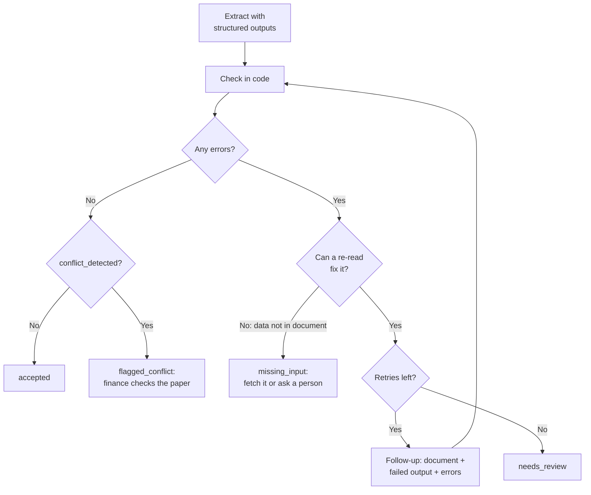

When Claude's extraction fails a validation check, send it a follow-up request with the original document, the failed output and the exact errors. That fixes most reading and format mistakes in one retry. A retry can't fix data that isn't in the document, though, and it can't fix a document that contradicts itself. So your loop has to tell those cases apart, stop after one or two tries, and record what happened. In this post you build that loop in TypeScript and test it offline with a fake client: one invoice that a retry fixes, one where retrying is pointless, and one where the invoice itself is wrong.

This is task statement 4.4 of the [Claude Certified Architect – Foundations exam guide](https://anthropic-partners.skilljar.com/claude-certified-architect-foundations-certification): "Implement validation, retry, and feedback loops for extraction quality". It is part of Domain 4, Prompt Engineering & Structured Output, which is 20% of the exam.

## What does task statement 4.4 test?

The guide lists four things to know and four skills. In plain words:

| The guide asks you to… | In practice |
| --- | --- |
| Know retry-with-error-feedback | On a retry, tell Claude exactly which check failed and why |
| Know the limits of retry | A retry can't find data that isn't in the document |
| Know feedback loop design with a `detected_pattern` field | Record which code pattern triggered each review finding, so you can count dismissals per pattern |
| Know semantic errors vs schema syntax errors | The schema stops broken JSON; your code still has to check the meaning |
| Send follow-ups with the document, the failed extraction and the errors | Give Claude everything it needs to correct itself |
| Tell when a retry will work and when it won't | Format and structure mistakes: retry. Data only in a document you didn't send: don't |
| Add `detected_pattern` to review findings | Find the false-positive patterns developers dismiss most |
| Design self-correction fields | `stated_total` next to `calculated_total`, plus a `conflict_detected` flag |

The previous post in this series, [Structured output from Claude: tool use and JSON schemas](/blog/claude-structured-output-json-schema) (task statement 4.3), built an invoice extractor with a schema and a set of meaning checks in code. Its checks ended in a `needs_review` pile. This post is about what to do with that pile. If structured output is new to you, read [What is tool calling?](/blog/what-is-tool-calling) first.

## Which errors can a retry fix?

Two words first. A **validation error** is a check in your code that the output failed, like "the line items don't add up". A **retry** is a second request for the same document.

With structured outputs or strict tool use, the API enforces your JSON schema, so broken JSON and wrong types are gone. The [structured outputs docs](https://platform.claude.com/docs/en/build-with-claude/structured-outputs) put it as "No retries needed for schema violations". What's left are **semantic errors**: the JSON is valid, but a value is wrong. The question for each one is simple: if Claude reads the same document again, with the error in front of it, can it get the value right?

| What went wrong | Example | Will a retry with feedback help? | What to do |
| --- | --- | --- | --- |
| Format mismatch | `invoice_date` is `14/09/2026`, not `2026-09-14` | Yes, usually | Retry with the error |
| Arithmetic or misread number | Claude's own sum of the line items is off by 100 | Yes, usually | Retry with the error |
| Value in the wrong field | A PO number in `invoice_number` | Often | Retry with the error |
| Data is in another document | "Terms as set out in the attached Schedule B", not sent | No | Mark as missing input; fetch Schedule B or ask a person |
| The source contradicts itself | The printed total doesn't match the line items on the paper | No | Flag the conflict for a person |
| Reply cut off | `stop_reason: "max_tokens"` | Not with feedback | Retry with a higher `max_tokens`, as the docs advise |

The two "No" rows are the ones the exam cares about. If the value isn't in the input, there is no right answer to find. A model that is told "this field is required, try again" can only return `null` again or make something up. Anthropic's [guide to reducing hallucinations](https://platform.claude.com/docs/en/test-and-evaluate/strengthen-guardrails/reduce-hallucinations) starts with the opposite advice: give Claude permission to say it doesn't know.

One more thing that is easy to mix up. The [TypeScript SDK](https://platform.claude.com/docs/en/cli-sdks-libraries/sdks/typescript#retries) already retries some requests: connection errors, 408, 409, 429 and 5xx responses, twice by default (`maxRetries`). Those are network and server failures. A reply that arrives fine but fails your checks is a success to the SDK. The validation retry loop is your code.

## What goes into a retry request?

Three things, all in one follow-up:

1. **The original document.** Claude has to read the source again. The Messages API is stateless, as the [Messages API guide](https://platform.claude.com/docs/en/build-with-claude/working-with-messages) puts it: "you always send the full conversational history to the API". If you send only the failed JSON, Claude can't check which number is right.
2. **The failed extraction.** It shows Claude what it produced, so it can see the mistake next to the error.
3. **The specific errors.** "Validation failed" tells Claude nothing. "calculated_total is 1150.00, but the line_items amounts add up to 1250.00" tells it exactly where to look.

Add one sentence that protects you from the bad kind of fix: read values from the document, not from the previous answer, and keep `null` for anything that isn't there. Without it, "fix this error" can turn into "change a number until the check passes".



You can send the follow-up as a fresh single message, or as a conversation with the failed output as an earlier assistant turn. Both carry the same three parts. This post uses one fresh message with XML tags around each part, because it is easy to read in logs and test in code.

## How many retries, and what do you log?

The exam guide doesn't give a number. One or two retries is a sensible cap: if two attempts with specific feedback don't fix an error, the problem is usually in the prompt, the schema or the document, and more calls only add cost. See [AI cost and latency](/blog/ai-cost-and-latency) for how quickly extra calls add up at volume.

After the cap, don't accept the last attempt. Send the record to review with its remaining errors.

Then log every error you found on the first try. The guide's exercise asks you to "track which errors are resolvable via retry (format mismatches) versus which are not (information absent from source)". Three outcomes cover it:

| Outcome | Meaning | What a high count tells you |
| --- | --- | --- |
| `fixed_by_retry` | The error was gone after a retry | Retries work for this error; also consider fixing the prompt so the first try gets it right |
| `not_fixed` | The error was still there after the last retry | Retrying this error wastes calls: fix the prompt or schema, or stop retrying it |
| `not_retried` | The loop didn't retry it, because a re-read can't help | Inputs are incomplete: fix the upstream process that sends documents |

Group the log by error code, and by field if you have many. It becomes your quality dashboard. It tells you which checks to retry, which to send straight to review, and which prompt rules to improve. The [evals post](/blog/test-ai-output-with-evals) shows how to turn the failing documents into a test set.

## How do self-check fields catch bad data?

The guide calls them "self-correction validation flows". You ask Claude for two versions of the same number and compare them:

- **`stated_total`**: the total exactly as printed on the invoice, even if it looks wrong.
- **`calculated_total`**: Claude's own sum of the line items.
- **`conflict_detected`**: `true` when the two differ.

Your code then adds up the line items itself and checks `calculated_total` against that sum. That second check is what tells the two kinds of failure apart:

| Code's sum vs `calculated_total` | `stated_total` vs `calculated_total` | What it means | Action |
| --- | --- | --- | --- |
| Different | Any | Claude added up wrong or misread an amount | Retry with the error |
| Equal | Equal | The invoice is consistent | Accept |
| Equal | Different, flag `true` | The invoice is wrong on paper | Flag for finance; don't retry |
| Equal | Different, flag `false` | The flag is wrong | Retry with the error |

The alternative is a schema with a single `total` field, and that hides the problem. If the paper says 381.90 and the items add up to 318.90, Claude has to choose one, and nobody sees the difference.


<Callout type="warning" title="Don't retry a real conflict away">

If you retry an invoice whose printed total is wrong on the paper, with "the line items must add up to the total" as the error, you are asking Claude to make the numbers agree. It might change a line item to do it. Your check passes, and the data is now wrong in a way no check will catch. Flag conflicts in the source; don't retry them.

</Callout>


## How does detected_pattern close the feedback loop?

The same idea works for review bots. A code review bot posts findings, and developers dismiss the ones they think are wrong. If 30% of findings are dismissed, you know there's a problem, but not where.

Add a `detected_pattern` field to each structured finding: an enum naming the code construct that triggered it, such as `swallowed_exception` or `unchecked_array_index`, with `other` and a detail field for the rest. Store each dismissal next to its finding. Now you can count dismissal rates per pattern and find the one or two patterns that cause most of the noise. Then you fix those prompt criteria and leave the rest alone. The first post in this series, [Explicit criteria in prompts: fewer false positives](/blog/prompt-explicit-criteria) (task statement 4.1), covers how to rewrite the criteria once you know which ones are noisy.

## Try it: a retry loop, tested offline

You'll build a retry loop for invoice extraction with structured outputs and Zod, then test it against a fake client that returns canned replies:

- **Northwind**: the first reply has a date in the wrong format and a sum that is off. The retry fixes both.
- **Calder**: the payment terms are in a Schedule B that wasn't sent. The loop doesn't retry.
- **Hartley**: the printed total is wrong on the invoice itself. The loop flags it and doesn't retry.
- **Stubborn**: the same bad reply every time. The loop stops at the cap.

The canned replies are **examples we wrote by hand** in the shape the API returns. They are not recorded model output. They prove the loop's logic, not Claude's accuracy.

**You need:** Node.js 22.18 or later, which runs `.ts` files directly because [type stripping is on by default](https://nodejs.org/docs/latest-v22.x/api/typescript.html). An Anthropic API key only for the last step.


<Steps>


<Step title="Create the project">

```bash
$ mkdir invoice-retry
$ cd invoice-retry
$ npm init -y
$ npm pkg set type=module
```

Install the [official TypeScript SDK](https://github.com/anthropics/anthropic-sdk-typescript) and [Zod](https://zod.dev/), then TypeScript and the Node types for type-checking:


```bash
npm install @anthropic-ai/sdk zod
```


```bash
npm install -D typescript @types/node
```


Use the same `tsconfig.json` as the earlier posts in this series:


**tsconfig.json**

```json
{
  "compilerOptions": {
    "noEmit": true,
    "target": "esnext",
    "module": "nodenext",
    "rewriteRelativeImportExtensions": true,
    "erasableSyntaxOnly": true,
    "verbatimModuleSyntax": true,
    "allowImportingTsExtensions": true,
    "strict": true
  },
  "include": ["*.ts"]
}
```


</Step>


<Step title="Define the schema with self-check fields">


**schema.ts**

```ts
import { z } from 'zod';

export const InvoiceSchema = z.object({
  vendor_name: z.string(),
  invoice_number: z.string().nullable(),
  invoice_date: z.string().nullable().describe('Issue date as YYYY-MM-DD. null if absent.'),
  payment_terms_days: z
    .number()
    .nullable()
    .describe('Days until payment is due, for example 30 for "net 30". null if this document does not state the terms.'),
  referenced_documents: z
    .array(z.string())
    .describe('Other documents this one points to for details it leaves out, such as "Schedule B". Empty if none.'),
  line_items: z.array(z.object({ description: z.string(), amount: z.number() })),
  stated_total: z.number().nullable().describe('The total exactly as printed. null if no total is printed.'),
  calculated_total: z.number().describe('Your own sum of the line item amounts.'),
  conflict_detected: z.boolean().describe('true when stated_total and calculated_total differ.'),
});
export type Invoice = z.infer<typeof InvoiceSchema>;

// Zod writes the JSON schema for the API; we drop the "$schema" header line.
const { $schema, ...invoiceJsonSchema } = z.toJSONSchema(InvoiceSchema);
export { invoiceJsonSchema };
```


Compared with the previous post's schema, three things are new:

- **`stated_total`, `calculated_total` and `conflict_detected`** replace the single `total`.
- **`payment_terms_days`** is nullable. When the document doesn't state the terms, `null` is the honest answer.
- **`referenced_documents`** lets Claude say *where* the missing data lives, for example "Schedule B". That turns "not found" into something a person can act on.

As before, `z.toJSONSchema()` turns the Zod schema into the JSON schema the API enforces.

</Step>


<Step title="Write checks that say what to fix">


**validate.ts**

```ts
import type { Invoice } from './schema.ts';

export type IssueCode = 'date_format' | 'sum_mismatch' | 'conflict_flag' | 'missing_terms';

export interface Issue {
  code: IssueCode;
  field: string;
  message: string; // written for Claude: what is wrong and what to check
  retryable: boolean; // can a second look at the same document fix it?
}

const ISO_DATE = /^\d{4}-\d{2}-\d{2}$/;
const cents = (n: number) => Math.round(n * 100);
const money = (n: number) => n.toFixed(2);

export function validate(inv: Invoice): Issue[] {
  const issues: Issue[] = [];

  if (inv.invoice_date !== null && (!ISO_DATE.test(inv.invoice_date) || Number.isNaN(Date.parse(inv.invoice_date)))) {
    issues.push({
      code: 'date_format',
      field: 'invoice_date',
      message: `invoice_date "${inv.invoice_date}" is not a valid YYYY-MM-DD date.`,
      retryable: true,
    });
  }

  // calculated_total is Claude's own sum, so code can check it exactly.
  const sum = inv.line_items.reduce((acc, item) => acc + cents(item.amount), 0);
  if (cents(inv.calculated_total) !== sum) {
    issues.push({
      code: 'sum_mismatch',
      field: 'calculated_total',
      message: `calculated_total is ${money(inv.calculated_total)}, but the line_items amounts add up to ${money(sum / 100)}. Check each line item amount against the document, then add them again.`,
      retryable: true,
    });
  }

  // The flag must match the two totals. A real difference is fine: it is the point of the flag.
  const differs = inv.stated_total !== null && cents(inv.stated_total) !== cents(inv.calculated_total);
  if (inv.conflict_detected !== differs) {
    issues.push({
      code: 'conflict_flag',
      field: 'conflict_detected',
      message: `conflict_detected is ${inv.conflict_detected}, but stated_total is ${inv.stated_total} and calculated_total is ${inv.calculated_total}.`,
      retryable: true,
    });
  }

  // Accounts payable needs terms. A null here is Claude saying "not in this document",
  // so a retry would only push it to invent a number.
  if (inv.payment_terms_days === null) {
    const where = inv.referenced_documents.length > 0 ? ` It refers to: ${inv.referenced_documents.join(', ')}.` : '';
    issues.push({
      code: 'missing_terms',
      field: 'payment_terms_days',
      message: `Payment terms are not in this document.${where}`,
      retryable: false,
    });
  }

  return issues;
}
```


Each issue has a `code` for your logs, a `message` written for Claude, and a `retryable` flag. Only the missing terms are marked `retryable: false`, because `null` there means "not in this document". Note what is *not* an issue: a real difference between `stated_total` and `calculated_total`, as long as the flag says so.

</Step>


<Step title="Build the retry loop">


**extract.ts**

```ts
import type Anthropic from '@anthropic-ai/sdk';
import { invoiceJsonSchema, InvoiceSchema, type Invoice } from './schema.ts';
import { validate, type Issue, type IssueCode } from './validate.ts';

// Anything with a messages.create() method: the real client, or a fake in tests.
export interface MessagesClient {
  messages: {
    create(params: Anthropic.MessageCreateParamsNonStreaming): Promise<Anthropic.Message>;
  };
}

export const MODEL = 'claude-opus-5-5';

const SYSTEM = `You extract data from supplier invoices for an accounts payable team.
- Copy values only from the document. If a value is not in the document, use null.
- Dates: YYYY-MM-DD.
- stated_total: the total exactly as printed, even if it looks wrong.
- calculated_total: your own sum of the line item amounts.
- conflict_detected: true when the two totals differ. Never change a number to make them match.`;

function request(content: string): Anthropic.MessageCreateParamsNonStreaming {
  return {
    model: MODEL,
    max_tokens: 16000,
    system: SYSTEM,
    messages: [{ role: 'user', content }],
    output_config: { format: { type: 'json_schema', schema: invoiceJsonSchema } },
  };
}

const wrap = (document: string) => `<document>\n${document}\n</document>`;

// The follow-up carries all three things the model needs to correct itself:
// the original document, its failed extraction, and the specific errors.
export function retryPrompt(document: string, failedJson: string, issues: Issue[]): string {
  const errors = issues.map((i) => `- ${i.field}: ${i.message}`).join('\n');
  return `${wrap(document)}

<previous_extraction>
${failedJson}
</previous_extraction>

<validation_errors>
${errors}
</validation_errors>

Your previous extraction of this document failed the checks above. Extract the
document again and fix each error. Read every value from the document, not from
the previous extraction. If a value is not in the document, keep it null: do not
invent a value to pass a check.`;
}

export type Status =
  | 'accepted' // passed every check
  | 'flagged_conflict' // passed, but the document's own totals disagree: finance looks
  | 'missing_input' // data is not in this document: fetch it or ask a person
  | 'needs_review' // fixable errors remained after the last retry
  | 'rejected'; // no usable output (cut off, refused, not JSON)

export type Outcome = 'fixed_by_retry' | 'not_fixed' | 'not_retried';
export interface QualityEvent {
  docId: string;
  code: IssueCode;
  outcome: Outcome;
}

export interface Result {
  status: Status;
  reason?: string; // why the output was rejected
  invoice: Invoice | null;
  issues: Issue[];
  calls: number;
  events: QualityEvent[];
}

function parse(message: Anthropic.Message): Invoice | string {
  // A cut-off or a refusal may not match the schema. More feedback won't fix that.
  if (message.stop_reason !== 'end_turn') return `stop_reason is ${message.stop_reason}`;
  const text = message.content.find((block) => block.type === 'text');
  if (!text) return 'no text block';
  try {
    const result = InvoiceSchema.safeParse(JSON.parse(text.text));
    return result.success ? result.data : 'does not match the schema';
  } catch {
    return 'not valid JSON';
  }
}

export async function extractWithRetry(
  client: MessagesClient,
  docId: string,
  document: string,
  maxRetries = 2,
): Promise<Result> {
  let content = wrap(document);
  let calls = 0;
  let firstIssues: Issue[] | null = null;

  while (true) {
    calls++;
    const parsed = parse(await client.messages.create(request(content)));
    if (typeof parsed === 'string') {
      return { status: 'rejected', reason: parsed, invoice: null, issues: [], calls, events: [] };
    }

    const issues = validate(parsed);
    firstIssues ??= issues;
    const fixable = issues.filter((i) => i.retryable);

    if (fixable.length > 0 && calls <= maxRetries) {
      content = retryPrompt(document, JSON.stringify(parsed), fixable);
      continue;
    }

    const status: Status =
      fixable.length > 0
        ? 'needs_review'
        : issues.length > 0
          ? 'missing_input'
          : parsed.conflict_detected
            ? 'flagged_conflict'
            : 'accepted';
    return { status, invoice: parsed, issues, calls, events: track(docId, firstIssues, issues) };
  }
}

// One event per problem found on the first try: did a retry fix it?
function track(docId: string, first: Issue[], last: Issue[]): QualityEvent[] {
  const stillThere = new Set(last.map((i) => i.code));
  return first.map((i) => ({
    docId,
    code: i.code,
    outcome: !i.retryable ? 'not_retried' : stillThere.has(i.code) ? 'not_fixed' : 'fixed_by_retry',
  }));
}
```


How it works:

- **`retryPrompt`** puts the three parts in tags: `<document>`, `<previous_extraction>` and `<validation_errors>`. It sends only the retryable errors.
- **`calls <= maxRetries`** caps the loop. With `maxRetries = 2`, a document gets at most three calls: the first try and two retries.
- **A cut-off or refused reply** ends the loop as `rejected`. Error feedback can't fix it. For a cut-off, the structured outputs docs say to retry with a higher `max_tokens`.
- **`track`** writes one quality event per error from the first try: `fixed_by_retry`, `not_fixed` or `not_retried`.
- **The status order matters:** retryable errors left mean `needs_review`; only non-retryable errors mean `missing_input`; a clean result with the flag set means `flagged_conflict`.

</Step>


<Step title="Add a fake client and test cases">

The fake client returns canned replies in order and records every request, so tests can read the follow-up prompt:


**fake.ts**

```ts
import type Anthropic from '@anthropic-ai/sdk';
import { MODEL, type MessagesClient } from './extract.ts';
import type { Invoice } from './schema.ts';

// A reply in the documented message shape, with the JSON in a text block.
// The empty thinking block mirrors Opus 5.5, whose replies can start with one.
function reply(invoice: Invoice): Anthropic.Message {
  return {
    id: 'msg_canned',
    type: 'message',
    role: 'assistant',
    model: MODEL,
    content: [
      { type: 'thinking', thinking: '', signature: 'canned' },
      { type: 'text', text: JSON.stringify(invoice), citations: null },
    ],
    stop_reason: 'end_turn',
    stop_sequence: null,
    usage: { input_tokens: 0, output_tokens: 0 },
  } as unknown as Anthropic.Message;
}

// Returns the canned invoices in order and records every request it gets.
export function fakeClient(...replies: Invoice[]) {
  const requests: Anthropic.MessageCreateParamsNonStreaming[] = [];
  const client: MessagesClient = {
    messages: {
      create: async (params) => {
        requests.push(params);
        const next = replies[Math.min(requests.length, replies.length) - 1];
        return reply(next);
      },
    },
  };
  return { client, requests };
}
```


The four documents and their canned replies:


**cases.ts**

```ts
import type { Invoice } from './schema.ts';

// Hand-written documents and replies. They are not recorded model output.

export const NORTHWIND = `NORTHWIND SOFTWARE LTD
Invoice INV-2207          Date: 14 September 2026
Team licence, 12 seats ........ EUR 960.00
Support plan .................. EUR 290.00
Total due: EUR 1,250.00        Payment terms: net 30`;

const northwindGood: Invoice = {
  vendor_name: 'Northwind Software Ltd',
  invoice_number: 'INV-2207',
  invoice_date: '2026-09-14',
  payment_terms_days: 30,
  referenced_documents: [],
  line_items: [
    { description: 'Team licence, 12 seats', amount: 960 },
    { description: 'Support plan', amount: 290 },
  ],
  stated_total: 1250,
  calculated_total: 1250,
  conflict_detected: false,
};

// First try: a date in the wrong format and a sum that is off by 100.
export const northwindBad: Invoice = {
  ...northwindGood,
  invoice_date: '14/09/2026',
  calculated_total: 1150,
  conflict_detected: true,
};
export { northwindGood };

export const CALDER = `CALDER IT SERVICES
Invoice C-3381            Date: 2026-09-21
Network audit ................ EUR 400.00
Report ....................... EUR 250.00
Total due: EUR 650.00
Payment terms: as set out in the attached Schedule B.`;

// Schedule B was not sent. The honest answer is null, every time.
export const calderReply: Invoice = {
  vendor_name: 'Calder IT Services',
  invoice_number: 'C-3381',
  invoice_date: '2026-09-21',
  payment_terms_days: null,
  referenced_documents: ['Schedule B'],
  line_items: [
    { description: 'Network audit', amount: 400 },
    { description: 'Report', amount: 250 },
  ],
  stated_total: 650,
  calculated_total: 650,
  conflict_detected: false,
};

export const HARTLEY = `HARTLEY OFFICE SUPPLY
Invoice 88213             Date: 2026-09-18
Copy paper, 10 boxes ......... USD 189.90
Toner, 2 cartridges .......... USD 129.00
Amount due: USD 381.90         Payment terms: net 15`;

// The printed total is wrong on the invoice itself (189.90 + 129.00 = 318.90).
export const hartleyReply: Invoice = {
  vendor_name: 'Hartley Office Supply',
  invoice_number: '88213',
  invoice_date: '2026-09-18',
  payment_terms_days: 15,
  referenced_documents: [],
  line_items: [
    { description: 'Copy paper, 10 boxes', amount: 189.9 },
    { description: 'Toner, 2 cartridges', amount: 129 },
  ],
  stated_total: 381.9,
  calculated_total: 318.9,
  conflict_detected: true,
};
```


</Step>


<Step title="Test the loop">


**retry.test.ts**

```ts
import assert from 'node:assert/strict';
import { test } from 'node:test';
import { CALDER, calderReply, HARTLEY, hartleyReply, NORTHWIND, northwindBad, northwindGood } from './cases.ts';
import { extractWithRetry } from './extract.ts';
import { fakeClient } from './fake.ts';

const lastUserText = (params: { messages: { content: unknown }[] }) => String(params.messages.at(-1)?.content);

test('a format error is fixed by one retry with specific feedback', async () => {
  const { client, requests } = fakeClient(northwindBad, northwindGood);
  const result = await extractWithRetry(client, 'northwind', NORTHWIND);

  assert.equal(result.status, 'accepted');
  assert.equal(result.calls, 2);

  // The follow-up holds the document, the failed extraction and each error.
  const followUp = lastUserText(requests[1]);
  assert.match(followUp, /<document>\nNORTHWIND SOFTWARE LTD/);
  assert.match(followUp, /"invoice_date":"14\/09\/2026"/);
  assert.match(followUp, /invoice_date "14\/09\/2026" is not a valid YYYY-MM-DD date/);
  assert.match(followUp, /line_items amounts add up to 1250.00/);

  assert.deepEqual(
    result.events.map((e) => `${e.code}:${e.outcome}`),
    ['date_format:fixed_by_retry', 'sum_mismatch:fixed_by_retry'],
  );
});

test('data that lives in another document is not retried', async () => {
  const { client } = fakeClient(calderReply);
  const result = await extractWithRetry(client, 'calder', CALDER);

  assert.equal(result.status, 'missing_input');
  assert.equal(result.calls, 1);
  assert.match(result.issues[0].message, /It refers to: Schedule B/);
  assert.deepEqual(result.events, [{ docId: 'calder', code: 'missing_terms', outcome: 'not_retried' }]);
});

test('a real conflict in the source is flagged, not retried or "fixed"', async () => {
  const { client } = fakeClient(hartleyReply);
  const result = await extractWithRetry(client, 'hartley', HARTLEY);

  assert.equal(result.status, 'flagged_conflict');
  assert.equal(result.calls, 1);
  assert.equal(result.invoice?.stated_total, 381.9);
  assert.equal(result.invoice?.calculated_total, 318.9);
});

test('retries stop at the cap and the record goes to review', async () => {
  const { client } = fakeClient(northwindBad); // the same bad reply every time
  const result = await extractWithRetry(client, 'stubborn', NORTHWIND, 2);

  assert.equal(result.status, 'needs_review');
  assert.equal(result.calls, 3); // the first try plus two retries
  assert.ok(result.events.every((e) => e.outcome === 'not_fixed'));
});
```


```bash
$ node --test retry.test.ts
```

```text
✔ a format error is fixed by one retry with specific feedback (5.623697ms)
✔ data that lives in another document is not retried (0.69497ms)
✔ a real conflict in the source is flagged, not retried or "fixed" (0.376787ms)
✔ retries stop at the cap and the record goes to review (0.695194ms)
ℹ tests 4
ℹ suites 0
ℹ pass 4
ℹ fail 0
ℹ cancelled 0
ℹ skipped 0
ℹ todo 0
ℹ duration_ms 276.291169
```

All four pass. The first test also checks the follow-up itself: it contains the invoice text, the failed `invoice_date` and both error messages. The second proves the point of the exam's "limits of retry": one call, no retry, and a message that names Schedule B. Your timings will differ.

</Step>


<Step title="Print the quality report">

Add the `detected_pattern` schema for review findings, and a function that counts dismissals per pattern:


**findings.ts**

```ts
import { z } from 'zod';

// One finding from the code review bot. detected_pattern names the code
// construct that triggered it, so dismissals can be counted per pattern.
export const FindingSchema = z.object({
  file: z.string(),
  line: z.number(),
  detected_pattern: z.enum([
    'unchecked_array_index',
    'swallowed_exception',
    'sql_string_concat',
    'missing_await',
    'other',
  ]),
  pattern_detail: z.string().nullable().describe('When detected_pattern is "other": the construct, in a few words.'),
  message: z.string(),
});
export type Finding = z.infer<typeof FindingSchema>;

export interface Feedback {
  finding: Finding;
  dismissed: boolean; // the developer closed it as "not a problem"
}

export function dismissalRates(feedback: Feedback[]) {
  const byPattern = new Map<string, { shown: number; dismissed: number }>();
  for (const { finding, dismissed } of feedback) {
    const row = byPattern.get(finding.detected_pattern) ?? { shown: 0, dismissed: 0 };
    row.shown++;
    if (dismissed) row.dismissed++;
    byPattern.set(finding.detected_pattern, row);
  }
  return [...byPattern]
    .map(([pattern, { shown, dismissed }]) => ({ pattern, shown, dismissed, rate: dismissed / shown }))
    .sort((a, b) => b.rate - a.rate);
}
```


Then a script that runs all four invoices, prints the follow-up for Northwind, groups the quality events by error code, and computes dismissal rates for some made-up review feedback:


**report.ts**

```ts
import { CALDER, calderReply, HARTLEY, hartleyReply, NORTHWIND, northwindBad, northwindGood } from './cases.ts';
import { extractWithRetry, type QualityEvent } from './extract.ts';
import { fakeClient } from './fake.ts';
import { dismissalRates, type Feedback, type Finding } from './findings.ts';

// 1. Four invoices through the retry loop, with canned replies.
const runs = [
  { id: 'northwind', doc: NORTHWIND, replies: [northwindBad, northwindGood] },
  { id: 'calder', doc: CALDER, replies: [calderReply] },
  { id: 'hartley', doc: HARTLEY, replies: [hartleyReply] },
  { id: 'stubborn', doc: NORTHWIND, replies: [northwindBad] },
];

const events: QualityEvent[] = [];
let followUp = '';
console.log('Invoices');
for (const run of runs) {
  const { client, requests } = fakeClient(...run.replies);
  const result = await extractWithRetry(client, run.id, run.doc);
  events.push(...result.events);
  console.log(`  ${run.id.padEnd(10)} ${result.status.padEnd(17)} calls: ${result.calls}`);
  for (const issue of result.issues) console.log(`    - ${issue.message}`);
  if (run.id === 'northwind') followUp = String(requests[1].messages[0].content);
}

console.log('\nThe follow-up request for northwind');
console.log(followUp.replace(/^/gm, '  | '));

// 2. Which errors do retries fix? Group the quality events by error code.
console.log('\nErrors on the first try, by code');
const table = new Map<string, Record<string, number>>();
for (const e of events) {
  const row = table.get(e.code) ?? { fixed_by_retry: 0, not_fixed: 0, not_retried: 0 };
  row[e.outcome]++;
  table.set(e.code, row);
}
for (const [code, row] of table) {
  console.log(`  ${code.padEnd(14)} fixed: ${row.fixed_by_retry}  not fixed: ${row.not_fixed}  not retried: ${row.not_retried}`);
}

// 3. Review findings: dismissal rate per detected_pattern (made-up feedback data).
const finding = (detected_pattern: Finding['detected_pattern']): Finding => ({
  file: 'src/app.ts',
  line: 1,
  detected_pattern,
  pattern_detail: null,
  message: '…',
});
const feedback: Feedback[] = [
  ...Array.from({ length: 10 }, (_, i) => ({ finding: finding('swallowed_exception'), dismissed: i < 7 })),
  ...Array.from({ length: 8 }, (_, i) => ({ finding: finding('unchecked_array_index'), dismissed: i < 1 })),
  ...Array.from({ length: 5 }, () => ({ finding: finding('sql_string_concat'), dismissed: false })),
];
console.log('\nReview findings, dismissal rate by detected_pattern');
for (const row of dismissalRates(feedback)) {
  console.log(`  ${row.pattern.padEnd(22)} ${row.dismissed}/${row.shown} dismissed (${Math.round(row.rate * 100)}%)`);
}
```


```bash
$ node report.ts
```

```text
Invoices
  northwind  accepted          calls: 2
  calder     missing_input     calls: 1
    - Payment terms are not in this document. It refers to: Schedule B.
  hartley    flagged_conflict  calls: 1
  stubborn   needs_review      calls: 3
    - invoice_date "14/09/2026" is not a valid YYYY-MM-DD date.
    - calculated_total is 1150.00, but the line_items amounts add up to 1250.00. Check each line item amount against the document, then add them again.

The follow-up request for northwind
  | <document>
  | NORTHWIND SOFTWARE LTD
  | Invoice INV-2207          Date: 14 September 2026
  | Team licence, 12 seats ........ EUR 960.00
  | Support plan .................. EUR 290.00
  | Total due: EUR 1,250.00        Payment terms: net 30
  | </document>
  | 
  | <previous_extraction>
  | {"vendor_name":"Northwind Software Ltd","invoice_number":"INV-2207","invoice_date":"14/09/2026","payment_terms_days":30,"referenced_documents":[],"line_items":[{"description":"Team licence, 12 seats","amount":960},{"description":"Support plan","amount":290}],"stated_total":1250,"calculated_total":1150,"conflict_detected":true}
  | </previous_extraction>
  | 
  | <validation_errors>
  | - invoice_date: invoice_date "14/09/2026" is not a valid YYYY-MM-DD date.
  | - calculated_total: calculated_total is 1150.00, but the line_items amounts add up to 1250.00. Check each line item amount against the document, then add them again.
  | </validation_errors>
  | 
  | Your previous extraction of this document failed the checks above. Extract the
  | document again and fix each error. Read every value from the document, not from
  | the previous extraction. If a value is not in the document, keep it null: do not
  | invent a value to pass a check.

Errors on the first try, by code
  date_format    fixed: 1  not fixed: 1  not retried: 0
  sum_mismatch   fixed: 1  not fixed: 1  not retried: 0
  missing_terms  fixed: 0  not fixed: 0  not retried: 1

Review findings, dismissal rate by detected_pattern
  swallowed_exception    7/10 dismissed (70%)
  unchecked_array_index  1/8 dismissed (13%)
  sql_string_concat      0/5 dismissed (0%)
```

This is our output on Node 22.22.2 with `@anthropic-ai/sdk` 0.131.0 and `zod` 4.6.5. No model was called. Read it like this:

- **northwind** needed two calls. Without the code check on `calculated_total`, its first reply would have looked like a real conflict (flag `true`, totals different) and gone to finance by mistake.
- **calder** stopped after one call as `missing_input`. The message names Schedule B, so someone knows what to fetch.
- **hartley** was flagged after one call. The invoice says 381.90; the items add up to 318.90. Both numbers are kept.
- **stubborn** stopped at three calls with its errors attached, instead of looping forever.
- **The error table** is the feedback loop: each error type is counted as fixed, not fixed or not retried. With real traffic, the `not_fixed` column tells you which checks to stop retrying.
- **The dismissal table** points at `swallowed_exception` (70% dismissed) as the pattern whose criteria need work, while `sql_string_concat` findings are all kept.

Type-check everything, including the live script in the next step:

```bash
$ npx tsc
```

`tsc` prints nothing when there are no type errors.

</Step>


<Step title="Run it with Claude">

Create an API key in the [Claude Console](https://platform.claude.com/) and set it as the `ANTHROPIC_API_KEY` environment variable. Save the Calder invoice:


**invoice.txt**

```text
CALDER IT SERVICES
Invoice C-3381            Date: 2026-09-21
Network audit ................ EUR 400.00
Report ....................... EUR 250.00
Total due: EUR 650.00
Payment terms: as set out in the attached Schedule B.
```


**run.ts**

```ts
import Anthropic from '@anthropic-ai/sdk';
import { readFileSync } from 'node:fs';
import { extractWithRetry } from './extract.ts';

// Usage: node run.ts <invoice.txt>
const file = process.argv[2];
if (!file) throw new Error('Usage: node run.ts <invoice.txt>');

const client = new Anthropic(); // reads ANTHROPIC_API_KEY from the environment
const result = await extractWithRetry(client, file, readFileSync(file, 'utf8'));
console.log(JSON.stringify(result, null, 2));
```


```bash
$ node run.ts invoice.txt
```

Expect `"status": "missing_input"` with `"calls": 1`, because Schedule B isn't there. Then follow the guide's exercise: add an invoice with a wrong printed total and check that it comes back `flagged_conflict`. Real replies will differ from the canned ones, and a real first try may well pass every check.

The model is `claude-opus-5-5`, which the [models overview](https://platform.claude.com/docs/en/about-claude/models/overview) suggests starting with.

</Step>


</Steps>


## Common traps

These are the mistakes that wrong answer options are built on.

| Trap | Why it fails | Fix |
| --- | --- | --- |
| Retrying with the same prompt and no error details | Claude doesn't know what was wrong, so it often repeats it | Send the document, the failed output and the specific errors |
| Retrying with the errors but without the document | Claude can't re-read the source to find the right value | Always include the original document |
| Retrying when the data isn't in the document | Costs calls, and pushes the model to invent a value | Mark as missing input; fetch the document or ask a person |
| No retry cap, or "retry until valid" | Cost grows without limit, and late "passes" are suspect | One or two retries, then review |
| Accepting the last attempt after the cap | The errors are still in the data | Send the record to review with its errors |
| "The schema passed, so the data is right" | A schema checks shape, not meaning | Code checks for sums, formats and field placement |
| One `total` field, or retrying until the totals match | A real error on the invoice gets hidden or "fixed" | `stated_total`, `calculated_total` and `conflict_detected` |
| Counting dismissed findings without a pattern field | You know the noise level, not its cause | `detected_pattern` on each finding, rates per pattern |

## Practice questions

These four questions are this blog's own, written for practice. They are not from the exam.

**Question 1.** A receipt extractor uses structured outputs. When the code check finds that `subtotal + tax_amount` doesn't equal `total`, the pipeline retries with only the failed JSON and the line "Validation failed, please try again." To save input tokens, it doesn't send the receipt again. Most retries return the same numbers. Which change is most likely to make the retries work?

- A. Raise the retry cap from two to five.
- B. Send the original receipt, the failed extraction and the specific error, such as "subtotal 18.40 + tax_amount 41.60 does not equal total 60.00; check whether these two values are swapped".
- C. Add `minimum` limits to `subtotal` and `tax_amount` in the schema.
- D. Ask Claude for a confidence score on each field and keep the attempt with the higher score.

**Question 2.** You log every validation failure with its error code and whether a retry fixed it. After a month, `date_format` errors are fixed by the first retry 94% of the time. `total_mismatch` errors (line items don't add up to the total) are fixed only 12% of the time. When you open the unfixed invoices, the printed total really is wrong on the paper, and some of the "fixed" ones had a line item changed to match. What should you change?

- A. Raise the retry cap for `total_mismatch` to five.
- B. Add "Make sure the line items always add up to the total" to the extraction prompt.
- C. Extract `stated_total` and `calculated_total` with a `conflict_detected` flag, check `calculated_total` against the line items in code, retry only when Claude's own sum is wrong, and send real conflicts to finance.
- D. Remove the total check, since most mismatches come from the documents.

**Question 3.** A code review bot posts structured findings with file, line, severity and message. Developers dismiss about a third of them. The team wants to fix the prompt, but nobody can say which kinds of code lead to dismissed findings. What change gives them that data?

- A. Ask developers to write a free-text reason each time they dismiss a finding.
- B. Lower the number of findings the bot may post on each pull request.
- C. Add a confidence score and hide findings below a threshold.
- D. Add a `detected_pattern` field to each finding that names the code construct that triggered it, store dismissals with their findings, and compare dismissal rates per pattern.

**Question 4.** A nightly job extracts 40,000 shipping manifests. Its retry loop reads `while (!valid) retry()`. One night a supplier changed its layout, and the job made eleven times its usual number of calls. Some records passed on the sixth or seventh attempt with a container number that appears nowhere in the manifest. Which design best prevents this?

- A. Cap retries at one or two, retry only errors a re-read can fix, and after the cap mark the record for review with its remaining errors and log the error codes.
- B. Keep the loop, and add "Do not invent values" to the retry prompt.
- C. Remove all retries and send every failed record to a person.
- D. Move the job to a larger model so fewer records fail.

## Answer key

### Question 1

**Answer: B.** A retry works when Claude has what it needs to correct itself: the source to re-read, its failed output, and an error that says exactly what's wrong. Here the receipt is missing and the error is vague. The strongest distractor is A: more retries of a request that lacks the document and the details give more of the same answer. C fails twice: numeric limits aren't supported in strict schemas, and a limit can't check a sum.

### Question 2

**Answer: C.** The log shows that `total_mismatch` mostly isn't a model error: the documents disagree with themselves. Self-check fields keep both totals and flag the conflict, while the code check on `calculated_total` still catches Claude's own arithmetic mistakes, which a retry can fix. The strongest distractor is B: it tells Claude to make the numbers agree, which is exactly how line items got changed. D throws away the check that found the problem.

### Question 3

**Answer: D.** A `detected_pattern` field turns each dismissal into a data point you can group, so you can find the patterns that cause most false positives and fix those criteria. The strongest distractor is A: reasons from developers help, but free text is inconsistent, often skipped, and hard to count. B and C cut noise without telling you where it comes from.

### Question 4

**Answer: A.** A cap limits cost when something changes upstream, retrying only fixable errors stops the loop from pushing for values that aren't there, and logging the error codes shows the layout change the next morning. The strongest distractor is B: the instruction helps a little, but an uncapped loop still keeps asking until something passes, and the cost is still unlimited. C throws away the cheap fix for errors a retry would solve.

## What should I do next?

- **Use your own documents.** Run `run.ts` on ten real invoices with your key, include one that refers to a document you didn't send, and watch which errors your log puts in each column.
- **Read the earlier posts in this series.** [Explicit criteria in prompts: fewer false positives](/blog/prompt-explicit-criteria) (task statement 4.1), [Few-shot prompting: consistent output from Claude](/blog/few-shot-prompting-claude) (task statement 4.2) and [Structured output from Claude: tool use and JSON schemas](/blog/claude-structured-output-json-schema) (task statement 4.3) build the extractor this post checks.
- **Move on to task statement 4.5**, "Design efficient batch processing strategies". The next post in this series covers the Message Batches API: when its lower price is worth the wait, and how to resubmit only the failed documents.
- **Turn failures into tests.** [How to test AI output with evals](/blog/test-ai-output-with-evals) shows how to keep failed documents as a test set, and [How to test, deploy and use your AI agent](/blog/test-deploy-ai-agent) covers monitoring in production.
- **Plan and check your prep.** Follow the [six-week study plan](/blog/claude-architect-exam-study-plan), and test yourself with the [mock exam](/blog/claude-certification-mock-exam) once you've worked through Domain 4.
