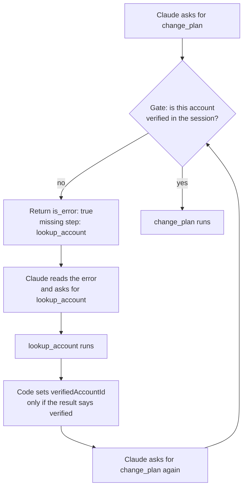

Some rules must hold every time: verify the customer before you change their account, and get an approved ticket before you deploy. A sentence in the system prompt makes the model follow such a rule most of the time, but not every time. So you put the rule in code, as a gate that blocks the tool call until the required step is done. In this post you build that gate around an agent loop in TypeScript, add a structured handoff to a human, and test both without an API key.

This is task statement 1.4 of the [Claude Certified Architect – Foundations exam guide](https://anthropic-partners.skilljar.com/claude-certified-architect-foundations-certification): "Implement multi-step workflows with enforcement and handoff patterns". It sits in Domain 1, Agentic Architecture & Orchestration, which is 27% of the exam.

## What does task statement 1.4 test?

The guide lists three things to know and three skills. In plain words:

| The guide asks you to… | In practice |
| --- | --- |
| Know programmatic enforcement vs prompt guidance | Code that blocks a step (a gate or a hook) versus a sentence in the system prompt |
| Know that prompts have a non-zero failure rate | When a rule must always hold, such as identity checks before money moves, a prompt alone isn't enough |
| Know structured handoff protocols | When the agent escalates, it sends customer details, the root cause and a recommended action |
| Block downstream tools until a prerequisite is done | Your code refuses `process_refund` (or `change_plan`) until `get_customer` has returned a verified ID |
| Split multi-concern requests | List each concern, work on them together with shared context, then answer them all in one reply |
| Write handoff summaries for humans | Customer ID, root cause, amount and next action, for a person who can't read the transcript |

This post builds on part 1 of this series, [Agentic loops: stop_reason, tool results and when to stop](/blog/claude-agentic-loops), which built the loop. Parts 2 and 3 covered coordinators and subagents. Here the loop stays simple and the new code sits in one place: between Claude's tool call and your tool. If tool calling is new to you, read [What is tool calling?](/blog/what-is-tool-calling) first.

## Why isn't a rule in the system prompt enough?

A [large language model](/blog/what-is-an-llm) picks each next word by probability. A clear instruction makes the right behaviour very likely, but not certain. The exam guide says it directly: when you need "deterministic compliance", "prompt instructions alone have a non-zero failure rate". If a support agent handles 10,000 conversations a day, a rule that holds 99.9% of the time still fails about 10 times a day.

Think of a sign on a door that says "Staff only" and a door with a lock. Most people obey the sign. The lock works on everyone. Writing the sign in capital letters, or adding three examples of people obeying it, makes it a better sign. It is still a sign.

Claude Code's [hooks guide](https://code.claude.com/docs/en/hooks-guide) describes the same split: hooks give "deterministic control" so that "certain actions always happen rather than relying on the LLM to choose to run them."

So sort your rules by what a miss costs:

| Rule | A miss means… | Where it goes |
| --- | --- | --- |
| Verify identity before changing an account or moving money | Wrong person's account changed; fraud | Code: a gate |
| Get a confirmed data export before closing an account | Data lost for good | Code: a gate |
| Get the person's confirmation before an irreversible action | An action nobody agreed to | Code: a gate that checks a flag your app sets |
| Use a friendly, professional tone | A slightly off reply | Prompt |
| Suggest a help article when one fits | A missed chance to help | Prompt |

The prompt still matters. It tells Claude the right order, so the gate rarely has to fire. The gate is there for the times it does.

## How does a gate work?

A gate is a small check in your **dispatch layer**: the code that receives Claude's `tool_use` blocks and runs the matching tool. Before it runs a sensitive tool, it checks a fact that only your code can set. If the fact isn't there, the tool doesn't run, and Claude gets an error result instead.



Four rules make a gate trustworthy:

- **Only code sets the flag.** The session flag is set from the real result of `lookup_account`, never from what Claude writes. If Claude says "the customer is verified", that changes nothing.
- **Block before, don't audit after.** A nightly report of unverified changes finds the problem after the damage is done. A detected violation is still a violation.
- **Return an error Claude can act on.** The [handle tool calls](https://platform.claude.com/docs/en/agents-and-tools/tool-use/handle-tool-calls) docs say to send failures back with `is_error: true` and to "write instructive error messages": say what went wrong and what Claude should try next. A bare "denied" leaves Claude guessing.
- **Never gate the way out.** `escalate_to_human` has no gate. Even an unverified customer must be able to reach a person.


<Callout type="warning" title="A gate is only as strong as its state">

Keep the facts a gate checks (verified IDs, approvals, confirmations) in your session state, written only by your code. If the gate reads a field from the tool input that Claude fills in, such as `verified: true`, Claude can unlock its own gate by mistake, and so can a prompt injection.

</Callout>


### What about confirming irreversible actions?

Confirmation is a gate too. The prerequisite is "the person said yes", and that fact must come from your app, not from the model. Show the exact action in your UI ("Close account acct_1001 and delete its data?"), record the answer in session state, and let the gate check that record. A model that writes "the user confirmed" is not a confirmation.

The Claude Agent SDK has this built in: when a tool call isn't already approved by a permission rule or mode, its [`canUseTool` callback](https://code.claude.com/docs/en/agent-sdk/user-input) pauses the agent until your callback returns allow or deny, so your app can ask the user first. On a deny, "Claude sees this message and may adjust its approach."

## How should an agent handle a message with several concerns?

Customers often put everything in one message: "I was charged twice, I want a cheaper plan, and I can't log in." The guide expects the agent to:

1. **Split the message** into separate items, one per concern.
2. **Work on them with shared context.** One account lookup serves all three items. Independent steps can run in the same turn: Claude can call several tools in one response, which the [parallel tool use](https://platform.claude.com/docs/en/agents-and-tools/tool-use/parallel-tool-use) docs describe.
3. **Answer once.** One reply covers every item: what was done, what a human will do, and what the customer should do.

Handling only the first concern, or asking the customer to send each issue separately, are both wrong answers on the exam.

Parallel calls change one thing for gates. The parallel tool use docs say tools with "side effects, shared state, or ordering requirements might be better run sequentially". There is a subtler problem too: if Claude asks for `lookup_account` and `change_plan` in the same turn, it chose the account ID before it saw the lookup result. The gate in this post therefore checks the state from before the turn. A prerequisite counts only after Claude has seen its result.

## What goes into a handoff to a human?

When the agent escalates, the human usually can't read the conversation. The handoff is all they get. "Customer needs help with billing" forces them to start over and ask the customer everything again.

A good handoff answers every question the human would ask:

| Field | Why the human needs it | Who fills it |
| --- | --- | --- |
| Account ID and verified yes/no | To open the right account and know if identity is confirmed | Your code, from the session |
| Every issue, with status | To see the whole case, including what's already solved | Claude |
| Root cause, with evidence | To act without investigating again: charge IDs, dates, amounts | Claude |
| Amount involved | To check limits and approve refunds quickly | Claude |
| Actions already taken | So nothing is done twice | Your code, from a log of tool calls that ran |
| Recommended next action | One clear step to take | Claude |

The split in the last column matters. Claude is good at the analysis: what went wrong and what to do. Your code is the reliable source for facts: who was verified and which tools really ran. A handoff that mixes both gives the human a summary they can trust.

Make `escalate_to_human` a tool with a strict schema. With [`strict: true`](https://platform.claude.com/docs/en/agents-and-tools/tool-use/strict-tool-use), Claude's tool input always matches your JSON Schema, so a required field like `root_cause` can't be missing.

## When should the agent escalate in the middle of a task?

Escalation is not only for the end of a conversation. The exam guide's task statement 5.2 names three triggers: the customer asks for a person, a policy exception or gap, and the agent can't make meaningful progress. Add one more for agents with limited tools:

- **The customer asks for a person.** Do it; don't argue.
- **A policy doesn't cover the case.** Don't let the agent guess.
- **The agent isn't making progress.** For example, it keeps hitting the same gate. Your code can count that and escalate on its own.
- **The fix is outside the agent's authority.** In this post the agent has no refund tool, so a duplicate charge must go to a human.

In the build below, the authority rule is in the prompt and the "no progress" trigger is in code. The "context management and reliability" series covers task statement 5.2 and escalation criteria in depth.

## Try it: add a gate and a handoff to an agent loop

You'll build a billing support agent with three tools: `lookup_account`, `change_plan` and `escalate_to_human`. The data is canned, so nothing touches a real billing system. Then you'll test it against a fake client that plays back replies in the documented Messages API shape.

**You need:** Node.js 22.18 or later, which runs `.ts` files directly because [type stripping is on by default](https://nodejs.org/docs/latest-v22.x/api/typescript.html). An Anthropic API key only for the last step.


<Steps>


<Step title="Create the project">

```bash
$ mkdir gated-agent
$ cd gated-agent
$ npm init -y
$ npm pkg set type=module
```

Install the [official TypeScript SDK](https://github.com/anthropics/anthropic-sdk-typescript), then TypeScript and the Node types for type-checking:


```bash
npm install @anthropic-ai/sdk
```


```bash
npm install -D typescript @types/node
```


Add the same `tsconfig.json` as in part 1:


**tsconfig.json**

```json
{
  "compilerOptions": {
    "noEmit": true,
    "target": "esnext",
    "module": "nodenext",
    "rewriteRelativeImportExtensions": true,
    "erasableSyntaxOnly": true,
    "verbatimModuleSyntax": true,
    "allowImportingTsExtensions": true,
    "strict": true
  }
}
```


</Step>


<Step title="Define the three tools">


**tools.ts**

```ts
import type Anthropic from '@anthropic-ai/sdk';

// What Claude sees. strict: true makes Claude's inputs match each schema exactly.
export const tools: Anthropic.Tool[] = [
  {
    name: 'lookup_account',
    description:
      "Find and verify a customer's account. Needs the account email and the last 4 digits of the card on file. " +
      'Returns verified: true with the account ID, plan, recent charges and login status, or verified: false. ' +
      'Call this before any change to an account.',
    strict: true,
    input_schema: {
      type: 'object',
      properties: {
        email: { type: 'string', description: 'The email on the account' },
        card_last4: { type: 'string', description: 'Last 4 digits of the card on file, e.g. "4242"' },
      },
      required: ['email', 'card_last4'],
      additionalProperties: false,
    },
  },
  {
    name: 'change_plan',
    description:
      "Move a verified account to another plan. Only works after lookup_account has verified this account ID.",
    strict: true,
    input_schema: {
      type: 'object',
      properties: {
        account_id: { type: 'string', description: 'The account_id returned by lookup_account' },
        new_plan: { type: 'string', enum: ['basic', 'pro', 'team'] },
      },
      required: ['account_id', 'new_plan'],
      additionalProperties: false,
    },
  },
  {
    name: 'escalate_to_human',
    description:
      'Hand the case to a human support agent, who cannot read this conversation. Use it for refunds, ' +
      'anything you cannot fix with your tools, or when the customer asks for a person. ' +
      'Fill every field so the human can act without asking the customer again.',
    strict: true,
    input_schema: {
      type: 'object',
      properties: {
        account_id: { type: 'string', description: 'The verified account ID, or "unverified"' },
        issues: {
          type: 'array',
          description: 'Every concern the customer raised, including the ones you already solved',
          items: {
            type: 'object',
            properties: {
              summary: { type: 'string' },
              status: { type: 'string', enum: ['resolved', 'needs_human'] },
            },
            required: ['summary', 'status'],
            additionalProperties: false,
          },
        },
        root_cause: { type: 'string', description: 'What you found, with the evidence (IDs, dates, amounts)' },
        amount_usd: { type: 'number', description: 'Money involved, in US dollars; 0 if none' },
        recommended_action: { type: 'string', description: 'The exact next step for the human' },
      },
      required: ['account_id', 'issues', 'root_cause', 'amount_usd', 'recommended_action'],
      additionalProperties: false,
    },
  },
];

// Canned data, so the example needs no real billing system.
export interface Account {
  account_id: string;
  email: string;
  card_last4: string;
  plan: string;
  charges: { id: string; date: string; amount_usd: number; description: string }[];
  login: { locked: boolean; reason: string | null };
}

export const ACCOUNTS: Account[] = [
  {
    account_id: 'acct_1001',
    email: 'ana@example.com',
    card_last4: '4242',
    plan: 'pro',
    charges: [
      { id: 'ch_501', date: '2026-09-01', amount_usd: 29, description: 'Pro plan, September' },
      { id: 'ch_502', date: '2026-09-01', amount_usd: 29, description: 'Pro plan, September' },
    ],
    login: { locked: true, reason: '5 failed sign-in attempts' },
  },
];

export function lookupAccount(email: string, cardLast4: string) {
  const account = ACCOUNTS.find((a) => a.email === email.toLowerCase().trim());
  if (!account || account.card_last4 !== cardLast4) {
    // Same answer for "no such email" and "wrong digits", so the tool can't be used to probe emails.
    return { verified: false as const, message: 'No account matches that email and card. Ask the customer to check both.' };
  }
  const { card_last4: _hidden, ...safe } = account;
  return { verified: true as const, ...safe };
}

export function changePlan(accountId: string, newPlan: string) {
  const account = ACCOUNTS.find((a) => a.account_id === accountId);
  if (!account) throw new Error(`Unknown account_id: ${accountId}`);
  const oldPlan = account.plan;
  account.plan = newPlan;
  return { account_id: accountId, old_plan: oldPlan, new_plan: newPlan, effective: 'next billing date' };
}
```


Every tool uses `strict: true`, which needs `additionalProperties: false` on each object in the schema. The `change_plan` description mentions verification, which helps Claude get the order right, but the description is guidance, not enforcement. `lookup_account` gives the same answer for an unknown email and wrong card digits, so the tool can't be used to check which emails have accounts.

</Step>


<Step title="Build the handoff">


**handoff.ts**

```ts
import { randomUUID } from 'node:crypto';
import type { SessionState } from './dispatch.ts';

// What Claude writes in the escalate_to_human call (its analysis).
export interface HandoffInput {
  account_id: string;
  issues: { summary: string; status: 'resolved' | 'needs_human' }[];
  root_cause: string;
  amount_usd: number;
  recommended_action: string;
}

// What the human receives: Claude's analysis plus facts only your code can vouch for.
export interface Handoff extends HandoffInput {
  ticket_id: string;
  created_at: string;
  account_verified: boolean;
  actions_taken: string[];
  trigger: 'agent' | 'repeated_gate_block';
}

export function buildHandoff(
  input: HandoffInput,
  state: Readonly<SessionState>,
  trigger: Handoff['trigger'] = 'agent',
): Handoff {
  return {
    ticket_id: `HO-${randomUUID().slice(0, 8)}`,
    created_at: new Date().toISOString(),
    // Trust the session, not the model, for identity and history.
    account_id: state.verifiedAccountId ?? 'unverified',
    account_verified: state.verifiedAccountId !== null,
    actions_taken: [...state.actionsTaken],
    issues: input.issues,
    root_cause: input.root_cause,
    amount_usd: input.amount_usd,
    recommended_action: input.recommended_action,
    trigger,
  };
}

// The ticket text a human reads. Everything needed to act, no transcript required.
export function formatHandoff(h: Handoff): string {
  return [
    `Ticket ${h.ticket_id} (${h.trigger === 'agent' ? 'escalated by the agent' : 'escalated by a code rule'})`,
    `Account: ${h.account_id} (${h.account_verified ? 'identity verified' : 'NOT verified'})`,
    'Issues:',
    ...h.issues.map((issue) => `  - [${issue.status}] ${issue.summary}`),
    `Root cause: ${h.root_cause}`,
    `Amount: $${h.amount_usd.toFixed(2)}`,
    'Already done:',
    ...(h.actions_taken.length ? h.actions_taken.map((a) => `  - ${a}`) : ['  - nothing']),
    `Recommended action: ${h.recommended_action}`,
  ].join('\n');
}
```


`buildHandoff` merges Claude's analysis (issues, root cause, amount, next step) with facts from the session: the account ID and verified flag, and the list of actions that really ran. Even if Claude puts the wrong `account_id` in the tool call, the human sees the one your code verified. `formatHandoff` turns it into ticket text a person can read in ten seconds.

</Step>


<Step title="Add the gate to the dispatch layer">


**dispatch.ts**

```ts
import type Anthropic from '@anthropic-ai/sdk';
import { changePlan, lookupAccount } from './tools.ts';
import { buildHandoff, type Handoff, type HandoffInput } from './handoff.ts';

// Facts your code knows for sure. Only code writes them, never the model.
export interface SessionState {
  verifiedAccountId: string | null;
  actionsTaken: string[]; // what really ran, in order
  gateBlocks: number;
  handoff: Handoff | null;
}

export const newSession = (): SessionState => ({
  verifiedAccountId: null,
  actionsTaken: [],
  gateBlocks: 0,
  handoff: null,
});

// What Claude gets back when a gate says no: what's missing, and what to do next.
export interface GateError {
  error: 'prerequisite_missing' | 'account_mismatch';
  blocked_tool: string;
  required_step: string;
  message: string;
}

type Input = Record<string, unknown>;
type Gate = (input: Input, state: Readonly<SessionState>) => GateError | null;

// One entry per sensitive tool. Tools without a gate (like escalate_to_human) always run.
const GATES: Record<string, Gate> = {
  change_plan: (input, state) => {
    if (state.verifiedAccountId === null) {
      return {
        error: 'prerequisite_missing',
        blocked_tool: 'change_plan',
        required_step: 'lookup_account',
        message:
          'The account is not verified, so the plan was NOT changed. Ask the customer for their account email ' +
          'and the last 4 digits of their card, call lookup_account, then call change_plan again.',
      };
    }
    if (input.account_id !== state.verifiedAccountId) {
      return {
        error: 'account_mismatch',
        blocked_tool: 'change_plan',
        required_step: 'lookup_account',
        message: `Only the verified account (${state.verifiedAccountId}) can be changed in this session. Nothing was changed.`,
      };
    }
    return null;
  },
};

// Runs AFTER the gate passed. Updates state only from real tool results.
function execute(name: string, input: Input, state: SessionState): unknown {
  switch (name) {
    case 'lookup_account': {
      const result = lookupAccount(String(input.email), String(input.card_last4));
      if (result.verified) state.verifiedAccountId = result.account_id; // the only place the flag is set
      state.actionsTaken.push(`lookup_account: ${result.verified ? `verified ${result.account_id}` : 'not verified'}`);
      return result;
    }
    case 'change_plan': {
      const result = changePlan(String(input.account_id), String(input.new_plan));
      state.actionsTaken.push(`change_plan: ${result.old_plan} -> ${result.new_plan}`);
      return result;
    }
    case 'escalate_to_human': {
      state.handoff = buildHandoff(input as unknown as HandoffInput, state);
      state.actionsTaken.push(`escalate_to_human: ${state.handoff.ticket_id}`);
      return { ticket_id: state.handoff.ticket_id, status: 'queued for a human agent' };
    }
    default:
      throw new Error(`Unknown tool: ${name}`);
  }
}

// The dispatch layer: every tool call Claude makes goes through here.
export function dispatch(
  toolUses: Anthropic.ToolUseBlock[],
  state: SessionState,
): Anthropic.ToolResultBlockParam[] {
  // Gates see the state from BEFORE this turn: a prerequisite counts only after Claude has seen its result.
  const before: Readonly<SessionState> = structuredClone(state);

  return toolUses.map((toolUse) => {
    const input = toolUse.input as Input;
    const blocked = GATES[toolUse.name]?.(input, before) ?? null;
    if (blocked) {
      state.gateBlocks++;
      return { type: 'tool_result', tool_use_id: toolUse.id, content: JSON.stringify(blocked), is_error: true };
    }
    try {
      const output = execute(toolUse.name, input, state);
      return { type: 'tool_result', tool_use_id: toolUse.id, content: JSON.stringify(output) };
    } catch (error) {
      return { type: 'tool_result', tool_use_id: toolUse.id, content: (error as Error).message, is_error: true };
    }
  });
}
```


How it works:

- **`SessionState`** holds the facts. `verifiedAccountId` is set in exactly one place: when `lookup_account` returns `verified: true`.
- **`GATES`** maps a tool name to a check. `change_plan` needs a verified account, and only that account. Adding a gate for another tool is one more entry.
- **The blocked result** is JSON with the missing step and a plain instruction, sent with `is_error: true`. The tool never runs, and `gateBlocks` counts the block.
- **`before`** is a copy of the state from the start of the turn, so a lookup and a change in the same turn don't unlock each other.
- **Tools run one by one, in order**, because they share state.

</Step>


<Step title="Wrap the loop around it">


**workflow.ts**

```ts
import type Anthropic from '@anthropic-ai/sdk';
import { tools } from './tools.ts';
import { dispatch, newSession, type SessionState } from './dispatch.ts';
import { buildHandoff, type Handoff } from './handoff.ts';

const MODEL = 'claude-opus-5-5';
const MAX_TURNS = 20; // safety cap from part 1
const MAX_GATE_BLOCKS = 3; // escalation trigger: the agent keeps hitting a gate

// Guidance for judgment calls. The must-hold rule (verify first) lives in dispatch.ts, not here.
export const SYSTEM_PROMPT = `You are a billing support agent for an online service.
- A message can hold several concerns. First list each one. Work on all of them, calling independent tools in the same turn.
- Verify the account with lookup_account before changing anything.
- You cannot issue refunds. For a wrong or duplicate charge, find the evidence, then use escalate_to_human.
- If a tool returns an error, read it and take the step it asks for.
- End with ONE reply that answers every concern: what you did, what a human will do, and what the customer should do.
- Be friendly and brief.`;

export interface MessagesClient {
  messages: {
    create(params: Anthropic.MessageCreateParamsNonStreaming): Promise<Anthropic.Message>;
  };
}

export interface WorkflowResult {
  status: 'answered' | 'escalated_by_code';
  text: string;
  state: SessionState;
  handoff: Handoff | null;
}

export async function runWorkflow(client: MessagesClient, customerMessage: string): Promise<WorkflowResult> {
  const state = newSession();
  const messages: Anthropic.MessageParam[] = [{ role: 'user', content: customerMessage }];

  for (let turn = 1; turn <= MAX_TURNS; turn++) {
    const response = await client.messages.create({
      model: MODEL,
      max_tokens: 4096,
      system: SYSTEM_PROMPT,
      tools,
      messages,
    });
    messages.push({ role: 'assistant', content: response.content });

    if (response.stop_reason === 'tool_use') {
      const toolUses = response.content.filter(
        (block): block is Anthropic.ToolUseBlock => block.type === 'tool_use',
      );
      messages.push({ role: 'user', content: dispatch(toolUses, state) });

      // Mid-workflow escalation decided by code: stop instead of letting the agent go round in circles.
      if (state.gateBlocks >= MAX_GATE_BLOCKS && state.handoff === null) {
        state.handoff = buildHandoff(
          {
            account_id: state.verifiedAccountId ?? 'unverified',
            issues: [{ summary: `Customer message: ${customerMessage}`, status: 'needs_human' }],
            root_cause: `The agent was blocked ${state.gateBlocks} times by a required step it did not complete.`,
            amount_usd: 0,
            recommended_action: 'Verify the customer by phone, then handle the request by hand.',
          },
          state,
          'repeated_gate_block',
        );
        return {
          status: 'escalated_by_code',
          text: `I've passed your request to a member of our team (ticket ${state.handoff.ticket_id}). They'll contact you soon.`,
          state,
          handoff: state.handoff,
        };
      }
      continue;
    }

    if (response.stop_reason === 'end_turn') {
      const text = response.content
        .filter((block): block is Anthropic.TextBlock => block.type === 'text')
        .map((block) => block.text)
        .join('\n');
      return { status: 'answered', text, state, handoff: state.handoff };
    }

    // Part 1 handles every stop reason; here anything else is an error.
    throw new Error(`Workflow stopped with stop_reason: ${response.stop_reason}`);
  }

  throw new Error(`Safety cap: no end_turn after ${MAX_TURNS} turns`);
}
```


This is the loop from part 1 with three changes: a system prompt, `dispatch` in place of the plain tool runner, and an escalation trigger. If the agent hits gates three times, your code writes the handoff itself and stops, instead of letting the agent go round in circles. The system prompt still says to verify first and to answer every concern. That is the guidance; `dispatch.ts` is the guarantee. The stop-reason handling is shortened here; part 1 covers every case.

</Step>


<Step title="Test it without an API key">

The fake client plays back scripted replies. In the first test, the "model" skips verification on purpose, the way a real model sometimes does.


**workflow.test.ts**

```ts
import assert from 'node:assert/strict';
import { test } from 'node:test';
import type Anthropic from '@anthropic-ai/sdk';
import { runWorkflow, type MessagesClient } from './workflow.ts';
import { formatHandoff } from './handoff.ts';

// Build replies in the shape the Messages API returns (as in part 1).
const reply = (stop_reason: Anthropic.StopReason, content: Anthropic.ContentBlock[]): Anthropic.Message => ({
  id: 'msg_test',
  type: 'message',
  role: 'assistant',
  model: 'claude-opus-5-5',
  content,
  stop_reason,
  stop_sequence: null,
  stop_details: null,
  container: null,
  diagnostics: null,
  usage: {
    input_tokens: 0,
    output_tokens: 0,
    cache_creation: null,
    cache_creation_input_tokens: null,
    cache_read_input_tokens: null,
    inference_geo: null,
    output_tokens_details: null,
    server_tool_use: null,
    service_tier: null,
  },
});
const text = (t: string): Anthropic.TextBlock => ({ type: 'text', text: t, citations: null });
const toolUse = (id: string, name: string, input: object): Anthropic.ToolUseBlock => ({
  type: 'tool_use',
  id,
  name,
  input,
  caller: { type: 'direct' },
});

// Plays back scripted replies and records every request.
function fakeClient(replies: Anthropic.Message[]) {
  const requests: Anthropic.MessageCreateParamsNonStreaming[] = [];
  const client: MessagesClient = {
    messages: {
      create: async (params) => {
        requests.push(structuredClone(params));
        const next = replies.shift();
        if (!next) throw new Error('No more scripted replies');
        return next;
      },
    },
  };
  return { client, requests };
}

// The tool_result blocks our code sent back in a given request.
const resultsIn = (request: Anthropic.MessageCreateParamsNonStreaming) =>
  request.messages.at(-1)!.content as Anthropic.ToolResultBlockParam[];

const CUSTOMER =
  "I was charged twice for September, I want to move to the basic plan, and I can't log in. " +
  'My email is ana@example.com, card ending 4242.';

test('three concerns: the gate blocks, the agent verifies, then fixes and escalates', async () => {
  const { client, requests } = fakeClient([
    // Turn 1: the model skips verification (the prompt said not to; it happens).
    reply('tool_use', [
      text('Three concerns: a double charge, a plan change, a login problem.'),
      toolUse('toolu_01', 'change_plan', { account_id: 'acct_1001', new_plan: 'basic' }),
    ]),
    // Turn 2: it reads the structured error and takes the missing step.
    reply('tool_use', [toolUse('toolu_02', 'lookup_account', { email: 'ana@example.com', card_last4: '4242' })]),
    // Turn 3: two independent actions in one turn.
    reply('tool_use', [
      toolUse('toolu_03', 'change_plan', { account_id: 'acct_1001', new_plan: 'basic' }),
      toolUse('toolu_04', 'escalate_to_human', {
        account_id: 'acct_1001',
        issues: [
          { summary: 'Charged twice for September', status: 'needs_human' },
          { summary: 'Move from pro to basic', status: 'resolved' },
          { summary: 'Cannot log in: locked after 5 failed sign-ins', status: 'resolved' },
        ],
        root_cause: 'Duplicate charge: ch_501 and ch_502, both $29 on 2026-09-01 for the same September Pro plan.',
        amount_usd: 29,
        recommended_action: 'Refund ch_502 ($29) to the card ending 4242 and confirm by email.',
      }),
    ]),
    reply('end_turn', [
      text(
        'Done: you are on the basic plan from your next billing date. Double charge: a colleague will refund ' +
          'the extra $29. Login: your account is locked after 5 failed sign-ins; use "Forgot password" to unlock it.',
      ),
    ]),
  ]);

  const result = await runWorkflow(client, CUSTOMER);

  // Turn 1 was blocked with an error Claude can act on, and nothing changed.
  const [blocked] = resultsIn(requests[1]);
  assert.equal(blocked.is_error, true);
  assert.deepEqual(JSON.parse(String(blocked.content)), {
    error: 'prerequisite_missing',
    blocked_tool: 'change_plan',
    required_step: 'lookup_account',
    message:
      'The account is not verified, so the plan was NOT changed. Ask the customer for their account email ' +
      'and the last 4 digits of their card, call lookup_account, then call change_plan again.',
  });

  // After verification, both turn-3 calls ran.
  assert.deepEqual(
    resultsIn(requests[3]).map((r) => r.is_error ?? false),
    [false, false],
  );
  assert.equal(result.status, 'answered');
  assert.deepEqual(result.state.actionsTaken.slice(0, 2), ['lookup_account: verified acct_1001', 'change_plan: pro -> basic']);

  // The handoff covers all three concerns, with facts from the session.
  const handoff = result.handoff!;
  assert.equal(handoff.account_verified, true);
  assert.equal(handoff.issues.length, 3);
  assert.equal(handoff.amount_usd, 29);
  console.log(formatHandoff(handoff));
});

test('a failed verification never unlocks the gate', async () => {
  const { client, requests } = fakeClient([
    reply('tool_use', [toolUse('toolu_01', 'lookup_account', { email: 'ana@example.com', card_last4: '0000' })]),
    reply('tool_use', [toolUse('toolu_02', 'change_plan', { account_id: 'acct_1001', new_plan: 'team' })]),
    reply('end_turn', [text('I could not verify your account. Please check your email and card digits.')]),
  ]);

  const result = await runWorkflow(client, 'Move me to the team plan. ana@example.com, card 0000.');

  assert.equal(result.state.verifiedAccountId, null);
  const [blocked] = resultsIn(requests[2]);
  assert.equal(JSON.parse(String(blocked.content)).error, 'prerequisite_missing');
});

test('a prerequisite in the same turn does not count yet', async () => {
  const { client, requests } = fakeClient([
    // Both in one turn: the model guessed the account ID before seeing the lookup result.
    reply('tool_use', [
      toolUse('toolu_01', 'lookup_account', { email: 'ana@example.com', card_last4: '4242' }),
      toolUse('toolu_02', 'change_plan', { account_id: 'acct_1001', new_plan: 'team' }),
    ]),
    reply('end_turn', [text('Your account is verified. Shall I move you to the team plan now?')]),
  ]);

  await runWorkflow(client, 'Move me to the team plan. ana@example.com, card 4242.');

  const [lookup, change] = resultsIn(requests[1]);
  assert.equal(lookup.is_error, undefined);
  assert.equal(change.is_error, true);
});

test('repeated gate blocks trigger an escalation from code', async () => {
  const tryChange = (id: string) =>
    reply('tool_use', [toolUse(id, 'change_plan', { account_id: 'acct_1001', new_plan: 'team' })]);
  const { client, requests } = fakeClient([tryChange('toolu_01'), tryChange('toolu_02'), tryChange('toolu_03')]);

  const result = await runWorkflow(client, 'Just switch me to team, I am in a hurry.');

  assert.equal(result.status, 'escalated_by_code');
  assert.equal(requests.length, 3); // no 4th model call
  assert.equal(result.handoff?.trigger, 'repeated_gate_block');
  assert.equal(result.handoff?.account_verified, false);
});
```


```bash
$ node --test --test-reporter=spec workflow.test.ts
```

```text
Ticket HO-5e789bc2 (escalated by the agent)
Account: acct_1001 (identity verified)
Issues:
  - [needs_human] Charged twice for September
  - [resolved] Move from pro to basic
  - [resolved] Cannot log in: locked after 5 failed sign-ins
Root cause: Duplicate charge: ch_501 and ch_502, both $29 on 2026-09-01 for the same September Pro plan.
Amount: $29.00
Already done:
  - lookup_account: verified acct_1001
  - change_plan: pro -> basic
Recommended action: Refund ch_502 ($29) to the card ending 4242 and confirm by email.
✔ three concerns: the gate blocks, the agent verifies, then fixes and escalates
✔ a failed verification never unlocks the gate
✔ a prerequisite in the same turn does not count yet
✔ repeated gate blocks trigger an escalation from code
ℹ tests 4
ℹ suites 0
ℹ pass 4
ℹ fail 0
ℹ cancelled 0
ℹ skipped 0
ℹ todo 0
ℹ duration_ms 154.301683
```

This is our output on Node 22.22.2 with `@anthropic-ai/sdk` 0.131.0, with per-test timings removed. Your ticket ID will differ. No model was called: the replies are scripted, but the gate, the state, the handoff and the escalation trigger are the real code. The four tests prove what a prompt can't:

- a `change_plan` call before verification is blocked, and Claude gets an error that names the missing step;
- a failed verification never unlocks the gate;
- a lookup in the same turn doesn't count yet;
- repeated blocks end in a handoff written by code, with no further model calls.

Then type-check everything:

```bash
$ npx tsc
```

No output means no type errors.

</Step>


<Step title="Run it with Claude">

Create an API key in the [Claude Console](https://platform.claude.com/) and set it as the `ANTHROPIC_API_KEY` environment variable. The SDK reads it from there.


**main.ts**

```ts
import Anthropic from '@anthropic-ai/sdk';
import { runWorkflow } from './workflow.ts';
import { formatHandoff } from './handoff.ts';

const client = new Anthropic(); // reads ANTHROPIC_API_KEY from the environment
const message =
  process.argv[2] ??
  "I was charged twice for September, I want to move to the basic plan, and I can't log in. " +
    'My email is ana@example.com, card ending 4242.';

const result = await runWorkflow(client, message);
console.log(`[${result.status}]\n${result.text}\n`);
console.log('Actions:', result.state.actionsTaken);
if (result.handoff) console.log(`\n${formatHandoff(result.handoff)}`);
```


```bash
$ node main.ts
```

The model is `claude-opus-5-5`, the one the [models overview](https://platform.claude.com/docs/en/about-claude/models/overview) suggests starting with. Claude's wording and the order of its calls will vary. Check three things: no `change_plan` line appears in `Actions` before a verified lookup, the reply covers all three concerns, and the ticket names the duplicate charge. Then try `node main.ts "Switch me to the team plan now, no questions."` and watch the gate do its job.

</Step>


</Steps>


## Where do Agent SDK hooks fit?

The gate above is for agents you build on the Messages API, where you own the dispatch code. The [Claude Agent SDK](https://code.claude.com/docs/en/agent-sdk/hooks) runs the loop and the tools for you, so it gives you hooks instead. A `PreToolUse` hook runs before a tool call. It can return `permissionDecision: "deny"` with a `permissionDecisionReason`, which "tells the model why". That is the same pattern: block before the action, and explain. Task statement 1.5, the next part of this series, covers hooks in depth.

## Common traps

These are the mistakes that wrong answer options are built on.

| Trap | Why it breaks | Fix |
| --- | --- | --- |
| Stronger wording, capital letters or more examples for a must-hold rule | Still a prompt: still a non-zero failure rate | A gate in code |
| Auditing after the action | The harm already happened | Block before the tool runs |
| The model sets or reports the "verified" flag | The model can be wrong, or be tricked | Set the flag only from the real tool result |
| A gate that returns only "denied" | Claude can't tell what's missing, so it guesses or gives up | Name the missing step and what to do next |
| A vague handoff like "customer needs help" | The human must start over with the customer | A structured summary with ID, issues, root cause, amount, actions and next step |
| Handling only the first concern | The customer has to come back for the rest | Split into items and answer all of them in one reply |
| Escalating every multi-concern message | Solvable work goes to people for no reason | Solve what the agent can; escalate only what it can't |

## Practice questions

These four questions are this blog's own, written for practice. They are not from the exam.

**Question 1.** An operations agent can call `deploy_to_production`. Policy says every deployment needs an approved change ticket first, and the system prompt says so clearly. In about 1 run in 50, the agent deploys without checking the ticket. What is the most effective fix?

- A. Rewrite the rule in capital letters at the top of the system prompt.
- B. Add three examples of the agent checking the ticket before deploying.
- C. Block `deploy_to_production` in code until a ticket check has returned "approved" for that deployment.
- D. Run a nightly audit that alerts the team about deployments without tickets.

**Question 2.** A support agent escalates hard cases to a human team. The humans can't see the chat transcript, and they complain that they must ask customers to explain everything again. What should the agent send when it escalates?

- A. A one-line note naming the general topic, such as "billing issue".
- B. A structured summary with the customer ID, each issue, the root cause found, actions already taken, the amount involved and the recommended next step.
- C. A request for the customer to send their message again to the human team.
- D. The customer's first message only.

**Question 3.** A customer writes: "My order is late, I was charged twice, and I need to change my delivery address." The agent fixes the late order and ends the conversation. What is the best design change?

- A. Escalate every message that contains more than one issue.
- B. Ask the customer to send one issue per message.
- C. Handle the issues one by one and stop after the first one is resolved.
- D. Split the message into separate items, investigate each one (in parallel where they are independent) with shared context, then send one reply that covers all of them.

**Question 4.** You are reviewing the rules for a banking assistant. Which rule is the strongest candidate for a programmatic gate rather than prompt guidance?

- A. Close an account only after a confirmed data export for that account has finished.
- B. Use a friendly, professional tone.
- C. Prefer short paragraphs and bullet lists.
- D. Suggest a relevant help article when one exists.

## Answer key

### Question 1

**Answer: C.** A gate in code holds every time, which a prompt can't promise because prompts have a non-zero failure rate. The strongest distractor is D: an audit only finds an unapproved deployment after it has already reached production.

### Question 2

**Answer: B.** A structured handoff gives the human everything needed to continue without the transcript. The strongest distractor is D: it shows the original request, but none of what the agent already found or tried.

### Question 3

**Answer: D.** Splitting a multi-concern request into items and combining the results resolves everything in one contact. The strongest distractor is A: it sends solvable work to people and lowers the share of cases the agent resolves, for no reason.

### Question 4

**Answer: A.** Closing an account can't be undone, and it has a required step before it, so it needs a guarantee. The strongest distractor is D: it's helpful, but missing it now and then causes no lasting harm, so prompt guidance is enough.

## What should I do next?

- **Extend the build.** Add a `close_account` tool with two gates: a verified account and a confirmation flag that only your test (standing in for your UI) can set. Then write a test where the "model" claims the user confirmed.
- **Harden your agent.** [Prompt injection and AI security](/blog/prompt-injection-ai-security) shows why the facts a gate checks must never come from text the model reads, and [How to test, deploy and use your AI agent](/blog/test-deploy-ai-agent) covers testing agents before they reach users.
- **Move on to task statement 1.5**, "Apply Agent SDK hooks for tool call interception and data normalization". The next post in this series covers it.
- **Plan and check your prep.** Follow the [six-week study plan](/blog/claude-architect-exam-study-plan), and test yourself with the [mock exam](/blog/claude-certification-mock-exam) when you've worked through Domain 1.
