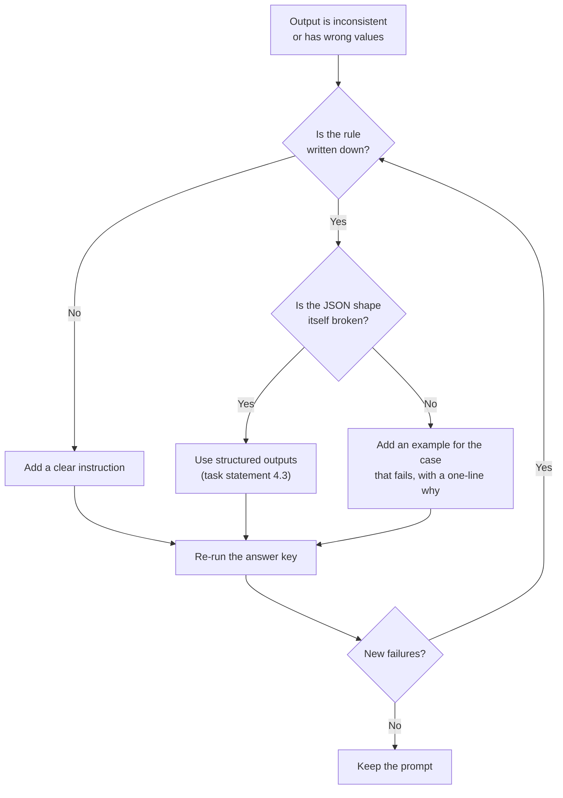

Few-shot prompting means putting a few worked examples in your prompt: an input, the exact output you want, and a short reason. When detailed instructions still give inconsistent output, examples are usually the fix, because they *show* Claude the format and the tricky decisions instead of describing them. In this post you build a few-shot extraction prompt in TypeScript and a small checker that counts missed, invented and inconsistent values on canned outputs, with no API key needed.

This is task statement 4.2 of the [Claude Certified Architect – Foundations exam guide](https://anthropic-partners.skilljar.com/claude-certified-architect-foundations-certification): "Apply few-shot prompting to improve output consistency and quality". It is part of Domain 4, Prompt Engineering & Structured Output, which is 20% of the exam.

## What does task statement 4.2 test?

The guide lists four things to know and five skills. In plain words:

| The guide asks you to… | In practice |
| --- | --- |
| Know that examples are the most effective fix when detailed instructions still give inconsistent output | Stop adding rule paragraphs; show two or three worked cases |
| Know that examples show how to handle ambiguous cases | For example, which tool to pick when a request fits two |
| Know that examples help Claude generalize | A good example teaches a judgment, not just one answer |
| Know that examples reduce hallucination in extraction | Informal measurements and unusual document layouts stop producing invented or empty values |
| Write 2–4 targeted examples with a reason | Each one says why this choice beats the plausible alternative |
| Show the output format | For a code review: location, issue, severity, suggested fix |
| Pair "acceptable" with "real issue" | Cuts false positives without hiding real problems |
| Cover varied document structures | Inline citations vs a reference list; methods section vs details in the results |
| Fix fields that come back empty | Show where the value hides in each layout |

Two words you'll see a lot. **Extraction** means pulling structured fields (numbers, names, lists) out of free text. A **hallucinated** or **invented** value is one the output contains but the document doesn't, like a sample size of 36 for "a few dozen volunteers". If prompts in general are new to you, read [What is prompt engineering?](/blog/what-is-prompt-engineering) and [Write your first prompt](/blog/write-your-first-prompt) first.

## Why do examples work better than more instructions?

Because a rule describes the output, and an example shows it. Rules leave room for reading. "Write citations as Surname YYYY" seems clear, until a citation is `[1]` with the author in a reference list, or has two authors, or reads "Haddad (2018)". Each of those needs one more rule, and every new rule adds more room for reading.

Anthropic's [prompting best practices](https://platform.claude.com/docs/en/build-with-claude/prompt-engineering/claude-prompting-best-practices#use-examples-effectively) put it this way: "Examples are one of the most reliable ways to steer Claude's output format, tone, and structure. A few well-crafted examples (known as few-shot or multishot prompting) improve accuracy and consistency."

Examples don't replace instructions. The two work together:

- **Instructions** state the rule: "Use null when the text gives no exact count."
- **Examples** show the rule applied to the case where it is hard: "Around a hundred shoppers" becomes `null`, not `100`.



## When does few-shot beat more instructions?

Look at what goes wrong before you pick the fix:

| What you see | Better fix | Why |
| --- | --- | --- |
| A rule is missing (Claude never heard of your "none" convention) | Instruction | Claude can't follow a rule it was never given |
| The rule exists, but the format still varies ("12in", "12 inches", "1 ft") | Examples | One shown format beats a paragraph of description |
| Two answers both look right (a borderline routing or severity choice) | Examples with a reason | The reason shows where the line is |
| A field comes back empty, but only for some document layouts | Examples of those layouts | They show where the value hides |
| A value is invented from a vague phrase | Instruction plus an example that stays empty | The example shows that "empty" is a valid answer |
| The output isn't valid JSON or misses required keys | Structured outputs | A schema fixes shape; examples fix values |

The last row matters. The [structured outputs docs](https://platform.claude.com/docs/en/build-with-claude/structured-outputs) promise valid JSON with "Guaranteed field types and required fields". That fixes the shape, not the content. A schema can't say whether "no external funding" should be `"none"` or `null`. Examples can.

## How do you choose good examples?

Start from your failures, not from your favourite documents. Run the instruction-only prompt, list what went wrong, and write one example per kind of failure.

Anthropic's docs ask for examples that are:

- **Relevant:** "Mirror your actual use case closely." Use realistic inputs from your domain.
- **Diverse:** "Cover edge cases and vary enough that Claude doesn't pick up unintended patterns." If every example has a funder, Claude may learn that funding is never empty.
- **Structured:** "Wrap examples in `<example>` tags (multiple examples in `<examples>` tags) so Claude can distinguish them from instructions."

The exam guide adds three habits:

1. **Target the ambiguous cases.** Easy examples teach nothing Claude didn't already do. Pick the borderline: the vague number, the citation in a reference list, the message that fits two tools.
2. **Add the reason.** One sentence on why this output, and not the plausible alternative. That reason is what lets Claude apply the same judgment to inputs you didn't show.
3. **Pair acceptable with wrong.** For a review bot, show one pattern that looks risky but is fine ("not an issue, because…") next to a real issue. Then the bot learns the difference, not a keyword.


<Callout type="warning" title="Never reuse your test documents as examples">

If an example is also in your test set, the test only checks that Claude can copy. Write examples from separate, realistic but different inputs, and keep your test set apart. Otherwise your before and after numbers look better than the prompt really is.

</Callout>


## How many examples, and in what order?

Start with three. The exam guide's skill says "2-4 targeted few-shot examples". Anthropic's docs say "Include 3–5 examples for best results". Three fits both. Add more only when a new kind of failure shows up, not to repeat a case you already cover.

On order, the docs don't give a rule. Two practical habits help:

- **Keep the order fixed while you measure.** Then a change in the results comes from what you changed, not from a shuffle.
- **Don't let the examples share a surface feature.** If all three end with `"funding": null`, or all are the same length, Claude may treat that as part of the pattern. Mix the answers.

Put the examples in the system prompt, after the instructions, and the document in the user message. For long inputs (the docs mention 20k+ tokens), the same page suggests putting the long documents "near the top of your prompt, above your query, instructions, and examples."

## What should the reason in an example say?

One sentence that names the choice and the alternative it beats: "'Around a hundred' is an estimate, not a count, so sample_size is null rather than 100." That is short, and it states the judgment.

Keep the reasoning in your examples, and don't ask Claude to write out long reasoning in its answer. The docs note that multishot examples work with thinking: "Worked examples in your prompt shape how Claude approaches similar problems in its own thinking blocks." On Claude Opus 5.5, thinking is always on, and the [Opus 5.5 prompting guide](https://platform.claude.com/docs/en/build-with-claude/prompt-engineering/prompting-claude-opus-5-5#safeguard-refusals) warns that a prompt pushing the model to reproduce its internal reasoning in the response text "may be declined". A short explanation is fine; a full reasoning transcript is not what you want.

## Try it: a few-shot extraction prompt, checked offline

You'll extract three fields from short study summaries: the sample size, the citations and the funding. Each field has a trap:

- **sample_size** sometimes sits in the results text, not in a methods section, and sometimes is only an estimate ("a few dozen").
- **citations** come inline "(Okafor et al., 2019)" or as numbers "[1]" with a reference list. The output should always be `Surname YYYY`.
- **funding** has three states: a funder's name, `"none"` when the text says there was no funding, and `null` when it isn't mentioned.

The checker runs without an API key. The four run files it scores are **canned examples we wrote by hand** to show typical failures. They are not recorded model output. The last step shows how to produce real ones with your own key.

**You need:** Node.js 22.18 or later, which runs `.ts` files directly because [type stripping is on by default](https://nodejs.org/docs/latest-v22.x/api/typescript.html). An Anthropic API key only for the last step.


<Steps>


<Step title="Create the project">

```bash
$ mkdir few-shot-extract
$ cd few-shot-extract
$ npm init -y
$ npm pkg set type=module
$ mkdir runs
```

Install the [official TypeScript SDK](https://github.com/anthropics/anthropic-sdk-typescript), then TypeScript and the Node types for type-checking:


```bash
npm install @anthropic-ai/sdk
```


```bash
npm install -D typescript @types/node
```


Add the same `tsconfig.json` as in the previous post of this series: the settings the Node docs recommend for code that Node runs directly, plus `allowImportingTsExtensions` and `strict`:


**tsconfig.json**

```json
{
  "compilerOptions": {
    "noEmit": true,
    "target": "esnext",
    "module": "nodenext",
    "rewriteRelativeImportExtensions": true,
    "erasableSyntaxOnly": true,
    "verbatimModuleSyntax": true,
    "allowImportingTsExtensions": true,
    "strict": true
  },
  "include": ["*.ts"]
}
```


</Step>


<Step title="Write the instructions, schema and format rules">


**extraction.ts**

```ts
// What we extract from each study summary.
export interface Extraction {
  sample_size: number | null;
  citations: string[];
  funding: string | null;
}

export const INSTRUCTIONS = `You extract facts from short study summaries.

Return three fields:
- sample_size: the number of participants analysed, as an integer.
  Use null when the text gives no exact count.
- citations: every work the summary cites, as "Surname YYYY" with the
  first author's surname. Use [] when nothing is cited.
- funding: the funder's name. Use "none" when the text says there was no
  funding, and null when funding is not mentioned.

Use only facts stated in the document. Never estimate a number.`;

// The output shape, for structured outputs in the live step.
export const SCHEMA = {
  type: 'object',
  properties: {
    sample_size: { anyOf: [{ type: 'integer' }, { type: 'null' }] },
    citations: { type: 'array', items: { type: 'string' } },
    funding: { anyOf: [{ type: 'string' }, { type: 'null' }] },
  },
  required: ['sample_size', 'citations', 'funding'],
  additionalProperties: false,
} as const;

// "Okafor 2019" passes. "Okafor et al., 2019" and "[1]" do not.
export const CITATION = /^\p{Lu}[\p{L}'-]+ \d{4}$/u;

// Format rules that a schema can't express. Returns a list of problems.
export function formatProblems(e: Extraction): string[] {
  const problems: string[] = [];
  if (e.sample_size !== null && (!Number.isInteger(e.sample_size) || e.sample_size < 1)) {
    problems.push(`sample_size ${e.sample_size} is not a positive integer`);
  }
  for (const c of e.citations) {
    if (!CITATION.test(c)) problems.push(`citation "${c}" is not "Surname YYYY"`);
  }
  if (e.funding !== null && e.funding.trim() === '') problems.push('funding is an empty string');
  return problems;
}
```


The instructions already state every rule. That is on purpose: the exercise shows that rules alone still leave the output inconsistent. `formatProblems` checks the rules a JSON schema can't express, like the `Surname YYYY` pattern.

</Step>


<Step title="Write three targeted examples">

Each example aims at one failure and says why its output is right:


**examples.ts**

```ts
import type { Extraction } from './extraction.ts';

export interface Example {
  input: string;
  output: Extraction;
  why: string; // one sentence: why this output and not the plausible alternative
}

// Three examples, each aimed at a case that instructions alone got wrong.
export const EXAMPLES: Example[] = [
  {
    input: `Teachers reported less marking time with rubric software [1]. Of the 57 teachers
who finished the term, 40 used it every week.
References
1. Novak P. Grading at scale. 2016.`,
    output: { sample_size: 57, citations: ['Novak 2016'], funding: null },
    why: 'The count is in the results, not a methods section, and the citation is a number, so the surname and year come from the reference list. Funding is not mentioned, so it is null.',
  },
  {
    input: `Methods: 120 commuters logged their trips for a month (Garcia & Wu, 2020).
The authors received no funding for this work.`,
    output: { sample_size: 120, citations: ['Garcia 2020'], funding: 'none' },
    why: 'The text states there was no funding, so funding is "none", not null. With two authors, keep only the first surname.',
  },
  {
    input: `Around a hundred shoppers were interviewed outside two stores. Funded by the
Riverside Council.`,
    output: { sample_size: null, citations: [], funding: 'Riverside Council' },
    why: '"Around a hundred" is an estimate, not a count, so sample_size is null rather than 100. Nothing is cited, so citations is an empty list.',
  },
];
```


Look at what each example teaches:

- **Example 1:** a numbered citation resolved from the reference list, and a sample size found in the results text. Funding stays `null`.
- **Example 2:** "no funding" becomes `"none"`, and two authors become one surname.
- **Example 3:** a vague count stays `null`, and the citation list is empty.

The answers vary: one example has a funder, one says `"none"`, one has `null`. None of them is a test document.

</Step>


<Step title="Build the prompt">

The builder adds the examples to the system prompt in `<examples>` tags, and puts the document in the user message. It also refuses to build with a badly formatted example, because Claude copies what the examples show:


**build-prompt.ts**

```ts
import { INSTRUCTIONS, formatProblems } from './extraction.ts';
import type { Example } from './examples.ts';

export interface Prompt {
  system: string;
  messages: { role: 'user'; content: string }[];
}

function renderExample(ex: Example): string {
  return [
    '<example>',
    `<input>\n${ex.input}\n</input>`,
    `<output>\n${JSON.stringify(ex.output)}\n</output>`,
    `<why>${ex.why}</why>`,
    '</example>',
  ].join('\n');
}

// Instructions and examples go in the system prompt; the document goes in the user turn.
export function buildPrompt(document: string, examples: Example[] = []): Prompt {
  // A bad example teaches a bad habit, so refuse to build with one.
  for (const [i, ex] of examples.entries()) {
    const problems = formatProblems(ex.output);
    if (problems.length > 0) throw new Error(`Example ${i + 1}: ${problems.join('; ')}`);
  }

  let system = INSTRUCTIONS;
  if (examples.length > 0) {
    system +=
      '\n\nThe examples below show the output format and how to handle tricky cases.' +
      ' They are not part of the document you extract from.\n\n' +
      `<examples>\n${examples.map(renderExample).join('\n')}\n</examples>`;
  }

  return {
    system,
    messages: [{ role: 'user', content: `<document>\n${document}\n</document>` }],
  };
}
```


This is how example 2 looks inside the system prompt:

```text
<examples>
<example>
<input>
Methods: 120 commuters logged their trips for a month (Garcia & Wu, 2020).
The authors received no funding for this work.
</input>
<output>
{"sample_size":120,"citations":["Garcia 2020"],"funding":"none"}
</output>
<why>The text states there was no funding, so funding is "none", not null. With two authors, keep only the first surname.</why>
</example>
</examples>
```

</Step>


<Step title="Add test documents with an answer key">

Six short summaries. Four use layouts the examples cover. Two use layouts no example shows: a labelled list, and a text with two different counts. Those two test whether Claude generalizes.


**docs.ts**

```ts
import type { Extraction } from './extraction.ts';

export interface TestDoc {
  id: string;
  layout: 'seen' | 'new'; // 'new' = a layout none of the examples shows
  text: string;
  expected: Extraction; // the answer key
}

export const DOCS: TestDoc[] = [
  {
    id: 'asthma',
    layout: 'seen',
    text: `Methods: We enrolled 48 adults with mild asthma in a 12-week trial. Breathing
exercises reduced night symptoms, in line with earlier work (Okafor et al., 2019;
Lind, 2022). Funded by the Nordic Lung Foundation.`,
    expected: { sample_size: 48, citations: ['Okafor 2019', 'Lind 2022'], funding: 'Nordic Lung Foundation' },
  },
  {
    id: 'meetings',
    layout: 'seen',
    text: `We surveyed remote workers about meeting load [1]. Results: of the 212
respondents, 61% reported fewer meetings after the policy change, similar to [2].
The study received no external funding.
References
1. Patel R. Remote teams. 2020.
2. Moreau A, Chen L. Meeting culture. 2023.`,
    expected: { sample_size: 212, citations: ['Patel 2020', 'Moreau 2023'], funding: 'none' },
  },
  {
    id: 'keyboard',
    layout: 'seen',
    text: `A few dozen volunteers tried the new keyboard layout for two weeks. Most typed
faster by the end.`,
    expected: { sample_size: null, citations: [], funding: null },
  },
  {
    id: 'breaks',
    layout: 'seen',
    text: `As Haddad (2018) showed, short breaks help focus. Methods: n = 30 students,
randomised to two groups. Supported by a grant from the City Learning Trust.`,
    expected: { sample_size: 30, citations: ['Haddad 2018'], funding: 'City Learning Trust' },
  },
  {
    id: 'nurses',
    layout: 'new',
    text: `Participants: 75 nurses from three hospitals
Design: cross-sectional survey
Prior work: shift length and sleep quality (Ito, 2017)
Funding: none declared`,
    expected: { sample_size: 75, citations: ['Ito 2017'], funding: 'none' },
  },
  {
    id: 'walking',
    layout: 'new',
    text: `Of 140 people invited to the walking programme, 96 completed it and were
analysed. Earlier studies disagree (Silva 2015; Brandt et al. 2021).`,
    expected: { sample_size: 96, citations: ['Silva 2015', 'Brandt 2021'], funding: null },
  },
];
```


The exercise in this series suggests ten documents plus three new layouts. Six keep the post short; use more for your own prompt.

</Step>


<Step title="Write the consistency checker">

The checker sorts every field into one of four outcomes, counts format problems, and measures how many fields came back the same in every run:


**check.ts**

```ts
import { formatProblems, type Extraction } from './extraction.ts';
import type { TestDoc } from './docs.ts';

export type Field = keyof Extraction;
export type Outcome = 'ok' | 'missed' | 'invented' | 'wrong';
export type Run = Record<string, Extraction>; // document id -> extraction

const FIELDS: Field[] = ['sample_size', 'citations', 'funding'];

const isEmpty = (v: Extraction[Field]) => v === null || (Array.isArray(v) && v.length === 0);
// Compare citation lists without caring about order.
const norm = (v: Extraction[Field]) => JSON.stringify(Array.isArray(v) ? [...v].sort() : v);

// missed = the value is in the document but came back empty.
// invented = the document has no value but the output has one.
export function compare(expected: Extraction[Field], got: Extraction[Field]): Outcome {
  if (norm(expected) === norm(got)) return 'ok';
  if (isEmpty(got)) return 'missed';
  if (isEmpty(expected)) return 'invented';
  return 'wrong';
}

export interface Score {
  outcomes: Record<Outcome, number>;
  formatProblems: number;
  details: string[]; // one line per field that isn't ok
}

export function score(run: Run, docs: TestDoc[]): Score {
  const outcomes: Record<Outcome, number> = { ok: 0, missed: 0, invented: 0, wrong: 0 };
  const details: string[] = [];
  let problems = 0;
  for (const doc of docs) {
    const got = run[doc.id];
    if (!got) throw new Error(`No output for ${doc.id}`);
    problems += formatProblems(got).length;
    for (const field of FIELDS) {
      const outcome = compare(doc.expected[field], got[field]);
      outcomes[outcome]++;
      if (outcome !== 'ok') details.push(`${doc.id}.${field}: ${outcome} (got ${norm(got[field])})`);
    }
  }
  return { outcomes, formatProblems: problems, details };
}

// Consistency: how many fields came back identical in every run.
export function agreement(runs: Run[], docs: TestDoc[]): { same: number; total: number } {
  let same = 0;
  for (const doc of docs) {
    for (const field of FIELDS) {
      const values = runs.map((r) => norm(r[doc.id]?.[field] ?? null));
      if (values.every((v) => v === values[0])) same++;
    }
  }
  return { same, total: docs.length * FIELDS.length };
}
```


The four outcomes match the failures the exam guide names:

- **missed:** the value is in the document, but the field is `null` or `[]`. These are the "empty/null extraction of required fields".
- **invented:** the document has no value, but the output does. That is a hallucination.
- **wrong:** both have a value, and they differ. Format slips like `"Haddad (2018)"` land here too.
- **ok:** an exact match. Citation order doesn't count.

</Step>


<Step title="Add the canned runs">

Two runs per prompt, keyed by document ID. The instruction-only runs are written to show the usual problems: mixed citation formats, an empty field the document does fill, and a count invented from "a few dozen".


**runs/instructions-1.json**

```json
{
  "asthma": {"sample_size": 48, "citations": ["Okafor et al., 2019", "Lind, 2022"], "funding": "Nordic Lung Foundation"},
  "meetings": {"sample_size": null, "citations": ["[1]", "[2]"], "funding": null},
  "keyboard": {"sample_size": 36, "citations": [], "funding": null},
  "breaks": {"sample_size": 30, "citations": ["Haddad 2018"], "funding": "City Learning Trust"},
  "nurses": {"sample_size": 75, "citations": ["Ito 2017"], "funding": "none declared"},
  "walking": {"sample_size": 140, "citations": ["Silva 2015", "Brandt et al. 2021"], "funding": null}
}
```


**runs/instructions-2.json**

```json
{
  "asthma": {"sample_size": 48, "citations": ["Okafor 2019", "Lind 2022"], "funding": "Nordic Lung Foundation"},
  "meetings": {"sample_size": 212, "citations": ["Patel R. 2020", "Moreau A, Chen L. 2023"], "funding": "No external funding"},
  "keyboard": {"sample_size": null, "citations": [], "funding": null},
  "breaks": {"sample_size": 30, "citations": ["Haddad (2018)"], "funding": "City Learning Trust"},
  "nurses": {"sample_size": 75, "citations": ["Ito 2017"], "funding": null},
  "walking": {"sample_size": 96, "citations": ["Silva 2015", "Brandt 2021"], "funding": null}
}
```


**runs/few-shot-1.json**

```json
{
  "asthma": {"sample_size": 48, "citations": ["Okafor 2019", "Lind 2022"], "funding": "Nordic Lung Foundation"},
  "meetings": {"sample_size": 212, "citations": ["Patel 2020", "Moreau 2023"], "funding": "none"},
  "keyboard": {"sample_size": null, "citations": [], "funding": null},
  "breaks": {"sample_size": 30, "citations": ["Haddad 2018"], "funding": "City Learning Trust"},
  "nurses": {"sample_size": 75, "citations": ["Ito 2017"], "funding": "none"},
  "walking": {"sample_size": 140, "citations": ["Silva 2015", "Brandt 2021"], "funding": null}
}
```


**runs/few-shot-2.json**

```json
{
  "asthma": {"sample_size": 48, "citations": ["Okafor 2019", "Lind 2022"], "funding": "Nordic Lung Foundation"},
  "meetings": {"sample_size": 212, "citations": ["Patel 2020", "Moreau 2023"], "funding": "none"},
  "keyboard": {"sample_size": null, "citations": [], "funding": null},
  "breaks": {"sample_size": 30, "citations": ["Haddad 2018"], "funding": "City Learning Trust"},
  "nurses": {"sample_size": 75, "citations": ["Ito 2017"], "funding": "none"},
  "walking": {"sample_size": 96, "citations": ["Silva 2015", "Brandt 2021"], "funding": null}
}
```


</Step>


<Step title="Compare the runs">


**report.ts**

```ts
import { readFileSync } from 'node:fs';
import { DOCS } from './docs.ts';
import { agreement, score, type Run } from './check.ts';

const load = (name: string): Run => JSON.parse(readFileSync(`runs/${name}.json`, 'utf8'));
const seen = DOCS.filter((d) => d.layout === 'seen');
const fresh = DOCS.filter((d) => d.layout === 'new');

function summary(label: string, names: string[]) {
  console.log(`\n${label}`);
  const runs = names.map(load);
  for (const [i, run] of runs.entries()) {
    const all = score(run, DOCS);
    const { ok, missed, invented, wrong } = all.outcomes;
    console.log(
      `  ${names[i]}: ${ok}/${DOCS.length * 3} fields correct ` +
        `(seen layouts ${score(run, seen).outcomes.ok}/${seen.length * 3}, ` +
        `new layouts ${score(run, fresh).outcomes.ok}/${fresh.length * 3}), ` +
        `missed ${missed}, invented ${invented}, wrong ${wrong}, format problems ${all.formatProblems}`,
    );
    for (const line of all.details) console.log(`    - ${line}`);
  }
  const { same, total } = agreement(runs, DOCS);
  console.log(`  same output in both runs: ${same}/${total} fields`);
}

summary('Instructions only', ['instructions-1', 'instructions-2']);
summary('Instructions + 3 examples', ['few-shot-1', 'few-shot-2']);
```


```bash
$ node report.ts
```

```text
Instructions only
  instructions-1: 10/18 fields correct (seen layouts 7/12, new layouts 3/6), missed 2, invented 1, wrong 5, format problems 5
    - asthma.citations: wrong (got ["Lind, 2022","Okafor et al., 2019"])
    - meetings.sample_size: missed (got null)
    - meetings.citations: wrong (got ["[1]","[2]"])
    - meetings.funding: missed (got null)
    - keyboard.sample_size: invented (got 36)
    - nurses.funding: wrong (got "none declared")
    - walking.sample_size: wrong (got 140)
    - walking.citations: wrong (got ["Brandt et al. 2021","Silva 2015"])
  instructions-2: 14/18 fields correct (seen layouts 9/12, new layouts 5/6), missed 1, invented 0, wrong 3, format problems 3
    - meetings.citations: wrong (got ["Moreau A, Chen L. 2023","Patel R. 2020"])
    - meetings.funding: wrong (got "No external funding")
    - breaks.citations: wrong (got ["Haddad (2018)"])
    - nurses.funding: missed (got null)
  same output in both runs: 9/18 fields

Instructions + 3 examples
  few-shot-1: 17/18 fields correct (seen layouts 12/12, new layouts 5/6), missed 0, invented 0, wrong 1, format problems 0
    - walking.sample_size: wrong (got 140)
  few-shot-2: 18/18 fields correct (seen layouts 12/12, new layouts 6/6), missed 0, invented 0, wrong 0, format problems 0
  same output in both runs: 17/18 fields
```

This is our output on Node 22.22.2. No model was called. Read it like this:

- **Missed fields.** With instructions only, `meetings.sample_size` comes back `null` in one run, even though "212 respondents" is in the text: the count is in the results, not a methods section. Example 1 covers that layout, and the few-shot runs find it.
- **Invented values.** "A few dozen volunteers" became `36` in one instruction-only run. Example 3 shows that a vague count stays `null`.
- **Format.** The instruction-only runs write citations in six different wrong ways, such as `[1]`, `Lind, 2022` and `Haddad (2018)`. With the examples, there are no format problems.
- **Consistency.** The two instruction-only runs agree on 9 of 18 fields. The few-shot runs agree on 17.
- **The new layouts.** The labelled list (`nurses`) is handled in both few-shot runs, so the judgment carried over. But `walking.sample_size` is 140 (people invited) in one run instead of 96 (people analysed). No example has two counts. That is your next example, or a sharper instruction.

Remember these numbers come from hand-written outputs. They show how the checker reports, not how any model performs. With real runs, use more documents and more runs before you trust a number.

Add a unit test, then type-check everything:


**check.test.ts**

```ts
import assert from 'node:assert/strict';
import { test } from 'node:test';
import { buildPrompt } from './build-prompt.ts';
import { compare } from './check.ts';
import { EXAMPLES } from './examples.ts';

test('compare tells missed, invented and wrong values apart', () => {
  assert.equal(compare(212, null), 'missed');
  assert.equal(compare(null, 36), 'invented');
  assert.equal(compare(96, 140), 'wrong');
  assert.equal(compare(['Lind 2022', 'Okafor 2019'], ['Okafor 2019', 'Lind 2022']), 'ok');
  assert.equal(compare(['Ito 2017'], []), 'missed');
});

test('the prompt has an examples block only when examples are given', () => {
  assert.doesNotMatch(buildPrompt('text').system, /<examples>/);
  const withExamples = buildPrompt('text', EXAMPLES).system;
  assert.equal(withExamples.match(/<example>/g)?.length, 3);
});

test('a badly formatted example is rejected', () => {
  const bad = { ...EXAMPLES[0], output: { ...EXAMPLES[0].output, citations: ['[1]'] } };
  assert.throws(() => buildPrompt('text', [bad]), /not "Surname YYYY"/);
});
```


```bash
$ node --test check.test.ts
$ npx tsc
```

All three tests pass, and `tsc` prints nothing when there are no type errors.

</Step>


<Step title="Produce real runs with Claude">

Create an API key in the [Claude Console](https://platform.claude.com/) and set it as the `ANTHROPIC_API_KEY` environment variable. This script extracts all six documents with one prompt variant and saves the results in the same format as the canned files:


**extract.ts**

```ts
import Anthropic from '@anthropic-ai/sdk';
import { writeFileSync } from 'node:fs';
import { buildPrompt } from './build-prompt.ts';
import type { Run } from './check.ts';
import { DOCS } from './docs.ts';
import { EXAMPLES } from './examples.ts';
import { SCHEMA, type Extraction } from './extraction.ts';

const [variant = 'few-shot', run = '1'] = process.argv.slice(2);
const examples = variant === 'instructions' ? [] : EXAMPLES;

const client = new Anthropic(); // reads ANTHROPIC_API_KEY from the environment
const results: Run = {};

for (const doc of DOCS) {
  const { system, messages } = buildPrompt(doc.text, examples);
  const response = await client.messages.create({
    model: 'claude-opus-5-5',
    max_tokens: 16000,
    system,
    messages,
    output_config: { format: { type: 'json_schema', schema: SCHEMA } },
  });

  if (response.stop_reason !== 'end_turn') {
    throw new Error(`${doc.id}: unexpected stop_reason ${response.stop_reason}`);
  }
  // Read by block type: a thinking block can come before the text block.
  const text = response.content.find((block) => block.type === 'text');
  if (!text) throw new Error(`${doc.id}: no text block in the response`);
  results[doc.id] = JSON.parse(text.text) as Extraction;
}

const out = `runs/${variant}-${run}.json`;
writeFileSync(out, JSON.stringify(results, null, 2));
console.log(`Saved ${out}`);
```


```bash
$ node extract.ts instructions 1
$ node extract.ts instructions 2
$ node extract.ts few-shot 1
$ node extract.ts few-shot 2
$ node report.ts
```

Each command overwrites the canned file of the same name, so `report.ts` now scores Claude's real output. Notes on the request:

- **`output_config.format`** asks for [structured outputs](https://platform.claude.com/docs/en/build-with-claude/structured-outputs) that follow `SCHEMA`, so every response is valid JSON with all three keys. `anyOf` with `null` is how the schema allows an empty value. Task statement 4.3 covers schemas in depth.
- **Anything but `end_turn` throws.** The docs warn that on `max_tokens` or `refusal` the output may not match the schema.
- **The text block is found by type.** The Opus 5.5 guide says to check each block's type, because a response may begin with a `thinking` block.

The model is `claude-opus-5-5`, the one the [models overview](https://platform.claude.com/docs/en/about-claude/models/overview) suggests starting with. Real results will differ from the canned ones and from run to run, which is why you compare more than one run.

</Step>


</Steps>


## How does this apply to a code review bot?

The same technique fixes the two review problems the guide names: an output format that changes between runs, and false positives on code that is fine. Show the format once, and pair an acceptable pattern with a real issue:

```text
<examples>
<example>
<code>
try { return await save(order); }
catch (err) { log.error('save failed', err); throw err; }
</code>
<output>No finding.</output>
<why>The error is logged and thrown again, so the caller still sees it. This is our standard wrapper, not a swallowed exception.</why>
</example>
<example>
<code>
try { await save(order); }
catch (err) { }
</code>
<output>
location: line 2
issue: the save error is caught and dropped, so the caller thinks the order was saved
severity: major
suggested fix: log the error and throw it again, or return a failure result
</output>
<why>Nothing is logged or thrown, so a failed save looks like a success.</why>
</example>
</examples>
```

The first example cuts the false positive. The second fixes the output shape (location, issue, severity, suggested fix) and keeps the real check alive. Because both carry a reason, Claude can apply them to other wrappers and other empty `catch` blocks, not only to these lines. The previous post in this series, on explicit criteria, covers the report and skip lists that go with them.

## Common traps

These are the mistakes that wrong answer options are built on.

| Trap | Why it fails | Fix |
| --- | --- | --- |
| Adding more and more rule text when output stays inconsistent | Every new rule adds room for reading, and Claude still has to guess how it applies to the hard case | Show the hard case as an example |
| Only easy, obvious examples | Claude already handled those; the failures are on the borderline | Pick examples from your failure list |
| The answer without the reason | Claude copies surface features instead of the judgment | One sentence: why this, not the alternative |
| "Examples only cover the cases they show" | Well-chosen examples with reasons help Claude generalize | Still test layouts no example shows |
| All examples look alike | Claude may treat the shared feature as a rule | Vary layouts and answers, including empty ones |
| "Never return null" to fix empty fields | Claude fills the field even when the value is truly missing, which invents data | Show where the value hides, and show a real empty case |
| Examples for deterministic conversions | Code is exact and cheaper for data that is already structured | Convert structured data in code; use examples for language |

## Practice questions

These four questions are this blog's own, written for practice. They are not from the exam.

**Question 1.** Your pipeline pulls product dimensions from supplier emails. The prompt already has two paragraphs of unit rules, but outputs still vary: "12in", "12 inches", "30.5 cm". Sometimes it returns 12 inches when the email only says "about a foot". What is the most effective next step?

- A. Add another paragraph of rules about units and rounding.
- B. Move the pipeline to a larger model.
- C. Add 2–3 examples with informal and mixed-unit inputs and their exact normalized output, including one where the vague value is handled the way your instructions say.
- D. Clean up the output with regular expressions after each call.

**Question 2.** A support agent has two tools, `billing_issue` and `cancel_subscription`. Both descriptions are detailed and say when to use each. Messages that fit both, such as "I was charged twice and want to cancel", go to a different tool on different runs. You want these borderline messages handled the same way every time. What should you add?

- A. 2–4 examples of borderline messages, each with the chosen tool and one sentence on why it beats the other.
- B. 20 examples of routine, clear-cut messages for each tool.
- C. The instruction "Choose the most appropriate tool."
- D. A rule to always pick the first tool in the list when unsure.

**Question 3.** Your review bot flags the team's standard retry wrapper as a "swallowed exception", although the wrapper logs the error and throws it again. You still want the bot to catch real swallowed exceptions everywhere else. What is the best change?

- A. Add the wrapper's file path to a skip list.
- B. Remove the "swallowed exception" category.
- C. Tell the bot to be less strict about error handling.
- D. Add one example of the wrapper marked "not an issue, because it logs and throws again", next to one example of a truly swallowed exception marked as an issue.

**Question 4.** You added three examples to an invoice extraction prompt. All three come from the same supplier, and all three are in US dollars. Now invoices from a supplier in Germany come back with `"currency": "USD"`, even when the totals are in euros. What is the best fix?

- A. Add ten more examples from the same supplier.
- B. Replace one or two examples with invoices that differ in currency and layout, so the set covers the variation you see in production.
- C. Remove all examples and rely on instructions.
- D. Add code that sets the currency to EUR for every German supplier.

## Answer key

### Question 1

**Answer: C.** When detailed rules still give inconsistent output, targeted examples are the most effective fix, both for the format and for vague inputs that tempt the model to invent a value. The strongest distractor is D: regular expressions can tidy units, but they can't tell that "about a foot" was vague, so the invented 12 inches gets through, and you now maintain fragile parsing code.

### Question 2

**Answer: A.** A few borderline examples with a reason show where the line between the two tools is. The descriptions are already good, so the remaining problem is the ambiguous case, which is exactly what examples are for. The strongest distractor is B: it adds many examples, but clear-cut ones teach nothing about the borderline messages that cause the problem.

### Question 3

**Answer: D.** Paired examples show the difference between an acceptable pattern and a real issue, so the bot can apply it to similar code in any file. The strongest distractor is A: it silences that one file, but the same wrapper in a new file gets flagged again, and real problems in the skipped file are hidden.

### Question 4

**Answer: B.** Examples that all share a feature teach that feature as a rule. Anthropic's docs ask for examples that "vary enough that Claude doesn't pick up unintended patterns". The strongest distractor is D: it patches one supplier with a hard-coded guess, which is wrong for a German supplier that bills in dollars, and it leaves the biased examples in place.

## What should I do next?

- **Use your own documents.** Collect ten real inputs, write the answer key, run the instruction-only prompt with your key, and write one example per kind of failure you see.
- **Read the previous post in this series.** Task statement 4.1, [Explicit criteria in prompts: fewer false positives](/blog/prompt-explicit-criteria), covers the rules that your examples demonstrate.
- **Move on to task statement 4.3**, "Enforce structured output using tool use and JSON schemas". The next post in this series covers it.
- **Grade AI output properly.** [How to test AI output with evals](/blog/test-ai-output-with-evals) covers test sets and graders in more depth, and [What is tool calling?](/blog/what-is-tool-calling) explains the tool choices in question 2.
- **Plan and check your prep.** Follow the [six-week study plan](/blog/claude-architect-exam-study-plan), and test yourself with the [mock exam](/blog/claude-certification-mock-exam) once you've worked through Domain 4.
