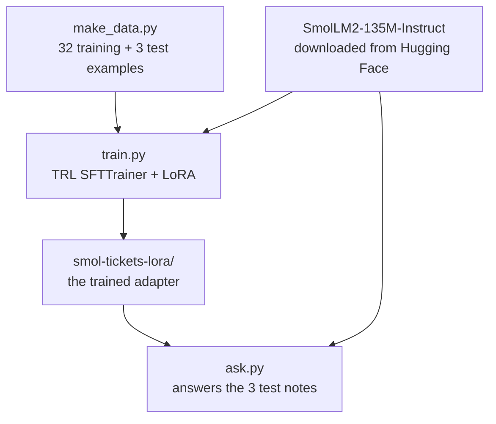

You can fine-tune a small open AI model on your own laptop in about ten minutes. In this guide you'll teach [SmolLM2-135M-Instruct](https://huggingface.co/HuggingFaceTB/SmolLM2-135M-Instruct), a tiny chat model, to turn short customer support notes into a fixed JSON format. You'll use Python, Hugging Face's [TRL](https://huggingface.co/docs/trl/sft_trainer) library and a LoRA adapter, and you'll compare the model's answers before and after training.

New to the idea? [What is fine-tuning?](/blog/what-is-fine-tuning) explains the concepts. Here we only build.

## What will you build?

The model will read a note like "I was charged twice for my March invoice." and answer with nothing but this:

```json
{"category": "billing", "priority": "high"}
```



You'll write three small scripts:

| Script | What it does |
| --- | --- |
| `make_data.py` | Writes the training and test examples to two JSONL files |
| `ask.py` | Asks the model about the test notes, with or without your adapter |
| `train.py` | Fine-tunes the model and saves the adapter |

The small model and the CPU keep this guide free and quick to run. The same code works for bigger models on a GPU.

## What do you need?

- **Python 3.10 or later.** The Hugging Face libraries used here require it.
- **At least 2 GB of free disk space** for the packages and the model. Our environment with the CPU-only PyTorch build took 1.5 GB. On Linux, the default PyTorch package needs much more, because it pulls in NVIDIA GPU libraries.
- **Any recent laptop.** No GPU needed, and no Hugging Face account.
- **Time.** On a 4-core CPU, training took three to six minutes in our two runs. Each `ask.py` run took under half a minute.

Be honest with yourself about hardware for real projects. A 135M model fits in a few hundred megabytes. Models with billions of parameters need a GPU with a lot of memory, which usually means a rented cloud GPU. The code stays the same; you change the model name and the settings.

## How do I fine-tune the model?


<Steps>


<Step title="Create a project and install the libraries">

```bash
$ mkdir fine-tune-demo && cd fine-tune-demo
$ python3 -m venv .venv
$ source .venv/bin/activate
$ pip install torch transformers datasets trl peft
```

The virtual environment keeps the packages inside this folder. On Windows, activate it with `.venv\Scripts\activate.bat` (Command Prompt) or `.venv\Scripts\Activate.ps1` (PowerShell).

On Linux without an NVIDIA GPU, install the smaller CPU-only build of PyTorch first:

```bash
$ pip install torch --index-url https://download.pytorch.org/whl/cpu
$ pip install transformers datasets trl peft
```

What each library does:

- **torch** (PyTorch) does the math.
- **transformers** loads models and runs them.
- **datasets** loads your training data.
- **trl** has `SFTTrainer`, which runs supervised fine-tuning (SFT): training on input → output examples.
- **peft** adds the LoRA adapter, so you train a small add-on instead of the whole model.

We used Python 3.11, torch 2.14.0, transformers 5.17.0, datasets 5.0.1, trl 1.14.0 and peft 0.21.0.

</Step>


<Step title="Write the dataset">

Each example pairs a support note with the exact answer you want. Eight notes per category, with a priority for each. Three more notes go into a separate test file that training never sees.


**make_data.py**

```py
import json

# (support note, category, priority)
TRAIN = [
    ("I was charged twice for my March invoice.", "billing", "high"),
    ("Can I get a receipt with our company address on it?", "billing", "low"),
    ("My card was declined but the payment still shows as pending.", "billing", "high"),
    ("How do I switch from monthly to yearly billing?", "billing", "normal"),
    ("The price on the invoice doesn't match the pricing page.", "billing", "normal"),
    ("Please cancel my subscription at the end of this month.", "billing", "normal"),
    ("Where can I download old invoices?", "billing", "low"),
    ("We were billed for 12 seats but only have 9 users.", "billing", "high"),
    ("The export button does nothing when I click it.", "bug", "normal"),
    ("The app crashes every time I open the settings page.", "bug", "high"),
    ("Dates show in the wrong time zone on the dashboard.", "bug", "normal"),
    ("Search returns no results even for exact titles.", "bug", "high"),
    ("A typo on the login page: 'pasword'.", "bug", "low"),
    ("File uploads over 10 MB fail with a 500 error.", "bug", "high"),
    ("The dark mode toggle resets after every reload.", "bug", "low"),
    ("Charts are blank in Safari but fine in Chrome.", "bug", "normal"),
    ("I can't log in, the reset email never arrives.", "account", "high"),
    ("How do I change the email address on my account?", "account", "normal"),
    ("Please delete my account and all my data.", "account", "normal"),
    ("I need to add a second admin to our team.", "account", "normal"),
    ("My account is locked after too many login attempts.", "account", "high"),
    ("Can I change my username?", "account", "low"),
    ("Two-factor codes from my phone are always rejected.", "account", "high"),
    ("How do I transfer ownership of the workspace?", "account", "normal"),
    ("It would be great to export reports as PDF.", "feature", "low"),
    ("Please add a keyboard shortcut for creating a task.", "feature", "low"),
    ("We need single sign-on with Okta before we can roll out.", "feature", "normal"),
    ("Could you support webhooks for new comments?", "feature", "normal"),
    ("A dark theme for the mobile app would be nice.", "feature", "low"),
    ("Can we get an API endpoint to bulk-import users?", "feature", "normal"),
    ("Please let us pin important projects to the top.", "feature", "low"),
    ("Our auditors require an activity log export.", "feature", "normal"),
]

# Held out: the model never sees these during training.
TEST = [
    ("I paid but my plan still says Free.", "billing", "high"),
    ("The mobile app freezes when I rotate my phone.", "bug", "normal"),
    ("Could you add a Slack integration?", "feature", "low"),
]


def to_example(note, category, priority):
    answer = json.dumps({"category": category, "priority": priority})
    return {
        "prompt": [{"role": "user", "content": note}],
        "completion": [{"role": "assistant", "content": answer}],
    }


for filename, rows in [("train.jsonl", TRAIN), ("test.jsonl", TEST)]:
    with open(filename, "w") as f:
        for row in rows:
            f.write(json.dumps(to_example(*row)) + "\n")
    print(f"Wrote {len(rows)} examples to {filename}")
```


Run it:

```bash
$ python make_data.py
```

```text
Wrote 32 examples to train.jsonl
Wrote 3 examples to test.jsonl
```

Each line of `train.jsonl` is one example in TRL's conversational prompt-completion format:

```json
{"prompt": [{"role": "user", "content": "I was charged twice for my March invoice."}], "completion": [{"role": "assistant", "content": "{\"category\": \"billing\", \"priority\": \"high\"}"}]}
```

With this format, TRL computes the training loss only on the completion, so the model learns to write the answer, not to repeat the note.

</Step>


<Step title="See what the model does before training">

This script asks the model about each test note. Without an argument it uses the original model. With a folder name, it adds your adapter.


**ask.py**

```py
import json
import sys

from transformers import AutoModelForCausalLM, AutoTokenizer

BASE = "HuggingFaceTB/SmolLM2-135M-Instruct"
# No argument: the original model. With a folder: the base model plus your adapter.
adapter = sys.argv[1] if len(sys.argv) > 1 else None

tokenizer = AutoTokenizer.from_pretrained(BASE)
model = AutoModelForCausalLM.from_pretrained(BASE)
if adapter:
    model.load_adapter(adapter)

with open("test.jsonl") as f:
    tests = [json.loads(line) for line in f]

for example in tests:
    inputs = tokenizer.apply_chat_template(
        example["prompt"],
        add_generation_prompt=True,
        return_tensors="pt",
        return_dict=True,
    )
    output = model.generate(**inputs, max_new_tokens=40, do_sample=False)
    answer = tokenizer.decode(
        output[0][inputs["input_ids"].shape[1]:], skip_special_tokens=True
    )
    print("Note:    ", example["prompt"][0]["content"])
    print("Model:   ", answer.strip())
    print("Expected:", example["completion"][0]["content"])
    print()
```


```bash
$ python ask.py
```

The first run downloads the model, about 270 MB. You may see a warning about unauthenticated requests to the Hugging Face Hub; public models download fine without an account. You should see something like this (shortened):

```text
Note:     I paid but my plan still says Free.
Model:    I'm sorry for the confusion, but as a helpful AI, I don't have the ability to provide plans or plans with a plan. I'm here to assist you with any questions or issues you
Expected: {"category": "billing", "priority": "high"}

Note:     The mobile app freezes when I rotate my phone.
Model:    The mobile app freezes when you rotate your phone. This is a common issue that can be caused by various factors, such as:
Expected: {"category": "bug", "priority": "normal"}

Note:     Could you add a Slack integration?
Model:    Absolutely! Here's an example of how you could add a Slack integration to your project:
Expected: {"category": "feature", "priority": "low"}
```

The model chats. It has no idea you want JSON.

</Step>


<Step title="Fine-tune with LoRA">


**train.py**

```py
from datasets import load_dataset
from peft import LoraConfig
from trl import SFTConfig, SFTTrainer

dataset = load_dataset("json", data_files="train.jsonl", split="train")

trainer = SFTTrainer(
    model="HuggingFaceTB/SmolLM2-135M-Instruct",
    train_dataset=dataset,
    args=SFTConfig(
        output_dir="smol-tickets-lora",
        num_train_epochs=8,
        per_device_train_batch_size=4,
        learning_rate=2e-4,
        logging_steps=8,
        save_strategy="no",
        bf16=False,
    ),
    peft_config=LoraConfig(
        r=16,
        lora_alpha=32,
        target_modules="all-linear",
        task_type="CAUSAL_LM",
    ),
)
trainer.model.print_trainable_parameters()
trainer.train()
trainer.save_model()
print("Saved the adapter to smol-tickets-lora/")
```


What the settings mean:

- `model` is the Hugging Face model ID. `SFTTrainer` downloads and loads it for you.
- `num_train_epochs=8` means the trainer goes through all 32 examples 8 times. With 4 examples per batch, that's 64 training steps.
- `learning_rate=2e-4` sets how big each update is. The [TRL docs](https://huggingface.co/docs/trl/sft_trainer) suggest a higher rate, around `1e-4`, for adapters than for full training.
- `save_strategy="no"` skips checkpoints during training; `trainer.save_model()` saves once at the end.
- `bf16=False` trains in standard 32-bit numbers. `SFTConfig` turns on the 16-bit bf16 format by default; we turn it off for a CPU run.
- `r=16` sets the size of the adapter ("rank"). Bigger means more trainable weights.
- `lora_alpha=32` scales how strongly the adapter changes the model's output.
- `target_modules="all-linear"` puts adapters on all the model's linear layers (except the output layer), per the [PEFT LoRA reference](https://huggingface.co/docs/peft/package_reference/lora).

Run it:

```bash
$ python train.py
```

You'll see progress bars and a log line every 8 steps. The important lines (shortened):

```text
trainable params: 4,884,480 || all params: 139,399,488 || trainable%: 3.5039
{'loss': '2.172', ..., 'mean_token_accuracy': '0.6228', 'epoch': '1'}
{'loss': '0.6902', ..., 'mean_token_accuracy': '0.847', 'epoch': '2'}
{'loss': '0.3131', ..., 'mean_token_accuracy': '0.9125', 'epoch': '3'}
...
{'loss': '0.07529', ..., 'mean_token_accuracy': '0.9759', 'epoch': '8'}
{'train_runtime': '344.8', ...}
Saved the adapter to smol-tickets-lora/
```

LoRA trained 4.9 million weights, 3.5% of the model. The **loss** measures how far the model's answers are from your examples; it should fall. `mean_token_accuracy` is the share of answer tokens the model predicted exactly. On our 4-core CPU, two runs took 177 and 345 seconds, depending on what else the machine was doing. Your numbers will differ a little.

</Step>


<Step title="Compare before and after">

Run the same test notes through the model with your adapter:

```bash
$ python ask.py smol-tickets-lora
```

```text
Note:     I paid but my plan still says Free.
Model:    {"category": "billing", "priority": "normal"}
Expected: {"category": "billing", "priority": "high"}

Note:     The mobile app freezes when I rotate my phone.
Model:    {"category": "bug", "priority": "high"}
Expected: {"category": "bug", "priority": "normal"}

Note:     Could you add a Slack integration?
Model:    {"category": "feature", "priority": "normal"}
Expected: {"category": "feature", "priority": "low"}
```

Now the model answers with valid JSON and nothing else, with no instructions in the prompt. The category is right for all three notes. The priority is right for none of them.

</Step>


</Steps>


## How do I know if it worked?

Look at three things, in this order:

1. **The held-out test notes.** This is the only check that matters. Training numbers only tell you the model fits the examples it has already seen.
2. **The format.** Parse every answer with `json.loads`. If any answer fails, the model hasn't learned the habit yet.
3. **The loss.** It should drop steadily. Ours fell from about 2.2 to 0.08. A loss near zero on a tiny dataset can also mean the model has memorized the examples, which is why step 1 comes first.

Our result is typical for a first run: the model learned the **format** from 32 examples, but not the **judgement** behind the priority. To improve it, add more examples where the priority is the hard part, make the labels consistent (is "I paid but my plan says Free" urgent or not?), and grow the test set well beyond three notes.

## What got saved?

```bash
$ ls smol-tickets-lora
```

```text
README.md  adapter_config.json  adapter_model.safetensors  chat_template.jinja  tokenizer.json  tokenizer_config.json  training_args.bin
```

- `adapter_model.safetensors` holds the trained LoRA weights: 19.6 MB, next to 269 MB for the full model.
- `adapter_config.json` records the LoRA settings and the base model's name, `HuggingFaceTB/SmolLM2-135M-Instruct`.
- The tokenizer files and chat template let you load everything from this one folder.
- `README.md` is an empty model card template. You'll fill it in before you share the model.

To use the adapter in your own code, load the folder with transformers. It reads `adapter_config.json`, loads the base model, and puts the adapter on top, as the [transformers PEFT guide](https://huggingface.co/docs/transformers/main/en/peft) describes:

```py
from transformers import AutoModelForCausalLM

model = AutoModelForCausalLM.from_pretrained("smol-tickets-lora")
```

## What if something goes wrong?

- **`ModuleNotFoundError`**: the virtual environment isn't active. Run `source .venv/bin/activate` again in this folder.
- **Training is very slow**: other programs are competing for the CPU, or the model is larger than this one. Close heavy apps, reduce `num_train_epochs` for a quick test, or use a machine with a GPU.
- **Out of memory**: lower `per_device_train_batch_size` to 2 or 1.
- **The model still chats after training**: check that `train.jsonl` has the `prompt` and `completion` fields, and train for more epochs.
- **Answers are the right shape but wrong**: that's a data problem, not a code problem. Add more, clearer examples for the cases it misses.


<Callout type="warning" title="Check your data before you train">

Models can memorize training examples and repeat them later. Never put passwords, API keys or customers' personal data in a training file. If you use a public dataset or a different base model, read its licence first: it decides what you may do with the result.

</Callout>


## What should I do next?

- **Share your model.** [How to publish your fine-tuned model on Hugging Face](/blog/publish-model-on-hugging-face) takes this `smol-tickets-lora` folder, writes a proper model card, and uploads it.
- **Use your own task.** Replace the notes in `make_data.py` with 50 or more real examples from your work, and keep at least 10 aside for testing.
- **Read the [TRL SFT docs](https://huggingface.co/docs/trl/sft_trainer)** for options like training on a GPU in bf16 and larger models.
