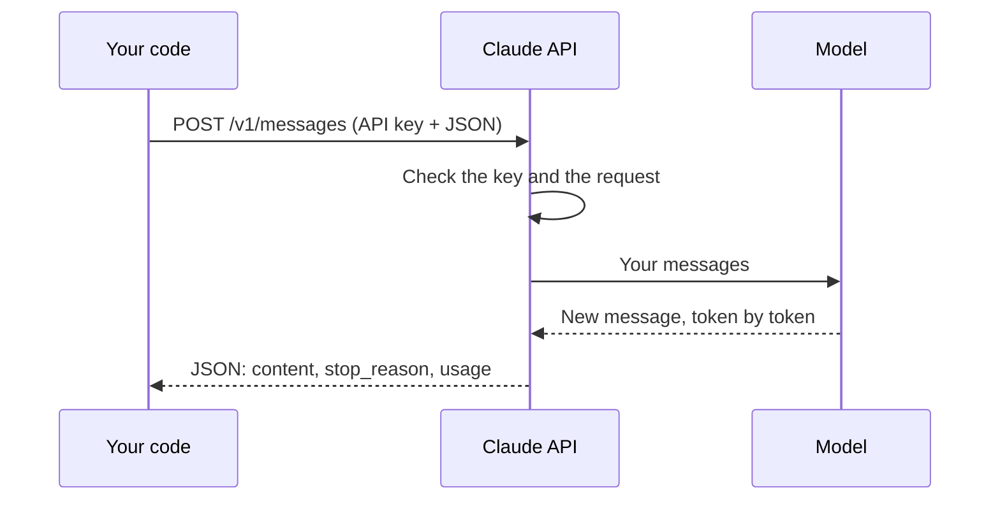
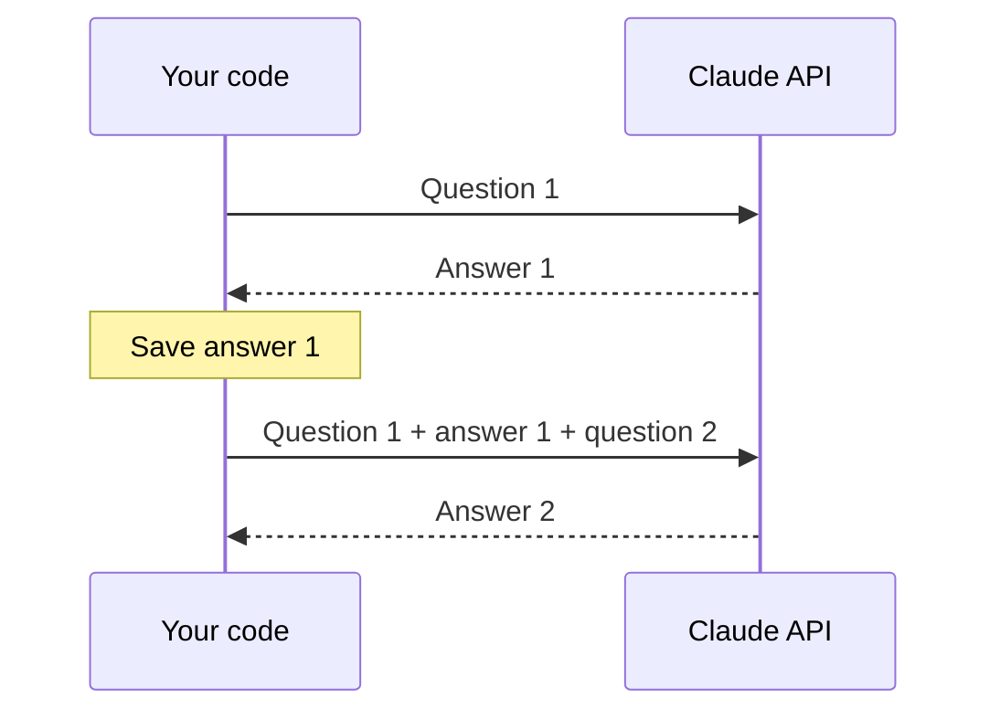

An LLM API call is a normal HTTPS request: your code sends a list of messages as JSON, and the model sends back one new message as JSON. That's all a chat app does behind the scenes. In this post you'll get an API key, make your first call to Claude from Node.js (and from curl), and learn to read what comes back.

You only need a terminal, Node.js and a Claude Console account. If words like "token" or "context window" are new, read [What is an LLM?](/blog/what-is-an-llm) first. This post builds on it.

## What is an LLM API call?

When you type into a chat app, the app sends your words to a model on a server and shows you the answer. An API (application programming interface) lets your own code do the same thing, without the chat window.

For Claude, you use the **Messages API**. It lives at `https://api.anthropic.com/v1/messages` and works like this:

- **Messages in.** You send a list of messages. Each one has a `role` (`user` for you, `assistant` for the model) and some `content`.
- **Message out.** The model writes the next message in the conversation and sends it back.
- **JSON over HTTPS.** The request is a `POST` with a JSON body. The response is JSON too. Any language that can send HTTP can call it.



You can build that request by hand, but Anthropic's official SDKs (client libraries) do it for you. They add the right headers, turn errors into exceptions and retry some failures. This post uses the [TypeScript SDK](https://platform.claude.com/docs/en/cli-sdks-libraries/sdks/typescript), which also works from plain JavaScript.

## How do I get an API key?

An API key is a secret string that proves a request comes from your account. Anyone who has it can make calls that you pay for.

1. Sign in to the [Claude Console](https://platform.claude.com/) (or create an account).
2. Open **Settings → API keys** and click **Create key**.
3. Copy the key. It starts with `sk-ant-`, and the Console shows it **only once**. If you lose it, create a new one.

The steps are in Anthropic's [Get your API key](https://platform.claude.com/docs/en/get-api-key) guide.

You also need credits. A paid Claude app plan doesn't include the API: you [buy prepaid credits](https://support.claude.com/en/articles/8977456-how-do-i-pay-for-my-claude-api-usage) in the Console, and each call uses them up according to the price per token. Failed requests aren't charged. You can also set your own monthly spend limit on the Console's Billing page.


<Callout type="warning" title="Keep your key out of your code">

Never paste the key into a source file, a chat or a support ticket, and never commit it to git. Put it in an environment variable or a `.env` file, and add `.env` to `.gitignore`. If a key leaks, delete it in the Console right away and create a new one. Anthropic's [API key best practices](https://support.claude.com/en/articles/9767949-api-key-best-practices-keeping-your-keys-safe-and-secure) cover this in more detail.

</Callout>


The SDK reads the key from the `ANTHROPIC_API_KEY` environment variable by itself, so your code never has to mention it.

## Try it: make your first call

You'll create a small project and ask Claude one question from a script.

**You need:** [Node.js](https://nodejs.org) 22 or later (we used Node 22) and your API key.


<Steps>


<Step title="Create a project folder">

```bash
$ mkdir hello-claude
$ cd hello-claude
$ npm init -y
```

`npm init -y` creates a `package.json` file with default settings.

</Step>


<Step title="Install the SDK">


```bash
npm install @anthropic-ai/sdk
```


This installs `@anthropic-ai/sdk`, Anthropic's official TypeScript and JavaScript SDK.

</Step>


<Step title="Save your key in a .env file">

Create a file named `.env` in the folder. Put one line in it: `ANTHROPIC_API_KEY=` followed by your key. Then create `.gitignore` so git never picks it up:


**.gitignore**

```text
.env
node_modules
```


Do this even if the folder is not a git repository yet. It's easy to forget later.

</Step>


<Step title="Write the script">


**hello.mjs**

```js
import Anthropic from "@anthropic-ai/sdk";

const client = new Anthropic();

const message = await client.messages.create({
  model: "claude-opus-5-5",
  max_tokens: 1000,
  messages: [
    {
      role: "user",
      content: "In one sentence, what is an API?"
    }
  ]
});

for (const block of message.content) {
  if (block.type === "text") {
    console.log(block.text);
  }
}
```


This is the same code as Anthropic's [quickstart](https://platform.claude.com/docs/en/get-started), with a shorter question. `new Anthropic()` finds your key in `ANTHROPIC_API_KEY`. `model` picks the model; `claude-opus-5-5` is Claude Opus 5.5. `max_tokens` is the most the model may write, counted in tokens.

</Step>


<Step title="Run it">

```bash
$ node --env-file=.env hello.mjs
```

`--env-file=.env` tells Node to load the variables in `.env` before your script runs. You should see a one-sentence answer about APIs. The exact words change from run to run.

</Step>


</Steps>


If you see an error instead, jump to [What do the common errors mean?](#what-do-the-common-errors-mean).

## What does the same call look like with curl?

The SDK is optional. Here is the same request as a raw HTTPS call, which shows exactly what goes over the wire. It's written for a macOS or Linux shell, and it expects `ANTHROPIC_API_KEY` to be set in that shell (for example with `export`):

```bash
$ curl https://api.anthropic.com/v1/messages \
    -H "content-type: application/json" \
    -H "x-api-key: $ANTHROPIC_API_KEY" \
    -H "anthropic-version: 2023-06-01" \
    -d '{
      "model": "claude-opus-5-5",
      "max_tokens": 1000,
      "messages": [
        {"role": "user", "content": "In one sentence, what is an API?"}
      ]
    }'
```

- `x-api-key` carries your key. The shell fills in `$ANTHROPIC_API_KEY`, so the key is not typed into the command. (An `Authorization: Bearer` header also works; the quickstart uses `x-api-key`.)
- `anthropic-version` picks the version of the API format. `2023-06-01` is the value the docs use.
- The body has the same three fields as the SDK call: `model`, `max_tokens` and `messages`.

## What comes back?

The response is one message. Here is the example from Anthropic's [Messages API guide](https://platform.claude.com/docs/en/build-with-claude/working-with-messages), for a request that said "Hello, Claude":

```json
{
  "id": "msg_01XFDUDYJgAACzvnptvVoYEL",
  "type": "message",
  "role": "assistant",
  "content": [
    {
      "type": "text",
      "text": "Hello!"
    }
  ],
  "model": "claude-opus-5-5",
  "stop_reason": "end_turn",
  "stop_sequence": null,
  "usage": {
    "input_tokens": 12,
    "output_tokens": 6
  }
}
```

Three fields matter most.

**`content` is a list of blocks, not one string.** Each block has a `type`. The answer is in the `text` blocks. Other types show up too. Thinking is always on for Claude Opus 5.5, so it may think before it answers; its [thinking blocks](https://platform.claude.com/docs/en/build-with-claude/thinking) come before the text, with the thinking text hidden by default. That's why the script loops over the blocks and prints only `type === "text"`.

**`stop_reason` says why the model stopped.** Check it before you trust the answer. The [stop reasons guide](https://platform.claude.com/docs/en/build-with-claude/handling-stop-reasons) lists them all; these are the ones you'll meet first:

| `stop_reason` | What it means | What to do |
| --- | --- | --- |
| `end_turn` | The model finished its answer. | Use it. |
| `max_tokens` | The answer hit your `max_tokens` limit and was cut off. | Raise `max_tokens`, or ask for a shorter answer. |
| `refusal` | The model declined to answer. | Read `stop_details` to see why. |
| `tool_use` | The model wants to call a tool you offered. | Run the tool and send back the result. |

**`usage` counts tokens, and tokens are what you pay for.** `input_tokens` is what you sent; `output_tokens` is what the model wrote. Output costs more. For Claude Opus 5.5, the [models overview](https://platform.claude.com/docs/en/about-claude/models/overview) lists $4 per million input tokens and $20 per million output tokens. The quickstart's example answer used 21 input and 305 output tokens: about $0.006, well under a cent. Thinking tokens are billed as output tokens even when you don't see them, and they count toward `max_tokens`.

To see these fields from your own script, add two lines at the end of `hello.mjs`:

```diff-js
 for (const block of message.content) {
   if (block.type === "text") {
     console.log(block.text);
   }
 }
+
+console.log("stop_reason:", message.stop_reason);
+console.log("usage:", message.usage);
```

## How do I tell the model how to behave?

Use a **system prompt**: instructions that apply to the whole conversation, such as a role, a tone or rules. You pass it in the `system` field, next to `messages`, not as a message. In `hello.mjs`:

```diff-js
 const message = await client.messages.create({
   model: "claude-opus-5-5",
   max_tokens: 1000,
+  system: "You are a patient teacher. Answer in two short sentences.",
   messages: [
```

Anthropic's [prompting guide](https://platform.claude.com/docs/en/build-with-claude/prompt-engineering/claude-prompting-best-practices#give-claude-a-role) notes that even a single sentence of role makes a difference.

One thing you can't use to steer newer models: `temperature`. On Claude 4.7 and later models, `temperature`, `top_p` and `top_k` return a 400 error, according to the [Messages API guide](https://platform.claude.com/docs/en/build-with-claude/working-with-messages). Leave them out and say what you want in the prompt.

## How do I have a conversation?

The Messages API is **stateless**: it keeps nothing between requests. Each call only knows what is in that call. To continue a conversation, your code keeps the history and sends all of it every time, like handing someone the full chat log before each new question.



In code, keep a `messages` array. Add each question, send the array, then add the model's reply:


**chat.mjs**

```js
import Anthropic from "@anthropic-ai/sdk";

const client = new Anthropic();
const messages = [];

async function ask(question) {
  messages.push({ role: "user", content: question });

  const response = await client.messages.create({
    model: "claude-opus-5-5",
    max_tokens: 1000,
    system: "You are a patient teacher. Answer in two short sentences.",
    messages
  });

  messages.push({ role: "assistant", content: response.content });

  const textBlock = response.content.find((block) => block.type === "text");
  return textBlock ? textBlock.text : "";
}

console.log(await ask("What is a REST API?"));
console.log(await ask("Give me one example of it."));
```


`content: response.content` sends the model's blocks back unchanged, including any thinking blocks, which is what the API expects. Run it the same way: `node --env-file=.env chat.mjs`.

This is also why long chats cost more: every turn resends every earlier turn as input tokens, and the history has to fit in the model's [context window](/blog/what-is-an-llm).

## How do I show the answer as it's written?

With a normal call, you wait until the whole answer is done. With **streaming**, the API sends the answer in small pieces as the model writes them, using [server-sent events](https://platform.claude.com/docs/en/build-with-claude/streaming). Your user sees the first words right away instead of staring at a spinner.

The SDK's `stream()` helper does the work:


**stream.mjs**

```js
import Anthropic from "@anthropic-ai/sdk";

const client = new Anthropic();

const stream = client.messages
  .stream({
    model: "claude-opus-5-5",
    max_tokens: 1000,
    messages: [{ role: "user", content: "Explain HTTP in three short sentences." }]
  })
  .on("text", (text) => {
    process.stdout.write(text);
  });

const message = await stream.finalMessage();
console.log("\n", message.usage);
```


The `text` event fires for each new piece, and `process.stdout.write` prints it without a line break. `finalMessage()` waits for the end and gives you the same full message as `create()`, with `usage` and `stop_reason`. For long answers with a large `max_tokens`, the SDKs require streaming to avoid HTTP timeouts, as the streaming docs explain.

## What do the common errors mean?

Errors come back as an HTTP status code plus a JSON body with a `type` and a `message`. With the SDK, they become exceptions. The [errors reference](https://platform.claude.com/docs/en/api/errors) lists every code; these are the ones you'll hit first:

| Status | Type | Usual cause | Fix |
| --- | --- | --- | --- |
| 401 | `authentication_error` | The key is wrong, revoked or expired. | Check the key in `.env`. Create a new key if needed. |
| 400 | `invalid_request_error` | Something in the request is wrong, such as `temperature` on a new model, a misspelled field or a bad model ID. | Read the `message`: it names the problem. |
| 429 | `rate_limit_error` | Too many requests or tokens in a short time, or your organization reached its monthly spend cap. | Slow down and retry later. See the [rate limits](https://platform.claude.com/docs/en/api/rate-limits) page. |
| 529 | `overloaded_error` | The API is busy for everyone. | Retry after a short wait. |

Here is the 401 we got by running `hello.mjs` with a made-up key (request ID shortened):

```text
AuthenticationError: 401 {"type":"error","error":{"type":"authentication_error","message":"invalid x-api-key"},"request_id":"req_…"}
```

If `ANTHROPIC_API_KEY` isn't set at all, the SDK stops before sending anything, with `Could not resolve authentication method`. That usually means you ran `node hello.mjs` without `--env-file=.env`.

You don't need retry code for your first scripts. The SDK already retries connection errors, 429s and server errors twice, with a short wait between tries, as its [docs](https://platform.claude.com/docs/en/cli-sdks-libraries/sdks/typescript) describe. To handle errors yourself, catch `Anthropic.APIError` and read its `status`:


**safe.mjs**

```js
import Anthropic from "@anthropic-ai/sdk";

const client = new Anthropic();

try {
  const message = await client.messages.create({
    model: "claude-opus-5-5",
    max_tokens: 1000,
    messages: [{ role: "user", content: "Hello, Claude" }]
  });
  console.log(message.content);
} catch (err) {
  if (err instanceof Anthropic.APIError) {
    console.error(`API error ${err.status}: ${err.message}`);
  } else {
    throw err;
  }
}
```


## What should I do next?

- **Change the model and compare.** Swap `claude-opus-5-5` for `claude-haiku-4-5`, the fastest and cheapest current model ($1 in, $5 out per million tokens), and watch how `usage` and the answers change.
- **Try the playground.** The [Claude Console](https://platform.claude.com/) has a playground where you can test prompts in the browser before you write code.
- **Follow the [AI roadmap for developers](/blog/ai-roadmap-for-developers).** This post is step 2: talking to a model.
- **Read [What is MCP?](/blog/what-is-mcp)** to see how models get tools to act on real systems.
- **Next in this series:** [What is tool calling?](/blog/what-is-tool-calling) shows how the model asks your code to run a function and uses the result.
