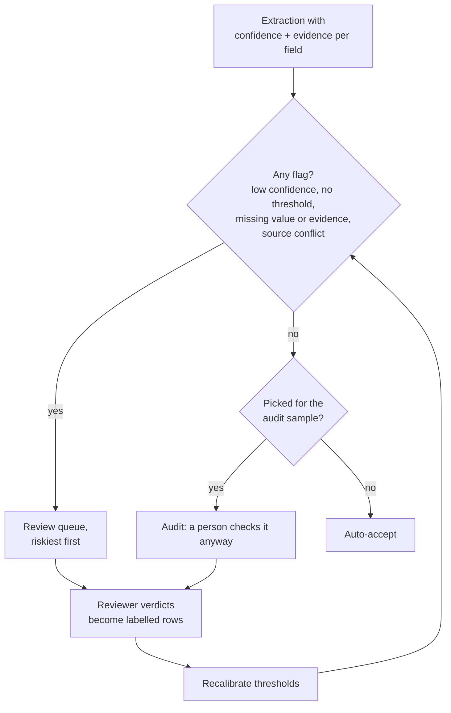

Don't decide which extractions a person checks from one overall accuracy number or from the confidence the model reports. First measure accuracy per document type and per field on a labelled set. Then set a confidence threshold for each of those segments from what you measured. Send everything below its threshold, or anything with a conflict or missing evidence, to a reviewer, riskiest first. Finally, keep a person on a small random sample of everything you auto-accept, so you keep measuring it. In this post you build that whole routing step in TypeScript and test it offline, with no API key.

This is task statement 5.5 of the [Claude Certified Architect – Foundations exam guide](https://anthropic-partners.skilljar.com/claude-certified-architect-foundations-certification): "Design human review workflows and confidence calibration". It sits in Domain 5, Context Management & Reliability, which is 15% of the exam.

## What does task statement 5.5 test?

The guide lists four things to know and four skills. In plain words:

| The guide asks you to… | In practice |
| --- | --- |
| Know that an overall score can hide weak segments | 96% overall can include one field that is right only 3 times in 4 |
| Know what stratified random sampling is for | Check a random sample of trusted output from every document type, to measure its error rate and spot new errors |
| Know that field-level confidence must be calibrated | Compare the confidence the model reports with labelled answers before you route on it |
| Validate every segment before automating | Auto-accept a segment only when its own measured accuracy is good enough |
| Set up ongoing sampling of high-confidence output | A fixed audit sample every day, from every document type |
| Break accuracy down by type and field | A table per document type and field, not one number |
| Ask for field-level confidence, then calibrate | Confidence per field in the schema; thresholds from labelled data |
| Route the risky items first | Low confidence, missing evidence and contradictory sources go to people, in order of risk |

A few posts in this prep series sit next to this one. [Validation and retry loops for Claude extraction](/blog/claude-validation-retry-loops) (task statement 4.4) covers the checks that run before routing: retries with error feedback, and the `conflict_detected` flag for documents that disagree with themselves. [Explicit criteria in prompts: fewer false positives](/blog/prompt-explicit-criteria) (task statement 4.1) covers how to fix the prompt once you know which outputs go wrong. And [When a Claude agent should ask, act or escalate](/blog/agent-escalation-ambiguity) (task statement 5.2) explains why an agent shouldn't escalate on its own raw confidence. This post shows the one way that confidence becomes useful: once you have checked it against labelled answers.

## Why can a 96% accuracy number be misleading?

Because it is an average, and averages are pulled toward the common cases. Say your pipeline reads three fields (total, date and vendor) from three document types: invoices, receipts and handwritten delivery notes. People have checked 1,020 extracted fields by hand. That is your **labelled set**: outputs with the right answer marked. Here are the results from the build below:

| View | What it shows |
| --- | --- |
| Overall | 95.6% correct. Looks ready to automate |
| By document type | Invoices 97.5%, receipts 93.3%, delivery notes 91.7%. Receipts look like the problem |
| By type and field | Delivery-note dates: **77.5%**. Every other segment is 91% or better |

Each view hides something. The overall number hides the delivery notes, because they are only 120 of the 1,020 fields. The view by type points at receipts, and delivery notes look acceptable, because their totals and vendors are almost always right and pull the average up. Only the view by **segment**, document type and field together, shows that one field of a rare document type is wrong almost one time in four.

That is what "stratify" means here: split the results into groups (strata) that can behave differently, and measure each group on its own. Pick the groups that matter for your data: document type, field, supplier, language, scan quality.

## What does calibrated confidence mean?

Ask Claude for a confidence value next to each field, from 0 to 1. That number is a prediction: "I think this is right." **Calibrated** means the prediction matches reality: of all the fields reported at 0.9, about 90% are correct. You only know that after you measure it.

Research says not to assume it. A study of how language models express uncertainty ([Xiong et al., ICLR 2024](https://arxiv.org/abs/2306.13063)) found that "LLMs, when verbalizing their confidence, tend to be overconfident". The task 5.2 post took this as a reason not to escalate on raw confidence. Task 5.5 takes the next step: measure the confidence, and then use what you measured.

In the build below, the labelled set gives this **reliability table**: for each confidence the model reported, how often it was right.

| Model said | Right | Fields |
| --- | --- | --- |
| 0.6 | 65.0% | 20 |
| 0.7 | 66.7% | 30 |
| 0.8 | 86.3% | 80 |
| 0.9 | 94.5% | 165 |
| 0.95 | 97.7% | 260 |
| 0.99 | 99.6% | 465 |

Pooled like this, the confidence looks fine. But inside the 0.99 row are ten delivery-note dates, and only eight of them are right. Calibration has the same problem as accuracy: it can be good on average and bad in one segment. So you check it per segment, too.

## How do you pick a review threshold?

For each segment, find the lowest confidence that is safe to auto-accept. You need two numbers first:

- **Target accuracy**: how often the auto-accepted fields must be right. This build uses 98%, so at most 2 in 100 may be wrong.
- **Minimum sample**: how many labelled fields must support a threshold. This build uses 30. A segment that is 12 out of 12 right hasn't proven anything yet.

Then, for each segment, try every confidence level from low to high. Take all labelled fields at or above it. The first level where those fields reach the target, with enough of them, is the threshold. If no level works, the segment has no threshold, and every field in it goes to a person.

The result for the labelled set above:

| Document type | Total | Date | Vendor |
| --- | --- | --- | --- |
| Invoice | 0.9 | 0.9 | 0.8 |
| Receipt | 0.9 | 0.95 | 0.99 |
| Delivery note | 0.95 | always review | 0.9 |

Compare that with one global threshold for everything. Over all 1,020 fields, 0.9 meets the 98% target. But at 0.9 and above, 9 of the 40 delivery-note dates are wrong. One global threshold would let them through. It would also send invoice vendors at 0.8 to review, although that segment meets the target from 0.8 up. Per-segment thresholds fix both.

Keep a **held-out** part of your labelled set: labelled documents that you don't use to pick thresholds. Run the thresholds on them to check that they still hold. Thresholds that are only checked on the data that chose them always look a little better than they are.

## What else sends a document to a person?

Confidence is one signal. The build adds three checks that don't depend on the model's opinion of itself:

| Check | Why it matters |
| --- | --- |
| Missing value | The document doesn't show the field, or Claude couldn't find it |
| Evidence not found | Claude gave a quote for the value, but that quote isn't in the document. A sure answer with no source is a warning sign |
| Source conflict | The document gives two different values for one field, such as two totals. A person has to decide which one is right |

The evidence check needs a quote per field, so the schema asks for one. Why not use Claude's Citations feature, which returns the exact cited text? Because the [citations docs](https://platform.claude.com/docs/en/build-with-claude/citations) say it doesn't work together with structured outputs: combining citations with `output_config.format` "returns a 400 error". So the quote is a schema field, and code checks that it is really in the document.

Here is the whole routing step:



## Why check outputs you already trust?

Because nothing else measures them. Once a segment is auto-accepted, no person looks at it, so its errors are invisible. The guide's answer is **stratified random sampling** of high-confidence output: every day, pick a fixed number of auto-accepted documents at random from each document type, and have a person check them.

It does two jobs:

- **It measures the real error rate** of the output you trust. If the audit finds 4 wrong totals in 20 invoices, your threshold no longer holds.
- **It catches new kinds of errors.** A supplier changes its invoice layout, and Claude now reads the subtotal as the total, with high confidence. No rule flags it. Only a person looking at a random sample sees it.

Two details make the sample useful:

- **Sample per type, not from the whole stream.** A 1% sample of everything mostly picks invoices. Receipts, which are rarer, may get no sample at all for days. A fixed count per type measures each one.
- **Keep it random.** Don't pick the items near the threshold, or the ones that look odd. A random sample is the only fair measure of the whole auto-accepted stream.


<Callout type="warning" title="Don't let a busy day eat the audit">

When the review queue is long, it's tempting to skip the audit sample and spend the time on flagged items. Then you stop measuring the output nobody else checks, and you'll only find a new error pattern when a customer does. Reserve the audit slots first, then fill the rest of the day from the queue.

</Callout>


## Who goes first when reviewers are busy?

Usually the queue is longer than the day. Sort it by how likely each document is to be wrong:

1. **Source conflicts and missing evidence first.** A document that disagrees with itself, or a value with no quote in the source, needs a person no matter how confident the model is.
2. **Then by measured error rate.** For each flagged field, look up the segment's measured accuracy at that confidence in your labelled set. A delivery-note date at 0.99 is wrong 20% of the time, so it beats a receipt vendor at 0.9, which is wrong 10% of the time.

What doesn't fit today waits in a backlog. It is never auto-accepted because time ran out. And note the difference between the two kinds of picking: **random** is right for the audit sample, because it measures. **Ranked by risk** is right for the review queue, because it fixes the most errors per hour.

## What should a reviewer see?

A reviewer who sees only the extracted JSON and an "Approve" button can't check anything. They can only agree. Give them:

| Show | Why |
| --- | --- |
| The source document next to each value, with the evidence quote highlighted | They check the value against the source, not against their memory |
| Why the item was flagged, per field | They look at the field that is in doubt first |
| Both values in a conflict | They choose, instead of fixing a number they never saw |
| A verdict per field: correct, corrected, or not in the document | Each verdict becomes a labelled row |

One more choice: for audit items, consider hiding the model's confidence. A reviewer who sees "0.99" may check less carefully.

## How does the feedback loop work?

Every verdict from a reviewer or an audit becomes a new labelled row: document type, field, the confidence the model reported, and whether it was right. Add those rows to your labelled set and recalibrate on a schedule, such as weekly.

In the build, an audit finds 4 wrong totals in 20 invoices reported at 0.99. After those 20 rows are added, invoice totals no longer meet the target at any threshold. All invoice totals go back to review until the cause is fixed. Nobody had to notice the problem by hand. The numbers moved the segment back.

The verdicts also tell you what to fix. If one segment keeps failing, the fix is usually in the prompt, the schema or the input, as the task 4.1 and 4.4 posts show. Recalibrate after every prompt change or model change, because old thresholds describe old behaviour.

## Try it: calibrate and route, tested offline

You'll build the routing step for the three document types above:

- A **labelled set** of 1,020 fields, written as counts so you can read it.
- **Calibration**: accuracy per segment, the reliability table, and a threshold per segment.
- **Routing**: flags, a risk-sorted review queue, a stratified audit sample and a fixed daily capacity.
- **Extraction** with the official SDK and structured outputs, type-checked here and run only in the last step.

The labelled counts and the documents are **examples we wrote by hand**. They are not recorded model output. They prove the routing logic, not Claude's accuracy.

**You need:** Node.js 22.18 or later, which runs `.ts` files directly because [type stripping is on by default](https://nodejs.org/docs/latest-v22.x/api/typescript.html). An Anthropic API key only for the last step.


<Steps>


<Step title="Create the project">

```bash
$ mkdir review-routing
$ cd review-routing
$ npm init -y
$ npm pkg set type=module
```

Install the [official TypeScript SDK](https://github.com/anthropics/anthropic-sdk-typescript) and [Zod](https://zod.dev/), then TypeScript and the Node types for type-checking:


```bash
npm install @anthropic-ai/sdk zod
```


```bash
npm install -D typescript @types/node
```


Use the same `tsconfig.json` as the earlier posts in this series:


**tsconfig.json**

```json
{
  "compilerOptions": {
    "noEmit": true,
    "target": "esnext",
    "module": "nodenext",
    "rewriteRelativeImportExtensions": true,
    "erasableSyntaxOnly": true,
    "verbatimModuleSyntax": true,
    "allowImportingTsExtensions": true,
    "strict": true
  },
  "include": ["*.ts"]
}
```


</Step>


<Step title="Write the labelled set">


**labels.ts**

```ts
// A labelled validation set: documents where a person checked every field.
// Hand-written counts, not real model output. Each bucket is
// [confidence the model reported, how many fields, how many were correct].
export const DOC_TYPES = ['invoice', 'receipt', 'delivery_note'] as const;
export const FIELDS = ['total', 'date', 'vendor'] as const;
export type DocType = (typeof DOC_TYPES)[number];
export type Field = (typeof FIELDS)[number];

export interface LabelRow {
  docType: DocType;
  field: Field;
  confidence: number; // what the model said
  correct: boolean; // what the reviewer found
}

type Bucket = [confidence: number, count: number, correct: number];

const BUCKETS: Record<DocType, Record<Field, Bucket[]>> = {
  invoice: {
    total: [[0.6, 10, 7], [0.8, 20, 16], [0.9, 40, 39], [0.95, 60, 60], [0.99, 70, 70]],
    date: [[0.7, 10, 6], [0.9, 40, 39], [0.95, 60, 59], [0.99, 90, 90]],
    vendor: [[0.8, 10, 9], [0.95, 50, 50], [0.99, 140, 140]],
  },
  receipt: {
    total: [[0.6, 10, 6], [0.8, 20, 17], [0.9, 30, 29], [0.99, 40, 40]],
    date: [[0.8, 20, 18], [0.95, 40, 39], [0.99, 40, 40]],
    vendor: [[0.7, 20, 14], [0.9, 30, 27], [0.99, 50, 50]],
  },
  // Handwritten delivery notes: rare, and the model is far too sure about their dates.
  delivery_note: {
    total: [[0.8, 10, 9], [0.95, 30, 30]],
    date: [[0.9, 10, 7], [0.95, 20, 16], [0.99, 10, 8]],
    vendor: [[0.9, 15, 15], [0.99, 25, 25]],
  },
};

// Expand the counts into one row per labelled field.
export function labelledSet(): LabelRow[] {
  const rows: LabelRow[] = [];
  for (const docType of DOC_TYPES) {
    for (const field of FIELDS) {
      for (const [confidence, count, correct] of BUCKETS[docType][field]) {
        for (let i = 0; i < count; i++) rows.push({ docType, field, confidence, correct: i < correct });
      }
    }
  }
  return rows;
}
```


Each bucket says: at this reported confidence, this many fields, this many correct. In your own project, these rows come from documents people have checked. The delivery-note dates are the trap: the model reports 0.9 to 0.99, and it's right far less often than that.

</Step>


<Step title="Measure accuracy and pick thresholds">


**calibrate.ts**

```ts
import { DOC_TYPES, FIELDS, type DocType, type Field, type LabelRow } from './labels.ts';

export interface Accuracy {
  segment: string;
  n: number;
  accuracy: number;
}

function accuracyOf(segment: string, rows: LabelRow[]): Accuracy {
  const correct = rows.filter((r) => r.correct).length;
  return { segment, n: rows.length, accuracy: rows.length ? correct / rows.length : 0 };
}

export const overall = (rows: LabelRow[]) => accuracyOf('overall', rows);

export const byDocType = (rows: LabelRow[]) =>
  DOC_TYPES.map((t) => accuracyOf(t, rows.filter((r) => r.docType === t)));

export const bySegment = (rows: LabelRow[]) =>
  DOC_TYPES.flatMap((t) =>
    FIELDS.map((f) => accuracyOf(`${t}.${f}`, rows.filter((r) => r.docType === t && r.field === f))),
  );

// Segments that are much worse than the overall number hides.
export function weakSegments(rows: LabelRow[], margin = 0.05): Accuracy[] {
  const floor = overall(rows).accuracy - margin;
  return bySegment(rows).filter((s) => s.accuracy < floor);
}

// Reliability table: for each confidence the model reported, how often it was right.
export function reliability(rows: LabelRow[]): Accuracy[] {
  const levels = [...new Set(rows.map((r) => r.confidence))].sort((a, b) => a - b);
  return levels.map((c) => accuracyOf(`said ${c}`, rows.filter((r) => r.confidence === c)));
}

export interface CalibrationOptions {
  target: number; // accuracy you need from everything you auto-accept, e.g. 0.98
  minSamples: number; // don't trust a threshold backed by fewer labelled fields
}

// null means no threshold is safe: this segment always goes to a person.
export type Thresholds = Record<DocType, Record<Field, number | null>>;

// The lowest threshold whose auto-accepted fields meet the target. Lowest = most automation.
export function pickThreshold(rows: LabelRow[], { target, minSamples }: CalibrationOptions): number | null {
  const candidates = [...new Set(rows.map((r) => r.confidence))].sort((a, b) => a - b);
  for (const t of candidates) {
    const accepted = rows.filter((r) => r.confidence >= t);
    if (accepted.length < minSamples) return null; // higher thresholds only have fewer rows
    if (accuracyOf('', accepted).accuracy >= target) return t;
  }
  return null;
}

export function calibrate(rows: LabelRow[], options: CalibrationOptions): Thresholds {
  const out = {} as Thresholds;
  for (const t of DOC_TYPES) {
    out[t] = {} as Record<Field, number | null>;
    for (const f of FIELDS) {
      out[t][f] = pickThreshold(rows.filter((r) => r.docType === t && r.field === f), options);
    }
  }
  return out;
}

// Measured accuracy for one segment at a reported confidence: the review queue sorts by it.
export function measuredAccuracy(rows: LabelRow[], docType: DocType, field: Field, confidence: number): number {
  const segment = rows.filter((r) => r.docType === docType && r.field === field);
  const below = segment.filter((r) => r.confidence <= confidence);
  const nearest = below.length ? Math.max(...below.map((r) => r.confidence)) : Math.min(...segment.map((r) => r.confidence));
  return accuracyOf('', segment.filter((r) => r.confidence === nearest)).accuracy;
}
```


What each part does:

- **`byDocType` and `bySegment`** split the accuracy. `weakSegments` flags any segment more than 5 points below the overall number.
- **`reliability`** is the table of "model said" against "was right".
- **`pickThreshold`** walks up the confidence levels and returns the first one where the fields at or above it meet the target, with at least `minSamples` of them. `null` means "always review".
- **`measuredAccuracy`** looks up how often a segment is right at a given confidence. The review queue sorts by it.

</Step>


<Step title="Ask Claude for confidence and evidence per field">


**schema.ts**

```ts
import { z } from 'zod';

// One extracted field: the value, how sure Claude is, and the text that shows it.
const fieldOf = (what: string) =>
  z.object({
    value: z.string().nullable().describe(`${what} null if the document does not show it.`),
    confidence: z.number().describe('How sure you are that value is correct, from 0 to 1.'),
    evidence: z
      .string()
      .nullable()
      .describe('The exact text in the document that shows the value, copied character for character. null if value is null.'),
  });

export const ExtractionSchema = z.object({
  total: fieldOf('Total amount as printed, digits and a decimal point only, for example "1250.00".'),
  date: fieldOf('Document date as YYYY-MM-DD.'),
  vendor: fieldOf('Name of the business that issued the document.'),
  conflicts: z
    .array(z.string())
    .describe('Each place where the document gives two different values for one field, for example "two totals: 1250.00 and 1205.00". Empty if none.'),
});
export type Extraction = z.infer<typeof ExtractionSchema>;
export const extractionJsonSchema = z.toJSONSchema(ExtractionSchema);
```


**extract.ts**

```ts
import type Anthropic from '@anthropic-ai/sdk';
import type { DocType } from './labels.ts';
import { ExtractionSchema, extractionJsonSchema, type Extraction } from './schema.ts';

// Anything with a messages.create() method: the real client, or a fake in tests.
export interface MessagesClient {
  messages: {
    create(params: Anthropic.MessageCreateParamsNonStreaming): Promise<Anthropic.Message>;
  };
}

export const MODEL = 'claude-opus-5-5';

const SYSTEM = `You extract three fields from business documents: total, date and vendor.
- Copy values only from the document. If a field is not shown, use null.
- evidence: the exact text that shows the value, copied character for character.
- confidence: how sure you are, from 0 to 1. Use a low number when the text is
  hard to read, handwritten, or could mean two things.
- conflicts: list every place where the document gives two different values for one field.
  Never pick one of them silently.`;

export function extractionRequest(docType: DocType, text: string): Anthropic.MessageCreateParamsNonStreaming {
  return {
    model: MODEL,
    max_tokens: 4000,
    system: SYSTEM,
    messages: [{ role: 'user', content: `<document type="${docType}">\n${text}\n</document>` }],
    output_config: { format: { type: 'json_schema', schema: extractionJsonSchema } },
  };
}

export async function extract(client: MessagesClient, docType: DocType, text: string): Promise<Extraction> {
  const message = await client.messages.create(extractionRequest(docType, text));
  if (message.stop_reason !== 'end_turn') throw new Error(`stop_reason is ${message.stop_reason}`);
  const block = message.content.find((b) => b.type === 'text');
  if (!block) throw new Error('no text block');
  return ExtractionSchema.parse(JSON.parse(block.text));
}
```


Each field has a `value`, a `confidence` and an `evidence` quote. `conflicts` lets Claude report two different values instead of picking one. The request uses [structured outputs](https://platform.claude.com/docs/en/build-with-claude/structured-outputs) with `output_config.format`, so the reply always matches the schema. The schema only fixes the shape. Whether the values are right is what the rest of this build measures. The confidence range is in the description, not in `minimum` and `maximum`, because structured outputs don't support numeric limits.

This is the same setup as the task 4.3 post, [Structured output from Claude: tool use and JSON schemas](/blog/claude-structured-output-json-schema). That post also explains why a forced tool call (`tool_choice` set to `any` or a named tool) returns a 400 error on Claude Opus 5.5, so structured outputs are the way to get one fixed shape here.

</Step>


<Step title="Route each document">


**route.ts**

```ts
import { measuredAccuracy, type Thresholds } from './calibrate.ts';
import { DOC_TYPES, FIELDS, type DocType, type Field, type LabelRow } from './labels.ts';
import type { Extraction } from './schema.ts';

export interface Doc {
  id: string;
  docType: DocType;
  text: string; // the source document, for the evidence check and the reviewer screen
  extraction: Extraction;
}

export type Reason = 'no_safe_threshold' | 'low_confidence' | 'missing_value' | 'evidence_not_found' | 'source_conflict';
export interface Flag {
  field: Field | 'document';
  reason: Reason;
}

export interface Routed {
  doc: Doc;
  route: 'auto_accept' | 'audit' | 'review';
  flags: Flag[];
  priority: number; // review only: the expected chance that something is wrong, 0 to 1
}

const normalize = (s: string) => s.toLowerCase().replace(/\s+/g, ' ').trim();

// Check one document against the calibrated thresholds. Code checks, not the model.
export function check(doc: Doc, rows: LabelRow[], thresholds: Thresholds): Routed {
  const flags: Flag[] = [];
  let priority = 0;
  const raise = (p: number) => (priority = Math.max(priority, p));

  for (const field of FIELDS) {
    const { value, confidence, evidence } = doc.extraction[field];
    const threshold = thresholds[doc.docType][field];
    const expectedError = 1 - measuredAccuracy(rows, doc.docType, field, confidence);

    if (value === null) {
      flags.push({ field, reason: 'missing_value' });
      raise(expectedError);
    } else if (!evidence || !normalize(doc.text).includes(normalize(evidence))) {
      flags.push({ field, reason: 'evidence_not_found' }); // the quote isn't in the source
      raise(1);
    }
    if (threshold === null) {
      flags.push({ field, reason: 'no_safe_threshold' });
      raise(expectedError);
    } else if (confidence < threshold) {
      flags.push({ field, reason: 'low_confidence' });
      raise(expectedError);
    }
  }
  if (doc.extraction.conflicts.length > 0) {
    flags.push({ field: 'document', reason: 'source_conflict' });
    raise(1); // the document disagrees with itself: only a person can decide
  }
  return { doc, route: flags.length ? 'review' : 'auto_accept', flags, priority };
}

// Small seeded random generator (mulberry32), so a test run is repeatable.
function random(seed: number) {
  return () => {
    seed = (seed + 0x6d2b79f5) | 0;
    let t = Math.imul(seed ^ (seed >>> 15), 1 | seed);
    t = (t + Math.imul(t ^ (t >>> 7), 61 | t)) ^ t;
    return ((t ^ (t >>> 14)) >>> 0) / 4294967296;
  };
}

function shuffle<T>(items: T[], rand: () => number): T[] {
  const out = [...items];
  for (let i = out.length - 1; i > 0; i--) {
    const j = Math.floor(rand() * (i + 1));
    [out[i], out[j]] = [out[j], out[i]];
  }
  return out;
}

export interface DayOptions {
  capacity: number; // documents your reviewers can check today
  auditPerType: number; // random auto-accepted documents to check, per document type
  seed: number; // log it, so you can rebuild the sample later
}

export interface DayPlan {
  autoAccepted: Routed[];
  audit: Routed[]; // checked by a person even though no rule flagged them
  reviewToday: Routed[];
  backlog: Routed[]; // flagged, waiting for tomorrow: never auto-accepted
}

export function planDay(docs: Doc[], rows: LabelRow[], thresholds: Thresholds, options: DayOptions): DayPlan {
  const routed = docs.map((d) => check(d, rows, thresholds));
  const rand = random(options.seed);

  // Stratified audit sample: the same number from every document type, so rare types are measured too.
  const audit = DOC_TYPES.flatMap((t) =>
    shuffle(routed.filter((r) => r.route === 'auto_accept' && r.doc.docType === t), rand).slice(0, options.auditPerType),
  ).map((r) => ({ ...r, route: 'audit' as const }));
  const audited = new Set(audit.map((r) => r.doc.id));

  // Audit slots are reserved first, so a busy day can't squeeze out the measurement.
  const queue = routed
    .filter((r) => r.route === 'review')
    .sort((a, b) => b.priority - a.priority || a.doc.id.localeCompare(b.doc.id));
  const slots = Math.max(0, options.capacity - audit.length);

  return {
    autoAccepted: routed.filter((r) => r.route === 'auto_accept' && !audited.has(r.doc.id)),
    audit,
    reviewToday: queue.slice(0, slots),
    backlog: queue.slice(slots),
  };
}

// The feedback loop: every reviewed or audited document becomes new labelled rows.
export function labelsFromReview(doc: Doc, correct: Record<Field, boolean>): LabelRow[] {
  return FIELDS.map((field) => ({
    docType: doc.docType,
    field,
    confidence: doc.extraction[field].confidence,
    correct: correct[field],
  }));
}
```


The parts that carry the exam's ideas:

- **`check`** flags each field: below its threshold, in a segment with no threshold, missing, or with a quote that isn't in the document. A source conflict flags the whole document. The priority is the highest expected error among the flags, and 1 for a conflict or missing evidence.
- **`planDay`** picks the audit sample first: `auditPerType` documents at random from each type's auto-accepted items. It reserves their slots, then fills the rest of the capacity from the queue, riskiest first. The rest goes to `backlog`, never to auto-accept.
- **The seed** makes the sample repeatable. In production, use a new seed each day and log it, so you can rebuild any day's sample.
- **`labelsFromReview`** turns a verdict into labelled rows for the next calibration.

</Step>


<Step title="Add one day of documents">


**fixtures.ts**

```ts
import type { DocType } from './labels.ts';
import type { Doc } from './route.ts';

// Hand-written documents and extractions for one day. Not real model output.
interface Options {
  confidence?: [total: number, date: number, vendor: number];
  totalEvidence?: string; // a quote that may not be in the document
  conflicts?: string[];
}

export function makeDoc(id: string, docType: DocType, options: Options = {}): Doc {
  const [total, date, vendor] = options.confidence ?? [0.99, 0.99, 0.99];
  const text = `Brightwell Supplies Ltd\nDate: 14 September 2026\nTotal: EUR 1,250.00`;
  return {
    id,
    docType,
    text,
    extraction: {
      total: { value: '1250.00', confidence: total, evidence: options.totalEvidence ?? 'Total: EUR 1,250.00' },
      date: { value: '2026-09-14', confidence: date, evidence: 'Date: 14 September 2026' },
      vendor: { value: 'Brightwell Supplies Ltd', confidence: vendor, evidence: 'Brightwell Supplies Ltd' },
      conflicts: options.conflicts ?? [],
    },
  };
}

const many = (prefix: string, docType: DocType, count: number) =>
  Array.from({ length: count }, (_, i) => makeDoc(`${prefix}-${String(i + 1).padStart(2, '0')}`, docType));

export const TODAY: Doc[] = [
  ...many('inv', 'invoice', 40),
  makeDoc('inv-41', 'invoice', { confidence: [0.8, 0.99, 0.99] }),
  makeDoc('inv-42', 'invoice', { totalEvidence: 'Total: EUR 1,205.00' }),
  makeDoc('inv-43', 'invoice', { conflicts: ['two totals: 1250.00 on page 1, 1205.00 on page 2'] }),
  ...many('rcp', 'receipt', 8),
  makeDoc('rcp-09', 'receipt', { confidence: [0.99, 0.99, 0.9] }),
  makeDoc('dn-01', 'delivery_note'),
  makeDoc('dn-02', 'delivery_note'),
];
```


Fifty-four documents: 43 invoices, 9 receipts and 2 delivery notes. Most are clean. Six get flagged, for four different reasons.

</Step>


<Step title="Test it without an API key">


**calibrate.test.ts**

```ts
import assert from 'node:assert/strict';
import { test } from 'node:test';
import { byDocType, calibrate, measuredAccuracy, overall, pickThreshold, reliability, weakSegments } from './calibrate.ts';
import { labelledSet, type LabelRow } from './labels.ts';

const rows = labelledSet();
const OPTIONS = { target: 0.98, minSamples: 30 };

test('a good overall number hides one weak field of one document type', () => {
  assert.ok(overall(rows).accuracy > 0.95);
  const weak = weakSegments(rows);
  assert.deepEqual(weak.map((s) => s.segment), ['delivery_note.date']);
  assert.equal(weak[0].accuracy, 0.775);
  // Split by document type only, delivery notes don't stand out: you need type AND field.
  const floor = overall(rows).accuracy - 0.05;
  assert.ok(byDocType(rows).every((t) => t.accuracy >= floor));
});

test('confidence looks calibrated in total, but not for every segment', () => {
  const said099 = reliability(rows).find((r) => r.segment === 'said 0.99')!;
  assert.ok(said099.accuracy > 0.99); // pooled: "0.99" means 99.6% right
  assert.equal(measuredAccuracy(rows, 'delivery_note', 'date', 0.99), 0.8); // delivery-note dates: 80%
});

test('thresholds are set per document type and field', () => {
  assert.deepEqual(calibrate(rows, OPTIONS), {
    invoice: { total: 0.9, date: 0.9, vendor: 0.8 },
    receipt: { total: 0.9, date: 0.95, vendor: 0.99 },
    delivery_note: { total: 0.95, date: null, vendor: 0.9 },
  });
});

test('one global threshold would auto-accept delivery-note dates that are wrong more than 1 time in 5', () => {
  const global = pickThreshold(rows, OPTIONS);
  assert.equal(global, 0.9);
  const passed = rows.filter((r) => r.docType === 'delivery_note' && r.field === 'date' && r.confidence >= global!);
  const wrong = passed.filter((r) => !r.correct).length;
  assert.equal(`${wrong}/${passed.length}`, '9/40');
});

test('too few labelled rows: no threshold, so the segment stays in review', () => {
  const few: LabelRow[] = Array.from({ length: 12 }, () => ({ docType: 'receipt', field: 'total', confidence: 0.99, correct: true }));
  assert.equal(pickThreshold(few, OPTIONS), null); // 12 of 12 right is not proof
});

test('audit findings feed back: new errors take invoice totals out of auto-accept', () => {
  assert.equal(calibrate(rows, OPTIONS).invoice.total, 0.9);
  // The audit sample found 4 wrong totals in 20 "0.99" invoices from a new supplier layout.
  const audited: LabelRow[] = Array.from({ length: 20 }, (_, i) => ({
    docType: 'invoice', field: 'total', confidence: 0.99, correct: i >= 4,
  }));
  assert.equal(calibrate([...rows, ...audited], OPTIONS).invoice.total, null);
});
```


**route.test.ts**

```ts
import assert from 'node:assert/strict';
import { test } from 'node:test';
import { calibrate } from './calibrate.ts';
import { makeDoc, TODAY } from './fixtures.ts';
import { labelledSet } from './labels.ts';
import { check, labelsFromReview, planDay } from './route.ts';

const rows = labelledSet();
const thresholds = calibrate(rows, { target: 0.98, minSamples: 30 });
const reasons = (id: string) => check(TODAY.find((d) => d.id === id)!, rows, thresholds).flags.map((f) => `${f.field}: ${f.reason}`);
const DAY = { capacity: 8, auditPerType: 2, seed: 20261002 };

test('fields above their calibrated threshold, with evidence, are auto-accepted', () => {
  assert.deepEqual(reasons('inv-01'), []);
  assert.deepEqual(reasons('rcp-01'), []);
});

test('each flag says why the document needs a person', () => {
  assert.deepEqual(reasons('inv-41'), ['total: low_confidence']); // 0.8 < 0.9
  assert.deepEqual(reasons('rcp-09'), ['vendor: low_confidence']); // 0.9 < 0.99
  assert.deepEqual(reasons('inv-42'), ['total: evidence_not_found']); // confident, but the quote isn't there
  assert.deepEqual(reasons('inv-43'), ['document: source_conflict']);
  assert.deepEqual(reasons('dn-01'), ['date: no_safe_threshold']); // 0.99, but this segment is never auto-accepted
});

test('a missing value goes to review even with high confidence', () => {
  const doc = makeDoc('rcp-x', 'receipt');
  doc.extraction.date = { value: null, confidence: 0.99, evidence: null };
  assert.deepEqual(check(doc, rows, thresholds).flags, [{ field: 'date', reason: 'missing_value' }]);
});

test('the audit sample takes the same number from every type that has auto-accepted documents', () => {
  const plan = planDay(TODAY, rows, thresholds, DAY);
  const types = plan.audit.map((r) => r.doc.docType);
  assert.deepEqual(types, ['invoice', 'invoice', 'receipt', 'receipt']); // 2 of 40 invoices, 2 of 8 receipts
  assert.ok(plan.audit.every((r) => !plan.autoAccepted.includes(r)));
  // Same seed, same sample: you can rebuild it later.
  assert.deepEqual(planDay(TODAY, rows, thresholds, DAY).audit.map((r) => r.doc.id), plan.audit.map((r) => r.doc.id));
});

test('limited capacity: audit slots first, then the riskiest flagged documents', () => {
  const plan = planDay(TODAY, rows, thresholds, DAY);
  assert.equal(plan.audit.length + plan.reviewToday.length, 8);
  assert.deepEqual(plan.reviewToday.map((r) => r.doc.id), ['inv-42', 'inv-43', 'dn-01', 'dn-02']);
  assert.deepEqual(plan.backlog.map((r) => r.doc.id), ['inv-41', 'rcp-09']); // waiting, not accepted
  assert.equal(plan.autoAccepted.length + plan.audit.length + plan.reviewToday.length + plan.backlog.length, TODAY.length);
});

test('a reviewed document becomes labelled rows for the next calibration', () => {
  const doc = TODAY.find((d) => d.id === 'dn-01')!;
  assert.deepEqual(labelsFromReview(doc, { total: true, date: false, vendor: true }), [
    { docType: 'delivery_note', field: 'total', confidence: 0.99, correct: true },
    { docType: 'delivery_note', field: 'date', confidence: 0.99, correct: false },
    { docType: 'delivery_note', field: 'vendor', confidence: 0.99, correct: true },
  ]);
});
```


```bash
$ node --test --test-reporter=spec calibrate.test.ts route.test.ts
```

```text
✔ a good overall number hides one weak field of one document type
✔ confidence looks calibrated in total, but not for every segment
✔ thresholds are set per document type and field
✔ one global threshold would auto-accept delivery-note dates that are wrong more than 1 time in 5
✔ too few labelled rows: no threshold, so the segment stays in review
✔ audit findings feed back: new errors take invoice totals out of auto-accept
✔ fields above their calibrated threshold, with evidence, are auto-accepted
✔ each flag says why the document needs a person
✔ a missing value goes to review even with high confidence
✔ the audit sample takes the same number from every type that has auto-accepted documents
✔ limited capacity: audit slots first, then the riskiest flagged documents
✔ a reviewed document becomes labelled rows for the next calibration
ℹ tests 12
ℹ suites 0
ℹ pass 12
ℹ fail 0
ℹ cancelled 0
ℹ skipped 0
ℹ todo 0
```

This is our output on Node 22.22.2 with `zod` 4.6.5, with per-test timings removed. No model was called. What the tests prove:

- **The overall number hides the weak segment**, and the split by document type alone doesn't find it either.
- **Pooled confidence looks calibrated**: "0.99" is right 99.6% of the time. Delivery-note dates at 0.99 are right 80% of the time.
- **One global threshold (0.9) would auto-accept 40 delivery-note dates, 9 of them wrong.** Per-segment thresholds send all of them to review.
- **Too few labelled rows means no threshold**, so the segment stays with people.
- **Audit findings feed back**: four wrong invoice totals in an audit of 20 take invoice totals out of auto-accept.
- **Every type with auto-accepted documents gets the same audit sample**, the same seed gives the same sample, and audit slots come before the queue.
- **Flagged documents that don't fit today wait.** None is auto-accepted.

</Step>


<Step title="Print the report">


**report.ts**

```ts
import { byDocType, bySegment, calibrate, overall, reliability, weakSegments, type Accuracy } from './calibrate.ts';
import { TODAY } from './fixtures.ts';
import { labelledSet } from './labels.ts';
import { planDay } from './route.ts';

const rows = labelledSet();
const pct = (a: number) => `${(a * 100).toFixed(1)}%`;
const line = (a: Accuracy, mark = '') => `  ${a.segment.padEnd(22)} ${pct(a.accuracy).padStart(6)}  n=${a.n}${mark}`;

const weak = new Set(weakSegments(rows).map((s) => s.segment));
console.log('Accuracy');
console.log(line(overall(rows)));
console.log('By document type');
for (const a of byDocType(rows)) console.log(line(a));
console.log('By document type and field');
for (const a of bySegment(rows)) console.log(line(a, weak.has(a.segment) ? '  <- weak' : ''));

console.log('\nWhat the model said vs. how often it was right');
for (const a of reliability(rows)) console.log(line(a));

const thresholds = calibrate(rows, { target: 0.98, minSamples: 30 });
console.log('\nThresholds (target 98%, at least 30 labelled fields)');
for (const [docType, fields] of Object.entries(thresholds)) {
  const cells = Object.entries(fields).map(([f, t]) => `${f} ${t ?? 'always review'}`);
  console.log(`  ${docType.padEnd(14)} ${cells.join(' | ')}`);
}

const plan = planDay(TODAY, rows, thresholds, { capacity: 8, auditPerType: 2, seed: 20261002 });
console.log(`\nToday: ${TODAY.length} documents, capacity 8`);
console.log(`  auto-accepted ${plan.autoAccepted.length}`);
console.log(`  audit sample  ${plan.audit.map((r) => r.doc.id).join(', ')}`);
for (const r of plan.reviewToday) {
  const why = r.flags.map((f) => `${f.field}: ${f.reason}`).join(', ');
  console.log(`  review        ${r.doc.id.padEnd(7)} priority ${r.priority.toFixed(2)}  ${why}`);
}
console.log(`  backlog       ${plan.backlog.map((r) => r.doc.id).join(', ')}`);
```


```bash
$ node report.ts
```

```text
Accuracy
  overall                 95.6%  n=1020
By document type
  invoice                 97.5%  n=600
  receipt                 93.3%  n=300
  delivery_note           91.7%  n=120
By document type and field
  invoice.total           96.0%  n=200
  invoice.date            97.0%  n=200
  invoice.vendor          99.5%  n=200
  receipt.total           92.0%  n=100
  receipt.date            97.0%  n=100
  receipt.vendor          91.0%  n=100
  delivery_note.total     97.5%  n=40
  delivery_note.date      77.5%  n=40  <- weak
  delivery_note.vendor   100.0%  n=40

What the model said vs. how often it was right
  said 0.6                65.0%  n=20
  said 0.7                66.7%  n=30
  said 0.8                86.3%  n=80
  said 0.9                94.5%  n=165
  said 0.95               97.7%  n=260
  said 0.99               99.6%  n=465

Thresholds (target 98%, at least 30 labelled fields)
  invoice        total 0.9 | date 0.9 | vendor 0.8
  receipt        total 0.9 | date 0.95 | vendor 0.99
  delivery_note  total 0.95 | date always review | vendor 0.9

Today: 54 documents, capacity 8
  auto-accepted 44
  audit sample  inv-02, inv-26, rcp-01, rcp-03
  review        inv-42  priority 1.00  total: evidence_not_found
  review        inv-43  priority 1.00  document: source_conflict
  review        dn-01   priority 0.20  date: no_safe_threshold
  review        dn-02   priority 0.20  date: no_safe_threshold
  backlog       inv-41, rcp-09
```

Read it from the top: the overall number, the split that misleads, the split that shows the problem, the reliability table that looks fine, and the thresholds that handle it. Then the day: 44 auto-accepted, 4 audited, 4 reviewed, and 2 waiting for tomorrow. The two items with priority 1.00 are the ones no confidence score could clear.

Type-check everything, including the live script in the next step:

```bash
$ npx tsc
```

`tsc` prints nothing when there are no type errors.

</Step>


<Step title="Run it with Claude">

Create an API key in the [Claude Console](https://platform.claude.com/) and set it as the `ANTHROPIC_API_KEY` environment variable. Save a short document:


**note.txt**

```text
Brightwell Supplies Ltd
Delivery note DN-5521
Date: 14 Sept 2026 (handwritten, partly smudged)
Received: 12 boxes
Total: EUR 312.40
```


**run.ts**

```ts
import Anthropic from '@anthropic-ai/sdk';
import { readFileSync } from 'node:fs';
import { calibrate } from './calibrate.ts';
import { extract } from './extract.ts';
import { DOC_TYPES, labelledSet, type DocType } from './labels.ts';
import { check } from './route.ts';

// Usage: node run.ts <invoice|receipt|delivery_note> <document.txt>
const [docType, file] = process.argv.slice(2) as [DocType, string];
if (!DOC_TYPES.includes(docType) || !file) throw new Error('Usage: node run.ts <doc type> <document.txt>');

const client = new Anthropic(); // reads ANTHROPIC_API_KEY from the environment
const text = readFileSync(file, 'utf8');
const extraction = await extract(client, docType, text);

const rows = labelledSet(); // swap in your own labelled rows
const routed = check({ id: file, docType, text, extraction }, rows, calibrate(rows, { target: 0.98, minSamples: 30 }));
console.log(JSON.stringify(extraction, null, 2));
console.log(routed.route, routed.flags);
```


```bash
$ node run.ts delivery_note note.txt
```

Expect `review`, with a `date: no_safe_threshold` flag whatever confidence Claude reports, because the canned labelled set never trusts delivery-note dates. Then follow the guide's exercise: run 50 to 100 of your own documents of at least three types, have people label the fields, and replace `labelledSet()` with those rows. Claude's values and confidence will differ from the canned ones.

The model is `claude-opus-5-5`, which the [models overview](https://platform.claude.com/docs/en/about-claude/models/overview) suggests starting with. To label a large set cheaply, the [Message Batches API](https://platform.claude.com/docs/en/build-with-claude/batch-processing) runs the same requests at 50% of the cost, and most batches finish in less than an hour. Task statement 4.5, "Design efficient batch processing strategies", has its own post in this prep series.

</Step>


</Steps>


## Common traps

These are the mistakes that wrong answer options are built on.

| Trap | Why it breaks | Fix |
| --- | --- | --- |
| Cutting review because overall accuracy is high | A rare document type or one field can be far worse | Accuracy per document type and field first |
| Splitting by document type only | A weak field hides inside a type whose other fields are fine | Split by type and field together |
| Routing on raw model confidence | Reported confidence tends to be too high, and differs by segment | Thresholds from labelled data, per segment |
| One global threshold | Too loose for weak segments, too strict for strong ones | One threshold per document type and field |
| Trusting a threshold built on a dozen examples | A small perfect score is luck as often as proof | A minimum sample per segment; otherwise review |
| Reviewing only low-confidence items | Errors in the auto-accepted stream are never measured | A random audit sample of trusted output |
| Sampling from the whole stream, or only the main type | Rare types get few or no audit items | A fixed sample from every document type |
| Choosing review items at random when time is short | Spends scarce time on low-risk items | Rank the queue by risk; keep random for the audit |
| A reviewer screen without the source | Reviewers approve what they can't check | Source, highlighted evidence and the flag reason |
| Calibrating once | Prompts, models and documents change | Feed verdicts back and recalibrate on a schedule |

## Practice questions

These four questions are this blog's own, written for practice. They are not from the exam.

**Question 1.** Your extractor reports a confidence value for each field. On a labelled set, invoice `due_date` fields reported at 0.95 are correct 88% of the time, and the team needs 98% accuracy on anything it auto-accepts. How should you set the auto-accept rule for `due_date`?

- A. Auto-accept at 0.95 and above, since the model says it is 95% sure.
- B. Use the labelled `due_date` rows to find the lowest confidence at which the fields at or above it meet 98%, with enough rows to trust it, and send all due dates to review if no level qualifies.
- C. Add "be more careful with due dates" to the prompt and keep the 0.95 threshold.
- D. Use the threshold that works for invoice totals, so every field follows the same rule.

**Question 2.** A pipeline auto-accepts about 60,000 documents a week. To check them, a person reviews 50 documents picked at random from all of them each week. Customs declarations are about 300 of the 60,000. After two months, a customer reports that most customs declaration numbers have been wrong for weeks. What change would have caught this?

- A. Double the weekly sample to 100 documents picked from the whole stream.
- B. Each week, review a fixed number of randomly picked documents from every document type, including customs declarations.
- C. Review only the auto-accepted documents whose confidence is just above the threshold.
- D. Ask customers to report wrong values through a feedback form.

**Question 3.** Reviewers check flagged extractions on a screen that shows the extracted fields and an "Approve" button. They approve 99% of items. An audit of their approved items finds many wrong values that a look at the source would have caught. What is the best change?

- A. Have two reviewers approve every item.
- B. Show the model's confidence for each field in large type.
- C. Show the source document next to each field with the evidence highlighted, say why each field was flagged, and record a verdict per field.
- D. Set a target number of items per hour for each reviewer.

**Question 4.** Each day your reviewers can check 300 documents. The pipeline flags 1,200, and your audit plan picks 40 auto-accepted documents at random. What is the best plan for the day?

- A. Pick 300 of the flagged documents at random.
- B. Skip the audit on busy days, and use all 300 slots for flagged documents.
- C. Auto-accept flagged documents that have waited more than two days.
- D. Reserve 40 slots for the audit sample. Fill the other 260 with source conflicts and missing evidence first, then by measured error rate. Leave the rest in the queue.

## Answer key

### Question 1

**Answer: B.** The labelled data shows that "0.95" means 88% for this field, so the threshold must come from measured accuracy, per field, with a minimum sample. If no level reaches 98%, the field stays with people. The strongest distractor is D: one shared threshold ignores that fields behave differently, which is exactly what the 88% shows. A takes the model's number at face value.

### Question 2

**Answer: B.** A stratified sample takes a fixed number from every document type, so a rare type is checked every week. A sample of 50 from the whole stream picks a customs declaration only about once a month on average. The strongest distractor is A: doubling a sample of the whole stream still picks very few customs declarations. C isn't random, so it doesn't measure the whole stream, and D waits for customers to find the errors.

### Question 3

**Answer: C.** Reviewers can only check what they can see. With the source and the evidence next to each value, they compare instead of agreeing. Per-field verdicts also become labelled data. The strongest distractor is A: two reviewers with the same blind screen double the cost and still can't check against the source. B pushes reviewers to trust the model more.

### Question 4

**Answer: D.** The audit slots keep measuring the output nobody else checks. The rest of the time goes where errors are most likely, and unreviewed items wait instead of being accepted. The strongest distractor is B: it clears 40 more flagged items, but you stop measuring the auto-accepted stream exactly when you have the least insight into it. A uses random choice where ranking by risk fixes more errors, and C lets the riskiest items through just because they waited.

## What should I do next?

- **Extend the build.** Add a `supplier` field to `LabelRow`, split the calibration by supplier, and add a test where one supplier's totals fail while the others pass.
- **Build your labelled set like an eval.** [How to test AI output with evals](/blog/test-ai-output-with-evals) shows how to collect checked examples and run them on every change. [How to test, deploy and use your AI agent](/blog/test-deploy-ai-agent) covers monitoring in production.
- **Move on to task statement 5.6**, "Preserve information provenance and handle uncertainty in multi-source synthesis". The next post in this series covers it.
- **Plan and check your prep.** Follow the [six-week study plan](/blog/claude-architect-exam-study-plan), and test yourself with the [mock exam](/blog/claude-certification-mock-exam) when you've worked through Domain 5.
