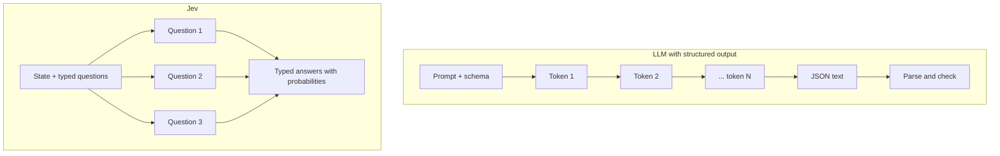
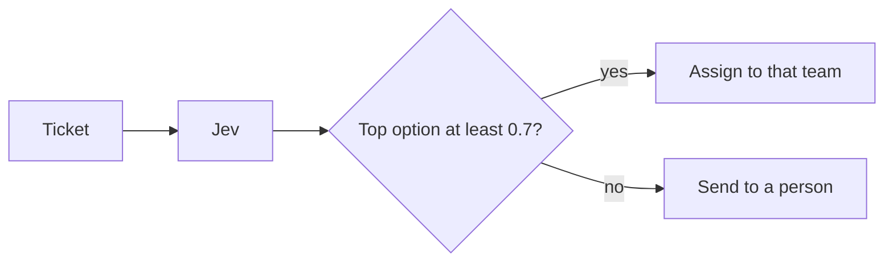

An LLM like Claude or GPT writes text. Even when you ask for JSON, the model is still writing it token by token. Jev, from TypeSafe AI, doesn't write at all: you give it some state and a few typed questions, and it returns a choice, a score or a yes/no probability for each one.

That one difference changes the code you write, what you pay, how fast you get an answer and what you can do with it. This post puts the two side by side on the same job: sorting a support ticket.

## What does "decision model" mean?

Vercel's changelog describes Jev as ["a probabilistic decision model for software: state goes in, typed Choice, Score, and Boolean answers come out"](https://vercel.com/changelog/typesafe-ai-jev-now-available-on-ai-gateway). Three words there matter:

- **State** is the input: a ticket, a log line, an order record or a chat history. It can be a string, an object or an array.
- **Typed** means the answer has a fixed shape that you define up front. It is never free text.
- **Probabilistic** means every answer comes with numbers that say how likely each option is.

If you are new to how LLMs work, [What is an LLM?](/blog/what-is-an-llm) explains tokens and next-word prediction. The short version: an LLM produces its answer one token at a time, each token based on the ones before. [TypeSafe's launch post](https://typesafe.ai/blog/introducing-system-one-models-and-jev) says Jev instead produces all of its outputs in parallel, and gives up string generation to do it.



TypeSafe calls this a "System One" model, after the idea of fast, intuitive thinking (System 1) versus slow, careful reasoning (System 2).

## How do Jev and an LLM compare?

Here is the comparison for a typical classification job. Numbers are what each vendor reports; none of them were measured for this post.

| | LLM (for example Claude) | Jev |
| --- | --- | --- |
| What comes out | Text. JSON that matches your schema if you use [structured outputs](https://platform.claude.com/docs/en/build-with-claude/structured-outputs) | Only typed answers: `choice`, `score` or `boolean`, each with probabilities |
| Format reliability | Schema-compliant in most cases; exceptions are refusals, answers cut off at `max_tokens`, and the capital letters of `enum` values | The answer is always one of the options you defined. It can still be the wrong one |
| Several questions | Answered together in one generation | Each question answered on its own, in parallel |
| Probabilities | Only if you ask the model to write a number | Part of every answer |
| Latency (vendor-reported) | Varies with prompt length, output length and thinking. Claude Haiku 4.5 is listed as the fastest current Claude model | 70 to 500 ms end to end, per TypeSafe |
| Pricing (list price) | Input and output tokens. Claude Haiku 4.5: $1 per million input, $5 per million output | $0.042 per million input tokens. No charge for output tokens |
| Context size | 200K tokens (Haiku 4.5) to 1M tokens (Opus 5.5, Sonnet 5.5) | 64,000 tokens per request, 32,000 of them for the state |
| Good at | Writing, summarizing, chat, code, reasoning, [tool calling](/blog/what-is-tool-calling) | Classifying, routing, scoring against a rubric, yes/no checks |

Sources: Claude prices, latency labels and context windows are from the [models overview](https://platform.claude.com/docs/en/about-claude/models/overview). Jev's price, the no-output-charge rule and the context size are from Vercel's [Jev and AI SDK guide](https://vercel.com/kb/guide/typesafe-jev-and-ai-sdk). The [model page](https://vercel.com/ai-gateway/models/jev) lists a 32,000-token context, which matches the state limit.

### What about the "193.6x faster" claim?

Vercel's changelog repeats TypeSafe's number: Jev was "up to 193.6x faster and 444.6x cheaper than LLMs" in workflow evaluations. These are **TypeSafe's own benchmarks**, not independent tests. In its launch post TypeSafe adds that it expects these numbers "are on the higher end of real world gains", and that the test workflows were made by its own team, "so some bias could exist". Treat them as a reason to test, not as a result.

## How does the same task look in code?

The task: a customer writes "I was charged twice for my subscription. Please refund the duplicate." You want two answers. Which team handles it (billing, technical, account or other)? And is the customer asking for money back?

### With an LLM and structured output

With Claude, you describe the answer as a schema and pass it as `output_config.format`. The TypeScript SDK can build that from a Zod schema and parse the reply for you. This follows the example in Anthropic's [structured outputs guide](https://platform.claude.com/docs/en/build-with-claude/structured-outputs). If you have never called Claude from code, start with [Your first LLM API call](/blog/first-llm-api-call).


```bash
npm install @anthropic-ai/sdk zod
```


**classify-claude.mts**

```ts
import Anthropic from "@anthropic-ai/sdk";
import { z } from "zod";
import { zodOutputFormat } from "@anthropic-ai/sdk/helpers/zod";

const TicketLabels = z.object({
  department: z.enum(["billing", "technical", "account", "other"]),
  requestsRefund: z.boolean(),
});

const client = new Anthropic(); // reads ANTHROPIC_API_KEY

const ticket = "I was charged twice for my subscription. Please refund the duplicate.";

const response = await client.messages.parse({
  model: "claude-haiku-4-5",
  max_tokens: 1024,
  messages: [
    {
      role: "user",
      content:
        "Classify this support ticket. department: billing (charges, invoices, refunds), " +
        "technical (bugs, outages), account (login, permissions) or other. " +
        "requestsRefund: is the customer asking for money back?\n\n" +
        `Ticket: ${ticket}`,
    },
  ],
  output_config: { format: zodOutputFormat(TicketLabels) },
});

// A refusal or a cut-off answer may not match the schema.
if (response.stop_reason === "refusal" || response.stop_reason === "max_tokens") {
  throw new Error(`No usable answer: ${response.stop_reason}`);
}

console.log(response.parsed_output);
```


What to notice:

- **The labels live in the prompt.** You explain each department in words, and the schema's `enum` only limits which strings come back.
- **You get one label, not a level of certainty.** `department` is `"billing"`. There is no number that tells you how sure the model was, unless you add a field and ask the model to write one. That number is still text the model wrote.
- **You still check for edge cases.** The guide says a refusal or an answer cut off at `max_tokens` "may not match your schema", and that `enum` values can come back with different capital letters. Compare enum values without caring about case.

You can get the same shape through tool use with `strict: true`. [What is tool calling?](/blog/what-is-tool-calling) shows how that loop works.

### With Jev and the AI SDK

Jev runs on Vercel AI Gateway. You call it with `experimental_evaluate` from the `ai` package, which needs AI SDK 7.0.105 or later, per the [changelog](https://vercel.com/changelog/typesafe-ai-jev-now-available-on-ai-gateway). Set `AI_GATEWAY_API_KEY` in your shell, as the [evaluation quickstart](https://vercel.com/docs/ai-gateway/getting-started/evaluation) shows. That quickstart uses `.mts` files run directly with Node.js 22.18 or later.


```bash
npm install ai@latest
```


**classify-jev.mts**

```ts
import { experimental_evaluate as evaluate } from "ai";

const ticket = "I was charged twice for my subscription. Please refund the duplicate.";

const result = await evaluate({
  model: "typesafe-ai/jev", // reads AI_GATEWAY_API_KEY
  state: ticket,
  questions: {
    department: {
      type: "choice",
      instructions: "Which team should handle this ticket?",
      criteria: {
        billing: "Charges, invoices, and refunds",
        technical: "Bugs, outages, and integration failures",
        account: "Login, permissions, and profile changes",
        other: "Anything that does not fit the other teams",
      },
    },
    requestsRefund: {
      type: "boolean",
      instructions: "Is the customer asking for money back?",
    },
  },
});

console.log(JSON.stringify(result.answers, null, 2));
```


The question types and criteria follow Vercel's [evaluation docs](https://vercel.com/docs/ai-gateway/modalities/evaluation). Each key in `questions` becomes a key in `answers`. Vercel's guide shows this shape for the same two questions on a different, technical ticket (the guide's example, not output from this post):

```json
{
  "department": {
    "type": "choice",
    "choice": "technical",
    "probabilities": { "billing": 0.08, "technical": 0.91, "account": 0.01, "other": 0 }
  },
  "requestsRefund": { "type": "boolean", "probability": 0.97 }
}
```

What changed:

- **No prompt and no schema.** The options and their descriptions are the question. The answer can only be one of those keys.
- **A number for every option.** `probabilities` tells you how likely each department is, and a boolean answer is a single probability between 0 and 1.
- **Questions don't affect each other.** Vercel's guide says Jev evaluates each question independently and in parallel, "so adding questions barely changes latency".
- **Output is free.** The docs' HTTP example reports 275 input tokens and a cost of $0.00001155. That is exactly 275 × $0.042 / 1,000,000: the 20 output tokens cost nothing.

## What do "calibrated probabilities" mean?

A probability is how likely the model thinks an answer is. `0.98` for `requestsRefund` means "almost certainly yes". `0.5` means "can't tell".

**Calibrated** means those numbers match reality over many examples. If a calibrated model says 0.9 on 1,000 tickets, about 900 of those answers should be right. Vercel's guide puts it carefully: calibration "describes how predicted probabilities match observed outcomes across many examples; it doesn't guarantee an individual answer is correct." TypeSafe claims Jev is calibrated ("higher confidence means higher accuracy"). That is the vendor's claim, so check it on your own labelled data.

Why it helps: you can set a **threshold**. Above it, your code acts on its own. Below it, a person looks. With an LLM that returns only a label, every answer looks equally sure, so you either trust all of them or check all of them.



Vercel's guide uses cutoffs like 0.7 for the chosen option and 0.8 for refund intent. For choice and score answers, TypeSafe also returns a separate `confidence` value, which the AI SDK puts under `providerMetadata.typesafe` on the result. Don't copy the numbers blindly: the guide says to run labelled examples through the same questions and "choose cutoffs based on the errors your workflow can tolerate".


<Callout type="warning" title="A probability is not permission">

A high probability says what the customer asked for, not what they are allowed to have. Vercel's guide says it plainly: "Jev classified the request. Whether to grant it is a separate check." Keep refunds, deletes and other risky actions behind your normal business rules and access checks.

</Callout>


## Try it: run the threshold logic without a key

You can't call Jev without an AI Gateway key, but you can run your decision logic today. The AI SDK ships a mock evaluation model in `ai/test` that returns whatever answers you give it. Vercel's guide uses it for unit tests.

**You need:** Node.js 22.18 or later, so Node can run `.mts` files directly.


<Steps>


<Step title="Install the AI SDK">

In an empty folder:


```bash
npm install ai@latest
```


</Step>


<Step title="Write the routing function">

This function asks Jev both questions and applies a threshold. The `model` parameter defaults to Jev, so tests can pass in a fake.


**route-ticket.mts**

```ts
import {
  experimental_evaluate as evaluate,
  type Experimental_EvaluationModel as EvaluationModel,
} from "ai";

export async function routeTicket(
  ticket: string,
  model: EvaluationModel = "typesafe-ai/jev",
) {
  const result = await evaluate({
    model,
    state: ticket,
    questions: {
      department: {
        type: "choice",
        instructions: "Which team should handle this ticket?",
        criteria: {
          billing: "Charges, invoices, and refunds",
          technical: "Bugs, outages, and integration failures",
          account: "Login, permissions, and profile changes",
          other: "Anything that does not fit the other teams",
        },
      },
      requestsRefund: {
        type: "boolean",
        instructions: "Is the customer asking for money back?",
      },
    },
  });

  const { department, requestsRefund } = result.answers;
  const picked = department.probabilities?.[department.choice] ?? 0;

  // Not sure enough? Don't guess: send it to a person.
  if (picked < 0.7) {
    return { action: "human-review", reason: "unclear department" };
  }

  return {
    action: "assign",
    queue: department.choice,
    // Jev classified the request. Granting a refund is a separate check.
    refundRequested: requestsRefund.probability >= 0.8,
  };
}
```


</Step>


<Step title="Feed it fake answers">

Two fake Jev replies: one clear, one unsure.


**try-it.mts**

```ts
import { Experimental_EvaluationMockModelV4 as MockEvaluationModel } from "ai/test";
import { routeTicket } from "./route-ticket.mts";

// A fake Jev that always returns the answers you give it. No network, no key.
function fakeJev(probabilities: Record<string, number>, refund: number) {
  const choice = Object.entries(probabilities).sort((a, b) => b[1] - a[1])[0][0];
  return new MockEvaluationModel({
    doEvaluate: async () => ({
      answers: {
        department: { type: "choice", choice, probabilities },
        requestsRefund: { type: "boolean", probability: refund },
      },
      warnings: [],
    }),
  });
}

const ticket = "I was charged twice for my subscription. Please refund the duplicate.";

const clear = fakeJev({ billing: 0.93, technical: 0.05, account: 0.02, other: 0 }, 0.97);
const unclear = fakeJev({ billing: 0.45, technical: 0.4, account: 0.15, other: 0 }, 0.3);

console.log("clear:  ", await routeTicket(ticket, clear));
console.log("unclear:", await routeTicket(ticket, unclear));
```


</Step>


<Step title="Run it">

```bash
$ node try-it.mts
```

```text
clear:   { action: 'assign', queue: 'billing', refundRequested: true }
unclear: { action: 'human-review', reason: 'unclear department' }
```

The clear ticket goes to billing. The unsure one goes to a person instead of a guess.

</Step>


</Steps>


When you have a key, call `routeTicket(ticket)` without the second argument and it uses the real `typesafe-ai/jev`. Later parts of this series cover [when to pick Jev](/blog/when-to-use-jev) and [how to try it on Vercel AI Gateway](/blog/test-jev-on-vercel-ai-gateway).

## What can't Jev do?

Jev is narrow on purpose. TypeSafe says it "gives up string generation", and Vercel's comparison lists text generation as "No". So Jev can't:

- **Write** a reply to the customer, an email or release notes.
- **Summarize** a long thread or a document.
- **Chat** with a user or keep a conversation going.
- **Write or fix code.**

It also has limits as a classifier. Per Vercel's guide, a choice question takes up to 255 options and a score question 2 to 10 levels. One request evaluates one state: an array is treated as one state, not a batch of separate inputs. The state can be up to 32,000 tokens, far less than an LLM's context window. And a typed answer can still be wrong.

A common pattern is to use both. An LLM writes the reply; Jev decides where the ticket goes, whether the reply is safe to send, or whether an agent should continue, retry or stop. The changelog lists those agent-loop decisions as Jev use cases.

## What should I do next?

- **Read [When should you use Jev instead of an LLM?](/blog/when-to-use-jev)**, the next part of this series, to decide which calls to move.
- **Find the "answer only yes or no" prompts in your code.** Those are the calls where a decision model may fit. Keep the ones that need text.
- **Build a small labelled set** of 50 to 100 real examples, run them through both, and compare accuracy, speed and cost. [How to test AI output with evals](/blog/test-ai-output-with-evals) shows how.
- **Pick your thresholds from data**, not from the examples above.
- **Read [AI cost and latency](/blog/ai-cost-and-latency)** to see where the time and money in your current LLM calls go.
