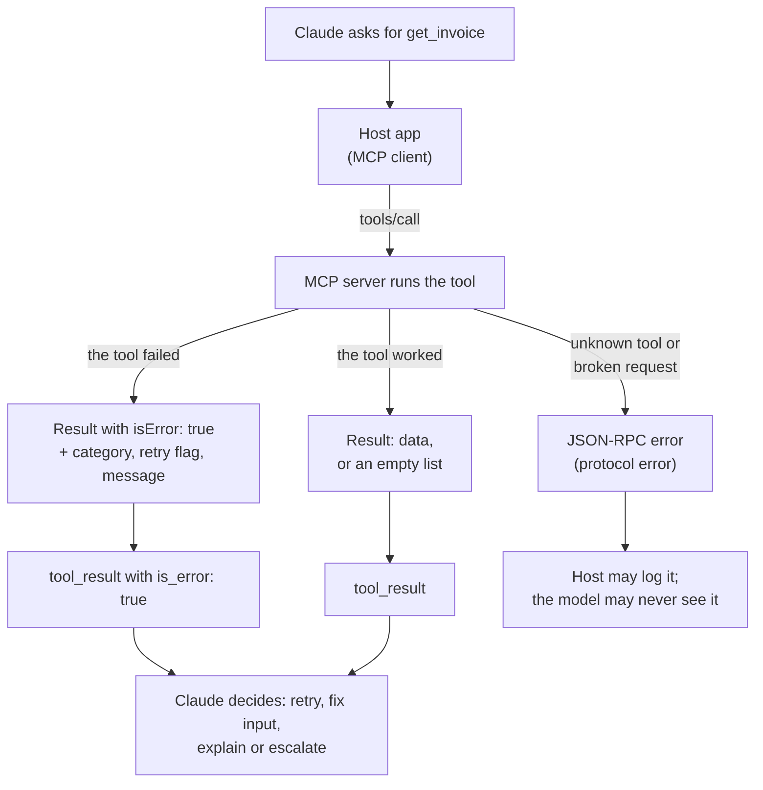
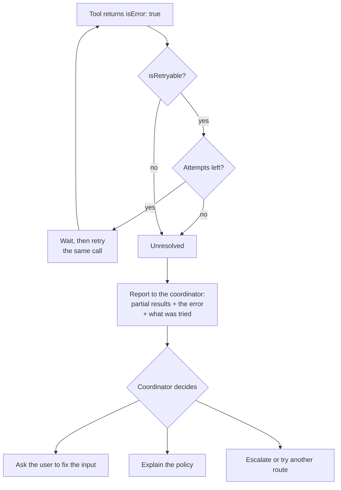

When an MCP tool fails, tell the agent in a form it can act on: flag the result as failed (`isError: true`), say what kind of failure it was, and say whether trying again can help. With that, the agent can retry a timeout, ask the user for a corrected ID, or explain a policy, instead of guessing from "Operation failed". In this post you build an MCP server whose `get_invoice` tool fails in four different ways on purpose, plus a small recovery layer, and test both through an in-memory MCP client with no API key.

This is task statement 2.2 of the [Claude Certified Architect – Foundations exam guide](https://anthropic-partners.skilljar.com/claude-certified-architect-foundations-certification): "Implement structured error responses for MCP tools". It is part of Domain 2, Tool Design & MCP Integration, which is 18% of the exam. The previous post in this series, on tool descriptions (task statement 2.1), was about Claude picking the right tool. This one is about what happens when that tool fails.

## What does task statement 2.2 test?

The guide lists four things to know and four skills. In plain words:

| The guide asks you to… | In practice |
| --- | --- |
| Know the MCP `isError` flag | A failure comes back as a tool result marked as an error, not as normal output |
| Know the four kinds of error | Transient (timeout), validation (bad input), business (a policy says no), permission (not allowed) |
| Know why one generic message fails | "Operation failed" doesn't say whether to retry, fix the input, explain or escalate |
| Know retryable vs not retryable | Saying which in the result stops retries that can never work |
| Return error metadata | An `errorCategory`, an `isRetryable` flag and a readable message |
| Handle business rules | Not retryable, with a customer-friendly explanation the agent can pass on |
| Recover locally in subagents | Retry transient errors close to the tool; escalate only what is left, with partial results |
| Tell "no data" from "no access" | An empty result is a success; an unreachable database is an error |

If tool calling is new to you, read [What is tool calling?](/blog/what-is-tool-calling) first. If MCP is new, start with [What is MCP?](/blog/what-is-mcp).

## How does an MCP tool report a failure?

The [MCP tools spec](https://modelcontextprotocol.io/specification/latest/server/tools) has two ways to report a problem, and the difference matters.

- **Protocol errors** are JSON-RPC errors, for problems with the request itself: an unknown tool, a request that doesn't match the `tools/call` shape, or a server error. The spec says these are "less likely" to help the model recover, and clients only **may** show them to the model.
- **Tool execution errors** come back as a normal tool result with `isError: true`. The spec lists API failures, input validation errors (like a date in the wrong format) and business logic errors. Clients **should** pass these to the model "to enable self-correction".

So for anything the agent could act on, use a tool execution error. The host app (the MCP client) then hands it to Claude. With the Messages API, that means a `tool_result` block with `is_error: true`, as described in the [handle tool calls](https://platform.claude.com/docs/en/agents-and-tools/tool-use/handle-tool-calls) docs.



The MCP TypeScript SDK follows the spec for you. Its [errors guide](https://ts.sdk.modelcontextprotocol.io/v2/servers/errors) says the SDK "catches anything a tool handler throws and converts it to the same `isError: true` shape", with the error's message as the text. Arguments that fail your input schema also come back as an `isError` result, before your handler runs. You still want to return errors yourself, because a thrown `Error` only carries a string. To add a category and a retry flag, you build the result.

The earlier post on enforcement gates and human handoffs (task statement 1.4, in the agentic architecture prep series) uses `is_error` for a different job: blocking a tool until a required step has happened. Here the tool did run, and something went wrong.

## What kinds of tool errors are there?

The guide names four kinds. Each one needs a different reaction from the agent, which is the whole point of telling them apart.

| Category | Example | Retry? | What the agent should do |
| --- | --- | --- | --- |
| Transient | The database timed out; the service is briefly down | Yes, after a short wait | Retry the same call, a few times at most |
| Validation | `"4211"` instead of `"INV-004211"` | Not with the same input | Fix the input, or ask the user for it |
| Business | The invoice is older than the retention policy allows | No | Explain the rule to the user, or escalate |
| Permission | The caller has no access to that account | No | Tell the user; don't retry and don't work around it |

Some details are easy to miss:

- **"Retryable" means "the same call may work later".** A validation error is often fixable, but only by changing the input, so the same call is not worth repeating. That's why it gets `isRetryable: false` here.
- **The field names are a convention.** MCP defines `isError` and the result `content`. It says nothing about `errorCategory` or `isRetryable`. They are the names the exam guide uses, so this post uses them. Pick names for your servers and keep them the same in every tool.
- **Write two messages for business errors.** One tells the agent what happened and what to do. A second, `customerMessage` in this post, is safe to repeat to the end user word for word.

Anthropic's [Writing tools for agents](https://www.anthropic.com/engineering/writing-tools-for-agents) gives the same advice for message text: "prompt-engineer your error responses to clearly communicate specific and actionable improvements, rather than opaque error codes or tracebacks." The handle tool calls docs add an example: instead of `"failed"`, write something like `"Rate limit exceeded. Retry after 60 seconds."`

## Why is "Operation failed" a problem?

A single generic message hides the one thing the agent needs to know: what to do next. Faced with "Operation failed", a careful agent can only guess:

- It retries a policy refusal again and again. Each call costs time and tokens and fails the same way.
- It gives up on a timeout that would have worked a second later.
- It tells the user "something went wrong" when the real answer was "please send the full invoice ID".

A category and a retry flag turn that guess into a lookup. The message then explains the details in plain words.

## Is "no results" an error?

No. If the query ran and nothing matched, the tool did its job. Return a normal result with an empty list, like `{ "found": 0, "invoices": [] }`. The agent can then say "there is no invoice with that ID" with confidence.

The opposite case is the dangerous one: the database was unreachable, and the tool returned an empty list anyway. The agent now tells the user that no data exists, when nobody checked. The guide calls this an access failure. It needs an error result, with a retry decision, never a quiet empty success.

| What happened | Return | What the agent can say |
| --- | --- | --- |
| Query ran, one match | Success: `found: 1` and the invoice | Here is the invoice |
| Query ran, no match | Success: `found: 0`, empty list | There is no invoice with that ID |
| Query could not run | `isError: true`, transient, retryable | I couldn't check right now; trying again |

## Who should retry: the subagent or the coordinator?

In a multi-agent system, a **coordinator** agent hands work to **subagents** and combines their results. The guide's rule is simple: fix what you can close to the tool, and pass up only what you can't.



Two things follow from that flow:

- **A timeout that recovers on the second try is not news.** The coordinator doesn't need to hear about it. Sending every transient error upward just fills its context and slows everyone down.
- **An unresolved error goes up with context.** Send the partial results (what did work), the error body, and what was tried, such as "1 attempt, permission error". A bare "task failed" throws away the data the subagent did collect.

## Try it: an invoice tool that fails four ways

You'll build an MCP server with one tool, `get_invoice`, that reads from a fake store. It fails on purpose with a timeout, a malformed ID, an invoice older than the retention policy, and a caller without access. A recovery layer retries only what is retryable, and tests drive it all through a real MCP client in memory.

**You need:** Node.js 22.18 or later, which runs `.ts` files directly because [type stripping is on by default](https://nodejs.org/docs/latest-v22.x/api/typescript.html). No API key.


<Steps>


<Step title="Create the project">

```bash
$ mkdir invoice-errors
$ cd invoice-errors
$ npm init -y
$ npm pkg set type=module
```

Install the [MCP TypeScript SDK](https://github.com/modelcontextprotocol/typescript-sdk) server and client packages, Zod for the input schema, and the [Anthropic TypeScript SDK](https://github.com/anthropics/anthropic-sdk-typescript) for its tool result type:


```bash
npm install @modelcontextprotocol/server @modelcontextprotocol/client zod @anthropic-ai/sdk
```


```bash
npm install -D typescript @types/node
```


Add a `tsconfig.json`. The MCP server package README asks for `"types": ["node"]` on TypeScript 6 and later:


**tsconfig.json**

```json
{
  "compilerOptions": {
    "noEmit": true,
    "target": "esnext",
    "module": "nodenext",
    "rewriteRelativeImportExtensions": true,
    "erasableSyntaxOnly": true,
    "verbatimModuleSyntax": true,
    "allowImportingTsExtensions": true,
    "strict": true,
    "types": ["node"]
  }
}
```


</Step>


<Step title="Add a fake invoice store">

Three invoices: a recent one for the caller's account, an old one for the same account, and one for another customer. The `timeouts` counter makes the next lookups fail, like a database that is briefly overloaded.


**invoices.ts**

```ts
// A fake invoice store. It can simulate a database that times out.
export interface Invoice {
  invoice_id: string;
  account_id: string;
  issued: string; // YYYY-MM-DD
  amount_usd: number;
  status: 'open' | 'paid';
}

export class StoreTimeoutError extends Error {}

const INVOICES: Invoice[] = [
  { invoice_id: 'INV-004211', account_id: 'acct_1001', issued: '2026-08-15', amount_usd: 129, status: 'paid' },
  { invoice_id: 'INV-002587', account_id: 'acct_1001', issued: '2023-05-02', amount_usd: 89, status: 'paid' },
  { invoice_id: 'INV-004390', account_id: 'acct_2002', issued: '2026-09-01', amount_usd: 450, status: 'open' },
];

export class InvoiceStore {
  // timeouts: how many of the next lookups fail before the store answers again.
  timeouts: number;

  constructor(timeouts = 0) {
    this.timeouts = timeouts;
  }

  async find(invoiceId: string): Promise<Invoice | undefined> {
    if (this.timeouts > 0) {
      this.timeouts--;
      throw new StoreTimeoutError('Invoice database did not answer within 2 seconds');
    }
    return INVOICES.find((invoice) => invoice.invoice_id === invoiceId);
  }
}
```


The constructor assigns `timeouts` by hand instead of using a TypeScript parameter property. Node's type stripping doesn't support parameter properties, so this keeps the file runnable with plain `node`.

</Step>


<Step title="Define the error body">

This is the convention, in one place, so every tool on the server returns errors in the same shape.


**errors.ts**

```ts
import type { CallToolResult } from '@modelcontextprotocol/server';

// Our own convention for the error body. MCP only defines isError; these field names are ours.
export type ErrorCategory = 'transient' | 'validation' | 'business' | 'permission';

export interface ToolErrorBody {
  errorCategory: ErrorCategory | 'unknown'; // 'unknown': a client got an error without this body
  isRetryable: boolean;
  message: string; // for the agent: what went wrong and what to do next
  customerMessage?: string; // safe to repeat to the end user
  retryAfterMs?: number; // only for retryable errors
}

// Same body in two places: text for the model, structuredContent for code.
export function toolError(body: ToolErrorBody): CallToolResult {
  return {
    content: [{ type: 'text', text: JSON.stringify(body) }],
    structuredContent: { ...body },
    isError: true,
  };
}

export function toolResult(data: Record<string, unknown>): CallToolResult {
  return {
    content: [{ type: 'text', text: JSON.stringify(data) }],
    structuredContent: data,
  };
}
```


The body goes into the result twice. The `text` block is what the model reads. `structuredContent` is the same data as JSON, so code (like the recovery layer in a later step) doesn't have to parse text. The spec recommends that a tool returning structured content also return it as serialized JSON in a text block, which is what `toolError` does.

</Step>


<Step title="Write the server and its four failure modes">


**server.ts**

```ts
import { McpServer } from '@modelcontextprotocol/server';
import { z } from 'zod';
import { InvoiceStore, StoreTimeoutError } from './invoices.ts';
import { toolError, toolResult } from './errors.ts';

const INVOICE_ID = /^INV-\d{6}$/;
const RETENTION_MONTHS = 24;

export interface Caller {
  name: string;
  accounts: string[]; // in a real server this comes from the caller's auth token
}

export interface ServerOptions {
  store: InvoiceStore;
  caller: Caller;
  now?: () => Date;
}

export function createInvoiceServer({ store, caller, now = () => new Date() }: ServerOptions): McpServer {
  const server = new McpServer({ name: 'billing', version: '1.0.0' });

  server.registerTool(
    'get_invoice',
    {
      title: 'Get one invoice',
      description:
        'Look up one invoice by its ID and return its account, issue date, amount and status. ' +
        'Input is an invoice ID like "INV-004211": "INV-" followed by six digits. ' +
        'Returns { found, invoices }: found is 0 and invoices is empty when no invoice has that ID. ' +
        'On failure, isError is set and the body has errorCategory, isRetryable and a message that says what to do next.',
      inputSchema: z.object({
        invoice_id: z.string().describe('Invoice ID, e.g. "INV-004211"'),
      }),
      annotations: { readOnlyHint: true },
    },
    async ({ invoice_id }) => {
      // 1. Validation: the input can never work, so retrying the same value is pointless.
      if (!INVOICE_ID.test(invoice_id)) {
        return toolError({
          errorCategory: 'validation',
          isRetryable: false,
          message: `"${invoice_id}" is not an invoice ID. IDs look like "INV-004211". Ask the user for the full ID, then call get_invoice again.`,
        });
      }

      // 2. Transient: the store did not answer. The same call may work in a moment.
      let invoice;
      try {
        invoice = await store.find(invoice_id);
      } catch (error) {
        if (error instanceof StoreTimeoutError) {
          return toolError({
            errorCategory: 'transient',
            isRetryable: true,
            retryAfterMs: 500,
            message: `The invoice database timed out. Nothing is wrong with "${invoice_id}"; retry the same call.`,
          });
        }
        throw error; // unexpected: the SDK turns it into a plain isError result
      }

      // 3. A valid query that matched nothing is a successful, empty result. Not an error.
      if (!invoice) return toolResult({ found: 0, invoices: [] });

      // 4. Permission: this caller may not see this account. Retrying will not change that.
      if (!caller.accounts.includes(invoice.account_id)) {
        return toolError({
          errorCategory: 'permission',
          isRetryable: false,
          message: `${caller.name} has no access to the account that owns ${invoice_id}. Do not retry. Tell the user to ask the account owner.`,
          customerMessage: 'I can only show invoices for accounts you have access to.',
        });
      }

      // 5. Business rule: the policy says no, every time.
      const cutoff = now();
      cutoff.setMonth(cutoff.getMonth() - RETENTION_MONTHS);
      if (new Date(invoice.issued) < cutoff) {
        return toolError({
          errorCategory: 'business',
          isRetryable: false,
          message: `${invoice_id} was issued on ${invoice.issued}, more than ${RETENTION_MONTHS} months ago, so policy keeps it out of this tool. Do not retry. Pass on the customerMessage.`,
          customerMessage:
            'Invoices older than 24 months are archived. Our finance team can send you a copy: email finance@example.com.',
        });
      }

      return toolResult({ found: 1, invoices: [invoice] });
    },
  );

  return server;
}
```


How each case maps to the table above:

- **Validation.** The schema only says `invoice_id` is a string, and the handler checks the format. That way the failure carries your structured body. A Zod `.regex()` in the schema would also reject the input, but with the SDK's own text and no category.
- **Transient.** A `StoreTimeoutError` becomes `isRetryable: true` with a `retryAfterMs` hint. Any other exception is rethrown, and the SDK turns it into a plain `isError` result.
- **No match.** A normal result, `{ found: 0, invoices: [] }`. No `isError`.
- **Permission.** Checked before the retention rule, so a caller without access learns nothing else about the invoice. The message names the invoice the caller asked for, not the other customer's account.
- **Business.** Not retryable, with a `customerMessage` the agent can repeat.

`caller` stands in for the identity your server gets from the request's credentials. The spec treats credentials as per-request input, so a real server would read the caller from the auth token on each call. `now` is injectable so the tests don't depend on today's date.

</Step>


<Step title="Add local recovery and the subagent report">

This is the code a subagent runs around its MCP client: retry what is retryable, then report.


**recovery.ts**

```ts
import { setTimeout as sleep } from 'node:timers/promises';
import type Anthropic from '@anthropic-ai/sdk';
import type { Client } from '@modelcontextprotocol/client';
import type { ToolErrorBody } from './errors.ts';

export type Outcome =
  | { ok: true; data: Record<string, unknown>; attempts: number }
  | { ok: false; error: ToolErrorBody; attempts: number };

export interface RetryOptions {
  maxAttempts?: number;
  wait?: (ms: number) => Promise<unknown>; // tests pass a fake, so nothing really waits
}

// Read our error body. Anything without it (an SDK message, a thrown error) is treated as
// not retryable: never retry an error you don't understand.
function readError(result: Awaited<ReturnType<Client['callTool']>>): ToolErrorBody {
  const body = result.structuredContent as Partial<ToolErrorBody> | undefined;
  if (body?.errorCategory && typeof body.isRetryable === 'boolean') return body as ToolErrorBody;
  const text = result.content.map((block) => (block.type === 'text' ? block.text : '')).join(' ');
  return { errorCategory: 'unknown', isRetryable: false, message: text || 'Unknown tool error' };
}

// Local recovery inside a subagent: retry only what the tool marks as retryable.
export async function callWithRecovery(
  client: Client,
  name: string,
  args: Record<string, unknown>,
  { maxAttempts = 3, wait = sleep }: RetryOptions = {},
): Promise<Outcome> {
  for (let attempt = 1; ; attempt++) {
    const result = await client.callTool({ name, arguments: args });
    if (!result.isError) {
      return { ok: true, data: (result.structuredContent ?? {}) as Record<string, unknown>, attempts: attempt };
    }
    const error = readError(result);
    if (!error.isRetryable || attempt >= maxAttempts) return { ok: false, error, attempts: attempt };
    await wait(error.retryAfterMs ?? 250 * 2 ** (attempt - 1)); // the server's hint, or exponential backoff
  }
}

// What the subagent sends to the coordinator: what it found, what came back empty,
// and only the errors it could not fix, with what it tried.
export interface SubagentReport {
  status: 'complete' | 'partial';
  invoices: unknown[];
  notFound: string[];
  unresolved: { invoice_id: string; attempts: number; error: ToolErrorBody }[];
}

export async function fetchInvoices(client: Client, ids: string[], options?: RetryOptions): Promise<SubagentReport> {
  const report: SubagentReport = { status: 'complete', invoices: [], notFound: [], unresolved: [] };
  for (const invoice_id of ids) {
    const outcome = await callWithRecovery(client, 'get_invoice', { invoice_id }, options);
    if (!outcome.ok) {
      report.unresolved.push({ invoice_id, attempts: outcome.attempts, error: outcome.error });
    } else if (outcome.data.found === 0) {
      report.notFound.push(invoice_id);
    } else {
      report.invoices.push(...(outcome.data.invoices as unknown[]));
    }
  }
  if (report.unresolved.length > 0) report.status = 'partial';
  return report;
}

// When Claude calls the tool itself, pass the MCP flag on as the Messages API's is_error.
export function toToolResult(toolUseId: string, outcome: Outcome): Anthropic.ToolResultBlockParam {
  return outcome.ok
    ? { type: 'tool_result', tool_use_id: toolUseId, content: JSON.stringify(outcome.data) }
    : { type: 'tool_result', tool_use_id: toolUseId, content: JSON.stringify(outcome.error), is_error: true };
}
```


What each part does:

- **`callWithRecovery`** retries only when the tool says `isRetryable: true`, at most `maxAttempts` times. It waits for the server's `retryAfterMs`, or backs off exponentially (250 ms, then 500 ms…) when there is no hint.
- **`readError`** treats any error without your body as `unknown` and not retryable. That covers the SDK's schema errors and unexpected exceptions. If you can't tell what an error means, retrying it is a guess.
- **`fetchInvoices`** is the subagent's job: look up several invoices and build a `SubagentReport`. A recovered timeout leaves no trace in it. A permission error stays in `unresolved`, with its attempt count, next to the invoices that did come back.
- **`toToolResult`** is for the other path, when Claude calls the tool directly in an agent loop. It turns the outcome into a Messages API `tool_result` block, with `is_error: true` for failures.

</Step>


<Step title="Test it without an API key">

The tests connect a real MCP client to the server through the SDK's `InMemoryTransport`, the same way a host app would talk to it, minus the process and the network.


**invoices.test.ts**

```ts
import assert from 'node:assert/strict';
import { test } from 'node:test';
import { Client } from '@modelcontextprotocol/client';
import { InMemoryTransport } from '@modelcontextprotocol/server';
import { InvoiceStore } from './invoices.ts';
import { createInvoiceServer } from './server.ts';
import { callWithRecovery, fetchInvoices, toToolResult } from './recovery.ts';

// Connect a real MCP client to the server in memory. timeouts = lookups that fail first.
async function connect(timeouts = 0) {
  const server = createInvoiceServer({
    store: new InvoiceStore(timeouts),
    caller: { name: 'support-agent', accounts: ['acct_1001'] },
    now: () => new Date('2026-10-02'),
  });
  const [clientSide, serverSide] = InMemoryTransport.createLinkedPair();
  await server.connect(serverSide);
  const client = new Client({ name: 'test', version: '1.0.0' });
  await client.connect(clientSide);
  return client;
}

const call = (client: Client, invoice_id: string) => client.callTool({ name: 'get_invoice', arguments: { invoice_id } });

test('four failure modes, each with its own category and retry flag', async () => {
  const cases = [
    { id: 'INV-004211', timeouts: 1, category: 'transient', retryable: true },
    { id: '4211', timeouts: 0, category: 'validation', retryable: false },
    { id: 'INV-002587', timeouts: 0, category: 'business', retryable: false },
    { id: 'INV-004390', timeouts: 0, category: 'permission', retryable: false },
  ];
  for (const c of cases) {
    const client = await connect(c.timeouts);
    const result = await call(client, c.id);
    assert.equal(result.isError, true);
    const body = result.structuredContent as { errorCategory: string; isRetryable: boolean; message: string };
    assert.equal(body.errorCategory, c.category);
    assert.equal(body.isRetryable, c.retryable);
    // The model reads the text block, so it must carry the same JSON.
    assert.deepEqual(JSON.parse((result.content[0] as { text: string }).text), body);
    console.log(`  ${c.id}: ${body.errorCategory}, retryable=${body.isRetryable}`);
    await client.close();
  }
});

test('the business error carries a message the agent can pass on', async () => {
  const client = await connect();
  const body = (await call(client, 'INV-002587')).structuredContent as { customerMessage: string };
  assert.match(body.customerMessage, /older than 24 months/);
  await client.close();
});

test('no match is a successful, empty result, not an error', async () => {
  const client = await connect();
  const result = await call(client, 'INV-009999');
  assert.equal(result.isError, undefined);
  assert.deepEqual(result.structuredContent, { found: 0, invoices: [] });
  await client.close();
});

test('local recovery retries the timeout, and only the timeout', async () => {
  const client = await connect(2); // the first two lookups time out
  const waits: number[] = [];
  const wait = async (ms: number) => waits.push(ms);

  const recovered = await callWithRecovery(client, 'get_invoice', { invoice_id: 'INV-004211' }, { wait });
  assert.equal(recovered.ok, true);
  assert.equal(recovered.attempts, 3);
  assert.deepEqual(waits, [500, 500]); // the server's retryAfterMs

  const refused = await callWithRecovery(client, 'get_invoice', { invoice_id: 'INV-004390' }, { wait });
  assert.equal(refused.ok, false);
  assert.equal(refused.attempts, 1); // a permission error is never retried
  await client.close();
});

test('the subagent reports partial results and only what it could not fix', async () => {
  const client = await connect(1); // one timeout, recovered locally
  const report = await fetchInvoices(client, ['INV-004211', 'INV-009999', 'INV-004390'], { wait: async () => {} });

  assert.equal(report.status, 'partial');
  assert.equal(report.invoices.length, 1);
  assert.deepEqual(report.notFound, ['INV-009999']);
  assert.equal(report.unresolved.length, 1); // the recovered timeout is not escalated
  assert.equal(report.unresolved[0].error.errorCategory, 'permission');
  const [left] = report.unresolved;
  console.log(`  ${report.status}: ${report.invoices.length} found, not found ${report.notFound}, unresolved ${left.invoice_id} (${left.error.errorCategory}, ${left.attempts} attempt)`);
  await client.close();
});

test('an error without our body is not retried', async () => {
  const client = await connect();
  // A missing argument fails the Zod schema, so the SDK answers before our handler runs.
  const outcome = await callWithRecovery(client, 'get_invoice', {});
  assert.equal(outcome.ok, false);
  assert.equal(outcome.attempts, 1);
  if (!outcome.ok) {
    assert.equal(outcome.error.errorCategory, 'unknown');
    console.log(`  SDK says: ${outcome.error.message.split(':').slice(0, 2).join(':')}`);
  }
  await client.close();
});

test('an error reaches Claude as is_error: true', async () => {
  const client = await connect();
  const outcome = await callWithRecovery(client, 'get_invoice', { invoice_id: '4211' });
  const block = toToolResult('toolu_01', outcome);
  assert.equal(block.is_error, true);
  assert.match(String(block.content), /"errorCategory":"validation"/);
  await client.close();
});

test('an unknown tool is a protocol error, not a tool result', async () => {
  const client = await connect();
  await assert.rejects(client.callTool({ name: 'get_invoices', arguments: {} }), /not found/);
  await client.close();
});
```


```bash
$ node --test --test-reporter=spec invoices.test.ts
```

```text
  INV-004211: transient, retryable=true
  4211: validation, retryable=false
  INV-002587: business, retryable=false
  INV-004390: permission, retryable=false
  partial: 1 found, not found INV-009999, unresolved INV-004390 (permission, 1 attempt)
  SDK says: Input validation error: Invalid arguments for tool get_invoice
✔ four failure modes, each with its own category and retry flag
✔ the business error carries a message the agent can pass on
✔ no match is a successful, empty result, not an error
✔ local recovery retries the timeout, and only the timeout
✔ the subagent reports partial results and only what it could not fix
✔ an error without our body is not retried
✔ an error reaches Claude as is_error: true
✔ an unknown tool is a protocol error, not a tool result
ℹ tests 8
ℹ suites 0
ℹ pass 8
ℹ fail 0
ℹ cancelled 0
ℹ skipped 0
ℹ todo 0
```

This is our output on Node 22.22.2 with `@modelcontextprotocol/server` and `@modelcontextprotocol/client` 2.3.0 and `@anthropic-ai/sdk` 0.131.0, with timings removed. The tests show each failure mode with its own category, the empty result without `isError`, two retries of the timeout and none of the permission error, a partial report that leaves out the recovered timeout, and the SDK's own schema error being treated as unknown. The last test shows the other kind of failure: an unknown tool name is a protocol error, so `callTool` rejects instead of returning a result.

Then type-check everything:

```bash
$ npx tsc
```

No output means no type errors.

</Step>


<Step title="Connect it to an agent">

To use the server with Claude, run it over stdio as in [Build your first MCP server](/blog/build-your-first-mcp-server) and add it to an MCP host, or call it from your own agent loop and send each outcome back with `toToolResult`. [How to test and debug an MCP server](/blog/test-and-debug-mcp-server) shows how to call the tool by hand in the MCP Inspector, which is a quick way to read each error body.

What to expect, not a measured result: with these error bodies, Claude should retry after the transient error, ask the user for the full ID after the validation error, and pass on the retention message after the business error, without calling the tool again for it. The handle tool calls docs note that after an invalid tool call Claude "will retry 2-3 times with corrections before apologizing to the user", so a clear validation message gives those retries something to work with. To check this for your own tools, run a small eval with real requests, as in [How to test AI output with evals](/blog/test-ai-output-with-evals).

</Step>


</Steps>


## Common traps

These are the mistakes that wrong answer options are built on.

| Trap | Why it fails | Fix |
| --- | --- | --- |
| One generic message for every failure | The agent can't tell a timeout from a policy refusal | A category, a retry flag and a specific message |
| An empty success when the data couldn't be reached | The agent reports "nothing found" with confidence, and it's wrong | `isError: true`, transient, retryable |
| Retrying everything | Validation, permission and policy errors fail the same way every time | Retry only what the tool marks as retryable, with a cap |
| A global retry limit in the prompt | Still wastes calls on hopeless errors and blocks useful retries | Per-error metadata from the tool |
| Every transient error goes to the coordinator | Fills its context with noise it can't act on | Retry locally; escalate what's left, with partial results |
| Recoverable failures as protocol errors | The host may never show them to the model | Tool execution errors with `isError: true` |


<Callout type="warning" title="Error messages go into the model's context">

Everything in an error body reaches Claude and may be repeated to the user. Don't put stack traces, SQL, internal hostnames or another customer's data in it. In this post the permission error names only the invoice the caller asked for, not the account that owns it. Log the technical details on the server, where only you can read them.

</Callout>


## Practice questions

These four questions are this blog's own, written for practice. They are not from the exam.

**Question 1.** A `create_shipment` MCP server rejects a pickup date in the wrong format by sending back a JSON-RPC error with code `-32602`. The host app logs it and tells Claude only that the tool is unavailable. Claude then tells the user that shipping is down. What is the best change?

- A. Make the host retry every failed `tools/call` three times before giving up.
- B. Return the problem as a tool result with `isError: true` and a message that names the expected date format, so the host passes it to Claude.
- C. Remove the date check and let the carrier's API reject bad dates later.
- D. Add a line to the system prompt that explains the date format.

**Question 2.** A `search_contracts` tool returns an empty array both when the contracts database is unreachable and when a search matches nothing. What is the main risk?

- A. The agent will call the tool less often than it should.
- B. Empty arrays use more tokens than error messages.
- C. The MCP client will reject results that contain empty arrays.
- D. The agent may tell the user that no contracts exist when the data was never checked.

**Question 3.** A refund tool refuses any refund above a limit set by company policy. What should the tool return when a request is over the limit?

- A. An error marked as a business error, not retryable, with a customer-friendly reason the agent can pass on.
- B. A transient error, so the agent tries again later.
- C. A success result with the refund amount set to zero.
- D. A permission error, so the agent asks the user to sign in again.

**Question 4.** A data-gathering subagent calls three MCP tools. One times out twice, then succeeds on the third try. Another fails with a permission error that is not retryable. The third succeeds. What should the subagent report to the coordinator?

- A. Every error it saw, including the two timeouts, and no results until all three tools succeed.
- B. Only "task failed", because one tool did not succeed.
- C. The results it gathered, plus the permission error and what was tried. The recovered timeouts don't need to be reported.
- D. Only the successful results, with no mention of errors.

## Answer key

### Question 1

**Answer: B.** A bad date is a validation error that Claude can fix, so it belongs in a tool execution error, which the spec says clients should pass to the model. A protocol error may never reach it. The strongest distractor is D: a prompt line may prevent some bad dates, but when one still happens, Claude still gets no usable error. A retries an input that will fail the same way each time.

### Question 2

**Answer: D.** An access failure that looks like a valid empty result leads the agent to a confident, wrong answer. Mark the outage as an error with retry guidance, and keep the empty array for real no-match results. The strongest distractor is A: the problem isn't how often the tool is called, but what the agent believes after it returns.

### Question 3

**Answer: A.** A policy refusal fails the same way every time, so mark it as not retryable and give a reason the agent can explain. The strongest distractor is B: calling it transient sends the agent into retries that can never succeed. D gives the user a wrong fix: signing in again doesn't change the policy.

### Question 4

**Answer: C.** Handle transient failures locally, and pass up only what couldn't be fixed, with the partial results and what was tried. The strongest distractor is D: hiding the permission error leaves the coordinator unaware that part of the data is missing. A floods it with errors that were already solved.

## What should I do next?

- **Audit one of your tools.** Find every place it returns an error, and give each a category, a retry flag and a message that names the next step. Check that "not found" returns an empty success.
- **Test the server end to end.** [How to test and debug an MCP server](/blog/test-and-debug-mcp-server) shows the MCP Inspector and stdio tests.
- **Move on to task statement 2.3**, "Distribute tools appropriately across agents and configure tool choice". The next post in this series covers it.
- **Plan and check your prep.** Follow the [six-week study plan](/blog/claude-architect-exam-study-plan), and test yourself with the [mock exam](/blog/claude-certification-mock-exam) when you've worked through Domain 2.
