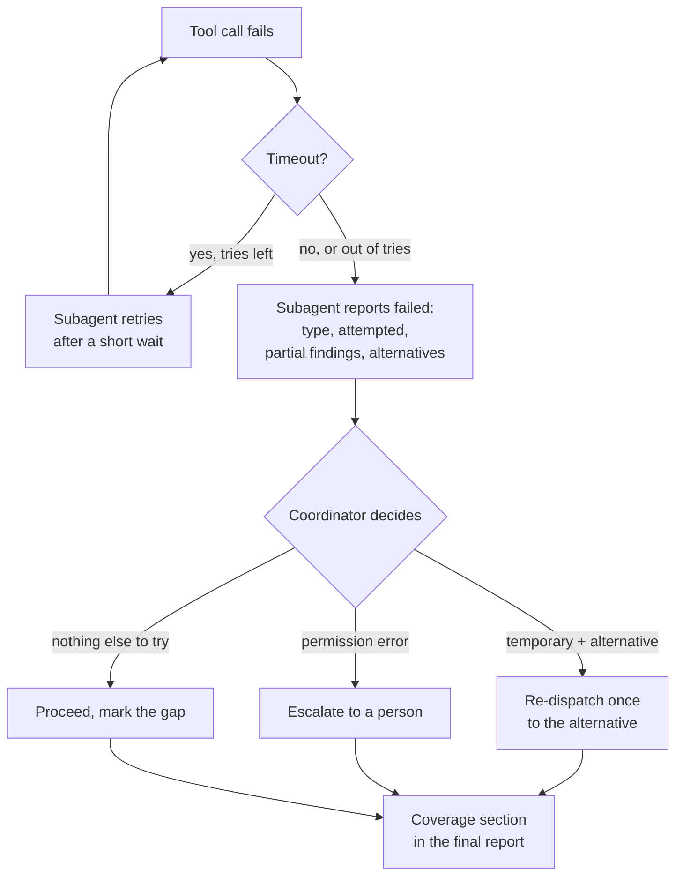

When one subagent in a multi-agent system fails, the coordinator needs to know four things: what kind of failure it was, what the subagent tried, what it found before it failed, and where else to look. With that, the coordinator can try another source, go on and mark the gap, or hand the problem to a person. The final answer then says plainly what it couldn't check. In this post you build that coordinator in TypeScript with the Claude Agent SDK and test every failure path with mocks, with no API key.

This is task statement 5.3 of the [Claude Certified Architect – Foundations exam guide](https://anthropic-partners.skilljar.com/claude-certified-architect-foundations-certification): "Implement error propagation strategies across multi-agent systems". It sits in Domain 5, Context Management & Reliability, which is 15% of the exam.

## What does task statement 5.3 test?

The guide lists four things to know and four skills. In plain words:

| The guide asks you to… | In practice |
| --- | --- |
| Know why structured error context helps | A failure report with a type, the query, partial results and alternatives lets the coordinator pick a recovery step |
| Tell access failures from empty results | "Could not search" and "searched, nothing found" are different answers |
| Know why generic errors hurt | "search unavailable" hides everything the coordinator needs to decide |
| Avoid both anti-patterns | Don't hide a failure as an empty success. Don't stop the whole run because one step failed |
| Return structured error context | Every subagent sends the same report shape, whether it worked or not |
| Report the two outcomes differently | `empty` and `failed` are separate statuses |
| Recover locally, report the rest | A subagent retries a timeout itself and sends up only what it can't fix |
| Annotate coverage | The final answer says which findings are well supported and which topics have gaps |

Two posts in this prep series cover the ground next to this one. [Structured error responses for MCP tools](/blog/mcp-structured-error-responses) (task statement 2.2) shows how a single tool reports a failure, with `isError`, a category and a retry flag, and how to retry close to the tool. [Multi-agent systems: the coordinator-subagent pattern](/blog/claude-multi-agent-coordinator) (task statement 1.2) shows how a coordinator splits work and collects results. This post is about the step between them: how a failure travels from a subagent to the coordinator, and from the coordinator into the final answer. If agents are new to you, start with [How to build your first AI agent](/blog/build-your-first-ai-agent).

## Why can't a failure just be logged?

Because the coordinator makes decisions from what it receives, not from your logs. In a multi-agent system, a **coordinator** hands focused tasks to **subagents** and combines their results. Each subagent works in its own context. The [Agent SDK subagents docs](https://code.claude.com/docs/en/agent-sdk/subagents) say that a subagent's "intermediate tool calls and results stay inside the subagent; only its final message returns to the parent". So whatever the subagent doesn't put in its report, the coordinator never sees.

Anthropic's engineering team saw what happens when this goes wrong. In their post on [building a multi-agent research system](https://www.anthropic.com/engineering/multi-agent-research-system), they write that "minor system failures can be catastrophic for agents" and that "Restarts are expensive and frustrating for users". They also found that "letting the agent know when a tool is failing and letting it adapt works surprisingly well". The agent can only adapt if the failure reaches it with detail.

## What should a subagent's failure report contain?

The same fields every time, whether the work succeeded or not. That way the coordinator reads one shape and never has to guess.

| Field | What it says | Example |
| --- | --- | --- |
| `status` | `ok`, `empty` or `failed` | `failed` |
| `failure_type` | What kind of failure, only when `failed` | `timeout` |
| `attempted` | Every search it tried, and how each one ended | `web_search "account recovery": timeout after 3 tries` |
| `findings` | What it found. When `failed`, the partial results | One finding from the docs search |
| `alternatives` | Other sources that might work | `news_search` |
| `note` | One sentence for the coordinator | "Web search timed out; the news archive may have it." |

Compare that with `{"error": "search unavailable"}`. From that string, the coordinator can't tell whether a retry might help, whether any data came back, or whether another source exists. It has two bad choices: guess, or give up.

The `status` field carries the distinction the exam cares most about:

| Status | What happened | What the coordinator may conclude |
| --- | --- | --- |
| `ok` | The search ran and found something | Use the findings, with their sources |
| `empty` | The search ran and found nothing | "We looked and found no evidence" |
| `failed` | The search could not run | "We don't know yet". Never "nothing exists" |

## What are the two anti-patterns?

They are opposites, and the exam builds wrong answers from both.

**Swallowing the error.** The subagent catches the timeout and returns an empty list marked as success. The coordinator reads it as `empty`, and the final report says "no evidence of X". Nobody checked. The MCP post covers this at the tool level. In a multi-agent system it gets worse: the false "nothing found" passes through the coordinator and the writer, and by the end it reads like a researched fact.

**Aborting everything.** The coordinator wraps all subagents in one `Promise.all` and lets the first error reject it. One unreachable source throws away the results of every other subagent, and the user gets an error page. A report that covers four of five topics and names the fifth as a gap is far more useful than nothing.

The fix for both is the same: every outcome, including a crash, becomes a report, and the coordinator decides what to do with it.

## How does the coordinator decide what to do?

It looks at each failed report and picks one of three moves:

| Move | When | Example |
| --- | --- | --- |
| **Re-dispatch** | The failure is temporary and the report names an alternative source | Web search timed out, so run the search subagent again on the news archive |
| **Proceed with a marked gap** | Nothing else can be tried, and the answer can stand without it | The internal docs are down; the web search still covered the topic |
| **Escalate** | A person must act, or an essential topic has no evidence at all | A permission error, or no source could cover "browser support" |

Here is the whole path a failure takes in the build below:



Three rules keep this from going round in circles:

- **Retry timeouts locally first.** A timeout that clears on the second try is not news for the coordinator. The subagent handles it and says so only in `attempted`.
- **Re-dispatch at most once per failure.** If the alternative fails too, the coordinator proceeds with the gap or escalates.
- **Keep what the first try found.** When a re-dispatch runs, its findings and `attempted` lines are added to the first report's, not swapped in.

The Agent SDK follows the same idea for its own failures. The [Claude Code subagents docs](https://code.claude.com/docs/en/sub-agents) say that when an API error cuts off a foreground subagent that already produced text, "the Agent tool returns that partial output with a note that the subagent was cut off and didn't finish its task". Partial work is passed up and marked, not dropped.

## How does the final output show what's missing?

With a coverage section that your code builds from the reports, not one the writer remembers to add. For each topic it gives a level:

| Level | Meaning |
| --- | --- |
| Well supported | Two or more independent sources |
| Single source | One source. Usable, but say so |
| Searched, nothing found | Every source ran and found nothing |
| Gap | No evidence, and at least one source could not be checked |

Under each topic it lists what wasn't checked and why, copied from the `attempted` lines. A reader who sees "user adoption: gap, docs unavailable" knows to ask again later. A reader who sees "user adoption: searched, nothing found" knows the answer is probably "no data".

## Try it: build a coordinator that survives failures

You'll research one question, "Should our app add passkey sign-in?", across three topics with two subagents: `search` (web and news archive) and `docs` (internal documents). The sources are canned and can fail on demand. The coordinator is plain TypeScript, so every decision is testable. Each subagent is one Agent SDK `query()` call with its own tools and a structured report.

**You need:** Node.js 22.18 or later, which runs `.ts` files directly because [type stripping is on by default](https://nodejs.org/docs/latest-v22.x/api/typescript.html). An Anthropic API key only for the last step.


<Steps>


<Step title="Create the project">

```bash
$ mkdir error-propagation
$ cd error-propagation
$ npm init -y
$ npm pkg set type=module
```

Install the [Claude Agent SDK](https://code.claude.com/docs/en/agent-sdk/overview) and [Zod](https://zod.dev/), then TypeScript and the Node types for type-checking:


```bash
npm install @anthropic-ai/claude-agent-sdk zod
```


```bash
npm install -D typescript @types/node
```


Add the same `tsconfig.json` as in the earlier parts of this series:


**tsconfig.json**

```json
{
  "compilerOptions": {
    "noEmit": true,
    "target": "esnext",
    "module": "nodenext",
    "rewriteRelativeImportExtensions": true,
    "erasableSyntaxOnly": true,
    "verbatimModuleSyntax": true,
    "allowImportingTsExtensions": true,
    "strict": true
  }
}
```


</Step>


<Step title="Define the report every subagent returns">


**report.ts**

```ts
import { z } from 'zod';

// One finding, always with the place it came from.
export const Finding = z.object({
  claim: z.string(),
  source: z.string(), // a URL or an internal document ID
});
export type Finding = z.infer<typeof Finding>;

// What every subagent hands back to the coordinator, whether it worked or not.
export const SubagentReport = z.object({
  agent: z.string(),
  topic: z.string(),
  status: z.enum(['ok', 'empty', 'failed']), // empty = every search ran and found nothing
  failure_type: z.enum(['timeout', 'unavailable', 'permission', 'agent_error']).nullable(), // only for failed
  attempted: z.array(z.string()), // every search tried, and how it ended
  findings: z.array(Finding), // for failed: the partial results gathered before the failure
  alternatives: z.array(z.string()), // other sources that might work
  note: z.string(), // one sentence for the coordinator
});
export type SubagentReport = z.infer<typeof SubagentReport>;
export type FailureType = NonNullable<SubagentReport['failure_type']>;

// The same contract as JSON Schema, for the Agent SDK's outputFormat option.
export const REPORT_JSON_SCHEMA = z.toJSONSchema(SubagentReport, { target: 'draft-7' });

export function failedReport(
  agent: string,
  topic: string,
  failure_type: FailureType,
  note: string,
  attempted: string[] = [],
): SubagentReport {
  return { agent, topic, status: 'failed', failure_type, attempted, findings: [], alternatives: [], note };
}

// Check what a subagent returned. A report that breaks the contract becomes a failure. It is never dropped.
export function toReport(raw: unknown, agent: string, topic: string): SubagentReport {
  const parsed = SubagentReport.safeParse(raw);
  if (!parsed.success) return failedReport(agent, topic, 'agent_error', `The ${agent} report did not match the schema.`);
  const r = { ...parsed.data, agent, topic }; // the coordinator knows who it asked, so it doesn't trust these two fields
  const problem =
    r.status === 'failed' && !r.failure_type ? 'said failed without a failure_type'
    : r.status === 'empty' && r.findings.length > 0 ? 'said empty but has findings'
    : r.status === 'ok' && r.findings.length === 0 ? 'said ok with no findings'
    : null;
  return problem ? failedReport(agent, topic, 'agent_error', `The ${agent} report ${problem}.`, r.attempted) : r;
}
```


One Zod schema does two jobs. `z.toJSONSchema` turns it into the JSON Schema for the SDK's `outputFormat` option. The [structured outputs docs](https://code.claude.com/docs/en/agent-sdk/structured-outputs) say the SDK validates schemas with JSON Schema draft-07, so pass `target: "draft-7"`. The same schema then checks every report in `toReport`.

`toReport` never throws a report away. A report that breaks the contract, such as `ok` with no findings, becomes a `failed` report with the type `agent_error`. A broken report is a failure too, not an empty result.

</Step>


<Step title="Add the sources, with local retry">


**sources.ts**

```ts
import { createSdkMcpServer, tool } from '@anthropic-ai/claude-agent-sdk';
import { z } from 'zod';
import type { Finding } from './report.ts';

type Source = 'web' | 'news' | 'docs';
type FaultKind = 'timeout' | 'unavailable' | 'permission';

export class SourceError extends Error {
  readonly kind: FaultKind;
  constructor(kind: FaultKind, message: string) {
    super(message);
    this.kind = kind;
  }
}

// Canned data. "user adoption" finds nothing anywhere, on purpose.
const DATA: Record<Source, Record<string, Finding[]>> = {
  web: {
    'browser support': [{ claim: 'Passkeys work in current desktop and mobile browsers.', source: 'https://example.com/passkeys/browsers' }],
    'account recovery': [{ claim: 'Keep a second sign-in method for users who lose every device.', source: 'https://example.com/passkeys/recovery' }],
    'user adoption': [],
  },
  news: {
    'browser support': [{ claim: 'Synced passkeys now work across phones and laptops.', source: 'https://example.org/news/synced-passkeys' }],
    'account recovery': [],
    'user adoption': [],
  },
  docs: {
    'browser support': [{ claim: 'Our browser audit: almost all sessions use a browser with passkey support.', source: 'doc:browser-audit' }],
    'account recovery': [{ claim: 'Most lockout tickets come from users who changed phones.', source: 'doc:support-review' }],
    'user adoption': [],
  },
};

// Make a source fail on demand. `times` is how many calls fail before it works again.
const faults = new Map<Source, { kind: FaultKind; times: number }>();
export const injectFault = (source: Source, kind: FaultKind, times = Infinity) => faults.set(source, { kind, times });
export const clearFaults = () => faults.clear();

async function lookup(source: Source, topic: string): Promise<Finding[]> {
  const fault = faults.get(source);
  if (fault && fault.times > 0) {
    fault.times--;
    throw new SourceError(fault.kind, `${source}: ${fault.kind}`);
  }
  return DATA[source][topic] ?? [];
}

// Local recovery: retry a timeout a few times with a short wait. Other failures go up at once.
export async function withRetry<T>(label: string, fn: () => Promise<T>, attempted: string[], maxTries = 3): Promise<T> {
  for (let attempt = 1; ; attempt++) {
    try {
      const value = await fn();
      attempted.push(`${label}: ok on try ${attempt}`);
      return value;
    } catch (error) {
      const kind = error instanceof SourceError ? error.kind : 'unavailable';
      if (kind !== 'timeout' || attempt === maxTries) {
        attempted.push(`${label}: ${kind} after ${attempt} ${attempt === 1 ? 'try' : 'tries'}`);
        throw error;
      }
      await new Promise((resolve) => setTimeout(resolve, 100 * 2 ** (attempt - 1))); // 100 ms, then 200 ms
    }
  }
}

const json = (body: object) => ({ content: [{ type: 'text' as const, text: JSON.stringify(body) }] });

function sourceTool(name: string, source: Source, description: string, alternatives: string[]) {
  return tool(
    name,
    description,
    { topic: z.string().describe('The topic exactly as given in your task') },
    async ({ topic }) => {
      const attempted: string[] = [];
      try {
        const findings = await withRetry(`${name} "${topic}"`, () => lookup(source, topic), attempted);
        return json({ status: findings.length > 0 ? 'ok' : 'empty', attempted, findings });
      } catch (error) {
        const failure_type = error instanceof SourceError ? error.kind : 'unavailable';
        return { ...json({ status: 'failed', failure_type, attempted, alternatives }), isError: true };
      }
    },
    { annotations: { readOnlyHint: true } },
  );
}

export const webSearch = sourceTool('web_search', 'web', 'Search the web for a topic.', ['news_search']);
export const newsSearch = sourceTool('news_search', 'news', 'Search the news archive for a topic.', []);
export const docSearch = sourceTool('doc_search', 'docs', 'Search internal documents for a topic.', []);

// One in-process MCP server per subagent, so each one sees only its own tools.
export const servers = {
  search: createSdkMcpServer({ name: 'search', version: '1.0.0', tools: [webSearch, newsSearch] }),
  docs: createSdkMcpServer({ name: 'docs', version: '1.0.0', tools: [docSearch] }),
};
```


What each part does:

- **`injectFault`** makes a source fail for the next few calls, or for good. The tests use it.
- **`withRetry`** retries only timeouts, up to three tries, waiting 100 ms and then 200 ms. A source that is down or refuses access fails at once: waiting won't fix it. Every try ends up in `attempted`.
- **`sourceTool`** builds an [in-process MCP tool](https://code.claude.com/docs/en/agent-sdk/custom-tools) with the SDK's `tool()` helper. A failure comes back with `isError: true` and the same fields as the report: type, what was tried and where else to look. Only `web_search` names an alternative, `news_search`.
- **`servers`** gives each subagent its own MCP server, so the docs subagent can't call web search.

</Step>


<Step title="Write the coordinator">


**coordinator.ts**

```ts
import { failedReport, toReport, type Finding, type SubagentReport } from './report.ts';

export interface Task {
  agent: string;
  topic: string;
  source?: string; // set when the coordinator re-dispatches to an alternative source
}
// Runs one subagent. In production it calls the Agent SDK; in tests it's a fake.
export type Dispatch = (task: Task) => Promise<unknown>;

export interface Plan {
  topics: { name: string; critical: boolean }[]; // critical: the answer is useless without it
  agents: string[];
}

export type Decision =
  | { action: 'accept' }
  | { action: 'redispatch'; source: string }
  | { action: 'proceed_with_gap'; reason: string }
  | { action: 'escalate'; reason: string };

// What to do with one report. Only failures need a decision.
export function decide(report: SubagentReport, alreadyRedispatched: boolean): Decision {
  if (report.status !== 'failed') return { action: 'accept' };
  const transient = report.failure_type === 'timeout' || report.failure_type === 'unavailable';
  if (transient && report.alternatives.length > 0 && !alreadyRedispatched) {
    return { action: 'redispatch', source: report.alternatives[0] };
  }
  if (report.failure_type === 'permission') {
    return { action: 'escalate', reason: `${report.agent} has no access. A person must grant it.` };
  }
  return { action: 'proceed_with_gap', reason: `${report.agent}: ${report.failure_type}` };
}

export type CoverageLevel = 'well_supported' | 'single_source' | 'nothing_found' | 'gap';

export interface TopicCoverage {
  topic: string;
  level: CoverageLevel;
  sources: string[];
  notChecked: string[]; // one line per failed subagent: what it tried and how it ended
}

export interface ResearchResult {
  status: 'complete' | 'partial' | 'needs_review';
  findings: Finding[];
  coverage: TopicCoverage[];
  escalations: string[];
  log: string[];
}

export async function runResearch(plan: Plan, dispatch: Dispatch): Promise<ResearchResult> {
  const log: string[] = [];
  const escalations: string[] = [];

  // A crash becomes a failed report. run() never throws, so one failure can't stop the others.
  const run = async (task: Task): Promise<SubagentReport> => {
    try {
      return toReport(await dispatch(task), task.agent, task.topic);
    } catch (error) {
      return failedReport(task.agent, task.topic, 'agent_error', `Crashed: ${(error as Error).message}`);
    }
  };

  const tasks = plan.topics.flatMap((t) => plan.agents.map((agent) => ({ agent, topic: t.name })));
  const first = await Promise.all(tasks.map(run));

  // Recovery: decide on each failure. Re-dispatch at most once, and keep what the first try found.
  const reports = await Promise.all(
    first.map(async (report) => {
      const decision = decide(report, false);
      if (decision.action !== 'accept') log.push(`${report.topic} / ${report.agent}: ${decision.action}`);
      if (decision.action === 'escalate') escalations.push(`${report.topic}: ${decision.reason}`);
      if (decision.action !== 'redispatch') return report;

      const retry = await run({ agent: report.agent, topic: report.topic, source: decision.source });
      log.push(`${report.topic} / ${report.agent}: ${decision.source} -> ${retry.status}`);
      const merged = {
        ...retry,
        attempted: [...report.attempted, ...retry.attempted],
        findings: [...report.findings, ...retry.findings],
      };
      const next = decide(merged, true);
      if (next.action === 'escalate') escalations.push(`${report.topic}: ${next.reason}`);
      return merged;
    }),
  );

  const coverage = plan.topics.map(({ name, critical }) => {
    const mine = reports.filter((r) => r.topic === name);
    const sources = [...new Set(mine.flatMap((r) => r.findings.map((f) => f.source)))];
    const failed = mine.filter((r) => r.status === 'failed');
    const notChecked = failed.map((r) => `${r.agent} (${r.failure_type}): ${r.attempted.join('; ') || r.note}`);
    const level: CoverageLevel =
      sources.length >= 2 ? 'well_supported'
      : sources.length === 1 ? 'single_source'
      : failed.length > 0 ? 'gap' // could not look
      : 'nothing_found'; // looked everywhere, found nothing
    if (critical && level === 'gap') escalations.push(`${name}: critical topic has no evidence because sources failed.`);
    return { topic: name, level, sources, notChecked };
  });

  const status =
    escalations.length > 0 ? 'needs_review'
    : coverage.some((c) => c.notChecked.length > 0 || c.level === 'gap') ? 'partial'
    : 'complete';
  return { status, findings: reports.flatMap((r) => r.findings), coverage, escalations, log };
}

const LABEL: Record<CoverageLevel, string> = {
  well_supported: 'Well supported',
  single_source: 'Single source',
  nothing_found: 'Searched, nothing found',
  gap: 'GAP: no evidence, not every source checked',
};

// The coverage section is built by code and added to the final report, so no writer can drop it.
export function renderCoverage(result: ResearchResult): string {
  const lines = ['## Coverage', `Status: ${result.status}`];
  for (const c of result.coverage) {
    lines.push(`- ${c.topic}: ${LABEL[c.level]} (${c.sources.length} ${c.sources.length === 1 ? 'source' : 'sources'})`);
    for (const n of c.notChecked) lines.push(`  - Not checked: ${n}`);
  }
  for (const e of result.escalations) lines.push(`- Needs a person: ${e}`);
  return lines.join('\n');
}
```


The parts that carry the exam's ideas:

- **`run` never throws.** A crash or a rejected promise becomes a `failed` report. So `Promise.all` waits for every subagent, and one failure can't throw away the others' work.
- **`decide`** is the three-move table in code: re-dispatch a temporary failure that names an alternative (once), escalate a permission error, otherwise proceed with the gap.
- **The re-dispatch merges.** The second try's findings and `attempted` lines are added to the first's.
- **`coverage`** gives each topic a level. "Searched, nothing found" needs every report to be `empty`. One failed report with no evidence makes it a gap. An essential topic (`critical: true`) that ends as a gap goes to a person.
- **`renderCoverage`** turns it into text you add to the final report. Your writer subagent turns findings into prose; this section is added after it, so a summary can't drop it.

</Step>


<Step title="Run each subagent with the Agent SDK">


**subagents.ts**

```ts
import { query } from '@anthropic-ai/claude-agent-sdk';
import type { Task } from './coordinator.ts';
import { failedReport, REPORT_JSON_SCHEMA, toReport, type SubagentReport } from './report.ts';
import { servers } from './sources.ts';

const REPORT_RULES = `When you are done, return the report.
- status: "ok" if you have findings, "empty" if every search ran and found nothing, "failed" if a search failed.
- Never say "empty" when a search failed. "Could not look" is not "nothing exists".
- failure_type: copy it from the failed tool result. null unless status is "failed".
- attempted: copy every line from the tools' "attempted" lists.
- findings: every finding with its source, including any you got before a failure.
- alternatives: copy them from the failed tool result. Add none of your own.`;

const AGENTS = {
  search: {
    prompt: 'You research ONE topic on the public web. Call web_search with the topic, unless your task names another source.',
    tools: ['mcp__search__web_search', 'mcp__search__news_search'],
  },
  docs: {
    prompt: "You research ONE topic in the company's internal documents. Call doc_search with the topic.",
    tools: ['mcp__docs__doc_search'],
  },
} as const;

// One subagent = one Agent SDK query() with its own prompt, its own tools and a structured report.
export async function runSubagent(task: Task): Promise<SubagentReport> {
  const agent = task.agent as keyof typeof AGENTS;
  const prompt = `Topic: ${task.topic}${task.source ? `\nUse this source: ${task.source}` : ''}`;
  let report: SubagentReport | undefined;
  let stopped = 'no result';

  try {
    for await (const message of query({
      prompt,
      options: {
        model: 'claude-sonnet-5-5',
        systemPrompt: `${AGENTS[agent].prompt}\n\n${REPORT_RULES}`,
        tools: [], // no built-in tools: only this agent's source tools
        mcpServers: { [agent]: servers[agent] },
        allowedTools: [...AGENTS[agent].tools],
        permissionMode: 'dontAsk', // anything not allowed is denied, never prompted
        settingSources: [],
        maxTurns: 6,
        outputFormat: { type: 'json_schema', schema: REPORT_JSON_SCHEMA },
      },
    })) {
      if (message.type !== 'result') continue;
      if (message.subtype === 'success' && message.structured_output) {
        report = toReport(message.structured_output, task.agent, task.topic);
      } else {
        stopped = message.subtype; // e.g. error_max_turns or error_max_structured_output_retries
      }
    }
  } catch (error) {
    // query() throws after an error result. Keep the subtype if we have one.
    if (stopped === 'no result') stopped = (error as Error).message;
  }
  return report ?? failedReport(task.agent, task.topic, 'agent_error', `Subagent stopped: ${stopped}`);
}
```


Each subagent is its own `query()` with its own system prompt and tools:

- **`tools: []`** turns off all built-in tools, so the subagent has only its MCP tools. `allowedTools` approves those, and `permissionMode: 'dontAsk'` denies anything else instead of asking.
- **`outputFormat`** asks for the report schema. When the run succeeds, the result message carries it in `structured_output`.
- **Every other ending becomes a report.** A result with an error subtype, such as `error_max_turns`, becomes a `failed` report with that reason. The [agent loop docs](https://code.claude.com/docs/en/agent-sdk/agent-loop) say a single-shot `query()` "yields the final result message, then raises an error", so the `catch` keeps the subtype if it already has one.
- **`REPORT_RULES`** tells Claude to copy `attempted` and `alternatives` from the tool results, and never to say `empty` after a failed search.

The model is `claude-sonnet-5-5`, a fast model for a narrow task. The [models overview](https://platform.claude.com/docs/en/about-claude/models/overview) lists its ID.

</Step>


<Step title="Test every failure path without an API key">

The coordinator test passes a fake `dispatch` that returns reports in the agreed shape, or throws. The sources test calls the real tool handlers, with faults switched on.


**coordinator.test.ts**

```ts
import assert from 'node:assert/strict';
import { test } from 'node:test';
import { renderCoverage, runResearch, type Dispatch, type Plan, type Task } from './coordinator.ts';
import type { SubagentReport } from './report.ts';

const PLAN: Plan = {
  topics: [
    { name: 'browser support', critical: true },
    { name: 'account recovery', critical: true },
    { name: 'user adoption', critical: false },
  ],
  agents: ['search', 'docs'],
};

// Build reports in the agreed shape.
const ok = (t: Task, ...sources: string[]): SubagentReport => ({
  agent: t.agent,
  topic: t.topic,
  status: 'ok',
  failure_type: null,
  attempted: [`${t.source ?? t.agent} "${t.topic}": ok on try 1`],
  findings: sources.map((source) => ({ claim: `About ${t.topic}`, source })),
  alternatives: [],
  note: 'Done.',
});
const empty = (t: Task): SubagentReport => ({ ...ok(t), status: 'empty', findings: [], note: 'Nothing matched.' });
const failed = (t: Task, failure_type: SubagentReport['failure_type'], alternatives: string[] = []): SubagentReport => ({
  ...ok(t),
  status: 'failed',
  failure_type,
  attempted: [`${t.agent} "${t.topic}": ${failure_type} after ${failure_type === 'timeout' ? '3 tries' : '1 try'}`],
  findings: [],
  alternatives,
  note: `Could not reach the ${t.agent} source.`,
});

// The default fake: every subagent finds one source, except "user adoption", which is empty everywhere.
const normal = (t: Task) => (t.topic === 'user adoption' ? empty(t) : ok(t, `${t.agent}:${t.topic}`));

// Wrap a fake so the test can see every task the coordinator sent.
function record(fake: (t: Task) => SubagentReport | Promise<SubagentReport>) {
  const tasks: Task[] = [];
  const dispatch: Dispatch = async (t) => {
    tasks.push(t);
    return fake(t);
  };
  return { dispatch, tasks };
}

test('all sources work: complete, and "nothing found" is not a gap', async () => {
  const { dispatch } = record(normal);
  const result = await runResearch(PLAN, dispatch);

  assert.equal(result.status, 'complete');
  assert.deepEqual(
    result.coverage.map((c) => c.level),
    ['well_supported', 'well_supported', 'nothing_found'],
  );
});

test('one source down for good: the run continues and the report names the gap', async () => {
  const { dispatch, tasks } = record((t) => (t.agent === 'docs' ? failed(t, 'unavailable') : normal(t)));
  const result = await runResearch(PLAN, dispatch);

  assert.equal(tasks.length, 6); // every subagent ran; nothing was cancelled
  assert.equal(result.status, 'partial');
  const recovery = result.coverage.find((c) => c.topic === 'account recovery')!;
  assert.equal(recovery.level, 'single_source');
  assert.match(recovery.notChecked[0], /docs \(unavailable\): docs "account recovery": unavailable after 1 try/);
  console.log(renderCoverage(result));
});

test('could not look vs. nothing there: a failed search is a gap, an empty one is not', async () => {
  const { dispatch } = record((t) =>
    t.topic === 'user adoption' && t.agent === 'search' ? failed(t, 'timeout') : normal(t),
  );
  const result = await runResearch(PLAN, dispatch);

  const adoption = result.coverage.find((c) => c.topic === 'user adoption')!;
  assert.equal(adoption.level, 'gap'); // docs found nothing, but search never got to look
  assert.equal(result.status, 'partial'); // not critical, so no escalation
  assert.deepEqual(result.escalations, []);
});

test('a crash or a broken report becomes a failure, not an empty result', async () => {
  const { dispatch } = record((t) => {
    if (t.topic === 'browser support' && t.agent === 'docs') throw new Error('subprocess exited with code 1');
    if (t.topic === 'account recovery' && t.agent === 'docs') return { ...ok(t), findings: [] } as SubagentReport; // "ok" with nothing
    return normal(t);
  });
  const result = await runResearch(PLAN, dispatch);

  const [browser, recovery] = result.coverage;
  assert.match(browser.notChecked[0], /^docs \(agent_error\): Crashed: subprocess exited/);
  assert.match(recovery.notChecked[0], /^docs \(agent_error\)/);
  assert.equal(browser.level, 'single_source');
});

test('a transient failure with an alternative is re-dispatched once, to that source', async () => {
  const { dispatch, tasks } = record((t) => {
    if (t.agent === 'search' && t.topic === 'browser support' && !t.source) return failed(t, 'timeout', ['news_search']);
    return normal(t);
  });
  const result = await runResearch(PLAN, dispatch);

  assert.deepEqual(tasks.at(-1), { agent: 'search', topic: 'browser support', source: 'news_search' });
  const browser = result.coverage[0];
  assert.equal(browser.level, 'well_supported');
  assert.deepEqual(browser.notChecked, []);
  assert.equal(result.status, 'complete');
  for (const line of result.log) console.log(line);
});

test('a critical topic with no evidence, or a permission error, goes to a person', async () => {
  const { dispatch } = record((t) => {
    if (t.topic === 'account recovery') return t.agent === 'docs' ? failed(t, 'permission') : failed(t, 'unavailable');
    return normal(t);
  });
  const result = await runResearch(PLAN, dispatch);

  assert.equal(result.status, 'needs_review');
  assert.equal(result.coverage[1].level, 'gap');
  assert.deepEqual(result.escalations, [
    'account recovery: docs has no access. A person must grant it.',
    'account recovery: critical topic has no evidence because sources failed.',
  ]);
  // The other topics are still answered.
  assert.equal(result.coverage[0].level, 'well_supported');
});
```


**sources.test.ts**

```ts
import assert from 'node:assert/strict';
import { afterEach, test } from 'node:test';
import { clearFaults, docSearch, injectFault, webSearch } from './sources.ts';

afterEach(clearFaults);

const bodyOf = (result: { content: unknown[] }) => JSON.parse((result.content[0] as { text: string }).text);

test('two timeouts, then success: fixed locally, nothing for the coordinator to see', async () => {
  injectFault('web', 'timeout', 2);
  const result = await webSearch.handler({ topic: 'browser support' }, {});

  assert.equal(result.isError, undefined);
  const body = bodyOf(result);
  assert.equal(body.status, 'ok');
  assert.deepEqual(body.attempted, ['web_search "browser support": ok on try 3']);
});

test('timeouts that never clear: a structured error with what was tried and where else to look', async () => {
  injectFault('web', 'timeout');
  const result = await webSearch.handler({ topic: 'browser support' }, {});

  assert.equal(result.isError, true);
  assert.deepEqual(bodyOf(result), {
    status: 'failed',
    failure_type: 'timeout',
    attempted: ['web_search "browser support": timeout after 3 tries'],
    alternatives: ['news_search'],
  });
});

test('a source that is down is not retried locally, and is not reported as empty', async () => {
  injectFault('docs', 'unavailable');
  const result = await docSearch.handler({ topic: 'user adoption' }, {});

  assert.equal(result.isError, true);
  assert.equal(bodyOf(result).status, 'failed');
  assert.deepEqual(bodyOf(result).attempted, ['doc_search "user adoption": unavailable after 1 try']);
});

test('a search that runs and matches nothing is a normal, empty result', async () => {
  const result = await docSearch.handler({ topic: 'user adoption' }, {});

  assert.equal(result.isError, undefined);
  assert.equal(bodyOf(result).status, 'empty');
});
```


```bash
$ node --test --test-reporter=spec coordinator.test.ts sources.test.ts
```

```text
## Coverage
Status: partial
- browser support: Single source (1 source)
  - Not checked: docs (unavailable): docs "browser support": unavailable after 1 try
- account recovery: Single source (1 source)
  - Not checked: docs (unavailable): docs "account recovery": unavailable after 1 try
- user adoption: GAP: no evidence, not every source checked (0 sources)
  - Not checked: docs (unavailable): docs "user adoption": unavailable after 1 try
browser support / search: redispatch
browser support / search: news_search -> ok
✔ all sources work: complete, and "nothing found" is not a gap
✔ one source down for good: the run continues and the report names the gap
✔ could not look vs. nothing there: a failed search is a gap, an empty one is not
✔ a crash or a broken report becomes a failure, not an empty result
✔ a transient failure with an alternative is re-dispatched once, to that source
✔ a critical topic with no evidence, or a permission error, goes to a person
✔ two timeouts, then success: fixed locally, nothing for the coordinator to see
✔ timeouts that never clear: a structured error with what was tried and where else to look
✔ a source that is down is not retried locally, and is not reported as empty
✔ a search that runs and matches nothing is a normal, empty result
ℹ tests 10
ℹ suites 0
ℹ pass 10
ℹ fail 0
ℹ cancelled 0
ℹ skipped 0
ℹ todo 0
```

This is our output on Node 22.22.2 with `@anthropic-ai/claude-agent-sdk` 0.3.287, with per-test timings removed. No model was called. The printed coverage comes from the "one source down for good" test, and the two log lines from the re-dispatch test. What the tests prove:

- **One source down doesn't stop the run.** All six subagents ran, and the result is `partial`, not an error.
- **"Could not look" is not "nothing there".** User adoption ends as a gap when a search failed, but as "searched, nothing found" when every search ran.
- **A crash or a broken report becomes a failure**, with the reason in the coverage section.
- **A temporary failure with an alternative is re-dispatched once**, to that source, and the topic ends well supported.
- **A permission error and an essential topic with no evidence go to a person.** The other topics are still answered.
- **Two timeouts are fixed locally.** The tool result is a normal success. Timeouts that never clear come back as a structured error that names `news_search`.

Then type-check everything, including the SDK code:

```bash
$ npx tsc
```

No output means no type errors.

</Step>


<Step title="Run it with Claude">

The offline tests check your coordinator. A live run checks that Claude fills the report the way `REPORT_RULES` asks. Create an API key in the [Claude Console](https://platform.claude.com/) and set it as the `ANTHROPIC_API_KEY` environment variable.


**main.ts**

```ts
import { renderCoverage, runResearch } from './coordinator.ts';
import { runSubagent } from './subagents.ts';

const result = await runResearch(
  {
    topics: [
      { name: 'browser support', critical: true },
      { name: 'account recovery', critical: true },
      { name: 'user adoption', critical: false },
    ],
    agents: ['search', 'docs'],
  },
  runSubagent,
);

for (const f of result.findings) console.log(`- ${f.claim} (${f.source})`);
console.log(`\n${renderCoverage(result)}`);
```


```bash
$ node main.ts
```

With no faults switched on, expect three topics with findings from both subagents, except user adoption, which should come back "searched, nothing found". Then import `injectFault` from `./sources.ts` in `main.ts`, call `injectFault('docs', 'unavailable')` before `runResearch`, and run it again. The docs lines should move under "Not checked". If Claude reports `empty` after a failed search, tighten `REPORT_RULES`, not the coordinator. Claude's wording will vary from run to run.

</Step>


</Steps>


## What if Claude is the coordinator?

Then the coordinator is a model that calls the Agent tool, as in the coordinator-subagent post. The same report still works. It becomes the subagent's final message, which is what the Agent tool returns. Put the three-move table in the coordinator's system prompt, with the rule "never describe a failed topic as having no evidence".

Keep the coverage section in code even then. Your code sees each Agent tool result in the SDK's message stream, so it can collect the reports and build the section from them after the coordinator finishes. A rule in a prompt is followed most of the time. A section your code adds is there every time.

## Common traps

These are the mistakes that wrong answer options are built on.

| Trap | Why it breaks | Fix |
| --- | --- | --- |
| Return `[]` as success on a timeout | The coordinator reports "nothing exists" when nobody looked | A `failed` status, separate from `empty` |
| Let one failure reject the whole run | Every other subagent's work is thrown away | Turn each failure into a report; wait for all |
| Send `"lookup failed"` and nothing else | The coordinator can't choose between retry, another source or a gap | Type, attempted, partial findings, alternatives |
| Pass every timeout up to the coordinator | It re-plans for problems a retry would fix | Retry timeouts in the subagent first |
| Retry a permission error | It fails the same way every time | Escalate to a person who can grant access |
| Re-run the whole pipeline on one failure | Expensive, slow, and it may fail again elsewhere | Re-dispatch only the failed part |
| Drop the topics that have no data | Readers assume full coverage | A coverage section that names every gap |


<Callout type="warning" title="Don't let the writer fill a gap">

When a topic has no evidence, a writer model may fill it from general knowledge, and the result reads just like the sourced parts. Tell the writer to use only the findings it's given. Then add the coverage section in code, so a gap stays a gap.

</Callout>


## Practice questions

These four questions are this blog's own, written for practice. They are not from the exam.

**Question 1.** A due-diligence pipeline runs five subagents: financials, litigation, patents, press and leadership. When the litigation database refuses connections, the coordinator throws an exception and the user sees an error page. The other four subagents had finished. What is the better design?

- A. Keep stopping the run, because a report without litigation data could mislead.
- B. Remove the litigation subagent until its database is more reliable.
- C. Keep the other four results, have the litigation subagent report what it tried and any partial results, and mark litigation as a gap in the final report.
- D. Restart the whole pipeline until all five subagents succeed.

**Question 2.** A subagent reports failures to the coordinator as `{"error": "lookup failed"}`. The coordinator can't decide whether to retry, try another source or continue without the data. Which change helps most?

- A. Return the failure type, the query that was tried, any partial results and possible alternative sources to the coordinator.
- B. Log the full stack trace for engineers, and keep the same message for the coordinator.
- C. Replace the message with a numeric error code.
- D. Make the coordinator retry every failure three times.

**Question 3.** A competitor analysis covers six companies. The pricing source failed for two of them, the subagent reported this correctly, and the coordinator went on. The final report lists prices for four companies and says nothing about the other two. Readers conclude that those two have no public pricing. What should change?

- A. Tell the writer to leave out any company it has no data for.
- B. Let the writer estimate the missing prices from what it knows.
- C. Hold the report back until every pricing source responds.
- D. Add a coverage section that says pricing for those two companies was not checked because the source failed, which is different from "checked, none found".

**Question 4.** A subagent returns: status `failed`, failure type `permission`, attempted `hr_records "salary bands": permission denied after 1 try`, no partial results, no alternatives. The user's question can't be answered without salary bands. What should the coordinator do?

- A. Re-dispatch the same subagent three more times.
- B. Escalate to a person who can grant access, and keep the findings from the other subagents.
- C. Go on, and state in the report that no salary bands exist.
- D. Ask the writer subagent to estimate salary bands from industry averages it knows.

## Answer key

### Question 1

**Answer: C.** One failure shouldn't throw away four finished results. The coordinator goes on, and the report states the gap. The strongest distractor is A: it treats a partial report as worse than none, which is the "abort on a single failure" anti-pattern. A partial report is only misleading when it hides what's missing.

### Question 2

**Answer: A.** The coordinator can only make a good recovery decision when the error it receives carries that context. The strongest distractor is B: more detail in the logs helps engineers later, but the coordinator stays just as blind.

### Question 3

**Answer: D.** Silence about the two companies looks like "no data exists". A coverage note separates "not checked" from "checked, none found". The strongest distractor is A: it is exactly what produced the problem. C makes everyone wait for one source and still gives no way to show a gap.

### Question 4

**Answer: B.** A permission error fails the same way every time, and the topic is essential, so a person has to act. The other findings stay. The strongest distractor is A: retries can't grant access. C turns "could not look" into "nothing exists", and D fills the gap with numbers that have no source.

## What should I do next?

- **Extend the build.** Give `doc_search` an alternative, such as a `wiki_search` tool, and add a test where both the docs and the wiki fail. Check that the topic ends as a gap after exactly one re-dispatch.
- **Test your agent like any other code.** [How to test and deploy an AI agent](/blog/test-deploy-ai-agent) shows how to turn cases like these into tests you run on every change. [What is tool calling?](/blog/what-is-tool-calling) covers how tool results reach the model.
- **Move on to task statement 5.4**, "Manage context effectively in large codebase exploration". The next post in this series covers it.
- **Plan and check your prep.** Follow the [six-week study plan](/blog/claude-architect-exam-study-plan), and test yourself with the [mock exam](/blog/claude-certification-mock-exam) when you've worked through Domain 5.
