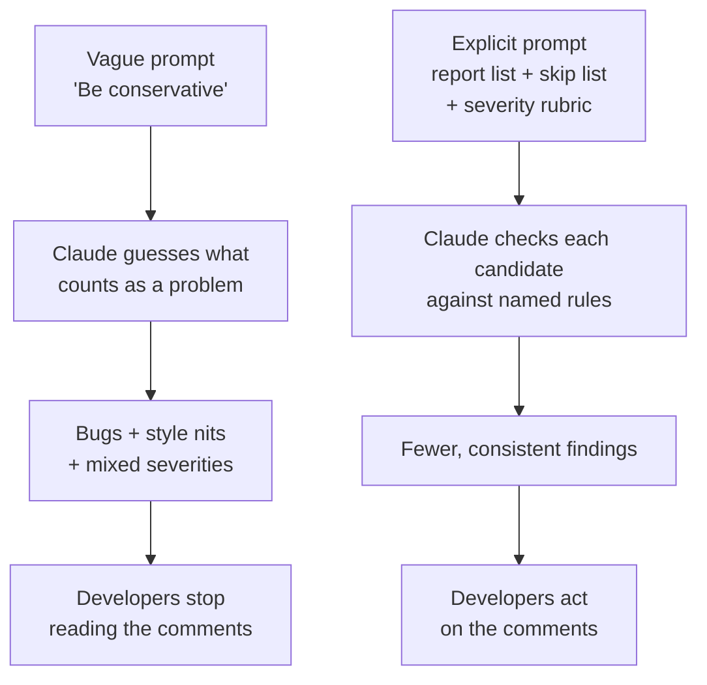

A prompt with explicit criteria tells Claude exactly what to report, what to skip and how to grade each finding. A vague prompt such as "Review this code. Be conservative." leaves all three decisions to the model, and the result is noise: style nits next to real bugs, and severity labels that change between runs. In this post you rewrite a vague review prompt into explicit criteria, and build a small scoring harness that measures false positives on canned review outputs, with no API key needed.

This is task statement 4.1 of the [Claude Certified Architect – Foundations exam guide](https://anthropic-partners.skilljar.com/claude-certified-architect-foundations-certification): "Design prompts with explicit criteria to improve precision and reduce false positives". It opens Domain 4, Prompt Engineering & Structured Output, which is 20% of the exam.

## What does task statement 4.1 test?

The guide lists three things to know and three skills. In plain words:

| The guide asks you to… | In practice |
| --- | --- |
| Know why explicit criteria beat vague instructions | "Flag a comment only when it contradicts the code" works; "check that comments are accurate" does not |
| Know why "be conservative" fails | General instructions about caution or confidence don't improve precision the way specific categories do |
| Know what false positives cost | One noisy category makes developers distrust the accurate ones too |
| Write report and skip criteria | Report bugs and security issues; skip minor style and patterns the codebase already uses |
| Switch off a noisy category for a while | Keep the trusted categories running while you fix the noisy one's prompt |
| Define severity with code examples | One short example per level, so the same issue gets the same label every time |

Two words appear everywhere in this post. A **false positive** is a finding that isn't a real problem, like a "bug" report about a variable name. **Precision** is the share of reported findings that are real: true positives divided by everything reported ([scikit-learn's definition](https://scikit-learn.org/stable/modules/generated/sklearn.metrics.precision_score.html) is `tp / (tp + fp)`). Its partner, **recall**, is the share of the real problems that were found ([`tp / (tp + fn)`](https://scikit-learn.org/stable/modules/generated/sklearn.metrics.recall_score.html)). If prompts in general are new to you, read [What is prompt engineering?](/blog/what-is-prompt-engineering) first.

## Why do vague instructions produce false positives?

Because they don't say what to check. "Be conservative" and "only report issues you are sure about" describe a mood. Claude still has to decide whether a snake_case function name is a "problem", and the prompt gives it no rule to decide with.

Anthropic's [prompting best practices](https://platform.claude.com/docs/en/build-with-claude/prompt-engineering/claude-prompting-best-practices) put it simply: "Claude responds well to clear, explicit instructions." They suggest you treat Claude like "a brilliant but new employee who lacks context on your norms and workflows", and offer a golden rule: "Show your prompt to a colleague with minimal context on the task and ask them to follow it. If they'd be confused, Claude will be too."

Try the golden rule on "be conservative". A new colleague would ask: conservative about what? Should I mention naming? Formatting? A missing return type? The prompt has no answer, so each run makes its own guess.

The docs show the same pattern in a different area. On frontend work, the [Claude Opus 5.5 prompting guide](https://platform.claude.com/docs/en/build-with-claude/prompt-engineering/prompting-claude-opus-5-5) notes that a general instruction such as "avoid a generic AI look" "mostly swaps one default for another", while the model "responds well to instructions that name specific patterns to avoid". Code review works the same way: name the categories.



## What does an explicit criterion look like?

An explicit criterion is a condition Claude can test against the code. Compare these pairs:

| Vague | Explicit |
| --- | --- |
| "Check that comments are accurate." | "Flag a comment only when the behaviour it describes contradicts what the code does." |
| "Report important issues." | "Report code that crashes, returns a wrong value or loses data for an input you can name." |
| "Look for security problems." | "Report untrusted input that reaches a SQL query, shell command, file path or HTML without parameters or escaping." |
| "Be conservative." | A skip list: "Never report naming, formatting, semicolons or patterns the rest of the codebase already uses." |
| "Assign a severity." | A rubric: each level defined in one line, with a short code example. |

Each explicit version has a yes-or-no test. A short but true comment fails the "contradicts the code" test, so it isn't flagged. That is exactly the false positive the vague version produces.

Two more parts make criteria work:

- **A skip list.** Saying what *not* to report matters as much as the report list. The [Claude Code Review docs](https://code.claude.com/docs/en/code-review) describe the same idea: by default it "focuses on correctness: bugs that would break production, not formatting preferences or missing test coverage", and its `REVIEW.md` file supports skip rules for "finding categories where Claude should post no findings".
- **Evidence.** Ask for the input or situation that triggers each finding. A finding that can't name one is often a guess. The Code Review docs call this a verification bar, for example "behavior claims need a `file:line` citation in the source, not an inference from naming".

## Why do false positives cost more than they seem?

A false positive costs more than the minute a developer spends dismissing it. Every noisy comment teaches the team that bot comments can be ignored. The exam guide says it directly: high false positive categories "undermine confidence in accurate categories".

Picture a bot that posts 30 comments on a pull request. 25 are naming preferences and 5 are real. After a week, developers close all 30 without reading, including the null-pointer bug. The 5 real findings were accurate, and they still had no effect.

That is why the guide has a skill for switching a category off. If performance findings are mostly wrong, turn that category off, keep security and correctness running, and fix the performance criteria against an answer key before you turn it back on. Removing a category is not giving up on it. It protects the trust that makes the other categories useful.

## How do you make severity consistent?

Give every level a definition and a short code example. "Critical, major or minor" with no definitions is three empty boxes. Claude fills them differently on different runs, because "serious" means different things in different contexts.

A rubric with examples gives Claude a fixed reference point:

| Level | Definition | Example |
| --- | --- | --- |
| critical | An attacker can read or change data they should not, or data is lost | `fs.readFileSync(req.query.path)` lets a user read any file on the server |
| major | A normal input gives a wrong result or a crash | `for (let i = 1; i < xs.length; i++) sum += xs[i];` skips the first element |
| minor | A misleading comment, or a wrong result only for a rare edge case | `// returns milliseconds` above a function that returns seconds |

Pick examples that are *not* in the code you review, so the rubric teaches the level instead of pointing at the answer. Showing whole worked examples of the output is a separate technique, few-shot prompting, which is task statement 4.2.

## Try it: a before and after review, scored offline

You'll review a small file with seven seeded issues: two real bugs, one SQL injection, one stale comment and three style differences. You'll write a vague prompt and an explicit one, then score review outputs for each with a small harness that counts true and false positives.

The harness runs without an API key. The four review outputs it scores are **canned examples we wrote by hand** to show what typical noise looks like. They are not recorded model output. The last step shows how to produce real ones with your own key, and the same harness scores them.

**You need:** Node.js 22.18 or later, which runs `.ts` files directly because [type stripping is on by default](https://nodejs.org/docs/latest-v22.x/api/typescript.html). An Anthropic API key only for the last step.


<Steps>


<Step title="Create the project">

```bash
$ mkdir review-criteria
$ cd review-criteria
$ npm init -y
$ npm pkg set type=module
$ mkdir sample runs
```

Install the [official TypeScript SDK](https://github.com/anthropics/anthropic-sdk-typescript), then TypeScript and the Node types for type-checking:


```bash
npm install @anthropic-ai/sdk
```


```bash
npm install -D typescript @types/node
```


Add a `tsconfig.json`. These are the settings the Node docs recommend for code that Node runs directly, plus `allowImportingTsExtensions` and `strict`. `include` keeps the file under review out of the type-check:


**tsconfig.json**

```json
{
  "compilerOptions": {
    "noEmit": true,
    "target": "esnext",
    "module": "nodenext",
    "rewriteRelativeImportExtensions": true,
    "erasableSyntaxOnly": true,
    "verbatimModuleSyntax": true,
    "allowImportingTsExtensions": true,
    "strict": true
  },
  "include": ["*.ts"]
}
```


</Step>


<Step title="Add the code to review">

This file has seven seeded issues. It imports a `db` module that doesn't exist, because the file is never run: it is only text that gets reviewed.


**sample/orders.ts**

```ts
import { db } from './db.ts';

// Returns the order, or null when no order has this ID.
export async function getOrder(id: string) {
  const rows = await db.query(`SELECT * FROM orders WHERE id = '${id}'`);
  if (rows.length === 0) throw new Error('Order not found');
  return rows[0];
}

export function orderTotal(items: { price: number; qty: number }[]) {
  let total = 0;
  for (let i = 0; i <= items.length; i++) {
    total += items[i].price * items[i].qty;
  }
  return total;
}

// percent is a whole number, e.g. 15 for 15% off.
export function applyDiscount(total: number, percent: number) {
  return total - percent;
}

export function fmt_money(cents: number) {
  return '$' + (cents / 100).toFixed(2)
}
```


The issues, by line:

- **Line 3:** the comment promises `null` for a missing order, but line 6 throws. A stale comment.
- **Line 5:** `id` goes straight into the SQL string. SQL injection.
- **Line 12:** `i <= items.length` reads one item past the end, so `items[i].price` throws a `TypeError` on every call, even with an empty list.
- **Line 20:** subtracts the percent as money: `applyDiscount(200, 15)` returns 185, not 170.
- **Lines 23–24:** a snake_case name, string concatenation and a missing semicolon. Style only.

</Step>


<Step title="Write both prompts and one output schema">


**prompts.ts**

```ts
// Before: the kind of prompt the exam warns about.
export const VAGUE_PROMPT = `Review this code and report problems. Be conservative.`;

// After: what to report, what to skip, and what each severity means.
export const EXPLICIT_PROMPT = `You review TypeScript code before it is merged.

<report>
Report a finding only if it fits one of these categories:
1. correctness: the code crashes, returns a wrong value or loses data for an input you can name.
2. security: untrusted input reaches a SQL query, shell command, file path or HTML without
   parameters or escaping.
3. comment: a comment or docstring describes behaviour that contradicts what the code does.
   Do not flag comments that are short, informal or incomplete but still true.
</report>

<skip>
Never report these, even if you notice them:
- naming, formatting, semicolons, quote style, string concatenation vs template literals
- anything a linter or formatter can enforce
- patterns that the rest of the codebase already uses
- refactors, performance ideas or missing tests that do not change behaviour
</skip>

<severity>
- critical: an attacker can read or change data they should not, or data is lost.
  Example: fs.readFileSync(req.query.path) lets a user read any file on the server.
- major: a normal input gives a wrong result or a crash.
  Example: for (let i = 1; i < xs.length; i++) sum += xs[i]; skips the first element.
- minor: a misleading comment, or a wrong result only for a rare edge case.
  Example: // returns milliseconds, above a function that returns seconds.
</severity>

For every finding, give the line number and the input or situation that triggers it.
If nothing fits a report category, return an empty findings list.`;

// Both prompts use the same output schema, so only the instructions change.
export const FINDINGS_SCHEMA = {
  type: 'object',
  properties: {
    findings: {
      type: 'array',
      items: {
        type: 'object',
        properties: {
          line: { type: 'integer' },
          category: {
            type: 'string',
            enum: ['correctness', 'security', 'comment', 'style', 'performance', 'other'],
          },
          severity: { type: 'string', enum: ['critical', 'major', 'minor'] },
          title: { type: 'string' },
          trigger: { type: 'string', description: 'The input or situation that triggers it' },
        },
        required: ['line', 'category', 'severity', 'title', 'trigger'],
        additionalProperties: false,
      },
    },
  },
  required: ['findings'],
  additionalProperties: false,
} as const;

export type Category = 'correctness' | 'security' | 'comment' | 'style' | 'performance' | 'other';
export type Severity = 'critical' | 'major' | 'minor';

export interface Finding {
  line: number;
  category: Category;
  severity: Severity;
  title: string;
  trigger: string;
}
```


How the explicit prompt maps to the guide:

- **`<report>`** lists three categories, each with a yes-or-no test. The comment rule uses the guide's own example: contradiction with the code, not "accuracy".
- **`<skip>`** names the noise sources: naming, formatting, linter territory, local patterns, and suggestions that don't change behaviour.
- **`<severity>`** defines each level in one line with a code example that isn't from `orders.ts`.
- **"Give the input that triggers it"** is the evidence rule. It makes guesses easy to spot.
- **No confidence score.** The schema has no `confidence` field, on purpose. The criteria do the filtering.

The XML tags follow the docs' advice that tags "help Claude parse complex prompts unambiguously". Both prompts share the same schema, so only the instructions change between the two runs.

</Step>


<Step title="Write the answer key and the scorer">

The answer key lists every seeded issue, the lines where a finding counts as a match, and whether it should be reported:


**key.ts**

```ts
import type { Severity } from './prompts.ts';

// The answer key: every issue we seeded in sample/orders.ts.
export interface SeededIssue {
  id: string;
  lines: number[]; // a finding on any of these lines counts as a match
  report: boolean; // true = a real problem, false = something the reviewer should skip
  expected?: Severity;
}

export const KEY: SeededIssue[] = [
  { id: 'stale-comment', lines: [3, 6], report: true, expected: 'minor' },
  { id: 'sql-injection', lines: [5], report: true, expected: 'critical' },
  { id: 'off-by-one', lines: [12, 13], report: true, expected: 'major' },
  { id: 'discount-math', lines: [20], report: true, expected: 'major' },
  { id: 'snake-case-name', lines: [23], report: false },
  { id: 'concat-and-semicolon', lines: [24], report: false },
];
```


The scorer matches each finding to the key by line number. A finding on a reportable issue is a true positive the first time; a skip-list item, an unknown line or a duplicate counts as noise:


**score.ts**

```ts
import type { Category, Finding, Severity } from './prompts.ts';
import type { SeededIssue } from './key.ts';

export interface Score {
  findings: number;
  truePositives: number;
  falsePositives: number;
  precision: number; // of everything reported, how much was a real problem
  recall: number; // of the real problems, how many were found
  falsePositivesByCategory: Partial<Record<Category, number>>;
  severities: Record<string, Severity>; // seeded issue id -> severity the reviewer gave
}

export function score(findings: Finding[], key: SeededIssue[]): Score {
  const found = new Set<string>();
  const severities: Record<string, Severity> = {};
  const falsePositivesByCategory: Partial<Record<Category, number>> = {};
  let truePositives = 0;

  for (const f of findings) {
    const issue = key.find((k) => k.lines.includes(f.line));
    // A true positive is a real, seeded problem that this run has not reported yet.
    if (issue?.report && !found.has(issue.id)) {
      found.add(issue.id);
      severities[issue.id] = f.severity;
      truePositives++;
    } else {
      // Skip-list items, unknown lines and duplicates are all noise for the developer.
      falsePositivesByCategory[f.category] = (falsePositivesByCategory[f.category] ?? 0) + 1;
    }
  }

  const reportable = key.filter((k) => k.report).length;
  return {
    findings: findings.length,
    truePositives,
    falsePositives: findings.length - truePositives,
    precision: findings.length === 0 ? 1 : truePositives / findings.length,
    recall: truePositives / reportable,
    falsePositivesByCategory,
    severities,
  };
}

// The same issue should get the same severity in every run, and match the rubric.
export function severityConsistency(scores: Score[], key: SeededIssue[]) {
  return key
    .filter((k) => k.report)
    .map((k) => {
      const given = scores.map((s) => s.severities[k.id] ?? 'missed');
      const consistent = given.every((g) => g === given[0]);
      return { issue: k.id, expected: k.expected, given, consistent };
    });
}

// Simulates switching a category off: drop its findings before they reach developers.
export function withoutCategory(findings: Finding[], category: Category): Finding[] {
  return findings.filter((f) => f.category !== category);
}
```


Matching on line numbers is rough. A finding on line 5 counts as the SQL injection even if its title talks about something else. For a real answer key, read the titles of matched findings too, or match on category as well as line.

</Step>


<Step title="Add the canned review outputs">

These four files stand in for two runs of each prompt. They follow `FINDINGS_SCHEMA`, so a real run from the last step drops in with the same file names. The two vague runs are written to show common noise: style nits, "add a return type" suggestions and severity labels that change between runs.


**runs/vague-1.json**

```json
{"findings": [
  {"line": 5, "category": "security", "severity": "critical", "title": "SQL built from a string", "trigger": "id = \"' OR '1'='1\""},
  {"line": 12, "category": "correctness", "severity": "critical", "title": "Loop reads past the end of items", "trigger": "any call"},
  {"line": 20, "category": "correctness", "severity": "major", "title": "Discount subtracts the percent as money", "trigger": "applyDiscount(200, 15) returns 185"},
  {"line": 23, "category": "style", "severity": "minor", "title": "Use camelCase: fmtMoney", "trigger": "naming convention"},
  {"line": 24, "category": "style", "severity": "minor", "title": "Prefer a template literal", "trigger": "readability"},
  {"line": 24, "category": "style", "severity": "minor", "title": "Missing semicolon", "trigger": "consistency"},
  {"line": 24, "category": "other", "severity": "minor", "title": "Magic number 100", "trigger": "readability"},
  {"line": 7, "category": "other", "severity": "minor", "title": "Return type is not declared", "trigger": "readability"},
  {"line": 13, "category": "performance", "severity": "minor", "title": "Use reduce instead of a loop", "trigger": "style preference"}
]}
```


**runs/vague-2.json**

```json
{"findings": [
  {"line": 5, "category": "security", "severity": "major", "title": "Possible SQL injection", "trigger": "untrusted id"},
  {"line": 12, "category": "correctness", "severity": "major", "title": "Off-by-one in loop condition", "trigger": "any non-empty list"},
  {"line": 20, "category": "correctness", "severity": "minor", "title": "Discount looks wrong", "trigger": "percent > 0"},
  {"line": 23, "category": "style", "severity": "minor", "title": "Function name is not camelCase", "trigger": "naming convention"},
  {"line": 24, "category": "style", "severity": "minor", "title": "Use a template literal and add a semicolon", "trigger": "readability"},
  {"line": 4, "category": "other", "severity": "minor", "title": "Add an explicit return type", "trigger": "readability"},
  {"line": 10, "category": "other", "severity": "minor", "title": "Add an explicit return type", "trigger": "readability"},
  {"line": 15, "category": "performance", "severity": "minor", "title": "Total could be cached", "trigger": "large carts"}
]}
```


**runs/explicit-1.json**

```json
{"findings": [
  {"line": 3, "category": "comment", "severity": "minor", "title": "Comment says null, code throws", "trigger": "getOrder('missing') throws instead of returning null"},
  {"line": 5, "category": "security", "severity": "critical", "title": "id is interpolated into SQL", "trigger": "id = \"x' OR '1'='1\" returns every order"},
  {"line": 12, "category": "correctness", "severity": "major", "title": "Loop runs one step too far", "trigger": "orderTotal([]) throws a TypeError"},
  {"line": 20, "category": "correctness", "severity": "major", "title": "Percent subtracted as an amount", "trigger": "applyDiscount(200, 15) returns 185, not 170"},
  {"line": 7, "category": "correctness", "severity": "minor", "title": "rows[0] may be undefined", "trigger": "empty result"}
]}
```


**runs/explicit-2.json**

```json
{"findings": [
  {"line": 5, "category": "security", "severity": "critical", "title": "SQL injection through id", "trigger": "id containing a quote"},
  {"line": 6, "category": "comment", "severity": "minor", "title": "Throws, but the comment promises null", "trigger": "unknown order ID"},
  {"line": 12, "category": "correctness", "severity": "major", "title": "i <= items.length reads items[items.length]", "trigger": "every call, even with an empty list"},
  {"line": 20, "category": "correctness", "severity": "major", "title": "Discount ignores that percent is a percentage", "trigger": "applyDiscount(50, 10) returns 40, not 45"}
]}
```


Notice the `trigger` field. In the vague runs it often says "readability" or "naming convention". In the explicit runs it names an input, such as `applyDiscount(200, 15) returns 185, not 170`. That difference is the evidence rule at work, and it is what you look for when you read real output.

</Step>


<Step title="Score the runs">


**report.ts**

```ts
import { readFileSync } from 'node:fs';
import type { Finding } from './prompts.ts';
import { KEY } from './key.ts';
import { score, severityConsistency, withoutCategory, type Score } from './score.ts';

const load = (name: string): Finding[] =>
  JSON.parse(readFileSync(`runs/${name}.json`, 'utf8')).findings;

const pct = (n: number) => `${Math.round(n * 100)}%`;

function summary(label: string, runs: string[]): Score[] {
  const scores = runs.map((r) => score(load(r), KEY));
  console.log(`\n${label}`);
  for (const [i, s] of scores.entries()) {
    console.log(
      `  ${runs[i]}: ${s.findings} findings, ${s.truePositives} real, ${s.falsePositives} noise, ` +
        `precision ${pct(s.precision)}, recall ${pct(s.recall)}, ` +
        `noise by category ${JSON.stringify(s.falsePositivesByCategory)}`,
    );
  }
  for (const c of severityConsistency(scores, KEY)) {
    const mark = c.consistent && c.given[0] === c.expected ? 'ok  ' : 'DIFF';
    console.log(`  ${mark} ${c.issue}: ${c.given.join(' / ')} (rubric: ${c.expected})`);
  }
  return scores;
}

summary('Vague prompt ("Be conservative.")', ['vague-1', 'vague-2']);
summary('Explicit prompt (report list, skip list, severity rubric)', ['explicit-1', 'explicit-2']);

// Exercise step 5: switch off the noisiest category and score again.
const noisy = score(withoutCategory(load('vague-1'), 'style'), KEY);
console.log(`\nvague-1 with "style" switched off: ${noisy.findings} findings, precision ${pct(noisy.precision)}`);
```


```bash
$ node report.ts
```

```text
Vague prompt ("Be conservative.")
  vague-1: 9 findings, 3 real, 6 noise, precision 33%, recall 75%, noise by category {"style":3,"other":2,"performance":1}
  vague-2: 8 findings, 3 real, 5 noise, precision 38%, recall 75%, noise by category {"style":2,"other":2,"performance":1}
  DIFF stale-comment: missed / missed (rubric: minor)
  DIFF sql-injection: critical / major (rubric: critical)
  DIFF off-by-one: critical / major (rubric: major)
  DIFF discount-math: major / minor (rubric: major)

Explicit prompt (report list, skip list, severity rubric)
  explicit-1: 5 findings, 4 real, 1 noise, precision 80%, recall 100%, noise by category {"correctness":1}
  explicit-2: 4 findings, 4 real, 0 noise, precision 100%, recall 100%, noise by category {}
  ok   stale-comment: minor / minor (rubric: minor)
  ok   sql-injection: critical / critical (rubric: critical)
  ok   off-by-one: major / major (rubric: major)
  ok   discount-math: major / major (rubric: major)

vague-1 with "style" switched off: 6 findings, precision 50%
```

This is our output on Node 22.22.2. No model was called. Read it like this:

- **Precision.** The vague runs are mostly noise (33% and 38%). The explicit runs are 80% and 100%.
- **Noise by category.** In the vague runs, `style` is the largest source of noise. That is the category to switch off first (exercise step 5): precision for `vague-1` goes from 33% to 50% without it. Precision rises because the nits are gone, but recall doesn't change. The stale comment is still missed, which only a better criterion fixes.
- **Severity.** Each issue the vague runs found got a different label in each run, and both missed the stale comment. With the rubric, both explicit runs agree with each other and with the rubric.
- **The one explicit false positive** (line 7, "`rows[0]` may be undefined") is wrong because line 6 already throws on an empty result. That's the kind of finding to read by hand: it tells you which criterion needs a sharper test.

Remember that these numbers come from hand-written examples. They show how the harness reports, not how any model performs. With real runs, use more files and more runs than this before you trust a number.

Add a unit test for the scorer, then type-check everything:


**score.test.ts**

```ts
import assert from 'node:assert/strict';
import { test } from 'node:test';
import { KEY } from './key.ts';
import { score } from './score.ts';

test('a real issue counts once; skip-list items and duplicates count as noise', () => {
  const s = score(
    [
      { line: 5, category: 'security', severity: 'critical', title: 'SQL injection', trigger: "id = \"' OR 1=1\"" },
      { line: 5, category: 'security', severity: 'critical', title: 'Same issue again', trigger: 'same' },
      { line: 23, category: 'style', severity: 'minor', title: 'Use camelCase', trigger: 'naming' },
    ],
    KEY,
  );
  assert.equal(s.truePositives, 1);
  assert.equal(s.falsePositives, 2);
  assert.deepEqual(s.falsePositivesByCategory, { security: 1, style: 1 });
  assert.equal(s.recall, 1 / 4);
});

test('an empty report has perfect precision and zero recall', () => {
  const s = score([], KEY);
  assert.equal(s.precision, 1);
  assert.equal(s.recall, 0);
});
```


```bash
$ node --test score.test.ts
$ npx tsc
```

Both tests pass, and `tsc` prints nothing when there are no type errors.

</Step>


<Step title="Produce real runs with Claude">

Create an API key in the [Claude Console](https://platform.claude.com/) and set it as the `ANTHROPIC_API_KEY` environment variable. This script sends one review request and saves the findings in the same format as the canned files:


**review.ts**

```ts
import Anthropic from '@anthropic-ai/sdk';
import { readFileSync, writeFileSync } from 'node:fs';
import { EXPLICIT_PROMPT, FINDINGS_SCHEMA, VAGUE_PROMPT } from './prompts.ts';

const [variant = 'explicit', run = '1'] = process.argv.slice(2);
const system = variant === 'vague' ? VAGUE_PROMPT : EXPLICIT_PROMPT;

// Number the lines so findings can point at them.
const code = readFileSync('sample/orders.ts', 'utf8')
  .split('\n')
  .map((text, i) => `${i + 1}: ${text}`)
  .join('\n');

const client = new Anthropic(); // reads ANTHROPIC_API_KEY from the environment

const response = await client.messages.create({
  model: 'claude-opus-5-5',
  max_tokens: 16000,
  system,
  messages: [{ role: 'user', content: `<code file="orders.ts">\n${code}\n</code>` }],
  output_config: { format: { type: 'json_schema', schema: FINDINGS_SCHEMA } },
});

if (response.stop_reason !== 'end_turn') {
  throw new Error(`Unexpected stop_reason: ${response.stop_reason}`);
}

// Read by block type: a thinking block can come before the text block.
const text = response.content.find((block) => block.type === 'text');
if (!text) throw new Error('No text block in the response');

const out = `runs/${variant}-${run}.json`;
writeFileSync(out, JSON.stringify(JSON.parse(text.text), null, 2));
console.log(`Saved ${out}`);
```


```bash
$ node review.ts vague 1
$ node review.ts vague 2
$ node review.ts explicit 1
$ node review.ts explicit 2
$ node report.ts
```

Each command overwrites the canned file of the same name, so `report.ts` now scores Claude's real findings. A few notes on the request:

- **`output_config.format`** asks for [structured outputs](https://platform.claude.com/docs/en/build-with-claude/structured-outputs) that follow `FINDINGS_SCHEMA`. The docs require `additionalProperties: false` on objects. Task statement 4.3 covers structured output in depth.
- **Why not a forced tool call?** [Forcing a specific tool](https://platform.claude.com/docs/en/agents-and-tools/tool-use/define-tools) with `tool_choice` returns a 400 error on Claude Opus 5.5, so structured outputs are the way to get a fixed JSON shape on this model.
- **The text block is found by type.** The Opus 5.5 guide says to check each block's type, because a response may begin with a `thinking` block.
- **Anything but `end_turn` throws.** The docs warn that on `max_tokens` or `refusal` the output may not match the schema.

The model is `claude-opus-5-5`, the one the [models overview](https://platform.claude.com/docs/en/about-claude/models/overview) suggests starting with. Real findings, counts and labels will differ from the canned ones and from run to run, which is exactly why you score more than one run.

</Step>


</Steps>


## Common traps

These are the mistakes that wrong answer options are built on.

| Trap | Why it fails | Fix |
| --- | --- | --- |
| Adding "be conservative" or "only report issues you are sure about" | It isn't a criterion: Claude still has nothing concrete to check | Report and skip lists with yes-or-no tests |
| Asking for a confidence score and filtering on it | The score is the model's own estimate, not a definition of what you want | Define categories first; measure precision per category on an answer key |
| Keeping a noisy category "because some findings are real" | Its noise trains developers to ignore every finding, including the accurate ones | Switch it off for now, fix its criteria, then turn it back on |
| Severity as adjectives only ("serious", "minor") | Each run reads the words differently, so labels change | One-line definitions plus a short code example per level |
| Rubric examples copied from the code under review | The rubric points at answers instead of teaching the level | Use examples from other code |
| Judging a prompt change on one run | Output varies between runs, so one good run proves little | Score several runs on a fixed answer key |


<Callout type="warning" title="A skip list can hide real bugs">

Skip rules remove findings, real ones included. Write them about *kinds* of issue (naming, formatting) and never about whole areas of risk such as "skip anything in auth/". When you add a skip rule, re-run your answer key and check that recall didn't drop.

</Callout>


## Practice questions

These four questions are this blog's own, written for practice. They are not from the exam.

**Question 1.** Your CI review bot posts about 40 comments on each pull request. Developers say most are naming preferences, and they have started closing every bot comment without reading it, including real null-pointer bugs. What is the best first change?

- A. Add "Only report findings you are highly confident about" to the system prompt.
- B. Rewrite the prompt with explicit criteria: report correctness bugs and security issues; skip naming, formatting and patterns already used across the codebase.
- C. Move the bot to a larger model so it makes better judgments.
- D. Post all findings as one summary comment instead of inline comments.

**Question 2.** A review prompt says "Check that docstrings are accurate." Claude often flags docstrings that are short or informally worded but still correct. Which instruction fixes this best?

- A. "Flag a docstring only when it describes behaviour, inputs or return values that contradict what the code actually does."
- B. "Be strict about docstring quality."
- C. "Flag docstrings that could be improved."
- D. "Ignore docstrings entirely."

**Question 3.** Your review bot has three categories: security, correctness and performance. Security and correctness findings are usually right, but developers dismiss about 70% of performance findings, and they now doubt the whole bot. You need a few weeks to improve the performance prompt. What should you do now?

- A. Keep all three categories and add a note that performance findings may be wrong.
- B. Switch off the whole bot until every category is fixed.
- C. Ask Claude to report fewer findings per pull request in every category.
- D. Switch off the performance category for now, keep security and correctness, and improve the performance criteria before turning it back on.

**Question 4.** Two runs of the same review label an identical unchecked array index as "critical" once and "minor" once. The prompt says "Assign severity: critical, major or minor." What improves consistency most?

- A. Tell the model to think carefully before it picks a severity.
- B. Reduce the scale to two levels.
- C. Add a definition for each severity level with a short code example of each.
- D. Run the review three times and keep the most common severity.

## Answer key

### Question 1

**Answer: B.** Categorical report and skip criteria remove the noisy category at its source, which gives the real findings a chance to be read again. The strongest distractor is A: "highly confident" sounds like a precision fix, but it isn't a criterion, and the guide says this kind of instruction doesn't reliably improve precision.

### Question 2

**Answer: A.** It gives a checkable condition, a contradiction with the code, so short but correct docstrings no longer match. The strongest distractor is D: it removes the false positives, but it also removes the useful findings about docstrings that are really wrong.

### Question 3

**Answer: D.** Switching off the high false positive category for a while restores trust in the accurate ones while you fix its prompt. The strongest distractor is B: it also stops the noise, but it throws away the security and correctness findings that already work.

### Question 4

**Answer: C.** Defined levels with concrete code examples give the model a fixed reference, which is what makes classification consistent. The strongest distractor is D: a majority vote can hide the variation, but it triples the cost and leaves the unclear rubric in place.

## What should I do next?

- **Use your own code.** Seed five to ten known issues in a real file from your project, write the answer key, and score both prompts with your API key over several runs.
- **Learn to grade AI output.** [How to test AI output with evals](/blog/test-ai-output-with-evals) covers test sets and graders in more depth.
- **Move on to task statement 4.2**, "Apply few-shot prompting to improve output consistency and quality". The next post in this series covers it.
- **Plan and check your prep.** Follow the [six-week study plan](/blog/claude-architect-exam-study-plan), and test yourself with the [mock exam](/blog/claude-certification-mock-exam) when you've worked through Domain 4.
