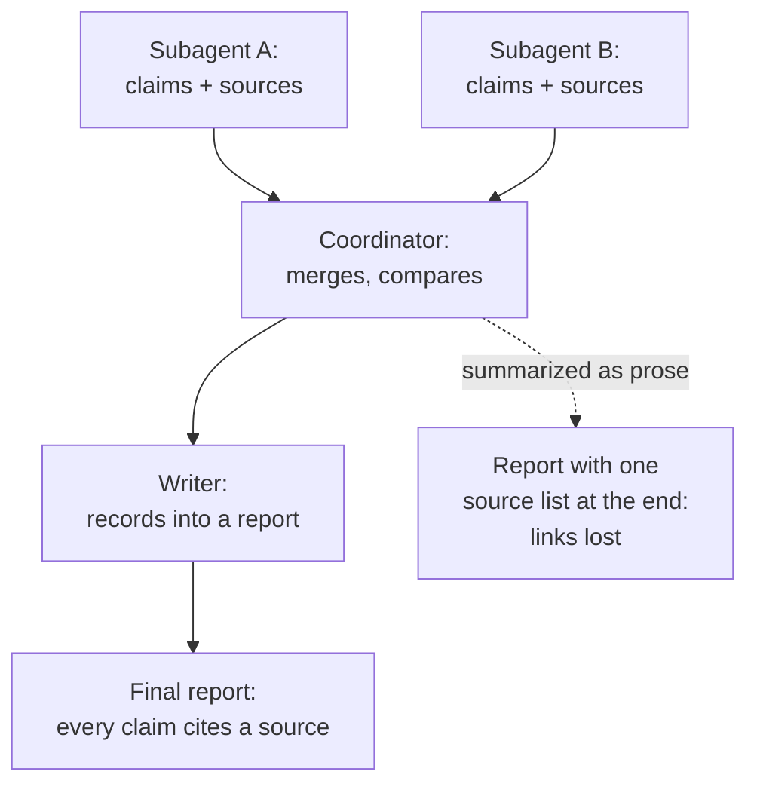
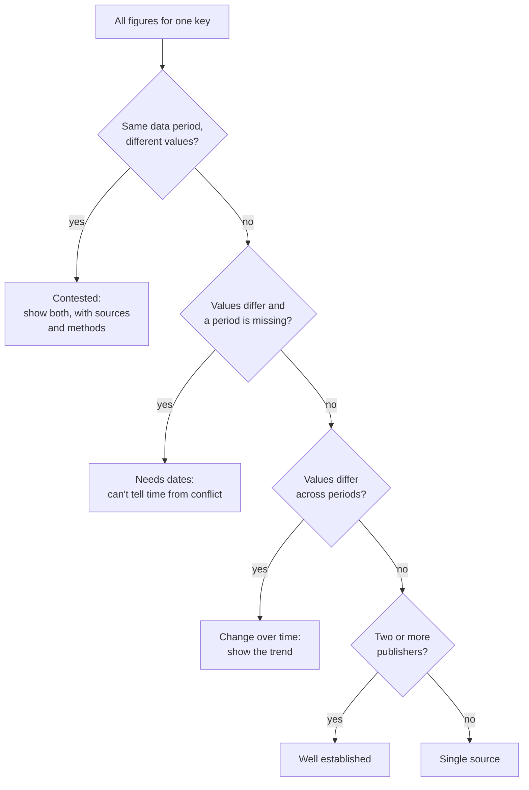

When several agents research a question, every claim in the final report should still point to the source that supports it. Do that by passing claims as records: each one carries its source, an exact excerpt, the publication date and the period the data covers. Every step keeps those records, including the step that writes the report. When credible sources disagree, the report shows both values with their sources instead of quietly picking one. In this post you build that merge-and-report step in TypeScript and test it offline, with no API key.

This is task statement 5.6 of the [Claude Certified Architect – Foundations exam guide](https://anthropic-partners.skilljar.com/claude-certified-architect-foundations-certification): "Preserve information provenance and handle uncertainty in multi-source synthesis". **Provenance** means where a piece of information came from. **Synthesis** is the step that combines many findings into one answer. The task statement sits in Domain 5, Context Management & Reliability, which is 15% of the exam.

## What does task statement 5.6 test?

The guide lists four things to know and five skills. In plain words:

| The guide asks you to… | In practice |
| --- | --- |
| Know how attribution gets lost | A summary step that rewrites findings as prose drops the link between each claim and its source |
| Keep claim-source mappings through synthesis | Subagents return records; the synthesis step merges them and keeps every link |
| Handle conflicting statistics | Show both values, each with its source. Don't pick one at random |
| Handle time | Ask for publication or data-collection dates, so a change over time isn't read as a contradiction |
| Separate settled from contested findings | Two report sections, keeping each source's own wording and method notes |
| Finish the analysis with conflicts included | Report the conflicting values and let the coordinator decide what to do |
| Render each content type well | Financial data as tables, news as prose, technical findings as structured lists |

Three earlier posts in this prep series sit next to this one. [Subagents: spawning, context passing and the Agent tool](/blog/claude-subagents-context-passing) (task statement 1.3) shows how to pass findings between agents as records. [Error propagation in multi-agent Claude systems](/blog/multi-agent-error-propagation) (task statement 5.3, part 3 of this series) covers what to do when a source fails, and how the report marks topics that could not be checked. This post doesn't repeat those coverage gaps. It is about the findings that did come back: keeping their sources, and being honest about how sure they are. [Human review and confidence calibration for Claude](/blog/human-review-confidence-calibration) (task statement 5.5) shows how code can check that a quote really appears in a document. If retrieval is new to you, start with [What is RAG?](/blog/what-is-rag).

## Where does attribution get lost?

At every step that rewrites findings in its own words. In a multi-agent research system, a **coordinator** sends questions to **subagents**, collects their answers and hands them to a step that writes the report. Each hand-off is a chance to compress, and compression is where sources fall off.



The Agent SDK makes each hand-off explicit. The [subagents docs](https://code.claude.com/docs/en/agent-sdk/subagents) say that a subagent's "intermediate tool calls and results stay inside the subagent; only its final message returns to the parent". The same page warns that "The parent receives the subagent's final report, but may summarize it in its own response". So a source that isn't in the subagent's final message is gone, and one that is there can still be dropped by the parent's summary.

Anthropic's [multi-agent research system](https://www.anthropic.com/engineering/multi-agent-research-system) treats citations as a separate job. After research ends, a CitationAgent "processes the documents and research report to identify specific locations for citations", which "ensures all claims are properly attributed to their sources". You don't need a separate agent to do the same thing. You need the link between claim and source to travel as data, all the way to the end.

## What should each finding carry?

The same fields every time. Here is the record this post uses, with an example:

| Field | What it says | Example |
| --- | --- | --- |
| `key` | What the claim is about, from the coordinator's list | `commuter_share` |
| `kind` | `figure`, `news` or `technical`, so the report can pick a format | `figure` |
| `claim` | The claim in one plain sentence | "9% of commuters ride a shared e-bike every week." |
| `figure` | The number and its unit, only for figures | `{ value: 9, unit: "%" }` |
| `source`, `source_title` | A URL or a document name, and its title | `https://example.edu/…`, "Rivertown Travel Survey 2024" |
| `publisher` | Who published it. Two documents from one publisher are not two independent sources | "Rivertown University Transport Lab" |
| `excerpt` | The source's own words, copied exactly | "9% of commuters used a shared e-bike at least once a week." |
| `published` | When the source was published | `2025-05-20` |
| `data_period` | When the data was collected | `2024` |
| `method_note` | How the source got the number | "Travel diaries from 2,000 randomly chosen households." |

The `excerpt` and `method_note` matter more than they look. "Used a shared e-bike at least once a week" and "ride with us every week" are not quite the same measure. A writer that paraphrases both as "commuter share" hides that difference. Keeping the source's own words lets the reader see it.

## How do you get the source links from Claude?

There are two ways, and they don't mix in one request.

| | Citations API | Structured fields |
| --- | --- | --- |
| How | Send documents with `citations: { enabled: true }` | Ask for a JSON schema with `source` and `excerpt` fields |
| What you get | Text blocks, each with a `citations` list holding the exact `cited_text` and where it is | Typed records in your schema |
| Accuracy of the quote | The API extracts `cited_text` itself | The model writes the excerpt, so check it in code |
| Good for | Answers in prose from documents you supply | Figures and fields your code compares |

The [citations docs](https://platform.claude.com/docs/en/build-with-claude/citations) list the advantages: citations "are guaranteed to contain valid pointers to the provided documents", and `cited_text` "does not count toward output tokens". For plain-text documents, each citation gives a character range. For PDFs, a page range. The document's `title` and `context` fields are passed to Claude but never cited. The docs suggest `context` for "storing document metadata as text or stringified JSON", which is where the build below puts the dates.

The catch: "Citations and structured outputs are incompatible". If you enable citations on any document and also set `output_config.format`, "the API returns a 400 error". So a subagent picks one path. In the build, a citations subagent answers in prose and code converts its cited blocks into the same records the other subagents return. The publisher and dates come from your own list of documents, not from the model.

## What should happen when sources disagree?

Keep both values, say who reported each one, and say how each was measured. Don't average them. An average is a number neither source reported. Don't pick the higher, the newer-sounding or the first one either, unless someone decides to, and the report says who did and why.

The guide puts that decision with the coordinator. A subagent that finds two values finishes its work and reports both. The coordinator compares all the findings before anything is written. In the build, that comparison is plain code, so it gives the same answer every time:



Two details in that flow are easy to miss:

- **Count publishers, not documents.** A department's annual report and its own press release saying the same number are one voice, not two.
- **"Contested" is a finding.** It tells the reader something true: credible sources don't agree yet. Hiding it makes the report look surer than the evidence is.

## Why do dates matter so much?

Because two correct figures from different years look like a contradiction when the years are missing. A city that reported 12,000 e-bike trips a day for 2022 and 18,500 for 2024 is not contradicting itself. It grew.

Ask for two dates, because they answer different questions:

- **`published`** says when the source came out. It shows the reader how fresh the source is.
- **`data_period`** says when the data was collected. Compare figures on this one. The 2024 annual report in the build was published in March 2025.

When a figure has no data period, the build can't tell a change over time from a conflict, so it marks the figure `needs dates` and shows it in the contested section. That is better than guessing either way.

## How should the final report look?

Split it by how sure you are, then format each part by what it contains:

| Section | What goes in | Format |
| --- | --- | --- |
| Well established | Findings that two or more independent publishers agree on | Short list, each item with its source IDs |
| Contested | Conflicting values, each with its source, excerpt and method | Nested list, one line per value |
| Key figures | Every number, with its data period and status | Table |
| News | Events, in date order | Prose, one cited sentence per event |
| Technical details | How things work | Structured list |
| Sources | Every source, with its publisher and publication date | List with IDs |

Numbers belong in a table because readers compare them across rows. News reads best as prose because order and context matter. Technical details are easiest to scan as a list. Forcing all three into one bullet list makes each harder to read.

## Try it: merge findings and keep every source

You'll research one question, "How is Rivertown's e-bike scheme doing?", from canned findings returned by two subagents: `stats` (official reports and surveys) and `web` (the operator's site and local news). Your code merges them, compares the figures and renders the report. A third piece shows how a citations subagent turns a cited answer into the same records.

Rivertown, VoltRide and every source and number here are **made up for this post**. The findings are examples we wrote by hand, not recorded model output. They prove the merge logic, not what Claude would find.

**You need:** Node.js 22.18 or later, which runs `.ts` files directly because [type stripping is on by default](https://nodejs.org/docs/latest-v22.x/api/typescript.html). An Anthropic API key only for the last step.


<Steps>


<Step title="Create the project">

```bash
$ mkdir provenance
$ cd provenance
$ npm init -y
$ npm pkg set type=module
```

Install the [Anthropic TypeScript SDK](https://github.com/anthropics/anthropic-sdk-typescript) and [Zod](https://zod.dev/), then TypeScript and the Node types for type-checking:


```bash
npm install @anthropic-ai/sdk zod
```


```bash
npm install -D typescript @types/node
```


Add the same `tsconfig.json` as in the earlier parts of this series:


**tsconfig.json**

```json
{
  "compilerOptions": {
    "noEmit": true,
    "target": "esnext",
    "module": "nodenext",
    "rewriteRelativeImportExtensions": true,
    "erasableSyntaxOnly": true,
    "verbatimModuleSyntax": true,
    "allowImportingTsExtensions": true,
    "strict": true
  }
}
```


</Step>


<Step title="Define the finding every subagent returns">


**findings.ts**

```ts
import { z } from 'zod';

// One claim, carried with everything a reader needs to trace it.
export const Finding = z.object({
  key: z.string(), // what the claim is about, from the coordinator's list, e.g. "daily_trips"
  kind: z.enum(['figure', 'news', 'technical']), // decides how the report shows it
  claim: z.string(), // the claim in one plain sentence
  figure: z.object({ value: z.number(), unit: z.string() }).nullable(), // only for kind "figure"
  source: z.string(), // a URL or a document name
  source_title: z.string(),
  publisher: z.string(), // two articles from one publisher are not two independent sources
  excerpt: z.string(), // the source's own words, copied exactly
  published: z.string(), // publication date, YYYY-MM-DD
  data_period: z.string().nullable(), // when the data was collected, e.g. "2024"
  method_note: z.string().nullable(), // how the source got the number, in its own terms
});
export type Finding = z.infer<typeof Finding>;

// What each research subagent hands back to the coordinator.
export const SubagentOutput = z.object({
  agent: z.string(),
  findings: z.array(Finding),
});
export type SubagentOutput = z.infer<typeof SubagentOutput>;

// The same contract as JSON Schema, for structured outputs or an Agent SDK outputFormat.
export const OUTPUT_JSON_SCHEMA = z.toJSONSchema(SubagentOutput, { target: 'draft-7' });
```


One Zod schema does three jobs. It types the records, it checks every subagent's output in the merge step, and `z.toJSONSchema` turns it into a JSON Schema. Pass `OUTPUT_JSON_SCHEMA` as the schema in `output_config.format` when a subagent uses [structured outputs](https://platform.claude.com/docs/en/build-with-claude/structured-outputs), or as the Agent SDK's `outputFormat`. The [Agent SDK structured outputs docs](https://code.claude.com/docs/en/agent-sdk/structured-outputs) say the SDK validates with JSON Schema draft-07, hence `target: 'draft-7'`.

</Step>


<Step title="Merge, compare and render">


**synthesize.ts**

```ts
import { SubagentOutput, type Finding } from './findings.ts';

export interface Source {
  id: string; // "S1", "S2"… what the report cites
  url: string;
  title: string;
  publisher: string;
  published: string;
}

export interface Claim extends Finding {
  id: string; // "C1", "C2"…
  agent: string; // which subagent found it
  sourceId: string;
}

export interface Merged {
  sources: Source[];
  claims: Claim[];
  rejected: string[]; // findings that can't be traced, with the reason
}

// Step 1: merge every subagent's findings. Each claim keeps a pointer to its source.
export function mergeFindings(outputs: unknown[]): Merged {
  const sources = new Map<string, Source>();
  const claims: Claim[] = [];
  const rejected: string[] = [];

  outputs.forEach((raw, i) => {
    const parsed = SubagentOutput.safeParse(raw);
    if (!parsed.success) {
      rejected.push(`output ${i + 1}: does not match the schema`);
      return;
    }
    const { agent, findings } = parsed.data;
    for (const f of findings) {
      if (!f.excerpt.trim()) {
        rejected.push(`${agent}: "${f.claim}" has no excerpt`);
        continue;
      }
      if ((f.kind === 'figure') !== (f.figure !== null)) {
        rejected.push(`${agent}: "${f.claim}" has kind ${f.kind} but figure ${JSON.stringify(f.figure)}`);
        continue;
      }
      let source = sources.get(f.source);
      if (!source) {
        source = { id: `S${sources.size + 1}`, url: f.source, title: f.source_title, publisher: f.publisher, published: f.published };
        sources.set(f.source, source);
      }
      claims.push({ ...f, id: `C${claims.length + 1}`, agent, sourceId: source.id });
    }
  });
  return { sources: [...sources.values()], claims, rejected };
}

export type FigureStatus = 'agreed' | 'single_source' | 'changed_over_time' | 'contested' | 'needs_dates';

export interface FigureRow {
  period: string | null;
  value: number;
  claims: Claim[];
}

export interface FigureAnalysis {
  key: string;
  unit: string;
  status: FigureStatus;
  rows: FigureRow[]; // one row per (data period, value), oldest first
  note: string;
}

export interface TextAnalysis {
  key: string;
  kind: 'news' | 'technical';
  status: 'established' | 'single_source';
  claims: Claim[];
}

export interface Analysis {
  sources: Source[];
  figures: FigureAnalysis[];
  texts: TextAnalysis[];
}

const publishers = (claims: Claim[]) => new Set(claims.map((c) => c.publisher)).size;

function groupBy<T>(items: T[], keyOf: (item: T) => string): Map<string, T[]> {
  const groups = new Map<string, T[]>();
  for (const item of items) groups.set(keyOf(item), [...(groups.get(keyOf(item)) ?? []), item]);
  return groups;
}

// Step 2: the coordinator compares the claims. It labels conflicts; it never picks a winner.
export function analyse(merged: Merged): Analysis {
  const figures: FigureAnalysis[] = [];
  const texts: TextAnalysis[] = [];

  for (const [key, claims] of groupBy(merged.claims, (c) => c.key)) {
    if (claims[0].kind !== 'figure') {
      const kind = claims[0].kind as 'news' | 'technical';
      texts.push({ key, kind, status: publishers(claims) >= 2 ? 'established' : 'single_source', claims });
      continue;
    }

    const rows = [...groupBy(claims, (c) => `${c.data_period}|${c.figure!.value}`).values()]
      .map((group) => ({ period: group[0].data_period, value: group[0].figure!.value, claims: group }))
      .sort((a, b) => (a.period ?? '').localeCompare(b.period ?? ''));
    const values = new Set(rows.map((r) => r.value));
    const clash = [...groupBy(rows, (r) => r.period ?? 'undated').entries()].find(
      ([period, sameTime]) => period !== 'undated' && sameTime.length > 1,
    );

    let status: FigureStatus;
    let note: string;
    if (clash) {
      status = 'contested';
      note = `Sources disagree for ${clash[0]}. Both values are kept with their sources and methods; none was picked.`;
    } else if (values.size > 1 && rows.some((r) => r.period === null)) {
      status = 'needs_dates';
      note = 'The values differ and at least one has no data period, so a change over time cannot be told apart from a conflict.';
    } else if (values.size > 1) {
      status = 'changed_over_time';
      note = `The values come from different years (${rows.map((r) => r.period).join(' to ')}): a change over time, not a conflict.`;
    } else if (publishers(claims) >= 2) {
      status = 'agreed';
      note = `Reported by ${publishers(claims)} independent publishers.`;
    } else {
      status = 'single_source';
      note = 'One publisher only.';
    }
    figures.push({ key, unit: claims[0].figure!.unit, status, rows, note });
  }
  return { sources: merged.sources, figures, texts };
}

const refs = (claims: Claim[]) => [...new Set(claims.map((c) => c.sourceId))].map((id) => `[${id}]`).join('');
const fmt = (value: number, unit: string) => (unit === '%' ? `${value}%` : `${value.toLocaleString('en-US')} ${unit}`);
const noDot = (text: string) => text.replace(/\.$/, '');

// Step 3: render. Every claim line ends with its source IDs, and each content type gets its own format.
export function renderReport(title: string, a: Analysis): string {
  const out: string[] = [`# ${title}`, ''];

  out.push('## Well established', '');
  for (const f of a.figures.filter((f) => f.status === 'agreed')) {
    out.push(`- ${noDot(f.rows[0].claims[0].claim)}. ${f.note} ${refs(f.rows[0].claims)}`);
  }
  for (const t of a.texts.filter((t) => t.status === 'established')) {
    out.push(`- ${noDot(t.claims[0].claim)}. Reported by ${publishers(t.claims)} independent publishers. ${refs(t.claims)}`);
  }

  out.push('', '## Contested', '');
  for (const f of a.figures.filter((f) => f.status === 'contested' || f.status === 'needs_dates')) {
    out.push(`- **${f.key}** ${refs(f.rows.flatMap((r) => r.claims))}: ${f.note}`);
    for (const row of f.rows) {
      for (const c of row.claims) {
        const method = c.method_note ? ` Method: ${c.method_note}` : '';
        out.push(`  - ${fmt(row.value, f.unit)} (${row.period ?? 'no data period'}), ${c.publisher}: "${c.excerpt}"${method} [${c.sourceId}]`);
      }
    }
  }

  out.push('', '## Key figures', '', '| Figure | Value | Data period | Sources | Status |', '| --- | --- | --- | --- | --- |');
  for (const f of a.figures) {
    for (const row of f.rows) {
      out.push(`| ${f.key} | ${fmt(row.value, f.unit)} | ${row.period ?? 'unknown'} | ${refs(row.claims)} | ${f.status.replaceAll('_', ' ')} |`);
    }
  }
  for (const f of a.figures.filter((f) => f.status === 'changed_over_time')) out.push('', `${f.key}: ${f.note}`);

  const news = a.texts.filter((t) => t.kind === 'news').flatMap((t) => t.claims);
  if (news.length > 0) {
    out.push('', '## News', '');
    const sorted = [...news].sort((x, y) => x.published.localeCompare(y.published));
    out.push(sorted.map((c) => `${noDot(c.claim)} (${c.publisher}, ${c.published}) [${c.sourceId}].`).join(' '));
  }

  const technical = a.texts.filter((t) => t.kind === 'technical');
  if (technical.length > 0) {
    out.push('', '## Technical details', '');
    for (const t of technical) {
      const single = t.status === 'single_source' ? ' (single source)' : '';
      out.push(`- ${noDot(t.claims[0].claim)}${single} ${refs(t.claims)}`);
    }
  }

  out.push('', '## Sources', '');
  for (const s of a.sources) out.push(`- [${s.id}] ${s.title}. ${s.publisher}, published ${s.published}. ${s.url}`);
  return out.join('\n');
}

// Check text a writer model produced: every sentence cites a source, and every cited ID exists.
export function checkCitations(text: string, sources: Source[]) {
  const known = new Set(sources.map((s) => s.id));
  const sentences = text.split(/(?<=[.!?])\s+/).map((s) => s.trim()).filter(Boolean);
  const uncited = sentences.filter((s) => !/\[S\d+\]/.test(s));
  const unknown = [...new Set([...text.matchAll(/\[(S\d+)\]/g)].map((m) => m[1]))].filter((id) => !known.has(id));
  return { ok: uncited.length === 0 && unknown.length === 0, uncited, unknown };
}
```


The file has four parts, one per job:

- **`mergeFindings`** gives each source an ID (`S1`, `S2`…) and each claim an ID, and keeps the claim's `sourceId`. A finding with no excerpt, or an output that breaks the schema, goes to `rejected` with a reason. It never enters the report without a source.
- **`analyse`** is the coordinator's comparison, following the flowchart above. It groups figures by `key` and data period. Two different values for the same period are `contested`. Different values across periods are a `changed_over_time`. A missing period makes it `needs_dates`. Agreement needs two or more publishers.
- **`renderReport`** builds the sections. Every claim line ends with its source IDs, and contested values keep the source's excerpt and method note word for word.
- **`checkCitations`** checks text that a writer model produced: every sentence must cite a source, and every cited ID must exist. You'll use it in the tests.

</Step>


<Step title="Add the canned findings and print the report">


**fixtures.ts**

```ts
import type { Finding, SubagentOutput } from './findings.ts';

// Canned subagent outputs about a made-up city e-bike scheme. Every source is invented.
const REPORT_2022 = { source: 'doc:rivertown-transport-annual-report-2022', source_title: 'Rivertown Transport Annual Report 2022', publisher: 'Rivertown Transport Department', published: '2023-03-14' };
const REPORT_2024 = { source: 'doc:rivertown-transport-annual-report-2024', source_title: 'Rivertown Transport Annual Report 2024', publisher: 'Rivertown Transport Department', published: '2025-03-12' };
const TRAVEL_SURVEY = { source: 'https://example.edu/transport-lab/travel-survey-2024', source_title: 'Rivertown Travel Survey 2024', publisher: 'Rivertown University Transport Lab', published: '2025-05-20' };
const OPERATOR = { source: 'https://example.com/voltride/rivertown-2024', source_title: 'VoltRide in Rivertown: 2024 in numbers', publisher: 'VoltRide', published: '2025-02-10' };
const NEWS_1 = { source: 'https://example.org/gazette/council-extends-ebike-scheme', source_title: 'Council extends e-bike scheme', publisher: 'Rivertown Gazette', published: '2025-06-03' };
const NEWS_2 = { source: 'https://example.org/gazette/voltride-east-side', source_title: 'VoltRide adds bikes on the east side', publisher: 'Rivertown Gazette', published: '2025-08-19' };

const figure = (key: string, value: number, unit: string, claim: string, src: typeof REPORT_2022, excerpt: string, data_period: string | null, method_note: string | null): Finding =>
  ({ key, kind: 'figure', claim, figure: { value, unit }, ...src, excerpt, data_period, method_note });
const text = (key: string, kind: 'news' | 'technical', claim: string, src: typeof REPORT_2022, excerpt: string): Finding =>
  ({ key, kind, claim, figure: null, ...src, excerpt, data_period: null, method_note: null });

export const statsAgent: SubagentOutput = {
  agent: 'stats',
  findings: [
    figure('daily_trips', 12000, 'trips a day', 'The scheme averaged 12,000 trips a day.', REPORT_2022,
      'In 2022 the e-bike scheme averaged 12,000 trips a day.', '2022', 'Trip logs from the docking stations.'),
    figure('daily_trips', 18500, 'trips a day', 'The scheme averaged 18,500 trips a day.', REPORT_2024,
      'Average daily trips rose to 18,500 in 2024.', '2024', 'Trip logs from the docking stations.'),
    figure('commuter_share', 9, '%', '9% of commuters ride a shared e-bike every week.', TRAVEL_SURVEY,
      '9% of commuters used a shared e-bike at least once a week.', '2024', 'Travel diaries from 2,000 randomly chosen households.'),
    figure('median_trip_km', 3.2, 'km', 'The median trip is 3.2 km long.', REPORT_2024,
      'The median trip length was 3.2 km.', '2024', 'Trip logs from the docking stations.'),
    text('battery_swap', 'technical', 'Bikes use swappable batteries that staff change on the street.', REPORT_2024,
      'Batteries are swapped on street by operator staff.'),
  ],
};

export const webAgent: SubagentOutput = {
  agent: 'web',
  findings: [
    figure('commuter_share', 14, '%', '14% of commuters ride with VoltRide every week.', OPERATOR,
      '14% of Rivertown commuters now ride with us every week.', '2024', 'Opt-in survey of 3,100 app users.'),
    figure('median_trip_km', 3.2, 'km', 'The median trip is 3.2 km long.', OPERATOR,
      'Half of all rides are shorter than 3.2 km.', '2024', 'Ride data from the app.'),
    text('battery_swap', 'technical', 'Bikes use swappable batteries that staff change on the street.', OPERATOR,
      'Our team swaps batteries right where the bikes are parked.'),
    text('assist_limit', 'technical', 'Motor assistance stops at 25 km/h.', OPERATOR,
      'The motor helps you up to 25 km/h.'),
    text('council_vote', 'news', 'The city council voted to extend the scheme until 2028.', NEWS_1,
      'Councillors voted on Monday to keep the scheme running until 2028.'),
    text('east_side', 'news', 'VoltRide added 400 bikes on the east side.', NEWS_2,
      'VoltRide has added 400 bikes across the east side.'),
  ],
};
```


The data is built to hit each case once: daily trips differ only by year, commuter share really conflicts in 2024, the median trip length is reported by two independent publishers, and assist speed comes from one source only.


**report.ts**

```ts
import { statsAgent, webAgent } from './fixtures.ts';
import { analyse, mergeFindings, renderReport } from './synthesize.ts';

const merged = mergeFindings([statsAgent, webAgent]);
console.log(renderReport('Rivertown e-bike scheme: research summary', analyse(merged)));
```


```bash
$ node report.ts
```

```text
# Rivertown e-bike scheme: research summary

## Well established

- The median trip is 3.2 km long. Reported by 2 independent publishers. [S2][S4]
- Bikes use swappable batteries that staff change on the street. Reported by 2 independent publishers. [S2][S4]

## Contested

- **commuter_share** [S3][S4]: Sources disagree for 2024. Both values are kept with their sources and methods; none was picked.
  - 9% (2024), Rivertown University Transport Lab: "9% of commuters used a shared e-bike at least once a week." Method: Travel diaries from 2,000 randomly chosen households. [S3]
  - 14% (2024), VoltRide: "14% of Rivertown commuters now ride with us every week." Method: Opt-in survey of 3,100 app users. [S4]

## Key figures

| Figure | Value | Data period | Sources | Status |
| --- | --- | --- | --- | --- |
| daily_trips | 12,000 trips a day | 2022 | [S1] | changed over time |
| daily_trips | 18,500 trips a day | 2024 | [S2] | changed over time |
| commuter_share | 9% | 2024 | [S3] | contested |
| commuter_share | 14% | 2024 | [S4] | contested |
| median_trip_km | 3.2 km | 2024 | [S2][S4] | agreed |

daily_trips: The values come from different years (2022 to 2024): a change over time, not a conflict.

## News

The city council voted to extend the scheme until 2028 (Rivertown Gazette, 2025-06-03) [S5]. VoltRide added 400 bikes on the east side (Rivertown Gazette, 2025-08-19) [S6].

## Technical details

- Bikes use swappable batteries that staff change on the street [S2][S4]
- Motor assistance stops at 25 km/h (single source) [S4]

## Sources

- [S1] Rivertown Transport Annual Report 2022. Rivertown Transport Department, published 2023-03-14. doc:rivertown-transport-annual-report-2022
- [S2] Rivertown Transport Annual Report 2024. Rivertown Transport Department, published 2025-03-12. doc:rivertown-transport-annual-report-2024
- [S3] Rivertown Travel Survey 2024. Rivertown University Transport Lab, published 2025-05-20. https://example.edu/transport-lab/travel-survey-2024
- [S4] VoltRide in Rivertown: 2024 in numbers. VoltRide, published 2025-02-10. https://example.com/voltride/rivertown-2024
- [S5] Council extends e-bike scheme. Rivertown Gazette, published 2025-06-03. https://example.org/gazette/council-extends-ebike-scheme
- [S6] VoltRide adds bikes on the east side. Rivertown Gazette, published 2025-08-19. https://example.org/gazette/voltride-east-side
```

Look at what the report does with each case:

- **Daily trips** sit in the table with their data periods, and the note under it calls the difference a change over time.
- **Commuter share** is in the contested section with both values, each publisher's own words and method. The report doesn't pick one. A reader can see that one is a household survey and the other an opt-in survey of the operator's own app users.
- **The median trip length** is well established, because the city and the operator both report it.
- **The news** is one paragraph in date order, and every sentence still cites its source.

</Step>


<Step title="Turn a cited answer into findings">

When a subagent uses the Citations API, its answer is text blocks with citations, not JSON. This adapter turns it into the same records.


**citations.ts**

```ts
import type Anthropic from '@anthropic-ai/sdk';
import type { Finding } from './findings.ts';

// A document you give Claude, plus the metadata your code already knows about it.
export interface SourceDoc {
  source: string; // URL or document name
  source_title: string;
  publisher: string;
  published: string;
  data_period: string | null;
  text: string;
}

// A plain-text document block with citations on. Title and context are passed to Claude but never cited.
export function toDocumentBlock(doc: SourceDoc): Anthropic.DocumentBlockParam {
  return {
    type: 'document',
    source: { type: 'text', media_type: 'text/plain', data: doc.text },
    title: doc.source_title,
    context: JSON.stringify({ publisher: doc.publisher, published: doc.published, data_period: doc.data_period }),
    citations: { enabled: true },
  };
}

// Turn a cited answer into findings. The source metadata comes from your list, not from the model.
export function findingsFromCitations(
  content: Anthropic.ContentBlock[],
  docs: SourceDoc[],
  key: string,
  kind: 'news' | 'technical',
): { findings: Finding[]; unsourcedNumbers: string[] } {
  const findings: Finding[] = [];
  const unsourcedNumbers: string[] = [];
  for (const block of content) {
    if (block.type !== 'text') continue;
    const claim = block.text.replace(/^[\s.,;:]+/, '').trim(); // drop the joining punctuation between blocks
    const cites = (block.citations ?? []).filter((c) => c.type === 'char_location');
    if (cites.length === 0) {
      if (/\d/.test(claim)) unsourcedNumbers.push(claim); // a number with no citation needs a person to check it
      continue;
    }
    for (const c of cites) {
      const doc = docs[c.document_index]; // indexes count every document block in the request, in order
      findings.push({
        key,
        kind,
        claim,
        figure: null,
        source: doc.source,
        source_title: doc.source_title,
        publisher: doc.publisher,
        excerpt: c.cited_text.trim(),
        published: doc.published,
        data_period: doc.data_period,
        method_note: null,
      });
    }
  }
  return { findings, unsourcedNumbers };
}
```


**research.ts**

```ts
import type Anthropic from '@anthropic-ai/sdk';
import { findingsFromCitations, toDocumentBlock, type SourceDoc } from './citations.ts';

// A research subagent: answer one question from the given documents, with citations on.
// No output_config.format here: citations and structured outputs can't share a request.
export async function researchWithCitations(
  client: Anthropic,
  docs: SourceDoc[],
  question: string,
  key: string,
  kind: 'news' | 'technical',
) {
  const response = await client.messages.create({
    model: 'claude-opus-5-5',
    max_tokens: 1024,
    messages: [
      {
        role: 'user',
        content: [...docs.map(toDocumentBlock), { type: 'text', text: question }],
      },
    ],
  });
  return findingsFromCitations(response.content, docs, key, kind);
}
```


What each part does:

- **`toDocumentBlock`** sends each document as plain text with citations on. The publisher and dates go in `context`, so Claude can see them, but they can't be cited.
- **`findingsFromCitations`** turns each `char_location` citation into one finding. It reads `document_index` to find the document, and copies the publisher and dates from your list. The model never supplies them.
- **Uncited numbers are flagged.** A text block with a number and no citation goes to `unsourcedNumbers`, for a person to check.
- **`researchWithCitations`** is the subagent call. It uses `claude-opus-5-5`, the model the [models overview](https://platform.claude.com/docs/en/about-claude/models/overview) suggests starting with, and sets no `output_config`.

</Step>


<Step title="Test it without an API key">

The synthesis tests use the canned findings. The citations tests pass a fake client whose `messages.create` returns text blocks in the documented citations shape.


**synthesize.test.ts**

```ts
import assert from 'node:assert/strict';
import { test } from 'node:test';
import type { SubagentOutput } from './findings.ts';
import { statsAgent, webAgent } from './fixtures.ts';
import { analyse, checkCitations, mergeFindings, renderReport } from './synthesize.ts';

const merged = mergeFindings([statsAgent, webAgent]);
const analysis = analyse(merged);
const report = renderReport('Rivertown e-bike scheme', analysis);
const section = (name: string) => report.split(`## ${name}\n`)[1].split('\n## ')[0].trim();
const figure = (a: typeof analysis, key: string) => a.figures.find((f) => f.key === key)!;

test('every claim keeps a link to a known source, and every claim line cites one', () => {
  const ids = new Set(merged.sources.map((s) => s.id));
  assert.equal(merged.claims.length, 11);
  assert.ok(merged.claims.every((c) => ids.has(c.sourceId)));
  for (const name of ['Well established', 'Contested', 'Technical details']) {
    for (const line of section(name).split('\n')) assert.match(line, /\[S\d+\]/, `${name}: ${line}`);
  }
  assert.deepEqual(checkCitations(section('News'), merged.sources), { ok: true, uncited: [], unknown: [] });
});

test('a real conflict shows both values with their sources, methods and own words', () => {
  assert.equal(figure(analysis, 'commuter_share').status, 'contested');
  const contested = section('Contested');
  assert.match(contested, /9% \(2024\), Rivertown University Transport Lab: "9% of commuters used a shared e-bike at least once a week\." Method: Travel diaries/);
  assert.match(contested, /14% \(2024\), VoltRide: .* Method: Opt-in survey of 3,100 app users\. \[S4\]/);
});

test('figures from different years are a change over time, not a conflict', () => {
  const trips = figure(analysis, 'daily_trips');
  assert.equal(trips.status, 'changed_over_time');
  assert.deepEqual(trips.rows.map((r) => [r.period, r.value]), [['2022', 12000], ['2024', 18500]]);
  assert.doesNotMatch(section('Contested'), /daily_trips/);
});

test('without data periods, the same two figures cannot be read correctly', () => {
  const undated: SubagentOutput = {
    ...statsAgent,
    findings: statsAgent.findings.map((f) => ({ ...f, data_period: null })),
  };
  const trips = figure(analyse(mergeFindings([undated])), 'daily_trips');
  assert.equal(trips.status, 'needs_dates');
  assert.match(trips.note, /cannot be told apart from a conflict/);
});

test('agreement counts independent publishers, not documents', () => {
  const pressRelease = {
    ...statsAgent.findings[1],
    source: 'doc:rivertown-press-release-2025-01',
    source_title: 'Press release: record year for e-bikes',
    excerpt: 'Riders took an average of 18,500 trips a day in 2024.',
  };
  const a = analyse(mergeFindings([{ agent: 'stats', findings: [statsAgent.findings[1], pressRelease] }]));
  assert.equal(figure(a, 'daily_trips').status, 'single_source'); // same department twice
  assert.equal(figure(analysis, 'median_trip_km').status, 'agreed'); // city and operator
});

test('findings that cannot be traced are rejected with a reason, never merged', () => {
  const noExcerpt = { ...webAgent.findings[3], excerpt: ' ' };
  const m = mergeFindings([{ agent: 'web', findings: [noExcerpt] }, { agent: 'stats', findings: 'see attached' }]);
  assert.equal(m.claims.length, 0);
  assert.deepEqual(m.rejected, ['web: "Motor assistance stops at 25 km/h." has no excerpt', 'output 2: does not match the schema']);
});

test('each content type gets its own format', () => {
  assert.match(section('Key figures'), /^\| Figure \| Value \| Data period \| Sources \| Status \|/);
  assert.doesNotMatch(section('News'), /^- /m); // prose, not bullets
  assert.match(section('Technical details'), /^- Motor assistance stops at 25 km\/h \(single source\) \[S4\]$/m);
});

test('a writer that flattens sources into one list at the end fails the check', () => {
  const flattened = 'Ridership grew strongly. About one in ten commuters ride every week. Sources: [S1], [S3], [S9].';
  const result = checkCitations(flattened, merged.sources);
  assert.equal(result.ok, false);
  assert.deepEqual(result.uncited, ['Ridership grew strongly.', 'About one in ten commuters ride every week.']);
  assert.deepEqual(result.unknown, ['S9']);
});
```


**citations.test.ts**

```ts
import assert from 'node:assert/strict';
import { test } from 'node:test';
import type Anthropic from '@anthropic-ai/sdk';
import { findingsFromCitations, toDocumentBlock, type SourceDoc } from './citations.ts';
import { researchWithCitations } from './research.ts';

const DOCS: SourceDoc[] = [
  {
    source: 'doc:rivertown-transport-annual-report-2024',
    source_title: 'Rivertown Transport Annual Report 2024',
    publisher: 'Rivertown Transport Department',
    published: '2025-03-12',
    data_period: '2024',
    text: 'Average daily trips rose to 18,500 in 2024. Batteries are swapped on street by operator staff.',
  },
  {
    source: 'https://example.com/voltride/rivertown-2024',
    source_title: 'VoltRide in Rivertown: 2024 in numbers',
    publisher: 'VoltRide',
    published: '2025-02-10',
    data_period: '2024',
    text: 'Our team swaps batteries right where the bikes are parked.',
  },
];

// A canned reply in the documented shape: text blocks, some with char_location citations.
const REPLY = [
  { type: 'text', text: 'Both sources agree that ', citations: null },
  {
    type: 'text',
    text: 'staff swap the batteries on the street',
    citations: [
      { type: 'char_location', cited_text: 'Batteries are swapped on street by operator staff.', document_index: 0, document_title: 'Rivertown Transport Annual Report 2024', start_char_index: 44, end_char_index: 95, file_id: null },
      { type: 'char_location', cited_text: 'Our team swaps batteries right where the bikes are parked.', document_index: 1, document_title: 'VoltRide in Rivertown: 2024 in numbers', start_char_index: 0, end_char_index: 58, file_id: null },
    ],
  },
  { type: 'text', text: '. A full swap takes about 4 minutes.', citations: null },
] as Anthropic.ContentBlock[];

test('documents go in with citations on, and the dates ride along in context', () => {
  const block = toDocumentBlock(DOCS[0]);
  assert.deepEqual(block.citations, { enabled: true });
  assert.equal(block.title, 'Rivertown Transport Annual Report 2024');
  assert.deepEqual(JSON.parse(block.context!), { publisher: 'Rivertown Transport Department', published: '2025-03-12', data_period: '2024' });
});

test('each citation becomes a finding with the source metadata from your list', () => {
  const { findings, unsourcedNumbers } = findingsFromCitations(REPLY, DOCS, 'battery_swap', 'technical');
  assert.equal(findings.length, 2);
  assert.deepEqual(findings.map((f) => [f.publisher, f.published, f.excerpt]), [
    ['Rivertown Transport Department', '2025-03-12', 'Batteries are swapped on street by operator staff.'],
    ['VoltRide', '2025-02-10', 'Our team swaps batteries right where the bikes are parked.'],
  ]);
  assert.ok(findings.every((f) => f.claim === 'staff swap the batteries on the street'));
  assert.deepEqual(unsourcedNumbers, ['A full swap takes about 4 minutes.']); // no citation behind this number
});

test('the subagent sends documents with citations and no output format', async () => {
  let sent: Anthropic.MessageCreateParamsNonStreaming | undefined;
  const fake = {
    messages: {
      create: async (body: Anthropic.MessageCreateParamsNonStreaming) => {
        sent = body;
        return { content: REPLY };
      },
    },
  } as unknown as Anthropic;

  const { findings } = await researchWithCitations(fake, DOCS, 'How are the e-bikes charged?', 'battery_swap', 'technical');
  assert.equal(findings.length, 2);
  assert.equal(sent!.model, 'claude-opus-5-5');
  assert.equal(sent!.output_config, undefined); // with citations on, a format would return a 400 error
  const content = sent!.messages[0].content as Anthropic.ContentBlockParam[];
  assert.deepEqual(content.map((b) => b.type), ['document', 'document', 'text']);
});
```


```bash
$ node --test --test-reporter=spec synthesize.test.ts citations.test.ts
```

```text
✔ documents go in with citations on, and the dates ride along in context
✔ each citation becomes a finding with the source metadata from your list
✔ the subagent sends documents with citations and no output format
✔ every claim keeps a link to a known source, and every claim line cites one
✔ a real conflict shows both values with their sources, methods and own words
✔ figures from different years are a change over time, not a conflict
✔ without data periods, the same two figures cannot be read correctly
✔ agreement counts independent publishers, not documents
✔ findings that cannot be traced are rejected with a reason, never merged
✔ each content type gets its own format
✔ a writer that flattens sources into one list at the end fails the check
ℹ tests 11
ℹ suites 0
ℹ pass 11
ℹ fail 0
ℹ cancelled 0
ℹ skipped 0
ℹ todo 0
```

This is our output on Node 22.22.2 with `@anthropic-ai/sdk` 0.131.0 and `zod` 4.6.5, with per-test timings and the duration line removed. Node runs the two files in parallel, so the order of the lines can differ on your machine. No model was called. What the tests prove:

- **Every claim keeps its source.** All 11 claims point to a known source, every claim line in the report cites one, and the news paragraph passes `checkCitations`.
- **A real conflict shows both values**, with each publisher's words and method.
- **A year difference is a change over time.** Remove the data periods and the same two figures become `needs_dates`.
- **Agreement needs independent publishers.** A report and a press release from the same department count once.
- **Untraceable findings are rejected** with a reason, not merged.
- **A writer that moves sources to one list at the end fails the check**, and an ID that doesn't exist is caught.
- **The citations path** sends documents with citations on and no output format, and builds findings with your metadata.

Then type-check everything, including the SDK code:

```bash
$ npx tsc
```

No output means no type errors.

</Step>


<Step title="Run the citations subagent with Claude">

The offline tests check your code. A live run checks what Claude cites. Create an API key in the [Claude Console](https://platform.claude.com/) and set it as the `ANTHROPIC_API_KEY` environment variable.


**main.ts**

```ts
import Anthropic from '@anthropic-ai/sdk';
import type { SourceDoc } from './citations.ts';
import { researchWithCitations } from './research.ts';

const docs: SourceDoc[] = [
  {
    source: 'doc:rivertown-transport-annual-report-2024',
    source_title: 'Rivertown Transport Annual Report 2024',
    publisher: 'Rivertown Transport Department',
    published: '2025-03-12',
    data_period: '2024',
    text: 'Average daily trips rose to 18,500 in 2024. Batteries are swapped on street by operator staff. The median trip length was 3.2 km.',
  },
  {
    source: 'https://example.com/voltride/rivertown-2024',
    source_title: 'VoltRide in Rivertown: 2024 in numbers',
    publisher: 'VoltRide',
    published: '2025-02-10',
    data_period: '2024',
    text: 'Our team swaps batteries right where the bikes are parked. The motor helps you up to 25 km/h.',
  },
];

const client = new Anthropic(); // reads ANTHROPIC_API_KEY
const result = await researchWithCitations(client, docs, 'How are the e-bikes charged?', 'battery_swap', 'technical');
console.log(JSON.stringify(result, null, 2));
```


```bash
$ node main.ts
```

Expect findings about battery swapping from both documents, each with an excerpt copied from the document and the dates from your list. The exact wording and how Claude splits its answer into text blocks will vary from run to run. If `unsourcedNumbers` isn't empty, Claude stated a number without citing it. Check that sentence before you use it.

</Step>


</Steps>


## What if Claude writes the report?

You'll often want a writer model to turn the records into readable prose. That is fine, as long as the records stay the source of truth:

- **Give the writer the records with their IDs**, not a summary of them. Tell it to end every sentence with the IDs that support it, to use only the records it was given, and to keep contested values as contested.
- **Check its text in code** with `checkCitations` before you publish. A sentence without an ID, or an ID that doesn't exist, sends the draft back.
- **Build the tables, the contested section and the source list in code**, and add them around the writer's prose. A rule in a prompt is followed most of the time; a section your code adds is there every time.

The same goes for a coordinator that is itself Claude, calling subagents through the Agent tool. If you want a subagent's records to reach the user unchanged, the subagents docs say to "include an instruction to do so" in the prompt or `systemPrompt` of the main `query()` call.

## Common traps

These are the mistakes that wrong answer options are built on.

| Trap | Why it breaks | Fix |
| --- | --- | --- |
| Summarize findings as prose with one source list at the end | Nobody can tell which source supports which claim | Claim-source records through every step; IDs on every sentence |
| Pick one value when sources disagree | The reader never learns the evidence is split | Show both values with source, excerpt and method |
| Average two conflicting values | The result is a number nobody reported | Show both; let the coordinator or a person decide |
| Compare figures without data periods | A change over time looks like a contradiction | Require `data_period`, and compare on it |
| Count two documents from one publisher as two sources | One voice looks like agreement | Count independent publishers |
| Ask for citations and a JSON format in one request | The API returns a 400 error | Citations for prose, structured fields for records |
| Put every content type in one bullet list | Numbers can't be compared, news loses its order | Tables for numbers, prose for news, lists for technical details |


<Callout type="warning" title="Don't let the writer settle a conflict">

A writer model that sees 9% and 14% may write "about 10% of commuters" or pick the one that fits the story best. The result reads smoothly and hides the disagreement. Tell the writer to keep contested values as they are, and build the contested section in code.

</Callout>


## Practice questions

These four questions are this blog's own, written for practice. They are not from the exam.

**Question 1.** A market report lists every finding in one bullet list. "Remote work raised productivity", backed by a single vendor's survey of its own customers, sits next to "Commute time fell", backed by three independent national statistics offices. Readers treat both as equally solid. What is the best fix?

- A. Ask the writer model to add a confidence percentage to each bullet.
- B. Split the report into well-established and contested or single-source sections, and keep each source's own wording and method notes, such as "survey of its own customers".
- C. Remove every finding that has only one source.
- D. Sort the bullets so the strongest findings come first.

**Question 2.** A document-analysis subagent reviews a supplier contract. The main text gives a 30-day payment term, and an appendix gives 45 days. The subagent reports only "payment term: 30 days", because the main text usually wins. What should change?

- A. Nothing. Main text taking priority over appendices is a reasonable default.
- B. Have the subagent report 37.5 days as the expected value.
- C. Have the subagent report both values with their locations in the document and mark them as conflicting, so the coordinator decides how to handle it before the report is written.
- D. Have the writer model check the contract again and choose the more likely term.

**Question 3.** A synthesis step marks a "contradiction": one source says a software company has 2,400 employees and another says 3,100. Both are right. The first figure is from the 2023 annual report and the second from a 2025 press release. What change prevents this mistake?

- A. Tell the synthesis step to ignore headcount figures.
- B. Require subagents to return the publication or data-collection date with every figure, and compare figures by that date.
- C. Always use the larger figure, because companies tend to grow.
- D. Allow only one source per figure.

**Question 4.** A due-diligence report covers a startup's revenue for each of the last six quarters, recent press coverage of a lawsuit, and the architecture of its main product. Today the synthesis step writes everything as one long bullet list. What is the better output?

- A. Revenue as a table, the press coverage as short prose in date order, and the architecture as a structured list.
- B. Everything as prose, so the report reads like an article.
- C. Everything as a table, so the format is consistent.
- D. The same bullet list, with the revenue figures moved to an appendix.

## Answer key

### Question 1

**Answer: B.** The guide asks for sections that separate well-established findings from contested ones, keeping each source's characterization and method. The reader then sees why one finding is weaker. The strongest distractor is A: a percentage the writer makes up has no measured basis, and it still hides the method note that explains the difference. C throws away evidence that may be useful when it's labelled.

### Question 2

**Answer: C.** The analysis should finish with both values included and labelled, so the coordinator can decide what to do before synthesis. The strongest distractor is A: the rule may well be right for this contract, but applying it silently hides a real conflict that someone should decide on. B invents a term that appears nowhere in the contract.

### Question 3

**Answer: B.** With dates attached, the synthesis step sees growth over two years, not a conflict. The strongest distractor is D: one source per figure removes the flag, but it throws away evidence and still gives the reader no date to judge the figure by. C happens to be right here but is a guess, not a method.

### Question 4

**Answer: A.** Each content type is easiest to read and check in its own format. Numbers go in a table, events in dated prose, and structure in a list. The strongest distractor is C: a table suits the revenue, but press coverage and architecture don't fit rows and columns. B makes the revenue hard to compare.

## What should I do next?

- **Extend the build.** Let the coordinator record a decision for a contested figure, such as `{ key, chosen, reason, decidedBy }`, and render it under the contested values without removing them. Add a test that both values still appear.
- **Ground answers in your own documents.** [How to build your first RAG app](/blog/build-your-first-rag-app) shows how to retrieve the chunks you would pass to Claude as cited documents. [How to test AI output with evals](/blog/test-ai-output-with-evals) shows how to check citations on every change.
- **You've reached the last task statement.** 5.6 is the final task statement in the exam guide, and this post completes all five prep series: agentic architecture, tool design and MCP, Claude Code configuration, prompt engineering and structured output, and context management and reliability.
- **Check where you stand.** Follow the [six-week study plan](/blog/claude-architect-exam-study-plan) to review weak domains, and take the 20-question [mock exam](/blog/claude-certification-mock-exam) to see which domains still need work.
