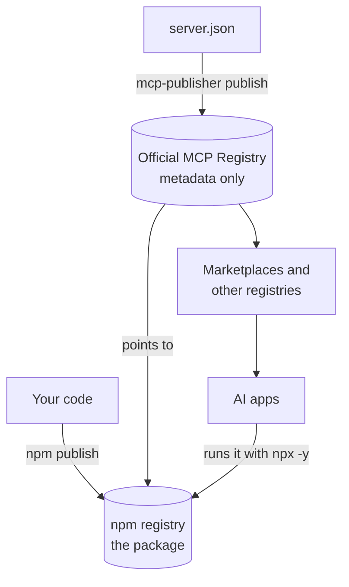

To share an MCP server, publish its code as an npm package and list it in the official MCP Registry. Users then add it to Claude Code, Claude Desktop, VS Code or Cursor with one command or a few lines of JSON, and their app starts it with `npx`. This post takes a small TypeScript server all the way there, and tests the package before anything goes public.

It builds on [What is MCP?](/blog/what-is-mcp). You don't need to know how the server works inside, only that it's a local (stdio) server: a program the AI app starts on the user's machine.

## What does publishing an MCP server involve?

Three pieces, each in a different place:

| Piece | Where it lives | What it's for |
| --- | --- | --- |
| The npm package | npm registry | The code. Users run it with `npx -y @your-username/project-todos-mcp` |
| `server.json` | [Official MCP Registry](https://modelcontextprotocol.io/registry/about) | Metadata: name, description, and where to find the package |
| A config entry | Each user's AI app | Tells the app which command starts your server |

The MCP Registry stores only metadata, not code. It points to packages on npm, PyPI or Docker Hub. Marketplaces and other registries read from it, and AI apps get servers from them.



## What do I need before I start?

- **Node.js 22.19 or newer** (the MCP Inspector needs it) and npm.
- **An npm account** for publishing, and a **GitHub account** to sign in to the MCP Registry.
- **A stdio MCP server in TypeScript.** This post uses "project todos", the server from the first post in this series, [How to build your first MCP server](/blog/build-your-first-mcp-server). If you don't have it, the first step below sets it up.

Replace `your-username` everywhere with your npm and GitHub user names.

## How do I prepare the package for npm?


<Steps>


<Step title="Start from the example server">

Skip this step if you already have the project.

```bash
$ mkdir project-todos
$ cd project-todos
$ npm init -y
$ mkdir src
$ npm pkg set type=module "bin.project-todos=./build/index.js" "scripts.build=tsc && chmod 755 build/index.js" "files[0]=build"
```


```bash
npm install @modelcontextprotocol/server zod
```


```bash
npm install -D @types/node typescript
```


**tsconfig.json**

```json
{
  "compilerOptions": {
    "target": "ES2022",
    "module": "Node16",
    "moduleResolution": "Node16",
    "types": ["node"],
    "outDir": "./build",
    "rootDir": "./src",
    "strict": true,
    "esModuleInterop": true,
    "skipLibCheck": true,
    "forceConsistentCasingInFileNames": true
  },
  "include": ["src/**/*"],
  "exclude": ["node_modules"]
}
```


**src/index.ts**

```ts
#!/usr/bin/env node
import { readFile, writeFile } from "node:fs/promises";
import { homedir } from "node:os";
import { join } from "node:path";
import { McpServer } from "@modelcontextprotocol/server";
import { StdioServerTransport } from "@modelcontextprotocol/server/stdio";
import { z } from "zod";

// Where the todos are saved. Set TODO_FILE to use another file.
const TODO_FILE = process.env.TODO_FILE ?? join(homedir(), ".project-todos.json");

type Todo = { id: number; text: string; done: boolean };

async function loadTodos(): Promise<Todo[]> {
  try {
    return JSON.parse(await readFile(TODO_FILE, "utf8"));
  } catch (error) {
    if ((error as NodeJS.ErrnoException).code === "ENOENT") return []; // no file yet
    throw error;
  }
}

async function saveTodos(todos: Todo[]): Promise<void> {
  await writeFile(TODO_FILE, JSON.stringify(todos, null, 2));
}

const server = new McpServer({ name: "project-todos", version: "1.0.0" });

server.registerTool(
  "add_todo",
  {
    description: "Add a todo to the project's todo list",
    inputSchema: z.object({
      text: z.string().min(1).describe("What needs to be done"),
    }),
  },
  async ({ text }) => {
    const todos = await loadTodos();
    const todo: Todo = { id: todos.length + 1, text, done: false };
    todos.push(todo);
    await saveTodos(todos);
    return { content: [{ type: "text", text: `Added todo #${todo.id}: ${text}` }] };
  },
);

server.registerTool(
  "list_todos",
  {
    description: "List all todos in the project's todo list",
  },
  async () => {
    const todos = await loadTodos();
    const text = todos.length
      ? todos.map((t) => `#${t.id} [${t.done ? "x" : " "}] ${t.text}`).join("\n")
      : "No todos yet.";
    return { content: [{ type: "text", text }] };
  },
);

async function main() {
  const transport = new StdioServerTransport();
  await server.connect(transport);
  // Log to stderr: stdout is reserved for MCP messages.
  console.error(`project-todos MCP server running on stdio (file: ${TODO_FILE})`);
}

main().catch((error) => {
  console.error("Fatal error:", error);
  process.exit(1);
});
```


On Windows, set `"scripts.build=tsc"` instead, because `cmd.exe` has no `chmod`.

</Step>


<Step title="Check the shebang and the bin entry">

Two things turn the compiled file into a command:

- **The shebang**, line 1 of `src/index.ts`: `#!/usr/bin/env node`. The [npm docs](https://docs.npmjs.com/cli/v11/configuring-npm/package-json) say files in `bin` must start with it, otherwise they run without Node. TypeScript keeps the line in `build/index.js`.
- **The `bin` field**, `"project-todos": "./build/index.js"`. When the package has one command, `npx` runs it without being told its name. The [npx docs](https://docs.npmjs.com/cli/v11/commands/npx) describe this rule.

</Step>


<Step title="Name the package and add the registry fields">

```bash
$ npm pkg set name=@your-username/project-todos-mcp description="An MCP server that keeps a simple project todo list." mcpName=io.github.your-username/project-todos "scripts.prepack=npm run build" repository.type=git repository.url=https://github.com/your-username/project-todos-mcp.git license=MIT "engines.node=>=20"
$ npm pkg delete main
```

- **`name`** is scoped with your user name (`@your-username/…`), so it can't clash with someone else's package.
- **`mcpName`** is your server's name in the MCP Registry. The Registry checks it to prove you own the npm package. With GitHub sign-in, it must start with `io.github.your-username/` ([Registry quickstart](https://modelcontextprotocol.io/registry/quickstart)).
- **`prepack`** runs the build before `npm pack` and `npm publish`, so you never publish stale code ([npm scripts](https://docs.npmjs.com/cli/v11/using-npm/scripts)).
- **`engines`** says which Node versions work. The SDK needs Node 20 or newer.
- **`main`** isn't needed: this package is a command, not a library.

</Step>


<Step title="Add a README">

npm shows the README on your package's page. Tell people how to add the server:


**README.md**

````md
# project-todos-mcp

An MCP server that keeps a simple project todo list.

```bash
claude mcp add --transport stdio project-todos -- npx -y @your-username/project-todos-mcp
```
````


</Step>


</Steps>


Your `package.json` now looks like this. Dependency versions are the ones we installed.

```json
{
  "name": "@your-username/project-todos-mcp",
  "version": "1.0.0",
  "description": "An MCP server that keeps a simple project todo list.",
  "scripts": {
    "test": "echo \"Error: no test specified\" && exit 1",
    "build": "tsc && chmod 755 build/index.js",
    "prepack": "npm run build"
  },
  "keywords": [],
  "author": "",
  "license": "MIT",
  "type": "module",
  "bin": {
    "project-todos": "./build/index.js"
  },
  "files": [
    "build"
  ],
  "dependencies": {
    "@modelcontextprotocol/server": "^2.1.0",
    "zod": "^4.6.5"
  },
  "devDependencies": {
    "@types/node": "^26.6.3",
    "typescript": "^7.0.2"
  },
  "mcpName": "io.github.your-username/project-todos",
  "repository": {
    "type": "git",
    "url": "https://github.com/your-username/project-todos-mcp.git"
  },
  "engines": {
    "node": ">=20"
  }
}
```

## How do I check the package before publishing?

Publishing is public, so test the exact file you're about to upload. First, see what goes in:

```bash
$ npm pack --dry-run
```

```text
npm notice Tarball Contents
npm notice 177B README.md
npm notice 2.0kB build/index.js
npm notice 841B package.json
npm notice Tarball Details
npm notice name: @your-username/project-todos-mcp
npm notice version: 1.0.0
npm notice filename: your-username-project-todos-mcp-1.0.0.tgz
npm notice package size: 1.5 kB
npm notice unpacked size: 3.0 kB
npm notice total files: 3
```

Three files: the README, the compiled server and `package.json`. No source, no tests, no `.env`. If you see anything private here, fix `files` before you go on.

Now build the real tarball and run it the way users will, with `npx`:

```bash
$ npm pack
```

Create a small config file for the Inspector. It uses the same `mcpServers` shape that AI apps use, and points `npx` at the tarball instead of npm:


**tarball-test.json**

```json
{
  "mcpServers": {
    "project-todos": {
      "command": "npx",
      "args": ["-y", "--package=./your-username-project-todos-mcp-1.0.0.tgz", "project-todos"]
    }
  }
}
```


`--package` tells `npx` which package to install, and `project-todos` is the command to run from it. Now call a tool through it:

```bash
$ npx @modelcontextprotocol/inspector --cli --config tarball-test.json --server project-todos --method tools/call --tool-name add_todo --tool-arg "text=Publish to npm"
```

```text
project-todos MCP server running on stdio (file: /home/you/.project-todos.json)
{
  "content": [
    {
      "type": "text",
      "text": "Added todo #1: Publish to npm"
    }
  ]
}
```

That proves the packed package installs, the `bin` entry and shebang work, and the server answers.

## How do I publish it to npm?

Log in and publish. Scoped packages are private by default, so pass `--access public` ([npm docs](https://docs.npmjs.com/creating-and-publishing-scoped-public-packages)):

```bash
$ npm adduser
$ npm publish --access public
```

To publish directly, npm needs two-factor authentication on your account, or a granular access token that is allowed to bypass it. Once published, anyone can start your server:

```bash
$ npx -y @your-username/project-todos-mcp
```

The `-y` flag skips npx's "install this package?" prompt ([npx docs](https://docs.npmjs.com/cli/v11/commands/npx)). The AI app starts your server in the background, where nobody can answer that prompt, so every config below includes `-y`.


<Callout type="warning" title="A published version is permanent">

npm registry data is immutable: a published version never changes, and the [unpublish policy](https://docs.npmjs.com/policies/unpublish) only lets you remove it in a few cases, such as within 72 hours when nothing depends on it. Check the `npm pack --dry-run` file list for keys, tokens and `.env` files every time, and bump `version` for each release.

</Callout>


## How do I list it in the official MCP Registry?

The Registry is in preview, so its [docs](https://modelcontextprotocol.io/registry/quickstart) warn that breaking changes or data resets may happen. Publish to npm first: the Registry only hosts metadata, and it verifies the package by reading its `mcpName`.


<Steps>


<Step title="Install mcp-publisher">

`mcp-publisher` is the official CLI for the Registry. With Homebrew:

```bash
$ brew install mcp-publisher
```

Without Homebrew, download a pre-built binary for your system from the [registry's releases page](https://github.com/modelcontextprotocol/registry/releases) and put it on your `PATH`.

</Step>


<Step title="Create server.json">

```bash
$ mcp-publisher init
```

This writes a `server.json` template with values from your `package.json`. Edit it to match your package:


**server.json**

```json
{
  "$schema": "https://static.modelcontextprotocol.io/schemas/2025-12-11/server.schema.json",
  "name": "io.github.your-username/project-todos",
  "description": "An MCP server that keeps a simple project todo list.",
  "repository": {
    "url": "https://github.com/your-username/project-todos-mcp",
    "source": "github"
  },
  "version": "1.0.0",
  "packages": [
    {
      "registryType": "npm",
      "identifier": "@your-username/project-todos-mcp",
      "version": "1.0.0",
      "transport": {
        "type": "stdio"
      },
      "environmentVariables": [
        {
          "name": "TODO_FILE",
          "description": "Path to the JSON file that stores the todos",
          "isRequired": false,
          "format": "filepath",
          "isSecret": false
        }
      ]
    }
  ]
}
```


- `name` must match `mcpName` in `package.json`.
- `packages` says where the code is: an npm package with this `identifier` and `version`, started over stdio.
- `environmentVariables` tells apps which settings your server reads. `TODO_FILE` is optional, and `filepath` means it's a path on the user's machine.

</Step>


<Step title="Validate it">

```bash
$ mcp-publisher validate
```

```text
Validating against https://registry.modelcontextprotocol.io...
✅ server.json is valid
```

</Step>


<Step title="Sign in and publish">

```bash
$ mcp-publisher login github
$ mcp-publisher publish
```

`login github` prints a code and a link to `https://github.com/login/device`. Enter the code there and approve. `publish` then sends `server.json` to the Registry.

</Step>


<Step title="Check that it's listed">

```bash
$ curl "https://registry.modelcontextprotocol.io/v0.1/servers?search=io.github.your-username/project-todos"
```

Your server's metadata appears in the JSON result.

</Step>


</Steps>


For each new release, bump `version` in both `package.json` and `server.json`, publish to npm, then publish to the Registry.

## How do users add it to their AI tools?

Every app needs the same two things: the command `npx` and the arguments `-y @your-username/project-todos-mcp`. Only where you write them differs.

| App | Where | Top-level key |
| --- | --- | --- |
| Claude Code | `claude mcp add` command | none |
| Claude Desktop | `claude_desktop_config.json` | `mcpServers` |
| VS Code | `.vscode/mcp.json` in the project | `servers` |
| Cursor | `.cursor/mcp.json` in the project, or `~/.cursor/mcp.json` | `mcpServers` |


**Claude Code**

```bash
$ claude mcp add --transport stdio --scope user project-todos -- npx -y @your-username/project-todos-mcp
```

`--scope user` makes the server available in all your projects. Leave it out to add it only to the current project. Everything after `--` is the command that starts the server ([docs](https://code.claude.com/docs/en/mcp)).


**Claude Desktop**

Open **Settings**, then **Developer**, then **Edit Config**. That opens `~/Library/Application Support/Claude/claude_desktop_config.json` on macOS or `%APPDATA%\Claude\claude_desktop_config.json` on Windows ([guide](https://modelcontextprotocol.io/docs/develop/connect-local-servers)).

```json
{
  "mcpServers": {
    "project-todos": {
      "command": "npx",
      "args": ["-y", "@your-username/project-todos-mcp"]
    }
  }
}
```

Quit Claude Desktop completely and start it again to load the change.


**VS Code**

Create `.vscode/mcp.json` in your project. VS Code's format uses `servers`, not `mcpServers` ([docs](https://code.visualstudio.com/docs/copilot/reference/mcp-configuration)):

```json
{
  "servers": {
    "project-todos": {
      "type": "stdio",
      "command": "npx",
      "args": ["-y", "@your-username/project-todos-mcp"]
    }
  }
}
```


**Cursor**

Create `.cursor/mcp.json` in your project, or `~/.cursor/mcp.json` for all projects ([docs](https://cursor.com/docs/context/mcp)):

```json
{
  "mcpServers": {
    "project-todos": {
      "command": "npx",
      "args": ["-y", "@your-username/project-todos-mcp"]
    }
  }
}
```


To set `TODO_FILE`, add `"env": { "TODO_FILE": "/home/you/todos.json" }` next to `args` in the JSON configs, or `--env TODO_FILE=/home/you/todos.json` after the server name in `claude mcp add`.

## What about remote (HTTP) servers?

A local server runs on each user's machine, with their files and their permissions. That's right for a todo list or a tool that works on local code. When the server wraps your company's API, a **remote** server is often a better fit: you host it once at a URL, users connect over HTTP and sign in, and you ship updates without anyone reinstalling.

The SDK supports this with the Streamable HTTP transport and small adapters for Node.js, Express, Fastify and Hono ([SDK README](https://github.com/modelcontextprotocol/typescript-sdk)). The Registry lists remote servers too, with a [`remotes` entry](https://modelcontextprotocol.io/registry/remote-servers) instead of `packages`. Users add them by URL, for example `claude mcp add --transport http <name> <url>`.

## What should I do next?

- **Publish a real server.** Wrap one API your team uses every day, test it with `npm pack` and the Inspector ([How to test and debug an MCP server](/blog/test-and-debug-mcp-server) shows more ways), and ship version 1.0.0.
- **Automate releases.** The Registry docs show how to [publish from GitHub Actions](https://modelcontextprotocol.io/registry/github-actions).
- **Next in this series:** [What adding MCP to an existing application gets you](/blog/add-mcp-to-existing-app), including remote servers and sign-in.
