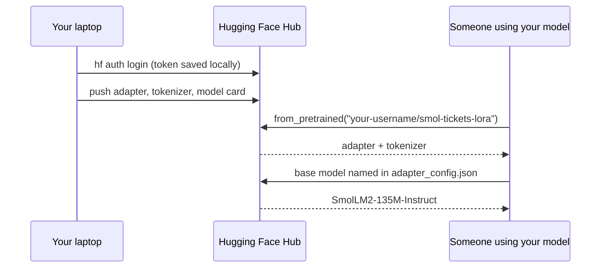

To publish a model on Hugging Face, you create a free account and an access token, log in from your terminal, and push the model's files to a model repository on the Hub. A good model card (the repo's `README.md`) tells people what the model does and where it fails. After that, anyone with access can load your model by name from Python.

This guide publishes the small LoRA adapter you trained in the previous post, [How to fine-tune your first model](/blog/fine-tune-your-first-model). If you don't know the Hub yet, [What is Hugging Face?](/blog/what-is-hugging-face) introduces it.

## What will you publish?

The `smol-tickets-lora` folder from the previous post: a LoRA adapter that turns support notes into JSON, the tokenizer, and a model card you'll write in this guide. You won't upload the 269 MB base model. Your adapter's config names it, so people who load your model get it from its own repository.



A model repository works like a git repository: it has files, commits and history, and each version can be loaded by commit hash, branch or tag, as the [transformers sharing guide](https://huggingface.co/docs/transformers/main/en/model_sharing) explains.

## What do you need?

- The `fine-tune-demo` folder and virtual environment from the previous post, with `smol-tickets-lora/` inside. Activate it with `source .venv/bin/activate`.
- An email address for a free Hugging Face account.
- Nothing new to install. The `hf` command-line tool and the `huggingface_hub` Python library came with transformers.

## How do I publish the model?


<Steps>


<Step title="Create an account and an access token">

Sign up at [huggingface.co/join](https://huggingface.co/join). Then open [Settings → Access Tokens](https://huggingface.co/settings/tokens) and click **New token**.

Tokens come in three roles, according to the [token docs](https://huggingface.co/docs/hub/security-tokens):

| Role | What it can do | Use it for |
| --- | --- | --- |
| `read` | Read repos you can access, including your private ones | Downloading private models, running inference |
| `write` | Also create and push to repos | Publishing from your own laptop |
| `fine-grained` | Only the resources and actions you pick | Production apps and CI |

For this guide, create a `write` token named after where you'll use it, such as `laptop`. Hugging Face recommends one token per app or machine, so you can revoke one without breaking the others.

</Step>


<Step title="Log in from your terminal">

```bash
$ hf auth login
```

The command lets you log in from your browser, or paste the token you just created. Either way, a token is saved in your Hugging Face cache folder (by default `~/.cache/huggingface/token`), outside your project, and every Hugging Face library on your machine uses it. Check who you're logged in as:

```bash
$ hf auth whoami
```

On a server or in CI, set the `HF_TOKEN` environment variable instead, from your platform's secret store. It takes priority over the saved token, per the [huggingface_hub quickstart](https://huggingface.co/docs/huggingface_hub/quick-start).

</Step>


<Step title="Write the model card">

The model card is the `README.md` in your repo. The Hub shows it as the model's page. The [model card docs](https://huggingface.co/docs/hub/model-cards) say it should describe the model, its intended uses and limitations, how it was trained, the training data, and evaluation results. The YAML block at the top holds metadata the Hub uses for search and display: the licence, the base model and the library.

The training run already wrote a `README.md` full of "[More Information Needed]" placeholders. This script replaces it with a real card:


**make_card.py**

```py
from huggingface_hub import ModelCard, ModelCardData

card_data = ModelCardData(
    base_model="HuggingFaceTB/SmolLM2-135M-Instruct",
    library_name="peft",
    pipeline_tag="text-generation",
    license="apache-2.0",
    language="en",
    tags=["lora", "sft", "trl"],
)

content = f"""---
{card_data.to_yaml()}
---

# smol-tickets-lora

A LoRA adapter for SmolLM2-135M-Instruct. It turns a short customer support
note into JSON with a category and a priority:

    {{"category": "billing", "priority": "high"}}

## Intended use

A learning project from a fine-tuning tutorial. Use it to see how a small
adapter changes a model's output format.

## Out-of-scope use

Real support triage. It was trained on 32 examples and often gets the
priority wrong. Don't route real customer tickets with it.

## Training data

32 short support notes written by hand for this tutorial. Categories: billing,
bug, account, feature. Priorities: low, normal, high. No real customer data.

## Training procedure

Supervised fine-tuning with TRL's SFTTrainer and a LoRA adapter (PEFT):
r=16, lora_alpha=32, all linear layers, 8 epochs, learning rate 2e-4, on CPU.

## Evaluation

On 3 held-out notes, the category was right 3 out of 3 times and the
priority 0 out of 3 times. The output was valid JSON every time.

## Limitations

Tiny base model and tiny dataset. English only. Treat any output as a guess.

## License

Apache 2.0, the same as the base model.
"""

card = ModelCard(content)
card.validate()  # asks the Hub to check the metadata
card.save("smol-tickets-lora/README.md")
print("Saved smol-tickets-lora/README.md")
```


- `base_model` links your page to SmolLM2-135M-Instruct on the Hub. The Hub works out that yours is an adapter of it.
- `library_name="peft"` tells the Hub, and its code snippets, how to load the model.
- `license` must be a licence ID the Hub knows. `card.validate()` asks the Hub to check the metadata and raises an error if, for example, the licence ID is wrong.
- Change the evaluation numbers to your own run. Yours may differ.

```bash
$ python make_card.py
```

```text
Saved smol-tickets-lora/README.md
```

</Step>


<Step title="Choose public or private">

| | Private | Public |
| --- | --- | --- |
| Who can see and load it | Only you | Everyone |
| In search results | No | Yes |
| Others visiting the URL | `404 - Repo not found` | The model page |

That's from the [repository settings docs](https://huggingface.co/docs/hub/repositories-settings). Start **private** while you check the card and the files. You can switch to public later in the repo's **Settings** tab.

</Step>


<Step title="Push the adapter, tokenizer and card">


**publish.py**

```py
from huggingface_hub import ModelCard, whoami
from peft import AutoPeftModelForCausalLM
from transformers import AutoTokenizer

ADAPTER_DIR = "smol-tickets-lora"
repo_id = f"{whoami()['name']}/smol-tickets-lora"

model = AutoPeftModelForCausalLM.from_pretrained(ADAPTER_DIR)
tokenizer = AutoTokenizer.from_pretrained(ADAPTER_DIR)

model.push_to_hub(repo_id, private=True)
tokenizer.push_to_hub(repo_id, private=True)

# Push your card last, so it replaces the README.md that push_to_hub writes.
ModelCard.load(f"{ADAPTER_DIR}/README.md").push_to_hub(repo_id)

print(f"Done: https://huggingface.co/{repo_id}")
```


```bash
$ python publish.py
```

What happens:

- `whoami()` reads your username from the saved token, so the repo is created under your account.
- `model.push_to_hub(repo_id, private=True)` creates the repo if it doesn't exist and uploads `adapter_config.json` and `adapter_model.safetensors`. The `private` flag only applies when the repo is created.
- `tokenizer.push_to_hub` uploads the tokenizer files and chat template.
- Both calls also write a basic `README.md`, so your own card goes last and replaces it.

Files you don't push stay on your laptop. `training_args.bin` and the JSONL data files are not uploaded. When the script finishes, it prints your model's URL. Open it and check the **Files** tab and the model card.

</Step>


<Step title="Load your model by name">

Now use it the way anyone else would, from the Hub. Replace `your-username` with your Hugging Face username:


**use.py**

```py
from transformers import AutoModelForCausalLM, AutoTokenizer

REPO_ID = "your-username/smol-tickets-lora"

tokenizer = AutoTokenizer.from_pretrained(REPO_ID)
model = AutoModelForCausalLM.from_pretrained(REPO_ID)  # base model + your adapter

messages = [{"role": "user", "content": "I was charged twice this month."}]
inputs = tokenizer.apply_chat_template(
    messages, add_generation_prompt=True, return_tensors="pt", return_dict=True
)
output = model.generate(**inputs, max_new_tokens=40, do_sample=False)
print(tokenizer.decode(output[0][inputs["input_ids"].shape[1]:], skip_special_tokens=True))
```


```bash
$ python use.py
```

```text
{"category": "billing", "priority": "high"}
```

`from_pretrained` sees `adapter_config.json` in your repo, downloads the base model it names, and puts your adapter on top, as the [transformers PEFT guide](https://huggingface.co/docs/transformers/main/en/peft) describes. While the repo is private, this works only on machines logged in to your account.

</Step>


</Steps>


## How do I keep my token safe?


<Callout type="danger" title="Never put a token in code or git">

A write token can push to every repository you have write access to. Keep it out of scripts, notebooks, `.env` files you commit and screenshots. If one leaks, delete or refresh it in [Access Tokens](https://huggingface.co/settings/tokens) straight away, then create a new one.

</Callout>


Three habits cover most of the risk:

- **Let `hf auth login` store the token** on your laptop, and use `HF_TOKEN` from a secret store on servers. Don't pass tokens as arguments in your code.
- **Use the smallest token that works.** Read-only for downloading, fine-grained for production, write only where you publish.
- **In CI, consider no stored token at all.** Hugging Face's [Trusted Publishers](https://huggingface.co/docs/hub/trusted-publishers) exchanges your CI provider's identity for a short-lived token on each run.

## What about licences and training data?

Publishing makes you responsible for what you share:

- **The base model's licence** decides what you may do with a fine-tune of it. SmolLM2-135M-Instruct uses [Apache 2.0](https://huggingface.co/HuggingFaceTB/SmolLM2-135M-Instruct). Other models have custom licences with extra conditions; read them before you publish.
- **Your training data** needs the right to be used this way. Our 32 notes were written by hand for the tutorial. If you use a public dataset, check its licence on its dataset page and list it in the card's `datasets` metadata.
- **Personal data and secrets** must not be in the training data. Models can repeat what they were trained on, and a public model can be downloaded by anyone.

## Can others try my model without writing code?

Two Hub features come up, but check what they support first:

- **Inference Providers** give you one API for models that partner providers have deployed. You can [filter the Hub by provider](https://huggingface.co/docs/inference-providers/hub-integration) to see which models they serve. A brand-new adapter usually isn't one of them, so check your model page before you promise an API.
- **Spaces** host a demo app next to your model. Static HTML Spaces are free. Gradio and Docker Spaces need a paid plan, although free personal accounts can host up to two Gradio Spaces on ZeroGPU, per the [Spaces overview](https://huggingface.co/docs/hub/spaces-overview).

For your own apps, loading the model with `from_pretrained`, as in the last step, is the simplest path.

## What should I do next?

- **Make it public** once the card is complete: repo **Settings** → change visibility.
- **Improve the model and push again.** Run `publish.py` after each training run. Every push is a new commit, so you can load an older version by its commit hash.
- **Read the [annotated model card](https://huggingface.co/docs/hub/model-card-annotated)** for what to write in each section when your model is meant for real users.
