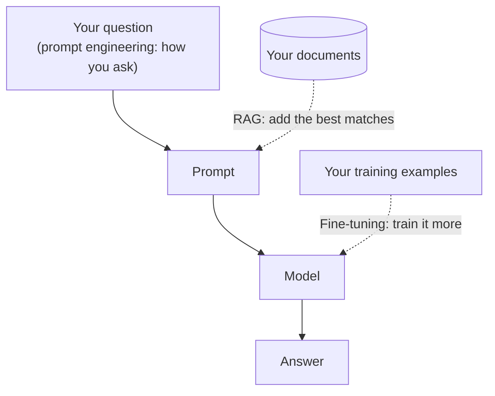
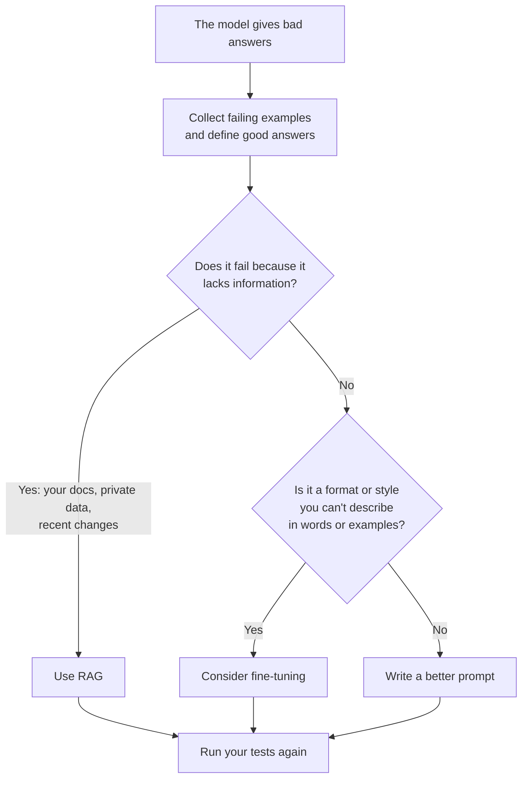

Pick by asking why the model fails. If it doesn't have the information it needs, such as your docs or last week's changes, use RAG. If it can't match a format or style that you can't put into words or examples, consider fine-tuning. For almost everything else, write a better prompt first.

The three names sound like rivals, but they change different things. This guide explains each one in plain words, compares their cost, freshness and debugging, and walks through real developer cases. If you're new to models, read [What is an LLM?](/blog/what-is-an-llm) first.

## What does each approach change?

A model answers from two places: what it learned during training, and the text you send it now. The three approaches change different parts of that picture.

- **Prompt engineering** changes **what you ask**. You rewrite the instructions, add examples, and describe the output you want. The model stays the same.
- **RAG (retrieval-augmented generation)** changes **what the model can see at question time**. When a question arrives, your app searches your documents and puts the best matches into the prompt. The model stays the same.
- **Fine-tuning** changes **the model itself**. You train an existing model a bit more on your own examples. That updates its weights: the many numbers inside the model that hold what it learned in training.

An analogy: you hire a smart new colleague. Prompt engineering is a clear task description. RAG is handing them the right folder when they need it. Fine-tuning is months of on-the-job training that changes how they work.

Anthropic's [glossary](https://platform.claude.com/docs/en/about-claude/glossary) describes RAG in the same way: the data "is retrieved at runtime when a query is sent to the model" and passed into the context window, the model's working memory for one request. It describes fine-tuning as further training that makes the model "start representing and mimicking the patterns and characteristics of the fine-tuning dataset".

## What is each one good for?

**A better prompt** fixes most problems where the model has the knowledge but doesn't do what you meant: vague answers, the wrong length, a missed rule, or a format you can describe. OpenAI's [model optimization guide](https://developers.openai.com/api/docs/guides/model-optimization) says prompt engineering "may be all you need in order to get great results for your use case", and lists three habits: include the context the model needs, give clear instructions, and show a few example outputs.

**RAG** fixes problems where the model lacks information: your internal docs, your tickets, private data, or anything newer than its training. The glossary says RAG is "particularly useful for tasks that require up-to-date information, domain-specific knowledge, or explicit citation of sources." The idea comes from a [2020 paper by Patrick Lewis and others](https://arxiv.org/abs/2005.11401), which found that models with retrieval "generate more specific, diverse and factual language" than models without it.

**Fine-tuning** fixes problems where the model has to behave in a new way that prompts can't teach. The glossary says it "can be useful for adapting a language model to a specific domain, task, or writing style". OpenAI's guide adds that it can "enable a model to consistently format responses in a certain way or handle novel inputs," and that you can train a smaller, cheaper, faster model to do one task well.

This matches the short table in the [AI roadmap for developers](/blog/ai-roadmap-for-developers): a better prompt to follow instructions or a format, RAG to answer from your docs or fresh data, fine-tuning to behave in a new way that prompts can't teach.

## How do they compare?

| | Prompt engineering | RAG | Fine-tuning |
| --- | --- | --- | --- |
| What changes | The prompt | The context sent with each question | The model's weights |
| Best for | Instructions, tone, formats you can describe | Facts the model doesn't have | Formats, styles or tasks prompts can't teach |
| What you need | A few test cases and a few examples | Your documents, kept clean and current | Many good input and output examples |
| Effort to start | Lowest: edit text, run tests again | Medium: build and run a search step | Highest: collect data, train, evaluate, host |
| Running cost | Grows with prompt length | Extra search plus a longer prompt | Can shrink prompts, but training costs time and compute |
| How fresh | Fixed at the model's training, plus what you paste | As fresh as your document index | Fixed when you train; update means training again |
| Debugging | Easy: you can read the whole input | Medium: check what was retrieved, then the answer | Hard: the change is spread across the weights |

A few notes on the table:

- **Effort for RAG.** A typical RAG setup, as Anthropic's [contextual retrieval article](https://www.anthropic.com/engineering/contextual-retrieval) describes it, splits your documents into small chunks, turns each chunk into an embedding (a list of numbers that captures its meaning) and stores them in a vector database you can search by meaning. That is real infrastructure to build and run.
- **Effort for fine-tuning.** It is much cheaper than training a model from scratch: Hugging Face's [fine-tuning guide](https://huggingface.co/docs/transformers/training) says it "requires far less compute, data, and time" than pretraining. It is still the heaviest of the three. Updating all of a large model's weights is costly, which is why methods like [PEFT](https://huggingface.co/docs/peft/index) (parameter-efficient fine-tuning) train only "a small number of (extra) model parameters".
- **Running cost for fine-tuning.** OpenAI's guide notes that a fine-tuned model can work with shorter prompts, "which saves on token costs at scale and can be lower latency." So fine-tuning costs more up front and can cost less per request.
- **Debugging RAG.** The glossary warns that RAG's results depend "on the quality and relevance of the external knowledge base and the knowledge that is retrieved at runtime." When an answer is wrong, first look at which chunks were retrieved. Often the model never saw the right one.

<Callout type="warning" title="Check that you can fine-tune the model you use">

Fine-tuning isn't offered everywhere. The Anthropic [glossary](https://platform.claude.com/docs/en/about-claude/glossary) says the Claude API "does not currently offer fine-tuning". OpenAI's [model optimization guide](https://developers.openai.com/api/docs/guides/model-optimization) says it is "winding down the fine-tuning platform", which is "no longer accessible to new users". If you do need fine-tuning, one option is an open model from [Hugging Face](https://huggingface.co/docs/transformers/training) that you train and host yourself.

</Callout>

## How do I choose?

First, write down what "good" looks like and collect a few real inputs where the model fails. Anthropic's [prompt engineering overview](https://platform.claude.com/docs/en/build-with-claude/prompt-engineering/overview) assumes you have "a clear definition of the success criteria for your use case" and "some ways to empirically test against those criteria" before you start. Without them, you can't tell whether any change helped.

Then ask why it fails:

Two questions do most of the work:

- **"Would a smart new colleague get this right if I handed them the right document?"** If yes, the problem is missing information. That points to RAG, or to pasting the document into the prompt if it is small.
- **"Could I explain the fix in writing, or show it with three examples?"** If yes, it's a prompt problem. Fine-tuning is for the cases where you truly can't, but you do have many good examples.

When in doubt, start simple. Anthropic's [Building effective agents](https://www.anthropic.com/engineering/building-effective-agents) recommends "finding the simplest solution possible, and only increasing complexity when needed," and notes that "optimizing single LLM calls with retrieval and in-context examples is usually enough" for many applications.

## Which one fits my case?

Here are common developer situations and what to try first.

| Your situation | Why it fails | Try first |
| --- | --- | --- |
| A support bot must answer from your product docs, which change every week | Missing, changing information | RAG |
| Your docs are a few dozen pages | Missing information, but small | Put the docs in the prompt |
| A code assistant keeps guessing your internal API | Missing information | RAG over your API docs |
| The model returns JSON with the wrong field names | Format you can describe | A better prompt with the exact shape and an example |
| Summaries are too long and skip the action items | Instructions you can describe | A better prompt |
| You need a small, cheap model to sort tickets into your own categories, and you have many labelled tickets | A narrow task, lots of examples, cost matters | Fine-tuning |
| Replies must match a house style that you can't explain in rules | Style you can't describe | A prompt with examples first, then fine-tuning |

About the second row: Anthropic's [contextual retrieval article](https://www.anthropic.com/engineering/contextual-retrieval) (2024) says that if your knowledge base is smaller than 200,000 tokens, about 500 pages, "you can just include the entire knowledge base in the prompt that you give the model, with no need for RAG or similar methods." Tokens are the small pieces of text models count in; [What is an LLM?](/blog/what-is-an-llm) explains them.

The ticket-sorting row matches OpenAI's guide, which lists classification among the jobs supervised fine-tuning is best for, and says fine-tuning lets you train a smaller model where a larger one "is not cost-effective".

## When should I combine them?

They are layers, not rivals, so real systems often use more than one.

- **RAG plus prompt engineering: always.** RAG ends by putting the retrieved text into a prompt. How you frame that text, for example "answer only from these documents and say which one you used", is prompt engineering. Anthropic's agents guide calls a model with retrieval, tools and memory the "augmented LLM", the basic building block of agentic systems.
- **Fine-tuning plus RAG.** Fine-tune for the stable part, such as a format or style, and use RAG for the facts that change. You don't retrain every time a document changes.
- **Fine-tuning plus prompt engineering.** OpenAI's guide describes fine-tuning as something you use "with prompt engineering". You still write a prompt for a fine-tuned model.

A good order is prompt first, then RAG if information is missing, then fine-tuning only if a clear gap is left. Run the same test cases at every step, so you know each layer earned its place.

## Try it: check your own project

You don't need code for this. Take one AI feature you're building or planning, and walk through it.

<Steps>

<Step title="Collect five failures">

Write down five real inputs where the answer was wrong or weak. Next to each, write what a good answer looks like. These are your first test cases.

</Step>

<Step title="Label each failure">

For each one, pick a label:

- **Missing info**: the right answer needs a document, record or recent fact the model didn't have.
- **Unclear ask**: you could explain the fix in a sentence or show it with an example.
- **Can't describe**: you know good output when you see it, but can't put the rule into words.

</Step>

<Step title="Count the labels">

Mostly "unclear ask": rewrite the prompt. Mostly "missing info": check whether your documents fit in the prompt; if not, plan RAG. Mostly "can't describe": first try adding more examples to the prompt, then look at fine-tuning.

</Step>

<Step title="Check the fine-tuning basics">

Only if fine-tuning is still on the table: can you fine-tune the model you use? Do you have many good input and output examples? Can you train again when things change? If any answer is no, go back to prompts and RAG.

</Step>

<Step title="Fix one thing and test again">

Make the smallest change, then run all five test cases again. Keep the change only if the results improve.

</Step>

</Steps>

## What should I do next?

- **Start with the prompt.** Anthropic's [prompt engineering overview](https://platform.claude.com/docs/en/build-with-claude/prompt-engineering/overview) links to its best practices, and [What is prompt engineering?](/blog/what-is-prompt-engineering) covers the basics.
- **If information is missing, learn RAG.** [What is RAG?](/blog/what-is-rag) walks through the search-then-answer flow. The [original RAG paper](https://arxiv.org/abs/2005.11401) is worth a skim.
- **Save fine-tuning for last.** [What is fine-tuning?](/blog/what-is-fine-tuning) covers it in depth. For hands-on work with open models, start with the [Hugging Face fine-tuning guide](https://huggingface.co/docs/transformers/training) and [PEFT](https://huggingface.co/docs/peft/index).
- **See where this fits** in the [AI roadmap for developers](/blog/ai-roadmap-for-developers).
