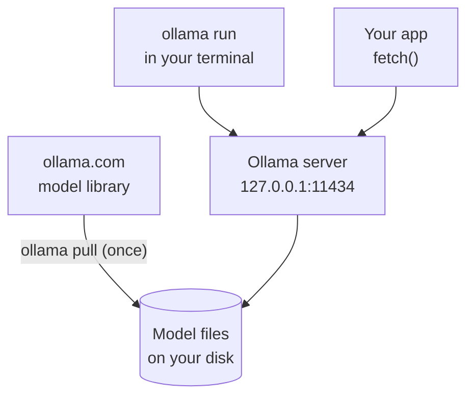

To run an AI model on your own computer, install [Ollama](https://github.com/ollama/ollama), download a model with `ollama pull`, and chat with it using `ollama run`. Ollama also starts a local HTTP API on port 11434, so your own code can call the model with a plain `fetch`, with no API key and no internet connection once the model is downloaded.

This post covers why you'd do that, what you give up, and a full walkthrough with a model small enough to run on almost any laptop.

## Why run a model on your own machine?

When you use Claude or ChatGPT, your text goes to the maker's servers and the model runs there. A local model runs on your own hardware instead. That gives you four things:

- **Privacy.** Your prompts and data stay on your machine. [Ollama's FAQ](https://docs.ollama.com/faq) says: "We don't see your prompts or data when you run locally."
- **Offline work.** After the model is downloaded, it works on a plane, on a train, or behind a strict company firewall.
- **No per-token bill.** Cloud APIs charge for every token you send and receive. A local model costs you only electricity and the hardware you already have.
- **Freedom to experiment.** You can try dozens of open models, run the same test a thousand times, and break things without watching a bill.

If terms like "token" or "model" are new to you, read [What is an LLM?](/blog/what-is-an-llm) first.

## What do I give up?

Local is not free of cost. You pay in three other ways.

- **Hardware.** The model has to fit in your computer's memory. Ollama's docs note that models "can be tens to hundreds of GB in size" on disk ([macOS](https://docs.ollama.com/macos), [Windows](https://docs.ollama.com/windows)). A GPU helps a lot, but only [supported ones](https://docs.ollama.com/gpu) are used; for example, NVIDIA cards need compute capability 5.0 or newer.
- **Speed.** A big cloud model runs on racks of expensive GPUs. Your laptop is slower, and very slow for large models without a GPU.
- **Quality.** The models that fit on a laptop are much smaller than the ones behind Claude or ChatGPT, and smaller models are less capable. They make more mistakes, follow instructions less well and know less. You'll see this in the walkthrough.

A good rule: start with the smallest model that does your task well enough, and only move up when it doesn't.

## Which tool should I use?

There are several ways to run a model locally. These three are the most common for developers:

| Tool | What it is | Best for |
| --- | --- | --- |
| [Ollama](https://docs.ollama.com) | An app with a CLI and a local HTTP API | Chat models (LLMs), and using them from any language |
| [Transformers.js](https://huggingface.co/docs/transformers.js/index) | A JavaScript library that runs models inside your Node or browser code | Small task models, like classification and embeddings |
| [Transformers](https://huggingface.co/docs/transformers/index) (Python) | Hugging Face's main Python library, built on PyTorch | The widest choice of models, plus training and fine-tuning |

This post uses Ollama because it is the quickest way to chat with an open LLM and call it from code. The companion post, [What is Hugging Face?](/blog/what-is-hugging-face), shows Transformers.js running a small model in Node.

## How does Ollama work?

Ollama has two parts: a **server** that loads models and runs them, and a **CLI** (the `ollama` command) that talks to that server. Your own apps talk to the same server through its HTTP API.



By default, the server listens only on your own machine (`127.0.0.1`, port 11434), according to the [FAQ](https://docs.ollama.com/faq). Local requests need no API key. Models come from the [Ollama library](https://ollama.com/library), where each model page lists its sizes and its licence.

## How do I install Ollama?

Use the official installer for your system. The [README](https://github.com/ollama/ollama) lists the download options.


**macOS**

Download [Ollama.dmg](https://ollama.com/download/Ollama.dmg), open it and drag Ollama into Applications. The [macOS docs](https://docs.ollama.com/macos) list macOS Sonoma (v14) or newer. Apple M-series Macs use both CPU and GPU; Intel Macs run on the CPU only.


**Windows**

Download and run [OllamaSetup.exe](https://ollama.com/download/OllamaSetup.exe). The [Windows docs](https://docs.ollama.com/windows) list Windows 10 22H2 or newer and at least 4 GB of free space for the app itself, plus space for models. It installs in your home folder and does not need Administrator rights.


**Linux**

Ollama's official Linux installer is a shell script. Download it, read it, then run it:

```bash
$ curl -fsSL https://ollama.com/install.sh -o install-ollama.sh
$ less install-ollama.sh
$ sh install-ollama.sh
```

If you prefer to do each step yourself, follow the [manual install guide](https://docs.ollama.com/linux#manual-install).


<Callout type="warning" title="Know what the Linux script does">

The [README](https://github.com/ollama/ollama) shows the one-liner `curl -fsSL https://ollama.com/install.sh | sh`. Piping a script into `sh` runs code from the internet on your machine without showing it to you first. This script also uses `sudo`: it installs Ollama into a system folder such as `/usr/local`, creates an `ollama` system user, and adds a systemd service that starts on boot. If it finds an NVIDIA GPU without drivers, it can install NVIDIA's drivers through your package manager. That's why the steps above save the script and let you read it before you run it.

</Callout>


Check that it worked:

```bash
$ ollama -v
```

```text
ollama version is 0.34.4
```

Your version number will likely be different. If the command says it can't connect to a running Ollama instance, start the server with `ollama serve` in another terminal, or open the Ollama app.

## Try it: run your first local model

You'll download a tiny model, chat with it, and call it from Node. The model is `gemma3:270m`, Google's Gemma 3 with 270 million parameters, which the [library page](https://ollama.com/library/gemma3:270m) lists at 292 MB. Like every model, it has its own licence: this one uses the Gemma Terms of Use.

**You need:** Ollama installed and running, a recent version of [Node.js](https://nodejs.org) for the last step (we used Node 22), and about 300 MB of free disk space.


<Steps>


<Step title="Download the model">

```bash
$ ollama pull gemma3:270m
```

This downloads the model files once. After that, nothing about this model needs the internet.

</Step>


<Step title="Chat with it">

Pass a prompt to get one answer back:

```bash
$ ollama run gemma3:270m "Explain what an API is in one sentence."
```

```text
An API is a standardized, reusable interface for communicating with a specific service or application.
```

Your answer will be worded differently: models pick words with some randomness. Run `ollama run gemma3:270m` without a prompt to get an interactive chat, and type `/bye` to leave.

On our test machine, a 4-core cloud server with no GPU, this answer took about 2 seconds. Notice the quality, too: it's roughly right but vague. That's the "smaller models are less capable" trade-off in one line.

</Step>


<Step title="See what's installed and what's running">

```bash
$ ollama list
```

```text
NAME           ID              SIZE      MODIFIED
gemma3:270m    e7d36fb2c3b3    291 MB    About a minute ago
```

```bash
$ ollama ps
```

```text
NAME           ID              SIZE      PROCESSOR    CONTEXT    UNTIL
gemma3:270m    e7d36fb2c3b3    325 MB    100% CPU     4096       4 minutes from now
```

`ollama list` shows models on your disk. `ollama ps` shows models loaded in memory right now. `PROCESSOR` tells you whether the model runs on the CPU, the GPU or both. `UNTIL` is when Ollama will unload it: by default, a model stays in memory for 5 minutes after its last use, as the [FAQ](https://docs.ollama.com/faq) explains.

</Step>


<Step title="Call the local API from Node">

Create this file. It uses the built-in `fetch`, so there is nothing to install:


**chat.mjs**

```js
const response = await fetch('http://localhost:11434/api/chat', {
  method: 'POST',
  headers: { 'Content-Type': 'application/json' },
  body: JSON.stringify({
    model: 'gemma3:270m',
    messages: [{ role: 'user', content: 'Give me three names for a cat. Names only.' }],
    stream: false,
  }),
});

if (!response.ok) {
  throw new Error(`Ollama returned ${response.status}: ${await response.text()}`);
}

const data = await response.json();
console.log(data.message.content);
```


- `/api/chat` takes a model name and a list of messages, like cloud chat APIs do.
- `stream: false` returns the whole answer as one JSON object. Without it, the [API streams](https://docs.ollama.com/api/streaming) the answer piece by piece, one JSON object per line.
- The answer text is in `data.message.content`.

Run it:

```bash
$ node chat.mjs
```

```text
Here are three cat names:

*   Mittens
*   Luna
*   Sasha
```

Notice that the model added a heading even though you asked for "names only". Small models often miss details like this. Your names will differ each run.

</Step>


</Steps>


That's the whole loop: pull a model, run it, call it from code. To try a bigger model, pick one from the [library](https://ollama.com/library), check that its size fits your memory, and change the model name in both places.

## What else can the local API do?

The API lives at `http://localhost:11434/api`. These endpoints cover most needs, per the [API reference](https://docs.ollama.com/api/introduction):

| Endpoint | Method | What it does |
| --- | --- | --- |
| `/api/chat` | POST | Next message in a conversation |
| `/api/generate` | POST | Answer to a single prompt |
| `/api/embed` | POST | Embeddings (numbers that represent text) |
| `/api/tags` | GET | Models on your disk |
| `/api/ps` | GET | Models loaded in memory |
| `/api/pull` | POST | Download a model |

Ollama also has an OpenAI-compatible API at `http://localhost:11434/v1`. If your code already uses an OpenAI client, you can often point it at that address instead. There are official client libraries for [JavaScript](https://github.com/ollama/ollama-js) and [Python](https://github.com/ollama/ollama-python) too, if you prefer them to raw `fetch`.

The local API has no password. By default that's fine, because it only listens on your own machine. The FAQ shows how to open it to your network with the `OLLAMA_HOST` setting. Only do that on a network you trust, or put an authenticating proxy in front of it, because anyone who can reach the port can use your models.

## How do I free memory and disk space?

```bash
$ ollama stop gemma3:270m
$ ollama rm gemma3:270m
```

`ollama stop` unloads the model from memory right away instead of waiting 5 minutes. `ollama rm` deletes its files from disk. Models add up fast, so remove the ones you no longer use.

## What should I do next?

- **Try a bigger model** that fits your hardware and compare its answers with the tiny one on the same prompts.
- **Swap a cloud call for a local one** in a side project: point it at `http://localhost:11434/api/chat` and see what breaks.
- **Read [What is Hugging Face?](/blog/what-is-hugging-face)**, the companion post in this series, to find open models and run small ones straight from JavaScript.
