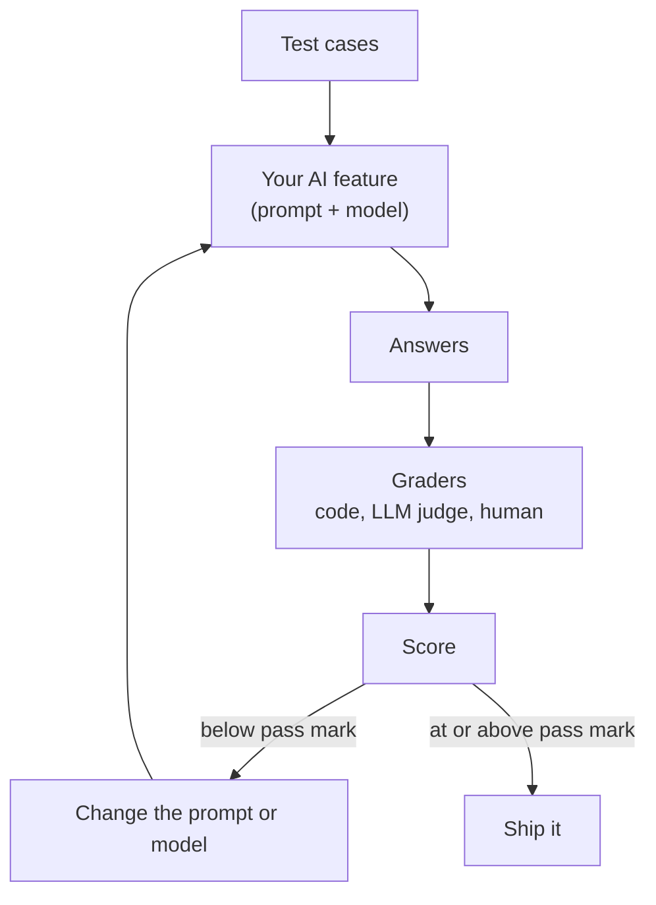

An eval (short for evaluation) is a test for AI output: you run a set of inputs through your AI feature, grade each answer, and get a score. You need evals because an LLM can give a different answer to the same question each time, so a normal unit test that expects one exact string will break. With a score, you can change a prompt or a model and see if things got better or worse.

This post shows how to define what "good" means, build a small test set, pick the right way to grade, and run a working eval in Node. The example runs without an API key.

## Why aren't normal unit tests enough?

A unit test checks that `add(2, 2)` returns `4`. Every time. An AI feature doesn't work like that. As [What is an LLM?](/blog/what-is-an-llm) explains, a model picks from likely next tokens with some randomness, so the same prompt can give different wording each run. Two answers can both be right and still not match.

So instead of "is the output exactly X?", you ask questions like:

- Is it valid JSON in the shape I asked for?
- Is the category correct?
- Does it avoid repeating personal data?
- Across 100 inputs, how many answers pass?

| | Unit test | Eval |
| --- | --- | --- |
| Input | One fixed input | A set of cases, including edge cases |
| Check | Exact expected value | Properties of the answer (format, correct field, tone) |
| Result | Pass or fail | A score, such as 92% |
| When it "fails" | Something is broken | The score dropped below your pass mark |

You still write unit tests for the code around the model. Evals test the part the model writes.

## How does an eval work?

An eval is a loop. You run your cases, grade the answers, look at the score, change your prompt or model, and run it again. Anthropic's [guide to building evaluations](https://platform.claude.com/docs/en/test-and-evaluate/develop-tests) calls this cycle central to prompt engineering.



It has three parts: success criteria (what "good" means), test cases (what you try), and graders (how you check).

## How do I define success?

Write down what a good answer looks like before you write tests. Anthropic's guide says good success criteria are:

- **Specific.** Not "good performance", but "correct category for support tickets".
- **Measurable.** A number or a clear scale. "Safe outputs" is vague; "less than 0.1% of 10,000 outputs flagged by the content filter" is a target.
- **Achievable.** Based on earlier results, benchmarks or expert knowledge, not a wish.
- **Relevant.** Tied to what your users need.

Most features need more than one criterion. The guide lists common ones: task fidelity (is it correct), consistency, relevance, tone and style, privacy, use of the context you gave it, latency and price.

For the example in this post, a support ticket classifier, the criteria are:

1. Every answer is valid JSON with `category`, `priority` and `summary`.
2. The category (and priority, where we know it) matches what a human chose.
3. The summary never repeats an email address.
4. At least 90% of cases pass all checks.

## How do I build a test set?

Collect real inputs and write down the answer you expect for each one. Three tips from Anthropic's guide:

- **Mirror real use.** Take examples from real tickets, logs or questions, not only ones you made up.
- **Include edge cases.** Empty or irrelevant input, very long input, rude or harmful input, and ambiguous cases where even people would disagree.
- **Prefer volume.** More cases with automated grading beat a few cases graded by hand.

Start small: 10 to 20 cases is enough to learn from. Every time a user reports a bad answer, add it as a new case. Your test set grows into a record of every mistake you've fixed.

## How do I grade the answers?

There are three ways. Anthropic's guide says to choose the fastest, most reliable and most scalable method that fits the check.

| Method | Good for | Trade-off |
| --- | --- | --- |
| Code | Exact match, keyword or regex, valid JSON that matches a schema | Fast, cheap and repeatable, but can't judge nuance |
| LLM as judge | Tone, relevance, "does this summary cover the problem?" | Fast and flexible, but test that it grades reliably first |
| Human review | Spot checks, building the first test set, checking the judge | Highest quality, but slow and expensive |

### Code graders

Use these whenever the check can be written as a rule. The most common ones:

- **Exact match:** `output === expected`, often after trimming spaces and lowercasing. Good for labels like `billing` or `positive`.
- **String or regex match:** does the answer contain (or not contain) a pattern, such as an email address?
- **JSON schema:** is the output valid JSON, with the right fields and allowed values? A library like Ajv checks this in one call.

### LLM as judge

For checks that need judgment, you ask a second model to grade the answer against a rubric. A rubric is a short list of rules that says what a correct answer must do. The guide's tips:

- **Write a detailed, clear rubric.** Say exactly what makes an answer correct.
- **Ask for a fixed output**, such as only `correct` or `incorrect`, or a score from 1 to 5.
- **Ask it to reason first**, then give the grade, and throw the reasoning away.

Here is a judge for the ticket summaries. The prompt follows the example in Anthropic's guide:


**judge.mjs**

```js
import Anthropic from '@anthropic-ai/sdk';

const client = new Anthropic();

const rubric = `The summary is one sentence. It states the customer's problem.
It contains no names, email addresses or phone numbers.`;

export async function judge(summary) {
  const message = await client.messages.create({
    model: 'claude-sonnet-5',
    max_tokens: 1024,
    messages: [{
      role: 'user',
      content: `Grade this answer based on the rubric:
<rubric>${rubric}</rubric>
<answer>${summary}</answer>
Think through your reasoning in <thinking> tags, then output 'correct' or 'incorrect' in <result> tags.`,
    }],
  });
  const textBlock = message.content.find((block) => block.type === 'text');
  return (textBlock?.text ?? '').toLowerCase().includes('<result>correct</result>');
}
```


It needs an API key, so the hands-on step below uses code graders only.

### Human review

People are the most flexible graders, but they are slow. Use them where they add the most: labelling your first test set, reading a sample of failures, and checking that your LLM judge agrees with a person before you trust its scores.

## Try it: build a small eval runner

You'll build an eval for a support ticket classifier. It runs seven cases through three code graders and prints a score. The trick that makes it work without an API key: each case stores an answer **recorded** from an earlier model run. You build and debug your graders against those fixed answers first, then switch to live calls.

**You need:** [Node.js](https://nodejs.org) 22 or later and an empty folder. We ran it with Node 22.22 and Ajv 8.20.


<Steps>


<Step title="Install Ajv">


```bash
npm install ajv
```


[Ajv](https://github.com/ajv-validator/ajv) is a JSON Schema validator. It checks that an answer has the fields and values you allow.

</Step>


<Step title="Write the test cases">


**cases.mjs**

```js
// Each case: the input, what a good answer must contain,
// and an answer recorded from an earlier run (so this works without an API key).
export const cases = [
  {
    id: 'refund',
    input: 'I was charged twice for my May invoice. Please refund one of them.',
    expect: { category: 'billing', priority: 'normal' },
    recorded: '{"category":"billing","priority":"normal","summary":"Charged twice for the May invoice and wants one refunded."}',
  },
  {
    id: 'outage',
    input: 'Nobody on our team can log in since 9am. Every page shows a 500 error.',
    expect: { category: 'bug', priority: 'urgent' },
    recorded: '{"category":"bug","priority":"urgent","summary":"The whole team cannot log in; every page returns a 500 error."}',
  },
  {
    id: 'email-change',
    input: 'How do I change the email address on my account?',
    expect: { category: 'account', priority: 'low' },
    recorded: '{"category":"account","priority":"low","summary":"Asks how to change the account email address."}',
  },
  {
    id: 'typo',
    input: 'Small thing: the Settings page says "Recieve emails".',
    expect: { category: 'bug', priority: 'low' },
    recorded: '{"category":"bug","priority":"low","summary":"Spelling mistake on the Settings page."}',
  },
  {
    id: 'personal-data',
    input: 'Please update my card. You can reach me at jane@example.com.',
    expect: { category: 'billing' },
    recorded: '{"category":"billing","priority":"normal","summary":"Wants to update their card; contact jane@example.com."}',
  },
  {
    id: 'feature-request',
    input: 'Would love a dark mode!',
    expect: { category: 'other', priority: 'low' },
    recorded: 'Here is the JSON:\n{"category":"other","priority":"low","summary":"Asks for a dark mode."}',
  },
  {
    id: 'empty',
    input: '',
    expect: { category: 'other', priority: 'low' },
    recorded: '{"category":"other","priority":"low","summary":"The ticket is empty."}',
  },
];
```


Each case has an `input`, the fields a good answer must have (`expect`), and a `recorded` answer. Two recorded answers are bad on purpose, so you can see the graders catch them.

</Step>


<Step title="Write the graders">


**graders.mjs**

```js
import Ajv from 'ajv';

const ajv = new Ajv();
const validate = ajv.compile({
  type: 'object',
  properties: {
    category: { enum: ['billing', 'bug', 'account', 'other'] },
    priority: { enum: ['low', 'normal', 'urgent'] },
    summary: { type: 'string', maxLength: 100 },
  },
  required: ['category', 'priority', 'summary'],
  additionalProperties: false,
});

// 1. Is the output valid JSON in the shape we asked for?
export function checkSchema(output) {
  let data;
  try {
    data = JSON.parse(output);
  } catch {
    return { pass: false, reason: 'not valid JSON' };
  }
  if (!validate(data)) return { pass: false, reason: ajv.errorsText(validate.errors) };
  return { pass: true, data };
}

// 2. Does a field match the expected value exactly?
export function checkExact(data, field, expected) {
  if (data[field] === expected) return { pass: true };
  return { pass: false, reason: `${field}: expected "${expected}", got "${data[field]}"` };
}

// 3. Regex: the summary must not repeat an email address.
export function checkNoEmail(data) {
  if (/[\w.+-]+@[\w-]+\.[\w.]+/.test(data.summary)) {
    return { pass: false, reason: 'summary contains an email address' };
  }
  return { pass: true };
}
```


Three code graders: a JSON schema check, an exact match per field, and a regex for email addresses. Each returns `pass` and, when it fails, a `reason` you can read.

</Step>


<Step title="Write the runner">


**run-evals.mjs**

```js
import { cases } from './cases.mjs';
import { checkSchema, checkExact, checkNoEmail } from './graders.mjs';

const PASS_MARK = 0.9; // our success criterion: at least 90% of cases pass
const live = process.argv.includes('--live');
const { classify } = live ? await import('./classify-claude.mjs') : {};

let passed = 0;
for (const c of cases) {
  const output = live ? await classify(c.input) : c.recorded;
  const failures = [];

  const schema = checkSchema(output);
  if (!schema.pass) {
    failures.push(schema.reason);
  } else {
    for (const [field, expected] of Object.entries(c.expect)) {
      const result = checkExact(schema.data, field, expected);
      if (!result.pass) failures.push(result.reason);
    }
    const privacy = checkNoEmail(schema.data);
    if (!privacy.pass) failures.push(privacy.reason);
  }

  if (failures.length === 0) passed++;
  const status = failures.length === 0 ? 'PASS' : 'FAIL';
  console.log(`${status}  ${c.id.padEnd(16)} ${failures.join('; ')}`.trimEnd());
}

const score = passed / cases.length;
console.log(`\nScore: ${passed}/${cases.length} (${Math.round(score * 100)}%). Pass mark: ${PASS_MARK * 100}%.`);
process.exitCode = score >= PASS_MARK ? 0 : 1;
```


The runner grades every case, prints `PASS` or `FAIL` with the reasons, and sets a non-zero exit code when the score is below the pass mark. That exit code is what lets you run evals in CI.

</Step>


<Step title="Run it">

```bash
$ node run-evals.mjs
```

You should see:

```text
PASS  refund
PASS  outage
PASS  email-change
PASS  typo
FAIL  personal-data    summary contains an email address
FAIL  feature-request  not valid JSON
PASS  empty

Score: 5/7 (71%). Pass mark: 90%.
```

The score is below 90%, so the exit code is 1. Both failures are real problems: one answer leaks the customer's email into the summary, and one wraps the JSON in extra text, which breaks code that calls `JSON.parse` on it.

</Step>


</Steps>


## How do I switch to a real model?

Once the graders catch what you care about, replace the recorded answers with live ones. Add a function that sends each input to Claude. It uses the official SDK and reads your key from the `ANTHROPIC_API_KEY` environment variable:


```bash
npm install @anthropic-ai/sdk
```


**classify-claude.mjs**

```js
import Anthropic from '@anthropic-ai/sdk';

const client = new Anthropic(); // reads ANTHROPIC_API_KEY from the environment

const prompt = (ticket) => `Classify this support ticket.
Reply with JSON only, no other text, in this shape:
{"category": "billing" | "bug" | "account" | "other",
 "priority": "low" | "normal" | "urgent",
 "summary": "one sentence, at most 100 characters, no personal data"}

<ticket>
${ticket}
</ticket>`;

export async function classify(ticket) {
  const message = await client.messages.create({
    model: 'claude-sonnet-5',
    max_tokens: 1024,
    messages: [{ role: 'user', content: prompt(ticket) }],
  });
  const textBlock = message.content.find((block) => block.type === 'text');
  return textBlock ? textBlock.text : '';
}
```


The runner already loads this file when you pass `--live`:

```bash
$ export ANTHROPIC_API_KEY=YOUR_API_KEY
$ node run-evals.mjs --live
```

Now each run tests the real model with your real prompt. Change the prompt, run the evals, and compare scores. Swap `claude-sonnet-5` for another model ID from the [models overview](https://platform.claude.com/docs/en/about-claude/models/overview) and you can compare models on your own task, not on someone else's benchmark.


<Callout type="warning" title="Live evals cost money">

Every case in a live run is a paid API call, and an LLM judge doubles that. Start with a small set, save the answers you get, and run the full live set when you change the prompt or model, not on every commit.

</Callout>


## What should I do next?

- **Write five cases for an AI feature you already have.** Include one empty input and one tricky one. Even a tiny eval tells you more than trying a prompt by hand.
- **Read Anthropic's [guide to building evaluations](https://platform.claude.com/docs/en/test-and-evaluate/develop-tests)** for more examples, such as consistency and summary quality checks.
- **Next in this series:** [Prompt injection and AI security](/blog/prompt-injection-ai-security), and [AI cost and latency](/blog/ai-cost-and-latency) for keeping cost and latency under control. Both use evals to check that a change didn't make things worse.
