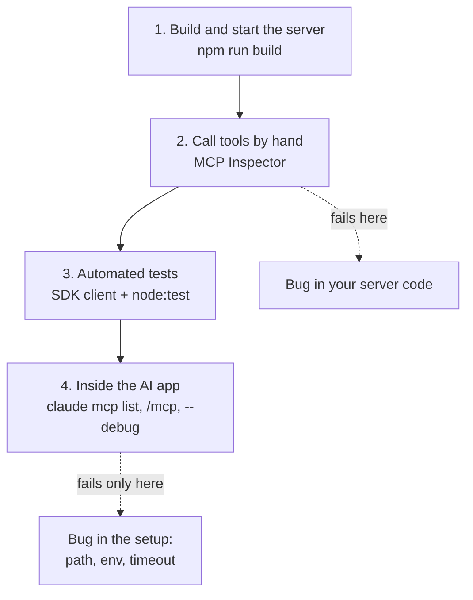

To test an MCP server, take the AI out of the loop first. Call your tools directly with the MCP Inspector, then turn those checks into automated tests with the SDK's own client. Only when both pass do you debug inside an AI app like Claude Code. That's where problems are hardest to see.

This post uses a small example server and shows each step with real output. If MCP itself is new to you, start with [What is MCP?](/blog/what-is-mcp).

## Where should I look first?

Test from the inside out. Each layer adds one thing that can go wrong, so when a layer fails, you know where the bug lives.



| Tool | Use it for | Needs an account? |
| --- | --- | --- |
| MCP Inspector, web UI | Exploring tools, reading every message | No |
| MCP Inspector, CLI | Quick checks and CI scripts | No |
| SDK client in a test | Tests that run on every change | No |
| Claude Code (`claude mcp list`, `/mcp`, `--debug`) | Problems that only happen in the app | Yes, for a session |

## What example server does this post use?

A local "project todos" server with two tools: `add_todo` adds a todo and `list_todos` lists them. It saves todos in a JSON file, which you can move with the `TODO_FILE` environment variable. It is the server from the first post in this series, [How to build your first MCP server](/blog/build-your-first-mcp-server).


<Steps>


<Step title="Create the project">

You need Node.js 22.19 or newer, because the MCP Inspector requires it.

```bash
$ mkdir project-todos
$ cd project-todos
$ npm init -y
$ mkdir src
$ npm pkg set type=module "bin.project-todos=./build/index.js" "scripts.build=tsc && chmod 755 build/index.js" "files[0]=build"
```

On Windows, use `"scripts.build=tsc"`, because `cmd.exe` has no `chmod`.


```bash
npm install @modelcontextprotocol/server zod
```


```bash
npm install -D @types/node typescript
```


</Step>


<Step title="Add the TypeScript config and the server">


**tsconfig.json**

```json
{
  "compilerOptions": {
    "target": "ES2022",
    "module": "Node16",
    "moduleResolution": "Node16",
    "types": ["node"],
    "outDir": "./build",
    "rootDir": "./src",
    "strict": true,
    "esModuleInterop": true,
    "skipLibCheck": true,
    "forceConsistentCasingInFileNames": true
  },
  "include": ["src/**/*"],
  "exclude": ["node_modules"]
}
```


**src/index.ts**

```ts
#!/usr/bin/env node
import { readFile, writeFile } from "node:fs/promises";
import { homedir } from "node:os";
import { join } from "node:path";
import { McpServer } from "@modelcontextprotocol/server";
import { StdioServerTransport } from "@modelcontextprotocol/server/stdio";
import { z } from "zod";

// Where the todos are saved. Set TODO_FILE to use another file.
const TODO_FILE = process.env.TODO_FILE ?? join(homedir(), ".project-todos.json");

type Todo = { id: number; text: string; done: boolean };

async function loadTodos(): Promise<Todo[]> {
  try {
    return JSON.parse(await readFile(TODO_FILE, "utf8"));
  } catch (error) {
    if ((error as NodeJS.ErrnoException).code === "ENOENT") return []; // no file yet
    throw error;
  }
}

async function saveTodos(todos: Todo[]): Promise<void> {
  await writeFile(TODO_FILE, JSON.stringify(todos, null, 2));
}

const server = new McpServer({ name: "project-todos", version: "1.0.0" });

server.registerTool(
  "add_todo",
  {
    description: "Add a todo to the project's todo list",
    inputSchema: z.object({
      text: z.string().min(1).describe("What needs to be done"),
    }),
  },
  async ({ text }) => {
    const todos = await loadTodos();
    const todo: Todo = { id: todos.length + 1, text, done: false };
    todos.push(todo);
    await saveTodos(todos);
    return { content: [{ type: "text", text: `Added todo #${todo.id}: ${text}` }] };
  },
);

server.registerTool(
  "list_todos",
  {
    description: "List all todos in the project's todo list",
  },
  async () => {
    const todos = await loadTodos();
    const text = todos.length
      ? todos.map((t) => `#${t.id} [${t.done ? "x" : " "}] ${t.text}`).join("\n")
      : "No todos yet.";
    return { content: [{ type: "text", text }] };
  },
);

async function main() {
  const transport = new StdioServerTransport();
  await server.connect(transport);
  // Log to stderr: stdout is reserved for MCP messages.
  console.error(`project-todos MCP server running on stdio (file: ${TODO_FILE})`);
}

main().catch((error) => {
  console.error("Fatal error:", error);
  process.exit(1);
});
```


</Step>


<Step title="Build it">

```bash
$ npm run build
```

</Step>


</Steps>


## How do I test with the MCP Inspector UI?

The [MCP Inspector](https://modelcontextprotocol.io/docs/tools/inspector) is the official test tool. It acts as the AI app: it starts your server, connects, and lets you call anything the server offers. Start the web UI with the command that runs your server:

```bash
$ npx @modelcontextprotocol/inspector node build/index.js
```

It prints a local URL with a one-time token. Open it and switch the server on. Then open **Tools**, pick a tool, fill in the form and select **Execute Tool**.


Three places matter when you debug:

- **The tool form** is built from your input schema. If a field is missing or has the wrong type here, the model sees the same wrong schema.
- **Protocol** is the list of JSON-RPC messages: every request, response and notification, with timings. If a call hangs, you see which request never got an answer.
- **Console** shows your server's stderr. Every `console.error` line lands here.


The log line above prints which file the server uses. One line like that at startup answers "is it reading the file I think it is?" before you start guessing.


<Callout type="warning" title="Keep the Inspector on your machine">

The web Inspector's backend starts processes and can hold sign-in tokens, and it protects itself with that one-time token. The [configuration docs](https://modelcontextprotocol.io/docs/tools/inspector/configuration) warn never to combine `DANGEROUSLY_OMIT_AUTH` and `DANGEROUSLY_BIND_ALL_INTERFACES`: anyone who can reach it could drive it. Leave both unset.

</Callout>


## How do I test with the Inspector CLI?

The CLI mode runs one request, prints the result and exits. That makes it good for quick checks and CI. The words right after `--cli` are the command that starts your server.

```bash
$ npx @modelcontextprotocol/inspector --cli node build/index.js --method tools/call --tool-name add_todo --tool-arg "text=Write the README"
```

```text
project-todos MCP server running on stdio (file: /home/you/.project-todos.json)
{
  "content": [
    {
      "type": "text",
      "text": "Added todo #1: Write the README"
    }
  ]
}
```

A few flags do most of the debugging work. They're listed in the [CLI docs](https://modelcontextprotocol.io/docs/tools/inspector/cli) and the [configuration docs](https://modelcontextprotocol.io/docs/tools/inspector/configuration):

| Flag | What it does |
| --- | --- |
| `--method tools/list` | Shows each tool's name, description and JSON Schema, exactly as the model sees them |
| `--tool-args-json '{"text":"x"}'` | Sends the arguments exactly as written, with no type conversion |
| `-e KEY=VALUE` | Sets an environment variable for the server (repeatable) |
| `--cwd <path>` | Starts the server in another folder |
| `--format json` | Prints one JSON object, easy to pipe into `jq` |

The CLI also exits with a code that says what went wrong: `0` success, `1` usage or unexpected error, `3` the server needs authentication, `4` the server can't be reached (including timeouts), and `5` the tool returned an error or doesn't exist. A CI step can fail the build on anything but `0`.

## How do I write automated tests?

Use the SDK's client in a normal test file. The client starts your real server as a child process, the same way an AI app does, so the test covers the build, the startup and the tools. The [SDK testing guide](https://github.com/modelcontextprotocol/typescript-sdk/blob/main/docs/testing.md) calls this covering stdio "by spawning the process". This uses Node's built-in test runner, `node:test`, so there's nothing else to install.


<Steps>


<Step title="Install the client">


```bash
npm install -D @modelcontextprotocol/client
```


`@modelcontextprotocol/client` is the SDK's package for MCP clients. It's a dev dependency: your server doesn't need it at runtime.

</Step>


<Step title="Write the tests">


**test/server.test.mjs**

```js
import { test, before, after } from "node:test";
import assert from "node:assert/strict";
import { mkdtemp, rm } from "node:fs/promises";
import { tmpdir } from "node:os";
import { join } from "node:path";
import { Client } from "@modelcontextprotocol/client";
import { StdioClientTransport } from "@modelcontextprotocol/client/stdio";

let client;
let dir;

before(async () => {
  // Use a fresh, empty todo file for every test run.
  dir = await mkdtemp(join(tmpdir(), "todos-"));
  const transport = new StdioClientTransport({
    command: "node",
    args: ["build/index.js"],
    env: { TODO_FILE: join(dir, "todos.json") },
    stderr: "ignore",
  });
  client = new Client({ name: "test-client", version: "1.0.0" });
  await client.connect(transport);
});

after(async () => {
  await client.close();
  await rm(dir, { recursive: true, force: true });
});

test("lists both tools", async () => {
  const { tools } = await client.listTools();
  assert.deepEqual(tools.map((t) => t.name).sort(), ["add_todo", "list_todos"]);
});

test("adds a todo and lists it", async () => {
  const added = await client.callTool({ name: "add_todo", arguments: { text: "Write the README" } });
  assert.equal(added.content[0].text, "Added todo #1: Write the README");

  const listed = await client.callTool({ name: "list_todos", arguments: {} });
  assert.equal(listed.content[0].text, "#1 [ ] Write the README");
});

test("rejects an empty todo", async () => {
  const result = await client.callTool({ name: "add_todo", arguments: { text: "" } });
  assert.equal(result.isError, true);
});
```


- `StdioClientTransport` starts `node build/index.js` and talks to it over stdin and stdout.
- `env` gives each run a fresh todo file in a temporary folder, so tests never touch your real todos.
- `stderr: "ignore"` hides the server's startup log from the test output.
- A tool that fails doesn't throw. The result comes back with `isError: true`, so you assert on that.

</Step>


<Step title="Add a test script and run it">

```bash
$ npm pkg set "scripts.test=npm run build && node --test --test-reporter=spec"
$ npm test
```

```text
✔ lists both tools (184.066633ms)
✔ adds a todo and lists it (9.569714ms)
✔ rejects an empty todo (1.792799ms)
ℹ tests 3
ℹ suites 0
ℹ pass 3
ℹ fail 0
ℹ cancelled 0
ℹ skipped 0
ℹ todo 0
ℹ duration_ms 432.158821
```

`npm test` builds first, so you always test the latest code. `node --test` finds files named `*.test.mjs` by itself ([Node.js docs](https://nodejs.org/docs/latest-v22.x/api/test.html)).

</Step>


</Steps>


## What are the most common problems?

Five causes cover most "it works on my machine" MCP bugs.

| Symptom | Likely cause |
| --- | --- |
| JSON parse errors, or the client drops the connection | Something writes to stdout |
| Works in your terminal, fails in the app | Relative path, or the app starts the server from another folder |
| The server uses a default instead of your setting | Environment variable not passed to the server |
| `Input validation error` from a tool | Arguments don't match the input schema |
| `Connection timed out`, or the server shows as pending | Slow startup or a slow tool |

### Logging to stdout breaks the protocol

A stdio server's stdout carries the MCP messages. The [stdio spec](https://modelcontextprotocol.io/specification/2026-07-28/basic/transports/stdio) says the server must not write anything else there. Log with `console.error`, never `console.log`. A library that prints to stdout causes the same problem.

Some clients skip a stray line and others fail with an error like `SyntaxError: Unexpected token ... is not valid JSON`, according to the [SDK troubleshooting page](https://github.com/modelcontextprotocol/typescript-sdk/blob/main/docs/troubleshooting.md). Our own test was a warning: the Inspector and the SDK client both skipped the stray line, so the bug stayed hidden. Don't rely on your test client to catch it. Check stdout directly. With stdin closed and stderr hidden, a clean server prints nothing:

```bash
$ node build/index.js < /dev/null 2>/dev/null
```

When we changed the startup log to `console.log`, the same command printed the log line. That line would have reached every client as a broken message.

### Wrong paths

An AI app doesn't start your server from your project folder. The [MCP debugging guide](https://modelcontextprotocol.io/docs/tools/debugging) says the working directory may be undefined, even `/` on macOS, and recommends absolute paths. The [Claude Code docs](https://code.claude.com/docs/en/debug-your-config) add that relative paths in a server's command resolve against the folder you started Claude Code from.

- Use an absolute path in the command: `node /home/you/project-todos/build/index.js`, not `node build/index.js`.
- Inside the server, build file paths from something stable. Our server uses the home folder. Claude Code also sets `CLAUDE_PROJECT_DIR` in a stdio server's environment to the project root ([docs](https://code.claude.com/docs/en/mcp)).
- To reproduce the problem in the Inspector, start the server from another folder with `--cwd`.

### Missing environment variables

A stdio server gets only a limited set of environment variables by default. The exact set depends on the platform, per the [debugging guide](https://modelcontextprotocol.io/docs/tools/debugging). We saw this ourselves: with `TODO_FILE` exported in the shell, the server started by the Inspector still used the default file. Passing the variable to the server fixed it:

```bash
$ npx @modelcontextprotocol/inspector --cli node build/index.js -e TODO_FILE=/tmp/work-todos.json --method tools/call --tool-name list_todos
```

```text
project-todos MCP server running on stdio (file: /tmp/work-todos.json)
{
  "content": [
    {
      "type": "text",
      "text": "No todos yet."
    }
  ]
}
```

Pass variables the same way everywhere: `-e` in the Inspector, `env` in the test's transport, `--env` in `claude mcp add`, and the `env` key in JSON config files.

### Schema mismatches

The SDK checks every call against the tool's input schema before your handler runs. A bad call comes back as a tool error, not a crash. Here `text` is empty, but the schema says at least one character:

```bash
$ npx @modelcontextprotocol/inspector --cli node build/index.js --method tools/call --tool-name add_todo --tool-args-json '{"text":""}'
```

```text
project-todos MCP server running on stdio (file: /home/you/.project-todos.json)
{
  "content": [
    {
      "type": "text",
      "text": "Input validation error: Invalid arguments for tool add_todo: text: Too small: expected string to have >=1 characters"
    }
  ],
  "isError": true
}
{"error":{"code":"tool_is_error","message":"Tool 'add_todo' returned isError:true."}}
```

The CLI exits with code `5`. If the model keeps sending the wrong arguments, fix the schema's descriptions, not the model: run `--method tools/list` and read the schema as if you were the model. Add `.describe()` to each field and say what a good value looks like.

### Timeouts

Two things are slow: starting the server and running a tool.

- **Startup.** `npx -y some-package` can take a while on the first run, because it downloads the package. The Inspector CLI gave up on a server that never answered with `Connection timed out after 15000 ms`. Raise it with `--connect-timeout`. In Claude Code, the `MCP_TIMEOUT` environment variable sets the startup timeout in milliseconds, for example `MCP_TIMEOUT=10000 claude` ([docs](https://code.claude.com/docs/en/mcp)). The [CLI reference](https://code.claude.com/docs/en/cli-reference) gives 30 seconds as the default.
- **Tool calls.** In Claude Code, a stdio tool call that sends no response and no progress for 30 minutes is stopped. A per-server `timeout` in `.mcp.json` sets a hard limit per call in milliseconds. A slow tool is usually a slow API behind it, so time it in your tests too.

## How do I debug the server inside Claude Code?

Start from the terminal, outside a session. The commands are in the [Claude Code MCP docs](https://code.claude.com/docs/en/mcp):

```bash
$ claude mcp list
```

```text
Checking MCP server health…

project-todos: node /home/you/project-todos/build/index.js - ✔ Connected
todos-typo: node /home/you/project-todos/biuld/index.js - ✘ Failed to connect — CONNECTION_CLOSED: Connection closed
```

The second server has a typo in its path, so Node exits at once and Claude Code sees the connection close. `claude mcp get <name>` shows one server in detail, with the failure on an `Issue:` line.

Inside a session:

- **`/mcp`** lists every server with its status and tool count. Select a server to reconnect it after you rebuild, or to turn it off.
- **Zero tools but connected?** The [debug guide](https://code.claude.com/docs/en/debug-your-config) says to reconnect first. If the count stays at zero, start Claude Code with `claude --debug=mcp` and read the server's stderr in the debug log at `~/.claude/debug/<session-id>.txt`.
- **`claude --debug-file /tmp/claude-debug.log`** writes the debug log to a file you choose.
- **`/debug`** turns on debug logging for the current session and asks Claude to diagnose the problem from the log.

Your `console.error` lines are what make that log useful. Log the settings you resolved at startup, and log each tool call's input and error.

## What should I do next?

- **Add the test script to CI**, so every pull request starts the server and calls its tools.
- **Add one test per bug you fix.** The next time someone breaks the schema, the test fails before a model does.
- **Read the [MCP debugging guide](https://modelcontextprotocol.io/docs/tools/debugging)** for Claude Desktop's log files and more client-side tools.
- **Next in this series:** [How to publish your MCP server and use it in AI tools](/blog/publish-mcp-server) puts your server on npm and the MCP Registry, so anyone can install it with one command.
