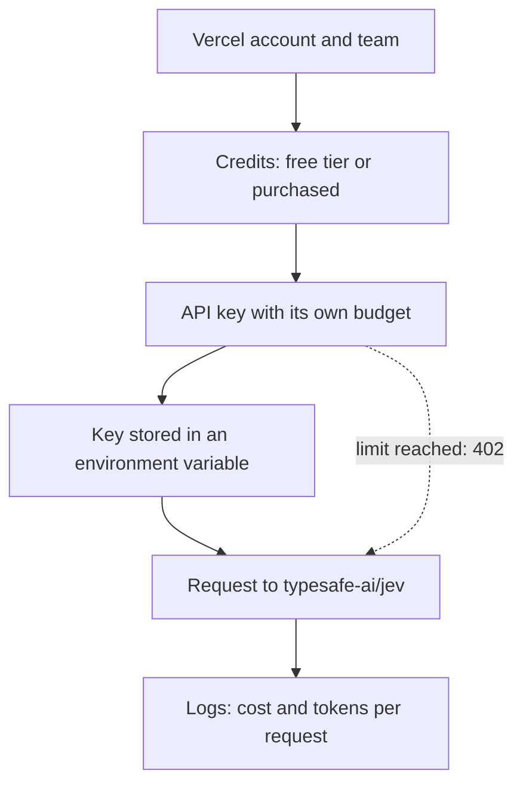

To test Jev, you need a Vercel account, an AI Gateway API key and credits. Every Vercel team gets a monthly free credit, but it only covers some models, and on 28 September 2026 Jev was not one of them. So the safe path is: buy a small amount of credits, create a key with its own spending limit, and make one cheap request.

The good news is that Jev is inexpensive to try. It costs $0.042 per million input tokens and nothing for output, so a few dollars go a long way. This guide shows the setup, what it costs, and the limits that stop a test from turning into a bill.

The earlier parts of this series explain [what Jev is](/blog/what-is-jev) and [how a decision model differs from an LLM](/blog/jev-vs-llms). Here you only need one idea: you send Jev some text (the "state") and typed questions, and it returns structured answers such as a probability.

## What do I get for free on Vercel AI Gateway?

[Vercel AI Gateway](https://vercel.com/docs/ai-gateway/getting-started) is one API endpoint that gives you access to models from many providers, with one key and one bill. Its pricing has two tiers.

| | Free tier | Paid tier |
| --- | --- | --- |
| Credit | A monthly included credit | AI Gateway Credits you buy |
| Models | A subset of the catalog | All available models |
| Rate limits | Lower limit per model | None from AI Gateway; provider limits still apply |
| Price per token | Provider list price, no markup | Provider list price, no markup |

A few rules from Vercel's [pricing page](https://vercel.com/docs/ai-gateway/pricing) and [FAQ](https://vercel.com/docs/ai-gateway/faq) are worth knowing before you start:

- **It is not a trial.** The free tier is a monthly included credit, not a trial that runs out.
- **It starts with your first request.** Your free credits start when you make your first AI Gateway request.
- **You may need a card anyway.** To use free credits, Vercel asks you to add a valid payment method to your team. Without one, requests fail with `403` and the type `customer_verification_required`.
- **Buying credits ends the free credit.** Once you purchase credits, your team moves to the paid tier and the monthly free credit no longer applies.
- **Purchased credits expire** one year after purchase.
- **No markup.** You pay the provider's list price per token. You're responsible for any payment processing fees.

How much is the monthly free credit? Vercel's docs don't state a number, so this post doesn't either. You can see your current balance in the upper right corner of the **AI Gateway** page in the Vercel dashboard.

## Is Jev in the free tier?

No, not on 28 September 2026. I checked two places that day:

- The [Free Tier model filter](https://vercel.com/ai-gateway/models?freeTier=true) did not include Jev. The page's own model data marks `typesafe-ai/jev` as not available to the free tier.
- The [Jev model page](https://vercel.com/ai-gateway/models/jev) shows the price, but no free-tier label.

Vercel's FAQ says what happens if you try anyway: a `403` whose message names the free tier means "the model is not in the free-tier subset and requires purchased credits".

Free-tier lists change, so check the Free Tier filter yourself before you decide. If Jev is not there, you have two options:

1. **Use the free credit for other models.** Pick any model from the Free Tier filter and learn the Gateway basics at no cost.
2. **Buy a small amount of credits to test Jev.** Remember that this moves your team to the paid tier, and the monthly free credit stops for that team.

## How much does testing Jev cost?

Jev's price on [its model page](https://vercel.com/ai-gateway/models/jev) is $0.042 per million input tokens. [Vercel's Jev guide](https://vercel.com/kb/guide/typesafe-jev-and-ai-sdk) adds that there is no output token charge. A token is a small piece of text, often part of a word; [What is an LLM?](/blog/what-is-an-llm) explains tokens in more detail.

Vercel's [evaluation docs](https://vercel.com/docs/ai-gateway/modalities/evaluation) show one example request: 275 input tokens, reported cost `0.00001155` dollars. That matches the price: 275 × $0.042 ÷ 1,000,000 = $0.00001155.

| You spend | Input tokens it buys | Requests the size of the docs example |
| --- | --- | --- |
| $1 | about 23.8 million | about 86,000 |
| $5 | about 119 million | about 433,000 |

This is simple arithmetic at the list price, before any payment processing fees. Your real cost depends on how much text you send. Two things can raise it:

- **Evaluation fallbacks.** If you configure a fallback model for uncertain answers, both calls are billed.
- **Price changes.** Check the model page before you plan a budget.

For the bigger picture on token pricing, see [AI cost and latency](/blog/ai-cost-and-latency).

## How does the setup fit together?



The key is the important part. Everything that uses it is capped by its budget, so a runaway loop stops at your limit instead of at your card's.

## Try it: make your first Jev request

**You need:** Node.js 22 or later, a terminal, and a Vercel account with a payment method on the team.


<Steps>


<Step title="Sign in and open AI Gateway">

[Create a Vercel account](https://vercel.com/signup) or sign in. In the dashboard, open **AI Gateway** in your team's sidebar. Your credit balance shows in the upper right corner.

</Step>


<Step title="Add credits if you want Jev">

If Jev is not in the Free Tier filter, add credits: click the button that shows your balance, choose an amount, click **Continue to Payment**, then **Confirm and Pay**.

Leave **auto top-up** off while you test. It's disabled by default, and when on, it charges your payment method automatically whenever the balance drops below a threshold.

</Step>


<Step title="Create an API key with a budget">

Create a key that exists only for this test, so you can cap it and delete it later.


**Dashboard**

On the **API Keys** page of AI Gateway, click **Create key**. Give it a name like `jev-test`, turn on the budget option, enter a small limit such as `5` dollars, and pick a refresh period. Copy the key value right away: you can't see it again.


**Vercel CLI**

```bash
$ npx vercel@latest login
$ npx vercel@latest ai-gateway api-keys create --name jev-test --limit 5 --refresh-period none --expiration 30d
```

- `--limit 5` caps this key at $5. The minimum is $1.
- `--refresh-period none` means the limit never resets: $5 in total, not per month.
- `--expiration 30d` makes the key stop working after 30 days.

The command prints the key once. Copy it right away.


</Step>


<Step title="Store the key in an environment variable">

Create a `.env` file in an empty folder and keep it out of git:


**.env**

```bash
AI_GATEWAY_API_KEY=your_ai_gateway_api_key
```


```bash
$ echo ".env" >> .gitignore
```

Replace `your_ai_gateway_api_key` with your key. Never paste the key into a chat, an issue or your code. [Never paste secrets into AI prompts](/blog/secrets-in-ai-prompts) explains why and what to do if a key leaks.

</Step>


<Step title="Install the AI SDK">

Jev uses the AI SDK's experimental `evaluate` API, which needs AI SDK 7.0.105 or later.


```bash
npm install ai@latest
```


</Step>


<Step title="Send one request">

This asks Jev one yes/no question about a sentence. It is the example from Vercel's [evaluation quickstart](https://vercel.com/docs/ai-gateway/getting-started/evaluation), plus one line that prints token usage.


**evaluate.mjs**

```js
import { experimental_evaluate as evaluate } from 'ai';

const result = await evaluate({
  model: 'typesafe-ai/jev',
  state: 'The support agent issued a full refund to the customer.',
  questions: {
    refunded: {
      type: 'boolean',
      instructions: 'Was a refund issued?',
    },
  },
});

console.log(JSON.stringify(result.answers, null, 2));
console.log(result.usage);
```


```bash
$ node --env-file=.env evaluate.mjs
```

`--env-file` loads the key from `.env` for this one run. Vercel's docs show this shape for the answer; the probability can vary:

```json
{
  "refunded": {
    "type": "boolean",
    "probability": 0.99
  }
}
```

If you prefer plain HTTP, the same request goes to `https://ai-gateway.vercel.sh/v1/evaluate` with the key in an `Authorization: Bearer` header. The [HTTP API section](https://vercel.com/docs/ai-gateway/modalities/evaluation#http-api) has the full `curl` command.

</Step>


<Step title="Check the cost in Logs">

Open **Logs** in the AI Gateway sidebar and select the newest request. It shows the status, model, provider, token usage, cost and duration. Logs can take up to 90 seconds to appear, so refresh if you don't see it yet.

</Step>


</Steps>


## How do I set budgets so a test can't run up a bill?

A [budget](https://vercel.com/docs/ai-gateway/observability-and-spend/budgets) caps how much can be spent in a period. You can set one at four levels, and they stack: a request must pass every budget that applies to it.

| Budget | What it caps | Good for |
| --- | --- | --- |
| Team | Everything your team spends | A hard ceiling for all tests |
| Project | Requests from one project's deployments, using their OIDC tokens | Apps deployed on Vercel |
| API key | Everything one key spends | A single experiment, a contractor or a CI job |
| User | One team member's keys | Letting teammates experiment |

For a test, set two: a **team budget** as your overall ceiling (in the dashboard under **AI Gateway**, **Budgets**, then the **Team** tab), and an **API key budget** on the test key. Each budget has a refresh period: `daily`, `weekly`, `monthly` or `none`. You can also turn on email alerts at 50%, 75% and 100% of the limit.

When a budget runs out, AI Gateway rejects further requests with HTTP `402` and the type `quota_for_entity_exceeded`, until the budget resets or you raise it.


<Callout type="warning" title="A budget is a soft cap">

AI Gateway checks budgets at the start of each request, so the request that crosses the limit still completes and total spend can end up slightly over. A new key's budget can also take a minute or two before it counts requests. Set limits a little below what you are willing to lose, and wait a couple of minutes before you start a loop.

</Callout>


Budgets limit spending; they don't give you money to spend. The team still needs credits or the free credit to make requests.

## What about apps deployed on Vercel?

On Vercel deployments you can skip the API key: the AI SDK uses the project's [OIDC token](https://vercel.com/docs/ai-gateway/authentication-and-byok/oidc) automatically when `AI_GATEWAY_API_KEY` isn't set, and a project budget caps that spend.

## What errors might I see?

If you run the script with no key at all, the AI SDK stops with an authentication error. This is what it printed when I ran it without a key (trimmed):

```text
_GatewayAuthenticationError: AI Gateway authentication failed: No authentication provided.
```

Vercel's [FAQ](https://vercel.com/docs/ai-gateway/faq) lists what each status means:

| Status | Cause | Fix |
| --- | --- | --- |
| `401` | The key is missing, invalid or revoked | Check `AI_GATEWAY_API_KEY` is set in this terminal |
| `402` | No credit left, or a budget reached its limit (`quota_for_entity_exceeded`) | Add credits, or wait for the budget to reset or raise it |
| `403` `customer_verification_required` | No valid payment method on the team | Add one from the link in the error |
| `403` naming the free tier | The model, such as Jev today, needs purchased credits | Pick a free-tier model or buy credits |
| `429` | A rate limit, lower on the free tier | Wait and retry; the AI SDK retries automatically |

## What should I do next?

- **Check the [Free Tier filter](https://vercel.com/ai-gateway/models?freeTier=true)** today, then decide: free credit for other models, or a few dollars for Jev.
- **Create a `jev-test` key with a $5 budget and a 30-day expiry**, and run `evaluate.mjs` once. Then try the ticket router from [Build your first Jev app](/blog/build-your-first-jev-app).
- **Try choice and score questions** from the [evaluation docs](https://vercel.com/docs/ai-gateway/modalities/evaluation#question-types) with the same key.
- **Plan real costs** with [AI cost and latency](/blog/ai-cost-and-latency) before you move from a test to production traffic.
